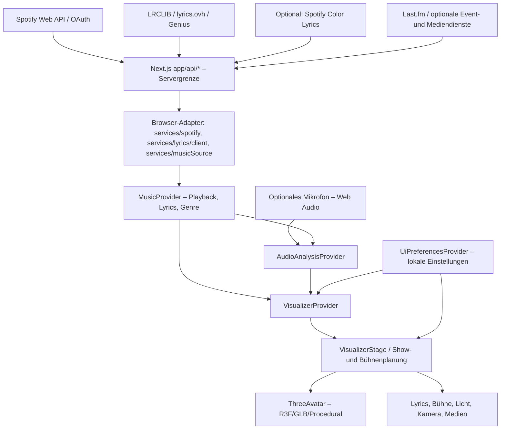
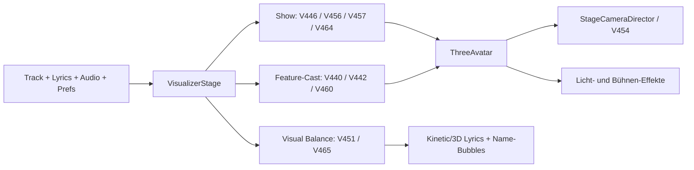

## V1136 – Update: Tanzdialoge mit gemeinsamem Motiv

Die lokale Regie plant Motiv, Antwort und gemeinsame Rückkehr. Ein anderer
Avatar übernimmt den zuvor vorgestellten Clip, während die Crew den Kontrast
begleitet. Der Ablauf bleibt nach Seeks reproduzierbar; Lyrics und wichtige
Songabschnitte behalten Vorrang. Details und Tests:
[Tanzdialoge](docs/versions/V1136-TANZDIALOGE.md).

## V1136 – Update: Kreativere Crew-Regie

Die lokale Regie entwickelt nach dem persönlichen Auftakt abwechslungsreiche
Ganzkörper-Motive aus Genre, Energie und Bewegungs-Kontrasten. Gemischte Crews
bleiben bei gemeinsamen Hits synchron; spätere Refrains wechseln die Richtung
der Antwortwelle. Details, Grenzen und Tests:
[Kreative Regie](docs/versions/V1136-KREATIVE-REGIE.md).

## V1136 – Update: Weicher Refrain-Aufbau

Die Crew bereitet den kommenden Refrain-Solisten bereits im Aufbau vor. Licht,
Bewegung und automatische Kamerakomposition steigen weich an. Eine gemeinsame
Lyrics-Zeitleiste reduziert wiederholte Arbeit bei langen Songs und erkennt
Textlücken eindeutig. Details, Grenzen und Tests:
[Refrain-Aufbau](docs/versions/V1136-REFRAIN-AUFBAU.md).

## V1136 – Quellengebundene Kameraanker und explizite Vorschau-Seeks

**Aktueller Dokumentationsstand: V1136.** Details: [V1136-SHOW-KONTINUITAET.md](docs/versions/V1136-SHOW-KONTINUITAET.md).

`showContinuityV1136.ts` trennt fortlaufende Positionsupdates, deutliche Sprünge und pausiertes Scrubbing. Der bestehende Concert Score trägt Track-/Quellenkennung und Position. Die Visualizer-Anbindung reicht Track-ID und bestätigte Provider-Probe aus dem vorhandenen Music-Context ausdrücklich an die Szene weiter; der gemeinsame Story-Hook benötigt dafür kein zusätzliches Context-Abonnement im Canvas. Die Kamera-Komposition wertet bestätigte Provider-Proben aus und verwendet nur ohne diese Songfortschritt und monotone Renderzeit. Sie setzt die Fallback-Zeitreferenz bei Pause/Wiederaufnahme zurück und verwirft veraltete Leseanker bei einer neuen Quelle oder einem deutlichen Sprung, übernimmt den neu komponierten Zielausschnitt und behält die vorhandene Glättung bei. Manuelle/gespeicherte Kameras und Reduced Motion bleiben vorrangig.

Die Probe wertet eine Pose auch ohne laufende Wiedergabe aus, wenn die Position geändert wurde. Solche Auswertungen beenden alte Snapshot-Übergänge; normale Clipwechsel starten dagegen aus der tatsächlich dargestellten Pose. Der Preview-Player verwirft nicht endliche Update-/Seek-Zeiten und prüft eine neue Clipdauer vor dem Stoppen der aktuellen Aktion. Private Übergangsclips und Aktionen werden weiterhin freigegeben.

Neue Prüfungen: `tests/v1136-show-continuity.cjs`, `tests/v1136-preview-resilience.mjs` und `tests/e2e/show-continuity-v1136.spec.cjs`. Die Tests erfassen tatsächliche GLB-Weltpositionen, pausierte Zielzeiten und reale Kamera-Statusposen. Die bestehende Statusmeldung erhält Quellenkennung und Haltemodus; zusätzliche Netzwerkabfragen, Timer oder Kamera-Schreiber entstehen nicht. Dokumentation liegt unter `docs/versions/`; generierte Playwright-Berichte bleiben vom ZIP ausgeschlossen.

## V1135 – Bodenkontakt und gedämpfte Bühnenreaktionen

**Historischer Dokumentationsstand: V1135.** Details und Grenzen: [docs/versions/V1135-BUEHNENPRAESENZ.md](docs/versions/V1135-BUEHNENPRAESENZ.md).

`stagePresenceV1135.ts` gleicht die verifizierte Sohlenhöhe der eingebauten GLBs mit dem sichtbaren Bühnenboden ab. Eine konstante äußere Platzierung berücksichtigt die Avatargröße; der bestehende Mixer bleibt im unveränderten Modellraum. Automatische Crew-Clips erhalten keinen weiteren Root-Bounce oder Root-Yaw. Manuelle Quellen, externe Modelle und explizite Avatar-Offsets verhindern die automatische Platzierung.

`SonicFootContactV1135` zeichnet zwei analytische Kontaktflächen aus den tatsächlichen Fuß-Bone-Positionen. Höhe verändert Breite und Deckkraft; angehobene Gruppenpositionen verschieben den Live-Schatten nicht vom Weltboden weg. Es entstehen zwei einfache Draw Calls pro Figur, keine Shadow-Maps oder Texturen. Die Bühne und Probe verwenden weiterhin ihre vorhandenen Canvas-/Renderloops.

`performerDynamicsV1135.ts` berechnet kleine Vorbereitungs-/Rückbewegungen aus der bestehenden Beat-Uhr. Eine analytische kritisch gedämpfte Feder ersetzt bei Persönlichkeits-Overlays die einfache Rotationseinfahrt. Die vorhandene Besitzprüfung stellt nur noch eigene, unverändert anliegende Werte zurück. Brust, Kopf und Arme werden ergänzt; Standfüße und Becken bleiben unverändert. Pause und fremde Pose-Schreiber behalten die Kontrolle.

Der bestehende Concert Score staffelt den Kameraausschnitt über Refrains/Finale. Die vorhandene Lichtkomposition erhält begrenzte Haupt-/Fülllichtfaktoren, geschützt durch manuelle, Blackout-, Vocal- und Reduced-Motion-Regeln. Es gibt keinen zweiten Kamera-Schreiber und keine neuen Hardwarebefehle.

Neue Prüfungen: `tests/v1135-stage-presence.cjs`, `tests/v1135-stage-contact.mjs`, `tests/e2e/stage-presence-v1135.spec.cjs`. Die realen Skinned-Mesh-Sohlen werden bei drei Größen gegen den sichtbaren Boden geprüft. Die Probe publiziert ihren tatsächlichen Sohlenabstand in den bestehenden Clip-Zeilen, damit die Browserprüfung echte 3D-Wiedergabe abdeckt.

## V1134 – Gemeinsamer Score für Song, Crew und Text

**Historischer Dokumentationsstand: V1134.** Bedienung, Stress-Tests und Grenzen: [V1134-SONGREGIE-CREW.md](docs/versions/V1134-SONGREGIE-CREW.md).

`lib/concertScoreV1134.ts` erweitert die V1131-Story um Auftakt, Refrain-Vorschau, Lesepassagen, Rollenrotation und begrenzte Lichtakzente. Das bestehende `useConcertStoryV1131` liefert diesen erweiterten Score an Kamera, Bühne, Lyrics und Probenbeleuchtung. Der Live-Regieindikator und `sonicCrewDirector` verwenden dieselbe reine Planung. Rollen und Phrasen sind aus festen Songzeitblöcken rekonstruierbar und springen nicht bei BPM-Updates. Die tatsächlich abgespielte Tanzuhr integriert weiterhin geglättete BPM und weiche Phasenkorrekturen.

`composeScoreCameraV1134` ergänzt die letzte automatische Komposition vor der bestehenden Glättung. Lesepassagen und Pausen halten eine gespeicherte Kamerapose einschließlich Blickziel. Manuelle, gespeicherte und Timeline-Kameras sowie Reduced Motion bleiben vorrangig. Virtuelle Licht- und Strahlengains berücksichtigen denselben Score; Blackout und manuelle Beleuchtung bleiben geschützt. Es gibt keine zusätzlichen Renderloops, Netzwerkanfragen oder Hardwarebefehle.

`lib/lyricTimingV1134.ts` validiert den Lyrics-Provider-Payload im Client-Adapter vor der Nutzung. Geprüft werden Zeilenstart, Sortierung, Duplikate, Überlappung, Songdauer und Wortzeiten. Bei beschädigten Wortdaten wird die ganze Wortzeitliste einer Zeile entfernt; lesbarer Text bleibt erhalten. Ungültige Zeilenenden werden auf ein begrenztes Lesefenster beschränkt. Formal plausible, inhaltlich falsch versetzte Zeiten bleiben eine bekannte Grenze.

Die Pause lässt den letzten gültigen Crew-State erhalten; ein Trackwechsel oder Seek löst beim nächsten aktiven Plan weiterhin einen Reset aus. Tänze verwenden ausschließlich geladene Clips. Gegenseitige Partnerblicke und relative Antwortphasen ergänzen die vorhandenen geglätteten Persönlichkeits-Overlays.

Tests: `tests/v1134-concert-score.cjs`, `tests/fixtures/concertStressV1134.cjs` und `tests/e2e/concert-score-v1134.spec.cjs`. Die bestehenden Regressionsprüfungen bleiben enthalten; die Fußarbeits-Variantenprüfung zählt zusätzlich die tatsächlich eingesetzten Ganzkörper-Schritte. Der Persönlichkeitstest prüft die energischen Folgen gezielt in der Strophe nach dem ruhigen Auftakt. Archivierung schließt weiterhin sämtliche generierten Playwright-Berichte und Testergebnisordner aus.

## V1133 – Ganzkörper- und Text-Prioritäts-Pipeline

**Historischer Dokumentationsstand: V1133.** Ausführliche Bedienung und Herkunft: [V1133-GANZKOERPER-LYRICS.md](docs/versions/V1133-GANZKOERPER-LYRICS.md).

### Bewegung und Persönlichkeiten

`scripts/sonic_stage_motion.py` erzeugt sechs zusätzliche zyklische Ganzkörper-Clips pro Figur. Beckenposition und -rotation werden vor der analytischen Zweiknochen-IK berechnet; die Zielpunkte der Standfüße bleiben unverändert. Der jeweils schwingende Fuß erhält einen stilabhängigen Seiten-/Diagonal-/Vorwärtsweg. Pivot-/Drehphrasen dürfen um die senkrechte Achse drehen, die Sohlen dürfen dabei nicht kippen. `scripts/generate-sonic-avatars.py -- --ensemble` exportiert alle elf GLBs und aktualisiert Dateigrößen/Hashes im Manifest. Die neue Bibliothek umfasst 306 Clips (22/28/32 pro ursprünglicher/Encore/Headliner-Figur). Es werden keine Motion-Capture- oder Fremd-Lizenzansprüche erhoben.

`lib/fullBodyPerformanceV1133.ts` wählt vorhandene Ganzkörper-Clips nach Figur, Genre und gemeinsamem Song-Cue. Die Auswahl ist eine zusätzliche Stufe im bestehenden `sonicCrewDirector.ts`; Ruhe, Aufbau, dichte Lyrics, Antwortgruppen, manuelle Priorität und Verfügbarkeit bleiben berücksichtigt. Gemeinsame Höhepunkte verwenden eine kompatible gemeinsame Bewegung. Die kleinen geglätteten Ausdrucks-Overlays aus V1132 bleiben unabhängig von den gebackenen Bein-/Beckenbewegungen.

### Lyrics, Kamera und Effekte

`lib/lyricSpotlightV1133.ts` ist ein reiner Planner. Aus bestehenden synchronisierten Zeilen berechnet er die Lesedichte und die Darstellungsart `verse`, `anthem` oder `rap`. Wortcursor und Schlüsselwort setzen tatsächliche Wortzeitmarken voraus; ohne diese bleiben ihre Indizes bei -1. Wiederkehrende Zeilen liefern weiterhin nur einen Refrain-Hinweis, keine Audioanalyse.

`KineticLyrics.tsx` verwendet die Richtung für Textlayout und semantische Wortmarker. Das CSS hält priorisierte Lyrics im sichtbaren Bereich oberhalb des Players; auf breiten Ansichten teilen sich Bühne und Text den Raum. `Lyrics3DScene.tsx` bevorzugt bei hoher Dichte eine vollständige Zeile und reduziert zusätzliche Textbewegung. Die beiden bestehenden Kameratreiber erweitern ihre vorhandenen Schutzbedingungen um die Text-Priorität. `DynamicStage.tsx` dimmt zusätzliche automatische Licht-/Strahlintensität, ohne manuelle Lichtsteuerung zu ersetzen. Es gibt keinen zusätzlichen Kamera- oder Render-Schreiber.

### Verifikation und Ausgabe

`tests/v1133-body-kinematics.mjs` prüft an realen Rigs sechs unterschiedliche Becken-/Fußtrajektorien, mindestens 7,5 cm seitliche Gewichtsverlagerung, sichtbare Kniekompression, Beckenrotation und feste Standfüße. Bestehende Skin-/Loop-/Bodenkontaktprüfungen bleiben aktiv. `tests/v1133-lyrics-body-policy.cjs` prüft tatsächliche Wortzeiten, Rap-Dichte, Figurenstile und Kameraschutz. Die neuen Browser-Tests verwenden die vorhandenen Spotify-/Lyrics-Mocks sowie einen kontrollierten schnellen Testtext.

Das ZIP enthält Quellcode und Testkonfigurationen. Generierte Reports, Playwright-Testberichte, Traces, Screenshots/Videos und Playwright-bezogene Testergebnis-Artefakte werden bei der Archivierung ausgeschlossen. Detaillierte Versionsdokumentation befindet sich unter `docs/versions/`; README und ARCHITECTURE bleiben im Projektstamm.

## V1132 – Expressive Performance

Elf individuelle Ausdrucksprofile, gespeicherte Ausdrucksstärke, genreabhängige Phrasenfolgen und kontinuierliche Phasenkorrektur für gemeinsame Tänze. Anleitung und Prüfungen: [LIESMICH-V1132.md](docs/versions/LIESMICH-V1132.md).

## V1131 – Concert Story & Crew

Gemeinsame Song-Dramaturgie für Tanz, Kamera, Licht und Lyrics; steigende Refrains, Crew-Dialoge, Tanzduelle und vier neue gebackene Fußarbeits-Clips für alle elf Figuren. Anleitung und Prüfungen: [LIESMICH-V1131.md](docs/versions/LIESMICH-V1131.md).

## V1130 – Intelligent Headliner Show

Vier weitere Original-GLB-Avatare (insgesamt elf), je 22 Headliner-Clips, lokale Genre-/Energie-Bewertung mit Bewegungs-Gedächtnis, lyricsabhängige Dramaturgie und zusätzliche Live-Show-Inszenierung. Vollständige Spotify-/Lyrics-Browser-Mocks für reproduzierbare Tests. Anleitung: [LIESMICH-V1130.md](docs/versions/LIESMICH-V1130.md).

## V1129 – Encore Music Performance

Vier neue echte GLB-Avatare mit jeweils 18 Animationen, Genre-Move-Variation über musikalische Phrasen und zusätzliche genreabhängige Lyrics-Einblendungen in DOM und 3D. Die lokale Musikregie nutzt vorhandene Songdaten ohne externen KI-Dienst. Anleitung und Grenzen: [LIESMICH-V1129.md](docs/versions/LIESMICH-V1129.md). Prüfung: `npm run test:v1129` und `npm run typecheck`.

## V1128 · Adaptive Concert Performance 2.0

`lib/adaptiveConcertPerformanceV1128.ts` reduziert auf Basis der **bereits gemessenen**
R3F-FPS-/P95-Fenster in `components/visualizer/adaptivePerformance.tsx` nur optionale
Effekt-Aktualisierungsfrequenzen. Nach drei belasteten Fenstern wird die Qualitätsstufe
schrittweise gesenkt, nach sieben stabilen Fenstern schrittweise wieder erhöht; acht
Sekunden Haltezeit verhindern Hin-und-Her. Pausen, verborgene Tabs, manuelle Qualität,
Szenenübergänge und fehlerhafte Messungen lösen keine Drosselung aus.

Die bestehende Hardware-, DPR-, Geräte-, V640- und V999-Steuerung bleibt autonom;
V1128 wirkt nur auf Render-Ticks der **vorhandenen** `ArenaAudienceV1032`,
`ArenaLedWallV1059`, `ArenaLowFogV1036` und `ArenaLaserFansV1036`, sowie auf
die begrenzte Nebeltransparenz. `components/visualizer/concertFxBudgetStoreV1128.ts`
veröffentlicht das Ergebnis ohne eigene Timer oder pro Frame auslösende React-Rerenders.
Weder Musik-Timeline, Govee, Stroboskop, Lyrics, Avatare, Kamerafahrten noch persönliche
Einstellungen werden verändert.

Kontrollen: `tests/v1128-adaptive-concert-performance-regression.cjs`,
`tests/tsconfig.v1128-core.json`, `tests/e2e/adaptive-concert-performance-v1128.spec.cjs`.

## V1127 · Crowd Frame Performance & Production Stability

`lib/arena360CrowdFrameBudgetV1127.ts` reduziert den CPU-Aufwand des **vorhandenen**
instanzierten 360°-Publikums: Die acht räumlichen Sektorsamples werden pro
vorhandenem gedrosseltem Crowd-Tick **einmal** berechnet und von Körpern, Armen,
Handys und Armbändern geteilt. Die Zuordnung der festen Zuschauer zu Sektoren
wird ausschließlich bei Änderungen der Crowd-Mitglieder bzw. Performance-Stufe
neu erstellt. Die V1125-Eight-Sector-Partitur wird über `useMemo` an tatsächliche
Show-, Playback- und Qualitätsparameter gekoppelt, nicht in jedem Renderframe
neu erzeugt. Sektorgleichheit zum V1125-Sampler ist über Tests nachgewiesen.

Es entstehen **keine zusätzlichen Meshes, Crowd-Instanzen, Animationstimer,
Netzwerkzugriffe oder Hardware-Befehle**. Reaktive Musikbewegung, dramaturgische
Fades, manuelle Telefonlichtmodi, Reduced Motion, Pause und Low-Tier bleiben
unverändert. Die CPU-Arbeit sinkt strukturell; ein garantierter FPS-Zuwachs
wird **nicht** behauptet, da er von Hardware und der restlichen Szene abhängt.

Changelog: `changelog/V1127-CROWD-FRAME-PERFORMANCE.md`.
Regressionen: `tests/v1127-crowd-frame-performance-regression.cjs`,
`tests/tsconfig.v1127-core.json`,
`tests/e2e/crowd-frame-performance-v1127.spec.cjs` für Desktop und Touch.
Der Produktionsbuild bleibt unter der bestehenden GitHub-Node-24-Pipeline
pflichtig. Versions- und Lockfile-Metadaten sind konsistent.

## V1126 · AI Festival Show Master

`lib/aiFestivalShowMasterV1126.ts` koordiniert neun vorhandene virtuelle Regiemodule
(V1117–V1125) zu einer **siebenphasigen, lokalen Konzertpartitur** mit sechs
Szenenwechseln. Vier verbindliche Profile (Kino, Festival, Deutschrap, Immersiv)
reichen gemeinsame, begrenzte Stärke-/Intensitätswerte an alle neun Module weiter.
Jedes Modul muss die unveränderten V1040-Szenengrenzen bestätigen; Widersprüche,
kaputte Crowd-Sektoren oder fehlende Direktoren führen zum Abbruch der Vorschau.

Der AI Show Designer bietet eine Offline-Probe und einen optionalen OpenAI-
Entwurfspfad sowie eine **gesonderte Live-Freigabe**. Das gemeinsame Preset
aktiviert ausschließlich bestehende virtuelle Licht-, Kamera-, Bühnen-,
Atmosphären- und Crowd-Renderer. Die tatsächlichen Live-Zeitfenster bleiben
bei deren jeweiligen, GPU- und Reduced-Motion-geschützten Engines.
Der Show Master erstellt keine neuen Audio-/GLB-/Hardware-/Govee-Kommandos,
behauptet keine Echtzeit-Hook-/Drop-/Sängererkennung und überschreibt nicht
manuelle Crowd-, Hologramm-, Partikel- oder Bühnenmodi. Ein einziges, gegen
manuelle Konflikte abgesichertes Rückgängig restauriert das komplette Preset.

Tests: `tests/v1126-festival-show-master-regression.cjs`,
`tests/tsconfig.v1126-core.json` sowie
`tests/e2e/ai-festival-show-master-v1126.spec.cjs` für Desktop und Touch.

## V1125 · AI Festival Crowd Director 2.0

`lib/aiFestivalCrowdDirectorV1125.ts` plant sieben lokale Szenen mit je acht
räumlichen Crowd-Sektoren. Die drei wechselnden Bühnenfokusse (Neon Pulse,
Festival Nova, Chrome Beat) sind **symbolische Regierollen**, keine automatisch
erkannten Sänger. Vier Formationsstile erzeugen verschiedene Winkelverteilungen.
Sektorwerte bleiben auf höchstens 65 begrenzt; die Atempause ist leiser.
Die V1040-Szenengrenzen und bestehende Remix-Einträge werden nicht verändert.
Ein gültiger V1124-Publikumsentwurf kann optional mit derselben Timeline
gekoppelt werden; fremde oder veraltete Partituren werden abgelehnt.

Nach separater Zustimmung aktiviert V1125 im tatsächlichen festen V1032-
Instanzrenderer acht sanft modulierte Helligkeitszonen für bereits vorhandene
Handy-/Armbandlichter sowie kleine bestehende Körper- und Armbewegungen.
Der Weg `VisualizerStage` → `ThreeAvatar` → `stages/index` →
`Arena360StageV1031` → `ArenaAudienceV1032` transportiert die drei neuen
Opt-in-Präferenzen. Der räumliche Cue wird nur einmal pro bereits vorhandenem
maximal 15-Hz-Crowd-Tick vorbereitet; `sampleFestivalCrowdSectorV1125` verteilt
ihn ohne zusätzlichen Renderer, Crowd-Instanz, Frame-Hook oder Netzwerkverkehr.
Pause, deaktivierter Showplan, Reduced Motion, Low-GPU, manuelle Handylicht-
modi und fehlende Freigabe schalten die räumliche Ebene ab. Ein Undo verändert
nichts, wenn die betroffenen Einstellungen inzwischen manuell überschrieben
wurden. V1073 Lichtbänder und V1074 Avatar-/Publikums-Interaktion werden nur
über ein weiteres Benutzer-Opt-in aktiviert, ohne Audio- oder Hardwarebefehle.

Prüfungen: `tests/v1125-festival-crowd-director-regression.cjs`,
`tests/tsconfig.v1125-core.json`,
`tests/e2e/ai-festival-crowd-v1125.spec.cjs` (Desktop/Touch).

## V1124 · AI Audience Energy Sync

`lib/aiAudienceEnergySyncV1124.ts` berechnet sieben rein lokale, durch die
V1040-Timeline begrenzte Publikumsbilder. Auf Wunsch verwendet die Vorschau den
bereits geprüften V1123-Energieverlauf; sonst die Intensität des vorhandenen
Show-Remixes. Die fünf **Planungskanäle** (Smartphone-Lichter, virtuelle
Lichtbänder, Arme, Jubelgesten und Bühnenaufmerksamkeit) sind keine Messwerte
und erzeugen weder Geräusche noch neue Publikumsinstanzen.

Nur nach einem zweiten Benutzerklick werden vorhandene V1044-/V1073-/V1075-/
V1092-Effekte aktiviert, mit maximal 55 % Preset-Stärke. Pause, niedrige
GPU-Leistung, Reduced Motion und manuelle Smartphone-Modi behalten Vorrang;
konfliktgeschütztes Undo stellt keine nachträglich bearbeiteten Werte zurück.
Dies ist keine sekundengenaue Crowd-Automation, kein echter Beat-/Hook-Nachweis
und keine Steuerung realer Mobiltelefone, Govee-Lichter oder Lautsprecher.

Prüfungen: `tests/v1124-audience-energy-sync-regression.cjs`,
`tests/tsconfig.v1124-core.json`,
`tests/e2e/ai-audience-energy-v1124.spec.cjs` (Desktop/Touch).

## V1123 · AI Concert Energy Director

`lib/aiConcertEnergyDirectorV1123.ts` integriert sieben validierte V1040-Szenen
zu einem **gemeinsamen Energiebogen für Kamera, Avatar-Choreografie,
Bühnenformation, virtuelle Beleuchtung und virtuelle Atmosphäre**. Vier Stile
(Ausgewogen, Deutschrap, Festival/Hardtekk, Filmisch) erlauben kontrollierte
Höhepunkte und eine ruhige Atempause. Die V1106-Preview bekommt nur bereits
zulässige Felder (`camera`, `dance`, `deck`, `floating`, `lasers`, `intensity`).
Manuell editierte Start-/Endmarken und IDs bleiben vollständig erhalten.
Maximale Sprünge zwischen Szenen bleiben auf 45 Intensitätspunkte begrenzt.

Ein **freiwilliger lokaler V1108-Messwert** darf die Preview pro Szene um höchstens
vier Energiepunkte beeinflussen, sofern ausreichend lang, plausibel und mit
mindestens 58 % Messsicherheit geprüft. Dies ist **keine Analyse der
vollständigen Song-Energie**, keine automatische Verse/Hook/Drop-Erkennung und
keine Echtzeit-Steuerung fünf neuer Kanäle. Die Regieplanung und die tatsächliche
Musik-Reaktivität der vorhandenen virtuellen V1071-/V1041-/V1043-/V1066-/V1060-/
V1045-Renderer bleiben bewusst getrennt.

Erst eine gesonderte Bestätigung aktiviert diese bestehenden Laufzeitmodule;
Reduced Motion, manuelle Tanz-/Deck-/Plattformmodi, GPU-/Pause-Regeln sowie
aktive Presets mit Rückgängig-Priorität bleiben geschützt. Das konfliktgeschützte
Undo setzt nie inzwischen manuell veränderte Werte zurück. Kein Govee, DMX,
Strobo, Pyrotechnik, Audio-Rohdaten-Upload oder neue Netzwerk-Anfrage.

Tests: `tests/v1123-concert-energy-regression.cjs`,
`tests/tsconfig.v1123-core.json`,
`tests/e2e/ai-concert-energy-v1123.spec.cjs` (Desktop + Touch).

## V1121 · AI Immersive Scene Transitions

`lib/aiImmersiveSceneTransitionsV1121.ts` berechnet sechs nebeneinander
liegende, **nicht überlappende Überblendfenster** aus den sieben tatsächlich
bearbeiteten V1040-Szenengrenzen. Die Fenster dauern maximal 0,65, 1,3 oder
2,1 Sekunden (abhängig von Benutzerstärke und Szenenlänge) und verwenden
Smoothstep-Gewichte für Bühne, Licht, Kamera und optische Hologramme.
Die Ergebnisse sind eine **lokale Probepartitur**, keine neue Render-Pipeline
und kein eigener Live-Show-Schnittplan. Eine eigene Probenpositionssteuerung
zeigt das Übergangsgewicht an jeder Szenengrenze, ohne Song oder Gerät zu
steuern. Die Song-Szenen werden **nicht** umgeschrieben. Keine verse/hook/drop
Erkennung oder künftige Beat-Vorhersage.

Der **separate Live-Opt-in** aktiviert ausschließlich bestehende, abgesicherte
virtuelle Automatikmodule: V1071 Smart Flow, V1043/V1072 Kamera, V1056 Licht,
V1066/1067 Bühne und V1068 Hologramme. Die tatsächlich gespielten Fades
werden weiterhin von den jeweiligen Renderern errechnet und entsprechen
nicht zwangsläufig exakt den sechs V1121-Probenfenstern. Der Live-Opt-in
verweigert sich bei Reduced Motion, deaktiviertem Show Director oder
manuellen Deck-/Float-/Hologramm-Modi. Alte Presetwerte werden nur dann
zurückgesetzt, wenn sie seither unverändert geblieben sind. Keine Govee-,
DMX-, Strobo-, Pyrotechnik-, Audioaufnahme- oder Cloud-Befehle.

## V1120 · AI Dynamic Lighting Conductor

`lib/aiDynamicLightingConductorV1120.ts` ist ein rein lokaler, deterministischer
Licht-Dramaturgieplaner mit vier Stilen und sieben geplanten Konzertphasen.
Die V1040-Show-Timeline unterstützt bisher `lasers`, aber **keine**
sekunden- oder szenengenauen Lichtfarben oder DMX-Universen. Entsprechend
können die geplanten Farb- und Helligkeitsstimmungen nur als ehrliche
**Vorschau** angezeigt werden. Bei ausdrücklicher Showplan-Übernahme werden
nur existierende, validierte Laserlooks geändert; alle Zeitgrenzen, Kameras,
Avatare, Bühnenplattformen, Tanzmodi und Intensitäten bleiben erhalten.

Ein **zweiter getrennter Opt-in** schaltet ausschließlich die vorhandenen
virtuellen Render-Bausteine V1056 (Cinematic Lighting), V1058 (Volumetric),
V1059 (LED Wall) und V1060 (Lighting Choreographer) mit begrenzter Stärke ein.
Die tatsächlichen Lichteffekte folgen weiterhin deren eigenen Playback-,
Manual-Timeline-, GPU-, Pause-, Lyrics- und Reduced-Motion-Regeln; es wird
**keine sekundengenaue Partitur abgespielt**. Der zurücksetzbare Preset-Schritt
schützt seit der Aktivierung manuell veränderte Einstellungen vor Überschreiben.
Keine automatische OpenAI-Anfrage, keine Audioaufnahme, kein physisches Govee,
DMX, Strobo, Pyro oder Mikrofon wird ausgelöst.

## V1119 · AI Cinematic Camera Director 4.0

`lib/aiCinematicCameraDirectorV1119.ts` erzeugt eine lokale, siebenphasige
Kamera-Partitur aus den vorhandenen V1040-Kameramodi (wide, orbit, lead, group).
Sie kann nur das `camera`-Feld einer ausdrücklich zur Speicherung freigegebenen
V1106-Show-Vorschau anpassen; alle manuell angepassten Abschnittsgrenzen,
Tanz-, Bühnen-, Hologramm- und Intensitätswerte bleiben unverändert. Sie
beansprucht keine Künstleridentität, keinen echten Drop und kein Audio-Timing.

Ein gesonderter, rückgängig machbarer Opt-in aktiviert die bestehenden V1043-
Showkameras, V1053-Cinematic-Offsets und V1072-Konzertkameras. Die bereits
vorhandene V1072-Regie glättet Fahrten mit zeitbasierten Überblendungen und
hält Einstellungen unter manueller Kamera, Lyrics, Wiedergabe, GPU- und
Reduced-Motion-Grenzen. Die neue Partitur ist ein Konzept, kein eigener
sekundengenauer 3D-Kamerapfad oder permanenter Live-Cut-Automat. Keine
neuen Renderpässe, GLBs, Govee-Gerätebefehle oder Cloud-Abfragen.

## V1118 · Holographic Stage Director

`lib/aiHolographicStageDirectorV1118.ts` erzeugt ausschließlich sichere V1040-
Szenen-Laserlooks und eine erklärende optische Partitur aus festen, vorhandenen
V1068-/V1081-/V1085-Mustern. Keine neuen Renderobjekte, keine Kopien von Avataren.
Die UI erweitert die bestehende V1106-V1117-Vorschaukette; ein zusätzlicher
Live-Preset aktiviert V1039/V1068/V1081/V1085 nur nach Opt-in und blockiert bei
manuellen Hologramm-/Projektionsmodi, Reduced Motion oder fehlendem Show Director.
Die Prüfung bleibt in den vorhandenen GPU-/Songzeit-/Optik-Gates der Renderer.

## V1116 – AI Artist Interaction (Lead-Wechsel, Dialoge und Duos)

Der **V1116 AI Artist Interaction**-Bereich im AI Show Designer verbindet die bisherigen Character-, Dance- und Vocal-Regiepartituren zu sieben sichtbaren Interaktionsszenen. Vier Stile (Dialog, Duo, Rap-Battle und Festival) wechseln die Kameraführung zwischen den vorhandenen V1040-Modi. Die Regie nennt Lead-/Partnerrollen, Antwortgesten und gemeinsame Bühnenmomente, aber behauptet **keinen erkannten Gesang, physischen Blickkontakt oder neue GLB-Clips**. Die Original-Songgrenzen und die Govee- und Laserwerte bleiben bis zur expliziten Annahme unverändert.

Optional kann nach einer separaten Zustimmung der vorhandene **V1079 Live Artist Interaction**-Modus aktiviert werden. Dieser visualisiert Partnerakzente ausschließlich bei echten, synchronisierten Lyrics-Lücken. Es werden keine Audiodaten gesendet und keine individuellen Kopf- oder Blickanimationen erfunden. Die Regler lassen sich konfliktgeschützt rückgängig machen. Details: `changelog/V1116-AI-ARTIST-INTERACTION.md`, `docs/V1116-RELEASE-AND-TESTS.md`.

## V1115 – AI Vocal Acting & Lip-Sync Intelligence

Die optionale Vocal-Regiepartitur zeigt sieben Songphasen, drei Stage-Crew-Charaktere und wechselnde Rollen für Rap, Melodie und Festival-Hybrid. Ihre Sänger-/Adlib-Rollen sind **Inszenierungsvorschläge**, keine automatische Sprechererkennung. Ein zweiter Opt-in-Schritt aktiviert begrenzte, bereits bestehende V368/V371/V372-Parameter (Lip-Sync zu vorhandenen Lyrics, Gestik, Augen/Blick, Gesichtsintensität); Rückgängig ist konfliktgesichert. Manuell gesetzte Vocal-Cues und zeitlich ausgerichtete Viseme bleiben unangetastet. Die mitgelieferten GLBs haben keine Jaw-Bones oder Mund-Morph-Targets, deshalb ist ihre echte Gesichts-Lippensynchronisation damit noch nicht möglich. Keine neuen KI-, Audio-, Mikrofon- oder Geräteberechtigungen.

Siehe `changelog/V1115-AI-VOCAL-ACTING-LIP-SYNC.md` und `docs/V1115-RELEASE-AND-TESTS.md`.

## V1114 – AI Dance Choreographer 4.0 (Stage Crew mit echten GLB-Clips)

Der 360° AI Show Designer bietet eine lokale **Sieben-Szenen-Choreografie** für die mitgelieferten Performer Neon Pulse, Festival Nova und Chrome Beat. Vier wählbare Stile und eine Probenpartitur planen Solo, Duo, Kanon (zwei Beats Versatz), Gruppensynchronisation, Atempause und Finale. Die vorhandenen V1040-Zeitgrenzen, Intensitätsgrenzen sowie manuelle Kamera-/Tanzentscheidungen bleiben bis zur ausdrücklichen Übernahme unverändert. Die Darstellung ist eine dramaturgische Vorschau, **keine echte Echtzeit-Analyse der Musikstruktur**.

Neu ist außerdem der optionale Stage-Crew-Modus **„V1114 Auto-Choreografie · Abschnitte wechseln“**. Die bereits bestehende Live-GLB-Engine schaltet bei *vorhandenem Abschnittssignal* automatisch zwischen Ruhe-Animationen (Intro/Break), Spotlight-Solos (Verse), 2-Beat-Kanon (Hook) und Unisono (Drop). Sie wählt ausschließlich Clips, die tatsächlich im geladenen GLB vorkommen, und behält Fallbacks, 8-Sekunden-Haltezeiten, Pausen-, Reduced-Motion- und manuelle Prioritätsregeln bei. In der KI-Vorschau kann der Modus **gesondert und reversibel** eingeschaltet werden; auch eine Trio-Einrichtung ist wie bisher erforderlich. Die Partitur wird nicht als individuelle Clip-zu-Clip-Timeline persistiert: tatsächliche Live-Tänze orientieren sich an den zur Laufzeit verfügbaren Abschnittssignalen und Clips. Kamera-Tracking pro Künstler und neue Rig-Motion-Captures werden nicht erfunden. Kein dauerhafter KI-Aufruf, keine neuen Geräte- oder Audio-Rechte.

Tests: `npm run test:v1114`, `npm run test:v1114:types`, `node scripts/v959-source-preflight.cjs`. Desktop-/Touch-Browser-E2E: `tests/e2e/ai-dance-choreographer-v1114.spec.cjs`. Die lokalen Unit-Checks ersetzen keinen vollständigen GitHub-Actions-/Next.js-Produktionsbuild.


## V1113 – Performance Director im Show-Designer

Die rein lokale, deterministische Bibliothek `lib/aiPerformanceDirectorV1113.ts` komponiert eine pro Avatar unterscheidbare, schrittweise Charakterpartitur über V1112 und die unveränderten V1040-Timings. Im Preview werden gefilterte, unterstützte gemeinsame `camera`-/`dance`-Cues vorgeschlagen. Kein eigener Playback-Loop, kein Gerätezugriff, keine unerlaubte Persistenz. Tests unter `tests/v1113-performance-director-regression.cjs`.

## V1112 · AI Avatar Personality – individuelle Stage-Crew-Regie

Neon Pulse, Festival Nova und Chrome Beat erhalten im 360°-Show-Designer **jeweils einen wählbaren Bühnencharakter**: charismatischer Frontmann, energiegeladener Hype-Artist, präziser Tänzer oder mysteriöser Performer. Die reine lokale KI-Regie plant für sieben Konzertphasen einen Rollen-/Fokuswechsel und passt **Kamera und Tanzmodus der bestehenden V1040-Timeline** dazu an. Die Vorschau zeigt die Bewegungsabsichten für jeden der drei Performer. Die Auswahl ist bewusst optional; ohne Aktivierung bleibt die V1111-Regie unverändert. Speichern erfolgt ausschließlich mit dem bestehenden Button und kann rückgängig gemacht werden.

**Technische Grenze:** Die verfügbaren Tanzmodi gelten derzeit für die gesamte Bühne. Unabhängige GLB-Animationen jedes Avatars sowie echtes Kamera-Tracking einzelner Performer sind noch nicht umgesetzt. Es werden keine Audio- oder Personendaten an KI-Dienste gesendet und keine Govee-Geräte gesteuert. TypeScript und Regression: `npm run test:v1112:types`, `npm run test:v1112`. Desktop-/Touch-Browserprüfungen: `tests/e2e/ai-avatar-personality-v1112.spec.cjs`.

## V1111 · AI Live Show Conductor – koordinierte Konzertregie

Im **360° AI Show Designer** kannst du jetzt die V1111-Konzertregie proben: Sie harmonisiert **Kamera, Avatar-Choreografie, Bühnenform/Schwebeplattform und Laserlook** über alle sieben Szenen und stellt Kontraste, kontrollierte Übergänge sowie ein Finale sicher. Drei wählbare Stile (filmisch, Festival, ausgewogen) und optionale Perspektivüberraschungen. Die **virtuelle Probenposition** zeigt jederzeit den gerade geplanten gemeinsamen Regieimpuls; mit aktivem Spotify-Playback kann die Anzeige freiwillig der echten Songposition folgen. Der Probenregler steuert **keine** echte Bühne und keine Govee-Lichter. Erst der vorhandene „Diese sieben Szenen … übernehmen“-Button speichert den geprüften Plan; die bestehende V1040-Timeline führt diesen dann bei entsprechend aktivierter 360°-Show aus. Kein Behaupten erkannter Hooks oder Drops, keine automatische OpenAI-/Mikrofon-/Geräteabfrage. Tests: `npm run test:v1111` und `npm run test:v1111:types`.


## V1110 · Lokales Drop-Radar & sichere Regievorschau

Das Drop-Radar wertet die **freiwillig gestartete lokale V1108-Mikrofonmessung** aus. Erst nach mindestens fünf Sekunden mit sauberem Signal werden ein bereits gemessener Einschlag oder ein möglicher Energieaufbau erkannt. Ein künftiger Drop-Zeitpunkt kann aus diesem Signal **nicht sicher vorhergesagt** werden. Nur nach Zustimmung kann eine Regieidee für die **nächste** V1106/V1109-Vorschau vorgemerkt werden. Die sieben Zeitgrenzen, die Intensitätsobergrenze und die manuelle Freigabe bleiben erhalten. Keine Audio-/Geräte-/Cloud-Übertragung; Tests: `npm run test:v1110`, `npm run test:v1110:types`.

**Dokumentationsstand:** V1136

## V1104 · Playwright Visual QA & Screenshot Reports

Browser-Fixture `tests/e2e/fixtures.cjs` erfasst echte Screenshots auf Desktop- und Touch-Chromium. `scripts/v1104-playwright-visual-report.cjs` erstellt aus aktuellen JSON-Anhängen eine selbstständige Offline-Galerie, wobei unzulässige Pfade und HTML-Injektionen ausgeschlossen werden. Der produktive Browser-Runner verlangt Screenshots beider Browserprojekte; fehlende oder unvollständige Evidenz verweigert die Freigabe. `reports/playwright-production/` wird weiterhin im vorhandenen Windows-/Ubuntu-Workflow als Artefakt gesichert. Keine Verbindung mit echten Govee-Leuchten oder Spotify-Konten.

## V1102 – Govee Scene Zone Choreographer

`lib/goveeSceneZoneChoreographerV1102.ts` ist reiner, fail-closed Modifikator. Es verarbeitet ausschließlich einen gültigen V1096-Raum-Cue, das explizite V1102-Opt-in und den passenden bestätigten V318-Phasencue. Die vier fixen Zonenprofile dimmen die bestehenden Farbanteile: Verse ambientbetont, Build bühnenbetont, Hook/Drop rhythmus- und neonbetont und Break atmosphärisch. Die aktuelle, verifizierte Phasenposition blendet vom bekannten vorherigen Profil zum aktuellen, ohne Songereignisse zu erfinden.

Autorisierter Pfad: V1096 → V1097 → V1098 → V1099 → V1100 manuell → V1101 Einblendung → **V1102 szenische Zonen-Gewichtung** → V1096 RGB-Rate/Helligkeit → V961 Governor → V909 ein einzelner LAN-Sender. UI-Vorschau erzeugt keinerlei Hardwarebefehle; kein zusätzlicher Timer, kein Zustandsmonitoring oder externe Speicherung.

## V1101 – Govee Scene Transition Smoother

`lib/goveeSceneTransitionV1101.ts` ist ein reiner, zustandsfreier, zeitquellenfreier und fail-closed Übergangsplaner. Aus der **bereits bestätigten V318-Phasenposition** berechnet er eine monotone Ease-In-Absenkung des vorhandenen V1096-Cues. Er erfindet keine Drop-Zeiten und besitzt weder einen eigenen Timer noch eine Geräte-Sendefunktion. Position im autorisierten Pfad: V1096 → V1097 → V1098 → V1099 → V1100 → **V1101** → `applyGoveeRoomV1096` (RGB-Slew-/Helligkeitslimit) → V961 (Governor) → V909 (einziger LAN-Sender). Opt-in, lokale Speicherung, UI-Vorschau ohne Hardware. Bei fehlender Freigabe ist die Entscheidung inaktiv und die alte Ausgabe bleibt unverändert.

**Dokumentationsstand:** V1102

## V1100 – Govee Room Zone Mixer

`lib/goveeRoomZoneMixerV1100.ts` stellt einen reinen, deterministischen, fail-closed Zonenregler bereit. Er verändert ausschließlich den Mix und reduziert optional die Helligkeit eines vorher gültigen V1096-Cues. Die autorisierte Verarbeitung bleibt V1099 → V1100 → V1096-Grenzprüfung → V961-Governor → V909-LAN-Sender. Es gibt weder einen zweiten Netzwerk-Timer noch erzwungene Geräteaktionen. Das Govee-Panel besitzt lokale, separat gespeicherte Regler und eine Preview ohne Befehle.

**Dokumentationsstand:** V1100

## V1099 · Govee Live Beat Accent

**Dokumentationsstand:** V1099

Das opt-in Modul `lib/goveeLiveBeatAccentV1099.ts` moduliert ausschließlich den vorhandenen,
autorisierten V1096-Raumlicht-Cue nach V1097-Welle und V1098-Farbdramaturgie.
Nur bestätigte V318-Hook/Drop-Phasen mit frischem Mikrofon-Beatsignal (≤600 ms,
Stärke ≥0,78) erlauben einen kurzen, über die vier Zonen abgestuften Farbakzent.
Farbe: maximal ±12/255 pro Kanal; Mix und Helligkeit werden **nie erhöht**.
Danach gelten unverändert `applyGoveeRoomV1096` (12/255 Slew/Cap),
`governConcertLookV961` und der einzige autorisierte V909-LAN-Sendetakt.

Die Einstellungen befinden sich im Govee-Panel (`GoveeBeatAccentStudioV1099`)
mit hardwarefreier Vorschau; standardmäßig inaktiv, lokale/cross-tab Speicherung.
Keine neuen Netzwerk-Timer, Geräte-Power-Kommandos oder automatisch erfundenen Drops.
Regression und isolierter TypeScript-Check: `npm run test:v1099` und `npm run test:v1099:types`.

## V1098 · Govee Immersive Color Journey

Reiner Mood-Planner `lib/goveeColorJourneyV1098.ts`: auf bereits aktiven V1096- und optional V1097-Farb-Cues wird die RGB-Zielfarbe pro Kanal maximal um 24/255 gedreht; Mischung und Helligkeit werden nur abgeschwächt. Verifizierte V318-Phasen, Zuordnung einer von vier Zonen und vorhandene Opt-in-Einstellungen sind Pflicht. Implementiert in `components/GoveeMusicSyncV909.tsx` unmittelbar vor `applyGoveeRoomV1096` und dem bestehenden V961-Governor. Im Panel `components/GoveeColorJourneyStudioV1098.tsx` erfolgen ausdrückliche Freigabe, Stilwahl und rein lokale Simulation. Kein neuer LAN-Sender, Timer, Mikrofon oder Energiedetektor. Die V1097-Wellen-Einstellungen stehen jetzt auch in der bestehenden Effect-Dependency-Liste, sodass Änderungen tatsächlich im laufenden Sendetakt ankommen.

**Dokumentationsstand:** V1098

## V1097 · Govee Spatial Light Waves

Pure planner `lib/goveeSpatialWavesV1097.ts` erzeugt zonenversetzte Farb-Mischfaktoren auf Basis bestätigter V318-Phasen und *aktiver* V1096-Entscheidungen. Die vorhandene `applyGoveeRoomV1096`-Funktion und der V961-Governor begrenzen weiterhin Farbänderungen und Helligkeit. `components/GoveeMusicSyncV909.tsx` nutzt seinen einzigen bereits autorisierten LAN-Tick; keine zusätzlichen Timer/Netzwerkkommandos oder neuen Berechtigungen. `components/GoveeSpatialWavesStudioV1097.tsx` zeigt die Opt-in-Regler und eine rein simulierte Vorschau. V1096 bleibt Voraussetzung; manuelle/gespeicherte Shows, Sprache, Gruppenmodus und Recovery haben Vorrang.

**Dokumentationsstand:** V1098

## V1096 · Govee Room Lighting 5.0

Opt-in room color harmonisation for up to four separately mapped Govee fixtures, based only on verified V318 song phases and conservative virtual-stage tint. A new pure planner (`lib/goveeRoomLightingV1096.ts`) feeds the existing `components/GoveeMusicSyncV909.tsx` LAN loop. Explicit settings live in `GoveeRoomLightingStudioV1096`; it never enables LAN, devices, or microphone. The send cadence, master/group brightness caps, V961 governor, manual presets, authored stages, V987 atmosphere, voice cues, V1027 and V1042 precedence remain unchanged. No added timers, UDP calls, RGBIC segments, power or flash actions.

**Dokumentationsstand:** V1096

## V1095 · Live Show Learning

V1095 ergänzt den bestehenden V1040-Show-Designer um ein bewusstes, **lokales Feedback-System**.
`lib/arena360LiveShowLearningV1095.ts` validiert und begrenzt gespeicherte
Showstil-Abstimmungen auf 24 Einträge; nur Genre sowie sieben abstrakte
Licht-/Laser-/Plattformmotive werden gespeichert. Titel, Prompts, Songtexte,
Track-IDs und Hörverlauf sind nicht Teil des Feedback-Schemas.

`components/visualizer/LiveShowLearningPanelV1095.tsx` speichert erst nach
explizitem **Gefällt / Weniger**-Klick in einer versionierten localStorage-
Sammlung und erlaubt vollständiges Löschen. Neue Varianten sind ausschließlich
Vorschläge. Die Bühne bekommt eine Variation erst nach **Vorschlag übernehmen**
über den bereits vorhandenen V1040-Showplan. V1094-Zeitgrenzen, Kamera- und
Choreografie-Cues bleiben unverändert; manuelle Regie und effektbezogene
Schalter behalten Vorrang. Lokales Lernen beansprucht keine automatische
Erfolgsmessung und verwendet kein Netzwerk, keine neue Audioanalyse, keine
Govee- oder Stroboskop-/Pyro-Befehle.

Prüfungen: `npm run test:v1095`, `npm run test:v1095:types`,
`node scripts/v1095-release-readiness.cjs`.

## V1094 · Concert Timeline Studio 3.0

Bearbeitbare Zeitgrenzen für die sieben vorhandenen Arena-Show-Szenen samt visueller Timeline, unabhängiger Vorschau und sicherem Zurücksetzen. Keine neuen Effektsysteme oder Hardwarezugriffe; die 360°-Bühne liest den gespeicherten V1040-Plan direkt.

## V1093 · Genre Show Intelligence

Die optionale Genre-Dramaturgie (`lib/arena360GenreShowIntelligenceV1093.ts`)
regelt die bestehenden virtuellen LED-, Laser- und Arena-Publikumslichter
je nach **Deutschrap, Hardtekk, Deutschrock oder Pop**. Das aktuelle Genre
wird konservativ aus vorhandenen Metadaten erkannt oder im Arena Show Designer
manuell gewählt. Sechs Showabschnitte (Intro, Strophe, Aufbau, Hook, Break,
Finale) definieren reine optische Look-Hinweise, keine erfundenen Beats/Drops.
Messbare starke Beat-Flanken können die Helligkeit lediglich bis zum ursprünglichen
Limit erholen lassen. Alle drei Instanced-Renderer werden weiterverwendet;
keine neuen Draw Calls, hardware commands, fullscreen flashes oder Timer.

Die Funktion ist Opt-in, standardmäßig deaktiviert, und setzt ihren State bei
Pause, Songwechsel, Seek, Low Tier oder Reduced Motion zurück. Manuelle LED-/Laser-
und Handy-Modi bleiben vorrangig. `npm run verify:v1093:focused` und
`node scripts/v1093-release-readiness.cjs` prüfen Implementierung und Übergaben.

## V1092 · Audience & Stage Emotion Sync

Der optionale Publikums-Regisseur nutzt die vorhandenen Handylichter, virtuellen Armbänder sowie Körper-/Kopf-Instanzen der 360°-Arena. In ruhigen Songpassagen werden Lichter sanft gedimmt, bei gemessenen Beats und Energieveränderungen folgen kleine, räumlich verteilte Bewegungswellen. Drei Geschwindigkeitsstile im Arena Show Designer. Opt-in und standardmäßig aus. Kein zusätzlicher Renderer, keine Govee-/Hardwaresteuerung, keine erfundenen Beats oder Drops. Manuelle Pulse-/Chase-Modi, Pause, Seek, Songwechsel, Low Tier und Reduced Motion schalten die neue Reaktion ab.

## V1091 · Smart Concert Story Arc Director

`lib/arena360StoryArcDirectorV1091.ts` ist ein reiner, deterministischer, songbezogener Zustandsautomat. Er setzt sich bei Stop/Seek/Songwechsel zurück, verzichtet auf neue Timer/Netzwerk/Renderer und multipliziert ausschließlich die bestehende optische Helligkeit von V1059/V1036/V1039 über Props und useFrame. Manuelle Muster und Helligkeitsbudgets bleiben autoritativ.

## V1090 · Musical Dynamics & Show Transitions

V1090 ergänzt eine standardmäßig deaktivierte, songbezogene Musikdynamik für LED-Wand,
Laserfächer und Lasertunnel. Eine deterministische Frame-Kurve dimmt die bestehenden
virtuellen Lichtquellen in ruhigen Passagen und fährt sie bei gemessenen Akzenten
fließend höchstens bis zur alten Helligkeit hoch. Drei Stile im Arena Show Designer,
manuelle Muster haben Vorrang. Kein zusätzlicher Renderpass, keine Hardware-Steuerung,
keine erfundenen Drops. Umfangreiche Regressionen und Release-Kontrollen enthalten.

## V1089 · Beat & Drop Intelligence 4.0

Der opt-in V1089-Beat-Filter `lib/beatDropIntelligenceV1089.ts` qualifiziert bereits
**gemessene** Beat-Flanken vor dem gemeinsamen V1087-Festival-Drop. Verwendet werden
normalisierte Beat-Stärke, Bass, Attack, Energieanstieg und ggf. ein vorhandener
Kick-Akzent. Die auswählbaren Filter **Ausgewogen** und **Präzise** begrenzen
Fehltrigger und Wiederholungen (220/320 ms). Ein vorhandener V1087-Cue ist
weiterhin notwendig, einschließlich separat beobachteten Drops, mindestens zwei
aktiver Visuals sowie Qualitäts-, Pause- und Manual-Guards. Kein Beat, kein
musikalischer Abschnitt und kein Hardware-Kommando wird künstlich erzeugt.

Der Beat-Zustand wird bei Titelwechsel, Seek, Pause, ungültigem Signal oder
Deaktivierung gelöscht. Standardmäßig ist V1089 **ausgeschaltet**, damit V1087
unverändert weiterläuft. Kein weiterer Render-Loop, Canvas-Stream oder Netzwerkzugriff. Die V1087/V1089-Einstellungen werden end-to-end über `VisualizerStage`, `VisualizerProps` und `StageEnvironment` an `Arena360StageV1031` durchgereicht; dies behebt den V1088-CI-TypeScript-Fehler V997.
Tests: `npm run verify:v1089:focused` / `node scripts/v1089-release-readiness.cjs`.

**Dokumentationsstand:** V1096

## V1088 · Smart Song Structure Detection

**Song Understanding / Live FX Deck:** Die neue V1088-Anzeige unterscheidet zwischen
wirklich bestätigten Abschnitten aus der V604/V763-Song-Timeline (Strophe, Hook,
Aufbau, Drop, Break) und lediglich **vorläufigen** Aufbau-/Break-Hypothesen aus
der gemessenen V896-Live-Energie. Die Beobachtungen müssen mindestens drei
Sekunden zusammenhängend, positionsrichtig und songbezogen sein. Spotify-
Metadaten oder ein lauter Bass allein können damit **keine Hooks, Drops oder
Abschnittsgrenzen bestätigen**. Ein visueller Positionshinweis für Songanfang
und Songende ist ausdrücklich keine Strukturdiagnose.

**Stabilität:** Pause, Seek, Titelwechsel, ungültige Werte und unterbrochene
Messreihen setzen die Kandidaten zurück. Gleiche Wiedergabeposition zählt nicht
als neue Beobachtung. Es gibt keine zusätzlichen Audio-Streams, API-Abfragen,
Speicherung, 3D-Effekte, Lichtblitze oder Hardware-Kommandos. Der bestehende
Show Director behält die Autorität für Effekt- und Drop-Signale. Das Modul ist
bereits für spätere V1089/V1090-Auswertungen typisiert, greift aber nicht in
die Bühnensignale ein. Tests: `npm run verify:v1088:focused` und
`node scripts/v1088-release-readiness.cjs`.

## V1087 · Ultimate Festival Drop

Die gemeinsame Beat-Edge-Engine `lib/arena360UltimateFestivalDropV1087.ts` steuert
bereits vorhandene Laser, LED und Konfetti sowie einen neuen, kleinen virtuellen
Schockwellen-Ring. Bei starken gemessenen Drops entsteht ein synchroner visueller
Impuls, während manuelle Einstellungen, Reduzierte Bewegung, Low-GPU, Pause,
Songwechsel und Seek respektiert werden. Ein geplanter Hook reicht als Trigger
nicht aus. Kein externer Hardwarezugriff, keine Vollblitze oder neuen Partikel-Batches.

**Dokumentationsstand:** V1092 (historischer Abschnitt)

## V1086 · Epic Stage Transformation 4.0

Eine optische, regelbasierte Regie koordiniert die bereits vorhandenen Kulissen, Laser, LED-Wand, Hologramme und Projektionen auf Basis der gültigen Showkapitel. Keine zusätzlichen Meshes, keine Hardwaresteuerung, keine neu erzeugten Beats. Manuelle Muster und deaktivierte Subsysteme bleiben unverändert. Mindestens zwei aktive Kanäle, ausreichend GPU-Leistung und gültige Songzeit sind erforderlich.

## V1085 · 360° Projection Mapping

`lib/arena360ProjectionMappingV1085.ts` is the pure optical show planner. Real song-clock
and authored show cues choose bounded, finite ripples, lattices, orbit sweeps and
ambient ribbons. Only measured audio beats may add a transient highlight.

`ArenaProjectionMappingV1085.tsx` draws two pooled InstancedMesh overlays: projected
floor strokes are children of the performer turntable, while scenic panels remain
world-fixed and require the V1082 architecture. Small satellite decals are
attached to the existing V1038 moving platform transforms; no new 3D scene root,
light sources, physics or external devices. At high tier at most 32 + 24 instanced
strokes are drawn; balanced tier uses 16 + 12; low tier and Reduced Motion draw none.
The feature is opt-in, preserves paused/seek safety and never generates musical
structure or triggers Govee / hardware projectors.

**Dokumentationsstand:** V1092 (historischer Abschnitt)

## V1084 · Festival Atmosphere FX

V1084 adds `lib/arena360FestivalAtmosphereV1084.ts` as a pure, deterministic
song-timeline / observed-audio planner. Per-chapter atmosphere switches among
bubbles, falling paper, streamers and virtual CO₂ plumes. `stepFestivalBurstsV1084`
requires a fresh beat edge + measured bass, beat strength and energy for jets;
a planned hook or finale is not a musical observation. Jets are enabled only if
the observed section is `drop`. Cooldown: six seconds; seeks clear envelopes.

`ArenaFestivalAtmosphereV1084.tsx` pools three InstancedMesh groups (high:
28 bubbles, 58 paper pieces, 8 jet puffs; balanced: 16 / 26 / 4; low: 0).
The existing ground fog remains the authoritative fog renderer; V1084 only
increases its bounded gain when the user enables the existing fog switch.
All effects are virtual; no real fog, pyro, CO₂, Govee or other device commands.
No new GPU lights, timers, network requests, textures or new microphone APIs.
The show configuration is opt-in. Pause, Reduced Motion, low-tier and invalid
song-clock data fail closed. Render update budget is 20 fps/high and 12 fps/balanced.

## V1083 · Advanced LED Wall 5.0

Der reine `planLedWallExperienceV1083` erzeugt Kapitel-Looks und virtuelle
3D-Tunnel-/Geometrie-/Drop-Muster im vorhandenen V1059-Pixelband. Es werden keine
neuen LED-Pixel-Draw-Calls erzeugt. Ein separater optionaler und lokaler
Canvas-Texture-Aufdruck enthält ausschließlich die aktuell gültige Zeile
synchronisierter Lyrics (maximal 64 Unicode-Zeichen). Auf Songpausen, Seeks und
ungültige Lyrics reagiert die Projektion mit leeren Inhalten, nicht mit Fantasietext.
Die einzige CanvasTexture wird bei Wechsel und Unmount freigegeben.

Ein manueller V1059-Look hat Vorrang. V1083 ist opt-in, benötigt V1059 und
aktivierte Showregie; niedrige Grafikstufe, Reduced Motion und Pause schalten ab.
Die optische Stärke bleibt durch V1059 auf maximal 0,55 begrenzt. Drop-Akzente
benötigen einen beobachteten Drop-Abschnitt UND gemessenen Beat/Bass/Energie.
Keine neuen Audio-/Govee-Hardwarepfade oder Timer.

## V1082 · Dynamic Stage Architecture

V1082 bringt sechs dynamische **mehrstöckige Kulissenformationen** für die
360°-Konzertbühne: Gate, Arcade, Staircase, Terraces, Colonnade und Crown.
Außerhalb der zentralen Künstlerplattform werden drei Ebenen aus
Traversen, Verbindungen und LED-Kanten optisch arrangiert, ohne Avatare
zu bewegen. Die neue Architektur ist freiwillig aktivierbar unter
**AI Show Designer → V1082** und folgt ausschließlich einem gültigen,
automatisch geführten Showplan. Nur beobachtete Beat-Signale erzeugen
rhythmische Lichtakzente. Manuelle Steuerung, Pause, Reduced Motion und
Low-Tier genießen Vorrang. Höchstens drei zusätzliche Instanced-Mesh-Batches
mit 64 Segmenten; keine physische Laser-/Govee-Ausgabe.

Lokale Tests: `npm run test:v1082`, `npm run test:v1082:types`,
`npm run verify:v1082:focused`, `node scripts/v959-source-preflight.cjs`.
Die Produktionsfreigabe braucht gesondert grünes GitHub Actions und Vercel.

## V1081 · Holographic Dancers 2.0

V1081 erweitert die **bestehenden** holografischen Silhouetten zu virtuellen
Tänzerprojektionen mit sechs begrenzten Bewegungsstilen: Intro, Strophe,
Aufbau, Hook (gespiegelte Paare), Interlude und Finale. Die Arm-Highlights
werden als eine zusätzliche Instanced-Mesh-Gruppe gerendert (höchstens
18 Instanzen), ohne GLB-Kopien oder zusätzliche Audio- und Frame-Controller.
Die optische Choreografie folgt dem bereits freigegebenen V1068-Show-Cue
sowie V1070/V1071-Fades. Beats werden nicht aus Songabschnitten erfunden;
Akzente benötigen gemessene Signale. Bei Pause, reduzierter Bewegung,
niedrigem GPU-Profil, manuellen Portalmustern oder inaktiven Show-Plänen
bleibt die neue Funktion aus. Aktivierung: AI Show Designer → V1068 und V1081.

Lokale Checks: `npm run test:v1081`, `npm run test:v1081:types`,
`npm run verify:v1081:focused` und `node scripts/v959-source-preflight.cjs`.
Production & Playwright erfordern anschließend einen GitHub-Actions-Lauf.

## V1080 · Laser Show Experience 5.0

Ein reiner, deterministischer Stage-Planner in `lib/arena360LaserExperienceV1080.ts`
wandelt den vorhandenen V1057-Show-Cue (7 Kapitel) in sanfte, begrenzte
Endpunktverschiebungen um. `Arena360StageV1031` gibt denselben Cue an die
bestehenden V1036- und V1039-Instanced-Meshes weiter; die Geometrie wird nur
im vorhandenen `useFrame` aktualisiert. Keine zusätzlichen `useFrame`-Loops,
GPU-Meshes, Audiopoller oder Gerätekommandos. Sicherheits- und
Performance-Gates: opt-in, auto pattern, gültige Uhr, vorhandener
Director-Cue, observed beat, Reduced Motion, Pause, Low-Tier. Die alte
Rendering-Logik bleibt bei abgeschalteter Funktion erhalten.

## V1071 · Smart Concert Flow 3.0

V1071 ergänzt eine lokale, optionale Acht-Kanal-Übergangsregie für den **geplanten** V1040-Showablauf. Sie gewichtet die bereits aktiven Bühnen-, Floating-, Hologramm-, Laser-, LED-, Kamera-, Rap- und Gruppenkanäle mit begrenzten Faktoren von 0,50 bis 1,00. Die zweite Strophe erhält einen anderen Fokus. Ein sanfter Übergang zur neutralen Regie übergibt das Finale an V1070. Manuelle Vorgaben und deaktivierte Effekte bleiben unverändert. Weder echte Songstruktur noch Beats werden hier erkannt oder ausgelöst. Keine zusätzlichen Timer, Govee-Kommandos oder WebGL-Objekte.

## V1070 – Ultimate Concert Finale 2.0

Eine optionale, gemeinsame Vier-Phasen-Regie fuer das letzte Achtel des Songs:
Buehne (V1066), Satelliten (V1067), Hologramme (V1068), vorhandene
Laser- und LED-Effekte sowie automatische Avatar- und Kameraregie folgen
demselben Song-Zeitplan. Es werden nur bestehende Effekte abgeschwaecht,
nie manuell deaktivierte Systeme eingeschaltet. Kein neuer Renderer, Beat,
Pyro- oder Govee-Befehl. AI Show Designer: standardmaessig AUS.

## V1069 – Epic Drop Experience

Neue optionale Drop-Regie für die 360°-Bühne: existierende Basswellen,
Konfetti, LED-Farben und virtuelle Pyrotechnik werden nur bei beobachteten
Drop-Abschnitten und verifizierten Beat-Flanken koordiniert. Keine künstlich
erfundenen Drops, keine Hardware-Steuerung, keine Flashes oder neuen Meshes.
AI Show Designer → V1069 Epic Drop Experience (standardmäßig AUS).

## V1068 · Holographic Concert FX 3.0

Die vorhandenen weltfesten V1039-Hologramm-Ringe und -Kristalle erhalten eine
optionale Showchoreografie. Bei High/Balanced erzeugt **ein zusätzliches Instanced-Mesh**
maximal neun einfache, virtuelle Künstler-Silhouetten; keine zusätzlichen GLB-Avatare,
keine neuen Audio-/Netzwerk-/Govee-/Kamera-Besitzer. Sechs Showlooks basieren auf
dem lokalen, bearbeitbaren V1040-Plan; vorhandene V1066-/V1067-Phasen können synchronisieren.
Die Show erzeugt keine echten Song- oder Sänger-Erkennungsdaten. Bei manueller Portalwahl,
Pause, niedriger Grafikqualität oder Reduced Motion schaltet V1068 ab.
Aktivierung: AI Show Designer → V1068 Holographic Concert FX 3.0 (standardmäßig AUS).
Prüfung: `npm run test:v1068`, `npm run test:v1068:types`,
`npm run verify:v1068:focused`, `node scripts/v959-source-preflight.cjs`.

## V1063 · Ensemble Choreography 4.0

Optionale lokale Ensemble-Regie für die bestehende 360°-Bühne. Sie ergänzt automatische Gruppenformationen (2–4 Avatare) um sehr kleine Fächer-, Bogen- und diagonale Versätze und einen optisch wechselnden Ensemble-Blickfokus. **Kein physischer Partner-Platztausch, keine neuen Singer-Zuordnungen oder erkannten Beats.** Die bestehende Animations-, Fußkontakt- und Kollisionsregie behält Vorrang; manuelle Shows, niedrige GPU-Stufe, Pausen und Reduced Motion deaktivieren den Zusatz. Nutzt einen vorhandenen gemeinsamen Frame-Loop; keine neue Netzwerk-/Govee-Aktion. Die Funktion muss unter **AI Show Designer → V1063 Ensemble Choreography 4.0** aktiviert werden.

Qualitätsprüfungen: `npm run test:v1063`, `npm run test:v1063:types`, `npm run verify:v1063:focused`, `node scripts/v959-source-preflight.cjs`. Vollständiger Next.js-/Playwright-Build über GitHub Actions nach Import.

## V1062 · Advanced Rap Performance 7.0

Die optionale **Advanced Rap Performance 7.0** erweitert bestehende, bereits verifizierte Rap-Wort-Cues. Sie verfeinert bei GLB-Avataren gestische Betonungen von Kopf, Brust und Armen mit weicher Einschwing-/Ausblendkurve; vorhandene V515-Korrekturen und Clip-/IK-Priorität bleiben erhalten. Der vorhandene V837-Lip-Sync gewinnt winzige additive Rate-Anpassungen für Kiefer, `wide` und `round` sowie minimale Augenbrauen-/Wangenakzente. **Keine** Änderung an `lipsClosed`, manuell gesetzten Visemen, morph targets, Lippen-Quellinformationen, Sängerrollen oder Fußkontakten. Nur bei beobachteten synchronisierten Wörtern, verifiziertem Slot, laufendem Deutschrap/Rap und ausreichender GPU-Qualität aktiv. Die Funktion ist im **AI Show Designer → V1062 Advanced Rap Performance 7.0** abschaltbar und standardmäßig deaktiviert. Keine neuen Ticker, Audio-Abfragen, KI-Dienste, Kameras oder Gerätebefehle.

Qualitätsprüfungen: `npm run test:v1062`, `npm run test:v1062:types`, `npm run verify:v1062:focused`, `node scripts/v959-source-preflight.cjs`. Produktionsfreigabe weiterhin über GitHub Actions (Windows/Ubuntu, Next.js/Playwright).


## V1061 · Natural Avatar Motion 3.0

Die optionale **Natural Avatar Motion 3.0** ergänzt die GLB-Rig-Bewegung um winzige, musikalisch modulierte Schulter-, Brust- und Wirbelsäulenakzente sowie eine **rotatorische** Hüftbewegung nur bei beobachteter Fußkontakt-Freigabe. Bei zwei gepflanzten Füßen oder unbekanntem Kontakt bleibt die Hüftzugabe null. Der vorhandene finale V839-Footwork-Guardian und Foot IK bleiben verantwortlich. Für den prozeduralen Fallback wird ausschließlich der Oberkörper animiert. Aktivierung unter **AI Show Designer → V1061 Natural Avatar Motion 3.0**, standardmäßig aus; gültiger Showplan und 360°-Bühne erforderlich. Manuelle GLB-Clips, explizite Timelines, Pausen, Reduced Motion und Low-GPU-Voreinstellungen haben Vorrang. Der Planner nutzt den vorhandenen Songfortschritt und ein beobachtetes BPM; er erkennt keine eigenen Beats und ruft keine Cloud-KI auf.

Prüfung: `npm run test:v1061`, `npm run test:v1061:types`, `npm run verify:v1061:focused`, `node scripts/v959-source-preflight.cjs`. Die GitHub-Matrix für Windows und Ubuntu mit Next.js/Playwright bleibt die Produktionsfreigabe.

## V1060 · AI Lighting Choreographer

Die lokale Konzertlichtregie koordiniert die bisher getrennten Effekte V1056–V1059. Aktivierung: **AI Show Designer → V1060 AI Lighting Choreographer** (standardmäßig aus). Ein gültiger Showplan und mindestens ein bereits separat eingeschalteter visueller Effekt sind erforderlich. Die sieben Kapitel wechseln die Aufmerksamkeit zwischen Scheinwerfern, Lasern, Nebel und LED-Panorama; alle Modulationen **senken höchstens** vorhandene optische Werte ab. Der Choreograf führt keine Cloud-KI-Abfragen durch, besitzt keine Geräte-/Musiksteuerung und umgeht keine manuellen Vorgaben oder Performance-Schutzmechanismen.

```sh
npm run verify:v1060:focused
node scripts/v959-source-preflight.cjs
```

## V1059 · Advanced LED Wall 4.0

Die opt-in 360°-LED-Panoramabänder sind über **AI Show Designer → Advanced LED Wall 4.0** steuerbar. Das LED-Muster folgt dem siebenaktigen Showplan (Auto) oder einer manuellen Auswahl (Equalizer, Geometrie, Orbit, Pulse). Der Equalizer verwendet ausschließlich bereits vorhandene Audioenergie. Ein einzelnes Instanced-Mesh mit höchstens 256 offenen LED-Pixeln, kein zusätzliches Licht, keine neuen Govee- oder Netzwerkbefehle. Bei Low-Tier, Pause, Reduced Motion, ungültigem Plan oder ohne Song ist die Funktion ausgeschaltet. Tests: `npm run test:v1059`, `npm run test:v1059:types`, `npm run verify:v1059:focused`.

## V1058 · Volumetric Light Experience

Die 360°-Konzertbühne verfügt nun über **optionale, weiche Lichtkegel und dramaturgisch abgestimmten Nebel**. V1058 nutzt weiterhin die zwei bereits vorhandenen Spot-Kegel der V1032-Bühne sowie beide GPU-Instanz-Batches des V1036-Nebels. Ein sparsamer Transparenz-Shader verleiht den vorhandenen Kegeln einen sanfteren Tiefenverlauf; Nebelfarben und die auf 0,16/0,095 gedeckelten Nebel-Deckkräfte werden mit dem siebenkapiteligen V1040-Showplan abgestimmt. Die Atmosphäre-Regie V1045 und manuell abgeschaltete Effekte behalten Vorrang. **Keine echten Raymarch-Volumetrics** und keine zusätzlichen Lampen, Shader-Meshes oder Nebelpartikel.

**Aktivierung:** Display → 360°-Bühne → AI Show Designer → gültigen Showplan aktivieren → *V1058 Volumetric Light Experience* einschalten (0–80 %, standardmäßig AUS). Bei Pause, Reduced Motion, fehlendem Zeitbezug, niedriger Grafikqualität oder deaktivierten Lichtern/Nebel bleibt der bisherige Look. V1056-Verfolger und V1057-Laser bleiben unabhängig; keine Govee-Befehle oder physischen Laser.

Änderungen: `lib/arena360VolumetricLightingV1058.ts`, `components/visualizer/stages/ArenaLightsV1032.tsx`, `components/visualizer/stages/ArenaLowFogV1036.tsx`, `tests/v1058-volumetric-light-regression.cjs`, `changelog/V1058-VOLUMETRIC-LIGHT-EXPERIENCE.md`. Lokal: `npm run verify:v1058:focused`. Vollständiger Next-/Playwright-Build erfolgt in GitHub Actions (Node 24).

## V1057 · Intelligent Laser Director

Die bestehende **360°-Konzertbühne** nutzt ihre vorhandenen V1036-Laserfächer und V1039-Lasertunnel für eine neue optionale Laserdramaturgie. Ein selbst erzeugter oder bearbeiteter **V1040-Showplan** lenkt über sieben Kapitel langsam die Fächer, Farbakzente und Tunnel-/Spiral-/Halo-Looks. Ein manuell ausgewähltes Lasermuster hat weiterhin Vorrang; die geplanten Szenen simulieren **keine erkannten Echtzeit-Drops**.

**Aktivierung:** Display → AI Show Designer → Showplan aktivieren; V1036-Laser und V1039-Laserarchitektur einschalten; **V1057 Intelligent Laser Director** separat einschalten und Stärke zwischen 0 und 80 % wählen. Standardmäßig ausgeschaltet. Bei Pause, unplausiblen Songzeiten, niedrigem Grafikbudget, reduzierter Bewegung oder deaktivierten Effekten inaktiv. Keine zusätzlichen Shader-/Laser-Batches, Hardware-Laser, Govee-Befehle, Strobes oder externe APIs.

Technische Dateien: `lib/arena360IntelligentLaserV1057.ts`, `components/visualizer/stages/ArenaLaserFansV1036.tsx`, `components/visualizer/stages/ArenaLaserTunnelsV1039.tsx`, `tests/v1057-intelligent-laser-regression.cjs`, `changelog/V1057-INTELLIGENT-LASER-DIRECTOR.md`.

## V1056 · Cinematic Concert Lighting 2.0

Die bestehende 360°-Bühne nutzt ihre **zwei vorhandenen V1032-Verfolger-Spots** jetzt auf Wunsch als filmische Lichtregie. Die Positionen der wirklich gerenderten Avatare werden direkt aus der Three.js-Szene ermittelt (auch während sich die Rundbühne dreht); bei nicht vorhandenen oder unsichtbaren Darstellern gelten die herkömmlichen Lichtziele. Die sieben V1040-Showkapitel steuern sanfte Farbwechsel, Duo-Fokus, Totalen und zurückhaltende Beleuchtungsakzente. Die jeweiligen Akzente sind **geplante Szenen, keine künstlich erkannten Beats oder Gesangsrollen**.

**Aktivierung:** 360°-Bühne wählen, AI Show Designer und V1040-Showplan aktivieren, vorhandene V1032-Bühnenlichter einschalten; danach **V1056 Cinematic Concert Lighting 2.0** separat aktivieren und Stärke (0–80 %) wählen. V1056 ist standardmäßig deaktiviert. Pausen, reduzierte Bewegung, niedriger Grafikmodus, unzuverlässige Songzeiten, deaktivierte Lichter und ungültige Pläne schalten den Zusatz aus. Keine neuen Leuchten, Schatten, Kamera, Netzwerkverbindungen, Mikrofonnutzung oder Govee-Befehle. Die Farbe und Zielpositionen ändern sich sanft; vorhandene Qualitätsgrenzen und manuellen Einstellungen bleiben erhalten.

Technische Quellen: `lib/arena360CinematicLightingV1056.ts`, `components/visualizer/stages/ArenaLightsV1032.tsx`, `tests/v1056-cinematic-lighting-regression.cjs`, `changelog/V1056-CINEMATIC-CONCERT-LIGHTING-2.md`. Verifikation: `npm run verify:v1056:focused`; GitHub Actions baut auf Node 24 zusätzlich TypeScript, Next.js und Playwright.

## V1055 · Dynamic Concert Stage & Avatar Interaction Engine

Eine neue optionale Arena-Regie erweitert die automatischen **prozeduralen Duos** um
ruhige Positionswechsel auf der *mittleren drehenden 360°-Bühne*. Sieben
Showkapitel verbinden sichere Innenbereich-Positionen, kleine Blickrichtungswechsel
und einen gemeinsamen Fokus für Kamera, Publikum und schwebende Bühnendekoration.
Schwebende Plattformen bleiben Kulisse, die Avatare steigen **nicht** darauf.

**Einschalten:** Display → AI Show Designer → Showplan erstellen/aktivieren,
V1041 automatische Avatar-Choreografie aktivieren und anschließend V1055
Dynamic Concert Stage & Avatar Interaction (0–80 %) aktivieren.
Standardmäßig ausgeschaltet. Optionale Kamera-, Publikums- und Plattformmodule
werden nur koordiniert, wenn sie ohnehin aktiviert sind.

Kein zusätzliches 3D-Objekt, Timer, Mikrofon, physischer Lichteffekt oder Govee-Aufruf.
Beim Pausieren, bei Reduced Motion und niedrigem Grafikprofil ist die Zusatzregie
inaktiv. Eigene Formationen, Foot-IK, Kollisionsschutz, Timeline und importierte
Avatar-Animationen haben Vorrang. Die Planer sind lokal und deterministisch,
kein echtes KI-Modell oder eine neue Beat-Erkennung.

Details und Tests: `changelog/V1055-DYNAMIC-STAGE-AVATAR-INTERACTION.md`,
`lib/arena360StageInteractionV1055.ts`, `tests/v1055-stage-interaction-regression.cjs`.
`npm run verify:v1055:focused` prüft V1055 plus bisherige Konzertfunktionen.

## V1054 · Advanced Avatar Performance Intelligence

Die neue, zunächst deaktivierte Avatar-Regie verfeinert die vorhandene automatische
V1041-Duo-Choreografie für die 360°-Arena. Sie wählt lokale genreabhängige
Gestenakzente für Rap, Gesang und Gruppenszenen. Echte synchronisierte
Wort-Zeitstempel können kleine Rap-Akzente oder länger gehaltene Gesangsgesten
auslösen. Ohne Wort-Zeitstempel verwendet V1054 ausschließlich den bestehenden
Showplan und eine lokale, deterministische Variation – keine Sängererkennung,
keine künstlichen Beats.

**Aktivierung:** Display → AI Show Designer → Showplan erzeugen und aktivieren,
V1041 Avatar-Choreografie einschalten, dann **V1054** aktivieren.
Stärke von 0–80 %. Standardmäßig deaktiviert. Das vorhandene Duo- und
Fußkontakt-System bleibt alleiniger Besitzer der Bewegung. Keine zusätzlichen
Animationsmixer, GLB-Clips, Netzwerkanfragen, Govee-Befehle oder 3D-Objekte.
Eigene Formationen, manuelle Rollen, gespeicherte Animationen, Pausen,
Reduced Motion und geringe Renderleistung behalten Vorrang.

Implementierung: `lib/arena360AvatarPerformanceV1054.ts`, Integration in
`components/visualizer/ThreeAvatar.tsx`, Funktionstests in
`tests/v1054-avatar-performance-regression.cjs`. Release-Prüfung und
isolierter TypeScript-Test: `npm run verify:v1054:focused`.
Siehe `changelog/V1054-ADVANCED-AVATAR-PERFORMANCE-INTELLIGENCE.md`.

## V1054 · Advanced Avatar Performance Intelligence

Optionaler, lokaler Choreografie-Feinschliff für die **bestehende Zwei-Avatar-
Formation** der V1041-360°-Arena. V1054 kombiniert sanfte Phrase-Einblendungen,
leicht variierte Bewegungsintensitäten und dezente Reaktiv-Gesten passend zum
Showplan. Bei wirklich synchronisierten Wort-Zeitstempeln unterscheidet die
Steuerung kurze Akzente und länger gehaltene Silben. Das ist **keine**
Sängeridentifikation oder Audio-Klassifikation; ohne Wortzeiten wird nur ein
transparentes, genreabhängiges Bewegungsmotiv verwendet.

**Aktivierung:** Display → AI Show Designer → Showplan aktivieren → V1041
Choreografie einschalten → V1054 aktivieren (0–80 %). Standardmäßig aus.
Bei Pause, reduzierter Bewegung, Low-Performance oder manuellen Choreografien
bleiben die bisherigen Bewegungen unverändert. Gespeicherte Gruppen (3/4),
Solo-Avatare, Duo-/Vocal-Rollen, importierte GLB-Clips, Fuß-IK und
Kollisionsvermeidung behalten Vorrang. Keine zusätzliche Figur, kein Mixer,
keine neuen Render-Pässe, keine Govee-Kommandos.

Technik: `lib/arena360AvatarPerformanceV1054.ts` liefert nur begrenzte
Zusatz-Cues an `components/visualizer/ThreeAvatar.tsx` und den vorhandenen
`components/visualizer/DanceFormationActorsV492.tsx`. Die beiden
Regressionstufen `tests/v1054-avatar-performance-regression.cjs` und
`tests/tsconfig.v1054-core.json` sind in Prebuild und Produktionsgates
integriert. Freigabe: `npm run verify:v1054:focused` sowie Full Build nach
`npm ci` in GitHub/Vercel; das lokale Quellcode-Gate ist kein Browser-/GPU-Test.
Details: `changelog/V1054-ADVANCED-AVATAR-PERFORMANCE.md`.

---

## V1053 · Intelligent Concert Camera Experience 2.0

Die optionale, lokale Regie ergänzt die **bestehende** Konzertkamera um ruhige
360°-Schwenks, automatische Höhenfahrten und weite Arenaperspektiven.
Bei *tatsächlich synchronisierten Wort-Zeitstempeln* können sanfte
Lead-Close-ups vorgeschlagen werden, ohne daraus Sängeridentität abzuleiten.
Die Kamera im Vordergrund wird weiterhin von den vorhandenen Vocal-/Lyrics-/
Duett-/Manuellregisseuren gesteuert; deren Priorität bleibt erhalten.

**Einschalten:** Display → AI Show Designer → Showplan erzeugen und aktivieren,
V1043 Kamera-Automatik aktivieren und danach V1053 einschalten. Standardmäßig
ist V1053 aus. Stärke 0–80 %. Bei Pause, Reduced Motion, unvollständiger
Zeitbasis, niedrigem Performance-Profil oder manueller Kamera bleibt der
bisherige Bildausschnitt unverändert. Keine zusätzliche Kamera, kein Shader,
kein separates Render-Pass, kein Mikrofon- oder Netzwerkeffekt.

Neue Dateien: `lib/arena360CinematicCameraV1053.ts`,
`tests/v1053-cinematic-camera-regression.cjs`,
`tests/tsconfig.v1053-core.json` und `scripts/v1053-release-readiness.cjs`.
Der Cue wird von `components/visualizer/ThreeAvatar.tsx` an
`components/visualizer/StageCameraDirectorV289.tsx` und
`components/visualizer/SmartStageCameraV236.tsx` weitergereicht. Beide
wenden ihn erst nach der bestehenden Kamerakomposition und nur bei
unprotected auto shots an. CI: `npm run verify:v1053:focused`.
Siehe `changelog/V1053-INTELLIGENT-CONCERT-CAMERA.md`.

---

## V1052 · Ultimate Live Concert Experience

Die neue, opt-in-aktivierbare V1052-Regie synchronisiert die vorhandenen 360°-Bühnenaktionen, V1051-Publikumsanimationen, V1044-Handylichter, V1043-Kameravorschläge und V1041-Choreografie über denselben deterministischen Songabschnittsplan. Fokuswechsel zwischen Bühne, Publikum, Kamera und Ensemble erfolgen sanft; das Interlude bleibt ruhig und das Finale klingt weich aus. Bestehende manuelle Einstellungen, Lyrics-/Gesangs-Kameraprioritäten, Pausen und Grafikgrenzen bleiben unangetastet. Keine neuen 3D-Objekte, keine Govee-Netzwerkbefehle, keine erfundenen Beats oder KI-Cloud-Abfragen. Die einzelnen Effekte müssen weiterhin separat aktiviert sein. Siehe `changelog/V1052-ULTIMATE-LIVE-CONCERT-EXPERIENCE.md`.

## V1051 · Immersive Concert Crowd Experience

Optional crowd reactions in the V1032 world-fixed instanced arena audience: genre-neutral smooth La-Ola, 360° wave, arms-up cheering, reduced interlude and finale ovation with phone-light coordination. The V1051 local planner uses authored V1040 chapters, not detected music events. Manual phone modes, pauses, reduced-motion and low-tier performance win; no additional Govee instructions or synthesized crowd audio. Off by default, intensity 0–80%. See `changelog/V1051-IMMERSIVE-CONCERT-CROWD-EXPERIENCE.md`.

## V1050 · Adaptive Concert Storytelling

`lib/arena360AdaptiveStorytellingV1050.ts` liefert reine, deterministische
Story-Cues. Grundlage ist die validierte siebenaktige V1040-Timeline; sie wird
nicht um neue angeblich erkannte musikalische Ereignisse ergänzt. Pro Kapitel
wird ein weicher Intensitätsmultiplikator von maximal 1.0 berechnet, der weder
einen Nutzerwert noch ein V1048-Arrangement überschreiten kann. Die finale
Kamera und die schwebenden Plattformen dürfen nur bei ursprünglich unveränderten
V1040-Standardfeldern variieren; manuelle Kamerapriorität bleibt beim V1043-
Kameraregisseur. Kein eigener Kamera-Rig, Partikelsystem, Timer oder Netzwerkpfad.

Die Kopplung `V1040 → V1048 → V1050 → V1049` gilt identisch für die virtuelle
360°-Bühne, den Avatar-Kameravorschlag und die bestehende V1042-Govee-Regie.
Nur V1042 darf verifizierte LAN-Geräteaktionen veranlassen. Pausen, reduzierte
Bewegung, fehlende Zeitbasis oder niedrige Leistungsstufe schalten V1050 ab.

Tests und Gates: `tests/v1050-adaptive-concert-storytelling-regression.cjs`,
`tests/tsconfig.v1050-core.json`, `scripts/v1050-release-readiness.cjs`.

---

## V1049 · Live Concert Intelligence Engine

`lib/arena360LiveConcertIntelligenceV1049.ts` ist eine reine Funktion ohne Timer,
Netzwerk, Zustand oder zufällige Effekte. Die UI verwendet die gemessenen
`AudioFeatures` aus `AudioAnalysisContext`; Govee bekommt zusätzlich das Alter
seiner Messung und verwirft sie nach 450 ms. Nur `microphoneActive` legitimiert
Live-Effekte, Beat-Kriterien erfordern gleichzeitig `beat`, `phaseLocked`,
`phaseConfidence >= .55`, `beatStrength >= .55` und Beat-Akzent.

Die Regie verändert ausschließlich die Intensität eines autorisierten V1040-/V1048-
Cues (nie höher als vorher); alle benutzerdefinierten Deck-/Laser-/Kamera-/Tanzwerte
bleiben erhalten. `GoveeMusicSyncV909` wendet weiterhin V1042 mit Verifikation,
Gerätefreigabe, Gruppenlimit und manuellen Prioritäten an; kein zusätzlicher Polling
und kein zusätzliches Senden. V1049 erkennt keine verifizierten Songabschnitte.

Tests: `tests/v1049-live-concert-intelligence-regression.cjs`,
`tests/tsconfig.v1049-core.json`, `scripts/v1049-release-readiness.cjs`.

---

## V1048 · Next Generation Concert Director

`lib/arena360ConcertDirectorV1048.ts` arrangiert den bereits vorhandenen V1040-Showplan
optional auf Titel-ID-Basis neu. Ein FNV-1a-Seed plus vier Regiemotive in sieben Szenen
macht jede Songinszenierung **reproduzierbar**, ohne zufällige Frame-Wechsel.
Die Autorität des Showplans bleibt bestehen: geänderte Szenenfelder werden
nicht überschrieben, keine Regieintensität erhöht und die kurzen Übergänge
bleiben in der V1040-Timeline gebunden. Kein Cloud-KI-Modell, keine Aussage
über tatsächlich erkannte Songabschnitte oder Beats.

Die Bühne (`components/visualizer/stages/Arena360StageV1031.tsx`) und die
Avatar-/Kameraregie (`components/visualizer/ThreeAvatar.tsx`) beziehen ihren Cue
über denselben reinen Adapter. `components/GoveeMusicSyncV909.tsx` nutzt ihn
nur als zusätzlichen Eingang des **bereits bestehenden** V1042-Overlays:
Bestätigte V318-Phasen, manuelle Freigaben und der V961-Governor gelten
unverändert. Keine neuen Netzwerkaufrufe, Timer, Geräte oder Renderer.
Aktivierung unter AI Show Designer; standardmäßig AUS. Pause, reduzierte
Bewegung, fehlende Songposition und Low-Tier deaktivieren die zusätzliche
Bühnenregie. Die bestehende manuelle Kamera- und Duo-Priorität bleibt erhalten.

Tests: `tests/v1048-nextgen-concert-director-regression.cjs`,
`tests/tsconfig.v1048-core.json` und `scripts/v1048-release-readiness.cjs`.

## V1047 · Immersive Arena Experience 3.0

`lib/arena360ImmersiveArenaV1047.ts` interpretiert ausschließlich einen vom
Benutzer aktivierten, lokalen V1040-Showplan. Es erzeugt begrenzte Cues für
fünf virtuelle Arena-Muster und für eine dezente Kamerafahrt. Das Modell
arbeitet deterministisch anhand der realen Songposition und erfindet keine
Audio-Beats. `components/visualizer/stages/ArenaImmersiveExperienceV1047.tsx`
zeichnet maximal 24 schwebende Hologramm-Ringe und 12 Tunnel-Ringe in nur
zwei InstancedMesh-Batches, ohne zusätzliche Lichter oder Frame-React-Updates.
Bei niedriger Grafikstufe sind beide Batches deaktiviert.

Der Kamera-Akzent wird durch die bereits vorhandenen Directors
`StageCameraDirectorV289` und `SmartStageCameraV236` **nach** V1043
komponiert, aber vor der bestehenden Smooth-Interpolation. Die vorhandenen
Schutz-/Manual-Prioritäten gelten weiterhin; es wird keine Kamera erzeugt.
Alle Cues sind hinter `arenaImmersiveEnabledV1047` (default AUS) sowie den
V1040-/V1043-Schaltern abgeschirmt. Die Visuals respektieren zusätzlich die
bestehenden V1039-Hologramm-/Laser-Optionen und Pause/Reduced Motion.
Keine Steuerung von echten Lasern, Govee, Nebel oder Pyrotechnik.

Tests: `tests/v1047-immersive-arena-regression.cjs`,
`tests/tsconfig.v1047-core.json`, `scripts/v1047-release-readiness.cjs`.

# V1040 · AI Show Designer (aufbauend auf V1039)


## V1046 · Cinematic Concert Finale Engine

`lib/arena360CinematicFinaleV1046.ts` liefert ausschließlich lokalisierte,
begrenzte Cues für die vier Teilakte des **authored** V1040-Finales. Ein
freigegebener Showplan, passende Track-ID, Songdauer, Wiedergabe und
Motion-/Reaktivitätsfreigabe sind Voraussetzungen. Der neue opt-in Schalter
ist standardmäßig ausgeschaltet. `components/visualizer/stages/Arena360StageV1031.tsx`
leitet die Cues an die vorhandenen Laser- und Zuschauerinstanzen weiter;
manuelle Stage-/Handylichtmodi bleiben vorrangig.
`components/visualizer/stages/ArenaCinematicFinaleV1046.tsx` zeichnet das
virtuelle, GPU-instanzierte Konfetti (maximal 96 Stück) und einen Ring, der
nur auf einen **realen steigenden Beat** mit ausreichendem Bassniveau
reagiert. Er besitzt eine 1,45-s-Sperrzeit; keine realen Lichter, Blitze,
Govee-, Nebel- oder Pyrokommandos. Die vorhandene opt-in V1041-Avatarregie
kann im Höhepunkt einen kleinen gemeinsamen Akzent erhalten, ohne manuelle
Tanz-/Duo-/GLB-Steuerung zu ersetzen. Die Renderer verwenden den bestehenden
R3F-Frame-Loop und stellen bei Pause/Trackwechsel den Zustand zurück.
Tests: `tests/v1046-cinematic-finale-regression.cjs`,
`tests/tsconfig.v1046-core.json` und `scripts/v1046-release-readiness.cjs`.

## V1045 · Intelligent Concert Atmosphere 2.0

Ein optionaler, deterministischer Atmosphären-Showdirector unter
`lib/arena360AtmosphereDirectorV1045.ts` interpoliert die sieben lokalen V1040-Szenen
über einen weichen Übergang und liefert begrenzte Gains, Laser-Fächer-Öffnung,
Sky-/Laser-/Nebelfarben und Nebeldrift. Die drei bestehenden instanzierten
Arena-Renderer (`components/visualizer/stages/ArenaLowFogV1036.tsx`,
`components/visualizer/stages/ArenaLaserFansV1036.tsx`,
`components/visualizer/stages/ArenaMovingLedSkyV1036.tsx`) setzen die Cues
mit GPU-Materialuniforms und gepufferten Farben um; keine zusätzlichen
Renderpasses, Objektbatches, Timer, Hardware- oder Netzwerkbefehle.
Die Steuerung bleibt per Show Designer opt-in, Reduced Motion/Pause sowie
sämtliche manuellen Render- und Leistungs-Schalter behalten Vorrang.

## V1044 · Audience Light Orchestra

Die reine, lokal ausführbare Planungsfunktion `lib/arena360AudienceDirectorV1044.ts` interpretiert den ausdrücklich aktiven V1040-Showplan als Vorschlag für virtuelle Handylichtmuster im Publikum. `components/visualizer/stages/Arena360StageV1031.tsx` prüft Playstatus, Songposition, Grafikstufe, Reduced Motion und manuelle Handylichtmodi, bevor die neue Cue in `components/visualizer/stages/ArenaAudienceV1032.tsx` einfließt. Die vorhandene InstancedMesh-Gruppe und deren Render-Loop bleiben Eigentümer der Animation. Die Steuerung kommt aus `components/visualizer/ArenaShowDesignerPanelV1040.tsx`, neue Typen aus `types/music.ts`. Kein Zugriff auf echte Govee-Lampen, keine neuen Timer oder zusätzlichen WebGL-Lichter. Getestet mit `tests/v1044-audience-orchestra-regression.cjs`.

# V1038 · Floating Stage (aufbauend auf V1037)

## Implementiert

* 4/6/8 animierte Bühnen-Petalen am äußeren Rand der 360°-Rundbühne (low/balanced/high).
* Sanfte radiale Translation (max. 46 cm) und Anhebung (max. 16 cm) mit begrenztem Drehen.
* Auto-Modus: Verse = Halo, Build = Spirale, Hook/Drop = Fächer, Break = geschlossen.
  Alternativ manuell Fächer, Spirale oder Halo; Stärkeregelung 0–100 %.
* Szene dreht sich unverändert zusammen mit den Avataren; die zentralen Bühnenbretter,
  Fuß-Kontakte und Avatarrigs werden **nicht** verschoben oder skaliert.
* Erhalt aller V1031–V1036-Elemente, keine neuen Netzwerkaufrufe oder zusätzlichen
  WebGL-Lichtquellen. Bei Musikpause wird die letzte Bühnenposition eingefroren,
  bei reduzierter Bewegung wird die Mechanik zurückgesetzt.
* Einstellungen → Dynamic Stage → Arena; aktualisierte Bühnenvorschau.

## Tests und reale Einschränkungen

`npm run test:v1037`, `npm run test:v1037:types`, `npm run check:syntax`,
`npm run check:architecture`, `npm run verify:v959:source`.
Nach `npm ci` sind zusätzlich `npm run typecheck` und `npm run build:next`
über GitHub Actions (Ubuntu + Windows) vorgesehen. Eine echte Browser- und
WebGL-Prüfung ist zusätzlich erforderlich.

## Priorisierung V1038–V1042

1. V1038: Floating Stage – separat steuerbare, schwebende, rein dekorative
   Plattformen mit klaren Avatar-Kollisions-/Sichtbarkeitsgrenzen.
2. V1039: Laser/Hologramme 2.0 – erweiterte Formationen mit GPU-Budget.
3. V1040: KI-Showplanner – optionale API, Datenminimierung, lokaler Fallback,
   Vorschau und nachvollziehbare Cues.
4. V1041: Avatar-Formations-/Choreografie-Director – nur vorhandene passende
   Animationen, Foot-IK und Übergangsprüfungen.
5. V1042: Govee Sync – lokale/API-Limits, Gerätezuordnung, Ausfall-/Offline-
   Fallback und sichere Begrenzung der Lichtwechsel.

Bewusst noch nicht in V1037 implementiert: schwebende Avatarplattformen, neue
Hologrammsysteme, generative KI-Abfragen oder reale Govee-Gerätesteuerung.

# V1036 · Laser & Atmospheric Arena

Erweitert die V1035-Rundbühne um drei separat einstellbare, ressourcenschonende Effekte:
- 6/12/18 transparente Laserfächer je nach Grafikstufe (keine echten Lichtstrahlen, kein Stroboskop).
- 24/60/120 Segmente eines beweglichen LED-Himmels, ohne eine blickdichte Decke.
- 5/9/14 shaderbasierte Bodennebelflächen mit 2/4/6 transparenten Rauchschwaden (keine echte volumetrische Rauchsimulation).
- Gemeinsame Showhöhepunkt-Regie: ein klassifizierter Hook oder Drop **und** eine kräftige gemessene Beatflanke,
  danach 18 Sekunden Sperrzeit. Zeitleiste allein triggert keine Höhepunkte und keine Pyro.
- Pause, reduzierte Bewegung, deaktivierte Musikreaktion und deaktivierte Einstellungen unterdrücken Bewegung;
  keine zusätzlichen Spotlights, externe APIs, Intervalle oder Postprocessing-Instanzen.

V1031–V1035 bleiben erhalten. Optionen unter Einstellungen → Dynamic Stage → 360° Arena.
Die bisherigen Stages, Lyrics und Kamerapositionen bleiben unberührt.

Prüfung: `npm run test:v1036`, `npm run test:v1036:types`, `npm run check:syntax`,
`npm run verify:v959:source`; vollständiger Next.js-Build wird in GitHub Actions unter Windows und Ubuntu geprüft.

# V1035 · AI Arena Show Director (regelbasiert)

Auf Basis V1034: Acht bis sechzehn unabhängige, weltfeste LED-Säulen (Instancing, 2 Draw Calls),
virtuelle Pyro-Spark-Jets (12–48 Partikelinstanzen) und ein stärker reagierendes 360°-Publikum.
Eine lokale Showdramaturgie berücksichtigt tatsächlichen Songfortschritt, vorhandene Verse-/Hook-/Drop-Markierungen und gemessene Audioenergie.
Bei fehlender Songdauer bleibt der Showbogen konservativ; ein Drop wird niemals allein aus Songfortschritt angenommen.
Virtuelle Funken benötigen einen erkannten Drop, einen Beat mit >= 0,72 Stärke und >= 0,45 Energie, plus 5,5 s Cooldown.
Eine Pause oder „Bewegung reduzieren“ setzt das Feuerwerk sofort zurück. Keine HTTP-/KI-Anfrage, keine echte Pyrotechnik.
Die vier neuen Schalter und eine Intensitätsregelung sind unter Dynamic Stage / 360° Arena erreichbar.
Die vorhandenen Bühnen, Avatare, Kameras, Lyrics und V1031–V1034-Funktionen bleiben unverändert.

Validierung: `npm run test:v1035`, `npm run test:v1035:types`, `npm run check:syntax`,
`npm run check:architecture`, `npm run verify:v959:source`; vollständiger Next.js-Build in GitHub Actions
über Windows und Ubuntu vorgesehen.

## V1034 – Ultimate 360° Concert Experience

V1034 verbindet die 360°-Live-Arena mit einer zweiten, unabhängig anhebbaren Bühnenring-Ebene (Künstler bleiben sicher im Hauptdeck), einem zusätzlichen Ring aus adaptiven Overhead-LED-Formationspunkten sowie automatisch verschiedenen Verse-/Hook-/Build-/Break-/Drop-Looks. Die reinen Phasenpläne liegen in `lib/arena360ShowV1034.ts`; die beiden vorhandenen Kamera-Owner komponieren ausschließlich auf autorisierte automatische Shots. Alle Optionen können unter Dynamic Stage / 360° einzeln abgeschaltet werden. Regressionstests und Build-Workflow: `changelog/V1034-ULTIMATE-ARENA.md`. Die Showregie verwendet vorhandene Songabschnitts-Cues und führt keine neuen externen KI- oder Netzwerkanfragen durch.

## V1033 – Immersive Arena Show

Die Rundbühne ergänzt `lib/arena360ImmersionV1033.ts` mit drei deterministischen Lichtmustern für virtuelle Handys und einem durch Beat-Onsets ausgelösten Publikumswellen-Plan. In `components/visualizer/stages/ArenaAudienceV1032.tsx` bewegen sich die bestehenden GPU-Instanzen in begrenzter Frequenz. `components/visualizer/stages/ArenaLedDomeV1033.tsx` erzeugt eine feststehende schwebende LED-Kuppel mit adaptiven Segmentmengen. Beide Kamera-Owner integrieren einen bis 3,4 Sekunden dauernden Flyover über die bestehende Kamera, geschützt gegen manuelle Aufnahmen, Lyrics und reduzierte Bewegung. Settings, Tests und CI-Integration sind in `changelog/V1033-IMMERSIVE-ARENA-SHOW.md` dokumentiert. Ohne starke verifizierte Musik-Onsets bleiben Wellen und Drop-Kameraflüge ruhig; die LED-Kuppel kann weiter sanft leuchten.

## V1032 – 360° Live Arena Experience

Die rotierende V1031 Rundbühne erhält ein 360°-Publikum mit qualitätsabhängigem Instancing, bewegliche Scheinwerfer, einen begrenzten Drop-Lichtring und eine optionale Arena-Kamerafahrt (`arc`/`orbit`). Alle Funktionen sind in Settings → Dynamic Stage separat schaltbar. Künstler und Plattform rotieren weiter gemeinsam. Die bestehende Konzertregie behält die Autorität über manuelle, gesprochene, Gesangs- und Lyrics-Kameraansichten. Siehe `changelog/V1032-LIVE-ARENA-EXPERIENCE.md`.

# V1031 – Rotating 360° Arena

Die neue `components/visualizer/stages/Arena360StageV1031.tsx` zeichnet eine frei stehende Rundbühne mit bewegter LED-Drehplattform, Instancing für Segmentleuchten und stationärem Traversenring. In `components/visualizer/stages/index.tsx` ist `arena360` als auswählbarer `StageEnvironmentId` integriert. `components/visualizer/ThreeAvatar.tsx` legt den bestehenden `TRACKING_ROOT_NAME` der Solisten, Duette und Gruppen als Kind der Plattform an: Alle Avatare bleiben auf dem sich drehenden Boden und die vorhandene Kameraverfolgung kann ihren Weltort weiter lesen. Die bestehende Konzertregie behält ihre Kamera-/Licht-/Effektkontrolle. `lib/arena360RotationV1031.ts` berechnet den gedrosselten Winkel ohne separate Timer; Pause, reduzierte Bewegung und manuelle Abschaltung stoppen die Rotation. Die Einstellungen sind in `components/SettingsPanel.tsx` verfügbar. Releaseprüfung: `tests/v1031-rotating-arena-regression.cjs` und `scripts/v1031-release-readiness.cjs`. Vollständige GPU-Prüfung ist erst nach Installation in der Zielumgebung möglich.

# V1026 – Intelligent Stage Lighting 4.0

`DynamicStage.tsx` komponiert unverändert die existierenden V462/V542/V551/V749/V762-Key-, Fill-, Spot- und Bodenlichter. `intelligentStageLightingV1026.ts` wertet danach read-only die V604-verifizierte Song-Timeline und den V761-Camera-Cue aus, validiert Track/Dauer/Akt sowie V749-Sänger-Slots und ergänzt **ausschließlich kleine Multiplikatoren** und einen 4.5%-Farbmix ohne weitere Lights, Shadows oder Renderer-Loops. Gespeicherte Timelines, manueller FX-Modus, Blackout, Seek, Pause, Low Tier und reduzierte Bewegung blockieren den Layer; sichtbare Lyrics begrenzen den Beam und schützen Gesicht/Fill. Der V1026-Layer sendet keine Govee-, Matter-, Alexa- oder Netzwerk-Kommandos.

# V1025 – Cinematic Camera Intelligence 4.0

Der deterministische Planer `cinematicCameraIntelligenceV1025.ts` führt verifizierte V604/V895 Songakte mit aktuellen V528-Sänger-/Handoff-Cues und tatsächlich gesampelten V377-Avatarwurzeln zusammen. Er formt ausschließlich die bereits laufende R3F-Kamera in `StageCameraDirectorV289.tsx`, nach V898 und vor dem letzten V351-Lyrics-Wächter. V540/V550-Prüfungen erfassen Gesamtbild und jeden Einzelavatar; jede Verschlechterung verwirft den Vorschlag ohne Pose-Mutation. Authored-Cues, manuelle Kameras, sichtbare Lyrics, Pause/Seek, reduzierte Bewegung und niedrige Qualitätsstufe sperren den Effekt. Neue Song- oder Sängererkennung, eigene Hardware-Aktionen, Timer, zweite Kamera oder Persistenz existieren nicht. Details: `changelog/V1025-CINEMATIC-CAMERA-INTELLIGENCE-4.md`.

# V1022 – AI Live Show Adaptation

Der pure Planer `lib/aiLiveShowAdaptationV1022.ts` liest den V1021-Genreplan und passt die vorgeschlagene Intensität nur bei track- und positionsgleichen V896-Messungen an. V826-Rendererfenster mit plausibler Stichprobe begrenzen FX-Dichte und bewegte Looks. Kein eigenständiger Dispatch, keine Zusatzaufrufe, kein Speicher; alle Sicherheitsflags führen zu einer inaktiven Vorschau. `LiveShowAdaptationPanelV1022` zeigt Evidenz und Empfehlungen im Live-FX-Deck.

# V1021 — Genre Intelligence 3.0 (Stand 2026-11-06)

V1021 trennt Meta-Genre-Hinweise strikt von verifizierten V604/V763-Songabschnitten. Eine reine, lesende Regievorschau differenziert Deutschrap, Hardtekk, Hardstyle, Deutschrock/NDH und unbekannte Genres, ohne Beats, Tempo oder Vocals zu erfinden. Manuelle Regie, Pause, Seek, Blackout, Bewegungsreduktion und Lyrics-Schutz haben Vorrang. Details: `changelog/V1021-GENRE-INTELLIGENCE-3.md`.

# V1020 — AI Concert Storytelling (Stand 2026-11-06)

V1020 ergänzt den V1019-Planer um eine verifizierte Dramaturgie-Vorschau: zusammenhängende Akte, Spannungsaufbau, Atempause und bedingtes Finale. Die Darstellung erzeugt weder neue Songmarker noch Befehle für Kamera, Lichter oder Hardware. Manuelle Eingriffe, Seek und Blackout haben Vorrang. Details: `changelog/V1020-AI-CONCERT-STORYTELLING.md`.

---

> **V1016:** `lib/smartOfflineV1016.ts` hält zeitlich begrenzte, account-spezifische letzte bekannte Titel und Lyrics ausschließlich im Browser-RAM. `hooks/usePlaybackPolling.ts` stoppt falsche Live-Anzeige bei Fehlern und beim Offline-Event. `scripts/version-action-titles-v1016.cjs` aktualisiert ausschließlich `run-name` in geschützten GitHub-Workflows nach einem validierten ZIP-Import.

## V1015 – Adaptive Request Intelligence (2026-11-06)

Die vorhandene Netzwerkanfragesteuerung passt die Parallelität ausschließlich bei Lyrics/Genre und optionalen Inhalten anhand abgeschlossener Antwortzeiten und Fehler automatisch an. Bei Spotify-429-Limits wird Hintergrundlast sofort abgesenkt, ohne die separate Retry-After-Sperre zu umgehen. Nach mehreren schnellen erfolgreichen Antworten wird die Parallelität stufenweise wiederhergestellt. Benutzeraktionen und Wiedergabe behalten eigene feste Kapazitäten. Neue Live-Daten stehen im Service-Status-Dashboard; die anonymen Zähler werden beim Spotify-Kontowechsel zurückgesetzt. Vollständiger Produktionsbuild: über GitHub Actions zu bestätigen.

Die adaptive Steuerung liegt in `lib/networkAdaptiveV1015.ts`, wird in `lib/networkCoordinatorV1010.ts` beim Start und Abschluss jedes Netzwerkversuchs berücksichtigt und im vorhandenen `components/NetworkPerformanceDashboardV1011.tsx` passiv visualisiert. Die Prüfungen liegen in `tests/v1015-adaptive-network-regression.cjs`.

Details: `changelog/V1015-ADAPTIVE-REQUEST-INTELLIGENCE.md`.

## V1012 – Intelligent Network Health & Auto Recovery (2026-11-06)

Der lokale Netzwerk-Koordinator führt den Circuit Breaker, Recovery-Zähler und gestaffelte Warteschlangen fort. `lib/networkHealthV1012.ts` leitet daraus sichere Diagnose- und Handlungstexte ab. Die Darstellung erfolgt im bestehenden `components/NetworkPerformanceDashboardV1011.tsx`, ohne eigene Internetabfragen. Nach Wiederverbindung starten optionale Aufträge in kleinen zeitlich versetzten Wellen; Benutzeraktionen bleiben bevorzugt.

## V1011 – Netzwerkdiagnose und Release-Sicherheit (2026-11-06)

`components/NetworkPerformanceDashboardV1011.tsx` visualisiert die tatsächlich gemessene
Arbeit des browserlokalen `lib/networkCoordinatorV1010.ts` im vorhandenen
`components/ServiceStatusDashboardV667.tsx`. Erfasst werden gleichzeitige Requests je
Priorität, Warteschlangenspitzen, Cache-Treffer, zusammengelegte Anfragen, Abbrüche,
Retry-Versuche, HTTP-429-Pausen und Circuit-Breaker. Die Ansicht selbst fragt **keinen**
externen Dienst ab. Sie pausiert ihre Sekundenaktualisierung bei verstecktem Tab.

Telemetrie ist ausschließlich flüchtig, wird beim Konto-/Sitzungswechsel verworfen
und enthält keine Spotify-IDs, Konten, Tokens, URLs, Songs oder Rohfehlermeldungen.
Provider-Namen und Fehler werden in feste, ungefährliche Kategorien überführt.
Benutzeraktionen können nun bei voller Warteschlange niedrig priorisierte Aufträge
verdrängen. Weder der vorhandene Wiedergabe-Poller noch die Konfiguration werden
von der passiven Anzeige verändert.

Der CI-Fix zu Run 42202961731 setzt `sonicFeatureRelease` auf die tatsächliche
Release-Version (V1010, danach V1011). `scripts/production-workflow-metadata.cjs`
prüft Feature-, Roadmap- und Paket-Version jetzt gemeinsam vor jedem Build.
Im V359-Spotify-Follow-API-Regressionstest simuliert der Mock jetzt die echten
`Response.headers` (inklusive 429-`Retry-After`) und löst nicht mehr unberechtigt
`spotify_unavailable` aus.
`tests/v1011-network-dashboard-regression.cjs` prüft aktive Kapazität,
Warteschlangen, Cache, Kontowechsel, 429, Geheimnisschutz und UI-Integration.
Node-24-TypeScript-/Next.js-Build und Playwright müssen weiterhin in GitHub CI
bestätigt werden; isolierte Tests ersetzen keinen vollständigen Produktionsbuild.
Siehe `changelog/V1011-NETWORK-PERFORMANCE-DASHBOARD.md`.

## V1010 – Zentrale Browser-Anfragesteuerung (2026-11-06)

`lib/networkCoordinatorV1010.ts` koordiniert browserseitig Konto-gebundene GET-Anfragen
mit deduplizierten Flügen, vier getrennten Kapazitäten (Aktionen: 2, Wiedergabe: 2,
Lyrics/Genre: 3, optionale Quellen: 2), einer begrenzten Queue (48) und einem
begrenzten In-Memory-Cache (120). Alte Informationen werden bei Aktualisierung zunächst
weiter angezeigt; der erneute GET läuft unabhängig, kann aber bei Titelwechsel oder
Sitzungsende abgebrochen werden. Nicht reagierende Dienste belegen keine Kapazität
über das interne Zeitlimit hinaus. Schreibtätigkeiten werden nie blind wiederholt.

`lib/networkJsonV1010.ts` bündelt HTTP, Timeout, Auth- und Retry-After-Behandlung.
`services/spotify/client.ts`, `services/lyrics/client.ts`, `hooks/usePlaybackPolling.ts`,
`services/stageContent/providersV330.ts` und die Spotify-Künstler- und Connect-Oberflächen
nutzen die gemeinsamen Prioritäten. Der Server signiert einen vom Spotify-Refresh-Token
abgeleiteten, nicht rückrechenbaren Kontoschlüssel. Die Browser-Koordination ist nicht
server-global, sodass sich Spotify-Konten von verschiedenen HTTP-Nutzern nicht vermischen.
Ein HTTP 429 blockiert zukünftige Spotify-Anfragen bis `Retry-After`; vorübergehende
Fehler bekommen begrenzten Backoff, optionale Dienste einen Circuit Breaker.

Die Abdeckung betrifft die zentralen genannten Browserpfade; sie ersetzt **nicht** einen
verteilten Spotify-Limiter über mehrere Vercel-Instanzen. Tests:
`tests/v1010-network-coordination-regression.cjs` und die isolierten TypeScript-Checks,
zusätzlich der unverändert verpflichtende Node-24-Produktionsbuild in CI.
Siehe `changelog/V1010-CENTRAL-NETWORK-COORDINATION.md`.

## V1004 – CI and build reliability

Current GitHub action failures in V908/V910/V925/V929 were traced to
hard-coded assumptions about old release metadata and the initial `prebuild`
command. V1004 retains their substantive safety assertions while allowing the
versioned prebuild sequence to prepend more recent regressions. The full
`typecheck` (`tsc --noEmit`) and actual Next.js `build:next` remain mandatory
in Node 24 Linux/Windows CI, independently of the fast syntax/preflight gates.
Vercel keeps its own complete TypeScript + Next.js runner and adds the fixed
historical regression checks. Workflow files inside the archive are protected
by the importer and must be committed separately.

## V1003 – Auto-Improvement Director (2026-11-05)

- `components/visualizer/autoImprovementDirectorV1003.ts` erstellt **ausschließlich** nach
  bestätigter V801-Songbindung und frischen V466-Frame-Messungen begrenzte Vorschläge,
  wenn V1002 eine schlechte Bildrate oder hohe P95-Framezeit meldet. Die Vorschläge
  reduzieren nur **bereits aktivierte** virtuelle V1000-Bühnen- und V885-Lichtintensitäten;
  Kameras, Tanz, Lyrics, Songzeit, Govee und manuelle Timelines werden nicht angepasst.
- `components/visualizer/AutoImprovementDirectorPanelV1003.tsx` nutzt die gemeinsame
  V1001-Änderungsleitung im `components/visualizer/LiveFxDeckV881.tsx`.
  Review → Freigabe mit 20-s-TTL, Track-/Seek-/Konfliktprüfung → Compare-and-swap Undo.
  Weder KI-Text noch planbasierte Hinweise erzeugen ausführbare Befehle.
- Die **optionale** KI-Einordnung verwendet den vorhandenen authentifizierten
  `/api/ai/concert-qa`-Endpunkt nur mit aggregierten V1002-Messwerten. Es gehen
  weder Songtitel, Tokens, Lyrics oder Audiodaten noch lokale Reglerwerte nach außen.
- `tests/v1003-auto-improvement-regression.cjs` und
  `tests/tsconfig.v1003-core.json` prüfen die Kernlogik; CI verlangt zusätzlich
  vollständigen TypeScript- und Next.js-Produktionsbuild auf Node 24.

## V999 Intelligent Performance Governor (2026-11-05)

## V1002 – Evidence-scoped Concert Quality Assurance

- `components/visualizer/concertQualityAssuranceV1002.ts` ist ein rein funktionaler, deterministischer
  Reviewer. Er nutzt nur die bestätigte V801-Planstruktur und die freiwillige, frische V466-WebGL-Probe.
  Planwerte und Frame-Intervallwerte werden nie zu einem behaupteten Gesamt-KI-Score vermischt;
  fehlende, pausierte und veraltete Daten bleiben `null` / „Nicht gemessen“.
- `ConcertQualityAssurancePanelV1002.tsx` ist in das bestehende
  `ConcertQualityDashboardV751.tsx` integriert. Es nutzt den vorhandenen 1-s-Tick und
  `useSyncExternalStore`-Snapshots, keine neue Renderer-Schleife oder eigene Messhistorie.
- Optionaler `/api/ai/concert-qa`-Endpunkt: same-origin, authentifizierte Spotify-Session,
  Byte-Limit, Fünf-Anfragen-pro-fünf-Minuten-Limit, endliche Whitelist von
  Diagnosecodes/Werten und JSON-Schema für reine **textuelle Empfehlungen**.
  Es werden keine Song-Metadaten, Lyrics, Spotify-Tokens, Geräte-IDs oder Audio-Daten
  an den KI-Anbieter übertragen. Selbst bei falschen KI-Aussagen verändert das
  System keine Cues/Regler.
- V999-Governor und bisherige Bühnen-/Kamera-/Tanz-/Lip-Sync-/Govee-Module bleiben
  eigenständige, vorrangige Steuerungen. Read-only-Diagnose ersetzt keine echte
  Sichtprüfung und behauptet keine Phonem-, GPU- oder Konzertstimmungs-Erkennung.
- Prüfungen: `tests/v1002-concert-quality-assurance-regression.cjs`,
  `tests/tsconfig.v1002-core.json` sowie Node-24-Produktionstests in Vercel und
  `.github/workflows/v1002-quality-assurance-validation.yml`.


- Eine zusätzliche **reduktionsbasierte** Dekorationsqualität nutzt die bestehenden R3F-Messfenster (FPS, P95, Slow Frames); keine weitere RAF-Schleife und keine GPU-Timestamp-Messung.
- Progressive Reduktion der optionalen V989-Nebeltiefe, V996-Publikumslichtstäbe, V990-LED-Akzente und V991-Bass-Bodenwellen. Bestehende V640-, V825- und V835-Regler bleiben zuständig und werden nicht ersetzt.
- Der Quality-Dashboard-Schalter ist nur im Auto-Modus wirksam; Zielwerte 30/45/60 FPS, Stufen 0–3, Hysterese/Cooldown und stale-/pause-/hidden-fail-open. Keine Änderung von Lyrics, Tanz, Lip-Sync, Kamera, GLB-Materialien, Govee oder Spotify.
- Keine garantierten FPS oder automatische Reduktion von Avataranzahlen. Der vollständige Produktionsbuild muss mit Node 24, npm ci, TypeScript und Next.js in CI bestätigt werden.

## V998 – Live AI Concert Assistant

V998 extends the existing Live FX Deck with an **explicitly approved live-language virtual control preview**. The standalone `lib/liveConcertAssistantV998.ts` whitelists only V885 atmosphere, V894 stage, V992 camera and a downward-only V881 FX cap. `components/visualizer/LiveConcertAssistantV998.tsx` presents before/after diffs, local no-network fallback and fail-closed undo bound to a single song; `app/api/ai/live-concert/route.ts` authenticates Spotify sessions, validates origin, limits traffic and validates structured AI output. No music playback, hardware/Govee commands, new camera or automatic event prediction. See `docs/versions/V998-LIVE-AI-CONCERT-ASSISTANT.md`. Local tests are not a substitute for full Node 24 / Next.js CI.

## V997 – Continuous Concert Flow

V997 adds a **visual-only** 1.8–2.7-second handover on plausible observed Spotify end→start title changes. The user explicitly enables it in Concert Studio. The cross-song cue is bound to the new track, validated in the V882 stage bridge, and rendered as two dim rings in the existing R3F loop. It performs no audio crossfade, playlist prediction, manual timeline edits, camera takeover or Govee commands. Pauses, seeks, missing metadata, manual interventions and reduced motion fail closed; a manual skip very near the end cannot be distinguished from natural advance. See `docs/versions/V997-CONTINUOUS-CONCERT-FLOW.md`. Full Node 24/Next production verification is required before claiming production readiness.

# Sonic Display – Systemarchitektur

## V1000 – Gemeinsame immersive Konzertkoordination

`components/visualizer/immersiveConcertDirectorV1000.ts` bewertet ausschließlich bereits bestätigte Szenen aus V882 und erzeugt dekorative, auf 100 % begrenzte Multiplikatoren für die vorhandenen V990-LED-, V991-Bass- und V996-Publikumskanäle. Die optionalen Einstellungen werden in `components/visualizer/immersiveConcertStoreV1000.ts` gespeichert und über `components/visualizer/ImmersiveConcertPanelV1000.tsx` im Qualitäts-Dashboard bedient. `components/visualizer/DynamicStage.tsx` wendet die Multiplikatoren innerhalb der bestehenden R3F-Schleife **nach** den vorhandenen Sicherheits- und V999-Performance-Budgets an. Kein Ersatz für KI-Planer, reale Govee-Steuerung, Spotify-Wiedergabe, Lippen-/Tanzsynchronisation, manuelle Licht-/Kameracues oder bestätigte Songzeiten. Bei fehlender Evidenz wird neutral durchgereicht. Validierung: `tests/v1000-immersive-coordination-regression.cjs`. Produktionsfreigabe erfordert Node 24, npm ci, kompletten TypeScript-Check und Next.js-Build.


### V993 – Scene-gated, genre-specific avatar choreography

`components/visualizer/aiChoreographyDirectorV993.ts` is a pure, opt-in
multiplicative upper-body rig modifier. V895 supplies verified V604 scene
boundaries. The V882 bridge owns validated settings. `LiveFxDeckV881` persists
user preferences and publishes them; `GltfDancerAvatarV492` applies V993
**after** V666 grounding/genre expression and **before** V759 phrase variety,
with no extra timers, render loops, GLBs or device calls. Manual clips and
V492 Foot IK retain their authoritative positions. Unverified sections, unknown
auto genres, poor performance, reduced motion, Lyrics focus, pauses/seeks,
and authoring conflicts bypass this layer. Live amplitude requires V896's
fresh track-scoped measured audio record. Additional instrumentation:
`tests/v993-ai-choreography-director-regression.cjs`.

# V992 – Cinematic Camera Director 3.0

- A new **opt-in** camera director in the existing Live FX / Concert Studio, preserving the V897 camera and V898 dance-coordination pipeline.
- Three cinematic languages: Songgeschichte, Künstler-Nähe, Festival-Arena. Deterministic, conservative framing changes per confirmed V604 scene, without hard cuts, new Canvas, or 3D allocations.
- Only a real V433 live-normalized kick transient can trigger a very short, bounded camera accent in verified hook/drop/finale scenes. Requires a quiet-to-loud edge. No audio means no accent.
- Pause, seeks, track changes, authored timelines, manual camera, blackout, low tier, reduced motion and guarded lyrics block and reset the new director. Final V351 framing protection remains downstream.
- Save/reload normalized settings locally, publish through the existing V882 signal, show confirmed scene preview. Default OFF.
- V992 regressions, isolated TypeScript check, Vercel gate and V832 CI task are included. GitHub importer may protect workflow changes; deploy the workflow separately.
- **Build status:** Complete TypeScript and Next.js production build must still be verified in Node 24 CI; locally unavailable if npm dependencies are absent.

---

## V991 – Bass Impact Physics

- `bassImpactDirectorV991.ts`: nur V810-bestätigter Song + V822-gemessene Transienten; songgebundene Impulsdauer mit Reset bei Seek, Stop und Songwechsel; reine Planungsberechnung und begrenzter Zustand.
- `bassImpactShaderV991.ts`: einzelnes Boden-Mesh, örtliche ringförmige Alpha-Maske (max. 0.14) statt einer globalen Lichtblitz-Animation; keine weiteren Timer/Lichter/Partikelinstanzen.
- V816-Ringe werden nach V825/V880/V889 nur innerhalb bestehender Caps verstärkt. V823-Authoring und manuelle Shows gewinnen.
- Standard AUS; reduzierte Bewegung, Low-Tier, manuelles Licht, Blackout und Lyrics-Schutz deaktivieren den Effekt.
- `tests/v991-bass-impact-physics-regression.cjs` und `tests/tsconfig.v991-core.json` sind im Prebuild, V832-CI und Vercel-Gate hinterlegt.

## V990 – Living LED Wall 3.0

- `components/visualizer/livingLedWallDirectorV990.ts`: bestätigte V810-Abschnittsdaten und V821/V886-Schutzzustände, reine deterministische Visual-Cues; alle manuellen Vorgaben bleiben vorrangig.
- `components/visualizer/livingLedWallShaderV990.ts`: geprüfte Source-Injektion in den vorhandenen V886-Shader auf **demselben** V635-Mesh; höchstens 0,022 zusätzlicher Shaderanteil, Alpha weiterhin höchstens 0,15.
- `components/visualizer/ConcertFxStudioPanelV810.tsx`: normalisierte optionale Einstellungen und simulierte Vorschau. Standardmäßig aus und bei Low-Tier/Reduced Motion/Blackout deaktiviert.
- `tests/v990-living-led-wall-regression.cjs`: Schutzgates, Shader-Vererbung, 10.000 Szenarien, Source-Regressionsprüfungen.

## V988 – Holographic Stage Portal (neues virtuelles Tiefenelement)

- Pure Funktion `lib/holographicStagePortalV988.ts` plant aus dem bereits validierten V966-Cue deterministische Portalringe und Tiefenlinien. Keine eigenen Audio-, KI-, Gerätedaten- oder Timeline-Abfragen.
- `components/visualizer/HolographicStagePortalV988.tsx` zeichnet geometrische, additive, unbeleuchtete Meshes im bestehenden `ConcertFestivalFxV958`-Canvas, hinter dem Cast (z -5.3 bis -7.04). Keine zusätzliche Render-Schleife.
- Gates: explizites `portalV988` und `immersiveV966` + `enabled` + `virtualFx`, verifiziertes Scene-Objekt, keine Manual-/Timeline-Overrides, kein lowPerformance, gültige Farb-/Opacitydaten, zulässige Alexa-Hintergrundzone.
- Opt-in gespeichert über den bereits existierenden normalisierten `ConcertSettingsV958`-Store: `portalV988`, `portalModeV988` und `portalStrengthV988`. Default off. On/off, Stil, Intensität sind im Concert Studio erreichbar.
- Höchstens acht geometrische Elemente, opacity ≤ .085 (Ringe) / ≤ .045 (Linien), ohne Blitze, Schatten, zusätzliche Canvas oder Gerätebefehle. `reducedMotion` erzwingt statische Varianten.
- Abgedeckt von `tests/v988-holographic-stage-portal-regression.cjs`, `tests/tsconfig.v988-core.json`, Vercel-Produktionsgates, V931 Release-Gate und GitHub V832 CI. Das ZIP kann wegen des Importerschutzes keine bestehenden CI-Workflow-Dateien überschreiben: entsprechende Workflow-Änderungen sind separat auf GitHub anzuwenden.

## V987 – Govee Immersive Sync 2.0

- Nach ausdrücklicher Freigabe aus dem V986 Atmosphere Designer kann die
  Palette der fünf kreativen Akte auf vorhandene V909-Govee-LAN-Looks wirken.
- Die aktuelle V604/V763-Szenentimeline muss **bestätigt**, songgebunden,
  aktuell und synchron zur Spotify-Wiedergabe sein. Die fünf visuellen Akte
  bleiben kreative Motive, keine behaupteten akustisch gemessenen Abschnitte.
- Reine RGB-Farbüberblendung (max. 24 % Gewicht), Helligkeit ausschließlich
  reduzierend (max. 10 %), RGB-Ratenbegrenzung 24 Kanalschritte je vorhandenem
  LAN-Sendedurchlauf. Bestehende Master-/Gerätegruppen-Limits werden nie erhöht.
- Gespeicherte V912-Shows, manuelle V354-Cues, Alexa-Govee-Befehle,
  Geräte-Recovery, reduzierte Bewegung, Pausen und versteckte Tabs haben Vorrang.
- Die Erlaubnis ist nur im aktuellen Tab für den aktuellen Titel im Speicher,
  wird bei einem Trackwechsel oder beim Verlassen des Studios widerrufen und
  verfällt nach spätestens einer Stunde. Ein Stop-Button widerruft sofort.
- Keine zusätzlichen Govee-Netzwerkaufrufe, keine neuen Timer, keine
  Hardware-On/Off-Befehle, keine Lichtblitze und keine KI-API-Aufrufe.


---

## V985 – Verified Predictive Show Timeline

`lib/predictiveShowTimelineV985.ts` ist eine rein deterministische Brücke:
V984-Storyboard-Energie → ausschließlich bestätigte, songgebundene V604/V763-
Szenengrenzen → überprüfbare, begrenzte V354-Cue-Kandidaten. Die 2-Sekunden-
Vorschau verursacht **keine** zeitliche Verschiebung und **keinen** Trigger.
`PredictiveShowTimelineV985.tsx` liest den vorhandenen Event-Bridge-Zustand und
speichert nur nach ausdrücklichem Checkbox-Review; V354 bleibt alleinige
Playback-Instanz. Bestehende V354-Lanes und V764-Sicherungswege bleiben intakt.
Keine neuen Timer, Frame-Loops, Cloud-Routen oder Hardwarebefehle. Bei fehlenden
validierten Szenen wird nichts importiert. Details:
`docs/versions/V985-PREDICTIVE-SHOW-TIMELINE.md`.

---

## V981 – Read-only performance intelligence

`concertPerformanceIntelligenceV981.ts` consumes only completed V826 telemetry,
using a preallocated 12-window FPS/strain ring. It is invoked from DynamicStage
in the pre-existing <=2 Hz publish path and scoped by the same track/seek key as
V980. The V826 snapshot carries an optional V981 insight to the existing
`useSyncExternalStore` quality dashboard. There is no new RAF/timer, GPU query,
network or extra hardware sender. Reset on stop, invalid data or scope change.
Never claim renderer counters as measured CPU/GPU utilization. No changes to
V980 auto-quality policy or V825 output budget.

## V980 – Concert Quality & Performance Director

`components/visualizer/concertQualityDirectorV980.ts` wertet nur neue, valide
V826-Rendererfenster aus. Der Ref-State wird in `DynamicStage.tsx` zusammen mit
V825, V826 und V827 verwaltet (keine zweite Render-Schleife): V980 ersetzt die
V827-Zusatzregelung nur bei explizitem Opt-in, V825 wendet priorisierte FX-Gains
unter V810-/V823-Sicherheitssperren an. `ConcertQualityDashboardV826.tsx` zeigt
FPS, P95, Drosselung und Erholungszustand. Der Pi-Sparmodus bleibt bei V810
zwingend `guarded`. Siehe `docs/versions/V980-CONCERT-QUALITY-PERFORMANCE-DIRECTOR.md`.

---

## V977 – Smart Concert Storytelling (virtuelle Konzertregie)

`lib/concertStorytellingV977.ts` berechnet deterministisch und ohne Nebenwirkungen einen dramaturgischen Energieverlauf aus der realen V318-Songposition und dem bestätigten aktuellen Abschnitt. `components/visualizer/ConcertFestivalFxV958.tsx` ruft V977 direkt **nach V976/V975** und vor V969/V968 auf. Es gibt keinen weiteren Render-Loop, keine neue Kamera-Regie, keine Gerätedaten und keine zusätzlichen Netzwerkaufrufe. Die vier persistenten V977-Einstellungen sind im bestehenden `lib/ultimateConcertRoadmapV958.ts` normalisiert und im `ConcertRoadmapStudioV958.tsx` bedienbar. Tests: `tests/v977-concert-storytelling-regression.cjs`, isolierte TypeScript-Prüfung: `tests/tsconfig.v977-core.json`. Das Version-Gate ist sowohl in V931 als auch im Vercel-Build registriert. Ältere Manuell-/Show-/Lyrics-/Pi-Prioritäten bleiben bestehen.

---

## V973 – Living Audience 3.0

- `components/visualizer/livingAudienceDirectorV973.ts`: rein deterministischer Musik-/Sektor-Planer; nur aktive, verifizierte V810- und bestehende V815/V825/V893-Cues, kein weiterer Sound- oder Datenanbieter.
- `DynamicStage.tsx`: letzter Publikumsdurchlauf **nach** V880 und V893, mit manuellen Regie-/Lyrics-/Blackout-/Qualitätsgrenzen.
- `VirtualConcertCrowdV815.tsx` und `IntelligentAudienceArmsV874.tsx`: aktualisieren dieselben instanzierten Körper/Köpfe/Arme mit bereits vorhandener 20-Hz-Obergrenze. Scratch-Daten sind pro Komponente wiederverwendet.
- `ConcertFxStudioPanelV810.tsx`: Regler für individuelle Bewegung, Reihenwellen, Intensität und Obergrenze 24/48/72. `concertFxStudioV810.ts`: persistierte, normalisierte Konfiguration.
- Keine zusätzlichen Draw Calls, keine neue Render-Schleife, keine Hardwaresteuerung; `tests/v973-living-audience-regression.cjs`, `tests/tsconfig.v973-core.json` und die produktiven GitHub-/Vercel-Gates prüfen die Funktion.

---

# V968 – Alexa Concert Commands 2.0

Die virtuelle Konzertregie lässt sich jetzt pro Bühnenbereich (Bühne / LED-Wand / Publikum),
Lichtpalette (Warm / Kühl / Neon / Genreautomatik) und gezieltem virtuellem Effekt
(Lichtkegel, Nebel, Konfetti, Luftschlangen) über den privaten Alexa-Skill oder die
lokalen Studio-Auswahllisten steuern. Manuelle Shows, Eco-Budget und verifizierte
Songphasen bleiben maßgeblich; keine Spotify- oder Govee-Sprachsteuerung.

**Details:** `docs/versions/V968-ALEXA-CONCERT-COMMANDS-2.md`

---

<!-- V967: Privat integrierte Alexa Custom Skill Lambda Bridge.
Dateien: integrations/alexa/handler.cjs, integrations/alexa/interaction-model.de-DE.json,
app/api/alexa/command/route.ts, app/api/alexa/pending/route.ts,
lib/alexaConcertV967.ts, lib/alexaRedisV967.ts,
components/AlexaConcertControlV967.tsx.
Die bestehende Paketversion V908 wird wegen historischer Regressionen beibehalten.
Anleitung: docs/versions/V967-ALEXA-ANBINDUNG.md. -->

## V908 – Live Avatar & FX Benchmark Verification

`components/visualizer/liveStageBenchmarkProofV908.ts` erhält exakt die **gleiche**
V826-Renderer-Publikation, die in `components/visualizer/DynamicStage.tsx`
zusammen mit `inspectVisibleCastV830` überprüft wird. Der V830-Beleg zählt nur
sichtbare **SkinnedMeshes innerhalb benannter Bühnen-Performer-Slots**, nicht
vermeintliche GLB-Dateien oder Bühnen-Dekoration. Der V826-Beleg beschreibt
**beobachtete** nicht-null FX-Partikel/Publikum/Schaum/Kinetik/Spektral-Elemente;
laser/LED/Licht-Renderqualität und das vom Nutzer deklarierte V907-FX-Preset
werden dadurch nicht vollständig verifiziert. Keine automatische FX-Umstellung.

`components/visualizer/GuidedConcertBenchmarkPanelV905.tsx` führt die Belege
pro **tatsächlich akzeptiertem Messfenster** zusammen und zeigt sie im
`components/visualizer/LiveStageBenchmarkVerificationPanelV908.tsx` an.
Nicht bestätigte Slots, veraltete V826-Snapshot-Objekte oder fehlende Fenster
führen zu **unvollständiger Verifikation**, nie zu einer scheinbaren Bestätigung.
Belege sind auf 18 RAM-Durchläufe begrenzt; beim expliziten Löschen werden sie
mit entfernt. Der JSON-Export enthält keine Song-IDs, Zeitstempel oder Frames.
Kein neuer RAF, Poller, Telemetrie-Abonnent oder Three.js-Objekt.

Tests: `tests/v908-live-avatar-fx-verification-regression.cjs`,
`tests/tsconfig.v908-core.json`, `tests/tsconfig.v908-ui.json`,
`scripts/verify-v908-windows.ps1` und CI.

## V907 – Performance Profile Comparison Studio

`performanceProfileComparisonV907.ts` vergleicht ausschließlich **abgeschlossene**
V905-Benchmarkläufe. GLB-Anzahl (2–4) und FX-Aufbau sind ausdrücklich
**vom Nutzer angegeben**, nicht automatisch ermittelt. Die Annotation wird
beim manuellen Benchmarkstart festgehalten, niemals rückwirkend angepasst.
Die bisherigen V905-Start-/Invalidierungsregeln, V906-Berichte und die einzelne
V826-Telemetrie-Subscription bleiben unverändert. Paarvergleiche werden nur
bei identischem Song, verifizierter Szene, Messpreset und FPS-Ziel gezeigt;
eine Rangfolge nur bei mindestens drei wiederholten, stabilen Läufen je
Konfiguration. Der Advisor ändert **keine** Stage-Settings. Kein 3D-Overhead.

## V906 – Concert Benchmark Report Studio

Der neue **pure Reportkern** `components/visualizer/concertBenchmarkReportV906.ts`
verwendet ausschließlich bereits abgeschlossene und von V905 validierte
Messläufe. Die Gruppengrenzen (private Songkennung, bestätigte Szene, Preset,
FPS-Ziel, Performance-Profil) bleiben unangetastet. Der Bericht enthält
FPS-Median/Spannweite/IQR, Framebudget, mittlere V826-P95-Fenster,
FX-Regeldruck, Laufvergleiche und transparente Hinweise. Kein Hardware- oder
GPU-Modell wird erfasst; **keine Raspberry-Pi-Prognose**.

`ConcertBenchmarkReportPanelV906.tsx` erhält ausschließlich den RAM-Verlauf
aus `GuidedConcertBenchmarkPanelV905.tsx`, der über das V901-Panel von der
bestehenden V826-Telemetrie gespeist wird. Kein weiterer Listener/Timer/RAF,
keine automatische Showeinstellung und keine neuen Three.js-Objekte. Die
Exports als JSON/Markdown entfernen Track-IDs, individuelle Run-IDs,
Zeitstempel, Wiedergabepositionen und rohe Framefenster.

Tests: `tests/v906-concert-benchmark-report-regression.cjs`, getrennte
`tests/tsconfig.v906-{core,ui}.json`, Windows-Gates und CI.

## V905 – Guided Concert Benchmark Studio (manuelle, echte V826-Messläufe)

`components/visualizer/guidedConcertBenchmarkV905.ts` definiert den reinen, deterministischen
Benchmark-State-Machine-Kern. Start ausschließlich auf ausdrücklichen Klick mit neuer,
valider V826-Publikation in einer aktiven, bestätigten Songszene. Zwei zusätzliche
Renderer-Fenster werden als Stabilisierung verworfen; danach werden je Preset
5, 8 oder 12 **verschiedene** V826-Fenster erfasst. FPS-Median, FPS-Bereich,
Median-Framezeit, Durchschnitt der P95-Framefenster und FX-Druck stammen
nur aus diesen realen Messungen. Pause, Seek, Szeneanpassung, anderes FPS-Ziel,
Performance-Tier oder Telemetrieausfall machen einen laufenden Vergleich ungültig.

`GuidedConcertBenchmarkPanelV905.tsx` erhält die bestehende V826-Telemetrie **nur
als Props** von `ConcertQualityIntelligencePanelV901.tsx`. Es gibt weder
zweites Subscription-/Timer-/RAF-System noch neue WebGL-Objekte.
Maximal 18 abgeschlossene Durchläufe werden im Arbeitsspeicher behalten. Nur
dieselbe private Songkennung, bestätigte Szene, FPS-Ziel, Tier und dasselbe
Messpreset können eine Wiederholungsgruppe bilden. Ab 3 Läufen werden
schwankende Ergebnisse und wiederholte Zielverfehlung vorsichtig markiert;
keine statistische oder kausale Garantie. Export enthält nur Aggregate:
**keine Trackkennung, Playback-Zeit, Rohfenster oder Zeitstempel**. Löschung
nur nach zwei expliziten Klicks. Kein automatischer V902-Patch, keine
Änderung an Kamera-/Tanz-/FX-Einstellungen oder V903-Rollback.

Tests: `tests/v905-guided-concert-benchmark-regression.cjs`,
`tests/tsconfig.v905-core.json`, `tests/tsconfig.v905-ui.json`,
`scripts/verify-v905-windows.ps1`; CI ergänzt. Vollständige
App-Typprüfung, Produktionsbuild und WebGL-Browsertest separat durchführen.

## V904 – Concert Quality Regression Guard (read-only, session-only)

`components/visualizer/concertQualityRegressionV904.ts` erstellt aus **nur
abgeschlossenen V903-Messungen** begrenzte, flache Kopien der Durchschnitts-
fenster. Der bestehende `ConcertQualityIntelligencePanelV901.tsx` archiviert
die Daten einmal je bestätigter V903-Messung; React-StrictMode-Duplikate
werden anhand der Review-ID abgelehnt. Eine Gruppe erfordert denselben
privaten Songschlüssel, den verifizierten Szenenindex, eine identische
V902-Einstellungsänderung, FPS-Ziel und Performance-Tier. Die individuelle
Songkennung ist ausschließlich im Arbeitsspeicher und niemals im Export.
Drei unabhängige Vorher-/Nachher-Durchläufe bilden die Mindestmenge; Median,
Durchschnitt, Vorzeichenwechsel und Spreizung der FPS-Differenzen führen zu
vorsichtigen Zuständen `insufficient`, `unstable`, `no-benefit`,
`possible-benefit`, `regression`. Dies ist **keine statistische
Kausalitätsprüfung**. Es findet keinerlei automatische Änderung statt.

`ConcertQualityRegressionPanelV904.tsx` zeigt diese Diagnosen unter V901,
exportiert nur aggregierte Ergebnisse und löscht den Verlauf nur nach zwei
Klicks. Die Integration nutzt das existierende V826-`useSyncExternalStore`-
Abonnement, verursacht weder zusätzliche Renderer-Fenster noch neue GPU-
Objekte, Timer, Netzwerkanfragen oder Speicherpersistenz. Die bisherigen
V902-Bestätigungs- und V903-Rücksetzgates bleiben unverändert. Tests:
`tests/v904-concert-quality-regression-guard-regression.cjs`,
`tests/tsconfig.v904-core.json`, `tests/tsconfig.v904-ui.json`, CI und
`scripts/verify-v904-windows.ps1`. Build/Browser-Freigabe weiterhin offen.

## V903 – Concert Quality Before/After Review

`components/visualizer/concertQualityReviewV903.ts` ist die pure, deterministische V903-Review- und Undo-State-Machine. Sie verarbeitet ausschließlich getrennte, tatsächlich von `components/visualizer/concertQualityTelemetryV826.ts` gelieferte V826-Messfenster. Drei vor dem konkreten V902-Klick publizierte Frames bilden die Baseline, zwei neue Frames nach Bestätigung dienen zur Beruhigung und mindestens drei weitere bilden den Nachher-Vergleich. Mittelwerte der Framezeit, FPS, P95-Fenster und FX-Druck werden beobachtend verglichen, ohne fälschlich GPU-Zeiten, optische Qualität oder kausale Optimierung zu behaupten. Bei anderem Songabschnitt, pausierter Show, verändertem FPS-Ziel, anderem Performance-Tier oder manuell verändertem Zielwert gilt der Vergleich als ungültig. Fehlende Baseline liefert ausdrücklich `unavailable`.

`components/visualizer/ConcertQualityIntelligencePanelV901.tsx` nutzt die bestehende `useSyncExternalStore`-Subscription für V826 auch für V903; es kommen keine weiteren Intervalle, RAFs, Speicherschreibvorgänge, GPU-Abfragen oder Renderobjekte hinzu. `components/visualizer/ConcertQualityReviewPanelV903.tsx` zeigt Messfenster, Differenzen, Unsicherheitsgrenzen und die zweiteilige Rücksetz-Bestätigung. In `components/visualizer/LiveFxDeckV881.tsx` werden nur genau die ursprünglichen, explizit über V902 bestätigten Felder mit einem zweiten Wertgleichheits- und Aktivierungscheck zurückgesetzt. Das ersetzt keine manuellen Kameras, Timelines oder Choreografie. Session-Verlauf ist nur transient; JSON-Export enthält keine Spotify-/Songkennung.

Gates: `tests/v903-concert-quality-review-regression.cjs`, `tests/tsconfig.v903-core.json`, `tests/tsconfig.v903-ui.json`, `scripts/verify-v903-windows.ps1`, `docs/versions/V903-VERIFICATION.md`.

## V900 – Ultimate Concert Experience 5.0 (ein gemeinsamer, verifizierter Show-Bogen)

`components/visualizer/ultimateConcertExperienceV900.ts` erzeugt **deterministisch**
aus den vorhandenen, bestätigten V895/V604-Szenen einen vollständigen visuellen
Konzertplan. Er klassifiziert jeden Songabschnitt als Intro, Entwicklung,
Höhepunkt oder Schlussinszenierung und vergibt optische Motive (Portrait,
Lyrics-Ruhe, Bühnenaufbau, Ensemble, Drop, Finale). Wiederholte Motive erhalten
abwechselnde virtuelle Bildbreiten; frühere Höhepunkte sind leicht gedämpft,
damit spätere Drops und Finales mehr relative Wirkung erhalten. Weder Songabschnitte
noch Beats, Singer-Slots oder Animationsclips werden erfunden.

Die vorhandene `components/visualizer/concertStageSyncV882.ts`-Bridge transportiert
nur einen überprüften, immutablen, Track- und Laufzeit-gebundenen Szenenplan.
`components/visualizer/LiveFxDeckV881.tsx` bietet separate Regler für Kamera,
Tanz, Beleuchtung, LED-Wall und Bühne, Stil (Cinematic/Balanced/Festival),
Lyrics-Schutz, sanfte Übergänge und exportierbaren JSON-Plan.

Die V900-Laufzeitfunktion sampelt vorhandene **V896-Energie nur dann**, wenn diese
normalisiert, song-/zeitbezogen und hinreichend aktuell ist; sonst bleibt der
Storyboard-basierte Look unverändert. Der Modulator **dämpft ausschließlich**
vorhandene Leistungen mit Faktoren ≤ 1, erstellt keine neuen Shader, Objekte,
Lichter, Kameras oder Renderloops. Er wird innerhalb der bestehenden Pipeline
aufgerufen: `components/visualizer/DynamicStage.tsx` für Bühne/LED/Spotlights,
`components/visualizer/StageCameraDirectorV289.tsx` für bestehende Kamera-Easing
**vor** finalen Framing-Schutzsystemen V540/V550/V351,
`components/visualizer/VisualizerStage.tsx` für vorhandene automatische
Tanzintensität. Manuelle Kamera, Choreografie, Licht-/FX-Lanes, Blackouts,
Pausen, Spulen, Reduced Motion, Lyrics-Fokus und Low-Tier haben Vorrang.
V900 greift nicht in GLB-Skelette, IK, Rollen oder manuelle Timelines ein.

**Qualitätstore:** `tests/v900-ultimate-concert-regression.cjs`, isolierte
TypeScript-Kontrollen `tests/tsconfig.v900-{core,ui}.json`, GitHub Actions und
`scripts/verify-v900-windows.ps1`. Das ersetzt weder voll installierte
App-Typechecks noch Next.js-Builds und reale WebGL-/Avatarprüfungen.

## V899 – Advanced Dance Show Director (V604/V895/V896/V898, sichere Duettformationen)

`components/visualizer/advancedDanceShowDirectorV899.ts` ist ein deterministischer,
reiner Koordinator für **bestätigte** Songabschnitte aus V604/V895. In Strophen
wählt er bei zwei sichtbaren Bühnenfiguren engere, bei Hooks/Drops/Finales breitere
Aufstellungen; im Aufbau können vorsichtige diagonale Versätze eingesetzt werden.
Übergänge sind am Beginn und Ende jeder Szene begrenzt, maximal rund 22 cm
seitlich und 16 cm in Bühnentiefe vor der Intensitätsdämpfung.

Der Director verwendet im V492-Duettpfad ausschließlich die **vorhandenen**
Group-Targets **vor** V324-Kollisions- und Balance-Korrekturen.
Die V326-Gruppe mit drei oder vier Bühnenfiguren bekommt beim bestätigten Hook
nur eine geringe **Außenverbreiterung** auf vorhandenen X-Lanes;
`components/visualizer/GroupDancersV326SceneV492.tsx` verweigert diese
bei benutzerdefinierten V326-Cues, Fußsperren, Kollisionsrisiken oder
unbestätigtem Songbezug. Enge Gruppenszenen werden **nie** komprimiert. Er verändert weder
GLB-Mixer noch IK, Animationsclips, Gesichts- oder Sängerzuweisungen. Manuelle
V325-Timelines, Show-Formationen, Choreografie-Modus, V322-Fußsperren, Blackouts,
reduzierte Bewegung, Low-Tier und Lyrics-Close-ups haben Vorrang.
Für Solo-Avatare werden keine fiktiven Partner versetzt. Bereits vorhandene
V896-Energiemessungen dürfen die kleinen Gruppendistanzen nur moderat modulieren;
bei fehlender Audio-Evidenz bleibt die Regie neutral hinsichtlich Energie.

Die V899-Stufe in `components/visualizer/StageCameraDirectorV289.tsx` justiert
lediglich das Easing der einen vorhandenen Kamera, **nach V898**; der letzte
Bildschutzzugriff bleibt V351. Der vorhandene V882-Bridge-Snapshot verteilt die
per `components/visualizer/LiveFxDeckV881.tsx` lokal gespeicherten Einstellungen.
`tests/v899-advanced-dance-show-regression.cjs` prüft alle Schutzregeln,
Szenenkanten, Kamerapriorität und Audio-Validierung.

**Status:** fokussierte TypeScript- und Regressionstests sind separat ausführbar.
Vollständiger TypeScript-Check/Next.js-Build sowie echter Browser-/WebGL- und
Avatar-Fußkontakt-Test sind **nicht** durch isolierte Tests ersetzt.

## V898 – Dance & Camera Coordination (V377/V604, eine Kamera)

`components/visualizer/danceCameraCoordinationV898.ts` ist ein rein
funktionaler, konservativer Szenen-/Bildausschnittplaner. Die bestätigte
V895/V604-Songpartitur ist die Zeitquelle, die vorhandenen V377-Stage-Roots
sind die einzige gültige Quelle für tatsächliche Performer-Positionen.
Die bestehende Kamera erhält V898 nach V897 und vor dem finalen V351-Guard;
vorher und nachher prüfen V550/V540 den **Kopf-, Fuß- und horizontalen
Lyrics-Sicherheitsbereich aller real sichtbaren Performer**. V898 nutzt die
bereits alle ~180 ms entnommenen Anchor-Samples und kann keine zweite Kamera,
zusätzlichen Draw Call oder weiteren Render-Loop erzeugen. Keine Identität,
Beat, Fußkontakt oder Choreografie wird geschätzt. Die Bridge V882 speichert
und vergleicht die neuen Einstellungen; die Oberfläche V881 persistiert nur
vom Nutzer gesetzte Optionen. CI und Windows behalten volle Produktionsgates.

## V897 – Cinematic Camera 4.0 (ein R3F-Kamerapfad)

`components/visualizer/cinematicCameraDirectorV897.ts` wählt aus der einzigen
bestätigten V604/V895-Szenen-Partitur verschiedene Perspektiven und begrenzt
Positions-, Blickrichtungs- und FOV-Abweichungen. Keine zweite Kamera,
GL-Objekte, Schnitte, erfundenen Gesangsrollen oder Audioereignisse.
`StageCameraDirectorV289.tsx` wendet die Kameraabweichungen **nach V848**
Künstlerframing, aber **vor V351** Lyrics-/Projektionsschutz an. Autorisierte
manuelle Kamera-Timelines, gespeicherte Keyframes, Live-Editor und Presets
haben Vorrang. `LiveFxDeckV881.tsx` speichert die Optionen isoliert und exportiert
nur echte Szenenzeiten. `concertStageSyncV882.ts` transportiert die normalisierten
Optionen ohne einen zweiten Frame-Loop. Tests: `tests/v897-cinematic-camera-4-regression.cjs`,
`tests/tsconfig.v897-core.json`; eine vollständige UI-/App-Typprüfung und der
Next.js-Produktionsbuild sind separate, obligatorische CI-/Windows-Gates.

## V896 – Musical Energy Intelligence (gemessene Live-Energie)

`components/visualizer/musicalEnergyIntelligenceV896.ts` validiert normalisierte
`AudioFeatures`-Messwerte und erzeugt zwei geglättete, adaptive Energiespuren.
Der neue Regiekern erzeugt keine Songabschnitte: erst die bestätigte V604-/V895-
Partitur autorisiert begrenzte Änderungen. `DynamicStage.tsx` sammelt die Messwerte
im bestehenden R3F-Loop; ein song- und zeitgebundener Speicher ermöglicht
`StageCameraDirectorV289.tsx` und `VisualizerStage.tsx` den Zugriff ohne neue
React-Updates. `LiveFxDeckV881.tsx` speichert getrennte Einstellungen und zeigt
einen aktuellen Audio-Messpunkt. `concertStageSyncV882.ts` leitet ausschließlich
normalisierte Konfiguration weiter. Stop, Seek, Blackout, manuelle Kamera/Licht/
Tanzsteuerung, Lyrics, Low-Tier und Reduced Motion sind harte Schutzregeln.
Keine zusätzlichen GPU-Objekte, Hardwaresteuerung, neue Beats oder generative KI.
Prüfungen: `tests/v896-musical-energy-intelligence-regression.cjs`,
`tests/tsconfig.v896-core.json` und `tests/tsconfig.v896-ui.json`.

## V895 – AI Concert Director 3.0 (regelbasierte Song-Regie)

`components/visualizer/aiConcertDirectorV895.ts` erstellt eine deterministische
Szenen-Partitur ausschließlich aus bestätigten V604-/V885-Songabschnitten.
Sie balanciert Fokus auf Sänger, Lyrics, Ensemble, Bühnenaufbau und Höhepunkte.
Die Regie steuert **nur begrenzte Multiplikatoren** bereits aktiver Renderpfade.
`LiveFxDeckV881.tsx` verwaltet getrennte Schalter, Intensität, Profil, sichere
lokale Speicherung und JSON-Export. Die trackgebundene V882-Bridge speist
`DynamicStage.tsx`, `StageCameraDirectorV289.tsx` und `VisualizerStage.tsx`.
Manuelle Kamera-, Licht- und Tanz-Timelines haben stets Vorrang. Keine neue
GPU-Geometrie, Stroboskop-Automatik, Hardwarekontrolle, Speaker-Diarization
oder externe generative KI: der Name bezeichnet den automatischen Regieplaner.
Prüfungen: `tests/v895-ai-concert-director-regression.cjs` sowie isolierte
`tests/tsconfig.v895-core.json` und `tests/tsconfig.v895-ui.json`.

## V894 – Ultimate Genre Stage (vier virtuelle Konzertarchitekturen)

`components/visualizer/ultimateGenreStageV894.ts` erstellt einen ausschließlich
auf verifizierten V604/V885-Szenen basierenden, trackgebundenen Regieplan.
Der Plan wird über `components/visualizer/concertStageSyncV882.ts` in den
vorhandenen `components/visualizer/DynamicStage.tsx` übertragen. Vier Bühnenlooks
(Deutschrap Skyline, Hardtekk Reactor, Deutschrock Arena, Pop Prism) werden im
`components/visualizer/GenreStageArchitectureV894.tsx` als **ein optionales
InstancedMesh** hinter den Künstlern dargestellt; maximal 32 statische Instanzen,
ein zusätzlicher Draw Call, keine weiteren Leuchten, Schatten oder Downloads.

Die vorhandenen automatischen Licht- und LED-Wall-Farbuniforms erhalten nur
begrenzte Farbakzente. Gespeicherte Licht- und FX-Timelines, manuelle LED-Lanes,
Blackouts, Stopp/Seek, Low-Tier, Minimal-Stage und Reduced Motion haben Vorrang.
Der neue, getrennt deaktivierbare Live-FX-Abschnitt unter
`components/visualizer/LiveFxDeckV881.tsx` bietet Genrewahl, Übergang, Intensität,
Lyrics-Schutz, getrennte Architektur- und Lichtkanäle sowie JSON-Export.
Regressionen: `tests/v894-ultimate-genre-stage-regression.cjs`,
`tests/tsconfig.v894-core.json` und `tests/tsconfig.v894-ui.json`.
Browser-/WebGL-Test und vollständige Produktionsfreigabe bleiben separate Gates.

## V893 – Arena Crowd Atmosphere (virtuelles Publikum ohne Extra-Draw-Calls)

`components/visualizer/arenaCrowdAtmosphereV893.ts` ordnet vorhandenen V815-
Publikumsinstanzen anhand bestätigter V604-/V885-Szenen dezente Handylichter,
Publikumswellen und Silhouetten-Aufhellung zu. Die Regie nutzt denselben
publizierten Songstatus aus `components/visualizer/concertStageSyncV882.ts`.
`components/visualizer/DynamicStage.tsx` greift erst nach den bestehenden
Crowd-Regeln V815/V825/V879/V880 ein, und `components/visualizer/VirtualConcertCrowdV815.tsx`
recycelt die bisherigen maximal 72 Instanzen. Per-Instance-Phone-Farben werden
höchstens 20-mal pro Sekunde aktualisiert. Keine zusätzliche Geometrie,
Lichtquelle, Audioerkennung oder Publikumsdaten.

Manuelle Regie, Blackouts, unbekannte Songstruktur, Pause, Spulen, Reduced
Motion, Performer- und Lyrics-Fokus sowie Low-Tier stoppen die automatischen
Akzente. Deaktivierte Handylichter, Animationen oder Publikumsobjekte bleiben
deaktiviert. Der Bereich `components/visualizer/LiveFxDeckV881.tsx` enthält
Genre-/Stilwahl, Intensität, drei Kanalschalter, Szenenübersicht und JSON-Export.
Regressionsprüfungen: `tests/v893-arena-crowd-atmosphere-regression.cjs` und
isolierte `tests/tsconfig.v893-core.json` / `tests/tsconfig.v893-ui.json`.
Ein vollständiger Browser-/WebGL-Test und Produktionsbuild bleiben getrennte
Freigabeschritte.

## V892 – Epic Drop Experience (gemeinsame Drop-Regie)

`components/visualizer/epicDropExperienceV892.ts` baut aus den bereits
**verifizierten V883/V604-Höhepunkten** einen höchstens sechs Einträge großen,
trackgebundenen Drop-/Finale-Plan. Drei sanfte Phasen (Impact, Drive, Release)
modulieren ausschließlich **bereits aktive** V882-/V886-/V888-/V890-/V891-
Effekte. Der Plan wird über `components/visualizer/concertStageSyncV882.ts`
transportiert; `components/visualizer/DynamicStage.tsx` verändert nur bestehende
GPU-Uniforms, Ring-Opacity und optionale Pyro-Cues. Keine neue Lichtquelle,
Geometrie, Hardware-Schnittstelle oder Stroboskop-Steuerung.

`components/visualizer/StageCameraDirectorV289.tsx` ändert bei bestätigten
Drops nur die vorhandene automatische Kamera-Dämpfung. In
`components/visualizer/VisualizerStage.tsx` werden nur automatische Tänzer
minimal verstärkt, bis zur schon bestehenden V882-Grenze. Manuelle Kamera,
Tänzer-Timelines, FX- und Beleuchtungsregie, Pause/Seek, Blackouts, Reduced
Motion, Low-Tier und fehlende verifizierte Timeline behalten Vorrang. Bei Lyrics-
Schutz bleiben Kamera und Künstler-Spotlights neutral.

Das `components/visualizer/LiveFxDeckV881.tsx` zeigt Stil, Stärke, einzelne
Kanalschalter, geplante Drops, aktive Phase und JSON-Export. Konfiguration:
`sonic-epic-drop-experience-v892` im lokalen Browser. Tests:
`tests/v892-epic-drop-experience-regression.cjs`,
`tests/tsconfig.v892-core.json`, `tests/tsconfig.v892-ui.json`.
Anleitung: `docs/versions/V892-EPIC-DROP-EXPERIENCE-README.md`.

## V891 – Virtual Pyrotechnics (rein digitale 3D-Bühneneffekte)

Der datengestützte `components/visualizer/virtualPyrotechnicsV891.ts` wählt
kurze, begrenzte virtuelle Flammen, CO₂-Wolken oder Funkenfontänen anhand
bestätigter V604/V885-Abschnitte. Die vorhandene Bridge
`components/visualizer/concertStageSyncV882.ts` liefert den verifizierten,
trackgebundenen Plan und lokal gespeicherte Opt-in-Einstellungen.
`components/visualizer/DynamicStage.tsx` prüft Blackouts, manuelle Timelines,
Lyrics/Performer-Schutz, Seek- und Pausenstatus sowie die Performance-Stufe.
Der `components/visualizer/VirtualPyroStageV891.tsx` zeichnet höchstens drei
instanzierte 3D-Meshgruppen (6 Flammen, 14 CO₂-Puffs, 18 Funken) und
verwendet keine zusätzlichen Lichtquellen, Shader-Postpasses, Audio-Abfragen
oder Timer. Bestehende aktive V844-CO₂-Jets werden nicht verdoppelt.

V891 ist **standardmäßig ausgeschaltet** und lässt sich in
`components/visualizer/LiveFxDeckV881.tsx` getrennt einstellen.
Nur bestätigte Songteile können Akzente auslösen; dabei entstehen keine
Stroboskope oder Hardware-Kommandos. Geprüft mit
`tests/v891-virtual-pyrotechnics-regression.cjs` und isolierten
`tests/tsconfig.v891-core.json`, `tests/tsconfig.v891-ui.json`.
Gesamt-Typecheck, Next.js-Produktionsbuild und WebGL-Sichtprüfung bleiben
separate Freigabeschritte.

## V890 – Professional Spotlight Show (bestehende 3D-Spots)

`components/visualizer/professionalSpotlightShowV890.ts` plant vier zurückhaltende
Spotlight-Looks anhand der **verifizierten** V885/V604-Szenen. Die vorhandenen
zwei realen Spotlights und ihre Cone-Meshes werden ausschließlich in der
bisherigen Frame-Schleife des `components/visualizer/ConcertAtmosphereRendererV308.tsx`
gesteuert. `components/visualizer/concertStageSyncV882.ts` gibt lokale
V890-Einstellungen nur für den jeweils aktiven Track weiter. Das
`components/visualizer/LiveFxDeckV881.tsx` bietet Künstlerfokus, Genrelook,
Intensität, Lyrics-Schutz, fließende Übergänge und JSON-Szenenexport.

**Sicherheits- und Leistungsregeln:** keine neuen Lichtquellen, keine neuen
Shader/Geometrien, keine Blitze, keine Hardwaresteuerung; Beleuchtungsgewinne
maximal 1× der alten Lichtbudgets. Fehlende Timeline, Pause, Seek, Blackout,
manuelle Timelines, reduzierter Bewegungsmodus und Low-Tier schalten die
V890-Modulation aus. Follow-Spot verwendet ausschließlich zuvor bestätigte
V551-Performerpositionen – keine Schätzung von Leadsängeridentitäten.

Regression und isolierte Typen: `tests/v890-professional-spotlight-show-regression.cjs`,
`tests/tsconfig.v890-core.json`, `tests/tsconfig.v890-ui.json`. Release-Hinweise:
`PROFESSIONAL_SPOTLIGHT_SHOW_V890.md`.

## V889 – Advanced Particle FX (gemeinsamer, ressourcensparender Effekt-Mix)

`components/visualizer/advancedParticleDirectorV889.ts` verbindet vier bereits vorhandene
Partikelarten – Schaum, Seifenblasen, Papier-Luftschlangen und Konfetti – unter
Verwendung **bestätigter** V604/V885-Abschnitte. Die Regie reduziert die Sichtbarkeit
konkurrierender, bereits autorisierter Effekte. Sie darf keinen abgeschalteten Effekt
aktivieren, keine Partikel hinzu erzeugen und keine laufende Partikel-/Schaum-Timeline
überschreiben. `components/visualizer/DynamicStage.tsx` wendet die neue
Mischung nach den bisherigen Budgets (V823/V825), dem Festival-FX-Koordinator
(V871) und dem dramaturgischen Bogen (V880) an. Keine zusätzlichen Meshes,
Lichter, Shader, Audioanalysen oder Hardware-Effekte.

Das `components/visualizer/LiveFxDeckV881.tsx` enthält den konfigurierbaren
V889-Bereich mit Mischprofil, Genrelook, bevorzugtem Partikeleffekt,
Einzelschaltern und einem JSON-Prioritätenplan. Die Einstellungen gelangen über
`components/visualizer/concertStageSyncV882.ts` zum bestehenden 3D-Renderer.
Sicherheitsgrenzen: manuelle FX-Spuren, Songwechsel, Seek, reduzierte Bewegung,
Lyrics, Blackouts, Pausen, unbestätigte Timelines, Low-Tier und Render-Budgets.
Prüfung mit `tests/v889-advanced-particle-director-regression.cjs`,
`tests/tsconfig.v889-core.json` und `tests/tsconfig.v889-ui.json`.
Siehe `ADVANCED_PARTICLE_FX_V889.md`.

## V886 – LED Wall Creative Director (vier neue szenengesteuerte Muster)

`components/visualizer/ledWallCreativeDirectorV886.ts` plant aus den
verifizierten V810-Songabschnitten und gemessenen Audio-Frequenzwerten die
Looks Skyline, Kaleidoskop, Chevrons und Drop-Vortex. Der neue
`components/visualizer/ledWallCreativeShaderV886.ts` erweitert den
bisherigen V812→V821→V842→V870-Shader auf derselben V635-LED-Wand
in `components/visualizer/DynamicStage.tsx`. Keine weitere WebGL-Fläche,
Materialinstanz oder Zeitquelle. `components/visualizer/concertFxStudioV810.ts`
normalisiert die neuen Schalter; `components/visualizer/ConcertFxStudioPanelV810.tsx`
bietet Genre-/Abschnitts-Vorschau, Musterwahl, Stärke, Tempo und Kameraschutz.

Manuelle FX-/Licht-Timelines, Blackouts, Lyric- und Performer-Schutz,
Reduced Motion und Low-Tier haben Vorrang; ein unbestätigter Abschnitt
erzeugt keinen Drop. Tests unter `tests/v886-led-wall-creative-director-regression.cjs`
und Windows-Gate `scripts/verify-v886-windows.ps1`. Weitere Details in
`docs/versions/V886-LED-WALL-CREATIVE-DIRECTOR-README.md` und `docs/versions/V886-VERIFICATION.md`.

## V884 – Cinematic Concert Transitions (berechnete Szenen-Überblendungen)

`components/visualizer/cinematicConcertTransitionsV884.ts` plant an **direkt
aneinandergrenzenden, verifizierten** V763/V604-Szenenwechseln deterministische,
zeitlich begrenzte Übergänge. Abweichende Song-IDs, Pausen, Seeks,
reduzierte Bewegung und unbestätigte Timelines liefern keinen Übergang.
Ruhige, gesprächsartige oder Breath-Szenen werden besonders dezent behandelt.
Die Übergänge sind visuelle Empfehlungen, keine neue Beat- oder Gesangserkennung.

Im `components/visualizer/LiveFxDeckV881.tsx` gibt es einen V884-Einstellungsblock
mit *Sanft / Cinematic / Arena*, getrennten Kamera-/Licht-/Overlay-Schaltern,
Zeitpunkt-Liste und JSON-Export. Einstellungen werden unter
`sonic-cinematic-transitions-v884` gespeichert. Der vorhandene
`components/visualizer/concertStageSyncV882.ts` dämpft nur den bestehenden
Spotlight-Kanal; `components/visualizer/StageCameraDirectorV289.tsx` passt nur
an geeigneten **automatischen** Kamera-Shots die vorhandene Interpolation an.
Manuelle Kamera, Keyframes, Show-Cuts, explizite Licht-Timelines, Blackouts,
Lyrics-Schutzzonen, Low-GPU-Stufe und Live-FX behalten Vorrang. Es entstehen
weder zusätzliche Three.js-Lichter noch zusätzliche Kameras, Strobes oder
per-Frame-React-State-Updates.

Prüfpfad: `tests/v884-cinematic-concert-transitions-regression.cjs`,
`tests/tsconfig.v884-core.json`, `tests/tsconfig.v884-ui.json`,
`scripts/verify-v884-windows.ps1`; CI: V832 Windows/Ubuntu.
Siehe `docs/versions/V885-DYNAMIC-CONCERT-ATMOSPHERE-README.md`, `docs/versions/V884-CINEMATIC-CONCERT-TRANSITIONS-README.md`, `docs/versions/V884-VERIFICATION.md`, `docs/versions/V885-VERIFICATION.md`.

## V883 – Intelligent Concert Moments (sparsame dramaturgische Show-Highlights)

`components/visualizer/intelligentConcertMomentsV883.ts` leitet aus der
**verifizierten** V763/V604-Bühnentimeline höchstens sechs zeitlich verteilte
Momente ab: Build-up, Hook, Drop und optional ein bewusst zurückhaltendes
Finale im letzten tatsächlich bestätigten Abschnitt. Zwischen zwei Akzenten
liegen mindestens 18,5 Sekunden, und pro Songviertel werden höchstens zwei
geplant. Dies ist eine **regelbasierte visuelle Inszenierung**, kein Modell
zur Audio-/Tempo-/Gesangserkennung; die Intro-/Outro-Momentanpassung ist
eine Empfehlung, kein verifizierter Beat.

`components/visualizer/LiveFxDeckV881.tsx` bietet jetzt einen opt-in
Moment-Schalter, drei Intensitätsprofile, Countdown, Moment-Liste und einen
separaten JSON-Export. Die Daten werden unter `sonic-concert-moments-v883`
lokal gespeichert. `components/visualizer/concertStageSyncV882.ts` übernimmt
die vorab validierten Ereignisse in den **bestehenden** 3D-Ring-, Konfetti-,
Licht- und Tanzkanälen. Kein zusätzliches WebGL-Objekt, kein Licht-Flash,
Strobe, Kamera-Eingriff oder fremdgeschriebene Tanz-Timeline. Blackout,
Reduzierte Bewegung, manuelle Licht-/Tanzpriorität, Lyrics-Schutz, GPU-Low-Tier,
Pause, Seek und Songwechsel sind geschützt.

Prüfpfad: `tests/v883-intelligent-concert-moments-regression.cjs`,
`tests/tsconfig.v883-core.json`, `tests/tsconfig.v883-ui.json` und
`scripts/verify-v883-windows.ps1`. Siehe `docs/versions/V883-INTELLIGENT-CONCERT-MOMENTS-README.md`
sowie `docs/versions/V883-VERIFICATION.md`.

## V882 – 3D Concert Sync / V881 – Live FX Deck

Das Live-FX-Deck bezieht seinen verifizierten Zeitplan aus
`components/visualizer/concertTimelineBridgeV763.ts` und aktiviert bei Bedarf
manuelle Bass-Welle, Sweep und Konfetti. V882 verbindet diese Steuerung mit
der R3F-Avatar-Bühne unter Wahrung bestehender Regie- und Sicherheitsgrenzen.
`components/visualizer/ConcertStageFxV882.tsx` zeichnet einen Ring und ein
wiederverwendetes instanziertes Konfetti-Mesh. Die 3D-Kanäle können einzeln
deaktiviert werden. Andere Visualizer-Modi behalten ihr leichtes 2D-Overlay.
Siehe `docs/versions/V881-LIVE-FX-DECK-README.md`, `docs/versions/V882-CONCERT-STAGE-SYNC-README.md`.

## V880 – Smart Concert Experience 5.0 (ein gemeinsamer Show-Spannungsbogen)

`components/visualizer/smartConcertExperienceV880.ts` nutzt ausschließlich den
verifizierten musikalischen V810-Akt, die Songposition und die bereits vorhandenen
Audio-, Kamera- und Lyrics-Signale. Die sieben Kapitel (Opening, Narrative,
Singalong, Anticipation, Impact, Breathing, Finale) gewichten vorhandene
Publikums-, Partikel-, Festival-, Schaum-, LED- und Laser-Cues in einer
zusammenhängenden Dramaturgie. Die Priorität eines Höhepunkts rotiert
*deterministisch* und stabil in 18-Sekunden-Fenstern; das ist keine Tempo- oder
Gesangserkennung. Ein geglätteter Energieverlauf wird bei Seek, Trackwechsel,
Pause und Ausfall der Musikautorität zurückgesetzt.

Die finale Koordination in `components/visualizer/DynamicStage.tsx` erfolgt
**nach** V825-Performance-Governor, V871-Festival-Sichtschutz und
V879-Publikums-Kamera-Harmonie. Sie kann bestehende Effekte **nur reduzieren**:
keine zusätzlichen Instanzen, Lichter, Flashes, Strobes, Kameras oder Timer.
Explizit bearbeitete V823-FX-Spuren sowie manuelle Kamera-/Lichtregie bleiben
unverändert. Die vorhandene Tänzer-/Kamera-Choreografie bleibt Eigentum der
bisherigen Regisseure; V880 führt keine neue Bewegungs- oder Singer-KI ein.
Das `components/visualizer/ConcertFxStudioPanelV810.tsx` bietet sechs neue
Einstellungen und eine ausdrücklich simulierte Vorschau.

Tests: `tests/v880-smart-concert-experience-regression.cjs`,
`tests/tsconfig.v880-core.json` und `scripts/verify-v880-windows.ps1`.
Vollständige Veröffentlichung: `docs/versions/V880-FULL-RELEASE-README.md`.

## V873 – Cinematic Lyrics 10.0 (einzelne Textautorität)

`cinematicLyricsPolishV873.ts` optimiert die **bestehenden** V688/V748-Lyrics
und die V813-Rückwand-/Bodenprojektion auf Grundlage echter Zeilen- und
Wort-Zeitstempel. Kurze Rap-Wörter erhalten kürzere CSS-Übergänge, niemals
neue Wortmarken, Phoneme oder künstliche gesprochene Wörter. Die V813-Textur
wird weiterverwendet; nur die Größe ihrer vorhandenen Rückwand-Geometrie
ändert sich bis maximal 1,3× bei verifiziertem Hook. Manuell gewählte
Kameraperspektiven und Projektionseinstellungen bleiben maßgeblich.

Bei unbestätigten Daten, Pausen, Kameranahaufnahmen, mehreren Performern und
Reduced Motion werden neue Akzente unterdrückt oder gedimmt. Der bestehende
Lyrics-Renderer ist einziger Besitzer der eigentlichen Untertitel. Kein neuer
Renderpass, keine neuen Timer und kein automatischer Kamerawechsel.

Siehe `docs/versions/V873-CINEMATIC-LYRICS-10.md` und `docs/versions/V873-VERIFICATION.md`.

## V871 – Festival FX 4.0 (gemeinsamer Effekt-Sichtschutz)

V871 ergänzt `components/visualizer/festivalFxCoordinationV871.ts` als reine,
deterministische Koordination **nach** allen bestehenden V817/V823/V825/
V844–V850-Sicherheits- und Performance-Gates. CO₂, Schaum, Seifenblasen,
Luftschlangen und Finale-Effekte werden nicht neu gestartet, sondern
konservativ nach bereits bestätigten Musikabschnitten gewichtet.

Manuelle V823-Effektspuren werden bitgenau bewahrt, opt-in Full-Stage-Flashes
nicht verändert. Der Sichtschutz wirkt stärker bei Lyrics, Vocal-Fokus,
Nahaufnahmen und größeren Ensembles. Er erzeugt weder neuen Renderpass noch
neues Timing, keine echten GPU-Messwerte oder simulierte Beats. Das bestehende
`components/visualizer/DynamicStage.tsx` übernimmt nur reduzierte Cues;
`components/visualizer/ConcertFxStudioPanelV810.tsx` bietet Ein/Aus und
0–100 % Klarheitsgrad mit explizit **simulierter** Vorschau.

Siehe `docs/versions/V871-FESTIVAL-FX-4.md` und `docs/versions/V871-VERIFICATION.md`.

## V870 – LED Wall Experience: dynamische Muster und Drop-Fokus

V870 erweitert die **bereits vorhandene** V842-LED-Rückwand um frequenzreaktive
Equalizer-Säulen, konzentrische Prismengeometrie und begrenzte Bassringe bei
**verifizierten** Drops/Finales. Ein einziger Shader, ein Mesh und eine
vorhandene V810-Musikphase bleiben maßgeblich. Keine unabhängigen Timings,
zusätzlichen Lichtquellen, WebGL-Pässe oder Vollbildblitze.

`components/visualizer/ledWallMotifDirectorV870.ts` verwendet ausschließlich
V810/V821/V842-bestätigte Musik-Cues. Bei Blackout, Pausen, Reduced Motion,
Low-Tier, manuellen V823-LED-Spuren, gesperrter Lichtregie oder festem
V821/V842-Look bleiben die Ergänzungen ausgeschaltet. Aktive Lyrics,
Vocal-Fokus, mehrere Avatare und manuelle Kamera-/Nahaufnahme-Situationen
dimmen die zusätzliche LED-Intensität. Der Shader begrenzt ihren Zusatzbeitrag
auf .09 und erhält die bestehende finale Alpha-Grenze von .15.

Im `ConcertFxStudioPanelV810` lassen sich zusätzliche Muster, Stärke und
Kameradimmung einstellen. Das Dashboard zeigt eine **simulierte** Vorschau
statt echter Spotify- oder Mikrofondaten. Die Änderungen sind in den
Versions-Regressionen, den isolierten TypeScript-Core-Prüfungen und den
Windows-/Ubuntu-CI-Gates integriert.

Details: `docs/versions/V870-LED-WALL-MOTIFS.md` und `docs/versions/V870-VERIFICATION.md`.

## V869 – Advanced Deutschrap Lip-Sync 6.0

`components/visualizer/deutschrapVocalDirectorV869.ts` erweitert die bereits
verifizierte Wort-Reaktion V837 in der **einzigen** existierenden
`VocalRigV368.tsx`-Mundinterpolation. Unter 265 ms kurze, zusammenhängende
Rap-Wörter erhalten eine kleine zusätzliche Attack-/Release-Skalierung.
Explizit angelegte V632-Adlib-Begleitstimmen bekommen statt der Hauptwort-Taktung
eine zurückhaltende, szenengebundene Interpolation: V597/V686/V837-Worttempo
wird nur für diese Rolle ausgesetzt. Keine zusätzlichen Phoneme/Mundziele,
Stimmen oder Audioquellen werden inferiert. Authoring, reduzierte Bewegung,
Stems, Viseme, Bewegung/IK und Low-Tier gehen vor. Siehe
`docs/versions/V869-ADVANCED-DEUTSCHRAP-LIP-SYNC-6.md` und
`docs/versions/V869-VERIFICATION.md`.

## V868 – Concert Director 5.0 (verifizierter Song-Spannungsbogen)

Die Version erweitert ausschließlich den bestehenden V850 Smart Festival Show Director.
`components/visualizer/concertSongArcDirectorV868.ts` liest einen **verifizierten V604/V600-Gesamtplan**,
prüft Track-ID, Gesamtdauer, Aktindex, Abschnitt, monotone Aktgrenzen sowie den aktuellen Wiedergabezeitpunkt.
Ungültige, fremde, zu alte oder nicht vorhandene Songpläne fallen exakt auf das vorhandene V850-Verhalten zurück.
Unverifizierte Drops oder Finales werden **nicht** anhand einer Songposition erfunden.

`components/visualizer/DynamicStage.tsx` reicht den bereits vorhandenen verifizierten V604-Plan an
`components/visualizer/smartFestivalShowDirectorV850.ts` weiter. Die Planung der Regie berücksichtigt
Ruhephasen, bewiesene Build→Drop-Übergänge, wiederholte Hooks und das im V604-Plan
bestätigte Schlusskapitel. Änderungen erfolgen ausschließlich über **begrenzte Multiplikatoren**
für bereits genehmigte automatische Effekte (LED, Laser, Partikel, Übergänge, Ambience/Festival).
Bestehende manuellen V823-Spuren werden nicht verändert. Blackouts, Lyrics-Schutz,
Reduced-Motion, low-tier und V850-Entscheidungen behalten ihre Priorität.
Die vorhandene Kamera-Regie V848/V351 bleibt zuständig für Bildausschnitt und Lyrics-Sicherheit;
V868 erzwingt **keine** zusätzlichen Schnitte, führt **keinen** Timer und schafft **keinen** Renderer.

Prüfung: `npm run test:v868` und `npm run test:v868:types` sowie Regressionen
V850/V866/V867, Syntax, Architektur und die bestehende Windows-/Linux-Release-Pipeline.
Der vollständige TypeScript-Check, Next.js-Build und visuelle reale Konzertabnahme
sind weiterhin vor einer Produktionsfreigabe erforderlich.

## V867 – Cross-Platform Release-Dashboard und Fehlerdiagnose

Das unveränderte verbindliche V831-Production-Gate läuft unter `npm run verify:production:v867`
über den beobachtenden Wrapper `scripts/v867-verify-production.cjs`.
Der Wrapper zeigt alle Original-Logs, erfasst nur einen begrenzten Diagnose-Ausschnitt und
schreibt `v867-release-dashboard.json` sowie eine lokal lesbare, barrierearme
`v867-release-dashboard.html` mit Stufenstatus, Dauer, Fehlerschwerpunkt und
zielgerichtetem Prüfhinweis. Vor dem Lauf werden **alte Reports entfernt**;
auch ein fehlendes Ergebnis oder ein fehlerhafter Exitcode blockiert den technischen Status.
Keine Browser- oder GPU-Abnahme wird durch die HTML-Seite ersetzt.

Die reinen Funktionen in `scripts/v867-release-dashboard.cjs` aggregieren Windows-
und Ubuntu-Reports aus GitHub Actions in `v867-release-matrix.json` / `.html`.
Ein fehlender oder unvollständiger OS-Bericht ist immer **blockiert**. Der
V832-Workflow lädt beide Einzelberichte als Build-Artefakte hoch und erstellt
bei jedem Lauf – einschließlich fehlgeschlagener Läufe – eine Gesamtübersicht.
Der manuelle V831-Workflow erzeugt dieselben individuellen Dashboard-Dateien.
Der Status `productionReleased` bleibt grundsätzlich `false` (keine fiktive Freigabe).
Logs werden nur gekürzt und bei der Anzeige HTML-escaped / nach typischen Secrets
redigiert; die Dateien dürfen trotzdem nicht als Sicherheitsarchiv für Rohlogs gelten.

Befehle: `npm run test:v867`, `npm run verify:production:v867`,
`npm run dashboard:release:v867` und `npm run dashboard:release:v867:matrix`.
Die Veröffentlichung bleibt ohne vollständigen TypeScript-Check, Next.js-Build sowie
reale Konzert-, Lippen-, Lyrics-, Kamera-, Browser- und GPU-Abnahme blockiert.

## V866 – Genre-Aware Concert Show (automatische Bühnenvariation)

Der bestehende, rein deterministische V850-Festival-Show-Director in
`components/visualizer/smartFestivalShowDirectorV850.ts` erweitert seine
Fokusrotation nach V810-verifiziertem Genre: Deutschrap priorisiert Sänger
und Lyrics; Hardtekk/Hardstyle rotieren Laser-, LED- und Partikelfokus;
Rock und Pop variierten Hook- und Finale-Akzente. Der V850-Effektregler
kann weiterhin **nur vorhandene automatische FX abdunkeln** – keine neuen
Licht-/Strobe-/Flash-/Schaum-/Kamerasignale aktivieren. Die Stufen V823
(manuell) und V831 (Release-Gate) behalten ihre Autorität. Unverifizierte
Songabschnitte, Blackout, manuelles Licht und Reduced Motion bleiben geschützt.
Tests: `tests/v866-genre-show-variety-regression.cjs` und
`tests/tsconfig.v866-core.json` (Genre, Fade, Seek, Overrides, Readability).
Vor Freigabe: vollständiger TypeScript-Check, Next-Build und reale Browserabnahme.

## V865 – Smart History Fusion 2.0

Der bestehende Vergleich `components/ListeningSourceDashboardV707.tsx` zeigt in der gemeinsamen Quellenansicht nun `components/SmartHistoryFusionPanelV865.tsx`. Die reine Auswertung `lib/smart-history-fusion-v865.ts` baut auf der unveränderten, heuristischen 90-Sekunden-/1:1-Paarbildung von V707 auf und vergleicht pro UTC-Tag Spotify-/Last.fm-Ereignisse, mögliche Paare, quellenexklusive Ereignisse und Tage ohne archivierten Eintrag. Nur leere Tage **zwischen** erstem und letztem Archivzeitpunkt werden als mögliche Lücken im beobachteten Zeitfenster gezählt – nicht als nachgewiesene fehlende Wiedergaben. Das Panel ist lesend und enthält weder neue API-Aufrufe noch Schreibzugriffe. Der Quellendialog kann ein vorhandenes IndexedDB-Langzeitarchiv auch dann laden, wenn kein älterer localStorage-Spiegel mehr existiert. Tests: `tests/v865-smart-history-fusion-regression.cjs`, `tests/tsconfig.v865-ui.json`. Vollständiger TypeScript-Check, Next.js-Build und Browserabnahme bleiben Freigabegates.

## V838 Intelligent Vocal & Duet Director 3.0

One verified V528/V797 source drives camera/light/group glances. The final
V351 guard remains last, while V540/V550 reject camera crops that worsen
head/body overflow. V807 remains the owner of base gaze; V838 adds bounded
look-only accents, requiring authored V632 backing roles for adlib response.
No second camera, vocal inference, GLB edits, IK changes or render loop.
Production gate remains blocked until full typecheck, Next build and browser QA.

## V836 Concert Visual Quality Inspector 2.0

`concertVisualQualityV836.ts` bewertet ausschliesslich Projektionen aus der freiwilligen
V466/V754-Qualitaetsprobe: Kopfpositionen, Mehrpersonenabstaende, echte Fussknochen,
DOM-Lyrics-Schutzbereich und aufeinanderfolgende Kopfpositionen. Alle fehlenden
Messsignale bleiben **unverified**; auch geometrisch unauffaellige Ergebnisse
sind keine visuelle Abnahme. Ein grosser Positionssprung kann ein absichtlicher
Kameraschnitt sein; keine automatische Kameraaenderung oder Fehlfreigabe.
Das Panel `ConcertVisualQualityInspectorV836.tsx` ist direkt im bestehenden
V751-Qualitaetsdashboard eingebunden. Die Historie bleibt lokal im Speicher,
auf maximal 24 echte Messfenster beschraenkt und speichert keine Songtitel.
Echte Bildpixel, GPU-Zeiten, Verschattung, Gesicht, Lippensynchronitaet und
Textkontrast werden NICHT gemessen. V829/V830 bleibt Freigabeautoritaet.
Tests: `tests/v836-concert-visual-quality-regression.cjs`,
`tests/tsconfig.v836-core.json`.

## V834 Adaptive Performance Intelligence 3.0

Die neue `cameraAwarePerformanceV834.ts`-Logik wird **nach** dem bestehenden
V825-Performance-Governor angewendet und kann nur bereits freigegebene
Effektbudgets verringern. Bei nachgewiesener V761-Kameraabsicht fuer Portraet
oder Dialog werden unter anhaltender Framezeitlast nur dekorative Seiten-
Effekte (Publikum, Schaum, Partikel, Spektral und Nebel) gedaempft. Bei
Totalen, Builds mit weiter Ansicht und grossen Drop-Kameras gilt unveraendert
V825. V834 setzt weder neue Kamera-Cuts noch WebGL-Ressourcen voraus.
Eine *Kameraabsicht* beweist nicht, dass einzelne Objekte tatsaechlich unsichtbar
sind; die Reduktion ist eine konservative Heuristik, kein Occlusion-Culling.
Manuelle Kamera, unbestaetigte Songabschnitte, abgeschalteter Optimizer sowie
manuelle V823-Effektspuren werden respektiert. Kein Effekt wird aktiviert.
Die V826-Diagnose zeigt den V834-Status und eine relative Kosteneinsparung,
keine gemessene GPU-Auslastung. Einstellungen `cameraAwareV834` und
`cameraStrengthV834` persistieren in der bestehenden FX-Konfiguration.
Tests: `tests/v834-camera-aware-performance-regression.cjs`,
`tests/tsconfig.v834-core.json`.

## V833 GPU Memory & Resource Cleanup 2.0

V833 schuetzt private GLTF-Inspektionsdaten, privat geklonte Avatar-Skelette,
Render-Targets und Postprocessing-Paesse vor unterbrochenen Freigabeketten.
`resourceCleanupV833.ts` gibt **ausschliesslich vom Aufrufer besessene**
Ressourcen einmalig pro Aufraeumvorgang frei. Schlaegt eine `dispose()`-Operation
fehl, laufen die anderen Freigaben dennoch; Fehler werden als Zaehler erfasst,
aber niemals als Freigabeerfolg ausgegeben. Privater GLTF- und Motion-Asset-
Abbau wird ebenso gegen Teilfehler abgesichert. Fuer private GLTF-Assets wird
eine doppelte Freigabe verhindert. Gemeinsam genutzte `useGLTF`-Daten,
Materialien, Geometrien und Texturen werden dabei ausdruecklich NICHT
zwangsweise zerstoert, um aktive Performer nicht zu beschaedigen.

Der bestehende V654/V768-Cache bietet `trimInactive()`: entfernt nur Eintraege
mit `owners===0`, auch bei fehlerhaftem Cache-Clear-Callback. Ueber V770 ist
diese Operation manuell ausloesbar; der Bericht nennt Zahl und GROSSENSCHAETZUNG
freigegebener Dekodier-Eintraege. Dies ist keine GPU-/VRAM-Messung und
garantiert keine tatsaechliche GPU-Speicherfreigabe. Die bestehende
V767-Stresstestpruefung bleibt fuer langfristige Laufzeitverifikation noetig.
Die Aufraeumtelemetrie umfasst registrierte Operationen, nicht jede WebGL-
Ressource. Keine GPU-Benchmarks, reale Leckfreiheit oder erfolgreiche
Produktionskompilierung ohne Tests behaupten.

Tests: `tests/v833-gpu-memory-resource-cleanup-regression.cjs`,
`tests/tsconfig.v833-core.json`, bestehende V654/V769/V768-Regressionen.

## V825 – Concert FX Performance Optimizer

`components/visualizer/concertFxPerformanceOptimizerV825.ts` liest in der
bestehenden React-Three-Fiber-Schleife die Frame-Abstaende und ermittelt bei
**dauerhafter** Verlangsamung einen langsamen Belastungsindikator. Lange
Tab-Wakeup-Pausen, nicht-endliche Deltas und einzelne Jank-Frames werden
ignoriert. Erholung erfolgt verzögert, um sichtbares Pumpen zu vermeiden.
Dieser Wert ist **keine GPU-Zeitmessung**. Das Kostenmodell ist eine relative
Heuristik mit begrenzten Prioritaeten, kein Profiling realer GPU-Millisekunden.

10 bestehende Effektgruppen teilen das modellierte Budget: Schaumkanone,
Partikel, Publikum, Spektralvisuals, Bodennebel, Laser, bewegliche LEDs,
Szenenuebergaenge, LED-Wand und Vocal FX. Der Optimizer verringert unter Last
zuerst dekorative Instanzzahlen, erst spaeter die wichtigen LED- und Vocal-FX.
Manuelle V823-Cues werden bevorzugt, koennen unter kritischer Last aber
innerhalb der harten Qualitaetsgrenzen ebenfalls reduziert werden. Nie werden
Effekte eingeschaltet, neue Kameraschnitte erzeugt oder V810-Gates umgangen.
Der bestehende Viewer hat unveraendert Vorfahrt fuer echte Lyrics, Performer,
Blackouts, reduzierte Bewegung und manuelle Lichtentscheidungen.

Einstellungen: `concertFxV810.perfOptimizerV825`, `perfModeV825` (balanced,
fps, quality) und `perfSensitivityV825` (0–100), via normalisierter
UiPreferences-Sicherung. UI: `ConcertFxStudioPanelV810.tsx`, simulierte
Lastvorschau ausdrücklich ohne Echtzeit-GPU-Behauptungen. Keine neuen
3D-Renderobjekte. Tests: `tests/v825-concert-fx-performance-regression.cjs`,
`tests/tsconfig.v825-core.json`.

## V824 – Smart FX Show Director

`components/visualizer/smartFxShowDirectorV824.ts` erzeugt einen deterministischen
Regie-Bogen aus den **bereits bestaetigten** V604-/V761-Songakten. Fuer Intro,
Verse, Hook, Build, Drop, Break und Finale entstehen begrenzte relative Gains
fuer die fuenf bestehenden Render-Lanes (Laser, LED-Wand, Partikel,
Schaumkanone, V819-Uebergang). Ein Build steigt innerhalb seiner bestaetigten
Aktzeit an. Genre, Performance-Modus und sichtbare Lyrics/Performer begrenzen
die Intensitaet. Keine neuen Meshes, Audio-Erkennung, Kameraschnitte oder
unbestaetigten Drop-Zeitpunkte.

Manuell erstellte V823-Cues haben pro Lane Vorrang (Mute und Boost), auch
bei gleichzeitiger automatischer Regie. Ein explizit ausgewaehltes V821-LED-Look
bleibt erhalten. Endgueltige V810-Freigaben, Blackouts, Performance-/GPU-Budgets,
V791-Szenenwechsel-Gates und bestehende Hart-Caps gelten weiterhin.
Die Einstellungen werden wie gewohnt via UiPreferences normalisiert und
exportiert. Der Editor `components/visualizer/ConcertFxStudioPanelV810.tsx`
zeigt Regie-Modus und -Intensitaet mit rein simulierter Vorschau.
Tests: `tests/v824-smart-fx-show-director-regression.cjs` und
`tests/tsconfig.v824-core.json`.


## V823 – Visual FX Timeline Editor

Die songbezogenen FX-Cues werden in `components/visualizer/visualFxTimelineV823.ts` normalisiert (max. 200 insgesamt / 48 pro Titel) und von `components/visualizer/VisualFxTimelineEditorV823.tsx` als fuenf visuelle Spuren bearbeitet. Gespeichert wird in UiPreferences.concertFxV810;
dies ist kompatibel mit den existierenden V657-Backups. Aktueller Track und Zeit kommen
aus `components/visualizer/lightingPlayback.ts`. Die Runtime in `components/visualizer/DynamicStage.tsx`
wendet Cues nur nach der V810 Music-Verification an und erhoeht niemals die Renderer-Anzahl.
Boost/Mute wirken auf bereits aktive Laser-, V821-LED-, V816-Partikel-, V817-Schaum-
und V819-Uebergangscues. Blackouts, manuelle Lichtvorgaben und Kameraregien gehen vor.
Es werden keine Kameraschnitte und keine neuen Scene-Seams erzeugt. Tests: `tests/v823-visual-fx-timeline-regression.cjs` und `tests/tsconfig.v823-core.json`.

## V813–V814 – Lyrics Projection & Atmospheric Concert FX

V813 ergaenzt den V810-Planer um `components/visualizer/lyricsProjectionV813.ts`.
Nur mit synchronisierten Texten, bestaetigten Song-Timings und V604-/V761-
Regie werden Hook-Woerter und wortgenaue Akzente auf Boden oder Rueckwand
projiziert. `components/visualizer/DynamicStage.tsx` erstellt einmal eine
CanvasTexture, aktualisiert nur beim Wortwechsel und gibt sie beim Unmount frei.
Regulaere Lyrics bleiben unveraendert. Reimaehnliche Endungen sind eine
Heuristik und werden nicht als gesicherte Reime ausgegeben. Ohne Song-/Wort-
Zeitmarken keine erfundenen Effekte.

V814 verwendet `components/visualizer/atmosphericConcertFxV814.ts` und
`components/visualizer/atmosphereShaderV814.ts` fuer dezente Bodennebel-Baenke
und seitliche Lichtstrahlen mit festen Deckkraftobergrenzen. Der
`ConcertAtmosphereRendererV308` bleibt Besitzer von `scene.fog`.
Die neue Ebene ist opt-in ueber die zentralen Settings und respektiert
Pause, Reduced Motion, Low-Tier, manuelle Lichtregie, Blackouts, Lyrics-
und Gesichterschutz. Performance blendet die zusaetzlichen Lichtkegel aus.

Tests: `tests/v813-lyrics-projection-regression.cjs` und
`tests/v814-atmospheric-concert-fx-regression.cjs` plus V800–V812.
V825–V829 sind noch nicht implementiert. Full Build und echte GPU-Tests
sind ohne Projektabhaengigkeiten vor Ort weiterhin nicht bestaetigt.

## V810–V812 – Concert FX Studio 2.0, Laser Matrix und LED-Wand

`components/visualizer/concertFxStudioV810.ts` plant optionale Effekte deterministisch
nur aus bestaetigten V604-/V761-Abschnitten und den vorhandenen Audio-Features. V810
stellt `components/visualizer/ConcertFxStudioPanelV810.tsx` mit drei Qualitaetsstufen,
Genre- und eigenen Farbpaletten, Intensitaet und schematischer Offline-Vorschau bereit.
Die Einstellungen werden in `context/UiPreferencesContext.tsx` validiert und gespeichert.

V811 integriert `components/visualizer/laserMatrixShaderV811.ts` als einzelne, begrenzte
transparente Flaeche hinter den Darstellern. Laserfaecher und Lichtbaender sind rein
optische WebGL-Effekte ohne Strobe, reale Laser oder neue Lichter. V812 erweitert mit
`components/visualizer/reactiveLedWallV812.ts` den vorhandenen LED-Wand-Shader um
Bass-/Mitten-/Hoehenbalken, Wellen und geometrische Ringe. Pause, Reduced Motion,
manuelle Licht-Timelines, Blackouts, Low-Tier sowie Lyrics-/Portraetschutz bleiben
hoeherrangig. Ein Performance-Preset blendet die zusaetzliche Laserflaeche aus.

Tests: `tests/v810-concert-fx-studio-regression.cjs`,
`tests/v811-laser-matrix-regression.cjs`, `tests/v812-reactive-led-wall-regression.cjs`
und V800–V809. Vollstaendige Typpruefung, Build und echte Hardwarepruefungen
sind mangels installierbarer Abhaengigkeiten hier nicht bestaetigt.
V813–V814 sind implementiert, V818–V829 bleiben geplant.

## V751 – Concert Quality Dashboard

`components/visualizer/concertDashboardProjectionV751.ts` projects the V750 plan into a read-only
status matrix: configured, enabled, and planning evidence remain separate.
`components/visualizer/concertDashboardStoreV751.ts` publishes only limited, transient
status snapshots from `components/visualizer/VisualizerStage.tsx`, without tracks or lyrics.
The system/service tab and Dynamic Stage settings display
`components/visualizer/ConcertQualityDashboardV751.tsx`; the optional existing V466
WebGL probe is manually enabled from the dashboard, and its real measurements are
displayed separately. No renderer, lighting or camera heuristics are labeled as measured FPS.

## V742 – Genre Dance Intelligence (fuenf genretypische Hueft-Choreografien)

`components/visualizer/genreHipIntelligenceV742.ts` erstellt deterministische,
begrenzte Genre- und Songabschnitts-Profile fuer Hip_Sway, Hip_Circle und Hip_Bounce.
Live-Buehne und Avatar-Vorschau verwenden denselben Planer. Erst die vorhandene
V738-Logik blendet die Bewegungen weich ueber. Eigene GLB-Clips, manuelle
Timelines, explizite Hip-Modi, Pausen und Reduced Motion behalten Vorrang.
Bei unbekanntem Genre wird die V735-Automatik unveraendert benutzt; Foot-IK,
Skin-Weights und AnimationClips werden nicht veraendert.
Die Einstellungen stehen in `components/SettingsPanel.tsx` und werden in
`context/UiPreferencesContext.tsx` gespeichert. Die Vorschau bietet neu auch
Rock und simulierte Songabschnitte. Tests: `tests/v742-genre-hip-intelligence-regression.cjs`
und `tests/tsconfig.v742-core.json`. Keine neuen APIs oder GLB-Dateien.

## V741 - Advanced Hip & Glute Rig (optionale Laufzeitkanaele)

`components/visualizer/advancedGluteRigV741.ts` erkennt benannte Glute-/Buttock-Morph-Targets fuer beide Seiten und gewichtet skinnende Gesaessknochen ausschliesslich mit Skin-Weight-Pruefung. Bei der Avatar-Instanz wird einmal ein struktureller Rig-Check durchgefuehrt. Es folgt eine additive, begrenzte Laufzeitverformung aus der V738-Hueftpose, ohne Foot-IK zu ersetzen, die Szene zu verschieben oder Meshgewichte zu schreiben. Bei Pause, deaktivierter Funktion und manueller Timeline klingt der Zusatz aus. Vorhandene Clip-Werte bleiben erhalten, Mixer-Reset und Nichtakkumulation sind getestet. `components/visualizer/GltfDancerAvatarV492.tsx` bindet Live-Daten an, `components/visualizer/AvatarEditor.tsx` zeigt Rig-/Skinning-Warnungen und nutzt SkeletonUtils fuer Preview-Clones. Einstellungen werden in `components/SettingsPanel.tsx` persistiert; Standard ist deaktiviert. Die GLB-Datei wird nicht veraendert und GLB-Export enthaelt diese Overlay-Kanaele nicht. Tests: `tests/v741-glute-rig-regression.cjs` und `tests/tsconfig.v741-core.json`.

## V740 – Natural Body Dynamics

`components/visualizer/naturalBodyDynamicsV740.ts` erzeugt begrenzte Gegenbewegungen fuer Brust, Arme, Unterarme und freie Beine aus der bereits weich ueberblendeten V738-Hueftpose. Fuer Stuetzfuesse wird kein zusaetzlicher Bein- oder Fusswinkel erzeugt; die bestehende Foot-IK bleibt die einzige Endkorrektur. Der Live-Avatar (`components/visualizer/GltfDancerAvatarV492.tsx`) und die Vorschau (`components/visualizer/AvatarEditor.tsx`) nutzen denselben Sampler, angewendet durch `components/visualizer/avatarRigController.ts`. Aktivierung und individuell regelbare Staerken fuer Koerper, Arme und Beine sind in `components/SettingsPanel.tsx` gespeichert; fehlende optionale Knochen werden in der Vorschau gemeldet. Manuelle Timelines, GLB-Clips, Pause und Reduced Motion unterbinden die zusaetzliche Dynamik. V739-GLB-Exporte bleiben unveraendert und enthalten nicht automatisch die V740-Laufzeit-Overlays. Keine neuen Mesh-Gewichte, kein zusaetzlicher IK-Solver, keine neuen API-Routen. Tests: `tests/v740-natural-body-regression.cjs`, `tests/tsconfig.v740-core.json`.

## V728 – On This Day (lokales Last.fm-Musikgedächtnis)

`lib/lastfm-on-this-day-v728.ts` gruppiert vollständige V713-Archiv-Scrobbles mit viewer-lokalem Monat/Tag in ausschließlich früheren Kalenderjahren. `components/LastFmOnThisDayPanelV728.tsx` zeigt eine Vergleichstagsauswahl, wiederkehrende Tracks und aufklappbare Jahreskarten; `components/LastFmHistoryPanelV706.tsx` stellt die bestehende V726-Filter- und V715-Chroniknavigation bereit. Das V722-Dashboard hat einen Direktlink. Keine neuen Server-Routen, API-Abfragen, Storage-Updates oder Spotify→Last.fm-Schreiboperationen. Core- und UI-Typechecks sowie Regressionen: `tests/v728-on-this-day-regression.cjs`, `tests/tsconfig.v728-*.json`.

## V727 – Weekly & Monthly Music Recap

`lib/lastfm-period-recap-v727.ts` berechnet lokale (DST-sichere) Wochen-/Monatsrückblicke mit fairen Vorperioden-Vergleichen, Top-Songs/Künstlern und erstmals im Archiv erfassten Interpreten, ausschließlich aus dem vollständigen V713-Archiv. `components/LastFmPeriodRecapPanelV727.tsx` wurde in `components/LastFmHistoryPanelV706.tsx` integriert, mit direkter Navigation über den bestehenden V726-Filter. Keine zusätzlichen API-Calls, Benachrichtigungen, Schreiboperationen oder Spotify→Last.fm-Scrobbles. Regression und isolierte TS-Prüfung: `tests/v727-period-recap-regression.cjs`, `tests/tsconfig.v727-core.json`, `tests/tsconfig.v727-ui.json`.

## V725 – Connected Services Monitor

`services/system/connectedServicesV725.ts` führt konfigurierte Service-Flags (bestehende V667-Route), tatsächlich frische Spotify-Signale, den explizit aktivierten Last.fm-Leseabgleich (V708) sowie für den aktuellen Song bestätigte Lyrics-Provider zusammen. `components/ConnectedServicesMonitorV725.tsx` ist in `ServiceStatusDashboardV667.tsx` eingebettet. Keine externen Gesundheitstests, keine neuen Credentials im Browser, keine Scrobble-Schreibvorgänge. Weitere Details: `docs/versions/V725-CONNECTED-SERVICES-MONITOR.md`.

## V724 – Kontogebundene Dashboard-Presets

`lib/lastfm-dashboard-presets-v724.ts` verwaltet bis zu 16 validierte Presets und fünf unveränderlich benannte, aber in ihrem Layout editierbare Grundansichten. Die Einstellungen werden ohne API/Scrobble-Zugriff nur in `localStorage` abgelegt. Der alte V723-Layoutschlüssel wird bei erster Nutzung ausschließlich gelesen und in das Preset „Mein Dashboard“ kopiert; er bleibt bestehen. `components/LastFmDashboardPresetsV724.tsx` übernimmt Auswahl, Kopieren, Umbenennen, Löschen, Speichern und Tab-Synchronisation. `components/LastFmDashboardStudioV723.tsx` hat zusätzlich einen kontrollierten Editor-Modus, verwendet aber dieselben sechs V722-Widgets und behält den bisherigen unkontrollierten V723-Modus bei. Isolierte Core-/UI-Typechecks und Funktionstests: `tests/v724-dashboard-presets-regression.cjs`, `tests/tsconfig.v724-*.json`.

## V723 – Account-spezifische Dashboard-Konfiguration

`lib/lastfm-dashboard-layout-v723.ts` kapselt validierte, versionierte, kontogebundene lokale Layouts mit sechs stabilen Widget-IDs, Sichtbarkeit, Größe, Verschiebung und Standard-Rücksetzung. `components/LastFmDashboardStudioV723.tsx` stellt die responsive, touch-/tastaturgeeignete Bearbeitung über der unveränderten V722-Aggregation bereit. Die bisherige `LastFmPersonalInsightsDashboardV722` und alle älteren detaillierten Auswertungen bleiben bestehen. `LastFmHistoryPanelV706` übergibt den kontogebundenen Namen; Storage-Fehler führen nicht zum Verlust der Archivdaten. Kein neues Server-API, keine Scrobble-Schreibfunktion. Prüftests: `tests/v723-dashboard-studio-regression.cjs` und die beiden `tsconfig.v723-*.json`.

# V722 – Personal Music Insights Dashboard

`lib/lastfm-personal-insights-v722.ts` bündelt rein lesend die bestehenden Auswertungen V717, V718, V720 und V721; `components/LastFmPersonalInsightsDashboardV722.tsx` zeigt Kennzahlen, Rekorde, Monatsübersicht, Künstler-Trends und Archiv-Erstbeobachtungen. Der Einstieg wird in `components/LastFmHistoryPanelV706.tsx` bei geladenem, kontogebundenem V713-Archiv vor der Langzeitstatistik montiert. Aktionen verwenden die vorhandenen Filter-/Chronik-Callbacks, Links vorhandene Abschnittsanker. Kein neuer API-Endpunkt, kein neuer Speicherpfad, kein Last.fm-Schreibzugriff. TypeScript-Checks verwenden isolierte Tests mit test-only React-Stubs.

## V721 – Artist Discovery Dashboard (Read-only)

`lib/lastfm-artist-dashboard-v721.ts` validiert und aggregiert vollständig lokal aus `archive.events` (V713) drei unabhängige Künstler-Klassifikationen: Anteilzuwachs zwischen zwei 30-tägigen, lokalen Kalenderfenstern am letzten Archivtag (beide Fenster mindestens zehn Scrobbles), langjährige Artist-Treue (mindestens drei Kalenderjahre und insgesamt 30 Scrobbles sowie jüngere Archivaktivität) und Künstler-Rückkehr nach belegter Lücke von mindestens 90 lokalen Kalendertagen. `components/LastFmArtistDashboardV721.tsx` präsentiert drei filterbare, durchsuchbare Bereiche und übergibt Navigationen ausschließlich an `components/LastFmHistoryPanelV706.tsx`, das die unveränderte V715-Chronik passend eingrenzt. Das System schätzt weder Genres noch Hörminuten und legt keinen zusätzlichen Scrobble-/API-/DB-Schreibpfad an. Regressions- und isolierte UI-/Core-Typechecks: `tests/v721-artist-dashboard-regression.cjs`, `tests/tsconfig.v721-*.json`; weitere Infos: `docs/versions/V721-ARTIST-DISCOVERY-DASHBOARD.md`, `docs/versions/V721-VERIFICATION.md`.

## V720 – Music Discovery Timeline / Favorite Milestones

`lib/lastfm-discovery-timeline-v720.ts` berechnet aus allen gültigen Scrobbles des bereits lokal geladenen V713-Archivs Künstler- und Songaggregate sowie lokale Monats-/Jahreswerte. Jahres-„Entdeckungen“ sind erste **archivierte** Auftritte. Ein messbarer Favoritenmoment erfordert in einem Monat ≥20 Gesamtscrobbles, ≥5 für den Künstler, ≥10 % Künstleranteil und einen monatlichen Top-3-Rang. Kein Netzaufruf, keine Speicherung, keine zusätzliche Spotify→Last.fm-Übermittlung. `components/LastFmDiscoveryTimelinePanelV720.tsx` bietet einen anklickbaren Jahresüberblick, Künstler-Suche, Monatsentwicklung, Meilensteine, Top-Songs und direkte Filter in `LastFmHistoryPanelV706.tsx`. Bestehende V706–V719-Panels bleiben aktiv. Neue Tests `tests/v720-lastfm-discovery-timeline-regression.cjs` und isolierte TypeScript-Konfigurationen `tests/tsconfig.v720-*.json`. Details: `docs/versions/V720-MUSIC-DISCOVERY-TIMELINE.md` und `docs/versions/V720-VERIFICATION.md`.

## V719 – Musikjahre direkt vergleichen

`lib/lastfm-year-compare-v719.ts` berechnet aus dem vollständigen, bereits kontogebunden geladenen V713-Last.fm-Archiv zwei unabhängig wählbare lokale Kalenderjahre mit Scrobble-, Künstler-, Song- und Tagessummen, zwölf Monatswerten, Künstlerzu-/abgängen, in beiden Jahren erfassten Künstlern sowie Änderungen ihrer *Scrobble-Anteile* (Prozentpunkte). „Neu in B“ ist nicht dasselbe wie „erstmals im gesamten Archiv“; beide Aussagen werden getrennt angezeigt. Eine Wiederentdeckung muss in **beiden** ausgewählten Jahren vorkommen und im chronologisch späteren Jahr durch eine tatsächlich nachgewiesene Pause von mindestens 90 lokalen Kalendertagen im gesamten archivierten Scrobble-Verlauf getrennt sein. Fehlende Daten/gleiche Jahre sind als nicht vergleichbar markiert. `components/LastFmYearComparePanelV719.tsx` bietet responsive A/B-Auswahl, Tauschen, gemeinsame Monatsbalken und Direktlinks über `components/LastFmHistoryPanelV706.tsx` in die bestehende Chronik. Rein lesend und ohne neuen Netz-/Speicher-/Scrobble-Pfad. Regressionen: `tests/v719-lastfm-year-compare-regression.cjs`, `tests/tsconfig.v719-core.json`, `tests/tsconfig.v719-ui.json`. Details: `docs/versions/V719-MUSIC-YEAR-COMPARISON.md`, `docs/versions/V719-VERIFICATION.md`.

## V718 – Music Taste Story: interaktive Hörjahre

`lib/lastfm-taste-story-v718.ts` erstellt aus dem **vollständigen** bereits geladenen kontogebundenen V713-Last.fm-Archiv lesende Jahresaggregate, inklusive leeren Jahren zwischen erfassten Zeiträumen, jährlichen Top-5-Künstlern, Top-3-Songs, erstmalig *im Archiv* erfassten und aus Vorjahren bekannten Künstlern, 12 lokalen Monatsbalken und einem Vorjahresvergleich nur bei beidseitiger Datenbasis. Die Berechnung nutzt dieselben lokalen Datumsgrenzen wie der V716-Kalender (inklusive DST), ohne Genres zu erraten. `components/LastFmTasteStoryPanelV718.tsx` zeigt die Zeitachse mit Tastatur-/Touch-Buttons und den Jahreskapiteln; `components/LastFmHistoryPanelV706.tsx` öffnet aus Jahres-, Monats- und Künstlerauswahl die vorhandene V715-Chronik. Kein neuer Netz- oder Speicherpfad, keine doppelten Last.fm-Scrobbles, alte Panels bleiben erhalten. Regressionen: `tests/v718-lastfm-taste-story-regression.cjs`, `tests/tsconfig.v718-core.json`, `tests/tsconfig.v718-ui.json`. Details: `docs/versions/V718-MUSIC-TASTE-STORY.md` und `docs/versions/V718-VERIFICATION.md`.

## V717 – Persönliche Hörrekorde, Serien und Wiederentdeckungen

`lib/lastfm-milestones-v717.ts` aggregiert ausschließlich bestehende und gültige V713-/V706-Last.fm-Scrobbles. Der rein lesende Kern berechnet Rekordtage/-monate, aufeinanderfolgende lokale Kalendertage (DST-sicher), häufigste Songs und Künstler, wiederentdeckte Tracks nach mindestens 90 lokalen Kalendertagen ohne beobachteten Scrobble sowie Monatskennzahlen. `components/LastFmMilestonesPanelV717.tsx` zeigt die Rekorde im V715/V716-Explorer mit direktem Tag-/Titel-Sprung. Der Kalender steuert den Monatsvergleich; vor Beginn des Archivs fehlt ein Referenzmonat ausdrücklich. Suche/Seitennavigation und beide Last.fm-Opt-ins bleiben unverändert. Regressionen `tests/v717-lastfm-milestones-regression.cjs`, `tests/tsconfig.v717-core.json`, `tests/tsconfig.v717-ui.json`. Details: `docs/versions/V717-HISTORY-MILESTONES.md`.

## V716 – Interaktiver History-Kalender

`lib/lastfm-history-calendar-v716.ts` aggregiert **nur** die bereits geladenen, kontogebundenen Last.fm-Ereignisse aus IndexedDB in lokale Kalendertage, einschließlich 23-/25-Stunden-Tagen bei Sommer-/Winterzeit. Die Farbskala ist absolut (0, 1–4, 5–14, 15–34, ab 35 Scrobbles); Tageszahlen sind stets sichtbar, nicht in Minuten umgerechnet. Ein Monatswechsel läuft nur innerhalb des belegten Archivzeitraums. Das neue Kalender-Panel in `components/LastFmHistoryPanelV706.tsx` reagiert auf Freitext- und Künstlerfilter, unabhängig vom Datumsfilter und der Pagination. Ein gewählter Kalendertag setzt den inklusiven V715-Eintagesfilter, startet auf Seite 1 und springt zur Chronik. Kein neuer Netzwerkpfad, keine zusätzlichen Scrobbles oder Speicherwrites. Tests: `tests/v716-history-calendar-regression.cjs`, `tests/tsconfig.v716-core.json`, `tests/tsconfig.v716-ui.json`. Browser- und Vollbuild-Abnahme bleiben gesonderte Freigabeschritte.

## V715 – History Explorer 2.0

`lib/lastfm-history-explorer-v715.ts` durchsucht die kontogebundene V713-IndexedDB-History ausschließlich lesend. Freitext (NFKC), exakter Künstlerfilter, beliebige inklusive lokale Tagesintervalle mit DST-korrekten Datumsgrenzen, gleitende 30/365-Tage-Fenster, bis zu 200 Einträge pro Seite, lokale Tagesgruppen und abgesicherter CSV-Export (höchstens 25.000 gefilterte Ereignisse) sind implementiert. Das JSON-Backup aus V713 sichert weiterhin alle Scrobbles ohne diese CSV-Sicherheitsgrenze. `components/LastFmHistoryPanelV706.tsx` integriert die Bedienung, ohne zusätzliche API-Calls, Scrobble-Schreiboperationen oder Änderungen am Spotify-Archiv. Regressionen und isolierte Kern-/UI-Typchecks: `tests/v715-history-explorer-regression.cjs`, `tests/tsconfig.v715-*.json`. Die reale Browser-Abnahme und der Produktionsbuild sind gesondert freizugeben.

## V714 – Music Taste Evolution

`lib/lastfm-taste-evolution-v714.ts` wertet das vollständige bereits kontogebundene V713-IndexedDB-Archiv rein lesend aus und erstellt Jahresverläufe, erstmals im **Archiv** erfasste Künstler, nach ganzen Kalenderjahren ohne Eintrag wiedererfasste Künstler, Jahresvergleich (nur bei beiden tatsächlich belegten Jahren), langfristige Favoriten sowie eine Künstler-Jahres-Matrix. Korrekte Kalenderjahre nach `Europe/Vienna` inklusive Sommerzeit oder UTC. `components/LastFmTasteEvolutionPanelV714.tsx` nutzt dieselben `archive.events` wie V711/V712 – ohne neue Requests, automatisches Scrobbling oder Veränderungen an Last.fm/Spotify. Die Jahresabdeckung kann unvollständig sein; Genre-Zuordnungen werden ohne verifizierte Metadaten ausdrücklich nicht behauptet. Tests: `tests/v714-taste-evolution-regression.cjs`, `tests/tsconfig.v714-*.json`.

## V710 – Last.fm History Health & automatische Nachholung

`lib/lastfm-health-v710.ts` kapselt unabhängige V710-Einwilligungen pro Last.fm-Konto, feste V709-Sitzungs-Snapshots, strikt geprüfte Seitenfortsetzung und aggregierte Langzeitstatistik aus dem V706-Archiv. `components/AutomaticLastFmRecoveryV710.tsx` verwendet Browser Web Locks zur Koordination zwischen Tabs; eine zusätzliche API-Seite wird nur bei vorliegender V709-Lückenwarnung und ausdrücklicher zweiter Einwilligung im sichtbaren fokussierten Tab abgefragt. `components/LastFmHistoryPanelV706.tsx` stellt Opt-in/Opt-out, Fortschritt, zwölf Monate und Tageszeit dar; V701/Spotify bleibt unverändert. Details: `docs/versions/V710-LASTFM-HISTORY-HEALTH.md`, `docs/versions/V710-VERIFICATION.md`.

## V709 – Last.fm History Recovery

Neue lokale Gap-Warnung nach vollem V708-Seite-1-Poll, explizite browserseitige 5-Seiten-Nachholung mit `to`-Zeitgrenze und originalem V706-Archiv. Tests, Grenzen und Dateien: `docs/versions/V709-LASTFM-HISTORY-RECOVERY.md`.

# V708 – Opt-in Last.fm-Automatik

`lib/automatic-lastfm-history-v708.ts` fügt einen separaten, standardmäßig abgeschalteten, kontogebundenen Einwilligungs- und Statusvertrag hinzu. `components/AutomaticLastFmHistoryRecorderV708.tsx` fragt nur im aktiven/fokussierten Browser-Tab und frühestens nach fünf Minuten die erste Seite des vorhandenen V706-Last.fm-GET-Endpunkts ab; bei Aktivierung oder Last.fm-Benutzerwechsel erfolgt eine Prüfung der aktuell ausgewählten Kontoidentität. Der Datenkern ergänzt nur vorhandene gültige V706-Archive und bewahrt den separaten V701-Spotify-Vertrag. Das V706-Panel enthält Opt-in/Opt-out und Status, der V707-Statistik-/Entdeckungsdialog reagiert auf erfolgreiche neue Daten. Regression `tests/v708-lastfm-auto-sync-regression.cjs`, isolierte TS-Configs `tests/tsconfig.v708-*.json`.

# V707 – Quelle wählen und getrennte Archive vergleichen

`lib/listening-sources-v707.ts` liest V701-Song-Events und V706-Last.fm-Scrobbles nur als Eingaben, bildet in der gemischten Ansicht strikt **heuristische**, 1:1 nach Künstler/Track/±90 Sekunden gepaarte Ereignisse und bietet V703-/V704-analoge Statistiken und Entdeckungen. `components/ListeningSourceDashboardV707.tsx` nutzt hierfür ausschließlich lokal validierte Archive; die bestehende Spotify-Ansicht V703/V704 bleibt Standard. Beide Archive sind unverändert, keine API-/Backend-Schreibpfade. Integration `components/RecentlyPlayedV672.tsx`, QA: `tests/v707-*`, `tests/tsconfig.v707-*.json`.

# V706 Last.fm History Integration

- Server-API `app/api/lastfm/recent-tracks/route.ts`, API-Schlüssel nur serverseitig (`LASTFM_API_KEY`).
- Opt-in Last.fm Scrobbles und separates kontogebundenes lokales JSON-Archiv (`lib/lastfm-history-v706.ts`), keine Vermischung mit Spotify-/V701-Zeitreihen.
- React-Oberfläche `components/LastFmHistoryPanelV706.tsx` im Zuletzt-gespielt-Dialog; rein lesender API-Zugriff, Import auf Klick.
- Regressions- und isolierte Typprüfung `tests/v706-*` / `tests/tsconfig.v706-*.json`.

## V705 – Smart Music Discovery Studio

`lib/smart-music-discovery-v705.ts` plant höchstens drei explizit ausgelöste Spotify-Katalogsuchen (Genre oder sichere Artist-Suchabfrage) und filtert ausschließlich anhand der lokal kontogebundenen V701-Track-IDs / Künstler-Credits. `components/SmartMusicDiscoveryStudioV705.tsx` verifiziert die aktuelle Spotify-Kontoidentität vor jeder Suche und zeigt neue Katalogtreffer separat von archivierten Hörereignissen. Keine Spotify-Recommendations-API, kein User-Archiv an den Server, keine automatische Speicherung, keine Genre-Qualitätsbehauptung. Neuer Tab `recommendations` in `RecentlyPlayedV672.tsx`. Details: `docs/versions/V705-SMART-MUSIC-DISCOVERY-STUDIO.md`, `docs/versions/V705-VERIFICATION.md`.

## V703 – Persönliches Listening Statistics Dashboard

Pure Datenaufbereitung `lib/listening-statistics-v703.ts` (keine Browser- oder Netzwerk-APIs) aggregiert ausschließlich begrenzte, kontoidentifizierte `V701Archive.events`. Sie bildet Rolling-Window-Statistiken, 12-Monats-Balken mit explizit leeren Monaten, abgeschlossene Monatsvergleiche, deduplizierte Top-Songs/Künstler-Credits und lokale Wochentage/Stunden ab. `components/ListeningStatisticsDashboardV703.tsx` liest nach erfolgreichem GET `/api/spotify/history-identity` das bestehende kontogebundene Archiv schreibgeschützt und reagiert auf Archiv-Änderungen. Neue `statistics`-Ansicht im bestehenden `RecentlyPlayedV672.tsx`; keinerlei neue Tracker, Spotify-Abfragen, Backend-Writes oder Änderung am GLB-Renderer. Versionsbezogene Tests `tests/v703-listening-statistics-regression.cjs`, isolierte Typconfig `tests/tsconfig.v703-core.json` und `tests/tsconfig.v703-ui.json`. Darstellung und nicht nachgewiesene Vollständigkeit dokumentiert in `docs/versions/V703-LISTENING-STATISTICS-DASHBOARD.md` und `docs/versions/V703-VERIFICATION.md`.

## V702 – Automatische Spotify-Hörverlauf-Sicherung (Opt-in)

`lib/automatic-listening-history-v702.ts` speichert standardmäßig **deaktivierte**, kontoabhängige lokale Einwilligungen und validiert den append-only Abgleich mit dem vorhandenen V701-Archiv. `components/AutomaticListeningHistoryRecorderV702.tsx` läuft nur im aktiv sichtbaren/fokussierten verbundenen Sonic Display; bei bestätigter Einwilligung ruft er höchstens alle drei Minuten den vorhandenen Spotify-GET-Endpunkt ab, revalidiert bei jedem Durchlauf die Spotify-Konto-ID und unterbricht bei Ausblenden/Logout/Abschaltung. `components/PersistentListeningHistoryPanelV701.tsx` besitzt einen getrennten Ein-/Ausschalter und eine optionale Statusanzeige; `components/RecentlyPlayedV672.tsx` montiert den Sammler unabhängig vom geöffneten Dialog. Keine Server-Persistenz, Token-/Audio-/Lyrics-Speicherung, keine tatsächliche Browser-Hintergrundaufzeichnung. Nachweis `docs/versions/V702-AUTOMATIC-LISTENING-HISTORY.md`, `docs/versions/V702-VERIFICATION.md`; Test-Isolation unter `tests/tsconfig.v702-core.json` und `tests/tsconfig.v702-ui.json`.

## V700 – Smart Listening History

Die vorhandene V672-Dialog- und V699-Filterarchitektur erhält einen rein clientseitigen „Smart History“-Tab. `lib/smart-listening-history-v700.ts` erstellt die 14-Tage-Zeitachse (lokale Kalendertage), zeitlich stabile Replay-/Song-/Künstler-Credit-Ranglisten und den Zähler zusätzlicher Hörereignisse. `components/SmartListeningHistoryPanelV700.tsx` zeigt die Ergebnisse mit interaktiver Tagesauswahl, wiederholte-Songs-Schalter und lokalen Spotify-Links. Bis zu 600 bereits geladene Events; keine neuen Spotify-Rechte, Speicherung oder Bühnen-Dauerlast. Test-Only-React-Deklaration `tests/stubs/v700-react-jsx.d.ts` bleibt aus dem produktiven TypeScript-Typraum ausgeschlossen. V699 bleibt erhalten.

## V699 – Verbesserte „Zuletzt gespielt“-Chronik

Reine Browser-Datenaufbereitung `lib/recently-played-tools-v699.ts` ergänzt V672–V676 um lokale Such-/Datums-/Wiederholungsfilter, chronologische Sortierung, begrenztes Zusammenführen von Spotify-Paginierungen und expliziten CSV-Export mit Formel-Injektionsschutz. Das vorhandene `RecentlyPlayedV672.tsx` nutzt weiterhin den unveränderten serverseitigen Spotify-Endpunkt und das vorhandene OAuth-Read-Scope, ohne weitere Berechtigungen, Tracking-Polling oder lokale History-Persistenz. Automatische Song-/Bühnenanalyse der V673–V676-Tabs bleibt unverändert und bezieht sich auf geladene Ereignisse. Dialog-Fokus und Scrollsperre sind erweitert. Die 600er-Grenze und der Umfang von Spotify-Historie werden im UI gekennzeichnet.

## V697 – Opt-in Concert Acceptance Dashboard

Client-only Route `/acceptance` mit `ConcertAcceptanceDashboardPanelV697.tsx`, styling `app/acceptance/acceptance.css` und purem, streng geprüftem V696-Daten-Codec `concertAcceptanceDashboardV697.ts`. Link in `FullConcertQualityAuditPanelV641.tsx`. 6 echte Abnahmeszenarien erhalten manuell gepflegte Status, Notizen und Songzeitmarken; nur das validierte `review.json`-Format wird lokal im Browser gespeichert bzw. exportiert. V592-Report und PNGs werden ausschließlich über lokale Dateiauswahl als **unvalidierte, nicht gespeicherte Vorschau** geladen. Keine neuen Server-Endpunkte, keine automatische Freigabe oder GPU-/Musik-/Lyrics-Veränderung. CLI `v696-production-concert-acceptance.cjs` bleibt für PNG-CRC, echte GLBs und report-basierte Qualitätssperren verantwortlich; V695 bleibt für Produktionsbuild und WebGL vorgeschaltet. Siehe V697-Dokumentation.


## V712 – Personal Music Wrapped

- `lib/lastfm-wrapped-v712.ts` erstellt ohne Datenveränderung einen Jahresrückblick aus dem validierten V706-Last.fm-Archiv; `Europe/Vienna`/UTC mit korrekten Jahres- und Monatsgrenzen.
- `components/LastFmWrappedPanelV712.tsx` wird in `LastFmHistoryPanelV706` mit denselben kontogebundenen Scrobbles dargestellt; frei auswählbare Jahre, Top-Künstler/Songs/Alben, Monatsgraph und Datenabdeckungshinweise.
- Keine zusätzliche Last.fm-Abfrage, keine doppelte Scrobble-Übertragung, keine ungemessenen Hörminuten oder Behauptung über vollständige Historie. Spotify-Scrobbling bleibt ausschließlich bei der bereits verbundenen Last.fm-Anwendung.
- Tests: `tests/v712-lastfm-personal-wrapped-regression.cjs`, `tests/tsconfig.v712-core.json`, `tests/tsconfig.v712-ui.json`.

## V711 – Last.fm History Intelligence

- Reiner Datenkern: `lib/lastfm-intelligence-v711.ts` verarbeitet validierte V706-Scrobbles ohne Netzwerk- oder Speicherzugriff; Zeitzonen wählbar `Europe/Vienna` / `UTC`.
- UI: `components/LastFmIntelligencePanelV711.tsx` unter `components/LastFmHistoryPanelV706.tsx`. Liest nur `archive.events`; V706-Archiv, Spotify-Archiv, V708-Sicherung und V710-Recovery bleiben unverändert.
- 30/90/365 Tage oder Gesamtarchiv für Rankings/Wochentage; 12 Kalendermonate sowie separate Trends der jüngsten zwei 30-Tage-Fenster. Keine Hörminuten behaupten.
- Tests: `tests/v711-lastfm-intelligence-regression.cjs`, `tests/tsconfig.v711-core.json`, `tests/tsconfig.v711-ui.json`. Release-Prüfstatus: `docs/versions/V711-VERIFICATION.md`.

**Dokumentationsstand:** V1092 (historischer Abschnitt)

### V837 - Advanced Deutschrap Lip-Sync 7.0
- Verified timed lyric words and explicitly authorized lead/feature singers provide bounded response-rate cues only.
- V368 remains sole mouth interpolator; V384/V415/V546/V644/V662 own viseme/mouth targets.
- V837 cannot fabricate phonemes, override authored morphs, infer a singer, or change IK/camera/choreography.
- V420 syllable edits, V423 audio, manual V644/V662 visemes, V661 stem envelopes and previews disable V837.
- Test: `tests/v837-advanced-deutschrap-lip-sync-regression.cjs`; strict isolated typecheck: `tests/tsconfig.v837-core.json`.
- Release evidence: `docs/versions/V837-ADVANCED-DEUTSCHRAP-LIP-SYNC-7-VERIFICATION.md`.


**V704:** Die eigenständige „Entdeckungen“-Ansicht aggregiert ausschließlich das kontogebundene V701-Archiv (kein neuer API-Zugriff außer der bestehenden Identitätsprüfung). Sie kategorisiert archivierte Comebacks, selten gehörte Titel, erstmals erfasste Songs, Repeats und nur ausreichend belegte Veränderungen von Künstler-Credits. Die bestehende V702-Sicherung bleibt unverändert, die Ansicht schreibt keine Archivdaten. Verträge und Freigabegrenzen: `docs/versions/V704-MUSIC-DISCOVERY-DASHBOARD.md` und `docs/versions/V704-VERIFICATION.md`. 

**V698:** Visual Concert Review Studio: separates, begrenztes menschliches Notizarchiv zu lokalen V697-V592-Vorschaubildern, mit ID-only-Verknüpfung zur unveränderten V694-Historie; keine automatische Freigabe. Siehe `docs/versions/V698-VISUAL-CONCERT-REVIEW-STUDIO.md`.

## V696 – Real-GLB Konzertabnahme (sechs Varianten)

`v696-production-concert-acceptance.cjs` bewertet **sechs separate** opt-in V592-Live-Captures: Deutschrap und Hardstyle/Hardtekk jeweils mit 1/2/4 wirklich gerenderten GLB-Darstellern. Bestehende Spotify-/3D-Render-/Kamera-/Lyrics- und Licht-Pipelines bleiben unverändert. Die Testmatrix prüft Berichtskonsistenz, Render-Meshes je Performer, echte PNG-Dateinachweise, Songfortschritt, rAF-FPS, P95-Framezeit und ein manuell ausgefülltes, begründetes Sichtprüfungsblatt. Die JS-Suite verwendet ausdrücklich **synthetische Testdaten**, die nicht als Projektbelege übernommen werden. Keine automatisch behauptete Tanz-, Lippen- oder Lichtqualität, kein Benchmark ohne echten Song und keine automatische Freigabe. Für vergleichbare 1-/2-/4-Avatar-FPS müssen der Track, die Auflösung und der Chromium-Aufnahmemodus übereinstimmen; GPU-Zeiten und Raspberry-Pi-Eignung werden dadurch nicht gemessen. Ergebnisse (`artifacts/v696`) werden lokal erstellt und nicht als falsche Erfolge mitausgeliefert.

**Dokumentationsstand V696 (historisch):** V696

## V695 – Release- und Browser-Qualitätsprüfung (fail-closed)

V695 ergänzt ein **reproduzierbares Produktions-Freigabe-Gate**, ohne das Projekt ohne Nachweise als geprüft zu markieren. `scripts/v695-release-quality-gate.cjs` kontrolliert das projektkompatible Lockfile, lokal installierte npm-Abhängigkeiten, führt bei erfüllten Voraussetzungen tatsächlich `npm run typecheck` und `npm run build` aus und akzeptiert echte QA-/WebGL-Nachweise aus `scripts/v695-browser-qa-smoke.cjs` nur mit einer realen localhost-Anwendung. Ein optional übergebener aktueller, geprüfter V592-Bericht kann den GLB-Live-Nachweis liefern; PNG-Originale müssen vorhanden sein. Das V695-Protokoll unterscheidet `passed`, `failed`, `blocked`, `not-run` und `manual-required`. Selbst wenn sieben technische Gates bestehen, heißt das Ergebnis nur **needs-human-review** – keine automatische Freigabe von natürlichem Tanz, Lip-Sync, Lyrics-Lesbarkeit oder Bühnenlicht. Keine neuen GPU-Render-Pässe, keine Show-Regieänderungen, keine Audio-/Lyrics-Aufzeichnung. V694-Historie und manuelle Status bleiben unverändert.

**Dokumentationsstand V695 (historisch):** V695

## V694 – Dauerhafte Konzert-Qualitätshistorie

Die V641/V692/V693-QA erhält eine **versionierte, lokal gespeicherte Aufgaben- und Vergleichshistorie**. Der Speicheradapter `concertQualityHistoryStorageV694.ts` ist strikt vom reinen Codec `concertQualityHistoryV694.ts` getrennt. Der vorhandene QA-Recorder lädt die Historie beim Öffnen; Benutzerklicks sichern manuelle Aufgabenstatus, explizite Vorher-/Nachher-Aufnahmen und ausdrücklich archivierte Vergleiche. `ConcertQualityHistoryPanelV694.tsx` zeigt historische Vergleiche **auch ohne aktuelle Song-Aufzeichnung**, einschließlich Versions- und vorsichtigen Performance-Differenzen, und erlaubt JSON-Import/-Export und Löschungen nach Bestätigung. Keine Rohstichproben, Lyrics, Audio oder automatische Qualitätsfreigabe. Tests `test:v694`, `test:v694:types`, `test:quick`. Siehe `docs/versions/V694-DURABLE-CONCERT-QUALITY-HISTORY.md`.

**Dokumentationsstand V694 (historisch):** V694

## V693 – Concert Quality Improvement Studio

`concertQualityImprovementV693.ts` leitet aus dem **ausschließlich manuell gestarteten** V641-Vollsong-Capture fünf priorisierte, evidenzkennzeichnete Prüfschritte des V692-Inspektors ab. Die UI `ConcertQualityImprovementStudioV693.tsx` ist in `FullConcertQualityAuditPanelV641.tsx` integriert. Der Aufgabenstatus „Offen/In Prüfung/Von mir geprüft“ ist reiner, nur vom Benutzer geänderter React-Zustand im geöffneten QA-Panel; keine Änderung von Bühnen-/Kamera-/Lyrics-Einstellungen und keine dauerhafte Speicherung. Vorher- und Nachher-Snapshots enthalten lediglich Prüfzusammenfassungen ohne Audio/Lyrics-Inhalte oder Rohproben und müssen explizit als **zwei getrennte Aufzeichnungen** gewählt werden. Vergleiche werden bei anderem Song, abweichender Dauer, schwacher/unterschiedlicher Abdeckung oder Avatar-/GLB-Unterschieden unterbunden. Es werden nur „Warnhinweise nicht wiederholt“ und numerische FPS-/P95-Unterschiede ausgewiesen, niemals automatische Fehlerbehebung oder Qualitätsfreigabe. Tests: `test:v693`, `test:v693:types`, `test:quick`.

**Dokumentationsstand V693 (historisch):** V693

## V692 – Evidence-based Concert Quality Inspector

`concertQualityInspectorV692.ts` aggregiert vorhandene V466-Proben bzw. ausschließlich vom Nutzer gestartete und mit V641 geprüfte Vollsong-Beobachtungen. Es werden separate Status je Tanz/Framing (nur Geometrie), Kamera (nur Regie-Metadaten), Lyrics (nur Rechteckgeometrie), Licht (keine direkte Messung, immer manuell) und Performance (FPS/P95) erzeugt. `ConcertQualityResultsPanelV692.tsx` ist im bestehenden QA-Panel und bei V641-Vollsong-Reports eingebunden. Automatische Freigaben, ungefragte Aufzeichnung, neue Render-Schleifen und Eingriffe in Choreografie/Kamera/Licht/Lyrics finden nicht statt. Tests `test:v692`, `test:v692:types`, `test:quick`.

## V687 – Feature & Duet Performance

`featureDuetPerformanceV687.ts` verfeinert ausschließlich trackgebundene, **explizit bestätigte** Sänger-Cues (V385/V416/V496), die von V517 autorisiert wurden. Die reine, seek-sichere Funktion erzeugt kleine, zeitlich begrenzte Blickkontakte und Oberkörperakzente bei Handoffs, Duetten, Features und bestätigten Ensemble-Hooks. Ein ungeprüfter visueller Fokus gilt nicht als Sänger. Die Integration in `GroupDancersV326SceneV492.tsx` sitzt nach V638 und vor V506/V508-Kollisionsschutz; unverändert bleiben Bühne, Kamera, Vocals, Lipsync, Lyrics, manuelle Gruppen, Foot-IK und Animationsclips. `npm run test:v687`, `npm run test:v687:types`.

## V684 – Natural Dance Evolution

Die additive GLB-Rig-Pipeline besitzt nach V666 eine weitere **rein deterministische**
Verfeinerungsstufe `naturalDanceEvolutionV684.ts`. Sie variiert bereits vorhandene
Arm- und Oberkörperakzente langsam über mehrere Sekunden und dämpft die
Gewichtsverlagerung, wenn die bestehende IK beide Füße als aufgesetzt meldet.
Eine zweite Funktion reduziert ausschließlich automatisch generierte 3-/4-Avatar-
Schrittakzente **nach** V524/V587/V596, vor V487 und V494. Kein Clip-Retargeting,
kein neuer Beat, keine erfundene Bodenkontaktmessung, keine zusätzlichen Root-Bewegungen.
Manuelle Animationen, Qualitätsstufe `low`, reduzierte Bewegung und unbekannter GLB-
Fußkontakt deaktivieren den GLB-Rig-Eingriff. Song-Zeit und Performer-Slot
bestimmen die Variation; es entsteht kein weiterer Render-Loop.
Tests: `test:v684`, `test:v684:types`, siehe `docs/versions/V684-VERIFICATION.md`.

## V681 – Verse–Hook–Drop Intelligence

`verseHookDropDirectionV681.ts` verarbeitet dieselben vollständig belegten
V604-/V671-/V679-Abschnitte. Verse bewahren Platz für Lyrics, wiederholte Hooks
wechseln kleine Bewegungs- und Kameragewichte, echte Builds steigen sanft an,
Drops erhalten begrenzte Licht-/Tanzakzente und Breaks kontrastieren. Alle drei
Automatikkanäle bleiben begrenzt (max. ±2,2 % in V681), verblassen an jedem
Abschnittsrand und werden **vor** der finalen V670-Qualitätsgrenze angewendet.
Manuelle Regie sowie Lyrics-/Vocal-Zeitmarken sind nicht betroffen.
Eine Ansicht ist in `TrackAnalysisControlsV318.tsx` ergänzt. Ohne belegte
Songstruktur ist V681 identisch zur bisherigen Regie. Tests: `test:v681`,
`test:v681:types`, `test:smoke:v681`. `test:quick` bleibt build-sicher.


## V680 – Build & Quality Gate

`npm run build` führt über `prebuild` ausschließlich `check:fast` aus:
`check:dependencies` (Node.js + installierte npm-Pakete, Lockfile-Warnung),
`test:quick` (V669–V680 plus Syntax-/Architektur-/Case-/Typ-Isolation-/Spotify-Regression),
`typecheck` und erst danach `next build`. Die vollständige V671→V66x-Historie
bleibt in `check:release`/`test:smoke:v680` und wird **nicht** in jedem
lokalen Build gestartet. Der sonntägliche CI-Workflow führt `verify:historical`
getrennt aus. Ohne `node_modules` ist ein echter Next-Build **nicht bestanden**;
der Diagnosebefehl liefert einen klaren Abbruch ohne falsche Erfolgsmeldung.
`package-lock.json` fehlt weiterhin, siehe `docs/versions/V680-BUILD-QUALITY-GATE.md`.

## V679 – Intelligent Song Arc Director

`intelligentSongArcV679.ts` berechnet aus **derselben** bestätigten V604/V671-Zeitachse eine
strategische Priorisierung von belegten Hook-/Drop-Höhepunkten, getrennten Nebengipfeln,
Aufbauabschnitten und wirklichen Ruhephasen. Fehlen bestätigte Abschnitte oder die
Zeitachsen stimmen nicht überein, bleibt die Ebene aus. Die Regie verändert ausschließlich
kleine Multiplikatoren der vorhandenen automatischen Tanz-/Kamera-/Lichtkanäle und ist
zwischen V671 und dem finalen V670-Qualitätswächter integriert. Es entstehen weder
Kameraschnitte noch Songabschnitts-Timings, Sängerrollen, API-Zugriffe oder neue Timer.
Die grafische, rein lesende Vorschau ist in `TrackAnalysisControlsV318.tsx` verfügbar.

## V671 – Full-Song Dramaturgy / Verified Pacing

`fullSongPacingV671.ts` plant kleine, deterministische Intensitätsvariationen auf Grundlage `fullSongConcertDramaturgyV604` und des genre-spezifischen `universalConcertShowDirectorV669`. `VisualizerStage.tsx` integriert sie **vor** `automaticShowQualityGuardV670` in demselben Gain-Pfad. Die V670-Qualitätskappen und manuelle Prioritäten bleiben damit maßgeblich. `TrackAnalysisControlsV318.tsx` zeigt eine read-only Vorschau aus lokaler V318-Analyse. Kein zweiter `useFrame`, keine Timing- oder Textkorrektur, keine neuen API-Anfragen.

### V666 – Genre-spezifische, sichere Motion-Overlays

`genreAwareMotionDirectorV536.ts` bewertet installierte Rock- und Pop-GLB-Clips nun getrennt. `genreDancePerformanceV666.ts` skaliert bestehende additive Rig-Kanäle innerhalb fester Grenzen nach explizitem Genre, Songphase und Beatdaten, nach V665-Grounding und vor der regulären V492-Rig-/IK-Aktualisierung. Kein zusätzlicher Frame-Loop; keine Änderung von Lip-Sync, Foot-IK oder manuellen Clip-Prioritäten. Die Einstellung wird per `unifiedBackup.ts` exportiert.

> Aktueller Entwicklungsstand: **V666 – Genre-Specific Dance Intelligence** (Produktionsbuild ausständig).


**V666 – Genre-Specific Dance Intelligence:** Die vorhandene V536-Motion-Auswahl behandelt Rock und Pop jetzt unterschiedlich. Optionaler, standardmäßig abgeschalteter V666-Regler gewichtet bereits vorhandene GLB-Oberkörper-Overlays je nach Deutschrap, Hardstyle, Hardtekk, Rock und Pop; manuelle Choreografien, V665-Grounding, Fuß-IK und Lip-Sync bleiben geschützt. Die Einstellung wird in der Gesamtsicherung übernommen. Tests: `npm run test:v666`, `npm run test:v666:types`; Produktionsfreigabe ausständig. Details `docs/versions/V666-GENRE-SPECIFIC-DANCE-INTELLIGENCE.md`.

**V665 – Realistic Dance Physics & Grounding:** Opt-in-Beruhigung der bestehenden GLB-Zusatzrotationen bei bestätigtem IK-Fußkontakt und beim Wechsel in einen tatsächlich gewählten Hocke-Clip. Reine Overlay-Modulation nach V596, vor der einzigen bestehenden V492-Fuß-IK. Kein neuer Solver, keine neue Fußkontakt-Annahme, keine Root-Translation, keine Änderung an importierten Animationen. Über Einstellungen → Natürlicher Tanz. Tests: `npm run test:v665`, `npm run test:v665:types`; Produktionsfreigabe weiterhin ausständig.

## V664 – Natural Duet & Feature Interaction

`components/visualizer/naturalDuetFeatureInteractionV664.ts` erweitert den bestehenden V500/V575/V616-Planer mit ausdrücklich pro Song aktivierbaren, begrenzten Blick- und Oberkörperakzenten für V416-Lyrics- und V496-Zeitachsen-Zuordnungen. Es werden keine Sänger identifiziert oder Clips/Mundbewegungen verändert. Beide vorhandenen Zwei- und Vier-Avatar-Bühnen reichen den Opt-in-Modus an den gemeinsamen Planer weiter. Der Modus ist standardmäßig aus und wird durch `components/SmartLazySettings.tsx` beim Songwechsel auch bei geschlossenen Einstellungen zurückgesetzt. Tests `tests/v664-natural-duet-feature-regression.cjs` und `tests/tsconfig.v664-core.json`. Produktionsbuild und echte GLB-Runtime-Tests ausständig.

## V663 – Expressive Deutschrap Performance

`components/visualizer/expressiveDeutschrapPerformanceV663.ts` koordiniert ausschließlich die bereits bestätigten `V581`-Wort-/Sänger-Cues, V645-Performancemotive und manuell verifizierte V574-Blicke. `VocalRigV368.tsx` ergänzt kleine Kopf-, Blick-, Schulter- und IK-unterstützte Armbewegungen im bestehenden Renderloop, ohne Mund-/Becken-/Fußanimationen zu berühren. Die im `PhonemeTimelineLabV644.tsx` gewählte, ausschließlich songgebundene und standardmäßig deaktivierte Ausdrucksstärke wurde in `tests/v663-expressive-deutschrap-performance-regression.cjs` überprüft. Kein zweiter Renderer, kein Sprecher- oder Beat-Detektor. Siehe `docs/versions/V663-EXPRESSIVE-DEUTSCHRAP-PERFORMANCE.md`.

## V662 – Advanced Phoneme Lip-Sync

`components/visualizer/advancedPhonemeLipSyncV662.ts` erweitert den bestätigten, manuellen `V644`-Visem-Katalog um optionale koartikulatorische Kurven für Deutschrap und Gesang. Er liest den vorhandenen flüchtigen V644-Store nur bei explizitem Track-/Slot-Opt-in aus, indiziert die max. 4000 Cues pro Dokument und gibt nur innerhalb der Zeitmarken bounded Mundwerte zurück. `VocalRigV368.tsx` wendet V662 unmittelbar vor dem V644-Fallback innerhalb des *bestehenden* `useFrame` an; V562-Gesichtsprofil und bestehende Bone-/Morph-Fallbacks bleiben unverändert. `PhonemeTimelineLabV644.tsx` enthält die Profilauswahl. Keine automatische Phonemableitung aus V661-Energie. Regression `tests/v662-advanced-phoneme-lipsync-regression.cjs` und isolierter TypeScript-Test `tests/tsconfig.v662-core.json`. End-to-end-/GLB-/Build-Prüfung separat offen.

## V661 – Local Vocal Timing Studio

`components/visualizer/vocalAnalysisStudioV661.ts` wertet ausschließlich vom Nutzer bereitgestellte und als isolierte Gesangsspuren deklarierte V643-80-ms-Merkmale aus. Der V643-Dialog zeigt Kandidaten für Signalimpulse und längere Pausen pro Avatar-Slot, ohne Silben, Phoneme oder Sängeridentitäten vorzutäuschen. Ein ausdrücklich aktivierter, session-lokaler Store erlaubt in `VocalRigV368.tsx` eine maximal kleine additive Kiefermodulation **nur** bei wortgenauen Lyrics und bereits autorisierter Sängerrolle. V644-Viseme, manuelle V420-Edits und andere vorhandene Mundprioritäten bleiben vorrangig. `SmartLazySettings.tsx` löscht den Store beim Songwechsel; keine neue Audio- oder Render-Schleife. Tests `tests/v661-vocal-analysis-studio-regression.cjs` und `tests/tsconfig.v661-core.json`.

## V660 – Smart Vocal Assignment

`components/visualizer/smartVocalAssignmentV660.ts` erzeugt konfliktbewusste, ausdrücklich redaktionell autorisierte Zeitachsen-Vorschläge (V385/V416/Markierungen). `SmartVocalAssignmentPanelV660.tsx` zeigt sie in `VocalTimeEditorV496.tsx` zur expliziten Freigabe an. Nach Freigabe werden nur V496-Zeitmarken für die passende Track-ID ergänzt. Es gibt keine zusätzliche Audio-/Kamera-/GPU-Laufzeit. Siehe `docs/versions/V660-SMART-VOCAL-ASSIGNMENT.md`.

## V652 – Intelligente Musik-Metadaten und szenenbasierte Fotos (28.10.2026)

`services/musicMetadata/curationV652.ts` vergleicht MusicBrainz-/Last.fm-Künstler-IDs. Bei Konflikt wird keine MBID ausgegeben und keine verlinkte Song-/Album-Suche über diese ID gestartet; Last.fm-IDs allein sind *vorläufig*. Genretags werden ohne mehrfache Schreibweisen zusammengeführt. `lib/musicMetadataV651.ts` nennt die Quellen einzelner Künstlerdatenfelder; Suchtreffer mit identischem Song-/Albumtitel, aber falschem Künstler werden ausgeschlossen. Bildquellen sind Spotify (nur exakter Künstlername), Wikimedia Commons (geprüfte freie Lizenz), Flickr (vorausgefilterte offene Lizenzen + Nachweis) und TheAudioDB-Fanart ausschließlich bei explizitem Opt-in. Das reine Ranking wählt nachvollziehbar Portraits für Lyrics, Konzert-/Breitformatfotos für Hooks/Drops und ein neutrales Set für ausgewogene Szenen. Die Galerie liefert `selections` und `services/stageContent/stageContentV330.ts` beschränkt sie auf tatsächlich validierte HTTPS-Bilder; `components/visualizer/StageContentScreenV330.tsx` wählt während der Songabschnitte die entsprechende Bildreihenfolge. Keine Veränderung an Spotify-Steuerung, Sängerzuordnung, GPU-Shadern oder Audiozeit. Fototreffer können trotz Lizenz und Name falsch zugeordnet sein; die Vorschau bleibt wichtig. Tests: `tests/music-metadata-v652-curation-regression.cjs`, `tests/music-metadata-v652-identity-api.cjs` und bestehende V651-API-Tests; `npm run test:smoke:v652` / `npm run verify`.

## V651 – Smart Preset Automation (28.10.2026)

`components/smartPresetAutomationV651.ts` ordnet ausschließlich sicher erkannte, gemeldete Track-/Künstler-Genres V650-Werksprofilen zu (0–100 heuristische Vertrauensskala, Track ≥80 / Künstler ≥88). Unklare, unbekannte und manuell korrigierte Genres werden nicht automatisch angewendet. `components/useSmartPresetAutomationV651.ts` bleibt in `components/TouchKioskControls.tsx` auch bei geschlossener Steuerzentrale montiert. Betriebsarten Off (Standard), Vorschlag und Auto werden in einem separaten lokalen Storage-Key gehalten. Auto wartet 900 ms auf stabile Angaben und funktioniert nur zu Beginn eines neuen, gerade abgespielten Songs (≤12 s); das erstmalige Einschalten darf den aktuellen Song nicht ändern. Manuelle Änderungen sperren automatische Änderungen für diesen Titel; pro Titel höchstens eine Anwendung. Sicherheitsfreigabe über V650-Validator und V649-Allowlist. Rückgängig stellt nur betroffene Settings und V648-Anzeigewerte für denselben Track wieder her. Weder Spotify-Daten/-Playback noch Sänger-/Kamera-/Show-Timelines, Viseme, Audio, WebGL-Schleifen oder GLB-Dateien werden modifiziert. Genre-Score ist keine wissenschaftlich kalibrierte Wahrscheinlichkeit. Tests: `tests/v651-smart-preset-automation-regression.cjs`, `tests/tsconfig.v651-core.json`; Doku `docs/versions/V651-SMART-PRESET-AUTOMATION.md`, `docs/versions/V651-VERIFICATION.md`.

## V650 – Smart Concert Presets (28.10.2026)

`components/concertPresetsV650.ts` erlaubt ausschließlich eine strikte, versionierte Teilmenge der V649-Steuerfelder für lokale Presets. Sechs vordefinierte Genres/Touchprofile, maximal zwölf eigene Profile, validierter JSON-Import/Export ohne Überschreiben vorhandener IDs/Namen. `components/ConcertPresetManagerV650.tsx` liest und schreibt allein die eigene lokale Profilliste, nicht die `UiPreferences`. Im vorhandenen Touch-Control-Center `components/ConcertControlCenterV649.tsx` werden Presets atomar auf vorhandene UI-Preferences plus V648-Ansicht/Lesbarkeit und optional vorhandenes V388-Displayprofil angewandt und selektiv rückgängig gemacht. Auth, V496-Sängerzeiten, V644-Viseme und manuelle Show-/Kamera-Timelines werden nicht serialisiert. Keine neuen GPU-Objekte/Renderloops. Tests `tests/v650-smart-concert-presets-regression.cjs`, `tests/tsconfig.v650-core.json`. Doku `docs/versions/V650-SMART-CONCERT-PRESETS.md`; Nachweis `docs/versions/V650-VERIFICATION.md`.

## V647 – Cinematic Stage Environments 2.0 (27.10.2026)

`components/visualizer/cinematicStageEnvironmentsV647.ts` ergänzt die in V635 vorhandene, **eine** LED-Rückwand mit sechs shaderbasierten Architekturmotiven (Deutschrap-Industriehallen-Pfeiler, Hardstyle-Festivaltraverse, Hardtekk-Tunnel, Rock-Verstärkerwand, Pop-Prismen, Electronic-Neon-Gewölbe). Die neue pure Regie folgt ausschließlich `verified-v600`-Akt, bestehendem V622-Transform und V635-Fade sowie demselben Spotify-Zeitsignal. In `components/visualizer/DynamicStage.tsx` ersetzt sie nur den bestehenden Plane-Fragment-Shader und belegt fünf neue Uniforms; es entstehen keine neuen Meshes, Draw Calls, Stage-GLBs, Lichter, WebGL-Schleifen oder Texturen. Nutzer-Theme, Songposition, manuelle Lichtprogramme, Blackouts, Lyrics-/Vocal-Zonen, Reduced Motion, Low-Tier und V640-Grafikbudget behalten Vorrang. Zusätzliche Architekturmuster liegen überwiegend am Bildrand. Keine behauptete reale 3D-Geometrie oder optische Leistungsverbesserung; Browser-/GLB-Benchmark bleibt offen. `npm run test:v647`, `npm run test:v647:types`, `npm run verify:v647`. Dokumentation `docs/versions/V647-CINEMATIC-STAGE-ENVIRONMENTS-2.md` und `docs/versions/V647-VERIFICATION.md`.

## V646: Read-only Intelligent Concert Timeline

`components/visualizer/intelligentConcertTimelineV646.ts` validates the **same track/duration/act boundaries** for V600 `ConcertArc` and V604 `NarrativePlan` (no fabricated sections), and adds only opt-in V354 manual clips and V496/V547 *explicitly authored* vocal slots. `components/visualizer/ConcertTimelineOverlayV646.tsx` is a collapsed HTML overlay inside `components/visualizer/VisualizerStage.tsx`, relying on the **existing** Spotify progress, arc and V354 event; no R3F callback, new clock, audio interception, storage mutation or auto camera/light commands. All camera/formation/light labels are planning, not physically recorded changes. Read-only local JSON export. Docs: `docs/versions/V646-INTELLIGENT-CONCERT-TIMELINE.md`; tests: `tests/v646-intelligent-concert-timeline-regression.cjs`, `tests/tsconfig.v646-core.json`. Browser/GLB validation and Next.js build remain open.

## V641: Opt-in Vollsong-QA

`fullConcertQualityAuditV641.ts` wertet ausschließlich gemessene V466-Snapshots und vorhandene V604/V478/V568-Bühnenmetadaten aus. Der opt-in Rekorder `FullConcertQualityAuditV641.tsx` hängt im bestehenden QA-Panel und liest `data-v641-*` des Stage-Wrappers. Keine Motion-/Lyrics-/Stage-/GPU-Steuerung durch den Auditor; keine automatische Qualitätsfreigabe.

> **V639 – Intelligent Motion Library (27.10.2026):** `components/visualizer/intelligentMotionLibraryV639.ts` ergänzt nach V536/V588/V615 die vorhandene automatische GLB-Auswahl im bestehenden `components/visualizer/useGenreAwareMotionDirectorV536.ts`. Eine pro Song und Avatar geführte, auf acht Einträge begrenzte Historie, frequenzabhängige Nutzungsgewichte und kleine Metadatenhinweise fördern Vielfalt ausschließlich innerhalb der bereits genre-/abschnittskompatiblen Kandidaten. V639 bezieht sich nur auf geladene Clips, mit mindestens 10 s Cooldown, Pending-Auswahl ohne fortlaufendes Neuranking und Reset bei Song, Modell, Pause, Seek, Reduced Motion oder manueller Regie. Es gibt weder Clip-Downloads noch einen Mixer-/Renderloop, keine Vocal-Raterei oder GLB-Änderung. V492 bleibt Transition- und Fußkontakt-Eigentümer. Tests `npm run test:v639`, `npm run test:smoke:v639`, `npm run verify:v639`; docs `docs/versions/V639-INTELLIGENT-MOTION-LIBRARY.md`, `docs/versions/V639-VERIFICATION.md`. Browser/GLB und vollständiger Next.js-Build weiterhin gesondert erforderlich.

> **V638 – Advanced Ensemble Choreography (27.10.2026):** `components/visualizer/advancedEnsembleChoreographyV638.ts` adds deterministic role-aware, staggered gestures and V494-contact-gated shallow Z formation arcs to the **already-authorised** V517/V495 automatic 3/4-person group. In the existing `components/visualizer/GroupDancersV326SceneV492.tsx` frame loop, V638 is applied after V548, before the existing collision attenuation and before the existing root interpolation. Two-performer authored vocal duets use the same gesture planning in `components/visualizer/DanceFormationActorsV492.tsx`, but **never** receive V638 root travel. V517/V496 manually verified cast roles are respected; no visual lead is promoted to singer, and no speaker diarization is added. Existing imported GLB clips, V494 foot IK, V506/V508 risk and fixed X-lanes remain authoritative. All source gates (track/clock, manual, pause, reduced motion, low tier) fail closed. No new renderloop or GPU assets. Checks: `npm run test:v638`, `npm run test:smoke:v638`, `npm run verify:v638`; docs: `docs/versions/V638-ADVANCED-ENSEMBLE-CHOREOGRAPHY.md` / `docs/versions/V638-VERIFICATION.md`. Real GLB visual quality and the full Next.js production build still need local verification.

> **V637:** Genre Performance Intelligence (`genrePerformanceIntelligenceV637.ts`) komponiert nach V610/V624/V625 auf den bestehenden 4 automatischen Consumers; kein neuer Renderer, keine erfundene Vocal-/Instrument-/Drop-Erkennung, manuelle und Lyrics-Grenzen bleiben bestehen.

## V635: Dynamic Concert Stages – verifizierte LED-Bühnenmotive

`dynamicConcertStagesV635.ts` prüft die gleiche `verified-v600`-V604-Aktidentität wie V622 inklusive `trackId`, Dauer, Position, Abschnitt, Kapitel, Wiederholungsindex und Playback. Ein einzelnes rückwärtiges LED-Plane-Mesh in `DynamicStage.tsx` zeigt drei zurückhaltende Muster (Streifen, Grid, Diagonalen) sowie ein radiales Drop-Motiv, ohne Bilddateien, Partikel, neue Lichtquellen oder Renderloops. Der Shader ändert nur vorbereitete Uniforms in der bestehenden `useFrame`-Schleife; im Low-Tier, bei pausierter Wiedergabe, manuell authorisierten Licht-Cues, Blackout und Reduced Motion bleibt das Mesh verborgen. Motivwechsel werden an bestätigten Abschnittsgrenzen nach null überblendet. Bei dichter Lyrics-Anzeige und vier Avataren sind die LED-Werte geringer. Die bestehende V622-Boden-/Hintergrundfärbung erhält kleine Zusatzwerte und die **von V308 selbst erzeugte** Nebelschicht eine begrenzte Abschwächung. Keine neuen Künstler-, Song- oder Drop-Erkennungen, keine automatischen Bühnenwechsel. `docs/versions/V635-DYNAMIC-CONCERT-STAGES.md`, `docs/versions/V635-VERIFICATION.md`, `npm run verify:v635`. Sichtbarkeit/Ästhetik und Next.js-Produktionsbuild lokal prüfen.

## V634: Beautiful Lyrics 2.0 – ruhige und überprüfbare Wortbetonung

`components/visualizer/beautifulLyricsV634.ts` komponiert die bereits vorhandenen V477/V541/V549/V578/V598/V606/V619-Lyrics-Leitplanken. `components/KineticLyrics.tsx` verwendet sie im normalen und immersiven DOM-Lyrics-Renderer; `components/visualizer/Lyrics3DScene.tsx` in der bestehenden Troika-Textbühne. Die Ausgabebreite wird **nur verengt**, eine bereits gesetzte Backdrop-Deckkraft nie reduziert, lange Rap-Zeilen erhalten mehr Zeilenabstand. Der zusätzliche Glühakzent entsteht **nur aus vollständig geprüften Wortzeitstempeln**, beginnt nie vor dem aktuellen Wort und endet rechtzeitig; besonders schnelle Wortabfolgen bekommen schwächere, kürzere Übergänge. Manuelle Fonts/Positionen, Synchronisation, Karaoke-Füllung, V528-Cast-Rollen, V351-Kamera-/Lyric-Schutzzonen und Reduced Motion bleiben maßgeblich. Keine zusätzlichen GLB-Meshes, Canvas, Animationstimer, Audioanalyse oder neue Show-Cues. Prüfungen: `tests/v634-beautiful-lyrics-2-regression.cjs`, `tests/tsconfig.v634-core.json`, `npm run verify:v634`. Die echte Lesbarkeit auf dem geplanten 10-Zoll-Display bedarf weiterhin einer Browser- und Geräteprüfung.

## V633: Cinematic Camera 2.0 (verified stage and singer cinematography)

`cinematicCameraDirectorV633.ts` is a **pure, stateless** planner and conservative camera composition finisher. Inside the existing `StageCameraDirectorV289.tsx` `useFrame`, AFTER V613/V620 and BEFORE the final V351 lyrics safety gate, it uses the same `V528` editorially assigned artist scene, sampled V377 actual stage anchors, and optionally verified V604 full-song act/cue. Active but stale or malformed vocal assignments fail closed; a verified V604 act alone can request only a **wide stage** view, never a guessed vocalist. Portrait, two-shot, handoff and chorus decisions can only originate in V528 explicit singer roles. The handoff aim is blended from the exiting to the entering vocalist within the authenticated cue, with an intentionally slower camera interpolation during the exchange.

All automatic candidate poses are limited in horizontal aim (≤0.34 world units * gain), vertical aim (≤0.25 * gain), field of view (≤0.58 * gain), and distance. `measureConcertFrameV550` checks head and foot bounds for **all visible cast** and the selected singer; `measureScreenFrameV540` checks the safe viewport, including the existing lyric sidebar. A candidate is rejected unless all existing safety measurements are non-worse. Bottom lyrics disable extra horizontal camera movement. Existing V351 automatic-lyrics guard is retained as the **last** camera safety stage. Inactive playback, reduced motion, low tier, manual V299 camera mode, authored V400 camera timeline / V354 cues / presets / live editor / V430 overrides and song-ID mismatches preserve the original camera. No extra R3F camera, frame callback, separate render, external audio or API calls. Tests: `npm run test:v633`, `npm run verify:v633`.

## V632: Multi-Artist Vocal Director (explicit authored roles)

`multiArtistVocalDirectorV632.ts` prüft pro Frame den trackgebundenen V385-/V416-/V496-Sängercue (2–4 Sänger, Playback-Zeit und validierte Singer-Slots). Die bestehende `GroupDancersV326SceneV492` veröffentlicht genau einen gemeinsamen Ref für die vorhandenen GLB- und prozeduralen Gesichtsrenderer. `VocalRigV368` und `ProceduralDancerAvatarV492` wenden nur auf ihre **automatischen** Jaw-/Wide-/Round-Zielwerte eine rollenabhängige Reduktion an: nur der Sänger erhält den Lead-Wert, Duette/Hooks erhalten gemeinsames, schwächeres Backing, explizite Adlibs noch dezenter, nicht zugewiesene Avatare bleiben für die automatische Vocal-Mimik stumm und behalten ihre bestehenden Tanzclips. Hörbasierte Sprecheridentifikation, automatische Adlib-Zuordnung oder Vocal-Stem-Separation gibt es ausdrücklich nicht. V420 Silbenedit, V423 Audiomund, GLB-Authoring, Preview, V384 B/P/M-Lippensiegel und V562 Kalibrierung gewinnen immer; die aktive Lip-Seal-Komponente und alle Nicht-Mund-Kanäle werden nie überschrieben. Die bestehenden Kamerapläne lesen weiterhin denselben V385/V416/V496-Cue; keine neue Kamera-, GPU-, Drei.js- oder Render-Schleife.

## V631: Timed-word natural vocal continuity

`components/visualizer/advancedVocalLipSyncV631.ts` ist ein stateless, pure Frame-Policy-Modul über **bereits vorhandenen** V538/V546/V597/V612/V617-Gesichtszielwerten. Es prüft V415-Sync-Wortzeiten, passende Gesangsrolle, Genre Rap, authentische Manual-/Audio-/Preview-Prioritäten, Tier und den aktuellen geschlossenen Mund. Nur bestätigte eng verbundene Wörter erhalten schwache, begrenzte bestehende Jaw-/Wide-/Round-Antwortgeschwindigkeiten; große Morph-Differenzen unmittelbar an belegten Wortgrenzen werden etwas geglättet. Es werden **keine** neuen Viseme, Phoneme, Silbenzeiten, Morphwerte, Sängererkennungen, Song-Clocks oder Render-Loops erzeugt. In `components/visualizer/VocalRigV368.tsx` wird der V631-Multiplikator als letzte Korrektur der bereits bestehenden exponentiellen Morph-Antwort angewendet, bei `components/visualizer/ProceduralDancerAvatarV492.tsx` entsprechend an den vorhandenen Mundmesh-Skalen. Die V384-Lippenkontaktbegrenzung und V562-Kalibrierung bleiben hinter dem Multiplikator erhalten. Tests: `tests/v631-advanced-vocal-lip-sync-regression.cjs`, `tests/tsconfig.v631-core.json`; Doku: `docs/versions/V631-ADVANCED-VOCAL-LIP-SYNC.md`, `docs/versions/V631-VERIFICATION.md`. Tatsächliche Lippen-Audio-Synchronität nur durch realen Browser-/GLB-Test prüfbar.

## V630: Natural Dance Performance – konservatives Keyframe-basiertes Übergangsblending

`components/visualizer/naturalDancePerformanceV630.ts` liest **nur bei einem bestehenden GLB-Clipwechsel** die bereits geladenen Keyframe-Kurven für Hüfte, Oberschenkel, Unterschenkel und Füße. Quaternion- und Positionssamples am von V537/V492 ausgewählten Ein-/Austritt bilden ein begrenztes Pose-Mismatch-Signal; unvollständige oder ungültige Rigtracks sind Nulloperationen. Der Planner darf eine von V565/V614 genehmigte automatische Überblenddauer **nur verlängern**, nie verkürzen, Clip-Zeitpunkte ändern oder IK-Fußkontakte überschreiben. Eingriff erfordert beidseitige Beinevidenz, mindestens vier passende Tracks, laufende Wiedergabe, ausreichende Qualität und keine manuelle Priorität. Foot-Plant (V135/V494), schnelle Wechsel und BPM begrenzen den möglichen Zusatz; die Gesamtdauer bleibt musikalisch und durch die kürzere echte Clipdauer limitiert. `components/visualizer/useGltfClipTransitionsV492.ts` verwendet den Planner nach V614 und vor dem bestehenden `AnimationAction.fadeIn()/fadeOut()`; `components/visualizer/GltfDancerAvatarV492.tsx` und V530/V536 bestimmen weiterhin, **welche** Clips gespielt werden. Die V536-Auswahl berücksichtigt bereits die letzten Clips zur Wiederholungsvermeidung, V630 ersetzt sie nicht. Kein weiterer `useFrame`, Scheduler, Mixer, GLB-Asset oder GPU-Objekt. Nicht als sichtgeprüfte Tanzqualität auszugeben; die Wirkung hängt von realen GLB-Kurven und Fuß-IK ab. Tests: `tests/v630-natural-dance-performance-regression.cjs`, `tests/tsconfig.v630-core.json`; Details `docs/versions/V630-NATURAL-DANCE-PERFORMANCE.md`, Prüfung `docs/versions/V630-VERIFICATION.md`.

## V629: Evidence-bound complete-song story on the single V623 lane

`components/visualizer/intelligentSongDramaturgyV629.ts` compiles all confirmed V604 acts **once per V604 plan with `useMemo`**. Its verified hook counts, breaks, recovery moments and finale condition are deterministic and derive no new events. Each frame `VisualizerStage.tsx` checks the current V604 cue, current section, V628 result, track/time and manual overrides before composing a tiny, boundary-faded amendment to the existing **single** `concertDramaturgyV623` score. All downstream V619/V620/V621/V623 stage consumers remain unchanged. `data-v629-*` diagnostics only. No new GLB motion, render loops, lighting assets or GPU allocations. Stage/lyric guards and manual overrides remain authoritative.

## V628: Single editorial cue over V623

`components/visualizer/concertExperienceV628.ts` liest den vorhandenen bestätigten V604/V623-Akt (Track-ID, Segment, Quelle, Zeitposition, Kapitel, Motiv, Wiederholungsindex) und komponiert ausschließlich bestehende Auto-Gains. `VisualizerStage.tsx` verteilt den gemeinsamen V628/V629-komponierten V623-Cue an die bereits bestehenden 3D-Bühnen-, Kamera-, Lyrics- und Lichtverbraucher. An wirklichen Segmentgrenzen läuft die Zusatzamplitude gegen null. Inaktive, widersprüchliche oder unsichere Quellen sind Nulloperationen. Keine neuen GPU-Objekte oder Timer. Die V351-Kameraprüfung und V621-Budgets bleiben hinter dem Komponisten bestehen.

## V627 – Automated Concert Quality Inspector (27.10.2026)

`services/monitoring/automatedConcertQualityInspectorV627.ts` fasst die **tatsächlich gemessenen** V518/V522-Browser-Benchmarkdurchläufe (drei vergleichbare Durchläufe je bestehender V522-Szene), ausdrücklich **manuell** bestätigte V543-Sichtprüfpunkte und optional einen importierten **echten** V593-Screenshot-Hinweisbericht zusammen. Die Einbindung in `components/visualizer/PiConcertBenchmarkStudioV522.tsx` zeigt eine nach Schweregrad sortierte Maßnahmenliste mit getrennten Quellenlabels und bietet JSON-Export. V593-Dateien werden lokal auf Format, Herkunftsmetadaten, Größen und nachvollziehbare Screenshot-Belege geprüft, **nicht kryptografisch authentifiziert**. Ohne Bildimport erscheinen keine angeblich erkannten Kamera-/Lyrics-Probleme; ohne Bedienerbestätigung erscheinen keine automatisch bestandenen Lippen-/Tanztests. Die vorhandene V553-Freigabe bleibt unabhängig. Drei definierte V522-Szenen (Langzeittest maximal 3 Minuten) sind **keine lückenlose Ganzsong-Inspektion**. Keine Änderungen an Avataren, Spotify, Kamera, Lyrics, Renderloop, Qualitätseinstellungen oder Bühnenregie. Tests: `tests/v627-automated-concert-quality-inspector-regression.cjs` und `tests/tsconfig.v627-core.json`; Details in `docs/versions/V627-AUTOMATED-CONCERT-QUALITY-INSPECTOR.md` und `docs/versions/V627-VERIFICATION.md`. Echt-GLB-Ansicht und kompletter Next.js-Build müssen weiterhin auf dem Windows-PC geprüft werden.

## V621 – Advanced Stage Lighting Director (27.10.2026)

`components/visualizer/advancedStageLightingV621.ts` koordiniert die **bereits vorhandenen** V462/V542/V551/V608-Lichtquellen in `DynamicStage.tsx` und `ConcertAtmosphereRendererV308.tsx` und die vorhandenen V555/V601-LED-/Gobo-/Bodennebel-Projektionen in `ConcertDetailStageV555.tsx`. Es werden keine neuen Spotlights, Shader, Geometrien, Materialinstanzen, Audioquellen, WebGL-Renderloops oder Timer erzeugt. Die automatische Regie folgt **ausschließlich** einer zum aktuellen Playback passenden, im V604/V600 bestätigten Songphase und vorhandenen Energie-/Kick-Werten; die Synchronisierung ist seek-stabil und auf maximal vier Performer begrenzt. Verse betonen Lesbarkeit/Gesichter, bestätigte Hooks LED und Gruppenlicht, Builds steigen langsam an und Drops reagieren nur bei tatsächlich gemessenen Kick-Akzenten. Wiederholte Hooks erhalten andere LED-/Spotlight-Schwerpunkte. Bei Lyrics werden Beams, Gobos, LED-Ablenkung, Bodennebel und Schwenks reduziert. Die vorhandenen V556/V601/V602-Gesamtbudgets und alle Null-/Manuell-/Blackout-/Reduced-Motion-/Low-Tier-Sperren bleiben bindend. Im Dekorationszweig wird nach der bestehenden Pi-Qualitätsbremse ausschließlich ein bereits zugewiesenes Budget **umverteilt**, nicht erweitert. Tests: `tests/v621-advanced-stage-lighting-regression.cjs`, `tests/tsconfig.v621-core.json`; Dokumentation `docs/versions/V621-ADVANCED-STAGE-LIGHTING-DIRECTOR.md`. Die visuelle GLB-/10-Zoll-Prüfung sowie der komplette Next.js-Produktionsbuild bleiben lokal offen.

## V620 – Intelligent Concert Camera Composition (27.10.2026)

`components/visualizer/intelligentCameraCompositionV620.ts` ergänzt die *bestehende* R3F-Kamera-Regie durch eine begrenzte Kompositionsstufe **nach V613/V610 und vor dem abschließenden V351-Lyrics-Sicherheitsguard**. Nur zum aktuellen Song passende, ausdrücklich bestätigte V528-Vokal-Cues dürfen Porträt-, Duett- oder Ensemblebildausschnitte steuern. Liegt ausschließlich eine vollständig bestätigte V604-Songphase vor, ist allenfalls eine Gruppen-/Bühnenkomposition möglich; einzelne Sänger werden nicht geraten. Die vorhandenen real gemessenen Bühnen-Roots von V377 (maximal vier) werden auf sicheren horizontalen und vertikalen Bildbereich geprüft. Jede mögliche Kamerapose wird mit V550-Head-/Full-Body-Grenzen und V540-Screen-Grenzen gegen das unveränderte Eingangspose verglichen; bei schlechterem Zuschnitt bleibt die Kamera *exakt* unverändert. Bei Lyrics ohne Seitenpanel sind neue Seitenschwenks gesperrt. Manuelle Kamera-Cues, Keyframes, Timeline, Live-Editor, Pause, Low-Tier und Reduced Motion haben Vorrang. Keine neuen Kameras, Audio-/Sängererkennung, WebGL-Renderer oder Update-Loops. Für die tatsächliche optische Bewertung sind die echten GLB-Bühnen im Browser weiterhin erforderlich. Tests: `tests/v620-intelligent-camera-composition-regression.cjs`, `tests/tsconfig.v620-core.json`; Dokumentation `docs/versions/V620-INTELLIGENT-CAMERA-COMPOSITION.md`.

## V619 – Cinematic Lyrics Performance (27.10.2026)

`components/visualizer/cinematicLyricsPerformanceV619.ts` vereinheitlicht die dekorativen DOM-Lyrics-Akzente mit der bestätigten Songregie V606 und den Lesbarkeitsgrenzen V578/V598. Hook-Markierungen benötigen den belegten V604-Cue aus V606; Wortakzente benötigen echte, gültige V477-Zeitmarken und aktivierte Wort-Hervorhebung. Ein gemeinsamer maximaler Textbereich sowie der kräftigste der bestehenden Backdrops stabilisieren Rap-Zeilen auch bei 3–4 Performern. Bei langen Texten und dichtem Rap werden zusätzliche Akzente deutlich reduziert; bereits vorhandene V598/V606-Effekte und der unveränderte V541/V549-Karaoke-Füllstand bleiben erhalten. Pausen, Reduced Motion, manuelle Schriftgröße/Position und unbestätigte Songabschnitte werden respektiert. Diese Änderung gilt für DOM-/immersive Lyrics und verändert keine WebGL-Wortmeshes, R3F-Kamera, Sängerzuordnung, Audioanalyse oder Animationen. Tests `tests/v619-cinematic-lyrics-performance-regression.cjs` und `tests/tsconfig.v619-core.json` sowie `docs/versions/V619-CINEMATIC-LYRICS-PERFORMANCE.md`. Visuelle Abnahme und vollständiger Next.js-Build bleiben lokal offen.

## V618 – Full-Body Performance Coordination (27.10.2026)

`components/visualizer/fullBodyPerformanceCoordinationV618.ts` verknüpft das **bereits zeitlich bestätigte** V582-Körper-Cue und das **identische** V617-Gesichtscue mit den vorhandenen V492-Fußkontaktmessungen des vorherigen Animationsframes. Nur bei erkannter, ausreichend sicherer Standphase entstehen kleine stützende Brustkorb-, Schlüsselbein- und Oberarm-Zusätze (max. 0,012/0,007/0,009/0,0035 rad); bei Einbeinstand besonders gedämpft. Fehlt IK, ein echtes Wort-Cue oder eine passende GLB-Bone, bleibt die V582-Basis unverändert. Keine neuen Ganzkörper-Clips, Beat-/Sängererkennung, Schritte, Wurzelbewegungen oder eigene Renderloops. Vorhandene GLB-Keyframes werden durch additive V582-Helper nicht überschrieben; manuelle Priorität, Reduced Motion, Low-Tier sowie Pause bleiben geschützt. Nur GLB-Live-Avatar: Voransichten ohne Fuß-IK nutzen weiterhin V582 ohne V618-Zusatz. Eine visuelle Verbesserung am tatsächlichen GLB-Modell muss im Browser geprüft werden. `tests/v618-full-body-performance-coordination-regression.cjs`, `tests/tsconfig.v618-core.json`, `docs/versions/V618-FULL-BODY-PERFORMANCE-COORDINATION.md`.

## V617 – Advanced Vocal & Facial Realism (27.10.2026)

`components/visualizer/advancedVocalFacialRealismV617.ts` ergänzt die vorhandene V538→V546→V597→V612-Facial-Pipeline mit rein frame-lokaler, begrenzter **Wortgrenzen-Dynamik**, ohne neue phonemgenaue Timestamps, Audio-/Sprecherklassifikatoren oder Gesichtspose zu erzeugen. Ein echtes synchronisiertes Wort, unveränderte manuelle Sängerzuordnung, gültige Rig-Werte und die bestehenden V384/V415/V420/V423/V562-Prioritäten sind zwingend. Der Planer ändert ausschließlich kleine Brow-/Cheek-/Squint-Morph-Ausdruckswerte (≤ 0,009 pro Frame) sowie die Attack-/Release-Rate bereits bestehender offener Kiefer-/Vokalzielwerte (Faktor 1 bis 1,055). Bei B/P/M-Wörtern, kommenden B/P/M-Lippenschlüssen oder geschlossenen Lippen bleiben die Raten neutral. Vorhandene V581/V574-Bone-Cues erlauben nur winzige zusätzliche Kopf- bzw. Augenbewegungen (maximal 0,004/0,003 rad), nie erfundene Blickrichtungen oder eigene Tracking-Ziele. Die existierenden maximalen GLB-Rotationsgrenzen, GLB-Keyframes, additive Bone-Releases und Kalibrierungen bleiben erhalten. Der prozedurale Avatar erhält dieselbe Mimik und Wort-Ratenregel, keine künstliche Bone-Blickbewegung. Pause, Seek, anderes Lied, falscher Sänger, Low-Tier, Reduced Motion, Demo/Preview und manuelle Audiospuren bleiben geschützt. **Eine objektiv bessere reale Lippensynchronität ist damit nicht nachgewiesen**; reale Spotify-/GLB-Sichtprüfungen bleiben erforderlich. Tests `tests/v617-advanced-vocal-facial-realism-regression.cjs`, `tests/tsconfig.v617-core.json`, Doku `docs/versions/V617-ADVANCED-VOCAL-FACIAL-REALISM.md`.

## V616 – Natural Multi-Performer Interaction (27.10.2026)

`components/visualizer/naturalMultiPerformerInteractionV616.ts` ergänzt **die bereits vorhandenen** V500-/V607-Duettpläne und die V539-Ensembleplanung (jeweils 2–4 Performer) durch kleine, musikalisch versetzte Arm-/Schulter-Antworten. V500 wird über `components/visualizer/duetResponseV575.ts` erweitert; V539 verwendet V616 als seine letzte reine Overlay-Stufe und wird auf der Duo- sowie Gruppenbühne unverändert eingebunden. Ausgehend von **bereits editorseitig bestätigten, zum Song passenden Sängerrollen** reagiert ein zweiter Performer zeitversetzt; V416-Reply-Cues warten auf die gespeicherte 62%-Grenze, V496-Segmente folgen der tatsächlichen Segmentzeit. Kurzzeitiger Blickkontakt verstärkt ausschließlich bereits vorhandene, korrekt ausgerichtete Blick-Cues. Hooks bleiben publikumsorientiert. Support-Tänzer erhalten leicht unterschiedliche statt identische Impulse. Alle Bewegungen bleiben in den bestehenden V144/V145/V452-Grenzen; vorhandene Kollisionsrisiko-/Abstandssicherungen, manuelle Szenen, Pausen, Reduced Motion und Low-Tier haben Vorrang. Visual-only-Gruppen werden ausdrücklich **nicht** als Sänger eingestuft. Keine neuen GLB-Clips, Sängererkennung, Root-Bewegung, IK-/Mundsteuerung, Render-Loops oder neuen Effekte. Neu: `tests/v616-natural-multi-performer-interaction-regression.cjs` und `tests/tsconfig.v616-core.json`; Dokumentation: `docs/versions/V616-NATURAL-MULTI-PERFORMER-INTERACTION.md`. Sichtprüfung auf echter Browser-/GLB-Bühne offen.

## V615 – Intelligent Choreography Variety (27.10.2026)

`components/visualizer/intelligentChoreographyVarietyV615.ts` ergänzt die bereits vorhandene V536-/V588-Auswahl von **geladenen** GLB-Animationen um eine pro Song und Avatar geführte Sechs-Clip-Historie und begrenzte Nutzungsgewichte. Die eigentliche Clip- und Regieauswahl bleibt im bestehenden Hook `components/visualizer/useGenreAwareMotionDirectorV536.ts`: V615 wählt ausschließlich musikalisch ähnlich bewertete, sichere Alternativen, berücksichtigt bereits geladene Library-Clips ohne starre Obergrenze und hält mindestens neun Sekunden zwischen automatischen Clipwechseln. Bereits vorhandene V614-Crossfades bleiben verantwortlich für die Wiedergabe. `components/visualizer/intelligentMotionPresetDirectorV493.ts` verhindert zusätzlich unnötige Wiederholungen bei vorhandenen maskierten Oberkörper-Gesten (mindestens zehn Sekunden zwischen Wechseln). Pausen, manuelle Motion-/Timeline-/Loop-Steuerung, Reduced Motion, Track-/Avatarwechsel und Seeks bleiben geschützt. Keine neuen GLB-Dateien, Audio-/Sängererkennung, Renderer oder Frame-Loops. Tests: `tests/v615-choreography-variety-regression.cjs`, `tests/tsconfig.v615-core.json`; Details: `docs/versions/V615-INTELLIGENT-CHOREOGRAPHY-VARIETY.md`, `docs/versions/V615-VERIFICATION.md`. Optische Browser-/GLB-Freigabe weiterhin offen.

## V614 – Natural Motion Flow (27.10.2026)

`components/visualizer/naturalMotionFlowV614.ts` berechnet eine **begrenzte, rein deterministische Überblenddauer** für bereits ausgewählte automatische GLB-Animationsclips. Es integriert sich in `components/visualizer/useGltfClipTransitionsV492.ts` **nach** V537-Pose-Matching und V565-Intelligent-Transitions, aber **vor** den bestehenden Drei-/Three.js-Crossfade-Aktionen. Bestehende Songabschnitt-Hinweise, gemessene Kick-/Snare-Onsets, vorhandene Foot-IK-Kontakte, GLB-Clipdauer und ein bereits verfügbarer Songzeitstempel führen zu ruhigeren Verse-/Break-/Build-Übergängen und musikalisch kürzeren, belegten Drop-Akzenten. Kurz nacheinander vorgeschlagene automatische Wechsel erhalten zusätzliche Überlappung. **Keine** zusätzlichen Animationen, Mixers, Renderer, Timer, Frameschleifen, Sänger- oder Audio-Detektoren. Der Planer verändert weder Clip-Auswahl noch Motion-Entry-Seeking, gespeicherte Loops, Keyframe-Timelines, Bühnenpositionen, Foot-IK oder Lyrics. Manual-/Group-/Sequencer-/Blend-Prioritäten, Pause, Reduced Motion, Low-Tier und ungültige Clipdauer deaktivieren V614; bestehende Logik bleibt dann aktiv. Tests `tests/v614-natural-motion-flow-regression.cjs` und `tests/tsconfig.v614-core.json`; Details `docs/versions/V614-NATURAL-MOTION-FLOW.md` und `docs/versions/V614-VERIFICATION.md`. Visuelle Browser-/GLB-Prüfung ausstehend.

## V613 – Cinematic Concert Shot Pacing (27.10.2026)

`components/visualizer/concertShotPacingV613.ts` ergänzt die einzige automatische R3F-Kamera um mehrere Sekunden lange, auf bestehender Spotify-Songzeit beruhende Kamera-Haltephasen. Die verifizierten V600/V604-Akte liefern Genre, dramaturgisches Motiv und Wiederholung; ohne bestätigte Daten bleiben die alten Aufnahmen unverändert. Wiederholte Hooks unterscheiden sich in ihren Shot-Folgen; Builds, Verse und nur anhand gemessener Energie/Kick zugelassene Drops besitzen eine eigene, ruhige Framing-Grammatik. Ein echtes V528-Sänger-Cue darf vorhandene, geprüfte Performer-Marker minimal für ein Portrait verwenden, ohne neue Sängerrollen, Phonem- oder Lipsync-Zeitstempel abzuleiten. Die Ergänzung sitzt in `components/visualizer/StageCameraDirectorV289.tsx` zwischen V606 und V610 und behält die finale V351-Lyrics-Bildschirmsicherung sowie V550/V540-Frameüberlauf-Prüfungen. Manuelle Kameras und V400/V354-Keyframes, Reduce-Motion, Low-Tier und inaktive Songs haben Vorrang. Keine neuen WebGL-Objekte, Timer, Frameschleifen, Motion-Clips oder Audioanalysen. Tests: `tests/v613-concert-shot-pacing-regression.cjs`, `tests/tsconfig.v613-core.json`; Details `docs/versions/V613-CINEMATIC-SHOT-PACING.md`. Offener Punkt: visuelle Browser-/GLB-/FPS-Abnahme. `npm run test:all` führt optional alle 642 aktuell registrierten atomaren npm-Tests einzeln aus, damit Fehler gesammelt werden können.

## V612 – Expressive Vocal & Facial Performance 7.0 (27.10.2026)

`components/visualizer/expressiveVocalFaceV612.ts` ergänzt die vorhandene V538→V546→V597→V581-/V582-Mund-/Mimikpipeline um **sehr kleine, deterministische und wortzeitgebundene** Ausdruckshinweise. In `components/visualizer/VocalRigV368.tsx` werden vorhandene (optional gescannte) Augenbrauen-/Wangen-/Squint-Morphs, bereits gültige Vokal-/Kieferwerte und vorhandene GLB-Head-Bones konservativ ergänzt: maximal ca. 0,012 zusätzlicher Vokalgewichtswert, maximal 0,009 rad zusätzlicher Kopfneigung, mit dem bestehenden V581-Kopfoverlay zu maximal 0,030 rad gedeckelt. Der Schutz für B/P/M, Manual/V420-Edits, V423-Audio, V562-Mundkalibrierung und V383-Vorschau bleibt unverändert; kein zusätzlicher Skeleton-Scan, GLB-Clip, Frame-Loop oder Renderobjekt. `components/visualizer/ProceduralDancerAvatarV492.tsx` nutzt dieselbe V612-Wortverfeinerung für Mund-/Brauen-Projektion. **Keine echten Silbenzeitstempel oder Phoneme werden detektiert**, kein Stimm- oder Emotionsklassifikator. Die neue Ausdrucksebene ist bei Pause, unsynchronisierten Lyrics, falschem Sänger, Seek ohne gültiges Wort, Reduced Motion, Low-Tier und manueller Priorität inaktiv. Zum optischen Qualitätsnachweis fehlen echte WebGL-/GLB-/Spotify-Vergleichsaufnahmen. Tests: `tests/v612-expressive-vocal-facial-performance-regression.cjs` und `tests/tsconfig.v612-core.json`, vollständiger Bericht `docs/versions/V612-VERIFICATION.md`.

## Neu: V611 – Ultimate Continuous Concert Experience 6.0

Die V600/V604-Songregie, V607-Interaktionen, V608-Beleuchtung, V609-Übergänge und V610-Genreplanung werden nun mit `components/visualizer/continuousConcertExperienceV611.ts` auf eine gemeinsame, **beleggebundene Songzeit- und Aktquelle** abgestimmt. Ein erster belegter Hook nutzt ein breiteres Ensemble-Motiv, der wiederholte Hook einen kleineren Spotlight-Fokus; raplastige Verse beruhigen Kamera, Deko-Beams und Tanz, ein echter Break senkt die Intensität, ein Drop benötigt separate gemessene Kick-Unterstützung. Ein Finale wird nur aus hinreichender bestätigter Trackende-Evidenz akzentuiert. Zusatzgains liegen eng um 1 und laufen an belegten Szenenrändern gegen neutral. Kein neuer Regieclock, keine erfundenen Stimm- oder Wortzeiten.

Verwendet werden ausschließlich vorhandene automatische Bewegungs-/Kamerakanäle und existierende Stage-Lichter in `components/visualizer/VisualizerStage.tsx`, `components/visualizer/StageCameraDirectorV289.tsx`, `components/visualizer/DynamicStage.tsx` und `components/visualizer/ConcertAtmosphereRendererV308.tsx`. Bestehende V351-Lyrics-Sicherheitsprüfung, manuelle Kamera/Choreografie/Licht-Blackouts, Low-Tier, Pause, Reduced Motion, Sängerrollen, GLB, IK und Wortzeitstempel behalten Vorrang. Kein neuer Shader, Renderloop, Laser oder GPU-Licht. **Nicht nachgewiesen:** echter Next.js-Build, Browser-/GLB-Konzertwirkung, reale FPS. Der Nutzer hat noch keinen Raspberry Pi gekauft; geplant ist vor Hardwareauswahl V618 als universeller Benchmark.

Tests: `tests/v611-continuous-concert-experience-regression.cjs`, `tests/tsconfig.v611-core.json`; Anleitung `docs/versions/V611-ULTIMATE-CONTINUOUS-CONCERT-EXPERIENCE-6.md`; Ergebnis `docs/versions/V611-VERIFICATION.md`.

## Neu: V610 – Genre-Specific Concert Experience 6.0

Sonic Display erhält drei **beleggebundene** Regievarianten für Deutschrap, Hardstyle und Hardtekk. Die vorhandenen automatischen Tänzer-Intensitäten, die einzelne R3F-Kamera und die beiden bestehenden Licht-/Atmosphären-Renderloops werden gemeinsam von einem konservativen V604/V600-Songakt abgestimmt. Deutschrap setzt auf klar lesbare Rap-Strophen und Close-ups; Hardstyle auf große bestätigte Hook-/Kick-Drop-Momente; Hardtekk auf etwas schnellere begrenzte Bewegungsakzente. Wiederholte Hooks unterscheiden sich. Keine zusätzlichen Renderloops, GLB-Clips, Spotlights, Shader, Laser oder erfundenen Songabschnitte. Manuelle Choreografie, Kamera-Keyframes und Lichttimelines behalten Vorrang. Ohne bestätigte Songstruktur greift V610 nicht ein.

Tests: `npm run test:v610`, `npm run test:v610:types`, `npm run test:smoke:v610`, `npm run verify:v610`. Details in `docs/versions/V610-GENRE-SPECIFIC-CONCERT-EXPERIENCE-6.md`. Die tatsächliche optische Wirkung bleibt am PC-Browser zu prüfen; Raspberry-Pi-Beschaffung ist vorerst nicht erforderlich.

## V609 – Seamless Concert Scene Transitions 5.0 (26.10.2026)

`components/visualizer/seamlessConcertTransitionsV609.ts` nutzt **nur** die bestätigte V604-/V600-Aktfolge samt Spotify-Zeit für eine gemeinsame sanfte Übergangskurve. Sie verändert in `components/visualizer/StageCameraDirectorV289.tsx` ausschließlich den Interpolationsfaktor der bestehenden automatischen R3F-Kamera; ausdrücklich gesetzte Cut-Keyframes und manuelle Editorposen gewinnen immer. In `components/visualizer/DynamicStage.tsx` und `components/visualizer/ConcertAtmosphereRendererV308.tsx` wird die bereits existierende Licht-/Fog-/Farbinterpolation an denselben Aktgrenzen kurzzeitig beruhigt, bei unveränderten Ressourcen. `components/visualizer/VisualizerStage.tsx` erweitert nur die Smoothstep-Blendzeiten tatsächlich automatisch erzeugter V442-/V446-Gruppenformationen – keine neuen Posen, GLB-Clips oder Sängerrollen. Lücken in Aktgrenzen, Trackwechsel, Pause, Reduced Motion, Low Tier, manuell gespeicherte Kamera-/Licht-Regie und ausdrückliche Cuts bleiben geschützt. Belegt sind nur Offline-Funktionen, nicht die Sichtqualität einer echten Show. Tests: `tests/v609-seamless-concert-transitions-regression.cjs`, `tests/tsconfig.v609-core.json`; technische Details `docs/versions/V609-SEAMLESS-CONCERT-SCENE-TRANSITIONS-5.md` und `docs/versions/V609-VERIFICATION.md`.

## V608 – Dynamic Concert Lighting & Atmosphere 5.0 (26.10.2026)

`components/visualizer/dynamicConcertLightingV608.ts` steuert in der **bestehenden** V308/V462/V542/V551-Lichtpipeline einen konservativen, trackgebundenen Lichtspannungsbogen. Voraussetzung ist ein zeitlich passender und bestätigter `components/visualizer/fullSongConcertDramaturgyV604.ts`-Akt; ohne passende `lightingPlayback`-Track-ID, Trackdauer, bestätigte Live-Sektion und aktuelles Cue läuft die bestehende Beleuchtung **unverändert**. Rap-Verse verbessern die Gesichtsausleuchtung und dämpfen Haze/Beams; Builds erhalten kleine Steigerungen; wiederholte Hooks wechseln zwischen Beam- und Spotlight-Fokus; Hardstyle-/Hardtekk-Drops benötigen zusätzlich tatsächlich gemessene Kick-/Energiewerte. V551-Sänger-Zuordnungen dürfen die bereits existierenden Spotlights bei explizitem Duett/Handoff leicht verfeinern; das ist **keine** neue Sängererkennung. Nur ein abgesichertes V604-Ending erhält eine Finale-Lichtsteigerung. Geschützte Lyrics erhalten Vorrang vor Haze oder Sweeps; manuelle Timeline/Blackout, Pause, Reduced Motion, deaktivierte Lichtreaktivität und Pi-Low-Tier schalten V608 aus. Eingebaut in `components/visualizer/DynamicStage.tsx` und `components/visualizer/ConcertAtmosphereRendererV308.tsx` über `components/visualizer/ThreeAvatar.tsx`; verwendet dieselben drei Spot/Key-/Fill-Kanäle, Haze/Beam-Meshes, kein neuer Frame-Callback, Shader, Laser oder WebGL-Spot. Tests `tests/v608-dynamic-concert-lighting-regression.cjs`, `tests/tsconfig.v608-core.json`; Anleitung `docs/versions/V608-DYNAMIC-CONCERT-LIGHTING-ATMOSPHERE-5.md`, Bericht `docs/versions/V608-VERIFICATION.md`. Optische/Hardware-Abnahme offen.

## V607 – Natural Multi-Artist Concert Interaction 5.0 (26.10.2026)

`components/visualizer/naturalMultiArtistInteractionV607.ts` erweitert den bestehenden **einen** V500-Sänger- und Gestenplaner nach V584/V585/V599 um deterministische, dezente Interaktionen für zwei bis vier Performer. Die authentifizierte Sänger-Cuequelle bleibt der manuell zugewiesene, trackgebundene V416-/V496-Abschnitt. Zwei zugewiesene Duettstimmen bekommen abwechselnde sparsame Schulter-/Arm-Akzente; ein bestätigter Reply wechselt seinen Akzent **erst am editorseitig belegten V416-62%-Zeitpunkt** (bei V496 direkt am Segmentanfang). Zuhörende Tänzer reagieren phasenversetzt; vollständig bestätigte Hooks variieren die Armgeste nach Song/Cue/Slot, **ohne Gesichter vom Publikum abzudrehen**. Bereits korrekt ausgerichtete V500-Blicke werden sehr gering verstärkt, aber niemals neue Blickziele erzeugt. Die tatsächlichen 2- und 3/4-Avatar-Bühnen benutzen bereits beide `components/visualizer/intelligentRapDuetPerformanceV500.ts` via `components/visualizer/duetResponseV575.ts`. **Kein** Sänger- oder Stimmerkennen, keine erfundenen Wortzeitmarken, keine neuen GLB-Animationsclips, kein Root Travel, Foot-IK, Mundsteuerung, Kamera-, Licht- oder Lyrics-Besitz. Schutz für Trackwechsel, widersprüchliche Casts, zu enge/ferne Körper, manuelle Choreografie, Pausen, Reduced Motion, Low-Tier. Keine neuen Renderloops/Objekte. Tests: `tests/v607-natural-multi-artist-concert-interaction-regression.cjs`, `tests/tsconfig.v607-core.json`; Dokumentation `docs/versions/V607-NATURAL-MULTI-ARTIST-CONCERT-INTERACTION-5.md`, `docs/versions/V607-VERIFICATION.md`. Echte GLB-/Browser-Sichtfreigabe weiterhin notwendig.

## V606 – Cinematic Lyrics & Performer Harmony 11.0 (26.10.2026)

`components/visualizer/concertLyricsPerformerHarmonyV606.ts` liefert einen **gemeinsamen, deterministischen Songzeit- und Szenenabgleich** für `components/KineticLyrics.tsx` und die vorhandene R3F-Kamera in `components/visualizer/StageCameraDirectorV289.tsx`. Keine neuen Renderloops, keine Phonem-/Sänger-/Section-Erkennung oder Änderung an Karaoke-Fill/Timecodes. Bei belegter Zeilensynchronisation verbessern statische Breiten-/Hintergrund-Puffer den 10-Zoll-Lesekomfort; zeitmarkierte Wörter erhalten nur minimale Glanzakzente, und ein Hook-Akzent entsteht nur aus live bestätigtem V604/V600-Hook-Cue. V528-Lead-/Duettbezüge erfordern explizit bestätigte Sänger- und Trackzuordnungen. Kamera: Nach `composeFullSongCameraV605` prüft `composeConcertHarmonyCameraV606` eine kleine zusätzliche Tiefen-/Fokussierung für dichte Rap-/Duett-Texte anhand tatsächlicher sichtbarer Avatar-Anker gegen **beide** bestehenden V540/V550-Bildrahmen-Messungen. Bei schlechterem Ausschnitt unveränderte Pose; anschließend greift weiter `guardAutomaticCameraV351`. Alle manuellen Kameras, Reduced Motion, Pause, niedrige Pi-Qualität, nicht belegte Lyrics und manuelle Typography gewinnen. Das vorhandene 3D-Textmesh ist unverändert; die visuelle Harmonisierung betrifft das DOM-Karaoke und seine immersive Bühnenüberlagerung. Reale Browser-/GLB-Sichtprüfung noch erforderlich. Tests: `tests/v606-cinematic-lyrics-performer-harmony-regression.cjs`, `tests/tsconfig.v606-core.json`; Anleitung: `docs/versions/V606-CINEMATIC-LYRICS-PERFORMER-HARMONY-11.md`; Verifikation: `docs/versions/V606-VERIFICATION.md`.

## V605 – Cinematic Concert Camera Director 6.0 (26.10.2026)

`components/visualizer/cinematicFullSongCameraV605.ts` ergänzt eine echte, **eng begrenzte** Kameraposen-Verfeinerung der bereits vorhandenen einzelnen R3F-Kamera aus `components/visualizer/StageCameraDirectorV289.tsx`. Die neue Stufe folgt auf V540-/V550-/V585-Komposition und unmittelbar vor dem bestehenden letzten V351-Lyrics-Sicherheitscheck. Quelle ist **ausschließlich** der zum aktuell laufenden Track gehörende, bestätigte `fullSongCueV604` aus der belegt importierten V600/V318-Aktfolge. Wiederholte Hooks haben verschiedene V604-Motive, kleine verschiedene Camera-Drift-Variationen und zurückhaltende Push-/Wide-Fahrten. Echte Sänger-Lead- und Duettfokussierungen sind nur bei zusätzlich **explizit** verifizierten V528-Rollen erlaubt. Unbekannte Sänger werden nicht erraten, unlabeled Passagen haben keinen neuen Kamera-Cue. Keine weiteren Kameras/Canvas/Renderloops, keine erfundenen Timeline-Keyframes, keine Änderung von Lyrics- oder Audiozeit. Der neue Kamera-Pose-Kandidat wird vor Anwendung mit `measureConcertFrameV550` und `measureScreenFrameV540` gegen die Ausgangspose geprüft; sichtbares Verschlechtern der zuvor berechneten Bildrahmen führt zum exakten Originalobjekt. Authored/Live-Edits, V400-Timeline, V430/V432-Shots, Reduce Motion, Low-Quality, Pausen und Lyrics bleiben vorrangig. Ein alternatives Motiv wird nicht als neuer V318-Abschnitt ausgegeben; die Prüfgrößen sind mathematische Bildrahmen-Näherungen und ersetzen **keine reale Browser-Sichtprüfung**. Regression: `tests/v605-cinematic-concert-camera-regression.cjs`; isolierter Typcheck: `tests/tsconfig.v605-core.json`; Anleitung: `docs/versions/V605-CINEMATIC-CONCERT-CAMERA-DIRECTOR-6.md`; Verifikation: `docs/versions/V605-VERIFICATION.md`.

## V604 – Intelligent Full-Song Concert Dramaturgy 6.0 (26.10.2026)

`components/visualizer/fullSongConcertDramaturgyV604.ts` baut ausschließlich auf `components/visualizer/ultimateConcertDirectorV600.ts` und dessen streng verifizierten V318-Songabschnitten auf. Die einmal pro Track memoisierte Regie vergibt songübergreifend motivische Kapitel (`setup`, `rise`, `payoff`, `respite`, `ending-arc`), variiert ausdrücklich mehrfach belegte Hook-Motive und schwächt Licht und Tanz in markierten Breaks ab. **`ending-arc` bedeutet ausschließlich ein Beleg-gebundenes dynamisches Schlussmotiv – keine erfundene Outro- oder Silbenerkennung.** Der V604-Zusatz nutzt die bestehende V568/V577/V600-Tanz-/Kamera-/Lichtintensität und wird an jedem belegten Abschnittsrand auf die vorherige V600-Wirkung ausgeblendet. Live wird zusätzlich die **exakte Übereinstimmung** mit dem durch V600 bestätigten V318-Abschnitt geprüft; unbeschriftete Passagen bleiben unberührt. Drei- und Vier-Avatar-Gruppen erhalten nur dann alternative Formationen, wenn sie aus bestehenden V442/V446-Auto-Cues stammen – ohne neue Cuezeitpunkte oder Sängerrollen, und ohne Änderungen an markierten Hooks, Drops oder manuellen Gruppen. Manuelle Regie, Pi-Low-Tier, Reduced Motion, deaktivierte Direktoren und Lyrics-Schutz haben Vorrang. **Motivnamen steuern keine tatsächlichen Kameraeinstellungen und es wurden keine zusätzlichen React-/WebGL-Renderloops geschaffen**; die sichtbare Änderung betrifft kontrollierte Intensitätsverläufe und zulässige Gruppenformationen. DOM-Probe-Metadaten weisen das aktive Kapitel nach, sind keine künstlichen Musikabschnitte. Benötigt echte Browser-GLB-/Spotify-Sichtprüfung. Regression: `tests/v604-full-song-dramaturgy-regression.cjs`; isolierter Typcheck `tests/tsconfig.v604-core.json`; Anleitung `docs/versions/V604-INTELLIGENT-FULL-SONG-CONCERT-DRAMATURGY-6.md`; Verifikation `docs/versions/V604-VERIFICATION.md`.

## V604 – Intelligent Full-Song Concert Dramaturgy 6.0 (26.10.2026)

`components/visualizer/fullSongConcertDramaturgyV604.ts` baut auf der streng geprüften, trackgebundenen V600-Aktfolge einen zweiten deterministischen **Gesamtsong-Regieplan** auf: erste und zweite Hooks erhalten verschiedene Motive und unterschiedlich abgestufte Intensitäten, Builds führen zu Höhepunkten, letzte tatsächlich gelabelte Songabschnitte können ein Finale bilden. Die ursprünglichen V568/V577/V600-Automatikkanäle werden in `components/visualizer/VisualizerStage.tsx` nach den bestehenden manuellen Schutzregeln weich mit höchstens kleinen Zusatzfaktoren moduliert; neutraler Rand jeder bestätigten Szene vermeidet abrupte Sprünge. Keine echten Kamera-Keyframes oder neuen Shot-Cuts, keine Interpretation unbekannter Passagen als Hook/Drop, keine erfundenen Sänger, keine neuen Renderloops, Netzwerkzugriffe oder GPU-Objekte. Nicht bestätigte Abschnitte bleiben unberührt. Die diagnostischen `data-v604-*`-Attribute markieren ausschließlich belegte Regie-Cues. Regression `tests/v604-full-song-dramaturgy-regression.cjs`, isolierter Typcheck `tests/tsconfig.v604-core.json`; Anleitung `docs/versions/V604-INTELLIGENT-FULL-SONG-CONCERT-DRAMATURGY-6.md`, Prüfbericht `docs/versions/V604-VERIFICATION.md`.

## V603 – Complete Concert Experience Validation 4.0 (26.10.2026)

`scripts/v603-full-concert-review.cjs` führt **1–16 echte, gemessene V592-Chromium-Liveberichte desselben Spotify-Tracks** zu einem konservativen Gesamtshow-Bericht zusammen. Der bereits lokale `components/visualizer/LiveStageDomProbeV592.tsx` gibt dafür die von Spotify gelieferte `durationMs` weiter, und `scripts/v592-live-stage-benchmark.cjs` speichert `trackDurationMs`. **Fehlt sie bei alten Berichten, wird kein Vollsong-Anteil erfunden.** Es werden nur durch reale rAF-Messzeit bestätigte aufeinanderfolgende Songfenster als belegt geführt; ungemessene Pausen bleiben sichtbar. Echte Stage-Cues (Verse, Hook usw.) und Kamera-Shot-Labels werden ausdrücklich als UI-Metadaten behandelt, nicht als Musikerkennung. Häufige Bildwarnungen, wiederholte Kamera-Cues, fehlende Abschnitte und Browser-rAF werden zur **menschlichen Sichtabnahme** bereitgestellt; eine bestandene künstlerische Freigabe gibt es niemals automatisch. **V592-Standbilder belegen weder durchgehendes Video, Fußkontakt, Phonem-Lip-Sync noch Lighting-FX- oder GPU-Pi-Qualität.** `scripts/v603-full-concert-cli.cjs` archiviert lokal geprüfte PNG-Dateien und `scripts/v603-full-concert-report.cjs` erzeugt einen statischen, HTML-escaped Bericht. Kein Spotify-Seek, kein anderer Renderloop, keine Änderung an GLB, Songregie, Kamera, Lyrics oder manuellen V601-/V602-Stufen. Tests: `tests/v603-full-concert-validation-regression.cjs` und `tests/tsconfig.v603-core.json`. Anleitung `docs/versions/V603-COMPLETE-CONCERT-EXPERIENCE-VALIDATION-4.md`; Prüfung `docs/versions/V603-VERIFICATION.md`.

## V602 – Real Raspberry Pi Concert Optimization 6.0 (26.10.2026)

Die V479-**gemessenen Browser-FPS/p95-Fenster**, Pi-Profilumschaltung und Cooldowns bleiben die einzige Pi-Last-Evidenz. `components/visualizer/piConcertOptimizationV602.ts` berechnet ausschließlich daraus und aus der echten 1–4-Avatar-Anzahl ressourcenschonende V601-Bühnen-FX-Grenzen und Auto-DPR-Obergrenzen. `components/visualizer/ConcertDetailStageV555.tsx` verwendet weiterhin seine drei existierenden Shaderpässe und denselben Frame-Loop; `components/visualizer/adaptivePerformance.tsx` deckelt nur die automatische DPR (manuelle Profile bleiben unverändert); `components/visualizer/ThreeAvatar.tsx` übermittelt die tatsächliche Anzahl. Authored-Licht, statische Bühnen-FX bei `stageReactive=false`, Karaoke, importierte GLB-Clips, Foot-IK, Sänger und die V600-Gesamtdramaturgie bleiben erhalten. Ein FPS-/GPU-/Thermikgewinn ist ohne reale Pi-Messung nicht bewiesen. Tests: `tests/v602-pi-concert-optimization-regression.cjs`, `tests/tsconfig.v602-core.json`. Anleitung `docs/versions/V602-REAL-RASPBERRY-PI-CONCERT-OPTIMIZATION-6.md`; Prüfbericht `docs/versions/V602-VERIFICATION.md`.

## V601 – Advanced Concert Stage FX 4.0 (26.10.2026)

`components/visualizer/advancedConcertStageFxV601.ts` erweitert die schon vorhandene `components/visualizer/ConcertDetailStageV555.tsx` um eine rein additive Effektauswertung der vorhandenen Stage-Sektionen: ruhige Verse, stärker akzentuierte Hooks und Drops, LED-Wellen, Gobo-Ringe und sanfte Übergänge. Die drei V555-Shader/Geometrien werden **wiederverwendet**, kein neuer Shaderpass. Ein einzelnes optionales, schattenfreies Spotlight nutzt die bestehenden V555-Schalter und wird bei Low-Tier, reduziertem Bewegungsmodus, dichter Lyrics-Passage oder manueller Regie nicht aktiviert. V556-Lichtbudget und Autor-Priorität bleiben erhalten. Importierte Songabschnitte werden nicht automatisch erkannt; Stage-Hinweise sind keine überprüfte Sprechererkennung. Integration aus `components/visualizer/ThreeAvatar.tsx`; Tests `tests/v601-advanced-concert-stage-fx-regression.cjs` und `tests/tsconfig.v601-core.json`, Anleitung `docs/versions/V601-ADVANCED-CONCERT-STAGE-FX-4.md`, Verifikation `docs/versions/V601-VERIFICATION.md`. Keine Laser, keine Änderungen an GLB, Mund, Fuß-IK oder Lyrics.

## V600 – Complete Song Arc / Ultimate Concert Director 5.0 (26.10.2026)

`components/visualizer/ultimateConcertDirectorV600.ts` plant für den ganzen Track aus *wirklich hochkonfident beschrifteten* `services/musicAnalysis/trackAnalysisV318.ts`-Abschnitten eine begrenzte, deterministische Abfolge von Konzert-Akten. Wiederholte Hook- und Drop-Passagen erhalten abwechslungsreiche, nicht unmittelbar doppelte Bildkompositions-Motive; Opening/Develop/Peak/Release steuern **ausschließlich** kleine, gemeinsame Intensitätsmultiplikatoren der bereits laufenden V568/V577-Tanz-/Kamera-/Lichtkanäle. Ohne verlässliche Label gibt es nur eine schwache generische Verlaufskontur, **keinen** erfundenen Verse-/Hook-/Drop-Cue. Bei aktuellen V442/V446-**automatisch generierten** 3/4-Avatar-Cues darf `refineAutomaticConcertGroupV600` einzelne vorhandene Formationspositionen aus der V326-Kollisionsschutz-Bibliothek ersetzen, bei unveränderten Zeitpunkten, Fokus- und Sängerrollen. Manuelle Gruppen und ausdrücklich markierte Hook-Drops sind geschützt. Shot-Labels sind diagnostische Regiemotive; **keine neue Kamerapose, kein eigener Kameraregler, keine Kamera-Auto-Cuts** werden behauptet. Bereits vorhandene V287/V306-Kameraschnitt-Mechanismen bleiben zuständig. V598-Lyrics und V597-Lip-Sync bleiben zeitlich und räumlich unverändert. Trackwechsel, Seek, Reduced Motion, niedrige Qualitätsstufe und manuelle Kamera/Bewegung/Licht-Priorität sind testbar. Ohne neue Animation-Actions, GPU-Objekte, Timer, Requests oder Persistenz. Tests: `tests/v600-ultimate-concert-director-regression.cjs` und `tests/tsconfig.v600-core.json`; Anleitung: `docs/versions/V600-ULTIMATE-CONCERT-DIRECTOR-5.md`; Prüfbericht: `docs/versions/V600-VERIFICATION.md`.

## V599 – Intelligent Feature & Duet Performance 4.0 (26.10.2026)

`components/visualizer/featureDuetPerformanceV599.ts` hängt als letzter, **rein additiver** Schritt am vorhandenen V500/V575/V584/V585-Duettplaner. Der Planer wird bereits von 2er- und 3/4er-GLB-Avatarbühnen genutzt. Nur explizit track- und zeitgeprüfte V416/V496-Sängerrollen lösen gestaffelte Hand-off-Gesten, zurückhaltende Duett-Blicke und gemeinsame Hook-Akzente aus. V416-Antwortpassagen starten erst an der autorisierten In-Line-Schwelle, während V496 echte Abschnittsgrenzen verwendet. Die Änderung berührt nur bestehende `LookAtCue.weight`- und `PartnerGestureCue`-Felder (V144/V145/V452), nie Sänger-/Munddaten, IK, AnimationActions, Bühnenroots oder Kameras. Niedrige Leistungsstufe, Reduced Motion, manuelle Bühnensteuerung und fremde Track-IDs sind gesperrt. `tests/v599-feature-duet-performance-regression.cjs` und `tests/tsconfig.v599-core.json` sichern die Kette ab. Dokumentation: `docs/versions/V599-INTELLIGENT-FEATURE-DUET-PERFORMANCE-4.md`.

## V596 – Natural Dance & Footwork Quality 6.0 (26.10.2026)

`components/visualizer/naturalFootworkQualityV596.ts` ergänzt eine **zustandsbehaftete, testbare Freigabe bestehender Fußbewegungen** nach real gemeldetem Bodenkontakt (vorheriger Frame aus der V492-IK). Die beiden Füße in automatisch gesteuerten 3/4er-Gruppen werden separat behandelt. Bei erneutem plant stoppt zusätzlicher Lift sofort, beim Loslösen wird die bereits vorhandene V486/V524/V587-Bewegung über eine kurze genreabhängige Zeitkonstante zurückgeführt. V596 ändert niemals Bühnenposition, Reisegeschwindigkeit, GLB-AnimationAction, Foot-IK oder neue Kontakte.

Die Gruppeneinbindung ist *optional* und läuft als letzter Schritt innerhalb der bestehenden V524-Pipeline, über den bereits vorhandenen `GroupDancersV326`-Framecallback. In GLB-Rigs dämpft ein eigener Zustandsautomat *nur vorhandene* additive `footStep`, `legGroove`, `weightShift` **nach** V545 und V587, **vor** `applyAvatarRigMotion` und der einzigen V492-Fuß-IK. Manuell gewählte Motion, reduzierter Bewegungsmodus, Low Tier, deaktivierte IK, Pause, Seek und Track-/Modellwechsel werden mit Identitäts- bzw. Reset-Garantien behandelt. Keine zusätzlichen Renderloops, externen Requests oder neuen Audio-Timestamps. Tests: `tests/v596-natural-dance-footwork-quality-regression.cjs`; isolierter Typcheck `tests/tsconfig.v596-core.json`. Grenzen: tatsächliches Fußrutschen importierter GLB-Clips lässt sich nur mit echten GLB- und Hardwareaufnahmen bewerten. Siehe `docs/versions/V596-NATURAL-DANCE-FOOTWORK-QUALITY-6.md` und `docs/versions/V596-VERIFICATION.md`.

## V595 – Automated Live Concert Visual Regression 2.0 (26.10.2026)

`scripts/v595-visual-regression.cjs` verbindet **zwei gültige V592-Livebühnenberichte** mit der strengen V594-Prüfung auf gleichen Spotify-Track, Browser, WebGL, Bildschirm und Avatarzahl. Bildpaare benötigen jetzt höchstens 1,2 Sekunden Versatz. `scripts/v592-live-stage-benchmark.cjs` liest während echter Spotify-Wiedergabe zusätzlich nur die vorhandenen, tatsächlich gerenderten V456-/V464-/V568-/V478-/V502-Stage-Labels pro Screenshot. V595 weist Solo, Duett, Hook oder Drop **nur anhand belegter, identischer Szenen-Cues** oder expliziter manueller Markierungen zu; keine geratenen Sängerrollen, fehlende Abschnitte gelten **nicht** als bestanden. `scripts/v595-visual-regression.cjs` blendet in echten PNG-Vergleichen die projizierten Tänzer- und Lyrics-Rechtecke aus, bewertet alle übrigen Bildunterschiede vorsichtig und sammelt **wiederholte** neue GLB-/Framing-/Lyrics-Warnungen. `scripts/v595-visual-regression-cli.cjs` und `scripts/v595-visual-regression-report.cjs` erzeugen ausschließlich lokale JSON-/HTML-Berichte ohne Auto-Freigabe. Kein Spotify-Seek, keine Änderung an Renderloop, Choreografie, Kamera oder UI, kein Performancegewinn behauptet. Tests: `tests/v595-automated-live-visual-regression.cjs`. Anleitung: `docs/versions/V595-AUTOMATED-LIVE-CONCERT-VISUAL-REGRESSION-2.md`, Verifikation: `docs/versions/V595-VERIFICATION.md`.

## V594 – Concert Quality Comparison & Optimization History 3.0 (26.10.2026)

`scripts/v594-concert-quality-comparison.cjs` vergleicht nur **zwei gültige, tatsächlich gemessene V592-Liveberichte** zum gleichen Spotify-Track. Identische Bildschirm-/Browser-/WebGL-Konfiguration, GLB-Zahl, Aufnahmemodus und genügend gemeinsame Songpositionen sind Pflicht für ein direktes FPS-/Qualitätswarnungs-Delta; andernfalls werden Metriken ausdrücklich als nicht vergleichbar markiert. `scripts/v594-concert-quality-cli.cjs` stellt die Browser-rAF-/p95-/p99-/Draw-Call-/Triangle-Deltas, echte zeitlich gepaarte PNGs (optional) und wiederholte Kamera-, Lyrics- und Formationwarnungen gegenüber. `scripts/v594-concert-quality-report.cjs` schreibt XSS-geschützte statische HTML-Vergleiche und eine lokale Verlaufshistorie. Keine automatischen Änderungen an Livebühne, Spotify, Lyrics, Choreografie oder Kamera; keine freigegebene Bildqualität ohne manuelle Kontrolle. Dokumentation: `docs/versions/V594-CONCERT-QUALITY-COMPARISON-OPTIMIZATION-HISTORY-3.md`, `docs/versions/V594-VERIFICATION.md`, Test: `tests/v594-concert-quality-comparison-regression.cjs`.

## V593 – evidenzbasierte Qualitätsvorschläge aus V592-Livebühne (26.10.2026)

`scripts/v592-live-stage-benchmark.cjs` behält den produktiven, nur auf Loopback aktivierbaren read-only Probe-Pfad unverändert bei und speichert zu jedem echten Screenshot jetzt auch projizierte GLB-Actor-Bounds, Bühnen- und DOM-Lyrics-Rechtecke. Nach einem gültigen gemessenen Lauf erzeugt `scripts/v593-concert-quality-advisor.cjs` ausschließlich aus echten V592-Bild- und Framezeit-Belegen wiederholbare Handlungsempfehlungen. `scripts/v593-concert-quality-cli.cjs` kann eine vorhandene Messdatei offline erneut bewerten, `scripts/v593-concert-quality-report.cjs` ergänzt die bisherige HTML-Ansicht um belegte Empfehlungen (separate `report-v593.html`, `advice-v593.json`). Bei `blocked`, synthetischer Szenenquelle, fehlendem Songfortschritt, nur einem Screenshot oder ungültigen Metriken erfolgt **keine** Freigabe und keine Vorschlagsdatei. Ein Fullscreen-Lyrics-DOM-Overlay gilt nicht als Text-Überlappungsbeweis. Gemessene rAF-Werte sind keine GPU-/Pi-FPS. V593 schreibt niemals Spotify-Zustand, GLB-Clips, manuelle Kameras, Lyrics-Timestamps oder Benutzer-Presets um. Siehe `docs/versions/V593-CONCERT-QUALITY-AUTO-IMPROVEMENT-2.md`, `docs/versions/V593-VERIFICATION.md`, `tests/v593-concert-quality-auto-improvement-regression.cjs`.

## V592 – echte Spotify-Livebühne im Chromium-Qualitätsbenchmark (26.10.2026)

`LiveStageDomProbeV592.tsx` hängt am produktiven `VisualizerStage` und gibt unter explizitem `?benchmarkV592=1` **ausschließlich auf localhost/127.0.0.1/::1** einen read-only Status aus. `LiveStageCanvasProbeV592.tsx` wird innerhalb der vorhandenen `ThreeAvatar`-R3F-`Canvas` eingesetzt und liest dort Kamera, GLB-Skelett-Bounds, WebGL-Draw-Calls, Triangle Count und Kontextstatus. Echte `GltfDancerAvatarV492`-Wurzeln tragen eine reine `userData`-Markierung; es wird weder eine neue Bühnenwelt erzeugt noch werden Animationen, Lyrics, Playback, Sprecherrollen oder IK überschrieben. Die teurere Analyse läuft nur mit Opt-in etwa alle 400 ms. `liveStageQualityV592.ts` validiert Quelle und messbare Warnungen.

`scripts/v592-live-stage-benchmark.cjs` verbindet sich per CDP mit einer vorhandenen lokal authentifizierten Chromium-Instanz (`--debug-port`) oder startet ein frisches isoliertes Chromium. Es navigiert nur zur lokalen Produktivstartseite, kontrolliert tatsächliche Spotify-Wiedergabe, **mindestens einen real sichtbaren GLB-Darsteller**, Lyrics, WebGL-Status und Fortschritt, erstellt während aktiver Wiedergabe Bildschirm-PNGs, Pixelvergleich und reale rAF-Metriken. Ohne diese Voraussetzungen schreibt es **nur** `blocked`/`report.json`. `scripts/v592-live-stage-report.cjs` erzeugt die HTML-Ansicht nur aus tatsächlich gemessenen Bildern und kennzeichnet jederzeit die notwendige menschliche Qualitätsfreigabe. Keine generierten Songdaten, kein Demo-Renderer und kein automatisch bestandenes visuelles Qualitätsurteil. V590/V591 bleiben für isolierte Clip-/Szenen-Tests erhalten. Siehe `docs/versions/V592-LIVE-CONCERT-STAGE-QUALITY-VALIDATION-4.md`, `docs/versions/V592-VERIFICATION.md` und `tests/v592-live-concert-quality-regression.cjs`.

## V591 – lokaler Multi-GLB-Konzert-Review (26.10.2026)

`components/visualizer/V591ConcertBrowserStage.tsx` ergänzt die dedizierte Route `app/benchmark/v591/page.tsx` für zwei bis vier tatsächlich ladbare GLBs mit eingebetteten `AnimationClip`s. Die unveränderten Quellen laufen über `useGLTF`, `SkeletonUtils.clone` und `THREE.AnimationMixer`; explizit gewählte Zeitmarken setzen echte Posen. Ein separates, bewusst vereinfachtes Fixture rendert reproduzierbar Bühnen-Lichtcues, Kamera-Sichten und Lyrics-Overlay, ohne in den normalen Spotify-`VisualizerStage`-Pfad einzugreifen. `components/visualizer/concertQualityProtocolV591.ts` begrenzt gültige Daten, sichere lokale Modelle/JSON-Cues und zeigt konservative Bounds-/Lyrics-Überlagerungswarnungen.

`scripts/v591-integrated-concert-visual-benchmark.cjs` fotografiert per lokalem Chromium/CDP den kompletten Bühnencontainer (WebGL **und** DOM-Text), prüft tatsächliche GLB-Ready-/Pose-Generationen und misst rAF-Frameintervalle. `scripts/v591-concert-visual-report.cjs` rendert eine HTML-Bildgalerie ausschließlich nach echten Screenshots. Der Status ist bewusst `blocked` oder `measured-needs-human-review`, niemals automatisch bestanden. Auch bei erfolgreichem Lauf kein GPU-Benchmark, kein echter Audio-Lip-Sync-Test und keine Produktionsshow-Abnahme. Dokumentation `docs/versions/V591-INTEGRATED-CONCERT-VISUAL-QUALITY-3.md`, Tests `tests/v591-integrated-concert-visual-regression.cjs`, `tests/tsconfig.v591-core.json`. V590 bleibt eigenständig und unberührt.

## V590 – Real Concert Visual Benchmark 2.0 (26.10.2026)

`app/benchmark/v590/page.tsx` / `components/visualizer/V590BrowserStage.tsx` provide an **independent, local-only WebGL GLB benchmark viewer**. Real model/animation binary files have to be served from the same Sonic Display instance. It clones the skin, uses the existing Three.js `AnimationMixer`, optionally retargets a separate local motion GLB through the same `avatarAnimationRetarget.ts` helper as the V534 preview, evaluates actual clips at specified seconds (no synthetic fallback), and exposes a narrow ready/seek/status interface to Chromium. Incompatible/empty clips and GLBs without a visible mesh are rejected. Shot bounds are projected after the mixer seek; their heuristic framing status is not visual approval. A precise geometry scan runs only once per captured pose, not every frame.

`scripts/v590-real-concert-visual-benchmark.cjs` uses loopback-only Chrome DevTools to screenshot the **actual WebGL canvas**, compare original/following clip pixels with `scripts/v590-visual-image.cjs` (dependency-free Chromium RGB/RGBA PNG decoder), evaluate boundaries (`scripts/v590-visual-geometry.cjs` mirrored against the typed `components/visualizer/realConcertBenchmarkV590.ts`), and sample actual `requestAnimationFrame` timestamps via the V580 stats processor. It saves JSON and PNGs **only after a real local model/scene has rendered**; errors yield `blocked`, never manufactured FPS or automatic artistic signoff. It is not a full Spotify live-show/lyrics or Pi hardware demonstration. The benchmark route does not alter V589's existing manual review, active avatar animation selection, IK, saved settings, or GLB binaries. See `docs/versions/V590-REAL-CONCERT-VISUAL-BENCHMARK-2.md`, `docs/versions/V590-VERIFICATION.md`, `tests/v590-real-concert-visual-benchmark-regression.cjs` and `tests/tsconfig.v590-core.json`.

## V589 – Visual Dance Quality & Real GLB Validation

`components/visualizer/visualDanceReviewV589.ts` erstellt aus echten V534-GLB-Skelettproben begrenzte Zeitleisten und einen **nicht automatisch freizugebenden** Sichtprüfbericht. `VisualDanceReviewPanelV589.tsx` stellt klickbare Zeitmarker sowie manuelle Checklisten/JSON-Export für vorhandene GLB-Vorschauen bereit; angebunden in `components/CharacterMotionBatchInstaller.tsx` und `components/visualizer/MotionQualityOptimizerDashboard.tsx`. `longSongQualityProbeV589.ts` / `LongSongReviewPanelV589.tsx` simulieren eine 2–8-Minuten-V588-Genreauswahl über vorhandene Clipdaten (hypothetische Songabschnitte), mit direkter Auswahl im bestehenden 3D-Viewer. Keine zusätzliche Renderloop, kein tatsächlicher optischer Test, keine Veränderung von Animation/IK/Sprecherzuordnung. `tests/v589-visual-dance-quality-regression.cjs`, `tests/tsconfig.v589-core.json`. Siehe `docs/versions/V589-VISUAL-DANCE-QUALITY-REAL-GLB-VALIDATION.md`.

## V588 – Intelligent Dance Choreography 7.0 (26.10.2026)

`components/visualizer/longFormChoreographyV588.ts` verfeinert die vorhandene V536-GLB-Auswahl, ohne eine zweite Motion-Engine zu installieren. Ausschließlich vorhandene gebundene `AnimationAction`-Namen werden aus dem gesamten **bereits geladenen** Repertoire rotiert – einschließlich optionaler V535-Library-Clips, die `library.automatic` erlaubt. Das System priorisiert die bestehende V536-Genre- und Abschnittsbewertung, berücksichtigt explizit `idle`, Rap, Dance, Hardstyle und Hardtekk und wechselt dann innerhalb musikalisch nahe geeigneter Bewegungen deterministisch über 32-Beat-Fenster. Die Rotation setzt **keine künstliche 20-/64-Clip-Grenze** im Planer. Sie lädt allerdings keine Dateien nach und ändert keine Limitierungen bestehender Import-/Speicherkomponenten.

`components/visualizer/useGenreAwareMotionDirectorV536.ts` benutzt die V588-Planung nach dem alten `stepGenreMotionV536`; das bisherige `useGltfClipTransitionsV492` bleibt einziger Crossfade-Pfad. Eine achtsekündige Umschaltsperre verhindert harte Wechsel bei Abschnittssprüngen; wartende Entscheidungen werden zwischengespeichert, damit während der Sperre kein erneutes Bibliotheksranking pro Renderdurchlauf erfolgt. Die Auswahl ist aus Track, Modell, Genre, Section, BPM, Window und Avatar-Slot reproduzierbar. Songsuche/Seek, neue GLBs, geänderte verfügbare Actions, Pause, `reducedMotion` und manuelle Clip-/Show-Regie bleiben geschützt. V588 verändert keine Clips, Root-Translation, Kontakt-IK, Vocals, Lyrics oder Kameras.

Tests: `tests/v588-long-form-choreography-regression.cjs` und `tests/tsconfig.v588-core.json`; Doku: `docs/versions/V588-INTELLIGENT-DANCE-CHOREOGRAPHY-7.md` und `docs/versions/V588-VERIFICATION.md`. Browser-Sichtprüfung und Raspberry-Pi-Hardwarebenchmark fehlen weiterhin.

## V587 – Expressive Dance & Footwork 5.0 (26.10.2026)

`components/visualizer/expressiveDanceFootworkV587.ts` verfeinert nur vorhandene automatische V486/V524-Gruppenschritte und die bereits etablierte V545-GLB-Motion-Pipeline. `components/visualizer/naturalFullBodyDanceV524.ts` ruft den opt-in-Plan für 3–4 automatische Performer nach seiner bisherigen Standfuß-/Swing-Begrenzung auf; `components/visualizer/GroupDancersV326SceneV492.tsx` übergibt nur Song-Cue, bekannte BPM, Genre, Section und vorhandene Foot-IK-Supportdaten. Die bestehenden V487/V494-Kontakt-Entscheidungen bleiben einzige Grounding-Instanz. Nur Swing-Dämpfung, kleine Gewichtsverlagerungs-Rücknahme und bereits vorhandene Arm-/Follow-Through-Skalarwerte werden beeinflusst; keine neue Schrittfolge, Root-Translation oder Foot-IK-Erkennung. Ohne BPM wird ausdrücklich kein Beat generiert. Die Input-/Rückgabeobjekte sind unverändert bei manueller Priorität, Pause, `reducedMotion`, Low-Tier, unbekanntem GLB-Kontakt und fehlendem Song. Seek und identische Song-Zeitmarken sind reproduzierbar. Für GLB-Avatare liegt V587 nach V545 und vor `applyAvatarRigMotion` in `components/visualizer/GltfDancerAvatarV492.tsx`; GLB-Clips/Morphs, manuelle Kameras und Sängerzuordnung werden nicht geändert.

Tests: `tests/v587-expressive-dance-footwork-regression.cjs`, `tests/tsconfig.v587-core.json`; Doku: `docs/versions/V587-EXPRESSIVE-DANCE-FOOTWORK-5.md` und `docs/versions/V587-VERIFICATION.md`. Offline-Regressionen und isolierte Typprüfung ersetzen keine echte visuelle GLB-/Raspberry-Pi-Hardwarefreigabe.

## V586 – Natural Concert Performance 4.0 (26.10.2026)

`components/visualizer/naturalConcertPerformanceV586.ts` ist ein gemeinsamer, rein funktionaler Song-Zeit-Planer für `components/visualizer/useGltfVocalMotionV492.ts` und `components/visualizer/ProceduralDancerAvatarV492.tsx`. Der Zusatz folgt dem bereits verifizierten V472/V583-/V564-Vocal-/Körperpfad und gibt nur winzige additive Kopf-, Brustkorb- und Arm-Gegengewichte aus. V515 bleibt für das GLB-Smoothing zuständig; die prozedurale Engine verwendet vorhandene lerp-Ziele. Ein wortbezogener Ein-/Ausklang sowie ein langsamer, deterministischer Phrasen-Gegenschwung verbessern Übergänge zwischen Rap-Geste und Tanz. In dichtem Rap werden Armspitzen zurückgenommen, für Hooks sehr sanft verstärkt. Kein eigener Taktgeber, keine neuen Beats oder Sprecher werden erkannt. Für zwei bis vier Performer muss eine belegte Sängerrolle (aus manueller Cast-Zuweisung) vorhanden sein; unzugeordnete Rollen werden nicht hochgestuft. Kein Zugriff auf Gesichtsmorphs, GLB-AnimationActions, Fuß-IK, Hüft-/Bein-Bones, Root-Position, Lyrics oder Kamera. Pause, `reducedMotion`, `low`-Tier, manuelle Choreografie, unsynced/line-only Lyrics und unbestätigte Rollen ergeben unveränderte Eingabeobjekte.

Tests: `tests/v586-natural-concert-performance-regression.cjs`, `tests/tsconfig.v586-core.json`; Release: `docs/versions/V586-NATURAL-CONCERT-PERFORMANCE-4.md`; Prüfbericht: `docs/versions/V586-VERIFICATION.md`. Browser-Sichttest mit echten GLBs und reale Pi-FPS-Messung bleiben separat offen.

## V583 – Intelligent Rap Performance Dynamics 3.0 (26.10.2026)

`components/visualizer/rapPerformanceDynamicsV583.ts` verfeinert die vorhandenen V472/V473/V474-Gesten anhand synchronisierter Lyrics und echter Wortdichte sowie vorhandener Stage-Section-Hinweise. Ruhige Passagen, belegte schnelle Flows, echte Flow-Wechsel, Hook-Szenen und *nur textlich markierte* Adlib-Kandidaten erhalten fein begrenzte Bewegungsgewichtungen. Sieben deterministische Mikrovarianten wechseln von Zeile zu Zeile; jede Figur erhält eine eigene Variation. Timing bleibt an reale Text-Zeitmarken gekoppelt; Phrase-Anfang und -Ende blenden den Zusatz sanft ein und aus. Die GLB-Pipeline `components/visualizer/useGltfVocalMotionV492.ts` führt V583 **vor** V516/V526/V538/V564/V515 ein; die prozedurale Pipeline `components/visualizer/ProceduralDancerAvatarV492.tsx` nutzt V583 vor V526 sowie sehr kleine Kopf-/Rumpf-Gegengewichte.

V583 verändert weder die bestehende Gesangsrollenauflösung noch Mund-/Lippenanimationen, Avatar-GLB-Clips, manuelle Choreografien, Fuß-IK, Kamera oder Licht. Pausierte, nicht-Rap-, Hintergrund- und Low-Tier-Pfade, reduced-motion, fehlende Track-/Lyric-Timings und manuelle Choreografien bleiben unverändert. Keine Audio-Vocal-Isolation, keine erfundenen Silben/Beats und keine zusätzlichen GPU-Effekte oder Renderloops. Tests `tests/v583-rap-performance-dynamics-regression.cjs`, `tests/tsconfig.v583-core.json`; Dokument `docs/versions/V583-INTELLIGENT-RAP-PERFORMANCE-DYNAMICS-3.md`. GLB-Sichtkontrolle und tatsächlicher Pi-Hardwaretest stehen aus.

## V582 – natürliche Koordination von Mimik und Tanz (26.10.2026)

Die bereits bestätigten Wort-/Sänger-Cues von `components/visualizer/coherentRapFacialPerformanceV581.ts` werden von `components/visualizer/naturalDanceFacialCoordinationV582.ts` in kleine Brust- und Schulterbewegungen umgesetzt. Der Renderer `components/visualizer/VocalRigV368.tsx` nutzt dafür nur vorhandene GLB-Brust- und Schlüsselbein-Bones und seine bereits bestehende Frame-Pipeline. Eigene additive Offsets werden über die V581-Mixer-Schutzlogik entfernt, ohne neue Keyframes zu überschreiben. Hände, Hüfte, Beine, IK und Fußkontakt werden nicht verändert. Ohne zeitverifiziertes Deutschrap-Wort, bestätigten Sänger oder bei pausiertem Song, deaktiviertem Tanz, manueller Bewegung, reduzierte Bewegung oder Low-Tier bleibt V582 aus. Kein erfundener Beat, keine neue Silben-/Emotionserkennung und keine GPU-Zusatzlast.

Tests: `tests/v582-natural-dance-facial-coordination-regression.cjs`, `tests/tsconfig.v582-core.json`; Dokumentation: `docs/versions/V582-NATURAL-DANCE-FACIAL-COORDINATION-2.md`, `docs/versions/V582-VERIFICATION.md`. Der echte WebGL-/Audio- und Pi-Hardware-Nachweis bleibt offen.

## V581 – Zusammenhängende Deutschrap-Mimik, Kopf- und Augenreaktion (26.10.2026)

Die GLB-`components/visualizer/VocalRigV368.tsx`-Pipeline ergänzt nach V538/V546/V572 die rein funktionale `components/visualizer/coherentRapFacialPerformanceV581.ts`. Sie verwendet ausschließlich bereits vorhandene, bestätigte **dichte Wortzeiten** als Bewegungshülle: leicht knackigerer Kiefer-Anschlag, minimal langsamere Breiten-/Rundungs-Rücknahme, begrenzte Brauen-/Squint-Akzente und kurze Kopf-Nicks (maximal 0,025 rad) an **vorhandenen** Head-Bones. Keine Silben, Phoneme, Emotionen oder Sprecher werden daraus errechnet.

Augen-Deltas werden **nur** auf ein durch manuelle Szene und Track autorisiertes V574-Blick-Cue addiert; unbestätigte Multi-Avatar-Sänger haben auch keinen V581-Kopfimpuls. Der vorhandene Mixer behält Vorrang. `additiveBoneAxisV581` und `releaseBoneAxisV581` ziehen nur die eigenen, nachweislich verbliebenen Offsets ab; Pausen, Seeks, Ausstieg und per-Frame-Keyframes dürfen kein kumuliertes Head-Rotation-Driften bewirken. GLB-Modelle ohne Head/Eye-Bones bleiben unverändert auf diesen Kanälen.

Mund-Morphziele, B/P/M-Lippenschluss, V562-Facial-Kalibrierung, Audio-Lip-Sync, manuelle Wortedits, selbst gestaltete Gesichtsposen, GLB-Clips, IK, Lyrics, Kamera und Bühneneffekte bleiben autoritativ; Low-Tier und reduzierte Bewegung schalten V581 ab. Es gibt keine neuen Frame-Callbacks, Shaders, Meshes oder Netzwerkanfragen. Offline-Test `tests/v581-coherent-rap-performance-regression.cjs`, TS-Subset `tests/tsconfig.v581-core.json`, Dokument `docs/versions/V581-COHERENT-DEUTSCHRAP-FACIAL-PERFORMANCE.md`. Echtes Audio/GLB/Chromium/Pi-Visual-Review bleibt offen.

## V573–V580 – Concert Experience 3.0: inkrementelle reale Integration (26.10.2026)

- `components/visualizer/naturalRapFaceV573.ts` ergänzt die bestehende V538/V546-GLB-Gesichtspipeline in `components/visualizer/VocalRigV368.tsx` um *ausschließlich* minimale Wangen-, Brauen- und Squint-Akzente bei bestätigter Rap-Wortzeit. Lippen, Kiefer, Blinks, exakte Zeitmarken und manuelle Edits bleiben autoritativ. Keine Phonem- oder Emotionserkennung.
- `components/visualizer/verifiedEyeContactV574.ts` nutzt ausschließlich aktive, track- und zeitgebundene manuelle V528-Sängerzuordnungen für sehr kleine Augenbewegungen an vorhandenen GLB-Augen-Bones. Ohne erkennbare Augen-Bones gibt es keine Knochenanimation. Eigene Offsets werden beim Unmount bzw. vor dem nächsten Animationsmix kontrolliert entfernt; keine neuen Renderloops.
- `components/visualizer/duetResponseV575.ts` erweitert die existierende V500/V504-Sängerwechselchoreografie nach belegtem Cue um einen zeitlich begrenzten Rückblick des übergebenden Performers. Manuelle Choreografie, Low-Tier und fehlende Cast-Evidenz sperren dies; keine Sängerdetektion.
- `components/visualizer/footworkSafetyV576.ts` stabilisiert additive V545-Fußschritt-/Bein-/Gewichtsbewegungen bei belegten Fußkontakten. Nur bekannte Kontakte der vorherigen Frame-Schätzung; keine neue IK und keine neue Clip-Generierung.
- `components/visualizer/showVariationV577.ts` setzt dem vorhandenen `smartConcertShowDirectorV568.ts` gebundene, langsame Variation *nach* der V568-Cuekoordination auf. Manuelle Dance/Camera/Lighting-Kanäle und vorrangige Lyrics bleiben geschützt. V579 ergänzt die visuelle Integration und Regressionen, keine zusätzliche Regie-Engine.
- `components/visualizer/beautifulLyricsV578.ts` und `components/KineticLyrics.tsx` ergänzen eine rein typografische Dichteanpassung für lange Zeilen; `app/globals.css` enthält die begrenzte Zeilenbreite und den Kontrast. `components/visualizer/ConcertDetailStageV555.tsx` verwendet weiterhin **dieselben drei Shader/Plane-Materialien** und variiert bei aktiven Worten die Gobo-/LED-Muster ohne weitere Draw-Calls oder neue Lichter. Kein Ersatz für Karaoke, keine erfundenen Adlibs.
- `scripts/v580-pi-benchmark.cjs` misst **nur beim tatsächlichen Aufruf auf dem lokalen Zielrechner** Browser-rAF-Framepacing, WebGL-Drawingbuffer, Long Tasks, Kontextverluste und (sofern verfügbar) JS-Heap in einer echten Chromium-Sitzung. Standardmäßig wird ein Desktop strikt nicht als Pi gewertet; `--allow-desktop` kennzeichnet Desktop-Tests. Keine simulierten FPS-/Temperaturwerte; das Gerät/GLB-/Spotify-Szenario muss real vorhanden sein. `scripts/v580-benchmark-metrics.cjs` wertet Messwerte aus.
- Gezielte Tests `tests/v580-concert-experience-regression.cjs`, `tests/tsconfig.v580-core.json`, `npm run test:smoke:v580`, `npm run verify:v580`; **echter Next.js-Build, WebGL-Bildqualität, Audio/Lyrics-Lippensynchronität und Pi-Hardware-Freigabe sind nicht durch Offline-Checks bewiesen**. Einzelheiten: `docs/versions/V580-CONCERT-EXPERIENCE-3.md`.

## V572 – Wortdichtebasierte GLB-Mund-Interpolation

`components/visualizer/rapMouthDynamicsV572.ts` wertet nur vorhandene, gültige Wortzeiten und positive zeitliche Nachbarschaft aus. Bei `playing`, bestätigter Sängerrolle, aktiviertem Deutschrap und ohne manuelle/Mouth-Audio-Priorität wählt die rein funktionale Logik einen der drei immutable Geschwindigkeitspläne (off/connected/dense). `components/visualizer/VocalRigV368.tsx` multipliziert ausschließlich die vorhandenen GLB-Interpolationsraten für Kiefer und seitliche Lippenmorphs **nach** V546. B/P/M-Mundverschluss-Raten, Morphziele, V562-Kalibrierung und Gesichts-Emotionskanäle bleiben unverändert. Low-Pi-Tier und reduzierte Bewegung schalten V572 ab; keine neue Speaker-/Phonem-Erkennung, Zeitverschiebung, GLB-Keyframes oder GPU-Last. Tests: `tests/v572-deutschrap-mouth-dynamics-regression.cjs`, `tests/tsconfig.v572-core.json`, Bedienung/Abnahme `docs/versions/V572-ADVANCED-DEUTSCHRAP-LIP-SYNC-5.md`. Fehlende echte npm-Dependencies, Build und GLB/Pi-Sichttest bleiben V571-Blocker.

## V571 – reproduzierbarer Build-Check und reale Browser-Artefakte

`package.json` trennt den schnellen `prebuild`-Test `test:smoke:v571` von der weiterhin vorhandenen sehr umfangreichen `build:preflight`-Regression. `scripts/v571-build-readiness.cjs` validiert Node, vorhandene npm-Pakete und gegebenenfalls das tatsächliche Manifest-/Lockfile-Paar; es behauptet niemals einen Build-Erfolg. `scripts/v571-browser-smoke.cjs` verwendet eine eigenständige Chromium/CDP-Sitzung, wartet auf eine tatsächlich geladene lokale Seite und speichert PNG+JSON. WebGL-/GLB-Status wird nur bei ausdrücklich angeforderten Checks und einem geöffneten Vorschau-Dialog ausgewertet. Verlässliche DOM-Selektoren sind in `components/SmartLazySettings.tsx`, `components/SettingsPanel.tsx`, `components/visualizer/ConcertDetailPreviewLauncherV556.tsx` und `components/visualizer/StagePreviewModal.tsx` angebracht. `tests/v571-build-browser-regression.cjs` deckt fehlende/inkonsistente Locks, Node- und URL-Sicherheit, Build-Skripte und DOM-Verkabelung ab. `.github/workflows/concert-validation-v571.yml` erlaubt echte Next-Builds auf Windows/Linux nach npm-Installation. Details: `docs/versions/V571-PRODUCTION-AND-BROWSER-VALIDATION.md`. Die im Arbeitscontainer nicht auflösbaren Dependencies, dessen restriktive Chrome-Policy und fehlende Raspberry-Pi-Hardware verhindern eine Produktionsfreigabe; es wird bewusst keine Lockdatei fingiert.

## V563 – Zwei reale GLB-Avatare in der Konzert-Duettvorschau (25.10.2026)

`components/visualizer/realDuetPreviewV563.ts` plant optional geladene, getrennte GLB-Modelle, synthetische Demo-Sängerwechsel und ausdrücklich trackgebundene V385-Besetzungen bei vorhandener synchronisierter Spotify-Songzeit. Ohne bestätigte Zuordnung werden keine Sänger geraten. `components/visualizer/StagePreviewModal.tsx` zeigt zwei unabhängig geklonte `components/visualizer/PreviewGlbPortraitV560.tsx` mit separaten `components/visualizer/VocalRigV368.tsx`-Gesichtsanimationen und V562-Avatarprofilen. Der vorhandene `components/visualizer/DynamicStage.tsx`-Key-/Fill-Plan folgt den Szenen-Rollen, während das Demo-/Low-Tier-Fallback bei zwei neutralen Figuren bleibt. Modellauswahl aus `components/SettingsPanel.tsx` fließt über `components/visualizer/ConcertDetailPreviewLauncherV556.tsx` ausschließlich in die 3D-Vorschau. Keine neuen WebGL-Lichter, Schattenpässe, Audioquellen, Spotify-Operationen oder Dateispeicherungen. Tests: `tests/v563-real-glb-duet-preview-regression.cjs`, `tests/tsconfig.v563-core.json`; Details und offene Hardware-Freigabe: `docs/versions/V563-REAL-MULTI-AVATAR-DUET-PREVIEW.md`.

## V562 – Avatarbezogene Advanced Facial Calibration (25.10.2026)

`components/visualizer/advancedFacialCalibrationV562.ts` begrenzt opt-in je GLB-Profil die Kieferöffnung, stärkt den Lippenschluss bei M/B/P und reduziert gleichzeitige breite/runde Lippenformen. Es nutzt weder Audio-Phoneme noch neue Playback-Cues. `components/visualizer/facialRigStudioV370.ts` erweitert das bestehende persistente Profil, `components/visualizer/VocalRigV368.tsx` appliziert dessen korrigierte Morphwerte in Live-Bühne **und** Vorschau und schützt Kieferbewegung auch bei bestehenden Gains über 100%. `components/visualizer/FacialAnimationStudioV370.tsx` bietet manuelle Presets und einzelne Parameter, ohne V424-Kalibrierung und Mapping zu überschreiben. Die temporäre Vorher-/Nachher-Umschaltung in `components/visualizer/StagePreviewModal.tsx` schreibt keine Einstellungen. `components/visualizer/advancedFacialRigV383.ts` sichert den V562-Profilteil beim JSON-Export/-Import mit ab. Kein automatisches Phoneme-Alignment, keine neuen 3D-Lichter oder Renderloops. `tests/v562-advanced-facial-calibration-regression.cjs`, `tests/tsconfig.v562-core.json`; Details `docs/versions/V562-ADVANCED-FACIAL-CALIBRATION.md`.

## V561 – Echte GLB-Lip-Sync-Nahaufnahme und verifizierte Songzeit (25.10.2026)

`components/visualizer/PreviewGlbPortraitV560.tsx` verwendet im optionalen V561-Nahaufnahmemodus dieselbe Gesichts-Morph-/Kiefer-Engine `components/visualizer/VocalRigV368.tsx` wie die Live-GLB-Bühne. `components/visualizer/facialRigStudioV370.ts` erkennt Mund-Blends und manuell zugeordnete Kanäle; ungeeignete Modelle zeigen einen Hinweis statt künstlicher Mundbewegung. Der reine Zeit-/Quellenplaner `components/visualizer/concertLipPreviewV561.ts` trennt synthetische Rap-/Gesangs-Demos von *tatsächlich* synchronisierten Spotify-Lyrics (vorhandene Wörter vor Zeilen), verwendet den Spotify-Fetch-Zeitstempel plus den Nutzer-Lyrics-Offset und stoppt bei pausierten oder über 20 Sekunden alten Daten. Keine neue Audio- oder Phonemerkennung. `components/visualizer/StagePreviewModal.tsx` enthält die Vorschau-Umschaltung; echte Duett-GLBs bleiben V562+ vorbehalten. Die GLB-Klon-/Material-Isolation aus V560 bleibt aktiv; neue Lichtquellen, Shader, Schattenpässe, Netzwerk-/Timerloops werden nicht ergänzt. Tests: `tests/v561-real-glb-lipsync-regression.cjs`, `tests/tsconfig.v561-core.json`; Details `docs/versions/V561-REAL-GLB-LIP-SYNC-PREVIEW.md`.

## V560 – GLB-Porträtmaterial und echte Avatar-Vorschau (25.10.2026)

`components/visualizer/portraitMaterialSafetyV560.ts` plant konservative PBR-Glanzkorrekturen nur für klar benannte Haut/Gesicht-Materialien: minimale Roughness-Anhebung und Metallness-Deckel, kein Farb- oder Texturwechsel. `components/visualizer/applyGlbPortraitMaterialsV560.ts` klont diese Materialien ausschließlich innerhalb der lokalen `SkeletonUtils`-Instanz in `components/visualizer/GltfDancerAvatarV492.tsx`, aktualisiert ohne Frame-Loop und entsorgt nur eigene Materialkopien. Besondere/transparente/emissive PBR-Materialien und Metalness-Maps bleiben unverändert; keine Shadow-Maps, Shader, GPU-Lichter, Geometrie oder Morph-Targets werden verändert. Einstellungen: `components/SettingsPanel.tsx`, `context/UiPreferencesContext.tsx`, `types/music.ts`. `components/visualizer/PreviewGlbPortraitV560.tsx` zeigt auf Wunsch den ausgewählten echten GLB im `components/visualizer/StagePreviewModal.tsx` mit Material-An/Aus und Gesichtsnähe; Duett bleibt Demo. Ein realer GLB-Praxis-/Browser-/Hardwaretest bleibt offen. Tests: `tests/v560-glb-portrait-regression.cjs`, `tests/tsconfig.v560-core.json`; Details `docs/versions/V560-GLB-PORTRAIT-MATERIAL.md`.

## V559 – Beat- & Musikenergie-Porträtlicht (25.10.2026)

`components/visualizer/beatVocalPortraitLightingV559.ts` ergänzt V557/V558 um einen konservativ begrenzten Musiksignal-Akzent für ausschließlich vorhandene Key-/Fill-Lichtquellen in `components/visualizer/DynamicStage.tsx`. Der reine Planer verwendet vorhandene Beat-, Mittenspektrum- und Lautstärke-Werte, aber **keine** echte Stimmseparation oder Gesangserkennung. Effektsteuerung, gespeicherte Optionen und Demo-Vorschau in `components/SettingsPanel.tsx`, `components/visualizer/StagePreviewModal.tsx`, `context/UiPreferencesContext.tsx`. Der Preview-Solo-Hook rendert genau eine aktive Silhouette für echtes Avatar-Tracking; Duette nur mit synthetisch bestätigten Rollen. V559 verändert weder `components/KineticLyrics.tsx` noch GLB-Materialien und führt keine zusätzlichen Lichtquellen oder Schattenpässe ein. Tests: `tests/v559-beat-vocal-portrait-regression.cjs`, `tests/tsconfig.v559-core.json`; Details in `docs/versions/V559-BEAT-VOCAL-PORTRAIT-LIGHTING.md`.

## V558 – Soft Avatar Portrait Lighting und Demo-Vergleich (25.10.2026)

`components/visualizer/avatarPortraitLightingV558.ts` ergänzt die validierte V557-Avatarverfolgung um begrenzte Farbtemperatur- und Gesicht-/Oberkörper-Ausrichtung in den vorhandenen `pointLight`-Key-/Fill-Lichtquellen in `components/visualizer/DynamicStage.tsx`. Hooks geben warmen Key-Akzent, validierte Duette erhalten dezent kühlere Partner-Fill-Tönung; bei schnellen Lyrics wird der Akzent verringert. `components/visualizer/StagePreviewModal.tsx` enthält 3D-Vorher-/Nachher-Umschaltung, Deutschrap-Hook und Duett-Demos mit synthetischen Silhouetten. Die neue Konfiguration fließt über `components/visualizer/VisualizerStage.tsx` und `components/SettingsPanel.tsx` in die reale Bühne. Niedrige Leistungsstufe, reduzierte Bewegung, Pausen, Blackouts und manuelle Licht-Timelines deaktivieren den zusätzlichen Planer. Bestehende Lichtobjekte/Materialien, Haupt-Lyrics und GLB-Daten werden nicht verändert. Tests: `tests/v558-portrait-lighting-regression.cjs`, `tests/tsconfig.v558-core.json`. Einschränkungen und offene Hardware-Abnahme: `docs/versions/V558-SOFT-AVATAR-PORTRAIT-LIGHTING.md`.

## V557 – Konzerteffekte beleuchten echte Avatar-Geometrie (25.10.2026)

`components/visualizer/performerLightingV557.ts` plant eine limitierte, lyrics-schonende Hook-/Duett-Lichtanhebung auf Basis des V555-Lyrics-Cues und nur dann bestätigter V528-Rollen, wenn Track und Besetzung zusammenpassen. `components/visualizer/DynamicStage.tsx` führt die vorhandenen Key-/Fill-PointLights sanft zu den gemessenen Weltkoordinaten sichtbarer Performer (`v377-vocal-stage-slot-*`); kein weiteres Licht, Schatten, Postprocessing oder Frame-Loop. Der bisherige Gobo-/LED-/Projektions-Renderer läuft unabhängig weiter. Blackouts und manuelle Timelines bleiben maßgebend; Low-Tier und reduzierte Bewegung schalten die Nachführung ab. Einstellungen: `components/SettingsPanel.tsx`, `context/UiPreferencesContext.tsx`, `types/music.ts`. V556-Vorschau ergänzt einen expliziten synthetischen Duett-Modus; reale 3D-Avatar-Materialien werden nur in der Live-Bühne gerendert. Tests: `tests/v557-performer-lighting-regression.cjs`, `tests/tsconfig.v557-core.json`. Details und Einschränkungen in `docs/versions/V557-AVATAR-CONCERT-LIGHTING.md`.

## V556 – Live 3D Concert Balance Preview (25.10.2026)

`components/visualizer/concertBalanceV556.ts` enthält das gemeinsame, deterministische additive Budget für Gobo, LED-Pixelwand und dekorative Hook-Projektion. Der bestehende Live-Renderer `components/visualizer/ConcertDetailStageV555.tsx` und die bisherige große Bühnenvorschau `components/visualizer/StagePreviewModal.tsx` verwenden dieselben Grenzwerte. Bei echten Hooks erhält die Wortprojektion Priorität und die anderen Lichtquellen werden gedimmt; dichte Rap-Lyrics unterdrücken die Projektion und beruhigen die LED-Wand. Im Low-Tier entfallen Projektionsschrift, Boden-Gobo und der zusätzliche Nebel; reduzierte Bewegung dämpft statische Effekte. Das Budget verändert keine Lyrics-Zeiten, Sängerzuordnung oder das automatische Kamera-Blocking.

`components/visualizer/concertDetailPreviewV556.ts` erzeugt ausschließlich gekennzeichnete, synthetische Beispielszenen (Strophe, Hook, dichter Deutschrap). `components/visualizer/StagePreviewModal.tsx` verwendet wieder den echten V555-R3F-Renderer; neutrale Silhouetten und eine separate, kontrastreiche Beispiel-Lyrics-Zeile machen die Lesbarkeitsprüfung möglich. Die Vorschau kann über Bühnenkarten oder den zusätzlichen Knopf im `components/SettingsPanel.tsx` geöffnet werden. Kein Abruf echter Song-Lyrics, keine zusätzlichen WebGL-Timer, keine Laser. Tests: `tests/v556-concert-balance-regression.cjs` und `tests/tsconfig.v556-core.json`; Bedienung in `docs/versions/V556-CONCERT-BALANCE-PREVIEW.md`. Ein echter WebGL-, Pi- und Next.js-Produktionsbuild ist weiterhin erforderlich.

## V555 – Konzert-Bühnendetails und Lyrics-Akzente (25.10.2026)

`components/visualizer/concertDetailEffectsV555.ts` liefert einen rein synchronen Cue-Planer: Gobo-/Pixelwand-Faktor, Wortprojektion bei echten Hook-Abschnitten, explizit markierte Adlib-Echos, konservative Reimendungs-Akzente und Lichtbögen nur bei bereits bestätigten V528-Übergaben. Der Renderer `components/visualizer/ConcertDetailStageV555.tsx` ergänzt die vorhandene `ThreeAvatar.tsx`-Bühne um eine einfache shaderbasierte LED-Pixelwand, Boden-Gobo und flachen Nebel, plus einen wiederverwendeten Linienbuffer für den kurzzeitigen Lichtbogen. Die bereits vorhandene Licht- und Nebelsteuerung V308/V551 bleibt verantwortlich für Beleuchtung/Atmosphäre; keine Laser, Schatten, externen Assets, eigenen Timers oder separaten WebGL-Canvas. Der Projektionstext ist ausschließlich dekorativ, maximal 18 Zeichen und lässt die eigentlichen Lyrics unberührt.

`components/KineticLyrics.tsx` zeichnet kurze `(Hey)`-/`[adlib:Hey]`-Echos abseits der Hauptzeile und markiert konservative gemeinsame Drei-Buchstaben-Endungen visuell, ohne eine Phonetik-/Reimerkennung zu behaupten. `components/SettingsPanel.tsx` erlaubt sieben einzelne Schalter sowie Stärke, die in `context/UiPreferencesContext.tsx` gespeichert werden. Auf Low-Tier werden Gobo, Bodenhaze, Verbindung und Bühnenprojektion deaktiviert, die LED-Pixelwand stark reduziert. Kein automatisches Sänger-Erkennen; der Bogen erfordert manuell zugeordnete oder verifizierte V528-Vokalrollen und sichtbare Actor-Anker. Die Shader wurden mit Syntax-/Quelltests geprüft; ein echter WebGL-/Raspberry-Pi-Sicht- und Performance-Test bleibt notwendig. Tests: `tests/v555-concert-details-regression.cjs` und `tests/tsconfig.v555-core.json`. Weitere Hinweise in `docs/versions/V555-CONCERT-STAGE-DETAILS.md`.

## V554 – Lyrics Provider Quality Selection (25.10.2026)

`services/lyrics/server.ts` fragt alle eingerichteten Lyrics-Provider parallel ab und berücksichtigt unabhängig von der Antwortreihenfolge ausschließlich den besten nutzbaren Timestamp-Typ: **Wortzeitmarken vor Zeilenzeitmarken vor reinem Text**. `services/lyrics/selectionV554.ts` prüft vorhandene Wort-/Zeilenzeiten und entscheidet bei gleicher Klasse anhand belegbarer Anzahl, danach in fester Quellreihenfolge. Fehler eines Providers dürfen Treffer anderer Anbieter nicht verdrängen. `services/lyrics/providers/lrclib.ts` wertet parsebare Lyricsfile-Wortzeiten auch bei fehlendem `hasWordSync` aus. Spotify Color Lyrics bleibt ausdrücklich opt-in mit autorisierter Session; es werden keine Wortmarken aus Zeilen interpoliert. HTTP-API und Bühnen-Lyrics-Typen bleiben kompatibel. Tests: `tests/v554-lyrics-provider-selection-regression.cjs` und `tests/tsconfig.v554-core.json`; Details in `docs/versions/V554-LYRICS-PROVIDER-QUALITY-SELECTION.md`.

## V553 – Concert Experience Release Validation (25.10.2026)

`services/monitoring/concertReleaseGateV553.ts` aggregiert vorhandene **echte** V522-Hauptbühnenmessungen mittels `services/monitoring/concertShowReadinessV543.ts`. Ein bestandenes Konzert braucht drei vollständige und vergleichbare Live-Durchläufe je Deutschrap-/Hardstyle-/Langzeitszene, pro Szene vier menschliche Sicht-/Hörbestätigungen sowie manuell dokumentierten vollständigen Next.js-Produktionsbuild, echten Raspberry-Pi-Test, 10-Zoll-Touchscreen-Kontrolle, Hänger- und Thermalprüfung. Die Freigabe wird strikt blockiert, solange ein Nachweis fehlt; bei einem späteren defekten Benchmark fällt der Status zurück. Build-Protokoll, Geräteidentität, Temperatur und die Sichtprüfung sind **Bedieneraussagen und keine kryptografische oder automatische Hardware-/Audio-/Pixelprüfung**.

`components/visualizer/PiConcertBenchmarkStudioV522.tsx` zeigt diese V553-Prüfmatrix im bestehenden V522/V543-Benchmark, samt konkreter Sperrgründe und erweiterbarem JSON-Export. Es werden keine neuen WebGL-Loops, Sampling-Timer, Plugins oder GLB-Assets benötigt. Testmodule: `tests/v553-concert-release-regression.cjs`, `tests/tsconfig.v553-core.json`. Vollständige Dokumentation in `docs/versions/V553-CONCERT-RELEASE-VALIDATION.md` und `docs/versions/V553-VERIFICATION.md`. Die Quelltests sind kein Beleg für einen echten Produktionsbuild oder eine Pi-Freigabe.

## V552 – Raspberry Pi Performance 5.0

`components/visualizer/piConcertDrawBudgetV552.ts` definiert allokationsfreie, hysteresegeschützte Alpha-Draw-Calls für das bestehende V308-Lichtsystem. `ConcertAtmosphereRendererV308.tsx` blendet vorhandene Beam-/Haze-Meshes bei unbedeutendem Alpha ohne Unmount aus; das V479-Profil begrenzt die Sparschwellen, manuelle Lichter bleiben feinauflösend. Auch V542-Laser-Blocking wird als Sichtbarkeit umgesetzt. Spotlight-Ziele vermeiden redundante Matrixupdates. `DanceFX.tsx` beendet Pool-Iterationen nach dem Deaktivieren; `StageVisualEffectsV353.tsx` schreibt dieselbe Draw-Range nicht erneut. Keine zusätzliche Uhr, RAF, React-Subscription, neue GPU-Geometrie, WebGL-Lichtquelle oder Veränderung am Karaoke-/Lip-Sync-/Camera-/Motion-Loop. Reale FPS und Performance-Gewinne bleiben auf dem Zielgerät zu validieren.

## V551 – Intelligent Stage Atmosphere 4.0 (25.10.2026)

`intelligentStageAtmosphereV551.ts` ergänzt die bereits bestehenden V462/V542-Vergleichsfaktoren und die vorhandenen V308-Licht-/Nebelobjekte. Echte bestätigte V528-Sängerrollen erlauben ein sanftes Spotlight-Tracking der vorhandenen V377-Avatar-Weltkoordinaten; ohne Cast- oder Positionsevidenz bleibt das vorherige Verhalten. Energiegestützte Hardstyle-/Hardtekk-Drops, Lyrics-Schutz sowie manuelle Timelines/Blackouts werden priorisiert. Keine neuen WebGL-Lichter, Schatten, Shader oder Loops. `docs/versions/V551-INTELLIGENT-STAGE-ATMOSPHERE-4.md` enthält Details und Prüfgrenzen.

## V550 – Cinematic Concert Camera 4.0

`components/visualizer/cinematicConcertCameraV550.ts` ergänzt die bestehende V528/V540-Bühnenkamera um perspektivische Projektion der V377-Kopf- und Fußpunkte mit konservativer Körperhöhenannahme. Solos erhalten einen moderaten Close-up, handoff-Cues eine sanfte Gewichtung des kommenden Leads, echte bestätigte 2–4-Sänger-Hooks einen leicht weiteren Bildwinkel. V540-Lyrics-/Bildrand-, V351-Finalschutz und manuelle Einstellungen bleiben authoritative. Keine Echtbild-Okklusionserkennung oder neue GPU-Kameras. Prüfungen: `tests/v550-cinematic-concert-camera-regression.cjs` und `tests/tsconfig.v550-core.json`. Details: [V550 Release](docs/versions/V550-CINEMATIC-CONCERT-CAMERA-4.md).

## V548 – Multi-Avatar Crew Choreography 6.0 (25.10.2026)

Der rein deterministische `crewChoreographyV548.ts`-Planer ordnet automatisch musikalische **Bühnenrollen** `lead`, `feature`, `backing`, `dancer` zu. Nur trackgebundene, gültige V385/V416/V496/V547-Sänger-Cues setzen `singing=true`; V547 selektive Hooks bleiben **selektiv**. Die bestehende rein visuelle 3/4er-Gruppenformation bleibt ausdrücklich ohne Sängerbehauptung. Pro Rolle werden kleine, zeitversetzte Arm-, Schulter- und Blickgesten in die bereits vorhandenen V452-Kontexte eingemischt. In Vierergruppen werden nur die Pegel **vorhandener** Beat/Kick-Onsets minimal pro Rolle variiert (nicht synthetisiert). Bei Foot-Lock bleibt deren Pegel unverändert. V506/V508-Kollisionsbegrenzung läuft anschließend; keine neue Bühne, keine Root-Traversierung, GLB-Keyframes, Mischer, IK-Solver oder Renderloop. Duos verwenden nur dieselbe sichere Gestenebene. Manuelle Choreografien, fehlende Singer-Evidenz, Low-Tier, Reduced Motion und falsche Song-IDs sperren diese Verfeinerung.

Tests: `npm run test:v548`, `npm run test:v548:types`, `npm run verify:v548`. Derzeit gibt es maximal **vier gleichzeitige Gruppen-Slots**, auch wenn die Asset-Bibliothek fünf oder mehr verschiedene GLB-Avatare unterstützt. Ein tatsächlicher WebGL- und Pi-Sichttest einschließlich eigener Choreografie-Qualitätsbewertung bleibt notwendig.

## V547 – Feature Vocal Assignment Studio (25.10.2026)

Die V496-Sänger-Timeline wurde um eine interaktive Mehrspuransicht, explizite Lead-/Feature-/Hook-/Adlib-Rollen, selektive Hook-Sänger und additive Background-Adlibs erweitert. Altdaten und die Priorität manueller Zuordnungen bleiben erhalten. Details: `docs/versions/V547-FEATURE-VOCAL-ASSIGNMENT-STUDIO.md`.

## V543 – Concert Show Integration & Performance Validation

Die bereits vorhandenen **Live-Hauptbühnen-Messwerte** aus V518/V522 werden in `services/monitoring/concertShowReadinessV543.ts` zu einer dreiteiligen Prüfmatrix aggregiert: Deutschrap-Feature, Hardstyle-/Hardtekk-Drop und dreiminütige Langzeitshow. Für jeden Modus sind drei erfolgreiche, gleich konfigurierte Durchläufe mit derselben FPS-Zielvorgabe erforderlich. Eine beliebige Mischung aus Geräten, Grafik- oder Pi-Profilen darf nicht als bestanden gelten.

`components/visualizer/PiConcertBenchmarkStudioV522.tsx` zeigt neue V543-Prüfstände pro Szenario (Messanzahl, echte FPS, schlechtestes Fenster-P99, manuelle Sicht-/Hörprüfung von Lyrics, Rap-Lip-Sync, Tanz, Kameralicht), ohne einen weiteren Abtast-Timer oder Renderloop einzuführen. Die manuelle Sichtprüfung gilt **nur für das jeweilige Testszenario**, wird beim erneuten Testlauf bzw. FPS-Zielwechsel zurückgesetzt und zusammen mit der provisorischen Laufzeitfreigabe in den JSON-Export aufgenommen.

`tests/v543-concert-integration-regression.cjs` validiert Zustände des vollständigen V522-Benchmark-Verfahrens und die Interaktion der bereits vorhandenen V535/V536-Motion-, V528/V540-Kamera-, V539-Crew-, V541-Lyrics- sowie V462/V542-Lichtplaner anhand von fünf GLB-Originalmodellen. Die statischen Simulationsfälle messen **keine reale FPS, keinen GPU-Takt und keine optische Tanzqualität**. Sie sind strikte technische Kontrolltests. Ein zusammenfassender Status *lokal geprüft* ist keine Zertifizierung auf einem Raspberry Pi. Erst ein dortiger Live-Benchmark plus eigene Sichtprüfung kann die echte Laufzeitqualität des Geräts beurteilen.

Prüfen: `npm run test:v543 && npm run test:v543:types && npm run check:syntax && npm run check:architecture`; danach mit installierten Abhängigkeiten `npm run build` und Live-Konzert auf dem 10-Zoll-Raspberry-Pi. Details: [V543-Releasebericht](docs/versions/V543-CONCERT-SHOW-VALIDATION.md).

## V542 – Intelligent Concert Lighting & Stage FX

`intelligentConcertLightingV542.ts` verfeinert die bereits gedeckelten V462-Gains in `DynamicStage.tsx` und `ConcertAtmosphereRendererV308.tsx`. 2D/3D-Lyrics und V539-Cast-Größe kommen aus `ThreeAvatar.tsx`. Die vorhandenen Key/Fill/Spotlights, Low-Poly-Beams und Nebel werden weitergenutzt; keine neuen GPU-Ressourcen oder Render-Loops. V462/V387/V394-Limits, manuelle Timelines, Blackouts, Reduced Motion und Low-Tier bleiben führend. Keine Lasereffekte. Songabschnitte bleiben Heuristiken des bestehenden Directors. Tests: `test:v542`, `test:v542:types`.

## V540 – Cinematic Concert Camera 3.0

`cinematicCameraCompositionV540.ts` composes existing V528 verified singer cues with measured V377 avatar roots for aspect- and lyrics-aware framing before the V351 guard. It never overrides authored camera controls.

# Sonic Display – Systemarchitektur

## V546 – Advanced Deutschrap Lip-Sync 4.0

`components/visualizer/advancedDeutschrapArticulationV546.ts` verfeinert die bereits synchronisierte Gesichtspose aus V538 in beiden Bühnenvarianten. Nur bestätigte, getimte Rap-Wörter erlauben eine sehr kurze heuristische B/P/M-Mundschließung, eine vorsichtige Wort-zu-Wort-Vokalüberblendung ohne Zeitstempelerfindung oder einen kleinen Satzzeichenakzent. Der neue Pass erhält autoritative V384/V415-Lippenverschlüsse, V420-Mundkorrekturen, V423-Audio-Mundprofile, reduzierte Bewegung, stumme Rollen und manuelle Vorschauen. GLB-Keyframes bleiben unverändert; kein neuer Mixer, keine zweite Uhr und kein Render-Loop. Es handelt sich nicht um akustisches Phonem-Alignment. Tests unter `tests/v546-advanced-deutschrap-lip-sync-regression.cjs` und `tests/tsconfig.v546-core.json`.

## V545 – Natural Dance Motion 6.0

`components/visualizer/naturalDanceMotionV545.ts` stabilisiert nur fünf **additive** GLB-Rig-Kanäle (hipSway, hipCounter, weightShift, legGroove, footStep). Der bestehende `GltfDancerAvatarV492.tsx`-Framepfad ruft V545 nach V323 auf, vor Rig-Overlay und V492-Fuß-IK. Der Planner wertet ausschließlich vorherige V492-Kontaktphasen aus; keine neuen IK-Solver, AnimationMixer, GLB-Keyframes, Root-Translationen, zusätzlichen Render-Loops oder GPU-Effekte.

Neue Fußkontakte führen unmittelbar zur Reduktion additiver Fußrotationen. Deutschrap erhält sanftere Interpolation, Hardstyle/Hardtekk dürfen auf wechselnde Akzente schneller reagieren. Unbekannte Kontakte, deaktivierte Fuß-IK, Reduced Motion, Pause, Low-Tier, manuelle Choreografien, Loops, Timelines, Blend- und Smart-Dance-Overrides lassen den Originalwert unverändert. Die Stärke lässt sich in `components/visualizer/NaturalDanceControlsV320.tsx` einstellen. Tests: `tests/v545-natural-dance-motion-regression.cjs`, `tests/tsconfig.v545-core.json`; die fünf Original-GLBs dienen ausschließlich strukturellen Fixture-Prüfungen. **Kein optischer/physikalischer Nachweis für Null-Fußrutschen oder reale Pi-FPS**.

## V544 – Real Concert Visual Quality 2.0

`services/show/liveConcertComparisonV544.ts` ergänzt eine reine A/B-Projektionsanalyse auf der bereits opt-in etwa sekündlich messenden V466-WebGL-Qualitätsprobe. `components/visualizer/ConcertVisualCompareV544.tsx` ist unter dem bestehenden QA-Knopf erreichbar und speichert maximal zwei manuell aufgenommene Momentaufnahmen (A/B) im React-UI-Zustand; die Schemabilder verwenden echte normalisierte Kopf- und Lyrics-Rechtecke und zeigen die vorhandenen FPS an, **keine Pixel/Fotos und keine optische Gesichts-/Tanzprüfung**. Der Anwender markiert Fußarbeit, Gesicht/Lip-Sync und Lyrics getrennt; `createComparisonReportV544` exportiert auf Klick einen JSON-Bericht, keine Auto-Freigabe. Bildrand-/Lyrics-Nähe werden heuristisch beurteilt, nicht über Objekt-Okklusion. Original-Bühnenkamera, Motion, Beleuchtung, GLBs, FPS-Messintervall und QA-Gating bleiben unangetastet. `tests/v544-visual-quality-regression.cjs`, `tests/tsconfig.v544-core.json`. Der Next.js-Build braucht vollständig installierte Abhängigkeiten.


> **Dokumentationsstand:** V1092 (historischer Abschnitt) (28.10.2026)

## V539 – Multi-Avatar Concert Interaction 5.0

`components/visualizer/crewConcertInteractionV539.ts` ergänzt die bestätigten V517-Sängerrollen und die V527-Crew-Styles um kurze Partner-Blicke, Reaktionen auf explizit zugeordnete Vocal-Handoffs und abgestimmte Hook-Gesten. `components/visualizer/GroupDancersV326SceneV492.tsx` und `components/visualizer/DanceFormationActorsV492.tsx` integrieren die reine V539-Planung in ihre bestehenden Frame-Callbacks. Für Vocal-Wechsel und Duette wird eine zum Track passende manuelle V385/V416/V496-Zuordnung vorausgesetzt. Rein automatische Vierer-/Dreier-Hooks erhalten nur visuelle Choreografie-Akzente, **keine fingierten Sängerrollen**. V452-Clamps und V506/V508-Kollisionsprüfung, V494-Fuß-IK, Avatar-Mixer und Stage-Root-Animation bleiben unverändert. Kein eigener Render-Loop. Prüfungen: `tests/v539-crew-concert-interaction-regression.cjs`, `tests/tsconfig.v539-core.json`. Die eigentliche WebGL-Wirkung muss am Display geprüft werden.

## V538 – Advanced Deutschrap Vocal Performance

`components/visualizer/deutschrapVocalPerformanceV538.ts` verfeinert **nur** bereits bestätigte Deutschrap-Wort-Zeitmarken mit geringfügig angepassten Mundöffnungen, Wangen-/Brauenakzenten und gebremsten, phrasierten Rap-Gesten. `VocalRigV368.tsx` verwendet diese ergänzenden Facial-Werte über den bestehenden kalibrierten Morph-/Kieferpfad; `ProceduralDancerAvatarV492.tsx` verwendet dieselbe reine Auswertung. `useGltfVocalMotionV492.ts` übergibt die präzisierte additive Geste weiterhin an die V515-Begrenzung. Kein weiterer Frame-Loop, keine Änderungen an Original-GLBs, manuellen Choreografien, IK, Songuhr oder Vocal-Casting. V420-Edits, V423-Audio-Munddaten, Lippenverschluss, manuelle Vorschau und Track-gebundene Sängerzuordnung behalten Vorrang. Texte erzeugen **keine gemessenen Phoneme**, und technisch korrekte Zeitmarken garantieren noch keine optisch perfekte Lippensynchronität. Test: `tests/v538-advanced-deutschrap-vocal-regression.cjs`, `tests/tsconfig.v538-core.json`.


## V537 – Natural Motion Transitions 4.0

`components/visualizer/naturalMotionTransitionsV537.ts` ist ein deterministischer, begrenzter und rein datenlesender Pose-Matcher. Für **automatische** Live-GLB-Clipwechsel vergleicht er kompatible Hüft-, linke/rechte Bein- und Fuß-Kanäle anhand originaler Interpolationskurven; tatsächliche IK-`planted`-Zustände verstärken die Gewichtung betroffener Gelenke. `useGltfClipTransitionsV492.ts` verwendet den empfohlenen Einstieg und ggf. etwas längeren bestehenden Fade **nur bei erfolgreichem Match**. Der bestehende V232/V489/V492-Weg ist Fallback für manuelle Eingriffe, Low-Poses, reduzierte Animation, unpassende Rigs oder schlechte Kurven. GLB-Keyframes, IK-Anker, Mixer, Lip-Sync und Choreografien bleiben unberührt. Technische Rotationsübereinstimmung ist keine visuelle Fußkontakt-Garantie. Dokumentation `docs/versions/V537-NATURAL-MOTION-TRANSITIONS-4.md`; Tests `tests/v537-natural-motion-transitions-regression.cjs` und `tests/tsconfig.v537-core.json`.

## V536 – Genre-Aware Dance Intelligence 3.0

`components/visualizer/genreAwareMotionDirectorV536.ts` bewertet bereits geladene Animationen nach Kategorie, Genre, Songabschnitt und Energie mit stabilen Vier-Takt-Entscheidungen (mindestens 8 Sekunden Verweildauer) sowie kleiner Wiederholungsstrafe und Favoriten-Bonus. `components/visualizer/useGenreAwareMotionDirectorV536.ts` ist der render-loop-freie Adapter. `components/visualizer/GltfDancerAvatarV492.tsx` kombiniert für den Hybridmodus vorhandene eingebettete/V531-Clips mit den **tatsächlich geladenen, für das Modell retargeteten** V535-Bibliotheksclips (maximal die 24 bisher vorgehaltenen Einträge). V536 ist nur unter bestehendem Auto-Bühnenbesitz wirksam; manuelle Loops, Timelines, Choreografien, V328/V329, V356, V481, Rap-Live, V440-Präferenzen und kuratierte Evolution/Adaptive-Pläne haben Vorrang. V530 und alte Bibliotheksregie bleiben als Rückfall. Kein neuer Mixer, keine neue GLB-Ladung, keine Audio-Sängerinferenz. Details `docs/versions/V536-GENRE-AWARE-DANCE-INTELLIGENCE-3.md`; Tests `tests/v536-genre-aware-dance-intelligence-regression.cjs`, `tests/tsconfig.v536-core.json`.

## V535 – Intelligent Motion Library 2.0

`components/visualizer/motionLibraryIntelligenceV535.ts` ergänzt conservative, per Clip konfigurierbare Kategorien, Favoriten-/Suche-Filter und kryptografische SHA-256-Fingerprints der Animations-**Kurven** (Kanäle, Zeit, Werte, Interpolation). `components/visualizer/characterMotionLibrary.ts` erhält optionale, rückwärtskompatible Metadaten und drosselt wie bisher auf 250 installierte separate Motions. `components/CharacterMotionLibraryPanel.tsx` bietet Filter/Favoriten, bis zu 64 auf ausdrücklichen Klick geladene **eingebettete Avatarclips** aus Full-GLB oder V531-Shared-Source mit Vorschau und rein lokalen Lieblings-/Kategorievorgaben sowie den manuellen Nachscan von maximal 24 alten separaten Einzelclip-Dateien pro Durchlauf. `components/CharacterMotionBatchInstaller.tsx` lädt identische separate Clips **nur bei bereits bekanntem identischem Hash desselben Ziel-Avatars** nicht erneut hoch; ältere/unbekannte Fingerprints werden nicht als Dublette gewertet. Kein automatisches Entfernen von Dateien, keine Choreografie-/V530-Director-Änderung und kein Rig-unabhängiges Retargeting. Details: `docs/versions/V535-INTELLIGENT-MOTION-LIBRARY-2.md`; Tests: `tests/v535-intelligent-motion-library-regression.cjs`, `tests/tsconfig.v535-core.json`.

## V534 – Advanced Motion Quality Inspector

Der **Character & Motion Library**-Import bietet neben dem V533-Keyframe-Check jetzt eine **optionale Pose- und Übergangsprüfung**. Ein ausgewählter GLB-Clip wird auf einem isolierten Skelett mit bis zu 81 echten Animationsposen ausgewertet: mögliche Fußrutscher nahe der niedrigsten beobachteten Höhe, auffällige Hüftbewegungen, Quaternion-/Zeitstempel-Warnungen und der Vergleich von End- und Startposen mit einem wählbaren Folgeclip. Meldungen lassen sich in der bestehenden **3D-Vorschau an den betreffenden Zeitpunkten** untersuchen. Kein automatischer Eingriff in Animationen oder laufende Choreografien. Der Hinweis "Fuß am Boden" ist eine heuristische Annahme ohne reale Bodenmessung; **manuelle Sichtprüfung bleibt Pflicht**. Details: [V534-Dokumentation](docs/versions/V534-ADVANCED-MOTION-QUALITY-INSPECTOR.md), Tests `npm run test:v534 && npm run test:v534:types`.

## V533 – Erweiterbare Motion-Bibliothek & technischer Motion Quality Inspector

`components/visualizer/expandableMotionLibraryV533.ts` validiert für zukünftige Animationspakete den ausgewählten oder vollständigen Clip-Import (maximal 64 einzelne Clips pro GLB) und die Priorität der bereits aktiven Motion. `components/CharacterMotionBatchInstaller.tsx` bietet zwei **explizit zuschaltbare** Optionen: zusätzliche Motion-Clips ohne Änderung des aktiven Overrides in die bestehende Bibliothek aufnehmen und aus einer neuen Motion-GLB alle Clips einzeln importieren. Die GLB wird nicht nachträglich mit dem Avatar zusammengeführt; jeder Clip bekommt einen eigenen Bibliothekseintrag für den ausgewählten Avatar. Der alte Einzelclip-Import bleibt Standard. Die Bibliothek ist mit dem bisherigen lokalen Store auf 250 Einträge begrenzt, nicht unbegrenzt. Ein vollautomatischer Transfer auf alle Avatare oder hochwertiges Retargeting ist nicht Teil von V533.

`components/visualizer/motionClipInspector.ts` ergänzt eine nur auf Knopfdruck ausgeführte, einzelne `analyzeGLBMotionClip`-Diagnose für den gewählten importierten Clip: sprunghafte Kurven, ungewöhnliche Translation und mögliche Fußverschiebungen. Die Diagnose ist rein heuristisch, kein visueller WebGL-Test. Manuelle Vorschau und V532 A/B bleiben unverändert. Tests: `tests/v533-expandable-motion-library-regression.cjs`, `tests/tsconfig.v533-core.json`; Grenzen in `docs/versions/V533-EXPANDABLE-MOTION-LIBRARY-QUALITY.md`.

## V532 – Avatar-3D-Vorschau Qualitätscheck (A/B)

`components/visualizer/avatarPreviewQualityV532.ts` definiert drei bewusst kuratierte und bei den fünf echten GLB-Beispielen vorhandene Vergleichsclips (`Idle_Groove`, `Dance_RapTwoStep`, `Dance_ClubGroove`) und deren unverwechselbare Review-IDs. `components/CharacterMotionBatchInstaller.tsx` zeigt für **installierte** Avatare einen direkt wählbaren Original-/Installiert-Modus, einzeln anklickbare Clip-Kürzel und pro Clip zwei nachvollziehbare Wiedergabe-Starts. Erst nachdem beide Versionen per „Tanz testen“ gestartet wurden, ist die *manuelle* Checkbox „Beide Ansichten geprüft – Bewegung sieht für mich gut aus“ verfügbar. Bestätigungen gelten nur in der momentanen Warteschlange, nicht global oder als automatische Bildprüfung.

`components/visualizer/AvatarPreview3D.tsx` meldet einen Wiedergabe-Start optional an den Installer. Beim Moduswechsel wird der Renderer neu montiert, auf Clipzeit 0 gesetzt und wartet auf erneutes Play; kein zweiter eigener Renderer, kein neuer Frame-Loop. Das Shared-Motion-Handling und seine Fallbacks werden nicht geändert. Die gespeicherte GLB, Choreografien und globale Bewegungsvorgaben werden durch die Review nicht verändert. Der bestehende Haken „Speicheroptimierung aktivieren“ bleibt **standardmäßig aus**; eine A/B-Bestätigung ist kein Benchmark für FPS oder Fußkontakt.

`tests/v532-preview-quality-regression.cjs` prüft alle fünf ursprünglichen GLBs mit drei Namen, 165 Kanälen pro Clip und 2.475 Kanalziel-Zuordnungen insgesamt gegen die Original-Motion-Signaturen: Identische Animationen und vorhandene Bone-Namen beweisen lediglich Daten-/Binding-Parität, **nicht** visuelle WebGL-Qualität. TypeScript-Kernprüfung: `tests/tsconfig.v532-core.json`. Ein echter Raspberry-Pi-Browser-Sichttest ist weiterhin erforderlich. Ausführliche Hinweise: `docs/versions/V532-AVATAR-PREVIEW-QUALITY-COMPARISON.md`.

## V531 – Gemeinsame Avatar-Motions ohne sichtbare Änderungen

`components/visualizer/sharedEmbeddedMotionV531.ts` erstellt zwei kryptografische Inhaltsfingerprints: Rig/Haltung und tatsächliche GLB-Animationssampler einschließlich Kanalzuordnung; nur exakte Übereinstimmung erlaubt deduplizierte Uploads. `components/CharacterMotionBatchInstaller.tsx` bietet die Optimierung bewusst **standardmäßig deaktiviert** an. Eine vollständige GLB bleibt Quelle; nur weitere im Import geprüfte GLBs werden um redundante Animationsaccessors/-BufferViews verkleinert. Der vollständige Mesh-/Skin-/Morph-/Material-/Texturinhalt bleibt bitgenau erhalten. `app/api/avatars/models/install/route.ts` und `app/api/avatars/config/route.ts` speichern die Quellverknüpfung und deren Fingerprints, `app/api/avatars/route.ts` liefert sie zusammen mit den Modellen zurück. Die Links bleiben bei späteren Metadaten-Edits erhalten.

In `components/visualizer/GltfDancerAvatarV492.tsx`, `components/visualizer/DanceFormationActorsV492.tsx` und `components/visualizer/GroupDancersV326SceneV492.tsx` werden die geteilten GLB-Clips direkt auf identischen Avatar-Skeletten abgespielt (kein heuristisches Retarget). `components/visualizer/AvatarPreview3D.tsx` und `components/SettingsPanel.tsx` laden dieselbe Quelle für die **installierte 3D-Vorschau** einschließlich Clipauswahl. Vorhandene externe Motions behalten Priorität. Tests: `tests/v531-shared-embedded-motion-regression.cjs` (fünf Original-GLBs, bytegenaue neutrale Pose/Mesh/Morph/Material-Prüfung), `tests/tsconfig.v531-core.json`; Einschränkung: keine Echtzeit-WebGL-Sichtprüfung, kein Pi-Produktionsbuild. Details: `docs/versions/V531-SHARED-AVATAR-MOTION-LIBRARY.md`.

## V530 – Automatische Regie für eingebettete Avatar-GLB-Motions

`components/visualizer/embeddedMotionDirectorV530.ts` wählt nur vorhandene, eingebaute GLB-Animationsclips anhand von Clip-Name, Spielzeit, Genre, Song-Sektion, Track-Zeit, Avatar-Slot und Energie. Er ist deterministisch (Vier-Takt-Phrasen, acht Sekunden Cooldown) und verändert keine Dateien, Sängerrollen oder IK-Ziele. `components/visualizer/useEmbeddedMotionDirectorV530.ts` übernimmt ausschließlich die bereits vorhandenen Render-Updates, ohne `useFrame`/Mixer. Die Auswahl wird nur unterhalb der manuellen Clips, Choreografien, Live-Rap-, Low-Pose-, Gruppen- und V356-Auto-Regie in `components/visualizer/GltfDancerAvatarV492.tsx` aktiviert; der bestehende `components/visualizer/useGltfClipTransitionsV492.ts` übernimmt Pose-Matching und Crossfade. Tests: `tests/v530-embedded-motion-director-regression.cjs`, `tests/tsconfig.v530-core.json`; Nutzungsgrenzen: `docs/versions/V530-INTELLIGENT-EMBEDDED-MOTION-DIRECTOR.md`.

## V529 – Ein-Datei-Import von Avatar und Animationen

`components/visualizer/embeddedAvatarBundleV529.ts` inspiziert GLB-2.0-Header und den begrenzten JSON-Chunk ohne GPU/Canvas/Upload. Clips werden per unveränderlichem Index identifiziert; Namen, Keyframe-Endzeiten, Skelett- und Morph-Target-Daten dienen als Hinweise. `components/CharacterMotionBatchInstaller.tsx` scannt mehrere Charaktere nacheinander, zeigt die eingebetteten Animationen und deren Morph-Targets und ermöglicht eine direkte 3D-Vorschau per Auswahl. `components/visualizer/AvatarPreview3D.tsx` akzeptiert dazu einen optionalen `selectedEmbeddedClipIndex`, ohne andere Studios oder die bestehende Live-Bühne zu beeinflussen. **Installation sendet immer die unmodifizierte GLB mit allen Clips**; der frühere separate Motion-Import exportiert weiterhin ausschließlich den ausgewählten Clip und belässt die bestehende Retargeting-Heuristik. Kein zusätzlicher Renderer/Loop, keine Änderung an Sängerregie, Kamera, Lyrics, IK oder Clip-Auswahl der Hauptbühne. Beispiele und Testgrenzen: `docs/versions/V529-EMBEDDED-AVATAR-ANIMATION-IMPORT.md`, `tests/v529-embedded-avatar-import-regression.cjs`, `tests/tsconfig.v529-core.json`.

## V528 – Cinematic Concert Camera & Lyrics Coordination

`components/visualizer/cinematicSceneIntentV527.ts` stellt die schon in V527 verwendeten Szenenabsichten (`lead`, `handoff`, `ensemble`, `drop`) ohne Composer-Abhängigkeiten bereit. `components/visualizer/cinematicConcertSceneSourceV528.ts` liest ausschließlich ausdrücklich zugewiesene, aktuelle Sängerrollen aus V385/V496/V416 (V385 vor V496 vor V416), mit gültigem Track und Cue-Zeitfenster. Artist-Credits und visuelle Leads sind **kein** Sängerbeweis. Der stateless Plan `components/visualizer/cinematicConcertCoordinationV528.ts` prüft 2–4 Personen, Grenzen, Song/Pause/Seek/Reduced Motion und Qualitätsstufe. Der einzelne vorhandene R3F-Director `components/visualizer/StageCameraDirectorV289.tsx` komponiert dezente, real an den aktuell sichtbaren Avatar-Ankern orientierte Portrait-/Handoff-/Hook-Gruppenbilder **nach** den bestehenden Kameracues, **vor** V351-Sicherheitsguard; V400-/V432-Kamera-Edits, manuelle Presets, Show-Timelines, ausdrücklich ausgeschaltete Vocal-Kameras und der Live-Editor haben Vorrang. Das vorhandene Kameraglätten übernimmt die weichen Bewegungen, es gibt keinen zweiten Frame-Loop.

Die gemeinsam aus dem Track-Zeitstempel abgeleitete V528-Regie reduziert in `components/KineticLyrics.tsx` und `components/visualizer/Lyrics3DScene.tsx` ausschließlich zusätzliche Wortanimationen und hebt bei aktiven Regiemomenten Schrift-/Kontrastwerte geringfügig an. Schriftlayout, manuelle räumliche Platzierung, Songtext, Wort-/Zeilentimestamps und die V477-Karaoke-Füllung bleiben unverändert. Innerhalb der normalen Hauptseiten-Lyrics außerhalb der immersiven Bühne ist V528 nicht aktiviert; dort gilt unverändert V525/V526. Tests: `tests/v528-cinematic-concert-coordination-regression.cjs`, `tests/tsconfig.v528-core.json`. Integrationstest auf echten GLBs und Raspberry Pi bleibt nötig.

## V526 – Unified Concert Performance Director

`components/visualizer/unifiedConcertPerformanceV526.ts` verwendet ausschließlich den **vorhandenen verifizierten V415-Wortzeitstempel** als gemeinsame Quelle für milde Rap-Mimik, kleine automatische V472/V516-Additivgesten und ruhigere V525-Textbewegung. In `components/visualizer/VocalRigV368.tsx` und `components/visualizer/ProceduralDancerAvatarV492.tsx` darf V526 nur nach **V523** und dessen Singer-/Audio-/Manual-Prüfungen geringe Wangen-/Brauenakzente ergänzen; Kieferöffnung, Lippenverschlüsse, Phoneme und vorhandenes GLB-Overlay bleiben bei V523/V384/V415/V423. Die zusätzliche GLB-Tanzdämpfung liegt in `components/visualizer/useGltfVocalMotionV492.ts` **nach V516, vor dem V515-Geschwindigkeitsbegrenzer**. Der prozedurale Tanzpfad darf im automatisch unbekannten Mehrpersonenfall keinen Sänger erschließen; solche V526-Zusatzgesten bleiben deaktiviert. `components/KineticLyrics.tsx` und `components/visualizer/Lyrics3DScene.tsx` verwenden dieselbe Wortplanungsfunktion nach V525, ohne Timestamps, Karaoke-Füllung, Position, Schriftgröße oder Kamera zu beeinflussen. Kein zusätzlicher Frame-Loop oder Sprach-/Phonem-Detektor. Kein Sängerwechsel ohne bereits zugewiesene V385/V416/V496-Cues. Tests: `tests/v526-unified-concert-performance-regression.cjs`, `tests/tsconfig.v526-core.json` und `docs/versions/V526-UNIFIED-CONCERT-PERFORMANCE-DIRECTOR.md`.

## V525 – Cinematic Lyrics Experience 6.0

`components/visualizer/cinematicLyricsExperienceV525.ts` erweitert **nur** V501/V477-Textplanung um bounded `readingBoost`, Kontrastplatte und dichte Worttiming-Akzentdämpfung. `components/KineticLyrics.tsx` und `components/visualizer/Lyrics3DScene.tsx` wenden dieselbe pure Planung auf bestehende DOM- und 3D-Ausgaben an. Die ursprünglichen tatsächlichen Wort-Zeitmarken und der `lyricPlaybackFractionV477`-Fortschritt sind unverändert. Responsive CSS im vorhandenen `app/globals.css` schützt den zentralen Bühnenbereich auf 10-Zoll-Displays, ohne Nutzer-Spatial-Koordinaten zu überschreiben. Keine neue Audio-/Zeitquelle, keine Änderung an Singer-Cast, V523-Facial-Rig, V524-Footwork, Bühnenkameras oder manuell importierten Clips. Die Layout-Heuristik kennt keine tatsächlichen Körper-/Gesichtsboxen. Tests `tests/v525-cinematic-lyrics-regression.cjs` und `tests/tsconfig.v525-core.json`.

## V524 – Natural Full-Body Dance 3.0

`components/visualizer/naturalFullBodyDanceV524.ts` sitzt in der existierenden `GroupDancersV326SceneV492.tsx`-Frame-Schleife direkt **nach V486**, vor V487-/V494-Kontakt und den Root-/Kontextverbrauchern. Der rein funktionale Zeitfilter reduziert **ausschließlich** optionale V486-Schwingungen, die kleine visuelle Gewichtsverlagerung und die optionale Reisegeschwindigkeit; V486 X-/Z-Zielkoordinaten passieren unverändert. Verifizierte Planted-Foot-Flags stoppen das betroffene Zusatz-Bein sofort. Die vorhandenen V494-Fußkontakt- und IK-Controller bleiben alleinige Eigentümer der tatsächlichen Gelenk-/Ankerpositionen. Bei User-/Manual-/Choreografie-Priorität, Low, Reduced Motion, Pause, fehlendem Track und Seeks gibt es keine V524-Zusatzsteuerung. Keine Mutation importierter GLB-Clips, Sängerrollen, Lip-Sync oder Lyrics. Tests: `tests/v524-natural-full-body-dance-regression.cjs`, `tests/tsconfig.v524-core.json`. Siehe `docs/versions/V524-NATURAL-FULL-BODY-DANCE-3.md`.

## V523 – Advanced Deutschrap Lip-Sync 2.0

`components/visualizer/advancedDeutschrapLipSyncV523.ts` verfeinert ausschließlich verifizierte, schnelle Deutschrap-Wortfolgen, nachdem V499 eventuelle manuelle Sängerübergänge aufgelöst hat. Kleine Kiefer-/Wangen-/Brauenakzente und bereits begrenzte Kopfbewegungen greifen niemals in belegte Audio-Posen V423, V420-Handkorrekturen, B/P/M-Verschlüsse oder Sängerrechte ein. Der prozedurale Pfad führt V523 vor der vorhandenen V503-/V510-Gesichtskomposition aus; beim GLB-Pfad wird der bestehende `VocalRigV368.tsx` (Morph-Targets und Kieferknochen) mit der V523-Pose versorgt, ohne einen zweiten Jaw-Overlay einzuführen. Keine isolierten Phonem-Zeitmarken, keine Stimmentrennung, keine neuen Frame-Loops. `tests/v523-advanced-deutschrap-lip-sync-regression.cjs`, `tests/tsconfig.v523-core.json`, `docs/versions/V523-ADVANCED-DEUTSCHRAP-LIP-SYNC-2.md`.

## V522 – Concert Benchmark & Quality Validation

`services/monitoring/concertBenchmarkValidationV522.ts` implementiert einen rein lesenden, inkrementellen Sitzungsbenchmark aus der vorhandenen 1-Hz-Hauptbühnenabtastung. `components/visualizer/PiConcertBenchmarkStudioV522.tsx` ist über `components/visualizer/PiConcertPerformanceStudioV518.tsx` im existierenden Renderdiagnosepanel eingebunden und bietet Szenenrezepte (Deutschrap-Feature, Hardstyle/Hardtekk-Drop, drei Minuten Langlauf), Aufwärmphase, Konfigurations-/Gap-Guards, drei gleiche Wiederholungen, manuelle Qualitäts-Checkliste und optionalen JSON-Export. `components/visualizer/adaptivePerformance.tsx` ermittelt P99 aus **denselben tatsächlich gemessenen Frame-Dauern** wie P95; `services/monitoring/piConcertPerformanceStudioV518.ts` akzeptiert optionale Fenster-P99- und WebGL-Ressourcenzähler. Weder neue Timer/Renderer noch Settings-Schreibzugriffe, Avatar-/GLB-/Foot-IK-/Vocal-/Lyrics-Mutationen. **Fenster-P99-Maximum ≠ globales Frame-P99**; kein hardwaregestützter Pi- oder audio-visueller Synchronitätsnachweis. Details `docs/versions/V522-CONCERT-BENCHMARK-QUALITY-VALIDATION.md`, Tests `tests/v522-concert-benchmark-regression.cjs`, `tests/tsconfig.v522-core.json`.

## V521 – Smart Concert Quality Presets & Benchmark Comparison

`services/monitoring/concertQualityPresetsV521.ts` definiert drei **explizite Vorschauprofile** Bildqualität (High/2 Avatare), Vier-Avatar-Balance (Balanced/4) und Leistungsreserve (Low/4). Profil-Empfehlungen für Avatarzahl/Licht werden nicht als reale Einstellungen angewandt. Der reine Kern sucht ausschließlich passende **echte** V518-Messpunkte; ohne Messwerte werden keine FPS oder Verbesserungen erfunden. `components/visualizer/PiConcertQualityPresetsV521.tsx` zeigt die Profilvorschau über `components/visualizer/PiConcertAutoTuningStudioV520.tsx`. Eine Änderung kann nur durch dieselbe bereits abgesicherte **V520**-Sitzungs-/Rücknahmeprozedur starten, sofern die V519-Empfehlung exakt zum gewählten Profil passt. High-Hochstufung und mehrere gekoppelte Änderungen sind im Auto-Tuning nicht möglich; dafür bleiben die bestehenden manuellen Einstellungen verfügbar. Keine Effekte auf GLB-Clipdaten, Motion, Vocal, Sängerrollen, IK oder Lyrics, kein neuer Renderer, Timer, Dependency. Tests: `tests/v521-concert-quality-presets-regression.cjs`, `tests/tsconfig.v521-core.json`.

## V520 – Concert Performance Auto-Tuning Studio

`services/monitoring/concertAutoTuningV520.ts` schützt einen explizit gestarteten, rücknehmbaren Qualitäts-Test anhand aktueller V518-Aufnahmen und der V519-Messempfehlung. `components/visualizer/PiConcertAutoTuningStudioV520.tsx` ergänzt direkt im `PiConcertPerformanceStudioV518.tsx` Opt-in, Vorher-/Nachher-Werte, Sitzungsspeicher vor dem Schreiben, manuelle Rücknahme sowie Beibehalten erst nach gültiger Folgemessung. Nur die vorhandene `setPerformanceMode`-Qualitätssteuerung wird verändert; ihre gekoppelte DPR-Folge wird transparent ausgewiesen. Keine neuen WebGL-Runs oder Timer und keine automatische Manipulation von Lyrics, Vocal-Lip-Sync, Licht, GLB-Clips oder Avatar-Besetzung. Siehe `docs/versions/V520-CONCERT-PERFORMANCE-AUTO-TUNING-STUDIO.md`, `tests/v520-concert-performance-auto-tuning-regression.cjs`, `tests/tsconfig.v520-core.json`.

## V519 – Adaptive Concert Performance Optimization

`services/monitoring/concertOptimizationAdvisorV519.ts` leitet eine reine, nach Datenqualität abgesicherte Empfehlungsliste aus **V518-Captures echter Browser-Renderfenster** ab. `PiConcertOptimizationAdvisorV519.tsx` ist rein lesend im `PiConcertPerformanceStudioV518.tsx` eingebunden, bietet ein wählbares 30/45/60-FPS-Ziel, einen priorisierten manuellen Testplan und eine Einzeländerungsanalyse zwischen zwei Captures. Kein automatisches Ändern von Qualitätsstufen, keine neue Browser-Render-Schleife, keine V517-Gruppen-/GLB-/Vocal- oder Foot-IK-Änderung. `docs/versions/V519-ADAPTIVE-CONCERT-PERFORMANCE-OPTIMIZATION.md`, `tests/v519-adaptive-concert-performance-optimization-regression.cjs`, `tests/tsconfig.v519-core.json`.

## V518 – Raspberry Pi Concert Performance Studio

`services/monitoring/piConcertPerformanceStudioV518.ts` validiert echte einsekündige V218/V479-Fenster und bildet bis zu 20 zusammenhängende, identisch konfigurierte Messfenster zu einer read-only Capture. `components/visualizer/adaptivePerformance.tsx` sendet die **bereits erfassten Renderwerte**, Qualitätsstufe und optionales Chromium-JS-Heap an `piConcertPerformanceRuntimeV518.tsx`. `ThreeAvatar.tsx` stellt tatsächliche Lyrics-/Lip-Sync-/reaktive Bühnenlicht-Zustände bereit; das Frontend `PiConcertPerformanceStudioV518.tsx` in `RenderDiagnosticsPanel.tsx` bietet bis zu acht direkt vergleichbare Captures und opt-in-JSON-Export. Keine neue Frame- oder WebGL-Schleife, keine Mode-Schreibzugriffe, keine importierten GLB-/Vocal-/Foot-IK-Änderungen. GPU, Pi-RAM und Temperatur werden **nicht** gemessen. Quelle und Grenzen: `docs/versions/V518-RASPBERRY-PI-CONCERT-PERFORMANCE-STUDIO.md`, `tests/v518-raspberry-pi-concert-performance-studio-regression.cjs` und `tests/tsconfig.v518-core.json`.

## V517 – Advanced Group Performance Director (Deutschrap)

`components/visualizer/advancedGroupPerformanceV517.ts` ergänzt V509/V516 im bestehenden V326-Gruppen- und Duo-Framepfad um kleine, zeitversetzte Bühnenreaktionen bei Deutschrap-Verses, expliziten Feature-Handoffs und gemeinsamen Hooks. **Singer evidence:** Nur bereits verifizierte, zum Track passende manuelle V385- oder V416/V496-Rollenzuweisungen dürfen einen echten Vocal-Lead bestimmen. Die V495-Automatik darf bei 3/4 Avataren einen **rein visuellen** Lead liefern, niemals Sängeridentitäten behaupten. Begleiter blicken diskret zum zugewiesenen Lead; bei Hooks bleiben alle nach vorne orientiert. V506-/V508-Risiken dämpfen zusätzliche Gesten. Die neue Regie nutzt ausschließlich die bestehenden V452-Blick-/Gesten-Overlays und höchstens minimale automatische visuelle Drehakzente; **keine** Positions-/Root-Änderungen, keine eigenen Mixer, Glb-Knochenmanipulation, Fuß-/Hand-IK, Änderungen an Lip-Sync/Originalclips oder neue Frame-Loops/Abhängigkeiten. Getestet in `tests/v517-advanced-group-performance-regression.cjs` und `tests/tsconfig.v517-core.json`; Details `docs/versions/V517-ADVANCED-GROUP-PERFORMANCE-DIRECTOR.md`.

## V516 – Natural Vocal & Dance Synchronization (Deutschrap)

`components/visualizer/naturalDeutschrapSyncV516.ts` liest bestätigte Wort-Timestamps und modelliert einen langsamen, deterministischen Phrasenverlauf. `components/visualizer/useGltfVocalMotionV492.ts` ergänzt V516 zwischen V474 und der bestehenden V515-Geschwindigkeitsgrenze für kleine automatische Rap-Zusatzgesten. Der V510-Mimik-/Körperpfad wird in `components/visualizer/gltfVocalPerformanceV492.ts`, `components/visualizer/ProceduralDancerAvatarV492.tsx` und `components/visualizer/VocalRigV368.tsx` vor der bestehenden Komposition verfeinert. Bei dichtem Deutschrap-Flow werden Armbewegungen reduziert; Wortlücken, Pausen, fehlende Sängerrechte und manuelle Choreografien werden respektiert. **Kein** Eingriff in Lip-Sync, Mund-/Kieferkanäle, Original-Motions, IK, Sängeridentitäten oder Root. Keine neuen Loop-/npm-Abhängigkeiten. Siehe `docs/versions/V516-NATURAL-VOCAL-DANCE-SYNCHRONIZATION.md`; Tests `tests/v516-natural-vocal-dance-sync-regression.cjs` und `tests/tsconfig.v516-core.json`.

## V515 – Intelligent Motion Correction

`components/visualizer/intelligentMotionCorrectionV515.ts` setzt eine deterministische, zeitdiskrete **Geschwindigkeits- und Beschleunigungsgrenze** ausschließlich auf den **additiven, automatisch erzeugten Vocal-/Rap-Gestenkanal** `V472/V474`. Der bereits bestehende `components/visualizer/useGltfVocalMotionV492.ts`-Frame-Aufruf nutzt einen rein lokalen Zustand mit expliziter Rücksetzung bei Modell-/Trackwechsel, Pausen, Reduced Motion und unplausibler Framezeit. `hooks/useAudioMotionEngine.ts` mischt die korrigierten Kopf-, Brust- und Armakzente weiter additiv, ohne neue AnimationMixer oder Fuß-/Hüft-/Gesichts-Bones zu kontrollieren. Automatisch ist hier nur die Glättung dieses Zusatzkanals; **keine** automatische Korrektur von GLB-Motions, manuell editierten Choreografien oder belegten Fußkontakten.

Die V514-Qualitätstimeline aus `components/visualizer/RealConcertPreviewCanvasV513.tsx` nennt über `correctionAdviceV515` **Prüfempfehlungen**, niemals erfundene automatische Reparaturen: Bei Foot-Slide wird ausschließlich eine IK-/Kontaktkalibrierung empfohlen. Die separate GLB-Vorschau und die gespeicherten Clips werden nicht mutiert. Grenzen, Tests und Arbeitsweise: `docs/versions/V515-INTELLIGENT-MOTION-CORRECTION.md`, `tests/v515-intelligent-motion-correction-regression.cjs` und `tests/tsconfig.v515-core.json`. Keine neuen npm-Abhängigkeiten und kein zusätzlicher WebGL-/Renderloop.

## V514 – Smart Concert Motion Quality Inspector

`components/visualizer/motionQualityInspectorV514.ts` wertet beim bereits von V513 gedrosselten Sampling ermittelte **tatsächlich animierte** GLB-Gelenkpositionen read-only aus. Es entstehen vorsichtige Hinweise auf extreme Ellbogen-/Kniewinkel, sehr starke Oberkörperneigung, schnelle Hand-/Kopf-/Hüftpositionänderungen und mögliche Verschiebung eines nahezu bodennahen Fußes. `components/visualizer/sampleMotionQualityV514.ts` liest dieselbe Bone-Map wie die Kapselmessung. Die Prüfung ist ausschließlich im **explizit geöffneten** 3D-Vorschau-Canvas aktiv, bei Low deaktiviert und auf dessen 2–8 Hz begrenzt. `components/visualizer/RealConcertPreviewCanvasV513.tsx` zeigt Risikomarkierungen und eine auf 80 Einträge begrenzte, zeitlich anspringbare Timeline; die Schalter liegen in `components/visualizer/RealConcertQualityStudioV513.tsx`. Die Ausgabe ist eine Heuristik, keine definitive Bewertung oder echte Fußkontaktmessung. Fehlende Knochen und unzulässige Zeitsprünge führen nicht zu erfundenen Auffälligkeiten. Keine Änderungen an Original-Clips, IK, Lippen, Hauptshow, auf Servern gespeicherten Daten oder WebGL-Loop. Tests: `tests/v514-smart-concert-motion-quality-regression.cjs`, `tests/tsconfig.v514-core.json`. Details: `docs/versions/V514-SMART-CONCERT-MOTION-QUALITY-INSPECTOR.md`.

## V512 – Visual Concert Quality Studio

`visualConcertQualityV512.ts` ist ein reiner, strenger Positions-/Status-/Risiko-Validator und Storyboard-Planer (max. 45 Samples) mit rein hypothetischem High/Balanced/Low-Knochenabtastbudget nach V511. `visualConcertQualityRuntimeV512.ts` übernimmt die **bestehende V511-Grenze von maximal einem akzeptierten Sample pro Sekunde**; `concertStageQualityRuntimeV511.ts` veröffentlicht V512-Daten nur nach einer tatsächlichen V511-Akzeptanz und löscht den V512-Sitzungsstore gemeinsam mit V511. Der Duo- und 3-/4er-R3F-Bühnenpfad reicht reale World-Root-Koordinaten mit. `VisualConcertQualityStudioV512.tsx` ist eine bei geöffneten Diagnosen interaktive **2D-Draufsicht** mit separater, offengelegter Demo-Simulation, Live-History-Scrubber, unprüfbaren Null-Risiken und Pi-Qualitätsvergleich. Sie erzeugt **keine** neue Mess-/Render-Frame-Schleife, keine animierten GLB-Objekte und keine Änderungen an IK, Clips, Lip-Sync, manueller Pose, Kollisionseinwirkung oder echten Performance-Einstellungen. Keine 3D-Mesh-/Knochenkontaktanalyse durch das Studio selbst. Siehe `docs/versions/V512-VISUAL-CONCERT-QUALITY-STUDIO.md`; Tests: `tests/v512-visual-concert-quality-studio-regression.cjs` und `tests/tsconfig.v512-core.json`.

## V510 – Expressive Rap Performance 7.0

`components/visualizer/expressiveRapPerformanceV510.ts` erzeugt ausschließlich bei verifizierten synchronisierten Rap-Wörtern eine **statische/seek-sichere** kleine Kopf-, Brust-, Arm- und Mimik-Ergänzung. Die genaue Markierung wird aus bereits vorliegenden V372- und V415-Wortzeitpunkten geprüft; bei Wortlücken, Zeilensynchronisierung allein, Pausen, unpassenden Tracks und fehlender Sängerfreigabe im V496-Editor bleibt sie inaktiv. Schnelle Wörter werden bewusst schwächer betont, um kein Silben-Stakkato zu erzeugen. GLB-Körperpfad `gltfVocalPerformanceV492.ts`, prozeduraler Pfad `ProceduralDancerAvatarV492.tsx` und GLB-Face-Rig `VocalRigV368.tsx` erhalten additive, stark begrenzte Änderungen. Lippen, Zunge, Kiefer, bestehende Audio-Mundformen, V420-Edits, P/B/M-Lippenschluss, Augen/Blick-Yaw, Roots, manuelle Choreografien, Handkontakt und Foot-IK bleiben unverändert. Keine neuen Timings, Stimmenidentitäten, Render-Loops oder Abhängigkeiten. Tests: `npm run test:v510`, `npm run test:v510:types`. Dokumentation: `docs/versions/V510-EXPRESSIVE-RAP-PERFORMANCE-7.md`.

## V509 – Natural Ensemble Choreography

`components/visualizer/naturalEnsembleChoreographyV509.ts` verfeinert die bestehenden V495-**visuellen** Lead-/Support-Rollen zu langsamen, zeitlich versetzten Formationsreaktionen für automatisch generierte Gruppen mit drei oder vier Avataren. Ein musikalischer Phrasenrhythmus (nicht einzelne Rap-Silben) steuert äußerst kleine Arm-, Schulter-, Blick- und Drehakzente; Hook bleibt publikumsgerichtet. Die vorhandenen V506-/V508-Kollisionsrisiken schwächen neue Akzente ab. Optionaler zusätzlicher Gruppen-Tiefenversatz bleibt unter 2 cm und muss ausnahmslos durch den vorhandenen V494-Fußkontaktbericht via `safeEnsembleTravelV509` freigegeben werden. Beim echten **Duett** gibt es *keine* zusätzliche Root-Translation: Nur vorhandene, trackgebundene V504-Rollenzuweisungen erhalten ruhige alternierende Reaktionen über die bestehenden V452-Kombinierer; V506/V508 dämpfen diese anschließend wieder. Keine Sänger-/Beat-Timestamp-Erfindung, keine X-Lane-Wechsel, neuen Render-Loops, GLB-Bone-/Lip-Sync-/IK-Eingriffe oder neuen Abhängigkeiten. Tests: `tests/v509-natural-ensemble-choreography-regression.cjs`, TypeScript: `tests/tsconfig.v509-core.json`. Details: `docs/versions/V509-NATURAL-ENSEMBLE-CHOREOGRAPHY.md`.

## V508 – Advanced Motion Collision Intelligence

`components/visualizer/measureAnimatedGlbV508.ts` ermittelt aus **animierten** Schulter-/Ellbogen-/Handgelenk-/Hüft-Koordinaten der geklonten GLB-Modelle höchstens fünf Weltkoordinaten-Kapseln pro Avatar. Die Knochenzuordnung verwendet V507; der neue Hook `components/visualizer/useAnimatedCollisionSamplingV508.ts` tastet die Bone-Weltpositionen mit höchstens 12/7 Hz ab und publiziert diese Bilder über den neuen `AnimatedBodyContextV508` aus `components/visualizer/ThreeAvatarContextsV492.tsx`. Der deterministische, dependency-freie 3D-Segment-Rechenkern `components/visualizer/animatedCollisionV508.ts` liest nur frische Snapshots und kennt manuelle, Pause-, Reduced-Motion- und Performance-Sperren. In `components/visualizer/DanceFormationActorsV492.tsx` und `components/visualizer/GroupDancersV326SceneV492.tsx` wird zusätzliche Gefahr ausschließlich auf die **automatische Gesten-/Dreh-Dämpfung** der bestehenden V506-Kollisionsebene übertragen. Root-Ausweichbewegungen entstehen nur in V506 und bleiben V494-fußkontaktgeschützt. Keine Veränderungen importierter Clips, Lippen, IK oder GLB-Knochen. Die Kapseln sind approximativ, keine Garantie auf Mesh-Kollisionsfreiheit. Test: `tests/v508-advanced-motion-collision-regression.cjs`, TypeScript: `tests/tsconfig.v508-core.json`. Details: `docs/versions/V508-ADVANCED-MOTION-COLLISION-INTELLIGENCE.md`.

## V507 – Advanced Avatar Body Awareness

`components/visualizer/measureGlbBodyV507.ts` liest ausschließlich **beim GLTF-Laden** die Rest-Pose-Bone-Landmarks und gegebenenfalls `Box3`-Abmessungen. `components/visualizer/avatarBodyAwarenessV507.ts` plausibilisiert Körperhöhe/Schultern/Arm-/Beinlängen und leitet daraus begrenzte V506-Torso-/Armreichweiten ab; ein unvollständiger Rig erhält grobe Bounds oder konservative Fallbacks. Der neue `AvatarBodyContextV507` in `components/visualizer/ThreeAvatarContextsV492.tsx` erlaubt den bestehenden `GltfDancerAvatarV492.tsx`-Instanzen, ihr Profil pro Slot ohne Frame-Rerenders an `components/visualizer/GroupDancersV326SceneV492.tsx` und `components/visualizer/DanceFormationActorsV492.tsx` zu melden. Diese Bühnenpfade geben ausschließlich die gemessenen `torsoRadii`/`armReaches` an den vorhandenen V506-Collision-Planer. Manuell gesetzte Positionen, V494-Fußkontakt, V506-Ausweich-/Gestensperren, importierte GLB-Motions und Lip-Sync bleiben unverändert. Keine skinned Mesh- oder animierte Bone-Kollisionsgarantie. Details: `docs/versions/V507-ADVANCED-AVATAR-BODY-AWARENESS.md`; Tests: `tests/v507-avatar-body-awareness-regression.cjs`, `tests/tsconfig.v507-core.json`.

## V506 – Realistic Multi-Avatar Collision Avoidance

`components/visualizer/multiAvatarCollisionAvoidanceV506.ts` ist ein reiner geometrischer Safety-Planer für 2–4 Avatare mit konservativen Torso-/Armreichweiten und **swept-path**-Vorhersage aus aktuellen und kommenden Bühnen-Root-Positionen. `components/visualizer/DanceFormationActorsV492.tsx` dämpft bei enger Duo-Nähe nur optionale Gesten; `components/visualizer/GroupDancersV326SceneV492.tsx` kann bei automatischer 3-/4er-Bühne riskante Zusatzgesten/Formationsdrehungen reduzieren und äußerst kleine Z-Ausweichbewegungen versuchen. Jede tatsächliche Root-Ausweichbewegung benötigt V494-Fußkontaktfreigabe über `safeCollisionDepthV506`; bei manuell gesetzten Bühnen und Choreografien darf V506 keine Pose verändern. V505 behält seine allgemeine räumliche Blick- und Gruppenlogik; V506 kann eine unpassende V505-Mikroverschiebung bei akuter Gefährdung ersetzen. Es werden **keine** skinned GLB Meshes, Hand-/Armknochen, Lippen, importierte Motions oder authored Handkontakte verändert. Die Hüllkörper sind Näherungen und keine Kollisionsgarantie. Test `tests/v506-realistic-multi-avatar-collision-regression.cjs` mit TypeScript-Kernprüfung `tests/tsconfig.v506-core.json`. Siehe `docs/versions/V506-REALISTIC-MULTI-AVATAR-COLLISION-AVOIDANCE.md`.

## V505 – Intelligent Stage Interaction 2.0

`components/visualizer/stageSpatialInteractionV505.ts` ist ein reiner zeit-/positionsbasierter Spatial-Refiner mit 2–4 Akteuren. Die vorhandenen `components/visualizer/DanceFormationActorsV492.tsx` und `components/visualizer/GroupDancersV326SceneV492.tsx` verwenden ihn **nach** V504 über die schon existierenden V452-Look/Gesture-Kanäle. Für echte Duo-Bühnen gibt es niemals neue Root-Translation; beim automatisch erstellten V442-Gruppenmodus darf nur ein sehr kleiner zusätzlicher Z-Offset in die bestehende Gruppen-Root-Zielberechnung gelangen, wenn `safeStageDepthV505` die Bewegungs-/Fußdiagnose V494 akzeptiert. Bei Manual-, Pause-, Reduced-Motion- oder ungültigen/anderen Trackdaten ist der Refiner gesperrt. Unter Low-Tier werden alle zusätzlichen Raumkorrekturen abgeschaltet. Es gibt keine Stimmenerkennung, keine IK-Änderung und keinen eigenen `useFrame`. Test: `tests/v505-stage-spatial-interaction-regression.cjs`, Typ-Config `tests/tsconfig.v505-core.json`, Übersicht: `docs/versions/V505-INTELLIGENT-STAGE-INTERACTION-2.md`.

## V504 – Natural Multi-Avatar Stage Interaction

`components/visualizer/naturalMultiAvatarStageInteractionV504.ts` erweitert ausschließlich die ausdrücklich trackgebundenen V416/V496-Sänger-Cues **nach** `components/visualizer/intelligentRapDuetPerformanceV500.ts` um kleine, zeitlich versetzte Bühnenreaktionen. Die bestehenden `components/visualizer/DanceFormationActorsV492.tsx` und `components/visualizer/GroupDancersV326SceneV492.tsx` leiten die neuen Look-/Gesture-Cues über die etablierten V452-Sicherheitskombinierer an dieselben Avatar-Rigs weiter. Gruppen- und Duett-Reaktionen erfordern den bereits gültigen V500-Plan; V385/V326-Choreografien, Pause, Reduced Motion und Trackwechsel sperren V504. Keine Sprechererkennung, kein neues Bone-/IK-/Mund-System und keine neuen Render-Loops. Tests: `tests/v504-natural-multi-avatar-stage-regression.cjs`, isolierte Typprüfung `tests/tsconfig.v504-core.json`; Details in `docs/versions/V504-NATURAL-MULTI-AVATAR-STAGE-INTERACTION.md`.

## V503 – Intelligent Concert Performance 6.0

`components/visualizer/intelligentConcertPerformanceV503.ts` erzeugt **deterministische, kleine und beschränkte** Kopf-/Schulter-/Oberkörper-Akzente und zusätzliche Augenbrauen-/Wangen-Mikromimik – ausschließlich bei **vorhandenen Wort-Timestamps** und der bestehenden V372/V374-Vocal-Regie. Schnelle Rap-Wortfolgen reduzieren die Gestenstärke, anstatt neue Gesten pro Silbe auszulösen. Unterstützte Renderwege sind `components/visualizer/gltfVocalPerformanceV492.ts`, `components/visualizer/ProceduralDancerAvatarV492.tsx` und `components/visualizer/VocalRigV368.tsx`; jede neue Animation ist ein Zusatz-Overlay, **keine** neue IK-/Clip-/Mund-Animation. Die eingebauten Preview-, Choreografie-, Rollen-, Wiedergabe- und Reduced-Motion-Sperren haben Vorrang. Es gibt keine Stimm- oder Phonemerkennung und keine Behauptung echter Beat-/Punchline-Timestamps. Kern- und 20.000-Fälle-Regressionen: `tests/v503-intelligent-concert-performance-regression.cjs`. Details: `docs/versions/V503-INTELLIGENT-CONCERT-PERFORMANCE-6.md`.

## V496 – Vocal-Aware Performance 4.0

Explizite trackgebundene Time-Cues in `vocalTimeDirectorV496.ts` und `VocalTimeEditorV496.tsx` steuern vorhandene V385/V416-Sänger-Cues und V368-Lip-Sync; V385 gewinnt vor V496, V496 vor V416. Siehe `docs/versions/V496-VOCAL-AWARE-PERFORMANCE-4.md`.

## V502 – Smart Concert Dynamics

`components/visualizer/smartConcertDynamicsV502.ts` setzt bereits vorhandene V318-Zeit- und Songstrukturangaben in zurückhaltende, genreabhängige **visuelle** Intensitätsfaktoren für Tanz, Kamerastärke, reaktives Bühnenlicht sowie 2D/3D-Lyrics-Kontrast um. Der gemeinsame Cue wird einmal in `components/visualizer/VisualizerStage.tsx` berechnet und bestehende Systeme werden **nur moduliert**, niemals eingeschaltet. Geschützte manuelle Animationen, Kamera-Timelines, deaktivierte Lichteffekte und reduzierte Bewegung behalten Vorrang. Die reine Regie unterscheidet importierte und tatsächlich beschriftete Abschnittsmarken von unsicheren Live-Schätzungen. Bei letzteren wird die Stärke deutlich reduziert. Die Lyrics-Wortzeitstempel und ihre Fortschrittsanzeige bleiben unverändert. Test: `tests/v502-smart-concert-dynamics-regression.cjs`. Siehe `docs/versions/V502-SMART-CONCERT-DYNAMICS.md`.
> **Quellbasis:** Sonic Display V528 auf vollständiger V527-Basis; npm-Paketversion `0.1.0-v528`.
> **Zweck:** Aktuelle Architektur und Verantwortlichkeiten, nicht chronologische Release-Historie.  
> **Pflege:** Bei neuen/umgebauten Komponenten, Datenflüssen, Routen und Prioritätsregeln mitaktualisieren. Der Build kontrolliert referenzierte Quelldateien; fachliche Aussagen benötigen weiterhin ein Review.

## V789 – Cinematic Light Architecture

Die automatische Konzertbühne erhält eine schlanke Lichtarchitektur hinter den Performern:
`components/visualizer/ConcertArchitectureV789.tsx` zeichnet maximal 64 Segmente in
**einem GPU-Draw-Call** über instanzierte Geometrie. Die reinen, wiederholbaren
Layouts definiert `components/visualizer/architecturalLightPlanV789.ts`:
Galaxy-Halo, Rock-Arena-Traverse, Stage-Portale und dezente Studio-Rahmen.
Keine zusätzlichen Lichtquellen, Schattenkarten, WebGL-Postprocessing-Pässe oder Timer.

Die Intensität reagiert ruhig auf vorhandene Song-Abschnitte und bestätigte V761-Intents,
keine neuen erfundenen Sängerzuweisungen oder Songabschnitte. Manuelle Beleuchtung hat
Vorrang; echte Blackouts werden sofort durchgereicht. Die Architektur ist auf
kleinen Performance-Tiers sowie bei reduzierter Szenendetail-Stufe ausblendbar.
Synchrone Lyrics bleiben unverändert. Regression:
`tests/v789-cinematic-architecture-regression.cjs`.

## 1. System auf einen Blick

Sonic Display ist eine Next.js-15-/React-/TypeScript-Anwendung mit Spotify-Wiedergabedaten, Lyrics, optionaler Mikrofonanalyse und einer 3D-Konzertbühne auf Basis von React Three Fiber/Three.js. Die Anzeige spielt Spotify-Musik **nicht selbst ab**: Wiedergabestatus und Position werden abgefragt und die Darstellung darauf synchronisiert. Das Raspberry-Pi-/Touchscreen-Ziel beeinflusst die Render- und Laufzeitstrategie. **Versionierte `Vxxx`-Dateien sind die Entwicklungshistorie; dieses Dokument beschreibt den gegenwärtigen Aufbau.**



**Zentrale Grenzen:** Tokens und Zugangsdaten bleiben in Server-Routen; Browser-Komponenten erhalten normalisierte Modelle aus `types/music.ts`, keine Spotify-Rohantworten. Mikrofonanalyse ist freiwillig. Aufnahme-/Analyseergebnisse dürfen nicht als echte Spotify-Audio-Analyse oder Sängererkennung ausgegeben werden.

### ThreeAvatar – Modulgrenzen (V492 Refactor)

Der öffentliche `ThreeAvatar`-Export bleibt in `components/visualizer/ThreeAvatar.tsx`. Der ehemalige monolithische Renderer ist ohne Änderung seiner Animationsentscheidungen in unabhängige Quellmodule aufgeteilt:

| Modul | Verantwortung |
| --- | --- |
| `ThreeAvatar.tsx` | Öffentlicher Einstieg, Canvas, Kamera/Lyrics/Bühnenintegration, WebGL-Recovery |
| `ThreeAvatarContextsV492.tsx` | Gemeinsame stabile React-Kontexte für Gruppe, Posen, Fußkontakt und Partnergesten; Provider und Consumer importieren identische Context-Instanzen |
| `ProceduralDancerAvatarV492.tsx` | Prozeduraler Tänzer, Ganzkörperpose und musiksynchrone Gesten |
| `GltfDancerAvatarV492.tsx` | GLB-Klon, AnimationMixer, Blending-Presets, IK/Foot-Lock, Lip-Sync |
| `DanceFormationActorsV492.tsx` | Avatar-Auswahl, Duo-Regie, 2er-Formationen und Choreografie-Ticks |
| `GroupDancersV326SceneV492.tsx` | Automatische 3-/4er-Gruppen, synchronisierte Posen und Bodenkontakt-Cues |

Der Split erzeugt **keinen** zusätzlichen R3F-Canvas, Animationsmixer oder Frame-Loop. Die älteren quelltextbasierten Regressionstests lesen nach der Modularisierung die tatsächlichen neuen Module über `tests/helpers/threeAvatarSourcesV492.cjs`; es wird kein alter Renderer-Snapshot mit ausgeliefert. `npm run test:three-avatar-split` prüft Import-/Provider-Grenzen und den öffentlichen Export.

## 2. Einstiegspunkte, Provider und Datenfluss

| Schicht | Aktueller Einstieg / Verantwortung |
| --- | --- |
| Next.js App Router | `app/layout.tsx` setzt die globale `UiPreferencesProvider`-Grenze. |
| Startseite | `app/page.tsx` schachtelt `MusicProvider` → `AudioAnalysisProvider` → `VisualizerProvider` → `SonicDisplay`. |
| Anzeige | `components/SonicDisplay.tsx` verarbeitet Track-/Lyrics-Zustand, Lazy-Loading, Kiosk-/Ambient-Ansichten und Visual-Balance. |
| Musik | `context/MusicContext.tsx` kombiniert `hooks/usePlaybackPolling.ts` und `hooks/useGenreDetection.ts` mit manuellen Genre-Korrekturen. |
| Audio | `context/AudioAnalysisContext.tsx` wählt Live-Mikrofonmesswerte oder geschätzte Beat-Metriken und gibt den aktiven Quellentyp weiter. |
| Visualizer | `context/VisualizerContext.tsx` bündelt Playback, Genre, Audio und Präferenzen zu `useVisualizer()`. |
| Präferenzen | `context/UiPreferencesContext.tsx` hält UI-Einstellungen getrennt vom Playback in Browser-`localStorage`. |
| Typen | `types/music.ts` definiert unter anderem `Track`, `Lyrics`, `MusicState`, `MusicSource` und `UiPreferences`; `types/audio.ts` die Audiomesswerte. |

**Wiedergabeablauf:** `services/musicSource.ts` → `services/spotify/client.ts` → `/api/spotify/current` → `hooks/usePlaybackPolling.ts` → `MusicContext`. Die Abfrage erfolgt normal alle 5 Sekunden; Fehler führen zu begrenztem Backoff bzw. `reconnecting`. Bei Trackwechsel werden Lyrics neu geladen. `SonicDisplay` interpoliert die Fortschrittsanzeige zwischen den Serverabfragen; das ist keine samplegenaue Audiouhr. Bei Seek, Pause, Trackwechsel und Tab-Wechsel müssen die Direktor-Module ihre Zustände prüfen bzw. zurücksetzen.

**Präferenzen:** Manuelle Optionen, gespeicherte Rap-/Kamera-Edits und Avatar-Auswahl sind getrennt von der Spotify-Session. `localStorage` ist eine browser-/gerätegebundene Speicherung und keine automatische geräteübergreifende Synchronisierung. Einstellungen können vor der Hydrierung zunächst Defaults verwenden.

## 3. Serverseitige Integration und Sicherheit

### Spotify-Anmeldung und Wiedergabe

- `app/api/spotify/login/route.ts`: OAuth-Einstieg mit CSRF-`state`; kanonischer Callback-Ursprung aus `lib/spotify-origin.ts` (wichtig für `localhost` gegenüber `127.0.0.1`).
- `app/api/spotify/callback/route.ts`: `state`-Validierung und Code-Austausch; danach Session-Cookie.
- `lib/spotify.ts`, `lib/session.ts`: Token-Aktualisierung und AES-256-GCM-verschlüsseltes, `HttpOnly`/`SameSite=Lax`-Session-Cookie; keine Browserausgabe von Spotify-Tokens.
- `app/api/spotify/current/route.ts`: Spotify-Status in das `Track`-Modell umwandeln, 401/204/429 und Refresh behandeln. Die API liefert auch Contributor-/Artist-Credits, **keine** zeitcodierten Sängerrollen.
- `app/api/spotify/artists/follow/route.ts` und die Discovery-/Library-Routen: eigene serverseitige Spotify-Zugriffe; Benutzeraktionen bleiben ausdrücklich zugeordnet.
- `app/api/canvas/route.ts`: optionaler, inoffizieller Spotify-Canvas-Endpunkt; Verfügbarkeit ist nicht garantiert.

Konfiguration und Secrets kommen aus `.env.example`/Serverumgebung, **nicht** aus `NEXT_PUBLIC_*` (ausgenommen ausdrücklich öffentliche Werte wie ein VAPID-Public-Key). Spotify-OAuth-Redirect-URL, Origin und Cookies müssen zusammenpassen. Die Version unterstützt nur die in `lib/env.ts` definierten gültigen Konfigurationen.

### Lyrics und Genius

`services/lyrics/client.ts` fragt `/api/lyrics` an. `services/lyrics/server.ts` ist der zentrale Provider-Orchestrator:

1. **Optional zuerst Spotify Color Lyrics**, wenn `SPOTIFY_INTERNAL_LYRICS_ENABLED=true`, ein gültiger Spotify-Track und ein autorisierter Session-Token vorliegen. `services/lyrics/providers/spotifyColorLyrics.ts` nutzt einen **nicht öffentlichen/undokumentierten Endpoint**: Web-API-Tokens können mit 401/403 abgewiesen werden, dann folgt normaler Fallback; keine Cookie-/Token-Extraktion aus dem Spotify-Webplayer.
2. **LRCLIB** (`services/lyrics/providers/lrclib.ts`), insbesondere für echte synchronisierte Lyrics.
3. **lyrics.ovh** (`services/lyrics/providers/lyricsOvh.ts`) als Text-Fallback.
4. **Genius** (`services/lyrics/providers/genius.ts`) als weiterer Text-Fallback, soweit konfiguriert.

Ergebnisse werden zu `Lyrics`/`LyricLine`/optional `LyricWord` normalisiert. `synced: false` bedeutet **keine** belegbare zeitgenaue Karaoke-Zuordnung. Ab V554 erfolgt nach Abschluss aller Provider-Abfragen ein Qualitätsvergleich (Wort- > Zeilenzeitmarken > Plaintext); Provider-Reihenfolge zählt nur bei gleichem Timing und gleicher Abdeckung. Genius-Metadaten sind separat: `/api/genius/insights` und `services/genius/songInsightsV447.ts`, `services/genius/cinematicInsightsV448.ts`, `services/genius/musicDiscoveryV449.ts`, `services/genius/musicConnectionsSpotlightV450.ts` liefern vorsichtig zugeordnete Credits, Samples und Verknüpfungen. **Genius liefert hier keine verifizierten Zeitstempel für den tatsächlich singenden Feature-Künstler.**

### Genre und externe Inhalte

- `app/api/genre/route.ts` + `hooks/useGenreDetection.ts`: genrebezogene Last.fm-Tags/Heuristiken, Fusion/Overrides; `services/genre/genreCorrectionMemory.ts` verwaltet gespeicherte Korrekturen. Genre bleibt eine Zuordnung/Heuristik, nicht Audiosignalerkennung.
- `app/api/stage-content/concerts/route.ts` + `services/stageContent/concertProvidersV336.ts`: optionale österreichische **oeticket/Eventim**-Abfrage (`STAGE_OETICKET_ENABLED=true`) und Ticketmaster bei vorhandenem Schlüssel; validierte Künstler-/Eventlinks, deduplizierte Events. Keine Bandsintown-Abhängigkeit.
- `services/stageContent/*` enthält Foto-/Galerie-, Layout-, Regie-, Echtzeit- und Quellenlogik; passende serverseitige Endpunkte liegen in `app/api/stage-content/`.
- `app/api/avatars/` + `lib/avatarBlob.ts`: administrativer Avatar-/Motion-Import, Konfiguration, lokaler JSON-Fallback oder optionaler Vercel-Blob-Speicher. Keine Annahme, dass Blob in jeder Installation eingerichtet ist.
- `app/api/push/subscription/route.ts` und `app/api/cron/release-push/route.ts`: optionale Web-Push-/Release-Workflows; zugehörige Server-Credentials müssen konfiguriert sein.

**Integrationsprinzip:** Externe Daten sind untrusted. IDs, URLs und API-Ergebnisse werden serverseitig validiert/normalisiert. Optionale Quellen dürfen die Grundanzeige bei Ausfall nicht blockieren.

## 4. Visualisierung und Bühnenarchitektur

`components/visualizer/registry.tsx` registriert `VisualizerProps` und die wählbaren Modi (`wave`, `particles`, `album-glow`, `avatar`). `components/visualizer/VisualizerStage.tsx` ist heute der **zentrale Orchestrator**: Dort laufen Präferenzen, Audio, Lyrics, Sänger-Credits, Bühneninhalte sowie Kamera-, Licht-, Tanz- und Show-Cues zusammen. `components/visualizer/ThreeAvatar.tsx` setzt die 3D-Performance in React Three Fiber um – für skinnte GLB-Modelle und die prozedurale Ausweichdarstellung.



### Tanz, Avatare, GLB und Motion-Bibliothek

- Avatarauswahl und GLTF-Modelle: `components/visualizer/avatarModels.ts`, `hooks/useAvatarModel.ts`, `components/visualizer/AvatarEditor.tsx`; Import und Bibliothek: `components/visualizer/characterMotionLibrary.ts` und Avatar-API-Routen.
- Motion-Playback, GLB-Clip-Analyse und Auswahl: `components/visualizer/glbMotionAnalyzerV439.ts`, `components/visualizer/automaticMotionIntelligenceV438.ts`, `components/visualizer/rapFlowIntelligenceV473.ts`, `components/visualizer/naturalRapGestureVarietyV474.ts`, `components/visualizer/intelligentMultiAvatarInteractionV475.ts`. Rhythmus-/Genre-/Vocal-Cues ergänzen die vorhandenen Bewegungen und ersetzen weder echte Clip-Anatomie noch unbekannte Gesangsdaten.
- Multi-Avatar-Formationen und Interaktionen: `components/visualizer/automaticFeatureShowV440.ts`, `components/visualizer/automaticMultiArtistStageV442.ts`, `components/visualizer/intelligentFeaturePerformanceV460.ts`, `components/visualizer/advancedMultiAvatarPerformanceV452.ts`.
- Bei Feature-Songs kann die Spotify-Credit-Liste die **Anzahl und Beschriftung** von bis zu vier Avataren steuern. **Credits sind keine Stimmtrennung.** Exakte Rollen-/Zeitzuweisungen bleiben ein eigener, manueller/autorisiert annotierter Vorgang.

### V489 – GLB-Hockbewegungen und Clipübergänge

Die automatische Choreografie nutzt die vorhandene Clipauswahl aus
`components/visualizer/intelligentLowPoseV481.ts` und die Hysterese aus
`components/visualizer/naturalLowPoseTransitionsV482.ts`. Neu in
`components/visualizer/naturalGlbFullBodyMotionV489.ts` ist ein reiner, begrenzter
Planer für Crossfade-Dauer und Pose-Match-Freigabe. **Nur** wenn ein bestehender
GLB-Hock-/Knieclip automatisch beginnt, endet oder auf einen anderen Low-Clip
wechselt, verfeinert `components/visualizer/ThreeAvatar.tsx` die bereits vorhandene
V311-Blend-Entscheidung. Linke/rechte Fußkontaktphasen aus V322/V487 werden
nur als konservatives Indiz verwendet. Die eigentliche IK-Skelettkorrektur,
manuelle Timeline, importierte Clipdateien, Sänger-/Lyrics-Timing und reguläre
Tanzclips bleiben unangetastet. Kein neuer Animator, kein dauernder React-State
für die Crossfades und kein universelles IK-Retargeting.

### Lippensynchronisation und Rap-Performance

- Gemeinsame Performance-Integration in `components/visualizer/ThreeAvatar.tsx` und die passenden Rig-/Face-Module; Lyrics und Playback-Zeit stammen aus den zentralen Zuständen.
- `components/visualizer/rapSyllableArticulationV419.ts` nutzt geschätzte Silbenformung; `components/visualizer/rapSyllableKeyframesV420.ts` hält benutzereditierte Keyframes vor; `components/visualizer/rapAudioAwareV423.ts` erlaubt explizit bereitgestellte Audiodaten – **keine** heimliche Spotify-Audioaufnahme.
- `components/visualizer/rapFlowIntelligenceV473.ts` nutzt **nur** belegbare Lyrics-Zeitpunkte, Zeilen-/Wortdichte und dezente *Text*-Ad-lib-Hinweise für bounded Gestik; keine Vocal-Isolation, Sprecher-Diarisierung oder automatisch erfundenen Wort-Timestamps.
- `components/visualizer/naturalRapGestureVarietyV474.ts` variiert diese bestehenden Bewegungen mit fünf deterministischen Gestenmotiven pro Track/Zeile/Avatar. Bei Hooks teilen sich die Avatare ein Motiv, behalten aber eine dezente Seiten-Asymmetrie. Anwender-Choreografien, pausierte Darstellung und unbekannte Sängerrollen bleiben unverändert.
- `components/visualizer/expressiveLipSyncV476.ts` ist ein kleiner, deterministischer **Finishing-Pass hinter V453/V459**: Er formt Mundöffnung und -breite sehr vorsichtig anhand des schon bestätigten Wortfensters und von **geschriebenen** Vokalhinweisen (keine Phonemerkennung), akzentuiert Braue/Wange und passt die Attack-/Release-Glättung innerhalb dieses Fensters an. **V420-editiertes Mund-Material und V423-Audio-Mundsignale bleiben unverändert**, ebenso V415-Lippenverschluss sowie der V459-Kopf-/Körperpfad. `components/visualizer/VocalRigV368.tsx` übernimmt den Pass für GLB-Morphs und das Jaw-Bone-Overlay; `components/visualizer/ThreeAvatar.tsx` für den prozeduralen Mund. Demo-/Editorvorschauen und unbekannte Lyrics-Zeitstempel erhalten keine erfundenen Bewegungen.
- `components/visualizer/beautifulLyricsV477.ts` erweitert den V455/V461-Typografiepfad. Das Modul unterscheidet **validierte Wortmarken**, **reinen Zeilenfortschritt** und **unsynchronisierten Text**. Für 3–4 Avatare wird die visuelle Beschriftung verkleinert oder die immersive Anzeige auf die aktive Zeile reduziert; die vorhandenen Lyrics, Künstlerrollen und Wort-Zeitstempel bleiben unverändert. `components/KineticLyrics.tsx` zeichnet Wortkaraoke nur mit echten Wortmarken; andernfalls eine zeilenbezogene Farbfüllung. `components/visualizer/Lyrics3DScene.tsx` reduziert Wortmeshes bei fehlenden validierten Zeitstempeln und benutzt die vorhandene Qualitätsstufe.
- `components/visualizer/cinematicLyricsExperienceV501.ts` ergänzt die V477-Schutzgrenzen um **deterministische playbackzeitgesteuerte Zeilen- und Wortakzente** ohne neue Timings. `components/KineticLyrics.tsx` und `components/visualizer/Lyrics3DScene.tsx` verwenden die gemeinsame reine Funktion für Backdrop-Kontrast, eingeschränkte 3D-Breite und auf echte Wortmarken begrenztes Hervorheben. Bei Pause/Reduced Motion werden Bewegungsakzente unterdrückt; die Anzeige priorisiert Lesbarkeit auch vor drei bis vier Avataren. Die bestehenden Stage-Positionen, Render-Qualitätsstufen, Spotify-Zeitmarken und V500-Tänzer bleiben unverändert.
- `components/visualizer/intelligentMultiAvatarInteractionV475.ts` verfeinert den V444/V460-Auto-Cast (3–4 Artists) mit leichten Blick-, Schulter- und Gestenreaktionen für Verses, visuelle Reply-Szenen und Hooks. Die vorhandenen Look-/Gesture-Mixer begrenzen die Ausgabe; gespeicherte Sängerrollen und manuelle Stage-Steuerung werden nicht überschrieben. 2er-Duette verbleiben im eigenen vorhandenen Renderer.
- `components/visualizer/rapDuetStudioV416.ts` und die entsprechenden Panels erlauben manuelle Zuordnungen; sie haben Vorrang vor automatisch geschätzten Rollen.

### Lyrics, Kamera, Licht und visuelle Balance

- Lyrics-Darstellung: `components/KineticLyrics.tsx`, `components/visualizer/Lyrics3DScene.tsx`, `components/visualizer/kineticLyricsV382.ts`, `components/visualizer/cinematicLyricsV461.ts`; vorhandene Timing-Information wird genutzt, bei fehlendem Sync gelten Fallbacks.
- Kamera: `components/visualizer/StageCameraDirectorV289.tsx`, `components/visualizer/cinematicRapCameraV429.ts`, `components/visualizer/cinematicConcertCameraV454.ts`; gespeicherte Keyframes, manuelle Kamera und Lyrics-Lesbarkeit begrenzen automatische Kamerabewegungen.
- Licht: `components/visualizer/concertLightingDirectorV462.ts`, zusätzlich bestehende Bühnen-/Lichtcontroller. Effekte sind nach Leistungsprofil und Schutzregeln begrenzt. Eine Laser-Show gehört nicht zum gewünschten Standard; die vorhandene Laser-Option ist in den UI-Defaults deaktiviert.
- Gemeinsame Show-Regie: `components/visualizer/smartAutomaticRapShowV446.ts`, `services/show/ultimateAutomaticShowV456.ts`, `services/show/showContinuityV457.ts`, `services/show/automaticConcertExperienceV464.ts`.
- **V478 – autonome visuelle Konzertregie:** `services/show/autonomousConcertDirectorV478.ts` arbeitet **nach** der V464-Bühnen-Dramaturgie in `components/visualizer/VisualizerStage.tsx`. Es koordiniert die vorhandenen automatischen V454-Kamera-Cues mit den bereits aktiven V456-Lichtstärken: Intro/Finale und Hooks als Ensemble, Verse eher als Portrait, visuelle Replies als Ensemble. Der Lyrics-Fokus unterbindet neue Kameraentscheidungen, um die Lesbarkeit zu sichern; schwache Geräteprofile, Pausen, reduzierte Animationen, manuelle Sänger- und Kamera-Einstellungen sind Schutzbedingungen. Dies ist eine **visuelle Regie auf Basis des vorhandenen zeitlichen Plans**, keine Erkennung echter Song-Sections oder Feature-Stimmen. Die nachgelagerten Kamera-Haltezeiten, manuelle Licht-Timelines, Blackouts und Renderbudgets bleiben zuständig. Keine zusätzlichen Lichter, Kamerarenderer, Timer oder Spotify-Zugriffe.
- `services/show/visualBalanceV451.ts` und `services/show/visualShowQualityV465.ts` begrenzen Informationsdichte, Lyrics-Überlagerungen und Beschriftungen. Die sichtbare Umsetzung ist weiterhin von gewählten Modi/Präferenzen abhängig.

**Vorrangregeln (designorientiert, durch Tests abgesichert):** explizite manuelle Vorgaben und gespeicherte Keyframes vor automatischen Vorschlägen; echte synchronisierte Lyrics vor Schätzungen; Pause, Seek, fehlende Daten und `reducedMotion` werden berücksichtigt. Automatik ist keine Garantie dafür, dass in jedem Song Künstlerwechsel, Drop oder Gesangsstimme korrekt erkannt werden.

**V492 – GLB Blending Preset Studio:** `components/visualizer/glbBlendPresetsV492.ts` validiert und speichert modell- und animationsquellgebundene Presets mit Basis-/Gestenclip-ID und Originalnamen, Region, Gewicht, Genre und Auto-Opt-in. `AvatarPreview3D.tsx` bietet Speichern/Aktualisieren/Löschen, gespeicherte Vorschau und begrenzten JSON-Import/-Export. `ThreeAvatar.tsx` bindet maximal acht gültige automatisch freigegebene sichere Oberkörper-Overlays in den vorhandenen GLB-Mixer ein, ausschließlich bei bereits ausgewähltem Basisclip; manuelle Choreografie, Foot-IK, reduzierte Bewegung und niedrige Qualität haben Vorrang. Tests: `tests/v492-glb-blending-presets-regression.cjs`, `tests/tsconfig.v492-core.json`.

**V491 – GLB Motion Preview & Blending Studio:** `components/visualizer/AvatarPreview3D.tsx` bietet im bestehenden Avatar-3D-Studio eine bedienbare Vorschau mit zwei bereits installierten Clips, eigener Basisclip-Timeline, maskiertem zweitem Gestenclip, Körperbereich (Arme oder Arme/Brust), 0–50 % Mischgewicht und pausiertem Scrubbing. `components/visualizer/glbMotionBlendPreviewV491.ts` validiert Masken und Gewichte ohne Nebenwirkungen und verwendet den konservativen V490-Bone-Filter. Das Overlay wird im vorhandenen Vorschau-`AnimationMixer` auf einem geklonten Rig abgespielt; Original-GLBs, Live-Bühne, Fuß-IK, Kopf und Lip-Sync bleiben unverändert. Bei reduzierter Bewegung/fehlenden Clips ist die Mischung deaktiviert. Tests: `tests/v491-glb-motion-preview-blending-regression.cjs`, `tests/tsconfig.v491-core.json`.

**V490 – automatisches GLB-Oberkörper-Masking:** Bei einer aktiven automatischen Low-Pose kann `components/visualizer/automaticGlbUpperBlendV490.ts` aus vorhandenen Gestenclips nur sichere Arm-/Brustrotationen auswählen; `components/visualizer/automaticGlbUpperClipV490.ts` klont diese Tracks und `components/visualizer/ThreeAvatar.tsx` mischt sie im bestehenden GLB-Mixer zum primären Knie-/Hockclip. Root, Becken, Beine, Füße, Kopf und Face-Morphs sind ausgeschlossen. Manuelle Animation, Timeline, Reduced Motion und Low-Tier deaktivieren die zusätzliche Ebene. V487-Foot-IK bleibt nach dem Mixer verantwortlich.

## 5. Audio- und Zeitquellen: Messung ≠ Schätzung

- **Spotify:** Track-ID, Play/Pause, Zeitposition und Metadaten. `hooks/useEstimatedBeat.ts` liefert daraus eine geschätzte Musikbewegung ohne Zugang zu Spotify-Roh-Audio.
- **Mikrofon optional:** `hooks/useMicrophoneAnalysis.ts` verarbeitet Web-Audio-Daten nach ausdrücklichem Opt-in; `hooks/audioRhythm.worker.ts`, `hooks/beatTempoTracker.ts`, `hooks/beatPhaseTracker.ts` und `hooks/rhythmLearningEngine.ts` enthalten zusätzliche Rhythmus-/Timing-Komponenten.
- **Lyrics:** Zeilen- und gegebenenfalls Wort-Timestamps sind eine dritte, getrennte Quelle; sie belegen weder Kick-Onsets noch Sängeridentität.
- **Abstimmung:** `context/AudioAnalysisContext.tsx` steuert, welche Metriken als live bzw. geschätzt gelten. Confidence, Pausen-/Seek-Handling und Offset-Vorgaben sollen diese Unterscheidung durch alle Darstellungen bewahren.

Die Mikrofonanalyse erkennt keine Instrumente oder Sprecher sicher. Geschätzte Phrasen-/Hook-Zuordnungen dürfen nicht als verifizierte Songstruktur dargestellt werden.

## 6. Laufzeit, Ressourcen und Raspberry Pi

- `components/SonicDisplay.tsx` lädt nicht notwendige Oberfläche und Bühnenansicht mit `next/dynamic` nach; Mikrofon und Audio-Visualizer werden nicht für bloße Spotify-Metadaten benötigt.
- `components/visualizer/ThreeAvatar.tsx` verwendet Qualitätsstufen, gezielte Aktualisierungsraten, begrenzte Avatar-/Animationsberechnung sowie GLB-/Motion-Fallbacks; tatsächliche FPS bleiben geräte- und szenenabhängig.
- `services/monitoring/piSessionStabilityV463.ts` und `services/monitoring/performanceStabilityGuardV272.ts` implementieren Stabilitäts-/Erholungsrichtlinien; Messwerte und Tests sind **keine** Hardware-FPS-Garantie.
- **V479 – Pi-Konzertbudget:** `components/visualizer/RaspberryPiEdition.tsx` aktiviert nur nach expliziter Profilauswahl (oder opt-in *Auto* bei Linux-ARM-Hinweis) die reine Zustandsmaschine `services/monitoring/piConcertBudgetV479.ts`. Der einmal pro Sekunde gemessene FPS-/P95-Framezeit-Block aus `components/visualizer/adaptivePerformance.tsx` wird durch `components/visualizer/piConcertRuntimeV479.tsx` an `components/visualizer/ThreeAvatar.tsx` weitergereicht; es gibt keine zusätzliche RAF-Schleife. Fünf schlechte Messfenster reduzieren optionale automatische Postprocessing-/Shader-/DanceFX-Effekte; nach 18 guten Fenstern und mindestens 30 Sekunden Cooldown wird wieder mehr Automatik erlaubt. Bei drei bis vier Avataren unterbleibt bereits in Balanced automatisches Postprocessing. *Pi Low* bleibt ausdrücklich Eco; manuell eingeschaltete Effekte bleiben erhalten. Pausen, versteckte Tabs und veraltete/ungültige Messwerte führen nicht zu einer Herabstufung. Die Qualität wird weiterhin maßgeblich durch DPR-/V388-/V403-Pixelbudget und den übrigen Renderer-Schutz gesteuert. Dies misst keine GPU-Temperatur und garantiert keine feste Pi-Bildrate.
- **V480 – passives Konzert-Diagnose-Dashboard:** `components/visualizer/piConcertRuntimeV479.tsx` reicht dieselben V479-Ein-Sekunden-Messfenster zusammen mit `components/visualizer/renderDiagnostics.ts` an die reine Session-Policy `services/monitoring/concertPerformanceDiagnosticsV480.ts` weiter. `components/visualizer/concertDiagnosticsRuntimeV480.tsx` hält einen begrenzten, nicht persistenten Store (90 valide Messungen/24 tatsächliche Pi-Budgetwechsel). Das Diagnosepanel `components/visualizer/ConcertPerformanceDiagnosticsV480.tsx` ist nur über `components/visualizer/RenderDiagnosticsPanel.tsx` im Diagnose-Tab geladen; es zeigt FPS/P95-/Avatar-/Draw-Call-Verläufe und erlaubt einen **lokalen JSON-Export**. Ungültige, pausierte oder versteckte Fenster werden nicht gezählt. Keine weitere Render- oder Netzwerk-Messschleife und keine zusätzliche Qualitätsregelung. Die Statushinweise sind Schwellenheuristiken; keine echten GPU-/Temperaturmessungen.
- **V487 – Realistic Ground Contact Studio 3.0:** `components/visualizer/groundContactStudioV487.ts` bewertet bereits vorhandene GLB-Foot-IK-Standanker und Knöchel-Weltpositionen **modellbezogen** (Konfidenz ≥ 0,35; Drift-Schwellen 1,5 cm und 4 cm). Im alten `components/visualizer/ThreeAvatar.tsx`-Frame-Callback publizieren vier unabhängige Context-Refs Messwerte; die vorhandene optionale V485/V486-Bühnen-Schrittverschiebung wird bei gemeldeter Drift weiter verlangsamt, *nicht* die ursprünglichen Formations- oder Clip-Ziele. `components/visualizer/GroundContactPanelV487.tsx` ist eine leichte, lesende Diagnose im `components/visualizer/StageDirectorControlsV287.tsx`: zwei Updates pro Songsekunde, maximal 40 Verlaufspunkte im RAM, keine zweite Render-Schleife. Standankerabweichung ist keine garantierte reale Bodenberührung, keine physikalische Kollision und keine neue Foot-IK. Keine GLB-Korrektur bei unbekanntem Rig. Tests: `tests/v487-realistic-ground-contact-regression.cjs`, `tests/tsconfig.v487-core.json`.
- **V486 – Advanced Dance Footwork 2.0:** `components/visualizer/advancedDanceFootworkV486.ts` verfeinert ausschließlich V485s opt-in Formationsschritte: der prozedurale Fußhub kommt aus Song-/Cue-Zeit und optional vorhandenem BPM, ist links/rechts abwechselnd und hat glatte Fußaufsetzpunkte. Bei importierten GLB-Avataren meldet die **bestehende** `components/visualizer/avatarFootIK.ts` über ein mutables Context-Ref die tatsächlich beobachteten `planted`-Zustände an die Gruppe; die optionale Bühnenverschiebung wird bei beiden Stützfüßen merklich gebremst. Ohne aktive IK gibt es keine unterstellten Fußkontaktmessungen. Root-Verschiebungen werden auf 90 % des V485-Offsets begrenzt; die V485-Abstandsprüfung und alle manuellen, Lyrics-/Foot-Lock-/Pause-/Low-Tier-Schutzregeln bleiben vorgeordnet. Die ursprünglichen GLB-Keyframes bleiben unverändert. Root-Drosselung ersetzt **keine** Kontaktphysik und ist keine Garantie gegen Rig-spezifisches Fußgleiten. Keine zusätzlichen Frame-Loops oder Animation-Mixer. Tests: `tests/v486-advanced-dance-footwork-regression.cjs` und `tests/tsconfig.v486-core.json`.
- **V485 – Natural Dance Motion Studio 5.0:** `components/visualizer/naturalDanceMotionStudioV485.ts` plant für automatisch dirigierte Dreier-/Vierergruppen einen kleinen **seitlichen Schritt mit Vorder-/Hintergrundstaffelung** zwischen einem stehenden und einem hockenden Bühnenpartner. Die ursprüngliche Slot-Reihenfolge bleibt fest; es gibt kein tatsächliches Durchlaufen der GLB-Modelle oder automatisches Umordnen der Rollen. Der Ausdruck „Vorbeitanzen“ bedeutet hier eine optische, begrenzte Annäherung **vor** dem Partner (max. 10,5 cm seitlich/20 cm Tiefe), nicht kollisionsgeprüftes Überholen. Bei jeder Tanzphrase fahren alle optionalen Verschiebungen sanft auf Null zurück. Die Policy nutzt nur vorhandene V481/V483-Tiefposen, Cue-/Beat-/Kick-/Energiewerte und die Performance-Tier-Information. Sie deaktiviert sich vollständig bei manueller Choreografie/Vocal-Rolle, Foot-/Contact-IK-Lock, `reducedMotion`, Lyrics-Vordergrund, Pause, schwacher Evidenz, Low-Tier oder eng beieinanderliegenden Stage-Roots (unter 1,03 m). Sie überprüft Stage-Root-Abstände, **nicht** die Mesh-/Fuß-Kollisionen. Die prozedurale Ersatzfigur benutzt die bestehende 2-Segment-Beinkette für eine kleine zusätzliche Schritthebung nur bei fast vollständig aufgerichtetem Bein; importierte GLB-Rigs bleiben bei ihren vorhandenen Clips und können bei Root-Bewegung weiterhin rigabhängiges Fußgleiten zeigen. Integration ausschließlich in dem schon bestehenden `components/visualizer/ThreeAvatar.tsx`-`useFrame`, keine neuen Timer, Dienste, GPU-Objekte oder Animationsmixer. Tests: `tests/v485-natural-dance-motion-studio-regression.cjs` und `tests/tsconfig.v485-core.json`.
- **V484 – Expressive Dance Performance 4.0:** `components/visualizer/expressiveLowPosePerformanceV484.ts` wertet ausschließlich die bereits von V481/V483 genehmigten automatischen Tiefposen aus und erzeugt begrenzte additive `PartnerGestureCue`-Akzente für vorhandene Schulter-, Arm- und Oberkörper-Rigkanäle. Bei Deutschrap verteilen sich linke/rechte Arm-Akzente asymmetrisch, bei Hardstyle-/Hardtekk-Drops gibt es sanft eingefadete Gruppenakzente, bei einem stehenden Lead nur eine zurückhaltende Reaktion. Der Algorithmus verwendet vorhandene Beat-/Kick-/Snare-/Energiewerte; er erkennt **keine** Punchline-Timestamps oder Singstimmen und bleibt ohne hinreichende rhythmische Evidenz neutral. Die bestehende GLB-Animation/Foot-IK darf nicht retargetiert oder überschrieben werden. In der prozeduralen Ersatzfigur ergänzt `components/visualizer/ThreeAvatar.tsx` eine kleine, auf 0,11 rad begrenzte Vorwärtsdrehung beider bereits vorhandener Arme. Manuelle Sänger- und Motion-Keyframes, `reducedMotion`, Pause, Lyrics-Vordergrund und nichtautomatische Formationen unterdrücken den Zusatz. Die Leistungsstufe reduziert nur diese optionalen Akzente. Keine neue RAF-Schleife, kein Animationsmixer und keine zusätzlichen 3D-Objekte. Tests: `tests/v484-expressive-dance-performance-regression.cjs` und `tests/tsconfig.v484-core.json`.
- **V483 – Natural Dance Interaction 3.0:** `components/visualizer/naturalLowPoseInteractionV483.ts` ergänzt die bestehende V481-Tiefposen-Policy und V482-Übergänge um leichtes partnerbezogenes Head-/Eye-Tracking, kleine asymmetrische Schulter-/Armakzente sowie **maximal 240 ms versetztes Aufrichten** nach automatisch gespielten Low-Pose-Abschnitten. Die vier festen Slot-Zustände laufen ausschließlich in `components/visualizer/ThreeAvatar.tsx` im vorhandenen V326-`useFrame`, ohne eigenen Taktgeber, neue React-Frame-Updates oder zusätzliche GPU-Ressourcen. Offizielle Rollen-Zeitstempel werden nicht behauptet: Blickrichtung folgt allein sichtbaren Bühnenpositionen. Bei manueller Choreografie, manuell zugeordneten Sängern, Pause, Seek, Lyrics-Vordergrund, `reducedMotion` oder Trackwechsel wird der kurzzeitige Release-Cache verworfen. Ein neuer aktiver Plan behält Vorrang und beachtet die eingestellte Normal-Höchstzahl; der Nachlauf eines explizit erlaubten synchronen Vierer-Drops darf die Vierergruppe für maximal 240 ms freigeben; die V475-/V458-Gesten werden nur vorsichtig über die bestehenden V452-Sicherheits-Clamps ergänzt. Der zusätzliche Blickkontakt beeinflusst weder GLB-Keyframes noch Clips, Foot-IK, Root-Positionen oder Lippenbewegungen. Prüfungen: `tests/v483-natural-dance-interaction-regression.cjs` und `tests/tsconfig.v483-core.json`.
- **V482 – natürliche Tiefposen-Übergänge:** `components/visualizer/naturalLowPoseTransitionsV482.ts` ergänzt V481 um pro Avatar **eine** kritisch gedämpfte Tiefenposition und eine begrenzte Oberkörper-Gewichtsverschiebung. In `components/visualizer/ThreeAvatar.tsx` treiben derselbe Tiefenwert und `solveProceduralLowLegV481` die prozedurale Beckenabsenkung und beide Bein-Ketten gemeinsam an; normale Beat-Bounce-Bewegung wird getrennt geglättet. Bei GLB-Tänzern bleiben vorhandene importierte Squat-/Kneel-Clips Pflicht. Ein kleiner Clip-Latch verhindert hektische Wechsel zwischen unterschiedlichen Low-Pose-Clips, hebt aber Stand/Pause/Manuell sofort auf. Die V481-Gruppen-Policy, das V326-UI, Foot-IK und die manuellen Eingriffe behalten Vorrang. Keine neue Rigsynthese, kein Physiksimulationsversprechen, kein zusätzlicher Frame-Sampler. Tests: `tests/v482-natural-low-pose-transitions-regression.cjs` und `tests/tsconfig.v482-core.json`.
- **V481 – intelligente Tiefposen/Formation:** `components/visualizer/intelligentLowPoseV481.ts` erstellt aus V326-Gruppen-Cues, Echtzeit-Beat-/Kick-Energie, V442-Automatik, Genre und Leistungsstufe pro Avatar eine deterministische Low-Pose-Absicht. Die Policy läuft in `components/visualizer/ThreeAvatar.tsx` nur für automatisch inszenierte Dreier-/Vierergruppen, nach manuellen Sänger- und Gruppen-Vorrangprüfungen. Eine für jeden Tänzer stabile Context-Ref wird pro Frame aktualisiert, ohne React-Render-Loop. Der bestehende GLB-Mixer verwendet Low-Pose-Animationsclips **nur dann, wenn sie vorhanden sind**, sonst bleiben normale Clip- und Foot-IK-Steuerung erhalten. Der prozedurale Renderer besitzt eigene zweigliedrige Beine (Hüft- und Kniebewegung) und senkt den Körperschwerpunkt kompensiert ab. `components/visualizer/LowPoseControlsV481.tsx` ist in `components/visualizer/MultiAvatarStageStudioV326.tsx` als Steuerung für Intensität, Normal-Limit und explizite gemeinsame Drops eingebunden. Automatische Tiefposen sind bei manueller Regie, Pause, `reducedMotion`, Lyrics-Vordergrund oder kritischem Performance-Tier eingeschränkt. Kein zweiter Animation-Mixer, kein zusätzlicher Audio-Analyzer und keine behauptete echte Bodenkollision. **GLB-Squat-Clips können weiterhin rigabhängige Fußrutsch-/Retargeting-Artefakte besitzen.**

- `components/visualizer/glbMotionAnalyzerV439.ts` und die Caches sollen Clipanalysen von Live-Frames entkoppeln. Riesige GLB-Dateien und vier komplexe Avatare können dennoch stark belasten.
- Keine dauerhaften per-Frame-React-State-Updates für hochfrequente Rendering-Telemetrie; Einstellungen, Audiosignale und Frame-Sampling bewusst entkoppeln.

### V488 – Ausdrucksstarke Ganzkörper-Koordination

`components/visualizer/naturalFullBodyDanceV488.ts` berechnet **nur für prozedurale Multi-Avatar-Tänzer** kleine, deterministische, pro-Avatar differenzierte Zielwerte für Hüftgewichtung, Oberkörperneigung, Schulter-/Armschwung, Blickausgleich und den Knie-Fuß-Schwung. Die Eingaben stammen aus dem bestehenden V482-Hockfilter und den V486-Footwork-Signalen und der Songzeit, nicht aus einer neuen Audio- oder Render-Schleife. `components/visualizer/ThreeAvatar.tsx` mischt diese Werte in vorhandene ProceduralAvatar-Rig-Refs; kein neues GLB-Retargeting oder Fuß-IK-Override. Bei Pause, manueller Choreografie, Reduced Motion, niedriger Qualitätsstufe, fehlender Track-ID oder deaktivierter automatischer Gruppe bleibt die Zusatzpose neutral. Aufgesetzte Füße werden von V488 nicht angehoben. V487 bleibt für importierte GLB-Fußkontakte verantwortlich. Rein visuelle Oberkörperbewegungen sind **keine** physikalische Gewichtsschwerpunkt- oder Bodenkontaktsimulation.

## 7. Datenspeicher und Schutzgrenzen

| Daten | Speicher/Verantwortung | Hinweise |
| --- | --- | --- |
| Spotify-Session / OAuth-State | `lib/session.ts`, serverseitig verschlüsselte Cookies | Cookies sind `HttpOnly`; Refresh bleibt serverseitig. |
| UI-, Rap-, Kamera- und Avatar-Präferenzen | `context/UiPreferencesContext.tsx` / Browser-`localStorage` | Lokal, nicht automatisch synchronisiert; Normalisierung einzelner Versionen beim Laden. |
| Genre-Korrekturen | `services/genre/genreCorrectionMemory.ts` | Gespeicherte Nutzerkorrekturen und temporäre Session-Overrides. |
| Avatar-Konfiguration/Modelle | `lib/avatarBlob.ts` / lokale Dateien oder optional Vercel Blob | Administration und öffentliche Blob-URLs sind getrennt von Spotify-Tokens. |
| Release Push | `lib/push-storage-v365.ts` und Push-API | Nur bei entsprechend konfigurierten Diensten/Schlüsseln funktionsfähig. |
| Playback-/Renderdaten | Context, Browserzustand, temporäre Caches | Keine automatische Langzeitspeicherung vollständiger Audioaufnahmen zugesichert. |

## 8. Test- und Build-Architektur

In `package.json` ruft `npm run build` zuerst `prebuild` → `build:preflight` auf, **danach** `next build`. In der V488-Kette liegen `check:syntax`, versionsspezifische Regressionstests (u. a. V483, V482, V481, V480, V479, V478, V477, V473.7, V473.5, V473.4 und Kamera-/Lyrics-/Rap-Tests), `scripts/build-preflight.cjs` (Node, Lockfile, installierte Pakete) und `typecheck` (`tsc --noEmit`). Die Suite enthält auch isolierte TypeScript-Checks unter `tests/tsconfig.v*.json`.

Der vorherige Testfehler bei V454/V456/V460/V464 war eine **fragile exakte Quelltextprüfung**, kein nachgewiesener Kamera-Laufzeitfehler. `tests/v4737-camera-test-compatibility-regression.cjs` sichert die semantische Auswertung der Kamera-Cues und die Genius-Track-Zuordnung ab. Für weitere Änderungen nach Möglichkeit konkrete Eingabe-/Ausgabe-Verträge testen statt unveränderte Schreibweisen von Source-Zeilen.

**Dokumentationsprüfung:** `tests/check-architecture.cjs` überprüft bei `npm run check:architecture`, ob die hier ausdrücklich referenzierten Quellpfade noch existieren und die Kernabschnitte vorhanden sind. Das ersetzt kein Architektur-Review und kann insbesondere semantische Verhaltensänderungen nicht automatisch erkennen.

### Lokale Prüfkommandos

```powershell
npm run check:architecture
npm run check:syntax
npm run typecheck
npm run build
```

Der zuletzt vom Nutzer unter Windows gemeldete vollständige **V473.7-Produktions-Build war erfolgreich** (Next.js 15.5.27, TypeScript, statische Seiten und Preflight). Ein vollständiger V498-Next.js-Build muss auf einer Umgebung mit installierten npm-Abhängigkeiten separat bestätigt werden.

## 9. Erweiterungspunkte und Wartungsregeln

1. **Neuer Musik-/Lyrics-Anbieter:** Serveradapter und Normalisierung ergänzen; `types/music.ts` als Client-Vertrag erhalten; Zeitquelle/Vertrauensniveau dokumentieren.
2. **Neue Visualizer-/Avatarfunktion:** `registry.tsx`-Vertrag und `VisualizerStage`/`ThreeAvatar`-Durchleitung betrachten; manuelle Priorität, `reducedMotion`, Pause und Seek testen.
3. **Neue Show-Regie:** Ein klar abgegrenzter Pure-Planner statt zusätzlicher unkoordinierter Live-Korrekturen; Konflikte zwischen Kamera, Lyrics, Licht und Motion explizit auflösen.
4. **Neue externe API/Cloudspeicherung:** serverseitige Schlüssel, Opt-in, Fallback, Länderbezug und Ausfallverhalten dokumentieren.
5. **Neue Version:** `ARCHITECTURE.md` bei Architekturänderungen im selben Commit anpassen; Version-Release-Notes separat belassen; `npm run check:architecture` und anschließend `npm run build` ausführen.

### Bekannte technische Risiken

- **Große Orchestratoren:** `VisualizerStage.tsx` und `ThreeAvatar.tsx` bündeln viele Versionen und haben hohe Änderungs-/Integrationskosten. Langfristig in testbare Controller, Datenverträge und schlankere R3F-Adapter zerlegen, **nicht** ungetestet in einem großen Refactoring.
- **Präferenzschema:** Viele versionierte optionale Felder in `types/music.ts` erleichtern Rückwärtskompatibilität, erschweren aber Migration, Validierung und Übersicht.
- **Undokumentierte Spotify-Endpoints:** Color Lyrics und Canvas sind best effort, keine unterstützten öffentlichen API-Verträge. Es muss immer eine funktionierende Grundanzeige ohne diese Daten geben.
- **Feature-Song-Zuordnung:** Artist-Credits, Genius-Informationen und heuristische Vokalwechsel dürfen nicht zu behaupteten exakten Sprecher-Timestamps verschmelzen.
- **Testabdeckung:** Statische Tests und simulierte Langlaufszenarien ergänzen, ersetzen aber keinen echten Raspberry-Pi-Dauertest, WebGL-Gerätetest oder echten Spotify-Integrationslauf.

## 10. Weitere Referenzen

- [README](README.md) – Installation und Einstieg.
- [Spotify-Setup](SPOTIFY_LOCAL_SETUP.md) – OAuth/Entwicklungsumgebung.
- [V488 – Natural Full-Body Dance 5.0](docs/versions/V488-NATURAL-FULL-BODY-DANCE-5.md)
- [V492 – GLB Blending Preset Studio](docs/versions/V492-GLB-BLENDING-PRESET-STUDIO.md)
- [V491 – GLB Motion Preview & Blending Studio](docs/versions/V491-GLB-MOTION-PREVIEW-BLENDING-STUDIO.md)
- [V490 – Intelligent GLB Motion Blending 2.0](docs/versions/V490-INTELLIGENT-GLB-MOTION-BLENDING-2.md)
- [V489 – Natural GLB Full-Body Motion](docs/versions/V489-NATURAL-GLB-FULL-BODY-MOTION.md)
- [V488 – Natural Full-Body Dance 5.0](docs/versions/V488-NATURAL-FULL-BODY-DANCE-5.md)
- [V487 – Realistic Ground Contact Studio 3.0](docs/versions/V487-REALISTIC-GROUND-CONTACT-STUDIO-3.md)
- [V486 – Advanced Dance Footwork 2.0](docs/versions/V486-ADVANCED-DANCE-FOOTWORK-2.md)
- [V485 – Natural Dance Motion Studio 5.0](docs/versions/V485-NATURAL-DANCE-MOTION-STUDIO-5.md)
- [V484 – Expressive Dance Performance 4.0](docs/versions/V484-EXPRESSIVE-DANCE-PERFORMANCE-4.md)
- [V483 – Natural Dance Interaction 3.0](docs/versions/V483-NATURAL-DANCE-INTERACTION-3.md)
- [V482 – Natural Low-Pose Transitions](docs/versions/V482-NATURAL-LOW-POSE-TRANSITIONS.md)
- [V481 – Intelligent Stage Formation + Low Pose Choreography](docs/versions/V481-INTELLIGENT-STAGE-FORMATION-LOW-POSES.md)
- [V480 – Concert Performance Diagnostics](docs/versions/V480-CONCERT-PERFORMANCE-DIAGNOSTICS.md)
- [V479 – Raspberry Pi Concert Performance Optimization](docs/versions/V479-RASPBERRY-PI-CONCERT-PERFORMANCE.md)
- [V478 – Autonomous Concert Director 4.0](docs/versions/V478-AUTONOMOUS-CONCERT-DIRECTOR-4.md)
- [V477 – Beautiful Lyrics 4.0](docs/versions/V477-BEAUTIFUL-LYRICS-4.md)
- [V476 – Expressive Lip-Sync 3.0](docs/versions/V476-EXPRESSIVE-LIP-SYNC-3.md)
- [V475 – Intelligent Multi-Avatar Interaction](docs/versions/V475-INTELLIGENT-MULTI-AVATAR-INTERACTION.md)
- [V474 – Natural Rap Gesture Variety](docs/versions/V474-NATURAL-RAP-GESTURE-VARIETY.md)
- [Letzter Build-Fix](docs/versions/V473.4-TYPESCRIPT-BUILD-HOTFIX.md) und [V473-Feature](docs/versions/V473-AUTOMATIC-RAP-FLOW-ADLIBS.md).
- [Automatische Show V456](docs/versions/V456-ULTIMATE-AUTOMATIC-SHOW-DIRECTOR.md), [Multi-Artist V442](docs/versions/V442-MULTI-ARTIST-STAGE-DIRECTOR.md), [Lip-Sync V453](docs/versions/V453-EXPRESSIVE-LIP-SYNC-2.md), [Performance V463](docs/versions/V463-RASPBERRY-PI-PERFORMANCE-STABILITY.md).

**Abgrenzung:** Diese Architekturdatei beschreibt das reale Modulnetz in V492. V492 – GLB Blending Preset Studio und V491 – GLB Motion Preview & Blending Studio und V490 – Intelligent GLB Motion Blending 2.0 und V489 – Natural GLB Full-Body Motion und V488 – Natural Full-Body Dance 5.0 und V487 – Realistic Ground Contact Studio 3.0 und V486 – Advanced Dance Footwork 2.0 und V485 – Natural Dance Motion Studio 5.0 und V484 – Expressive Dance Performance 4.0 und V483 – Natural Dance Interaction 3.0 und V482 – Natural Low-Pose Transitions und V481 – Intelligent Stage Formation und V480 – Concert Performance Diagnostics sowie V479 – Raspberry Pi Concert Performance Optimization sind implementiert. Eine feste FPS-Zusage für einen Raspberry Pi erfordert reale Geräte- und Langlauftests.


## V492 – GLB Avatar Hook Modularisierung (zweiter Refactoring-Schritt)

Die GLB-Avatar-Komponente wurde in zuständige Hooks für **AnimationMixer**, **Foot-IK/Kontakt**, **Vocal-Reaktionen**, **Vocal-Frame-Komposition**, **Preset-Clip-Vorbereitung**, **automatische/manuelle Blends** und **Clipüberblendungen** gegliedert. Dadurch sinkt `GltfDancerAvatarV492.tsx` von 1.516 auf 1.169 Zeilen. Der öffentliche Einstieg, die Reihenfolge von Animation/Hand-IK/Foot-IK sowie manuelle Prioritäten bleiben erhalten. Details, Risiken und Tests: [`docs/versions/V492-GLB-AVATAR-HOOK-MODULARIZATION.md`](docs/versions/V492-GLB-AVATAR-HOOK-MODULARIZATION.md).


## V493 – Intelligent Motion Preset Director

Pure, deterministische Entscheidungslogik in `intelligentMotionPresetDirectorV493.ts`, React-Lifecycle in `useGltfMotionPresetDirectorV493.ts`. `GltfDancerAvatarV492.tsx` behält seine Clip-Prioritäten und delegiert ausschließlich die Auswahl vorbereiteter V492-Overlays. `useGltfBlendPlaybackV492.ts` blendet alte und neue Overlay-Actions innerhalb des bestehenden Mixers gegeneinander.


## V495 – Automatic Multi-Avatar Formation Director 4.0

Die automatische V442-Gruppenbühne nutzt `components/visualizer/multiAvatarFormationDirectorV495.ts` für stabile visuelle Lead-/Support-/Background-Rollen. Kleine Z-Offset-Bewegungen sind nur nach V494-Kontaktschutz erlaubt; V326-Formationsabstände und manuelle Steuerung bleiben unverändert. Siehe `docs/versions/V495-MULTI-AVATAR-FORMATION-DIRECTOR-4.md`.

## V494 – Realistic GLB Motion & Foot Contact

Automatische GLB-Gruppen-Schrittversätze aus V486 werden im vorhandenen Gruppen-`useFrame` durch `stepGlbGroundingV494` mit den **vorherigen** V487-Foot-IK-Kontaktberichten und den bestehenden V481/V483-Hockabsichten gedämpft. Auch modellbezogene Kalibrierung wird ohne neuen Animationsmixer, IK-Solver oder Update-Loop über den Stage Director angeboten. Siehe `docs/versions/V494-REALISTIC-GLB-MOTION-AND-FOOT-CONTACT.md`.

## V497 – Cinematic Concert Choreography

Der reine Planer `components/visualizer/cinematicConcertChoreographyV497.ts` verbindet vorhandene V496-Sänger-Zeitmarken mit automatischer Kamera, bestehendem Spot-/Keylicht und Smart-Stage-Lyrics-Schutz. Drei Renderer bzw. zweite Animations-Mixer werden ausdrücklich vermieden; Autoren-Cues gewinnen. Siehe `docs/versions/V497-CINEMATIC-CONCERT-CHOREOGRAPHY.md`.

## V498 – Natural Vocal Handoffs

Der reine Verfeinerer `components/visualizer/vocalHandoffDirectorV498.ts` wendet sanfte Kamera-/Licht-Attack- und Release-Hüllkurven auf die bereits autorisierten V497-Akzente an. `components/visualizer/ThreeAvatar.tsx` verteilt das verfeinerte Cue unverändert an die bestehenden Kamera-, Licht- und Lyrics-Komponenten. `components/visualizer/DynamicStage.tsx` blendet den vorhandenen Spotlightfokus zeitgesteuert zwischen der tatsächlichen alten/neuen Sängerposition. Der V496-Editor, seine V385/V416-Prioritäten, autorisierte Sänger-Zeitmarken sowie bestehende Kamera-/Licht-Timelines bleiben die Quelle der Wahrheit. Keine neue WebGL-Szene, Render-Schleife oder Sängererkennung. Tests: `tests/v498-vocal-concert-handoff-regression.cjs`, `tests/tsconfig.v498-core.json`. Siehe `docs/versions/V498-NATURAL-VOCAL-HANDOFFS.md`.


## V499 – Natural Vocal Expression 4.0

`components/visualizer/naturalVocalExpressionV499.ts` verfeinert ausschließlich die optionalen V476-Ausdrucksakzente bei gültiger, trackgebundener V496-Sänger-Zeitleiste. Es benutzt unveränderte V453/V459-Mund-Frames als Basis und `V496`-letzter-Eintrag-gewinnt-Rollenwahl; an tatsächlichen neuen Sängergrenzen wird der rein zusätzliche V476-Ausdruck weich eingeblendet, am Segmentende weich ausgeblendet. Durchgängige Sänger, auch über kurze Pausen, werden nicht erneut eingeblendet. Bestehende V420-/V423-Mundhoheit, `lipsClosed`, synchronisierte Lyrics-Wörter sowie die V385-Rollen- und Choreografiepriorität bleiben unverändert. `components/visualizer/VocalRigV368.tsx` und `components/visualizer/ProceduralDancerAvatarV492.tsx` steuern damit GLB und Fallback; `components/visualizer/gltfVocalPerformanceV492.ts` dämpft die zusätzlichen automatischen Kopfakzente. `components/visualizer/GltfDancerAvatarV492.tsx` liefert hierfür die reale aktive Track-ID. Ohne aktive, passende V496-Intervalle bleibt der V476-Frame unverändert. Details und Grenzen: `docs/versions/V499-NATURAL-VOCAL-EXPRESSION-4.md`; Tests: `tests/v499-natural-vocal-expression-regression.cjs`, `tests/tsconfig.v499-core.json`. Keine zusätzliche Render-Loop oder Audio-Erkennung.

## V500 – Intelligent Rap Duet Performance

`components/visualizer/intelligentRapDuetPerformanceV500.ts` ist ein deterministischer, trackgebundener Planer für dezente visuelle Duett-/Hook-Reaktionen aus expliziten V416-/V496-Rollen. In `components/visualizer/DanceFormationActorsV492.tsx` und `components/visualizer/GroupDancersV326SceneV492.tsx` fließen seine gebundenen Blicke und Mikrogesten über die vorhandenen V452-Combiner in V144/V145-Kontexte ein. Singer-Identität wird nicht erkannt, keine neuen Lyrics-Timestamps oder IK-/GLB-Clips erstellt. Das bestehende Prioritätssystem schützt V385, manuelle Stage-Timelines, choreografische GLB-Clips, Pause/Reduced Motion und Songwechsel. Test und isolierter Typecheck: `tests/v500-intelligent-rap-duet-regression.cjs`, `tests/tsconfig.v500-core.json`; siehe `docs/versions/V500-INTELLIGENT-RAP-DUET-PERFORMANCE.md`.

## V501 – Cinematic Lyrics Experience 5.0

Die reine Planungsfunktion `components/visualizer/cinematicLyricsExperienceV501.ts` ergänzt vorhandene V477-Zeilen-/Wortdarstellung. Echte V477-Wortmarken erhalten begrenzte, deterministische Startakzente; unsynchronisierte und zeilensynchronisierte Lyrics bekommen **keine** erfundenen Wortmarken. `components/KineticLyrics.tsx`, `components/visualizer/Lyrics3DScene.tsx` und `app/globals.css` realisieren die 2D-/3D-Darstellung mit höherem Kontrast für volle Bühnen, ohne manuelle Positionierung oder Pi-Performance-Tiers zu überschreiben. Tests: `tests/v501-cinematic-lyrics-experience-regression.cjs`, `tests/tsconfig.v501-core.json`; Dokumentation: `docs/versions/V501-CINEMATIC-LYRICS-EXPERIENCE-5.md`.

### V513 – Real 3D Concert Quality Preview

`components/visualizer/RealConcertQualityStudioV513.tsx` lädt ausgewählte installierte GLB-Modelle erst auf explizite Bedienung hin. `components/visualizer/RealConcertPreviewCanvasV513.tsx` verwendet isolierte SkeletonUtils-Klone und individuelle AnimationMixer (eingebettete oder aus der Motion-Bibliothek retargetete GLBs). `components/visualizer/realConcertQualityV513.ts` berechnet Bühnenprojektion, optionale Abtastrate und risikobewusste Paardeckung aus vorhandenen V508-Kapselgeometrien. Der Vorschau-Canvas greift weder auf den Live-Renderer noch auf dessen AnimationMixer zu; ein globaler Renderloop wird nicht ergänzt. Nicht ladbare Rigs erhalten sichtbare Demo-Figuren und bleiben für Kapseln ungemessen. Paare ohne vollständige Skelette melden **nicht geprüft**. Open/Close steuert die zusätzliche WebGL-Last, Pi Eco senkt die Prüfrate. Das Modell-/Motion-Laden ist nicht gleichbedeutend mit einem synchronen Live-Mitschnitt.


### V523 / additive Rap-Lip-Sync
`advancedDeutschrapLipSyncV523.ts` refines confirmed short-word gestures downstream of V499 and upstream of V503/V510; guards V420, V423 and singer assignments; a separate tiny optional GLB jaw channel is attached to the existing rig pass. No timing inference, new renderer or animation mutation.

## V527 – Cinematic Multi-Avatar Performance 2.0

`cinematicMultiAvatarV527.ts` übernimmt die ausschließlich lesende und überprüfte V517-Gruppenrolle. Feste Performer-Persönlichkeiten, Call-and-Response und langsame Phrasenakzente werden in den bestehenden V452-Overlay-Kontexten verarbeitet; V506/V508 dämpfen Kollisionsrisiken. Nur visuelle automatische Gruppen dürfen eine zusätzliche minimale Drehung erhalten; Sänger-Casts sind track- und zeitgebunden. Keine Kamera-Steuerung, IK-Änderung, Lyrics-Füllstandänderung, Clip-Overrides oder Zusatzloops. `focus` bleibt eine rein informative Planabsicht für künftige Kamerakopplung.

## V541 – Cinematic Lyrics Experience 7.0

`components/visualizer/cinematicLyricsExperienceV541.ts` liefert einen deterministischen, rein visuellen Planer für verifizierte Wortmarken, ruhige Deutschrap-Hervorhebung, Kontrast und die maximale Zahl einzelner 3D-Wortmeshes nach Geräteprofil. Integration: `components/KineticLyrics.tsx`, `components/visualizer/Lyrics3DScene.tsx` und `app/globals.css`. Keinerlei neue Wort-/Sänger-Timestamps oder zusätzliche Render-/Audio-Uhren, keine Eingriffe in manuelle Lyric-Position oder V540-Kameraplan. Tests: `tests/v541-cinematic-lyrics-regression.cjs` und `tests/tsconfig.v541-core.json`. Details: [V541](docs/versions/V541-CINEMATIC-LYRICS-EXPERIENCE-7.md).


## V549 Cinematic Lyrics Experience 8.0

`cinematicLyricsExperienceV549.ts` ist eine reine Funktionsebene über V541: Die verifizierten Wortzeitstempel und der bestehende Playback-Clock bestimmen weiterhin die Karaoke-Füllung. In DOM und WebGL werden nur dekorative Bewegungen, Glow und kontrastschützende Werte reduziert. Eine optionale Beschriftung verwendet ausschließlich eine bereits geprüfte, trackgebundene V528-Sängerregie; eine rein visuelle Bühnenrolle führt niemals zu einer Sprecherbehauptung. Die V549-Logik fügt keine neuen Renderloops, Audiozugriffe oder 3D-Meshes hinzu.

## V558 – Sanftes 3D-Avatar-Porträtlicht

Das vorhandene Key-/Fill-Licht führt jetzt sanft wärmere Farbanteile zu Gesichtern und Oberkörpern; bei nachgewiesenen Duetten wird der Partner kühler aufgehellt. Dieselben bestehenden Lichter, keine zusätzlichen Schatten. Die Einstellungen enthalten Licht-Wärme und An/Aus. In der 3D-Vorschau sind Deutschrap-Hook, Duett und Vorher/Nachher-Vergleich verfügbar (synthetische Szenen). Details: `docs/versions/V558-SOFT-AVATAR-PORTRAIT-LIGHTING.md`.

## V559 – Beat- & Musikenergie-Porträtlicht

V559 ergänzt auf der echten 3D-Bühne eine sanft geglättete, begrenzte Beat-/Mittensignal-Reaktion für die bereits vorhandenen Avatar-Key-/Fill-Lichter. Die Mitten sind ein Musikenergie-Indikator, keine isolierte Stimme. Authored Cues, Blackouts, Low-Pi, reduzierte Bewegung und lesbare Haupt-Lyrics bleiben geschützt. Große Preview mit Beat-Licht An/Aus. Siehe `docs/versions/V559-BEAT-VOCAL-PORTRAIT-LIGHTING.md`.

## V564 · Natural Deutschrap Performance

`naturalDeutschrapBodyV564.ts` ergänzt die bestehende V472→V538→V515-Kette: nur echte synchronisierte Wortfenster, bestätigte Besetzung bei Mehrfach-Avataren und aktive Rap-Genreerkennung. `useAudioMotionEngine` verwendet vorhandene Kopf-/Nacken-Bones sowie Oberkörper-/Arm-Bones für geglättete, additive Winkel – keine neuen GLB-Clips, keine Kieferüberschreibung, keine zusätzlichen R3F-Schleifen. Die Vorschau bietet eine ausdrücklich synthetische, abschaltbare Rap-Körperdemo.

## V565 · Intelligent Dance Transitions

`components/visualizer/intelligentDanceTransitionsV565.ts` verfeinert nur automatische GLB-Crossfades aus der bestehenden `useGltfClipTransitionsV492.ts`-Pipeline nach V489/V537/V311. Nachgewiesene Kick-/Snare-Onsets, benannte Songabschnitte und echte Fußkontakte begrenzen die Übergangsdauer; Clip-Einstieg und IK-Anker werden nicht geändert. Die optionale 3D-Vorschau `components/visualizer/PreviewGlbPortraitV560.tsx` zeigt bei mindestens zwei geeigneten GLB-Clips einen zeitlich simulierten A/B-Überblendvergleich, ohne Spotify oder Live-Mixer zu verändern.

## V567 · Word-Synced Concert Performance

`wordSyncedConcertV567.ts` verwendet ausschließlich die vorhandenen, überprüften Wortfenster aus `rapLipWordAtV415` und den bereits konfigurierten Medien- oder Visualisierungs-Zeitversatz. Es erzeugt ein gemeinsames, deterministisches Zeitfenster für sehr kleine Gesichtsausdrucks-, Gesten- und 3D-Karaoke-Akzente. **Keine** neuen Phonem-/Stimmerkennung, keine extrapolierten Wortmarken. Der Rap-Gesichtskanal verändert ausschließlich Brauen/Wangen, nicht Kiefer/Mund/Visemes. V564-Körperbewegungen werden am Wortanfang gedämpft und verbleiben unter V515-Sicherheitsgrenzen. Bei mehreren Avataren ist eine belegte Besetzung zwingend. Der Wort-Accent des 3D-Karaokes verändert nur Outline und Mikro-Skalierung, nicht Text, Farb-Füllfortschritt, Layout oder Pausenschutz. Diagnose in V373. Bestehende Sprecher-/Choreografie-Timelines behalten Vorrang.

## V568 · Smart Concert Show Director

`smartConcertShowDirectorV568.ts` plant pro Render-Snapshot gemeinsam Tanz-, Kamera-, Licht- und dekorative Lyrics-Multiplikatoren. Die Quelle ist V502 (V318-Sektion und Evidenz); V528-Rollen werden nur bei korrekter Song-ID, Cast-Größe, Slot- und Zeitvalidierung verwendet. V451 schützt aktive Textzeilen vor aufdringlichen Akzenten. V568 wird in `VisualizerStage.tsx` vor den nachgelagerten Systemen berechnet; V528 bleibt für den tatsächlichen Singer-Camera-Pose-Workflow zuständig. Deaktivieren ergibt identische V502-Ausgaben. Niedrige Pi-Stufe, Pausen, fehlende valide Daten und reduzierte Bewegung führen zu keinen neuen V568-Akzenten. Alle Nutzer-Schalter und autorisierten Timelines bleiben vorrangig. Keine neuen GPU-Objekte, Loop-Events oder angepassten Wortzeiten.

## V569 · Raspberry Pi Performance & Long-Run Stability

`lodPlaybackBufferV569.ts` wiederverwendet die laufenden GLB-Clip-Zustandsobjekte im bestehenden Frame-Callback. `lodPlaybackContinuity.ts` begrenzt Quellenmetadaten; `lodContinuityDiagnostics.ts` führt ohne Übergang keine Posevergleiche und React-Benachrichtigungen aus. Keine Begrenzung für Motion-Clips, keine eigenen Canvas/Timer und keine Änderung an Tempo, Pose-Mixer, Sängerrollen oder Lyrics. Details: `docs/versions/V569-RASPBERRY-PI-LONG-RUN-STABILITY.md`.

## V570 · Concert Experience 2.0 – überprüfbarer Qualitätsabschluss

`components/visualizer/concertExperienceAuditV570.ts` beurteilt **nur überprüfbare Eingänge** in der bereits vorhandenen Konzert-Vorschau: gültige GLB-Quellen, tatsächlich durch `PreviewGlbPortraitV560.tsx` gemeldete Morph-/Mund-Rigs, eingebettete Tanzclips, vorhandene Lyrics-Zeiten und nur bestätigte manuelle V385-Sängerrollen. `components/visualizer/StagePreviewModal.tsx` bietet dafür einen aufklappbaren Qualitätscheck mit positiv/eingeschränkt/offen pro Prüfpunkten. Eine Demo wird niemals als realer Spotify-Lip-Sync, echte WebGL-Sichtprüfung oder Pi-Messung klassifiziert. Keine Änderungen an Original-GLBs, keinen neuen Renderloop, keine zusätzlichen Lampen, keine erfundenen Singer-/Phonem-Informationen.

`scripts/v570-release-readiness.cjs` prüft die **lokalen Buildvoraussetzungen** und zeigt offene Browser-/Hardware-/Spotify-Prüfungen an; es führt keinen Build aus und meldet ohne Messwerte keine Freigabe. `tests/v570-concert-experience-regression.cjs` sichert den Preview-Eingangsaudit gegen false positives ab; `tests/tsconfig.v570-core.json` enthält die gezielte isolierte Typprüfung. Das visuelle Testprotokoll steht in `docs/versions/V570-CONCERT-EXPERIENCE-QUALITY.md`.

## V584 – Natural Duet & Stage Interaction 3.0 (26.10.2026)

`components/visualizer/naturalDuetStageInteractionV584.ts` verfeinert ausschliesslich die trackgebundene V500/V575-Duett-Planung. Mit dem bereits validierten V416/V496-Sänger-Cue reagieren zugewiesene Performer durch zurückhaltende Übergabe-Gesten, phasenweise gegenseitige Blicke im Duett und kleine, versetzte Hook-Akzente. Alle Blicke behalten ihre bestehenden Zielrichtungen; ohne den etablierten V500-Plan werden keine neuen Rollen, Sprecher oder Zeiten erfunden. V452 beschränkt die Ausgabe; manuelle Timelines, Pausen, Reduced Motion und Low-Pi-Tier sind geschützt. Keine Eingriffe in Morph-Targets, GLB-Clip-Mixer, Fuß-IK oder Root. Validierung: `npm run test:smoke:v584` und `npm run verify:v584`; offene echte GLB-/Chromium-/Pi-Prüfungen: `docs/versions/V584-NATURAL-DUET-STAGE-INTERACTION-3.md`.

## V585 – Cinematic Duet Camera & Facial Interaction 4.0 (26.10.2026)

`components/visualizer/cinematicDuetInteractionV585.ts` erweitert die bestehende V528→V540→V550-Kamerakette **vor** dem finalen V351-Lyrics-Schutz in `components/visualizer/StageCameraDirectorV289.tsx`. Nur aktive, zeit- und songgebundene, ausdrücklich zugewiesene Sänger-Cues und tatsächlich sichtbare Avatar-Roots dürfen einen maximal 0,22 Einheiten großen, sanften Kameraschwenk beim Übergang oder die behutsame Weitung einer bestätigten Hook auslösen. V540- und V550-Screen-/Head-/Fullbody-Checks müssen das Resultat akzeptieren; ansonsten bleibt der ursprüngliche Kamerapose-Wert unangetastet. Gespeicherte Presets, Live-Edits, Studio-Modus, manuelle Rap-Kamera und Timelines sowie Pause, Reduced Motion und niedrige Performance-Stufe behalten Vorrang.

Im existierenden V500→V575→V584-Duettplan erhält bei ausdrücklich bestätigter Reply-Passage nur das alte und neue Mitglied ein kurzzeitiges, defensives V144-Kopf-/Augen-Blick-Cue. Solo-Leads bleiben vorne ausgerichtet. Es werden **keine** Stimmen identifiziert, Köpfe geriggt, neue Augen- oder Mund-Morphs angelegt, Audio analysiert oder zusätzliche Canvas-/Renderloops erzeugt. V584-Bühnenrollen, GLB-Clip- und Foot-IK-Prioritäten bleiben erhalten. Tests: `tests/v585-cinematic-duet-camera-face-regression.cjs`, `tests/tsconfig.v585-core.json`. Details: `docs/versions/V585-CINEMATIC-DUET-CAMERA-FACIAL-INTERACTION-4.md` und `docs/versions/V585-VERIFICATION.md`.


## V597 – Advanced Deutschrap Lip-Sync 6.0 (26.10.2026)

`components/visualizer/advancedDeutschrapLipFlowV597.ts` ist ein rein wortgebundener, deterministischer Zusatz *nach* V546 in der echten `VocalRigV368.tsx`-Morph-Steuerung und im vorhandenen `ProceduralDancerAvatarV492.tsx`-Mundpfad. Bei tatsächlich verbundenen Wortzeiten verfeinert er Vokalform und die **bestehende** exponentielle Kiefer-/Vokal-Glättung geringfügig; bei explizitem Phrasenende wird eine offene Kieferpose sehr behutsam beruhigt. Die vorhandenen V384/V415-B/P/M-Lippensiegel sowie die V420-Wort-Edits, V423-Audio-Mundsteuerung, manuell gesetzte Gesichtsanimationen, verifizierte Sängerzuweisungen, Pausen, Reduced Motion und Low-Tier besitzen Vorrang. Keine Phonem-, Silben- oder Stimmerkennung; kein neuer R3F-Loop, Mixer, Avatar, Audiozugriff oder GLB-Clip. Tests `tests/v597-advanced-deutschrap-lip-flow-regression.cjs` und `tests/tsconfig.v597-core.json`. Details in `docs/versions/V597-ADVANCED-DEUTSCHRAP-LIP-SYNC-6.md`.

## V598 – Beautiful Lyrics Experience 10.0

`beautifulLyricsExperienceV598.ts` erstellt reine, deterministische Sichtbarkeits- und Wort-Akzentpläne. Die gemeinsame DOM-Lyrics-Komponente `KineticLyrics.tsx` verwendet sie sowohl für reguläre als auch für immersive Bühnen-Lyrics; ein bereits vorhandener Bühnen-Hook-Cue darf die Hervorhebung beeinflussen. Quelle, Wortzeitstempel, Sängerrollen, manuelle Einstellungen, GLB-Geometrie und Kameraposition bleiben unverändert. Details: `docs/versions/V598-BEAUTIFUL-LYRICS-EXPERIENCE-10.md`.

### V622 – Dynamic Stage Transformation

Der reine, verifizierte Song-Abschnittsplaner `components/visualizer/dynamicStageTransformationV622.ts` ändert ausschließlich dezente Farbziele vorhandener Bühnenmaterialien. `components/visualizer/DynamicStage.tsx`, `components/visualizer/ConcertAtmosphereRendererV308.tsx` und `components/visualizer/ConcertDetailStageV555.tsx` verwenden denselben V604-Takt, grenzen manuelle Lichtregie/Blackouts ab und morphen kontinuierlich über benachbarte Abschnittsgrenzen. Kein Renderloop, Bühnenmodell, GLB-Import oder Lichtkörper wird hinzugefügt. Test: `tests/v622-dynamic-stage-transformation-regression.cjs` und `tests/tsconfig.v622-core.json`.

### V623 – Ultimate Concert Dramaturgy
Die gemeinsame, deterministische Prioritätswertung in `components/visualizer/ultimateConcertDramaturgyV623.ts` wertet ausschließlich die bereits bestätigten V604/V600-Songabschnitte aus. Die bisherige Kamera V620, die Karaoke-Regie V619, die automatic dance intensity und das bestehende V621-Lichtbudget verwenden diese Wertung, ohne eigene Sektionen, Sänger, Beats oder zusätzliche Renderloops zu erzeugen. Autorschaft, Lyrics-Lesbarkeit, GLB-Schutz und der abschließende Kamera-Guard V351 behalten Vorrang.


### V624 – Hardstyle & Hardtekk Performance Director

Die zustandslose Regie `components/visualizer/festivalPerformanceDirectorV624.ts` ergänzt das schon vorhandene, quellgebundene V610-Genreprogramm: Der V610-Plan wird nur bei bestätigten V600/V604-Abschnitten nachbearbeitet; Tanz, Kamera und Scheinwerfer erhalten denselben begrenzten Cue. Gemessene Energie und Kick bestimmen Drop-Akzente. Build-Steigerung basiert auf Aktzeit, wiederholte Hooks wechseln ihren Fokus. Manuelle Kanäle, reduzierte Bewegung und niedrige Gerätestufen bleiben unverändert; keine neuen Beleuchtungselemente, Animationsclips, Timer oder Renderloops. `tests/v624-hardstyle-hardtekk-performance-regression.cjs` und `tests/tsconfig.v624-core.json` prüfen diese Grenzen.


## V626 – Adaptive 3D Concert Performance & Benchmarking

`components/visualizer/adaptivePerformance.tsx` erfasst weiterhin nur die bereits vorhandenen einsekündigen Hauptcanvas-Renderfenster. V626 schreibt die tatsächliche Renderbuffer-Auflösung in `services/monitoring/piConcertPerformanceStudioV518.ts` und sperrt den V522-Lauf gegen Größenwechsel. `services/monitoring/hardwareSizingBenchmarkV626.ts` prüft jeweils drei echte vollständige Durchläufe für 2/3/4 Avatare bei identischen Einstellungen. `components/visualizer/PiConcertBenchmarkStudioV522.tsx` bietet Vergleich und JSON-Export (keine neue Renderloop). Keine automatische Hardware-Zusage: Windows-FPS belegen keine Raspberry-Pi-FPS; GPU, VRAM, Temperatur und Geräte-RAM sind nicht gemessen.


### V640 – Adaptive Performance Optimization

`components/visualizer/adaptiveVisualBudgetV640.ts` ist eine deterministische reine
Messfenster-Politik, die von `components/visualizer/adaptivePerformance.tsx`
nur innerhalb der bereits bestehenden V218/V518-Frame-Messung (einmal je Sekunde)
weitergeschaltet wird. Der `full / trimmed / minimal`-Status reduziert die
optionalen LED-, Gobo-, Haze- und Shaft-Transparenzstufen in
`components/visualizer/DynamicStage.tsx`,
`components/visualizer/ConcertDetailStageV555.tsx` und
`components/visualizer/ConcertAtmosphereRendererV308.tsx`.

Der vorhandene V552-Visibility-Guard spart bei verschwindender Transparenz Draw Calls.
Vor der V253/DPR-Qualitätsabsenkung steht ein stufenweiser Abbau freiwilliger
Dekoration. Nach der Minimalstufe bleiben die bisherigen V253/254/355/602-Regeln
unverändert zuständig. Eigene Lichtprogramme, manuelle Qualitätsmodi, Blackouts,
Songtransport, Lyrics, Vocal-/GLB-Animationen und Kamerauhr bleiben unangetastet.
`tests/v640-adaptive-performance-optimization-regression.cjs` enthält die
Regressionen für Framevalidierung, Hysterese, Erholung und Renderer-Schutzzonen.
**Messgrenze:** P95/P99 stammen aus R3F-Frame-Deltas. Draw Calls und Dreiecke
sind GPU-Lastindikatoren und **keine** direkten GPU-Zeitmessungen.

## V642 – gemeinsamer Konzert-Feinschliff

`concertEditionV642.ts` hängt als ein einziger, an bestätigte V604-Abschnitte
gebundener automatischer Coordinator **hinter** dem V629-Songbogen und **vor**
dem gemeinsamen V623-Score. Damit bleiben vorhandene Render-/Kamera-/Lyrics-
Verbraucher sowie ihre manuellen und Performance-Grenzen unverändert. Die
kleinen V642-Multiplikatoren laufen an Abschnittsgrenzen aus, bevorzugen
Vocal-/Lyrics-Schutz und verteilen Hook-Schwerpunkte. Die V641-QA-Ergebnisse
werden ausschließlich über `concertEditionReviewV642.ts` als read-only Hinweise
angezeigt und beeinflussen die laufende Show nicht.


## V643 – isolierte Vocal-Dateien lokal analysieren (opt-in)

`vocalStemAnalysisV643.ts` verarbeitet ausschließlich lokal vom Nutzer ausgewählte,
**zuvor isolierte** Gesangsdateien. Das im `SettingsPanel.tsx` eingebundene
`VocalStemLabV643.tsx` verwaltet höchstens vier manuelle Performer-Slots,
verlangt zeitlich zum aktuellen Song passende vollständige Dateien und dekodiert
sie nur bei aktivem Benutzeraufruf über `AudioContext.decodeAudioData`.

Die deterministische Analyse erzeugt 80-ms-Merkmale (normalisierte RMS-Energie,
Einsatz, Periodizitätsproxy) und grobe Phrasenbereiche; ihre Quellenbezeichnung
`user-declared-isolated-vocal` ist eine Benutzerangabe und **kein Nachweis**
einer wirklich isolierten Stimme. Export/Import als validierte JSON-Merkmale ist
lokal und trackgebunden. Es findet keine automatische Spotify-Audioextraktion,
Netzwerkübertragung, Sänger- oder Phonemerkennung, Stem-Separation, persistente
Speicherung oder Änderung am bestehenden V423/V632-Live-Lip-Sync statt.

Das vorbereitete, versionierte Merkmalformat kann bei V644 nach expliziter
Prüfung für weiterführende Artikulationsmodelle genutzt werden. Audiofiles,
Lyrics und Künstleridentitäten sind nicht Teil der gespeicherten Merkmaldaten.

## V644: Manuell ausgerichtete Visem-Spur (opt-in)

Die visuelle Lippenregie `VocalRigV368` konsumiert bei explizit aktiviertem lokalen
V644-Dokument ausschließlich dessen **manuell gesetzte** Zeitintervalle für
Jaw/Wide/Round/LipsClosed. Die V643-Energiemerkmale enthalten keine erkannten
Phoneme; V644 ist keine automatische Stimm-/Sprecher-/Phonemerkennung.

Der reine Validator und Sampler (`phonemeLipSyncV644.ts`) bindet jeden Track und
Avatar-Slot an eine höchstens zwölfminütige, validierte Zeitspur. Der einmalig
aufgebaute Slot-Index gestattet binäre Suche im **vorhandenen** `useFrame` der
Gesichtsregie; keine zusätzlichen Audio-/GLB-Render-Schleifen und keine Persistenz.
Nicht markierte Zeitbereiche und deaktivierter Modus nutzen die bisherige Pipeline.
V370/V383-Vorschau, bereits authored Animations und manuelle V420-/V423-Korrekturen
haben Vorrang; die reguläre V562-Kalibrierung, Morph-Priorität und additive GLB-Overlays
bleiben erhalten.

## V645 – Expressive Artist Performance

`expressiveArtistPerformanceV645.ts` verwendet ausschließlich schon bestätigte
V581-Rap-Wort-/Sängercues, die trackgebundenen V574-Blickrollen und die bestehende
V618-Fußkontaktbestätigung. Das Modul variiert über jeweils sieben Sekunden
kleine Augenbrauen-, Wangen-, Augen- und Kopfakzente; Hand-/Armakzente werden
nur an die bereits fußkontaktfreigegebene V618-Armpose angehängt. Kein neues
Emotionsmodell, keine Phonemerkennung, keine automatischen Künstlerrollen, keine
zusätzlichen GLB-Clips, Render-Loops oder Three.js-Ressourcen. Jedes Signal
wird bei Pause, Reduced Motion, Low Tier, unpassender Sängerrolle, fehlendem
Wortbeleg oder handautorisierten Einstellungen deaktiviert. In
`VocalRigV368.tsx` bleiben Bilabialkontakt, V644-Mundformen, V562-Kalibrierung,
V631-Mundraten und alle Keyframes in den bisherigen Besitzbereichen. Tests:
`npm run test:v645`, `npm run test:v645:types`, `npm run verify:v645`.

## V648 – Ultimate 10-inch Display Experience

- `components/touchDisplayPolicyV648.ts` is the pure 10-inch, landscape/portrait/readability policy.
- `TouchKioskControls.tsx` persists voluntary readability settings and detects viewport changes at resize only, not on animation frames. Touch wake affordance remains visible when toolbar hidden, 48×48+ buttons support touch and keyboard users.
- `SonicDisplay.tsx` scopes `touch-v648-*` classes exclusively to enabled kiosk mode; `app/globals.css` adds compact landscape and portrait layouts, measured text sizes and safe-area-aware controls.
- `VisualizerStage.tsx` optionally scales immersive WebGL lyric text without modifying user preference storage; screen-only changes do not alter stage render DPR, Spotify controls, camera or choreography.
- Stage theme, manually edited lyrics, lyrics timing, real/estimated word alignment, and low-tier rendering remain owned by predecessors.

## V649 – Interactive Concert Control Center
- Kiosk-only Sidecar in `TouchKioskControls.tsx`: lazy loaded `ConcertControlCenterV649.tsx`, keyboard Escape and accessible tab interface. Touch readibility and stage/lyrics/split views remain driven by `useTouchKiosk` (V648).
- Existing settings source of truth via `useUiPreferences().updatePreferences()`. `concertControlPolicyV649.ts` validates an explicit allowlist and builds a one-change undo snapshot; no second settings cache, audio capture, or new 3D stage.
- Manual authored camera/vocal assignments remain untouched. Live interaction can alter renderer modes; it is not a benchmark and does not claim gap-free GPU reconfiguration.


## V653 – Smart Artist Visual Director

Die reine, deterministische Policy `services/stageContent/smartArtistVisualDirectorV653.ts` koordiniert bereits gecachte V652-Fotos nach Verse, Hook, Drop und Instrumentalabschnitten. `components/visualizer/StageContentScreenV330.tsx` übergibt die resultierende Foto-Cue an die vorhandenen V338/V348-Renderer und erhält die manuellen V350-Prioritäten und V351/V352-Grenzen. `components/visualizer/StageContentScreensV333.tsx` und `components/visualizer/ThreeAvatar.tsx` reichen das bestehende Lip-Sync-Signal durch; ein separater Render-Loop wird nicht erzeugt. Das Preview und die lokalen Regler liegen in `components/visualizer/SmartArtistVisualSettingsV653.tsx`. Historische Rückwärtskompatibilitätsprüfungen bleiben erhalten. Details in `docs/versions/V653-SMART-ARTIST-VISUAL-DIRECTOR.md`.

## V654 – Intelligent Concert Flow

`components/visualizer/intelligentConcertFlowV654.ts` koordiniert die *vorhandenen* Kamera-, Licht-, Tanz- und Künstlerfoto-Lanes mit demselben, durch V600 und V604 bestätigten Songabschnitt. V654 erfindet keine Songstruktur, keine Rollen oder Shots: Unbestätigte Abschnitte und Pausen bleiben unverändert. An Abschnittsgrenzen kehrt die Intensität zur Ausgangskurve zurück; im Abschnitt gibt es längere ruhige Kamerahaltungen und nur kleine Licht-/Tanzmodulationen. `VisualizerStage.tsx` liefert den verifizierten Cue; `StageCameraDirectorV289.tsx` multipliziert nur die automatische Kameraglättung und lässt manuelle Cuts/Keyframes unangetastet. V653-Künstlerfotos werden durch `StageContentScreenV330.tsx` weiter reduziert, niemals erweitert. Lyrics/Lip-Sync und manuelle V350-Galerie haben Vorrang. Der Plan erzeugt keine Netzwerkaufrufe, GLB-Ladevorgänge, Zufallszahlen oder zusätzliche Timer. Tests: `npm run test:v654`, `npm run test:v654:types`, `npm run test:smoke:v654`. Dokumentation: `docs/versions/V654-INTELLIGENT-CONCERT-FLOW.md`.


## V655 – Natural Concert Camera Intelligence

`components/visualizer/naturalConcertCameraV655.ts` ergaenzt die bestehende automatische
Kameraregie um einen expliziten, trackgebundenen, reproduzierbaren Haltezustand.
Nur verifizierte V528-Saengerzuweisungen erlauben Portraet- oder Duett-Fokus;
V604-verifizierte Abschnitte ohne Vocal-Beleg erhalten nur Ensemble-/Totalenbilder.
Mindest-Haltezeiten und drei kleine Varianten vermeiden identische Wiederholungen;
Seek, Trackwechsel und lange Zeitspruenge setzen den Regiezustand zurueck.
Die Vorab-Framepruefung V550/V540 verweigert jede neue Bildbeschnitt-Verschlechterung;
V351 bleibt die abschliessende Lyrics-Schutzschicht.
Manuelle Kameramodi, Live-Editing, Presets, Keyframes und Authored-Timelines
werden niemals veraendert. Keine zusaetzlichen Renderloops, Timer oder Netzwerkaufrufe.
Integration: `components/visualizer/StageCameraDirectorV289.tsx`.
Pruefungen: `tests/v655-natural-concert-camera-regression.cjs`,
`tests/tsconfig.v655-core.json` und `npm run test:smoke:v655`.


## V656 – Production Stability & Quality Gate

- `tests/v656-production-stability-regression.cjs` testet Queue-Verdrängung (960 Imports),
  GLTF-Cache (280 Vorschauen), Skeleton-/Mixer-Cleanup, portable Presets und
  Spotify-Timer unter wiederholten Mount-/Unmount-/Tabwechseln. Es sind deterministische
  Simulationen ohne echte GPU oder Browser.
- `tests/v656-production-gate-regression.cjs` prüft die Release-Pipeline und die
  Windows-/Ubuntu-Build-Matrix gegen versehentliche Testauslassungen.
- **Verbindlich:** `npm run build` startet per `prebuild` `npm run check:release`,
  einschließlich `test:smoke:v656`, Syntax, Architektur, Case-Kollisionen,
  Ambient-Typ-Isolation und vollständigem `tsc --noEmit`. Der Next-Build
  wird nach erfolgreichem Preflight einmalig ausgeführt.
- `.github/workflows/concert-validation-v571.yml` führt genau diesen Build
  auf Windows und Ubuntu für Push/PR aus.
- **Erweitert:** `npm run verify:historical` und
  `.github/workflows/production-quality-v405.yml` prüfen die umfangreiche
  historische Suite wöchentlich oder manuell; sie wird nicht bei jedem PR
  zusätzlich zum Produktionsbuild doppelt ausgeführt.
- **Offen:** `package-lock.json` ist nicht vorhanden. CI nutzt dafür vorläufig
  `npm install`; für reproduzierbare Builds muss ein Lockfile generiert und
  committed werden. Lokaler vollständiger Next-Build ist nicht bestätigt.


## V657 – Complete Portable Backup

`components/PortableBackupV657.tsx` erweitert den Gerätewechsel im Display-Reiter um einen bewusst bestätigten TAR-Export mit den bestehenden V184-konformen Einstellungen, V190 Motion-Bibliothek, V492 GLB-Blend-Presets, V290 Kamerapresets, V354 Show-Timeline und Vercel-Blob-/lokal verwalteten GLB-/Vorschaudateien. `services/settings/portableArchiveV657.ts` serialisiert TAR-Daten ohne zusätzliche Abhängigkeit und prüft bei der Vorschau jeden eingelesenen SHA-256-Dateiwert, die TAR-Header und sichere relative Archivpfade. SHA-256 authentifiziert keine fremde Sicherung; kein automatischer Import vor Nutzerbestätigung.

`lib/portableBackupAssetsV657.ts` und `app/api/portable-backup/assets/route.ts` listen ausschließlich serverseitig verwaltete Dateien und gefilterte Avatar-Metadaten nach Admin-Authentifizierung. `app/api/portable-backup/asset/route.ts` erlaubt nur Asset-IDs aus der bestätigten Liste – keine externe URL-Eingabe bzw. kein SSRF-Proxy. `app/api/portable-backup/import-file/route.ts` akzeptiert neuen lokalen GLB-/Bild-Upload nur im Development-Modus und mit Origin-/Admin-Prüfung. Auf Blob-Geräten verwendet die bestehende Admin-geschützte `app/api/avatars/upload/route.ts` den Clientupload mit neuen, kollisionsfreien Pfaden. `app/api/portable-backup/restore-metadata/route.ts` nimmt nur erlaubte Metadatenfelder für tatsächlich existierende Modelle oder explizite Default-Modelle an. Einstellungs- und Modellpfadreferenzen werden vor dem Browser-Import umgeschrieben, Konflikte bleiben ohne Opt-in unangetastet. Bereits installierte Dateien können bei Importfehlern übrigbleiben; Transaktion über mehrere große Blob-Uploads gibt es nicht. Externe/ephemere Ressourcen sind nicht Bestandteil des portablen Archivs und werden im Bericht separat aufgeführt; GLTF mit externen BIN-Texturen ist nicht automatisch abgedeckt.

Tests: `tests/v657-portable-backup-regression.cjs`, `tests/tsconfig.v657-core.json`, `npm run test:smoke:v657`; produktiver TypeScript-Check und Next.js-Build bleiben verpflichtend in `check:release` und GitHub Actions. Keine Browser-/Vercel-Integration ohne echten Deployment-Test behaupten.

## V658 – Reliable Configuration & Recovery (28.10.2026)

`lib/avatarConfigSafetyV658.ts` erzeugt stabile revisionsbasierte SHA-256-Kennungen aus kanonischen Avatar-Metadaten und projiziert immutable Blob-Events deterministisch. Bei konkurrierenden gleichzeitigen Änderungen mit derselben `expectedRevision` wird nur ein Ereignis übernommen; verworfene Ereignisse bleiben diagnostizierbar. `lib/avatarBlob.ts` paginiert Snapshots/Journals, fällt bei defekten Snapshots auf die nächste lesbare Version zurück und blockiert bei unvollständigem Journal spätere Schreiboperationen. Lokale Updates sind innerhalb eines Prozesses serialisiert, schreiben über synchronisierte temporäre Datei + atomaren Rename und halten einen separaten gültigen `.bak`-Stand. API `app/api/avatars/config/route.ts` liefert Revisionen, 409-Konflikte und Status; `app/api/avatars/config/recovery/route.ts` ist Admin- und Origin-geschützt. `components/SettingsPanel.tsx` lädt beim Öffnen eines Editors Werte und Revision aus derselben Serverantwort und lässt die Eingaben bei Konflikten stehen.

Wichtig: Vercel Blob besitzt in dieser Implementierung keine serverübergreifende atomare CAS-Transaktion. Die Journal-Projektion erkennt Konflikte deterministisch und verhindert stilles Last-Write-Wins beim Lesen, **garantiert aber keine sofortige 409-Antwort** bei gleichzeitig noch nicht sichtbaren Writes (eventual consistency). Der Blob-Fallback ist nur read-only bei Unsicherheit; eine manuelle Blob-Rücksetzung bedarf einer gesonderten, bewusst autorisierten Administrationsfunktion. Gegen eine kompromittierte/gelöschte einzige Sicherung hilft das `.bak` nicht; zusätzlich V657 TAR extern aufbewahren.

## V659 – Unlimited Motion Playback (28.10.2026)

`components/visualizer/GltfDancerAvatarV492.tsx` filtert den vollständigen Motion-Katalog ohne den bisherigen `.slice(-24)`-Verlust. `motionPlaybackWindowV659.ts` plant den gewünschten aktuellen Clip vor dem bisher aktiven Clip und vor optionalen Predictive-Cues, dedupliziert IDs und begrenzt die parallel gehaltenen dekodierten/retargetierten Clips. Der vorhandene `GLTFLoader` wird mit begrenzter Parallelität verwendet; Generationserkennung verhindert, dass alte Retargets nach Modellwechsel übernommen werden. Ein abgeschnittener In-flight-Request führt zu einem neuen Ladeplan statt verlorener Auswahl. Wenn der aktuell gewünschte Clip noch lädt, bleibt die laufende Action erhalten. Manuell vorgegebene `installed:*`-Rap-Cues gelangen in denselben Cache. Die 250-Einträge-Kappung in `characterMotionLibrary.ts`, dem V438-Profilindex und der V410-Vorschau entfällt ebenfalls; GLB-Import-Validierung und Browser-Speicherquoten gelten weiter.

### V666.1 – Auto-Genre-Migration

`genreDancePerformanceV666.ts` setzt bei fehlender/teilweise alter Konfiguration `enabled=true, style='auto', strength=65`. Ein explizites `enabled:false` bleibt erhalten, beschädigte explizite Aktivierungsflags werden nicht aktiviert. Die Autorität von manuellen Motion-/Rig-/V665-Foot-IK-Steuerungen bleibt unverändert. Es gibt keinen weiteren Audio-Worker, keine neue `useFrame`-Schleife oder automatische Genre-Zuordnung ohne bestätigte Tags.

V666.1: Die gespeicherte Motion-Bibliothek (`characterMotionLibrary.ts`) wählt bei Neuinstallationen automatisch anhand von Genre und Songabschnitt; explizites `automatic:false` bleibt bestehen. Bereits gespeicherte Konfigurationen werden nicht ungefragt umgeschrieben.

## V667 – System- & Service-Dashboard
`SettingsPanel` öffnet standardmäßig die lazy geladene `ServiceStatusDashboardV667`-Ansicht.
Sie kombiniert `MusicContext`, `AudioAnalysisContext`, `UiPreferencesContext`, lokale Motion- und Genre-Speicher
sowie `GET /api/system/status`. Der Server liefert nur eine feste Liste boolescher
Konfigurations-/Aktivierungsmerkmale aus Umgebungsvariablen, keine Credentials, keine aktiven Provider-Requests.
Live-Erreichbarkeit wird nur dort als bestätigt dargestellt, wo die bereits bestehende Musik- oder Lyrics-Pipeline
ein frisches positives Signal liefert. Eine konfigurierte API ist nicht automatisch erreichbar.
Polling nur während Dashboard-Mount, 60 s, plus lokale Change-Events. Die Dashboard-Bedienoberfläche
verändert keine Einstellungen von sich aus. Die historische `tests/v667-service-dashboard-regression.cjs`
sichert die Konfigurations-Aussagen und UI-Anbindung ab.


## V668 – Guided System Diagnostics
`services/system/diagnosticAdviceV668.ts` wertet ausschließlich bereits bekannte V667-Statuszeilen aus und liefert
begründete, priorisierte Handlungsempfehlungen. `components/DiagnosticAssistantV668.tsx` ist unterhalb der
V667-Systemübersicht eingebettet und bietet direkte Navigation in die vorhandenen Settings.
Der Adapter benötigt keine zusätzlichen Netzwerkabfragen und greift niemals auf Tokens, Browser-Storage oder
Konfigurationsänderungen zu. Fehlende optionale Dienste werden nur nach expliziter Auswahl angezeigt.
„Nicht geprüft“ ist kein Fehler und keine bestätigte Funktionsfähigkeit. Eine unzugängliche Serverstatus-Quelle
wird separat gemeldet.

## V669 – Universal Automatic Concert Show Director
`components/visualizer/universalConcertShowDirectorV669.ts` erweitert V502/V654 innerhalb der bestehenden
Regie um genreübergreifende, konservativ begrenzte Akzente für automatische Tanz-, Kamera- und
Lichtkanäle. Vorhandene V600/V604-Songabschnitte gelten nur als bestätigt, wenn Plan und aktuelle
Cue übereinstimmen. Ohne bestätigte Abschnitte greift eine sanfte Songkontur ohne erfundene
Hook-/Drop-Ereignisse. Manuelle Animationen, Kamera-Keyframes, Lichtabschaltung, Lyrics,
Sängerrollen und Songzeitmarken bleiben geschützt. `VisualizerStage.tsx` benutzt weiterhin den
ursprünglichen Renderer, dessen Properties lediglich mit den zusätzlichen bounded Gains gespeist
werden. Datenattribute `data-v669-*` liefern überprüfbaren Status.

## V670 – Automatischer Show-Qualitätswächter
`components/visualizer/automaticShowQualityGuardV670.ts` ist ein reiner, zustandsloser Guard **nach** der V669-Koordination im bestehenden `components/visualizer/VisualizerStage.tsx`-Datenfluss. Keine zweite Kamera, neue Render-Schleife, Netzwerk-Abfrage oder zusätzliche Audioerkennung. Er begrenzt ausschließlich automatische V502-Gain-Multiplikatoren; manuelle Dance-/Kamera-/Licht-Einstellungen, Karaoke-Text, echte Cut-Timings und GLB-Fuß-IK bleiben unberührt. Bei Lyrics-Vorrang engere Kameralichtgrenzen. Wiederholung wird **nur** aus verifiziertem V604-Act-Metadatum abgeleitet, nicht aus vermuteten Songszenen. `data-v670-quality`, `data-v670-flags` und `data-v670-confirmed` sind vorsichtige Diagnoseinformationen – keine behauptete Pixel-, Okklusions- oder Blitzfrequenzmessung. Tests: `tests/v670-show-quality-guard-regression.cjs`, `tests/tsconfig.v670-core.json`.


### V672 – Zuletzt gespielt (Spotify-Hörverlauf)

- `components/RecentlyPlayedV672.tsx`: lazy geladenes, touchfreundliches Verlaufsfenster über der 3D-Bühne; Suche, Zeitgruppen, Cover, Album und Spotify-Links; Daten nur auf Nutzerklick.
- `app/api/spotify/recently-played/route.ts`: authentifizierte, nicht gecachte und paginierte Spotify-Abfrage mit Consent-Check, Token-Refresh sowie separaten Fehlerzuständen.
- `lib/recently-played-v672.ts`: begrenzte Daten-Normalisierung inklusive gültiger Spotify-URLs und Bildquellen.
- `tests/v672-recently-played-regression.cjs`: Testfälle für Historie, Pagination, Scope, Sicherheitsgrenzen und Integration.
- Der OAuth-Scope `user-read-recently-played` verlangt eine neue Spotify-Freigabe bei bestehenden Accounts. Keine langfristige Speicherung der Hörhistorie; der Suchfilter betrifft geladene Titel.

### V673 – Hör-Highlights (lokale Verlaufsauswertung)

- `lib/recently-played-insights-v673.ts`: deterministische, rein lokale Aggregation bereits geladener Spotify-Hörereignisse nach Songs, Künstler-Credit-Zeilen, Wiederholungen, Tagen und lokaler Tageszeit; Top-5-Ranglisten. Keine vollständige Langzeit-Statistik und keine Audio-Hörzeit-Schätzung.
- `components/RecentlyPlayedV672.tsx`: wechselt zwischen Chronik und responsivem V673-Highlights-Dashboard; nutzt nur `tracks` der V672-Route; keine neue externe API oder Datenspeicherung.
- `tests/v673-listening-insights-regression.cjs`: Tests für Wiederholungen, Credits mit Features, Zeitzonen-unabhängige Tageszeit-Fälle, Grenzen und Verdrahtung.

### V674 – Visuelle Hörhistorie und optionale Genre-Vorschläge

- `components/RecentlyPlayedDiscoveryV674.tsx` integriert Cover-Wand, Songdetail, Künstler-Favoriten, Last.fm-basierte Genreansicht und explizite Bühne-/Tanzstil-Übernahme. Keine automatischen Änderungen an der laufenden Konzertshow.
- `lib/recently-played-discovery-v674.ts` enthält reine Funktionen für Genre-Validierung, abdeckungsbewusste Statistik, Künstler-Ranking und kontrollierte Style-Vorschläge; kein Browser-Speicher.
- Genre-Erkennung erfolgt nur nach Nutzeraktion, ist limitiert, abbruchfähig und baut auf `/api/genre` auf (optionales `LASTFM_API_KEY`). Fehlende oder schwache Genre-Evidenz bleibt als unbekannt gekennzeichnet.
- `tests/v674-recent-discovery-regression.cjs` testet Modelle, Abdeckung, Sicherheit, UI-Verdrahtung und Test-Skripte.


## V675 – Temporäres Smart Music Profile

`lib/listening-profile-v675.ts` erstellt ausschließlich aus `RecentlyPlayedV672` und ausdrücklich in V674 geprüften Last.fm-Genres eine **flüchtige** Auswertung. Hauptkünstler werden anhand des Spotify-Primary-Artist-Labels gezählt; mehrere Wiedergaben desselben Songs werden als Wiedergaben gekennzeichnet. Die Genre-Familien kommen aus `config/musicGenres.ts`, unbekannte Genres bleiben unbekannt; keine Schätzungen aus Künstlernamen. Erst ab drei zugeordneten Wiedergaben **und mindestens zwei verschiedenen Songs je Familie** erscheint ein Vorschlag. Weitere Angaben zur Datenabdeckung erscheinen immer; keine Langzeit-Hörbehauptungen.

`components/ListeningProfileV675.tsx` zeigt Genre-Familien, Künstler, und höchstens drei auswählbare Show-Looks als zusätzlichen Tab „Mein Musikprofil“ im vorhandenen Dialog `components/RecentlyPlayedV672.tsx`. Beim Übernehmen werden ausschließlich `stageTheme`, `stageReactive`, `stageLightStrength` und `avatarDancePreset` verändert; nur mit zusätzlichem Häkchen auch `danceFxEnabled`/`danceFxStrength`. Vorherige Werte können widerrufen werden, solange kein anderer Settings-Patch dazwischenkam. Spotify, Lyrics, Auto-Songdramaturgie, Kamera, Sängerrollen und Avatar-Modelle werden nicht verändert. Die Statistik wird nur im Client-Speicher gehalten und beim Schließen verworfen. Tests: `tests/v675-listening-profile-regression.cjs`; Details `docs/versions/V675-SMART-MUSIC-PROFILE.md`.

### V676 – Persönlicher Konzert-Designer

`components/ConcertLookDesignerV676.tsx` ist im Dialog „Zuletzt gespielt“ auch ohne geladenen Spotify-Verlauf verfügbar. Der Vorschau- und Bearbeitungsmodus ändert keine aktuellen Bühneneinstellungen; die manuelle Anwendung eines gespeicherten Looks setzt ausschließlich Bühne, Licht, Tanz-Preset und DanceFX. `lib/concert-look-designer-v676.ts` validiert ein begrenztes, versioniertes lokales Looks-Format einschließlich Genre-Zuordnung; ungültige Daten werden nicht überschrieben. Der Speicher-Schlüssel `sonic-display:v676:concert-looks` gehört zur Gruppe `ui` der portablen Gesamtsicherung in `services/settings/unifiedBackup.ts`. Die vorhandene Genreerkennung bleibt optional und unverändert.


### V677 – Smarte Song-zu-Look-Automatik (Opt-in)

- `lib/smart-concert-look-v677.ts`: Validierter Track-/Genre-Evidenzschutz, stabiler Hash für abwechslungsreiche Auswahl, exakte Genres vor Familien- und Universal-Looks; reine Funktionen ohne Seitenwirkungen.
- `components/SmartConcertLookControllerV677.tsx`: Einmaliger, unsichtbarer Controller innerhalb des Musik-Providers. Spielt nur bei aktivierter Automatik, laufendem Song, verifiziertem Genre und gültiger lokal gespeicherter Look-Bibliothek einen der sechs Show-Regler ein. Jede manuelle Änderung an einem dieser Regler beendet die Automatik. Kein Netzwerkabruf und keine Änderung an Lyrics, Kameras, Vocal-Rollen, Show-Timelines oder Modellen.
- `hooks/useGenreDetection.ts`, `context/MusicContext.tsx`, `types/music.ts`: Genre-Ergebnis wird an die exakt erkannte Track-ID gebunden. So kann bei Songwechseln kein altes Genre angewendet werden; ausdrücklich manuelle Genre-Korrekturen sind ebenfalls erlaubt.
- `components/ConcertLookDesignerV676.tsx`: Touchfreundlicher Opt-in-Schalter mit Song-, Genre- und Look-Vorschau. Manuell aktivierte Looks stoppen Auto-Look. Umschaltung wird in vorhandenen UI-Einstellungen gesichert, bestehende Look-Bibliothek bleibt unverändert.
- `tests/v677-smart-concert-look-regression.cjs`: Erkennung/Vertrauen, Auswahlpriorität, wiederholbare Variation, Gültigkeit, Opt-in und Integration, keine unerwarteten Nebenwirkungen.

### V678 – Acoustic Mood / Opt-in

`lib/live-mood-v678.ts` analysiert ausschließlich tatsächliche Mikrofonmesswerte (`volume`, `energyEnvelope`, `bass`, `highs`, `beatStrength`, `attack`) in einem begrenzten 4-Sekunden-Ringfenster. Ohne aktive Mikrofonfreigabe, laufende Spotify-Wiedergabe und Nutzer-Opt-in gibt es **keine** Klassifikation. Der als Spotify-Ersatz vorhandene synthetische `useEstimatedBeat` wird vollständig ausgeschlossen. Vier **akustische** Modi: ruhig, atmosphärisch, treibend, druckvoll. Keine zuverlässige Emotions-/Aggressionserkennung und kein Zugriff auf Spotify-Audiofeatures.

`components/LiveMoodProviderV678.tsx` berechnet einen stabilisierten, songgebundenen Zustand (Hysterese, Reset bei Songwechsel, Audio-Ausfall oder Pause), ohne Audiodaten zu speichern. `VisualizerStage.tsx` wendet ausschließlich auf die bereits vollständig koordinierte finale Lichtstärke (±8 Punkte) und bei fehlender manueller Choreografie auf Tanzintensität (±8%) / Tanz-Impuls (±0,06) **reversible** Akzente an. Es werden keine Einstellungen überschrieben und keine weiteren Audio-/Rendering-Schleifen erzeugt. `components/ConcertLookDesignerV676.tsx` erlaubt Opt-in, Akzentstärke, Tanz-Freigabe und zeigt Quellen-/Messstatus. Die drei Einstellungen bleiben im bestehenden `UiPreferences`-Backup. Neue Tests: `tests/v678-live-mood-regression.cjs`. Vollständige Produktionsvalidierung separat dokumentiert.


## V682 – Cinematic Camera Variety

Evidence-bound and song-clock-driven shot-motif variety in `components/visualizer/cinematicCameraVarietyV682.ts`; V655 remains source of verified singer/section decisions. V550 and V540 checks prohibit worsened head/body/screen overflow; the V351 lyrics guard remains last. No new R3F canvas, camera cuts, clocks, persistence or fetches. V682 regression and isolated strict TypeScript checks are exposed via `test:v682` and `test:v682:types`. See `docs/versions/V682-CINEMATIC-CAMERA-VARIETY.md`.


## V683 – Smart Ensemble Director

Verified V681 sections drive **only** V442/V446 autogenerated, track-bound V326 3/4-avatar formation-root positions.
`smartEnsembleDirectorV683.ts` maps verses to spotlight staging, alternate hooks to dialogue-like staging,
confirmed drops to wide groups, builds to arcs and breaks to quieter formations. Existing focus slots are
never reassigned as vocals, and V609 transitions and V326 root spacing remain authoritative. Manual groups,
2-person duets, choreography overrides, songless data and absent verified timelines are untouched. Inspector
`TrackAnalysisControlsV318.tsx` renders a read-only four-performer preview. Test with `npm run test:v683`
and `npm run test:v683:types`; complete Next.js build requires dependencies.


## V685 Advanced Rap Performance

Begrenzte Rap-Gesten auf den vorhandenen V684-GLB-Overlays vor Debug/Foot-IK und nach der bestehenden Formationsregie. Zeitmarken stammen ausschließlich aus synchronisierten Lyrics und werden nur bei synchronem Track-Playhead berücksichtigt. Manuelle Clips, Live-Rap-Presets, Lyrics, Sänger-Zuordnung und Lip-Sync haben Vorrang. Tests: `test:v685`, `test:v685:types`.

### V686 – Vocal & Lip-Sync Precision

`components/visualizer/vocalTimingPrecisionV686.ts` optimiert nur die gefilterten Morph-Zielreaktionen in `VocalRigV368.tsx` bei bestätigten Lyrics-Wortmarken und bestehender Singer-Freigabe. Manuelle Visemes, Stems, V420/V423 und Preview übersteuern V686. Siehe `docs/versions/V686-VOCAL-LIP-SYNC-PRECISION.md`.


### V688 – Cinematic Lyrics 2.0
Die neue reine Planungsstufe `components/visualizer/cinematicLyricsV688.ts` begrenzt Textbreiten und verstärkt sichere Lesbarkeit in den bestehenden DOM- und 3D-Lyrics. Sie nutzt ausschließlich bestätigte Wort-Zeitmarken für optionale, kleine Highlight-Akzente. Es gibt keine neuen Caption-Layer, keine neue Positionierung, keine Veränderung des Karaoke-Fills und keine neuen Netzwerk-, Audio- oder Render-Loops.


### V689 – Professional Lighting Director
`professionalLightingDirectorV689.ts` erzeugt für dieselbe bestätigte V604/V600-Songzeit einen deterministischen Licht-Score. V308 führt damit nur bestehende Moving Heads/Lichtschächte/Nebelscheiben, V555 die vorhandenen Floor-Gobos und LED-Pixelwand. Die V636-/V621-/V602-/V640-Budgets werden **nicht** aufgestockt; für den neuen Layer sind sämtliche Multiplikatoren höchstens eins. Die LED-Shaders bekommen zwei zusätzlich auswählbare vorhandene prozedurale Muster, ohne neue Materialien oder Beleuchtungskörper. Die V308-Sänger-Zielposition wird niemals von V689 verschoben. Lyrics, Vocal-Portraits, User-Licht-Timelines, Blackouts, niedrige Qualitätsstufen und Reduced Motion genießen Vorrang. Details: `docs/versions/V689-PROFESSIONAL-LIGHTING-DIRECTOR.md`; Tests `test:v689`, `test:v689:types`.


### V713 – Last.fm Langzeitarchiv

`lib/lastfm-indexed-history-v713.ts` führt die browserseitige IndexedDB `sonic-display-lastfm-longterm-v713` mit kontogetrennten, einzigartigen Scrobble-Schlüsseln und atomaren Transaktionen ein. Historische V706-Events werden ausschließlich ergänzend migriert. Das ältere 8k-lokale JSON bleibt als Kurzzeitspiegel für V708–V710 erhalten, ist aber nicht mehr die Grenze für langfristige Auswertungen oder Backup/Restore. Der Background-Recorder spiegelt Legacy-Änderungen nach IndexedDB, ohne zusätzliche Netzwerkanfragen. Es findet kein automatisches Last.fm-Scrobbling statt. Browser-Speicherquoten und unvollständige Last.fm-Quellen bleiben Grenzen; produktive Browserabnahme erforderlich.

## V726 Gemeinsame History-Filter

`lib/lastfm-shared-history-filter-v726.ts` berechnet lokale Kalenderzeitfenster (DST-sicher), Archivjahre und Künstlerfilter. `components/LastFmSharedHistoryFilterV726.tsx` steuert die Auswahl in `components/LastFmHistoryPanelV706.tsx`. Nur `components/LastFmPersonalInsightsDashboardV722.tsx` und der History Explorer werden direkt durch diesen gemeinsamen Zeitraum eingegrenzt; historische Langzeit-/Jahresvergleiche bleiben unverändert und werden als Vollarchiv gekennzeichnet. Keine Scrobbler-Schreiboperationen oder Netzwerkanfragen.


## V729 Advanced Artist & Track Explorer
`lib/lastfm-explorer-v729.ts` aggregiert das vollständige Last.fm-Archiv in Künstler- und Songprofile. `components/LastFmExplorerV729.tsx` bietet Suche, Jahresstatistiken, Top-Songs, Wiederentdeckungen ab 90 lokalen Kalendertagen und paginierten Hörverlauf. `components/LastFmHistoryPanelV706.tsx` bindet Profile und direkte Chronikaktionen ein. Spotify wird ausschließlich über kodierte Suchlinks geöffnet. Keine Archivmigration und keine neuen Netzwerkzugriffe.


## V730 Profile auswerten, vergleichen und merken
`lib/lastfm-explorer-v730.ts` ergänzt lokale Datumsfilter, vollständige Monatsreihen, Jahres-/Profilvergleiche, geprüfte kontobezogene Favoriten und CSV-Ausgaben. `components/LastFmExplorerToolsV730.tsx` integriert diese Funktionen in den bestehenden Explorer. Favoriten schreiben ausschließlich bei expliziten Nutzeraktionen in einen eigenen localStorage-Schlüssel pro Konto; defekte gespeicherte Daten werden nicht überschrieben. Keine API-Erweiterung und keine Archivmigration.

## V731
Albumprofile und Wiederentdeckungen: `lib/lastfm-explorer-v731.ts`, `components/LastFmExplorerPlusV731.tsx`. Favoriten-Backup mit Formatprüfung und additivem Import im bestehenden Favoritenbereich.


## V732 – Archivwerkzeuge

`lib/lastfm-explorer-v732.ts`: Kalenderperioden, Zusammenfassungen, Vergleiche, Qualitätsdiagnose und Sammlungsschema. `components/LastFmInsightsV732.tsx` erweitert die bestehenden Explorer-Werkzeuge. `components/LastFmCollectionsV732.tsx` verwaltet Albumfavoriten und Merkliste pro Konto; `components/ExplorerBackupFileV732.tsx` liest lokale JSON-Dateien. Prüfungen: `tests/v732-explorer-regression.cjs`.


## V733 – Stabilitätskorrekturen

Upload-Grenzen: `lib/boundedUploadV733.ts`. Geteilter Avatar-Katalog: `services/avatarCatalogV733.ts`. Vorschaufehler: `components/visualizer/ModelPreviewBoundaryV733.tsx`. Regressionen: `tests/v733-bugfix-regression.cjs`, `tests/v733-async-regression.cjs`. Funktions- und Prüfstatus: docs/versions/V733-BUGFIXES.md und docs/versions/V733-VERIFICATION.md.


## V734 � Begrenzte Anfragen und tempor�re Modelle

`lib/requestDeadlineV734.ts` begrenzt vollst�ndige asynchrone Operationen einschlie�lich Body-Auswertung, entfernt Timer und Abbruch-Listener und verwirft versp�tete Ergebnisse. Spotify verwendet 15 Sekunden, Lyrics 20 Sekunden. Bildgr��en-Probes geben nach 8 Sekunden ihren Slot frei und werden beim Unmount abgebrochen. `components/visualizer/loadMotionAssetV734.ts` l�dt private Konvertierungsquellen mit 20 Sekunden Frist und gibt Geometrien, Materialien, Texturen, ImageBitmaps und Skelette nach der Konvertierung bzw. bei versp�teter Fertigstellung frei. Gemeinsame useGLTF-Modelle bleiben unber�hrt. Der Push-Job sortiert die vollst�ndige Kontoliste vor der Rotation; zwei Konten pro Aufruf bleiben das Arbeitsbudget.


## V735 – Begrenzte prozedurale Hueftbewegungen

`components/visualizer/hipDanceV735.ts` erzeugt drei konservative Bewegungsmuster **Hip_Sway**, **Hip_Circle** und **Hip_Bounce** auf den vorhandenen Rigkanälen. Auto variiert nach Genre und Songphrase. Einstellungen (Modus, Staerke, Tempo) im Dance Studio werden von `context/UiPreferencesContext.tsx` gespeichert. Die Avatar-Vorschau kann die drei Bewegungen auch ohne gleichnamige GLB-Clips anzeigen.

Der `components/visualizer/avatarRigController.ts` mischt Pitch/Roll- sowie geringe anatomie-relative Hüfttransfers ein; `components/visualizer/useGltfFootContactV492.ts` fuehrt danach weiterhin die vorhandene Fuss-IK aus. Ohne erkannte beide Bein-Ketten oder bei deaktivierter Fuss-IK sind alle Translationen gesperrt; bei beobachteten Bodenkontakten werden die Bewegungen gedrosselt. Dies ist ein Laufzeit-Fallback, keine garantiert fussfeste Offline-IK und kein eingebetteter GLB-Animationsclip. Fuer eine Einbettung in Avatar v2 muss die Original-GLB vorliegen. Separate Gesäß-Morph-Targets oder Skin-Weights wurden nicht hinzugefuegt.

Regression: `npm run test:v735`; Syntax: `npm run check:syntax`; Architektur: `npm run check:architecture`. Ohne erfolgreich installiertes npm-Dependency-Tree koennen weder vollstaendiger TypeScript-Check noch Next.js-Build als bestanden gelten.


## V736 – Build & Motion Validation

`tests/v736-motion-quality-regression.cjs` fuehrt einen deterministischen, GPU-freien
Stress- und Integrationstest der drei V735-Hueftbewegungen durch: mehrere BPM,
Genres, Songabschnitte, Fusskontaktmasken, Pausen, Reduced Motion, manuelle
Choreografie und extreme Zeitwerte. Ueber simulierte Mixer-Resets wird der
`components/visualizer/avatarRigController.ts` auf akkumulative Overlay-Drifts
geprueft, ebenso das Zusammenspiel mit der nachgelagerten Foot-IK.

`tests/tsconfig.v736-core.json` und `tests/stubs/v736-rig-three.d.ts`
sind ein **isolierter** Typcheck. Die Stubs sind im Produktiv-tsconfig ausgeschlossen
und ersetzen niemals das echte @types/three.

`npm run test:v736` sowie `npm run test:v736:types` sind Teil der
`test:quick`-Suite und somit des Build-Preflights. `npm run verify:v736`
startet V735/V665/V666 Regressionen, Syntax-, Architektur- und Case-Pruefungen
und anschliessend vollstaendiges `tsc --noEmit` sowie `next build`.

`components/visualizer/hipDanceV735.ts` begrenzt bei ungueltiger BPM und
extrem langen, aber endlichen Zeitspruengen die mathematische Phase, damit
kein NaN/Infinity in den Rig-Kanaelen entsteht. Ohne reale GLB/Browser/GPU ist
die tatsaechliche Fussstabilitaet weiterhin nicht visuell verifiziert.
Ergebnisse und Grenzen stehen in `docs/versions/V736-VERIFICATION.md`.


## V737 - Hip Foot Lock 2.0

`components/visualizer/hipFootLockV737.ts` implementiert einen eigenstaendigen,
konservativen Weltkoordinaten-Anker fuer automatisch generierte V735-Hueftbewegungen.
Ein Anker entsteht erst, wenn die vorhandene V135-Kontakterkennung einen
Stuetzzustand meldet. Er wird bei Fussheben, zu grosser Positionsabweichung,
Pause, Trackwechsel oder Zeitsprung freigegeben. Korrekturen sind relativ zur
Beinlaenge begrenzt und verwenden ausschliesslich den bereits vorhandenen
`components/visualizer/avatarFootIK.ts`-Solver; es gibt keinen zweiten
IK-Controller und keine Root-, Mesh- oder GLB-Aenderung.

V737 ist nur bei aktiver automatischer Hueftanimation und aktivierter Foot-IK
aktiv. Manuell vorgegebene Clips/Timelines sowie die explizite V322-Option haben
Vorrang. `components/visualizer/useGltfFootContactV492.ts` veroeffentlicht
ein gedrosseltes Diagnostik-Event. In
`components/visualizer/IntelligentFootLockControlsV322.tsx` wird die
Ankerabweichung *vor* IK als modellbezogene cm-Schaetzung dargestellt, niemals
als nachgewiesenes Rest-Sliding.

Regression und isolierter Core-Typcheck: `npm run test:v737` und
`npm run test:v737:types`; der komplette Produktionscheck ist weiterhin
abhaengig von installierten Node-Paketen und einem echten GLB/GPU-Test.


### V738 - Hip Motion Studio

`components/visualizer/hipMotionStudioV738.ts` crossfades the bounded V735 poses
with per-avatar state and C1 easing. `components/visualizer/GltfDancerAvatarV492.tsx`
uses this output before its single final foot IK pass. User preferences and preview
share those controls. The preview reports contact phases, not measured foot sliding.
Tests: `tests/v738-hip-motion-studio-regression.cjs`.


### V739 – GLB Motion Integration und Verfügbarkeitswarnungen

- `components/visualizer/hipClipAvailabilityV739.ts` trennt echte GLB-Clips von prozeduralen Bewegungen und meldet fehlende Clips.
- `components/visualizer/hipGlbMotionV739.ts` erzeugt einen Animationsclip aus Rig-Rotationen/Beckenpositionen und exportiert eine GLB mit dem Avatar. Keine automatische Installation und keine gebackene IK-Garantie.
- `components/visualizer/AvatarEditor.tsx` zeigt eine Warnung für fehlende GLB-Clips und bietet einen gesonderten prozeduralen Modus sowie den GLB-Export.
- `components/CharacterMotionLibraryPanel.tsx` validiert Dateiverfügbarkeit und mindestens einen Clip vor Vorschau/Aktivierung.
- Tests: `tests/v739-hip-glb-motion-regression.cjs`, `tests/tsconfig.v739-core.json`.

## V743 - Beat & Bass Motion

`components/visualizer/beatBassHipMotionV743.ts` moduliert nur bereits durch V738 erzeugte und ueberblendete Hueftkanaele mit vorhandenen Kick-, Bass-, Beat- und Attack-Signalen. Livebuehne und Avatar-Vorschau nutzen den gleichen Controller. `components/SettingsPanel.tsx` haelt getrennte Regler bereit, `types/music.ts` typisiert die persistente Einstellung `avatarBeatBassV743`. Beim Livebetrieb wird keine Audioquelle simuliert; die Vorschau besitzt einen ausdruecklichen Demo-Schalter. Manuelle Animationen, GLB-Clips und die bestehende Fuss-IK behalten Vorrang.

Validierung: `tests/v743-beat-bass-motion-regression.cjs` und `tests/tsconfig.v743-core.json`; der vollstaendige Produktionsbuild muss separat erfolgreich laufen.


## V744 - Smart Choreography 3.0

`components/visualizer/smartHipChoreographyV744.ts` waehlt vorhandene prozedurale Hip-Modes phrasenbasiert und genre- und abschnittsabhaengig. V742 liefert das Profil, V744 sorgt fuer weniger Wiederholung, V738 mischt die Posen sanft. GLB-Motions, manuelle Timelines und Foot-IK haben Vorrang. UI-Einstellungen in `components/SettingsPanel.tsx`, Vorschau in `components/visualizer/AvatarEditor.tsx`, Test: `tests/v744-smart-hip-choreography-regression.cjs`.


## V745 - Multi-Avatar Dance Sync

`components/visualizer/multiAvatarHipSyncV745.ts` ergaenzt die V742/V744-Hueftchoreografie um eine songuhrbasierte Ensemble-Koordination fuer bis zu vier GLB-Performer: Synchron, Stagger und Call/Response (automatisch nach Verse, Build-up, Hook/Drop). Die alte Prioritaetskette bleibt erhalten: Nur bei aktivem prozeduralem Auto-Hip-Profil und laufender Wiedergabe werden Gain und Sample-Zeit des V738-Mixers moduliert. Es gibt keine direkten Bone-, Root-, IK- oder GLB-Writes und keinen Einfluss auf Gesangsrollen. Die Lead-Slot-Wahl ist persistent in `types/music.ts` und `context/UiPreferencesContext.tsx`; Live-Einbindung in `components/visualizer/GltfDancerAvatarV492.tsx`, Einzelrollen-Vorschau in `components/visualizer/AvatarEditor.tsx`, Einstellungen in `components/SettingsPanel.tsx`. Tests: `tests/v745-multi-avatar-hip-sync-regression.cjs` und `tests/tsconfig.v745-core.json`.


## V746 – Vocal Performance 2.0

`components/visualizer/vocalPerformanceDirectorV746.ts` erzeugt rein additive,
begrenzte Kopf-, Brust- und Arm-Mikrobewegungen aus den bereits vorhandenen
V372-Wort-Zeitmarken und Gesichtssignalen. Der Director vergibt keine Gesangsrollen
aus der V745-Lead-Rolle: Bei mehreren Avataren ist eine explizite, zum Track
passende Zuordnung notwendig; ansonsten bleibt das neue Overlay stumm. Bei
Solo-Auftritten darf der einzige Performer gestikulieren.
Die Einbindung erfolgt ueber `components/visualizer/gltfVocalPerformanceV492.ts`
und `applyVocalStageOverlayV371` vor Hand-/Foot-IK. Keine Ueberschreibung der
Mundanimation, AnimationClip-Mixer, Root-, Hueft- oder IK-Bewegung.
Persistente Regler in `context/UiPreferencesContext.tsx`, `types/music.ts` und
`components/SettingsPanel.tsx`. Tests: `tests/v746-vocal-performance-regression.cjs`
und `tests/tsconfig.v746-core.json`.


## V747 – Cinematic Camera Director: Performance-Bilder

`components/visualizer/performanceCameraDirectorV747.ts` akzeptiert nur
aktuelle und zum Track passende V528-Gesangsrollen sowie verifizierte
V604-Songabschnitte. Die Runtime in
`components/visualizer/StageCameraDirectorV289.tsx` komponiert diese kleinen
Kamerakorrekturen nach V655/V682 und vor dem finalen V351-Lyrics-Guard.
V550/V540 pruefen stets sichtbare Besetzung, Kopf- und Fusspositionen.
Neue Kameraposen duerfen die bestehende Bildsicherheit nicht verschlechtern.
Bei geschuetzten Lyrics wird kein zusaetzlicher horizontaler Schwenk erzeugt.
Die Kamera respektiert manuelle Keyframes, Studio-Presets, gesetzte Timelines,
Reduced Motion und gesperrte/fehlende Performerrollen.

Persistente Einstellungen: `context/UiPreferencesContext.tsx`,
`types/music.ts`, `components/SettingsPanel.tsx`,
`components/visualizer/VisualizerStage.tsx`.
Tests: `tests/v747-performance-camera-regression.cjs` und
`tests/tsconfig.v747-core.json`. Browser/GLB-Abnahme steht aus.


## V748 - Lyrics Performance Studio

`components/visualizer/lyricsPerformanceStudioV748.ts` is the single pure planner for
2D (`components/KineticLyrics.tsx`) and 3D (`components/visualizer/Lyrics3DScene.tsx`)
lyric emphasis. `components/visualizer/VisualizerStage.tsx` passes the existing song
section and evidence-based vocal scene to the stage lyric planner. The new settings
are optional in `types/music.ts` and persist through `context/UiPreferencesContext.tsx`.
Word accents require verified word timestamps; no audio or singer inference added.
V747 framing and lyric protection remain authoritative. See docs/versions/V748-VERIFICATION.md.


## V749 - Concert Lighting Director

Pure, bounded performance lighting in components/visualizer/performanceLightingDirectorV749.ts,
composed in DynamicStage after the V551 verified-cast planner and prior to rendering existing
key/fill/beam lights. Respect manual timelines, blackouts, reduced motion, low tier and lyrics
readability. Settings persisted as avatarPerformanceLightingV749. See docs/versions/V749-VERIFICATION.md.


## V750 - Integrated Concert Quality & Performance

V750 plant ein zentrales, deterministisches Qualitaetsbudget fuer die automatischen Zusatzeffekte V735/V746/V747/V748/V749. Es reduziert nur die Zusatzintensitaet und erhoeht optional die Lesbarkeit. Gespeicherte Choreografien, Kamerafahrten, Lichttimelines, Mundanimation und Fuss-IK bleiben unveraendert. Die Budgetwerte sind Heuristiken und keine GPU/FPS-Messungen.

Dateien: `components/visualizer/integratedConcertQualityV750.ts`, `components/visualizer/VisualizerStage.tsx`, `components/visualizer/GltfDancerAvatarV492.tsx`, `components/visualizer/gltfVocalPerformanceV492.ts`, `components/KineticLyrics.tsx`, `components/SettingsPanel.tsx`, `tests/v750-integrated-concert-quality-regression.cjs`.


## V752 – Build & Integration Stability

- `scripts/release-integrity-v752.cjs` prueft offline und vor `npm ci` die Konsistenz von `package.json`, `package-lock.json`, CI-Gates und der produktiven TypeScript-Isolation. Eine bestandene Pruefung ist **kein** Ersatz fuer den realen Next.js-Build.
- `tsconfig.json` schliesst den gesamten `tests/`-Ordner aus dem produktiven Typcheck aus. Test-Stubs bleiben ueber eigene `tests/tsconfig.vXXX*.json` gezielt pruefbar.
- `check:fast` prueft fehlende npm-Pakete frueher. Unter Windows und Ubuntu laeuft in `.github/workflows/concert-validation-v571.yml` erst die Lockfile-Pruefung, dann `npm ci`, die statischen Regressionen, der echte TypeScript-Check und `npm run build`.
- `npm run verify:v752:static` arbeitet auch in einem eingeschraenkten Build-Container ohne installierte npm-Abhaengigkeiten, sofern die systemweiten Werkzeuge vorhanden sind. `npm run verify:v752` verlangt die **echte** Anwendungstypisierung und den Next.js-Produktionsbuild.
- Technische Details und nachpruefbare Umgebungsgrenzen stehen in `docs/versions/V752-BUILD-INTEGRATION-STABILITY.md` und `docs/versions/V752-VERIFICATION.md`.

## V753 - Real Concert Performance Benchmark

- `realConcertBenchmarkV753.ts`: read-only measurement sessions from V466, 12 fresh renderer windows, validity and comparability guards, CSV export; no simulated FPS.
- `RealConcertBenchmarkPanelV753.tsx`: opt-in UI within V751 status dashboard; collected results only in component memory, 1-4 GLB slots must be manually configured.
- `ConcertQualityProbeV466.tsx`: optional renderer resource counts and browser-supported JS heap telemetry; no GPU memory claim.
- Production validation still requires npm ci, full tsc and Next.js build on a connected machine; no Pi benchmark without Pi hardware.


## V754 - Visual Concert Quality Inspector

- `components/visualizer/visualQualityInspectorV754.ts`: reine DOM-Rechteck-/Knochen-Projektions-Analyse, begrenzte 30-Fenster-Historie und explizite Unbekannt-Zustaende.
- `components/visualizer/VisualConcertInspectorPanelV754.tsx`: read-only Live-Qualitaetshinweise im Dashboard, WebGL-Probe nur auf Wunsch; keine Canvas-Pixel, kein neuer Renderloop.
- `components/visualizer/ConcertQualityProbeV466.tsx`: optionaler Kopf-/Hueft-/Fussknochen-Projektionsdatensatz im bestehenden 1Hz-WebGL-Telemetriepfad.
- Kein automatischer Kamera-/Licht-/Bewegungseingriff, kein Nachweis der optischen Lichtqualitaet und keine Speicherung.


## V755 - Smart Quality Auto-Tuning

V755: optional, measurement-only 1 Hz WebGL feedback from V466/V753 and geometric inspection V754, with multi-sample hysteresis, stale-signal failsafe and additive V750 director gains only. No persistent setting, extra renderer, GPU light, avatar changes or access to authored GLB/IK. Benchmarks V753 block while tuning enabled. See docs/versions/V755-SMART-QUALITY-AUTO-TUNING.md.


## V756 - Advanced Vocal Assignment

- `advancedVocalReviewV756.ts`: redaktionelle Review-Korrekturen, Konfliktpruefung, explizite Ueberschreibung mit Intervall-Splitting, Adlib-Isolation, Timeline-Audit. Keine Sprechererkennung.
- `AdvancedVocalReviewPanelV756.tsx`: optionaler Review-Bereich im V496 Vocal Time Editor; Vorschlag, Korrektur, Preview und Freigabe nur nach Klick.
- Bestehende Prioritaet: V385 > V496 > V416; gesicherte V496-Cues steuern die bereits bestehenden Lipsync-/Kamera-/Licht-Ketten. V756 aendert keine GLB-Bones und keine Audio-/Voice-Inferenz.
- `tests/v756-advanced-vocal-review-regression.cjs`, isolierte Core-/UI-Typpruefungen, `verify:v756:static`, `check:fast`, CI.


## V757 - Vocal & Body Synchronization 3.0
Pure word-onset body cue `components/visualizer/vocalBodySyncV757.ts` after V746 in `gltfVocalPerformanceV492.ts`; same `applyVocalStageOverlayV371` smoothing. Evidence: track-matching V756/V496/V385/V416 vocalist role, verified word timestamps, existing resolved mouth activity. No audio phoneme inference, no new rig writer, no GLB/IK/root/face writes. Preferences/UI under `avatarVocalBodySyncV757`; regression `tests/v757-vocal-body-sync-regression.cjs` and isolated TS gate. Full Next.js build requires real npm dependencies.


## V758 - Natural Dance Motion 4.0

Contact-aware secondary body balance after V738/V743 and V740, prior to final V492 IK. No root writes, clip changes, audio beat invention or new GPU effects. GLB live and preview share the same pure module. Isolated TS, regression checks and CI release gate.


## V759 - Intelligent Dance Variety
- Existing V666 additive rig channels are selectively modulated by the phrase-based V759 controller before V684; V758 hip and V492 foot grounding remain authoritative.
- Authored GLB clips, custom timelines, group selections, mouth/face, planted limbs, hips and root positions are never changed by V759.
- A shared pure controller is also used in the GLB studio preview, with explicit simulated clock and genre/section.
- State is per track, model and slot; direct repetitions are avoided, transitions smoothed, invalid clocks and reduced motion bypassed.


## V760 - Advanced Ensemble Director
Opt-in director in existing GroupDancers frame callback after V638 and before V687; only 3-4 automatically generated groups. No singer identity inference, no X lane / GLB / IK changes. V494+V508 gate all additive root depth.


## V761 - Cinematic Concert Director 4.0
Validated V604 authored narrative acts -> deterministic V761 scene storyboard -> bounded automatic V502 dynamics before V654/V670 quality guards. Manual camera/light/dance, V750 quality, reduced motion and karaoke timings remain authoritative. No new voices, synthetic sections or GPU objects.

V762: verified V761/V604 scenes -> cinematicScenicLightingV762 -> DynamicStage (one shader gobo, existing V635 LED and beam) + V308 haze. UI preferences + CI v762.


## V763 - Interactive Concert Timeline Studio

The verified V761 storyboard is published in the transient bridge `components/visualizer/concertTimelineBridgeV763.ts` for the Settings UI; there is no invented timing or automatic persistence. `components/visualizer/InteractiveConcertTimelineStudioV763.tsx` overlays read-only scenes with actual V354 authored show lanes using `services/stageContent/showTimelineV354.ts`. Authoring is song-ID and duration bound; overwriting a preexisting V354 show requires confirmation, with JSON export offered. The existing `components/visualizer/ThreeAvatar.tsx` continues to evaluate authored cues. A manual lighting cue blocks V762 automatic scenic lights in `components/visualizer/DynamicStage.tsx`. Tests: `tests/v763-interactive-concert-timeline-regression.cjs` and isolated V763 TypeScript configurations. The V354 persistence is still a single local show and must be exported before replacing it; no claim of multi-song persistence.


## V764 – Smart Concert Timeline Automation and Multi-Song Library

`services/stageContent/concertTimelineAutomationV764.ts` converts confirmed V761/V763 scenes into bounded V354-compatible camera, lighting, dance and lyrics **suggestions**. No suggestion changes live playback before explicit review and import. Same-lane overlaps with manual V354 cues are skipped. `services/stageContent/showTimelineV354.ts` remains the sole playback owner. `components/visualizer/SmartConcertTimelineAutomationV764.tsx` is loaded on demand in `components/SettingsPanel.tsx` and offers per-cue changes, selection, conflict counts and explicit import.

A bounded 32-song localStorage library persists under `sonic-concert-song-library-v764`, matched by real track ID. `components/visualizer/ThreeAvatar.tsx` reads the actual ID on change (opt-in only) and backs up the outgoing V354 song before loading an existing saved song. Corrupt storage, quota failures and absent records never overwrite the live V354 slot. The library is included in `services/settings/unifiedBackup.ts` and portable V657 backup. Tests: `tests/v764-smart-concert-timeline-automation-regression.cjs`, `tests/tsconfig.v764-core.json`, `tests/tsconfig.v764-ui.json`.


## V765 - Concert Show Library Studio

`services/stageContent/concertShowLibraryStudioV765.ts` validates bounded V764 JSON imports,
previews conflicts, checks stale library snapshots and preserves the local autoLoad setting.
`components/visualizer/ConcertShowLibraryStudioV765.tsx` provides search, name edits, per-song
exports and explicit imports below V764. The V354 live timeline is never written by V765.
The V764 persistent key is retained for portable-backup compatibility.


## V767 - GPU Memory Leak Check

`app/diagnostics/gpu-memory/page.tsx` exposes an opt-in, loopback-only test using
`components/visualizer/GpuMemoryStressV767.tsx` and real StageEnvironment meshes.
`services/monitoring/gpuMemoryLeakV767.ts` compares resource counts at an identical
anchor scene after two warm-up cycles. `scripts/v767-gpu-memory-browser.cjs` drives
a real isolated Chromium WebGL canvas and exports a JSON report.
`components/visualizer/LiveGpuMemoryProbeV767.tsx` offers bounded, opt-in live
renderer sampling in the existing ThreeAvatar canvas. Neither renderer.info nor
this diagnostic provides exact VRAM usage or proof of leak freedom.
See `GPU_MEMORY_LEAK_V767.md` for commands and interpretation.


## V768 - GLB-Avatar-Cache und Ressourcenbudget

`components/visualizer/previewGltfCacheV654.ts` unterstuetzt jetzt auch ein
weiches Budget in geschaetzten dekodierten Bytes: max. sechs inaktive GLBs oder
96 MiB Idle-Payload. Aktive Taenzer/Previews bleiben angeheftet; gemeinsam
genutzte GPU-Materialien, Geometrien und Texturen werden nicht von diesem Cache
disposed. Nur Loader-Cacheeintraege werden bei Inaktivitaet ausgetragen.

`components/visualizer/estimateGltfCacheBytesV768.ts` beruecksichtigt nach einer
einmaligen Szeneninspektion Geometry-Arrays, Morph-Arrays, Texturen und
Animationsspuren, mit Dedup fuer gemeinsame Speicherbereiche. Es handelt sich
nicht um echte VRAM-Messwerte. Der Hook
`components/visualizer/usePreviewGltfCacheV654.ts` verwaltet die Besitzer;
`components/visualizer/GpuMemoryStressV767.tsx` zeigt den Budgetstatus
auf dem lokalen Diagnosebildschirm. Test: `tests/v768-avatar-cache-budget-regression.cjs`.


## V769 - GPU Resource Lifecycle Optimization

`components/visualizer/privateGltfLifecycleV769.ts` disposes only privately loaded
GLTF assets after one-off inspection or export. The async `finally` releases
material/geometry/texture/skeleton resources on failures and late completions.
Repeated assets within a scene are deduplicated. Shared `useGLTF` cache geometry,
materials and textures remain protected. SkeletonUtils clones only release their
private skeletons. Render targets stay owned by their generating passes/composers.
Integrated in motion scan, clip analysis, motion transition, live camera preview,
real lyrics preview, rap avatar preview, dance A/B comparison and GLB studios.
Test with `npm run test:v769`; actual WebGL behavior requires V767 browser
GPU test on target hardware.


## V770 - Passive Live Performance & Memory Dashboard

`components/visualizer/performanceMemoryHistoryV770.ts` records a bounded 360-sample
5-second history from `components/visualizer/renderDiagnostics.ts` (the existing
AdaptivePerformanceController once-per-second render window). No new render loop.
`components/visualizer/usePreviewGltfCacheV654.ts` registers a lightweight cache
statistics reader; idle decoded bytes are estimated rather than GPU VRAM.
`components/visualizer/PerformanceMemoryDashboardV770.tsx` provides live FPS,
draw calls, GPU resource counts, shader programs, GLB cache metrics, timeline
plots and on-demand local JSON export and reset in both System Dashboard
and Diagnostics. The trend is an advisory signal, not proof of a leak.
Validation: `tests/v770-performance-memory-regression.cjs`.


## V771 – Wiederholbarer WebGL-Langzeit-Stabilitätstest

`scripts/v771-longrun-browser.cjs` steuert eine einzige lokale Chromium-WebGL-Sitzung
über mindestens drei Testblöcke mit zusammen mindestens 24 Messzyklen. Es verwendet
die sechs echten `StageEnvironment`-Bühnen sowie mindestens zwei Avatarvarianten
(`components/visualizer/GpuMemoryStressV767.tsx`), optional bis zu vier lokale GLB-URLs.
Pro Block zwei vollständige Warm-up-Runden; nach dem Block eine Abkühlphase und
`HeapProfiler.collectGarbage`. Die opt-in Diagnoseschnittstelle liest `renderer.info`,
GC-Heap und GLB-Cache-Zähler. `scripts/v771-longrun-assessment.cjs` bewertet
ausschließlich identische Anker-Szenen und verlangt anhaltendes Wachstum statt
Einzelspitzen. Ein Verdacht ist kein nachgewiesenes Leck. GPU-Objekte sind keine
gemessenen VRAM-Bytes; kein neuer WebGL-Renderer in der Live-Konzertshow.
Aufruf `npm run test:v771:browser -- --cycles=90 --batch=15` bei lokalem Server.
Regression: `npm run test:v771`.


## V773 – Transparent Overdraw Reduction

`adaptiveOverdrawBudgetV773.ts` verwendet die hysteretische V640-Stufe. Bei hoher Last
werden der zweite Lichtkegel und die zweite Nebelebene ausgeblendet, die Bodennebelfläche
reduziert. Der primäre Kegel, Show-Cues und manuell gesetzte Lichtregie bleiben erhalten.
Transparente Lichtkegel werden einseitig gerendert und verwenden nur 14 Segmente;
unsichtbare Fragmentbereiche in Effektshadern werden verworfen. Die Bühnenvorschau
zeichnet zwei einzelne Billboard-Nebel statt vier transparente Kugeln. Keine weiteren
Canvas-, WebGL-Renderer-, Intervall- oder Animationsschleifen. Regression: `npm run test:v773`.


## V774 – Dance FX Instanced Rendering

`DanceFX.tsx` nutzt drei InstancedMesh-Batches für acht Schockwellen-, Abdruck-
und Leuchtspur-Slots. `danceFxInstancePlanV774.ts` kompaktiert aktive Instanzen
auf dem Frame-Thread ohne zusätzliche Arrays und erhält die Transparenz je
Instanz über `instanceOpacity`. Die drei privaten Geometrien und Materialien
werden nach dem Unmount freigegeben. Regression: `npm run test:v774`.

## V775 - Static Stage Prop Batching

`components/visualizer/stages/StageStaticBatchV775.tsx` uses R3F-managed `InstancedMesh` for fixed,
opaque, same-material props. Matrices are written once in `useLayoutEffect`, and no extra
render loop or WebGL context is used. R3F owns/disposes geometries and materials on stage unmount.
`stageInstancePlansV775.ts` preserves the original transforms. Separate material-color batches
are retained; the V635/V647 LED wall already uses a single mesh and remains untouched.
Validation: `tests/v775-stage-static-batching-regression.cjs`, `npm run test:v775:types`.


## V776 - Reproduzierbarer GPU-Buehnenbenchmark

Ein lokaler, explizit freigegebener React-Three-Fiber-Canvas unter `/diagnostics/stage-benchmark?stageBenchV776=1` rendert sechs echte StageEnvironment-Varianten und zwei fest definierte prozedurale Darsteller mit 960x540, DPR 1, AA aus. Zwei Warm-up-Durchlaeufe, weitere 60 Frames je Szene sowie 240 Mess-Frames pro Szene und Messdurchlauf. Die V776-Skripte starten Chromium per CDP und vergleichen nur identische Konfigurationen, Browser-/Renderer-/Aufloesungseinstellungen. Fuer alte V766+-Quellstaende wird dieselbe Fixture ohne Aenderung der vorhandenen Buehnenimplementierung hinzugefuegt; ein separater Next.js-Server ist notwendig. FPS = Frames/Zeit; P95 ist Framezeit-Perzentil; WebGL-Geometrie-/Texturzaehler sind keine VRAM-Bytes. Ein Software-Renderer-Benchmark ist kein Hardware-Leistungsbeweis. Dies ist eine isolierte Buehnenfixture, kein kompletter Spotify-Konzert-Benchmark. Siehe docs/versions/V776-STAGE-BENCHMARK.md.


## V777 — Real GLB Concert Benchmark

Separate loopback-only benchmark fixture: 3 stages x 2/4 skinned GLB actors, AnimationMixer, morph-driven simulated lip sync, existing DanceFX, DynamicStage and 3D lyrics, in one Canvas. See docs/versions/V777-CONCERT-BENCHMARK.md. V776 static benchmark remains unchanged. Production/Spotify performance cannot be inferred from the bundled small reference GLB.


## V778 - Concert Performance Quality Advisor

`services/monitoring/concertQualityAdvisorV778.ts` validates measured V777 JSON cases and returns evidence-bounded 30/45/60 FPS advice for 2/4 GLB scenes. No device certification. `components/visualizer/ConcertQualityAdvisorV778.tsx` presents local file-based advice under `/diagnostics/concert-quality` without network upload, canvas or render loop. `scripts/v778-concert-quality-advisor.cjs` produces machine-readable JSON plus Markdown offline. Strict V777 environment/hash comparison is reused; invalid inputs are blocked without invented FPS. Test: `tests/v778-concert-quality-advisor-regression.cjs`.

## V779 - Controlled Concert Quality Profile Sweep

V779 adds real per-profile browser measurements to the existing V777 GLB fixture, with strict environment/assets/config validation and repeated counterbalanced profile order. Pure policy: `services/monitoring/concertQualityProfilesV779.ts`. Controlled variants affect actual stage/light activity, DanceFX, and GLB bone/mouth update stride; they do not pretend to alter mesh polygon LOD or a Spotify stream. CLI: `scripts/v779-quality-sweep.cjs`; tests: `tests/v779-concert-quality-profiles-regression.cjs`.

## V780 – Reproduzierbare visuelle Konzert-Qualitaetskontrolle

`components/visualizer/ConcertBenchmarkV777.tsx` erweitert das vorhandene V777-Fixture um eine ausschliesslich lokale, explizit aktivierte `__sonicV780.capture`-Schnittstelle. GLB-Szenen und Lyrics werden vor der Aufnahme geladen. Alle drei V779-Profile verwenden identische Test-Frames und dieselben GLB-Assets. Der neue pure Planer `services/monitoring/visualQualityPlanV780.ts` ist deterministisch und begrenzt Framewerte. Das visuelle Fixture haelt die logische R3F-Zeit und den Clip-/Morph-Zeitpunkt fuer Screenshots fest; normale V777-FPS-Messungen werden nicht beeinflusst. `preserveDrawingBuffer` ist nur im expliziten V780-Modus aktiv.

`scripts/v780-visual-capture-browser.cjs` verwendet realen lokalen Chromium/CDP mit genau einem WebGL-Canvas und liest echte PNGs statt generierter Dummy-Bilder. `scripts/v780-visual-quality-report.cjs` prueft SHA256, PNG-Dimensionen, RGB-Daten, Bildkontrast und Konsistenz von Renderer/GLB sowie Vollstaendigkeit. Der Bericht `index.html` zeigt 3 Profil-Spalten pro Testfall. Pixelunterschiede sind **kein** automatisch ermitteltes Qualitaetsurteil, sondern technische Hinweise. Quelle der Audiosignale bleibt V777 synthetisch. Tests: `tests/v780-visual-quality-regression.cjs` und `test:v780:types`; keine neue Drittanbieter-Abhaengigkeit.

## V781 - Real GLB Motion Smoothness Benchmark

Post-mixer read-only bone and mouth morph sampling within the existing V777 fixture; independent per-avatar, per-pass timeseries. Foot sliding only reported when named foot bones and plausible contact intervals exist. Six counterbalanced profile runs and strict identical GLB/GPU/fixture validation. No speculative motion data, no automatic animation changes, no hardware certification. See docs/versions/V781-MOTION-SMOOTHNESS.md.

## V782 - Opt-in adaptive GLB pose interpolation

Local V777 fixture opt-in `?interpolationV782=on|off`: `services/monitoring/adaptiveAnimationInterpolationV782.ts` caches GLB transform and morph samples at V779 stride boundaries and interpolates world-agnostic local position/scale and shortest-path quaternion SLERP every display frame. Synthetic vocal cue is updated every frame. Legacy V779/V780/V781 reports retain their unchanged cadence. `services/monitoring/interpolationReviewV782.ts` checks paired V777 FPS and V781 motion evidence across eight counterbalanced Chromium runs and strictly verifies GPU/GLB/test identity, with no synthetic FPS claims. `scripts/v782-animation-interpolation.cjs` emits JSON and Markdown; `docs/versions/V782-ADAPTIVE-ANIMATION-INTERPOLATION.md` documents limits. The live avatar director is not modified.


## V783 - Lip-Sync Quality Guard (Benchmark Only)

Optionaler, framebasierter Mund-Morph-Schutz mit begrenztem Step, attack/release und Fail-Closed-Auswertung von acht gleichartigen Browser-Laeufen. Die V782-Koerperpose bleibt interpoliert, die V783-Mundwerte werden in jedem Frame neu gesetzt. Kein produktiver Avatar-Director-Eingriff. Dateien: `services/monitoring/lipSyncQualityGuardV783.ts`, `services/monitoring/lipSyncGuardReviewV783.ts`, `scripts/v783-lip-sync-guard.cjs`, `tests/v783-lip-sync-guard-regression.cjs`. Details: docs/versions/V783-LIP-SYNC-QUALITY-GUARD.md.


### V784 – Cinematic Camera Smoothness

Eigener opt-in Kamera-Diagnosemodus auf der realen GLB-Konzert-Fixture: deterministische Shot-Timeline, dynamisch geglaettete Kameraposition, Blickziel und FOV. Framebasierte Messungen direkt nach Kameratransform mit Projektionskontrolle fuer Lyrics und Avatare. Vier gegenlaeufige Browserlaeufe (off/on/on/off), strikte GLB-/GPU-/Frames-Konfiguration und Offline-Dashboard; keinerlei Aenderung am Live Camera Director.

## V785 - Lyrics Performance Protection (local GLB diagnostic)

services/monitoring/lyricsProtectionV785.ts evaluates true projected Three/Drei glyph bounds, delayed lyric changes, and explicitly estimated performer-position proxies. services/monitoring/lyricsReviewV785.ts requires 4 matching measured Browser runs (off/on/on/off). Fixture, browser runner, offline CLI and read-only dashboard use explicit local opt-in. Live show unchanged.


## V786 - Real Avatar Complexity Profiler

services/monitoring/avatarComplexityV786.cjs parses bounded local GLB 2.0 geometry, rig, morph, animation and textures without runtime dependencies. scripts/v786-avatar-complexity.cjs exports JSON/Markdown reports and optional SHA-256-matched V777 GPU benchmark evidence. services/monitoring/avatarComplexitySummaryV786.ts computes only theoretical 2/4 avatar geometry multiplication, never FPS. The local-only dashboard lives at /diagnostics/avatar-complexity. No live-avatar configuration or GLB asset is modified.

## V787 Smart Avatar LOD Director

Offline-GLB-Rig-Audit und eigenstaendige 3D-LOD-Vorschau mit SHA-256-Validierung, distanzbasierter Hysterese und synchroner Animationszeit. Live-LOD bleibt unveraendert. Siehe docs/versions/V787-SMART-AVATAR-LOD-DIRECTOR.md.


## V788 Intelligent Concert Quality Governor

Opt-in Browser-Diagnose mit echten Framezeiten, zwei Quality-Reduktionsstufen und Hysterese. `services/monitoring/concertQualityGovernorV788.ts` steuert nur Hintergrundlicht und DanceFX; animierte GLBs, Lip-Sync, Kamera, Lyrics und Lead-Performer werden nicht abgewertet. Vier paarweise lokale Browsermessungen prueft `services/monitoring/concertGovernorReviewV788.ts`; keine automatische Live-Umschaltung. Siehe docs/versions/V788-CONCERT-QUALITY-GOVERNOR.md.

## V790 – Cinematic Show Director 2.0

- `components/visualizer/cinematicShowDirectorV790.ts` verbindet nur die bestätigten V604/V761/V671/V679-Laufzeitinformationen zu einem Song- und Szenen-spezifischen Spannungsbogen, der bei ungeeigneten Daten neutral bleibt.
- Die Ausgabe wird nach V681 in die bestehenden Auto-Gains gemischt; V670 bleibt der letzte Schutz. Manuelle Kamera-, Licht- und Tanzspuren werden nicht überschrieben.
- `tests/v790-cinematic-show-director-regression.cjs` prüft Track-Identität, Zeitgrenzen, Highlight-Priorität, Pausen, Lyrics- und Override-Schutz, Seek-Sicherheit und die Integration der finalen V670-Kette.


## V791 – Seamless Scene Transitions

- `components/visualizer/seamlessSceneTransitionsV791.ts` plant aus benachbarten, bestätigten V790-Szenen symmetrische Übergänge von bis zu 2,2 Sekunden. Verschiedene Kamera-Intents innerhalb desselben Verse/Hook profitieren ebenso; Lücken bleiben unverändert.
- `components/visualizer/VisualizerStage.tsx` erzeugt genau einen V791-Cue und reicht ihn über `components/visualizer/registry.tsx` und `components/visualizer/ThreeAvatar.tsx` an `components/visualizer/StageCameraDirectorV289.tsx`, `components/visualizer/DynamicStage.tsx` und `components/visualizer/ConcertAtmosphereRendererV308.tsx` weiter.
- V609 bleibt als Akt-Grenzen-Fallback erhalten. Manuelle Schnitte, Licht-Cues, Blackouts, Reduced Motion und Lyrics-Schutz bleiben vorrangig. Es werden keine GPU-Objekte und kein zusätzlicher Frame-Loop erzeugt.
- `tests/v791-seamless-scene-transitions-regression.cjs` validiert Grenzen, Track/Seek, Priorität und Runtime-Anbindung.


## V792 – Smart Camera Choreography

- `components/visualizer/smartCameraChoreographyV792.ts` erzeugt deterministische Dolly-, Kran- und Seitwärtsfahrten ausschliesslich auf dem verifizierten V790/V761-Szenenplan. `components/visualizer/VisualizerStage.tsx` reicht den Cue ueber `components/visualizer/registry.tsx` und `components/visualizer/ThreeAvatar.tsx` an die bestehende `components/visualizer/StageCameraDirectorV289.tsx`.
- Keine zusaetzlichen Kameras, Renderloops, GLB-Gewichte oder erratenen Songzeiten. Manuelle Keyframes, Camera Studio, Timeline, Live-Edit und V655-Saengerfokus gewinnen. V550/V540 messen sichtbare Performer und Lyrics-Freiflaechen; V351 bleibt der letzte Guard.
- `tests/v792-smart-camera-choreography-regression.cjs` prueft deterministische Fahrten, weiche Szenengrenzen, Track-Treue, Lyrics- und Performance-Schutz sowie die Laufzeit-Verkabelung.


## V793 – Advanced Light Choreographer

`components/visualizer/advancedLightChoreographerV793.ts` steuert die vorhandenen Leuchten
mit verifizierten V604-/V761-Szenengrenzen. In `components/visualizer/DynamicStage.tsx`
wird ausschliesslich der bestehende schattenfreie Spotlight neu ausgerichtet.
`components/visualizer/ConcertArchitectureV789.tsx` nutzt das bestehende
instanzierte Lichtbalken-Batch fuer passende Musterwellen.
Manuelle Licht-Cues, Blackouts, Lyrics-Schutz, Performer-Slots und Low-Tier
behalten Vorrang. Tests: `tests/v793-advanced-light-choreographer-regression.cjs`.


## V794 – Epic Drop & Hook Moments

`components/visualizer/epicPeakMomentsV794.ts` samples four phases (build,
suspend, impact, release) only on the verified V790 scene clock. A contiguous,
verified build must precede any anticipatory dip. Main peak and supporting hook
receive different bounded intensity envelopes without synthetic beat markers.
`components/visualizer/VisualizerStage.tsx` passes automatic gains through the
V670 quality guard. `components/visualizer/ThreeAvatar.tsx` passes the cue to
`components/visualizer/DynamicStage.tsx`; this renderer checks playback ID,
manual light timeline, blackout, pause and GPU tier before modulation.
`components/visualizer/ConcertArchitectureV789.tsx` reuses existing instanced
bars at most once per 100 ms and adds no lights, geometry or rendering passes.
The spotlight is reused and vocal/lyrics priority remains protected.
Tests: `tests/v794-epic-peak-moments-regression.cjs`.

## V795 – Dynamic Stage Evolution

`dynamicStageEvolutionV795.ts` liest den verifizierten V790-Storyboard-Plan und berechnet deterministische Bühnenausbau-Cues. `VisualizerStage.tsx` reicht sie über `registry.tsx` und `ThreeAvatar.tsx` an `DynamicStage.tsx` weiter. Dort werden die tatsächlichen abgespeicherten Licht-Timelines und Performancegrenzen nochmals geprüft. Die V789-Instanzmatrizen verändern nur Positionen vorhandener Portalbalken, mit gedeckelter Frequenz; die existierende V635-LED-Wand sowie V622-/V690-Farbbudgets erhalten geringe, begrenzte Zusätze. Kein neuer Renderer oder Beleuchtungspass.


## V796 - Deutschrap Performance Director

`components/visualizer/deutschrapPerformanceDirectorV796.ts` refines the
existing V437 lyric-timed rap cue, with optional V790 verified-show accents.
It provides stable verse/hook phrase motifs and authored reply/duet accents,
never infers vocal identity or adlibs. The live `VisualizerStage` applies only
bounded automatic dance, expression and gesture values to existing avatar props.
Real line/track timestamps are revalidated with a binary search. Manual dance,
manual vocal/syllable edits, reduced motion, low tier and protected lyrics retain
priority. Mouth/lip-sync strength, GLB clips, renderer and camera are unchanged.
Tests: `tests/v796-deutschrap-performance-regression.cjs` and isolated strict
TypeScript validation. Full build is a separate production quality gate.


## V797 - Multi-Vocal Spotlight Director

`components/visualizer/multiVocalSpotlightDirectorV797.ts` projects the EXISTING, explicitly
verified V528 singer cast into one bounded solo, handoff, duet, or ensemble cue.
`components/visualizer/ThreeAvatar.tsx` shares this cue with
`components/visualizer/StageCameraDirectorV289.tsx` and
`components/visualizer/DynamicStage.tsx`. The existing camera uses a tiny
anchor-checked lens finish before the V351 lyrics framing guard. The existing
key/fill lights follow authored singer slots with bounded brightness and no
additional lights, shadows, geometry, cameras or render passes. Live blackout
and authored light controls are checked immediately before application. Manual
camera and lighting cues, lyric safety, reduced motion and low tier win. No
vocal recognition, auto diarization, new lip-sync or dancer clips.
Tests: `tests/v797-multi-vocal-spotlight-regression.cjs` and isolated strict
TypeScript check. Full production build requires installed dependencies.


## V798 – Advanced Facial & Lip-Sync Studio

`components/visualizer/advancedFacialStudioV798.ts` prüft vorhandene GLB-Mundkanäle
und Kieferknochen sowie gültige manuelle Zuordnungen.
`components/visualizer/FacialAnimationStudioV370.tsx` zeigt die Diagnose und
einen freiwilligen Avatar-spezifischen Rap-Präzisionsregler.
`components/visualizer/VocalRigV368.tsx` verändert nur die Rate zur Erreichung
bereits vorhandener Mundformen bei verifizierten Rap-Wörtern. Manuelle Viseme,
Audio- und Vocal-Stems, reduzierte Bewegung und Low-Tier behalten Vorrang.
Das V383-Gesichtsprofil importiert und exportiert V798-Einstellungen kompatibel.
Tests: `tests/v798-advanced-facial-lipsync-regression.cjs`.
Details: `docs/versions/V798-ADVANCED-FACIAL-LIP-SYNC-STUDIO.md`.

## V799 – Natural Dance Continuity

`components/visualizer/naturalDanceContinuityV799.ts` samples actual torso and
bilateral arm quaternion curves at the V537-approved entry point and compares
pose and gesture direction. Only after the V630 lower-body policy, the existing
`useGltfClipTransitionsV492.ts` playback hook may conservatively extend an
already-authorized **automatic** crossfade. No additional mixer, render loop,
clip selection, IK reset, beat-guessing or GLB modification. Manual playback,
short/partial rigs, missing animation evidence, low tier and Reduced Motion
retain the earlier decision. V614 guards backward seeks; V135/V494 own foot locks.
40 focused regression checks plus 3,000 deterministic transition samples:
`tests/v799-natural-dance-continuity-regression.cjs`.
Details: `docs/versions/V799-NATURAL-DANCE-CONTINUITY.md`.

## V800 – Concert Experience Milestone

`concertExperienceMilestoneV800.ts` audits den kompletten V790-Storyboard-Plan
(Abdeckung, belegte Szenenlücken, Häufung identischer Kamera-Intents, Haupt- und
Nebenhöhepunkte, Pausen und Szenenvielfalt) einmal pro neuem Plan über `useMemo`.
Bei der aktuellen Playback-Position erfolgt eine kleine, reproduzierbare
Korrektur ausschließlich der **automatischen** Tanz-, Kamera- und Licht-Gains.
Der V670-Quality-Guard bleibt nach V800 der letzte Begrenzer; V791, V792,
V794, V795 sowie alle manuellen Kamera-, Licht-, Tanz- und Vocal-Vorgaben bleiben
autoritativ. Die Live-Diagnostik findet sich in `data-v800-*`-Attributen;
Warnungen sind keine visuelle Messung oder ein bestandener 3D-Sichttest.
Details: `docs/versions/V800-CONCERT-EXPERIENCE-MILESTONE.md`, `docs/versions/V800-VERIFICATION.md`.


## V801 – Concert Experience Quality Inspector

`concertExperienceInspectorV801.ts` liest nur bestaetigte V790-Szenen und den
strukturellen V800-Audit. Daraus berechnet es nachvollziehbare Problembereiche
(Kamera-Wiederholungen, Storyboard-Luecken, fehlende Atempausen und Lyrics-Evidenz).
`concertExperienceInspectorStoreV801.ts` haelt das aktuelle, nicht persistierte
Abbild im Arbeitsspeicher. Die Buehne publiziert dieses nach einem React-Commit
mit maximal etwa 1 Hz. `ConcertExperienceInspectorPanelV801.tsx` ist in das
bestehende V751-Qualitaetsdashboard integriert und bietet Filter, Song-Timeline,
Szenendetails und konkrete Verbesserungshinweise. Die V754-WebGL-Probe bleibt
separat; fehlende 3D-, Tanz-, Licht- oder Lyrics-Bildmessungen werden nie als
Erfolg behauptet. Keine neue Renderer-Instanz, kein Show-Gain-Eingriff und
keine neue Audio-/GLB-Analyse.


## V802 – Intelligent Concert Improvement Assistant

`components/visualizer/concertImprovementAssistantV802.ts` creates evidence-backed,
ranked camera alternatives and manual review advice from the V790/V800/V801
verified scene graph. It re-runs the V800 and V801 auditors for the cumulative
Before/After storyboard preview, without a live camera mutation. No missing
section, vocal identity, lyric time or GPU result is fabricated.
`components/visualizer/ConcertImprovementAssistantPanelV802.tsx` is mounted in
`components/visualizer/ConcertQualityDashboardV751.tsx` directly below V801.
On deliberate consent only, the panel may transfer short, conservative camera
clips to an already active, exact-track V354 show. Overlapping/manual camera
clips are rejected, the save is atomic and checked, and no prior clips are
deleted. `components/visualizer/VisualizerStage.tsx` only publishes the verified
plan and evidence through `components/visualizer/concertExperienceInspectorStoreV801.ts`.
Tests: `tests/v802-concert-improvement-assistant-regression.cjs`.
Details: `docs/versions/V802-INTELLIGENT-CONCERT-IMPROVEMENT-ASSISTANT.md`.


## V803 - Visual Concert Comparison Studio

`components/visualizer/visualConcertComparisonV803.ts` validiert Songbindung, Szene und vorgeschlagene Kameraabsichten ohne Seiteneffekte. `VisualConcertComparisonPanelV803.tsx` startet die explizit anwählbare 3D-Vorschau. `CameraComparisonCanvasV803.tsx` rendert eine gemeinsame, eingefrorene DynamicStage + einen optionalen GLB-Klon in einem WebGL-Canvas durch zwei Scissor-Kameras. Der Songzeitpunkt ist identisch; Kamera-Posen sind angenäherte V790-Absichten und keine Live-Aufnahme. Keine automatische Übernahme; V802-/V354-Schutz bleibt bestehen. Siehe `docs/versions/V803-VISUAL-CONCERT-COMPARISON-STUDIO.md`, `docs/versions/V803-VERIFICATION.md` und `tests/v803-visual-concert-comparison-regression.cjs`.


## V804 – Cinematic Framing & Visibility Inspector

`components/visualizer/cinematicFramingInspectorV804.ts` wertet normalisierte GLB-Projektionspunkte ohne Seiteneffekte aus; fehlende Daten/Demo-Modell gelten niemals als verifizierte Messung. `CameraComparisonCanvasV803.tsx` nutzt weiterhin denselben WebGL-Context, dieselbe eingefrorene Szene und zwei Scissor-Kameras. Aus GLB-Bounds und vorhandenen Head/Foot-Bones werden Vorschaubefunde zu Bildausschnitt, Kopf, Fuessen sowie moeglichem Kontakt mit einer reservierten unteren Lyrics-Zone gebildet. Gruppenaufnahmen (V803 zeigt einen Performer), Verdeckung, Bildpixel, tatsaechlicher Text und Live-Kamera bleiben explizit ungemessen. Kein persistierender Zustand, kein Live-Eingriff; V802 entscheidet ueber Timeline-Cues. `docs/versions/V804-CINEMATIC-FRAMING-VISIBILITY-INSPECTOR.md`, `docs/versions/V804-VERIFICATION.md` und `tests/v804-cinematic-framing-visibility-regression.cjs`.


### V805 Multi-Performer Visibility Studio

- `components/visualizer/multiPerformerVisibilityV805.ts`: Deterministische projektionbasierte Gruppenmessung von zwei oder drei explizit ausgewaehlten, tatsaechlich geladenen GLB-Avataren; bei fehlenden Quellen kein positives Urteil.
- `components/visualizer/CameraComparisonCanvasV803.tsx`: Wiederverwendung des bestehenden einzelnen WebGL Canvas mit zwei Scissor-Kameras, instanziiert ausgewaehlte GLB-Modelle in einer statischen Aufstellung und prueft Kanten, Koepfe, Fuesse sowie die angenommene Lyrics-Zone.
- `components/visualizer/VisualConcertComparisonPanelV803.tsx`: Optionale zweite und dritte GLB-Auswahl aus der bestehenden Avatar-Bibliothek. Keine automatische Vocal-Zuordnung, keine Live-Kamera-Garantie.
- `tests/v805-multi-performer-visibility-regression.cjs`: Gruppen-Grenzfaelle, Demo-/Loading-Sperren, deterministische Projektionsproben und ein-CANVAS/Read-only-Invarianten.

## V806 Intelligent Ensemble Camera Director

`components/visualizer/intelligentEnsembleCameraV806.ts` optimiert das vorhandene Live-Kamerabild mit dem verifizierten V528/V797-Vocal-Cast und den aktuell sichtbaren V377-Performer-Ankern. Die geometrischen Sicherheitsmessungen aus V550/V540 gelten fuer jede beteiligte Person und die gesamte Gruppe; ohne belastbare Daten oder bei manuellen Kamera-/Lyrics-Vorgaben bleibt das Bild unveraendert. Die V805-GLB-Review ist davon getrennt und wird nicht als Live-Sichtbarkeitsbeweis verwendet. `StageCameraDirectorV289.tsx` wendet die begrenzte Korrektur nach V797 und vor dem finalen V351-Lyrics-Guard an; keine neue WebGL-Kamera oder Render-Schleife. Tests: `tests/v806-intelligent-ensemble-camera-regression.cjs`.

## V807 Natural Multi-Artist Stage Interaction

`components/visualizer/naturalMultiArtistStageInteractionV807.ts` berechnet ausschliesslich aus bestaetigten, songgebundenen V416/V496-Saengerrollen, vorhandenen Buehnenpositionen und Wiedergabezeit begrenzte Blicke und Gesten fuer Lead, Support, Duett, Handoff und gemeinsamen Hook. Die bestehenden 2er- und 3/4er-Avatar-Renderer verwenden die identische, reine Planungslogik ueber V144/V145-Overlays. Manuelle Animationen, Buehnenformationen, Gesichts-/Lippensynchronisation und Fuss-IK bleiben unberuehrt. V506/V508-Kollisionsschutz ist final. Keine neuen GLB-Mixer, Renderloops oder GPU-Ressourcen. Tests: `tests/v807-natural-multi-artist-stage-interaction-regression.cjs`.

> **Dokumentationsstand:** V1092 (historischer Abschnitt) (31.10.2026)

## V808 Natural Performer Positioning

`components/visualizer/naturalPerformerPositioningV808.ts` verwendet streng songgebundene V416/V496-Saengerzeiten fuer kleine, langsam ein- und ausblendende Z-Tiefenversatzbewegungen bei Duetten, expliziter Uebergabe und gemeinsamen Hooks. Keine X-Spurwechsel; die bisherigen Gruppenformationen V326/V495 bleiben zustaendig. Vor jeder optionalen Bewegung muessen echte Positionen, Mindestabstaende, der V506/V508-Risikoindikator und V494-Fusskontaktfreigabe vorliegen. Bei der 2er-Formation ohne V494-Individualkontakt ist V808 nur bei deaktiviertem V322-Footlock und ohne V324-Ensemble-Schutz aktiv. Authored cues und manuelle Choreografien gewinnen. V806-Kamera misst anschliessend die vorhandenen realen Buehnenanker. Keine neuen Mixer, Rendering-Paesse oder WebGL-Objekte.


## V809 Cinematic Performer Interaction & Camera Harmony

`components/visualizer/cinematicPerformerCameraHarmonyV809.ts` synchronisiert kurze, musikalisch begrenzte Kamerafokusse mit dem V807-Blickmotiv und den von V808 sicher verschobenen, tatsaechlich beobachteten V377-Buehnenankern. Bei autorisierten Duetten, Saengeruebergaben und Hooks verlangt die rein funktionale Kamera-Korrektur eine V528/V797-Uebereinstimmung aller Sprecherrollen, gueltige aktuelle Songzeiten und sichtbare reale Performer. V550/V540 sichern Kopf, Ganzkoerper und Bildrandsicherheit fuer alle Teilnehmer und die gesamte Gruppe ab. Keine Live-Kamera bei manuell verfassten Cues, Lyrics-Schutz, reduzierter Bewegung oder niedriger Leistungsstufe. `StageCameraDirectorV289.tsx` wendet V809 unmittelbar nach V806 und vor dem finalen V351-Lyrics-Guard im vorhandenen Renderloop an. Kein zweiter Canvas, keine neuen GLB-Clips, keine Persistenz. Regressionen: `tests/v809-cinematic-performer-camera-harmony-regression.cjs`.


## V815 Virtual Concert Crowd
Three bounded instanced meshes on audience wings. The pure V815 planner consumes the V810 verified song and section authority, with quality and safety gating. See docs/versions/V815-VIRTUAL-CONCERT-CROWD-VERIFICATION.md.

## V816 Reactive Particle Studio
The deterministic `components/visualizer/reactiveParticlePlannerV816.ts` plans capped sparks, shards, confetti and energy rings only from the verified V810 cue and the available audio analysis. Pauses, authored lighting, blackout, reduced-motion and low-tier suppress the effects. Four bounded instanced meshes in `components/visualizer/ReactiveParticleStudioV816.tsx` stay outside the central singer corridor; their instance data is updated at no more than 20 Hz. The existing V640 LED budget limits instance counts. See `docs/versions/V816-REACTIVE-PARTICLE-STUDIO-VERIFICATION.md` for test results.


## V817 Kinetic Stage Architecture and Virtual Foam Cannon

`components/visualizer/kineticStagePlannerV817.ts` and `components/visualizer/KineticStageV817.tsx`
move at most twelve instanced LED columns behind the performers. The existing V810 verified
act governs geometry and musical transitions; the V640 budget caps GPU work.

`components/visualizer/foamCannonPlannerV817.ts` and `components/visualizer/FoamCannonV817.tsx`
provide two virtual side-mounted nozzles with a bounded, two-mesh foam spray. No physical
device control, hardware actuators or DMX output is supported. No effect during paused
playback, unverified acts, blackout, manual light overrides or reduced motion. The central
performer lane remains clear and face/lyrics priority attenuates the foam opacity.
All settings are in the V810 Concert FX Studio and normalized on load. Tests:
`tests/v817-kinetic-foam-regression.cjs`. Full TypeScript/build and hardware GPU
verification remain separate quality gates.


## V818 Spectral Music Visuals - Bass waves, frequency rings, 3D audio prisms

`components/visualizer/spectralMusicPlannerV818.ts` computes a deterministic
visual cue from already measured `audio.bass`, `audio.mids`, `audio.highs` and
`audio.energyEnvelope`. It inherits the verified V810/V604/V761 song-act gate:
no fake beat/drop creation, and no rendering during pause, inactive/unverified
acts, blackouts, manual lighting takeover, reduced motion or low device tier.

`components/visualizer/SpectralMusicVisualsV818.tsx` uses at most three
instanced meshes: up to 12 side-floor bass waves, 20 vertical frequency rings
and 48 geometric bars. All sit on the stage wings (even maximum ring radius
leaves the central vocalist corridor clear); no real lights, new shadows or
frame allocations, with at most 20 instance-buffer updates per second.
Intensity follows measured bands, dramaturgy, genre, portrait and lyric safety,
device tier, V810 quality and existing V640 LED performance budget.

`components/visualizer/ConcertFxStudioPanelV810.tsx` offers independent controls,
0-100% intensity and an explicitly simulated preview. Settings are normalized
for old backups by `components/visualizer/concertFxStudioV810.ts`.
`tests/v818-spectral-music-visuals-regression.cjs` checks 20 safety, musical,
resource and integration groups. Full Next.js production build and actual 3D
GPU testing remain release gates, not covered by the isolated planner check.


## V819 Cinematic Scene Transition FX

`components/visualizer/cinematicTransitionPlannerV819.ts` requires both verified
V810/V604/V761 song-act cues and a V791/V790 confirmed adjacent-scene seam.
It does not invent a new timer, hard camera cut or transition moment. V791 still
owns camera and lighting interpolation. V819 passes both rates unchanged.

`components/visualizer/CinematicSceneTransitionV819.tsx` draws two shader planes
at the outer rear wings, never fullscreen: soft light wipe (Deutschrap), subtle
glitch slices (Hardtekk/Hardstyle), or diffuse light dissolve (rock/pop).
No new physical lights, strobe or shadows. Opacity is capped by V640 budget,
V810 device quality, group/lyrics/portrait guards and manual camera or manual
lighting overrides. Playback pause, unverified scenes, blackout, low tier,
reduced motion and seek away from a seam all fail closed.

`components/visualizer/ConcertFxStudioPanelV810.tsx` provides individual
switches, style and intensity plus a clearly labelled simulated preview.
`components/visualizer/concertFxStudioV810.ts` migrates old saved settings.
`tests/v819-cinematic-scene-transition-regression.cjs` verifies source gating,
clamping, determinism, zero-resource standby and stage integration. Full build
and real WebGL/GPU visual tests remain explicit release gates.

## V820 Vocal & Adlib FX Studio

`components/visualizer/vocalAdlibFxPlannerV820.ts` reads only the active V810 verified
concert act and saved, exact-track V496 vocal segments. Lead/feature and overlapping adlibs are
visual editorial directions, not inferred voice identities. A projected adlib word additionally
requires an explicitly tagged, synced lyric line with a valid word timestamp inside the authored
adlib interval. Pauses, reduced motion, manual camera/lighting and low GPU tier disable V820.

`components/visualizer/VocalAdlibFxV820.tsx` renders two low-opacity rear side-wing shader
planes and an optional small adlib text plane, leaving singers, face/lips and readable lyrics
untouched. One CanvasTexture is reused and disposed on unmount. No new lights, cameras or timers.
The existing Concert FX settings persist via the V810 object with backwards-safe defaults.
`tests/v820-vocal-adlib-fx-regression.cjs` tests strict vocal evidence, guardrails, side-stage
renderer, UI integration and profile budgets. Full WebGL acceptance still required.


## V821 – LED Wall Experience 2.0

`components/visualizer/ledWallExperiencePlannerV821.ts` selects equalizers for verses,
geometry for hooks, waves for intro/build/break, and bass tunnels for drops/finale.
Only V810-confirmed sections and real analyzed audio drive the mode. Manual lighting,
blackout, pause, reduced motion and low GPU tier turn the effect off.

`components/visualizer/ledWallExperienceShaderV821.ts` extends V812/V647 in place on the
existing single LED mesh. The alpha cap remains at 0.15 and the centre behind the cast
stays dim. `components/visualizer/ConcertFxStudioPanelV810.tsx` provides settings
and preview. All settings normalize through `components/visualizer/concertFxStudioV810.ts`,
including safe migration of older stored configurations.

`tests/v821-led-wall-experience-regression.cjs` and `tests/tsconfig.v821-core.json`
cover mode selection, source guards, budgets, shader integration and TypeScript types.
The complete production build and real browser/GPU acceptance are still required.

## V822 – Advanced Beat Accent Director

`components/visualizer/beatAccentDirectorV822.ts` adds a pure, deterministic
accent distributor to the existing V810 verified song-act authority. It uses
microphone-derived attack, onset-strength and kick/snare-like spectral bands
from `types/audio.ts`; spectral proxy measurements cannot reliably identify
individual instruments. Without a measured transient it generates no kick,
snare-like or peak events. Continuous bass response is separately bounded.
Peak accents require a verified hook, drop or finale.

`components/visualizer/DynamicStage.tsx` applies the capped accent gains to the
existing laser materials, existing V816 particle instances, existing V817 foam
instances and existing V821 LED shader material. The back-wall enhancement in
`components/visualizer/ledWallExperienceShaderV821.ts` uses three additional
uniforms, with no added mesh or render pass. The original V821 alpha ceiling of
0.15 remains in effect and the stage centre stays dim. No added light or camera
is created. Authoring priority, blackout, pause, reduced motion, quality,
performance budget, singer/lyrics protection and original FX switches all
remain authoritative.

`components/visualizer/ConcertFxStudioPanelV810.tsx` exposes sensitivity,
intensity and four independent accent toggles, with a simulated and explicitly
labelled preview. Normalization in `components/visualizer/concertFxStudioV810.ts`
keeps old configurations valid and adds the V822 preferences to existing export.
`tests/v822-beat-accent-director-regression.cjs` and `tests/tsconfig.v822-core.json`
validate guards, isolation, caps, GLSL integration and typing. Full Next.js
production build and browser GPU validation are still pending.


## V826 – Concert Quality Dashboard 2.0

`components/visualizer/concertQualityTelemetryV826.ts` erfasst die echten R3F-Frame-Abstaende in 0,5-s-Fenstern, ermittelt Durchschnitt, P95, Anteil langsamer Frames und diagnostische Hinweise. `DynamicStage.tsx` liefert nur die nach V825 gedrosselten, tatsaechlich an die jeweiligen Renderer uebergebenen Effekt-Cue-Instanzzahlen. `ConcertQualityDashboardV826.tsx` zeigt eine nur lesende Uebersicht in Display/Concert FX und Diagnose. Ein `useSyncExternalStore`-Abonnement begrenzt UI-Updates auf ca. 2 Hz, ohne die 3D-Buehne neu zu rendern. Messung ist per `qualityDashboardV826` in V810-Einstellungen speicherbar; keine Netzwerkanfrage/Telemetrie-Uebertragung. V825 FX-Kosten sind Schaetzungen, WebGLRenderer.info-Zahlen Zaehlersnapshots; weder echte GPU-Zeit noch GPU-Speicherbelegung werden gemessen. Pausen, Tab-Wakeup-Ausreisser, fehlende Live-Renderdaten werden ausdruecklich getrennt markiert.


## V827 - Automatic Concert Quality Tuning

`components/visualizer/automaticConcertQualityV827.ts` observes only valid and verified V826 frame-time windows. It changes FX pressure with hysteresis and capped recovery, never starts a previously forbidden effect or overrides V823 manual safety. `components/visualizer/concertBenchmarkV827.ts` accumulates up to three measured live-rendered configured performer-count profiles (1, 2, 4), separately from simulations. The benchmark does not alter avatar configurations; the user must choose the next count. Source of measurements is R3F frame cadence and WebGLRenderer.info, not hardware GPU timing. `components/visualizer/ConcertBenchmarkPanelV827.tsx` presents guided live captures, with limits on claims about loaded GLB meshes, consistency and hardware.


## V828 - Concert Experience 4.0

- `components/visualizer/concertExperienceDirectorV828.ts`: deterministic musical show motif per V604/V761 verified act; section-based contrast for verse/build/hook/drop/finale and four stable scene signatures. No inferred beats, adlibs, camera cuts, additional renderer or timers.
- `components/visualizer/DynamicStage.tsx`: multiplies five existing FX lane gains BEFORE V825 budget caps; V823 authored cues override lane by lane. Reuses current LED wall shader and existing background/floor tint for subtle scene reveals. V810 blackout/manual-lighting/reduced-motion authority wins.
- `components/visualizer/concertFxStudioV810.ts`: V828 enable, style and intensity fields normalised and persist via existing settings export.
- `components/visualizer/ConcertFxStudioPanelV810.tsx`: three styles and a clearly labelled simulated preview.
- `tests/v828-concert-experience-regression.cjs` and `tests/tsconfig.v828-core.json`: release gates.

- `components/visualizer/ConcertMomentCrownV828.tsx`: a single optional 12-instance, light-free rear-stage crown; only verified hook/build/drop/finale, disabled for authored LED cues or manually disabled LED wall, and instance-capped by V825.


## V829 - Ultimate Concert Experience / Real-Show-Abnahme

- `components/visualizer/concertAcceptanceV829.ts`: 3 x 3 Matrix fuer Deutschrap, Hardtekk, Deutschrock und 1/2/4 konfigurierte Performer. Erfasst nur verifizierte, nahezu vollstaendige und zeitlich fortlaufende Live-Songs aus V826-Messfenstern, keine simulierten GPU- oder Lip-Sync-Passes. Bei Seek, Song-, Dauer- oder Profilwechsel wird die Aufnahme ungueltig.
- `components/visualizer/ConcertAcceptancePanelV829.tsx`: manuelle visuelle Abnahme von Lyrics, Lip-Sync, Kamera, Choreografie, FX und Uebergaengen; JSON-Bericht mit Messwerten und klar als manuell gekennzeichneten Bewertungen. Keine automatische GLB- oder GPU-Validierung.
- `components/visualizer/DynamicStage.tsx`: ruft den passiven Akzeptanzsammler nur bei fertiger V826-Live-Telemetrie auf; keine neuen Render-Objekte, keine Kamerasteuerung und keine Timer.
- `tests/v829-ultimate-concert-acceptance-regression.cjs` und `tests/tsconfig.v829-core.json`: Verifikation von Live-Datenherkunft, verifizierten musikalischen Abschnitten, seek-freier Songabdeckung, manuellem Review, 9 Szenarien und geschuetzten Freigabeschranken.

**Freigabe:** Ohne neun echte Live-Songs, manuelle visuelle Bewertungen, komplette TypeScript-Pruefung, Next.js-Produktionsbuild und GPU-/Browser-Test darf V829 nicht als Produktionserfolg bezeichnet werden.


## V830 - Production Readiness & Sichtbarer GLB-Rig-Nachweis

- `components/visualizer/concertProductionEvidenceV830.ts`: fail-closed Nachweis fuer 1/2/4 tatsaechlich **sichtbare SkinnedMeshes** unter den benannten Hauptbuehnen-Performer-Slots. Pruefung nur je abgeschlossenem V826-Messfenster; nicht pro Frame und keine GPU-Timer. Unsichtbare Rigs, Null-Geometry, leere/fehlende Slots und Fallback-Darstellungen gelten nicht als bestaetigt. Ein animierbarer Mesh-Nachweis garantiert weder GLB-Dateiherkunft noch gute Darstellung.
- `components/visualizer/DynamicStage.tsx`: erfasst den Rig-Status unmittelbar vor der V829-Finalisierung des Live-Songs. V829-Rohabnahme wird nicht ueberschrieben; V830 erstellt einen strengeren separaten Produktionsnachweis mit mindestens 20 Messfenstern, >=95 % bestaetigten Slots, derselben Track-ID und Nachweis bis zum Songende.
- `components/visualizer/ConcertAcceptancePanelV829.tsx`: Zeigt eine zusaetzliche V830-Cast-Matrix, resetet den Nachweis bei Neuaufnahme, exportiert V829- und V830-Ergebnisse gemeinsam als JSON. Keine synthetischen Abnahmepasses.
- `scripts/v830-production-gate.cjs`: Blockierender lokaler Freigabe-Runner: zuerst `check:release`, dann **vollstaendiger** `typecheck`, danach der direkte Next.js-Produktionsbuild (nach erfolgreich absolvierter Preflight-Kette, ohne diese durch npm lifecycle doppelt aufzurufen). `--audit` prueft nur Installationsvoraussetzungen und gilt nicht als Testfreigabe. Erzeugt `v830-production-gate-result.json` mit exakt ausgefuehrten Ergebnissen; Fehler und fehlende Abhaengigkeiten blockieren statt sie zu ueberspringen.
- `tests/v830-production-readiness-regression.cjs` und `tests/tsconfig.v830-core.json`: Rig-Erkennung und Produktionsevidenz rein mit expliziten Mock-Szenen getestet; dies ist **keine** reale GPU-/GLB-Abnahme.

**Freigabe:** V830 ist erst dann produktionsreif, wenn `npm ci`, `npm run verify:production:v830`, alle neun realen Konzertdurchlaeufe, Reviewer-Sichtung und GPU-/Browser-Validierung auf echter Zielhardware nachweisbar abgeschlossen sind.


## V831 - Production Build Stabilization (technische Vorpruefung)

- `scripts/v831-build-readiness.cjs` erlaubt ein dependency-freies `npm run doctor:v831`.
  Die Diagnose prueft Node, package/lock, echte lokale Next-/TypeScript-Binaries
  und Windows-/Linux-Kollisionen (.ts/.tsx inklusive Gross-/Kleinschreibung).
  `ready-to-test` ist KEIN erfolgreicher Typecheck und KEINE Produktionsfreigabe.
- `scripts/v831-production-gate.cjs` verlangt nacheinander die tatsaechliche
  `check:release`-Regression, `typecheck` und die reale lokale Next.js-CLI.
  Das Build startet bewusst direkt ueber die Next.js-CLI, damit npm-prebuild die
  umfangreichen Release-Regressionen nicht erneut ausfuehrt. Kein Skip-Parameter.
- `.github/workflows/v831-production-on-demand.yml` bietet einen explizit
  manuell ausloesbaren Windows-/Linux-GitHub-Actions-Prueflauf mit npm ci und
  Fehlerbericht als Artefakt. Die bestehenden Push-/Historie-Jobs bleiben erhalten.
- `tests/v831-production-build-stabilization-regression.cjs` testet
  Fehlersicherheit, Lockfile-/Abhaengigkeitsdiagnose, Windows-Namen und die
  unbedingten technischen Gates. Der V830-Rig-Nachweis bleibt unveraendert.

**Freigabe:** V831 ist nur technisch bereit, wenn lokale Projektabhaengigkeiten
installiert sind und echte Release-Regressionen, vollstaendiger TypeScript-
Check und Next.js-Build bestanden wurden. Die neun realen Konzerte samt
audiovisueller/GPU-Abnahme sind weiterhin separat erforderlich.


## V832 - Real GLB Concert Benchmark 2.0 und kontinuierliche technische Validierung

`components/visualizer/realGlbConcertBenchmarkV832.ts` protokolliert nur
explizit gestartete reale V826-Renderloop-Messfenster mit gleichzeitigem
V830-Nachweis sichtbarer, geriggter SkinnedMeshes in **allen** 1/2/4
konfigurierten Performer-Slots. Fehlende Meshes, nicht bestaetigte Wiedergabe,
Pausen, Songwechsel, Seek, Quality-Tier-Wechsel, Renderaufloesungswechsel oder
Effektsettings-Wechsel verwerfen die aktive Probe. Die naechste Besetzung wird
vom Nutzer eingestellt; V832 laedt keine GLB-Dateien eigenstaendig und
erfindet keine Performerergebnisse. Messdauer je Cast: 15s.

Die V832-Auswertung erfasst echte Renderloop-FPS und Framezeiten,
Renderer.info Draw Calls/Dreiecke sowie Geometrien/Texturen und sichtbare
SkinnedMesh-Vertices. Geometrie-/Texturzahlen sind **keine VRAM-Bytes**,
Renderloop-Zeiten sind **keine GPU-Timer**; ein sichtbarer Rig beweist nicht
die Herkunft aus einer GLB-Datei. Das lokale JSON-Protokoll traegt explizit
`productionReleased:false`. Vergleichbarkeit erfordert denselben Song,
denselben Quality-Tier, dieselbe Renderaufloesung und dieselbe FX-Signatur.

UI: `components/visualizer/RealGlbBenchmarkPanelV832.tsx` wird im
`components/visualizer/ConcertFxStudioPanelV810.tsx` angezeigt.
Renderer-Anbindung: `components/visualizer/DynamicStage.tsx` im bestehenden
~500ms-V826-Publish-Fenster; keine neuen 3D-Meshes/Draw Calls. Tests:
`tests/v832-real-glb-concert-benchmark-regression.cjs`,
`tests/tsconfig.v832-core.json`.

`.github/workflows/v832-continuous-validation.yml` startet bei Pushes,
Pull Requests und manuell auf Windows und Linux `npm ci` und
`npm run verify:production:v831`, inkl. aller neuen V832-Regressionen,
vollstaendigem Typecheck und echtem Next.js-Produktionsbuild. Die CI
meldet Fehler als Blocker und laedt Reports auch bei Fehlschlag hoch.
Live-WebGL-, GPU- und neun menschliche Konzertabnahmen bleiben separate
Freigabebedingungen. Keine erfolgreich ausgefuehrte CI wird behauptet.


## V835 Display Performance Studio

- `components/visualizer/displayStudioV835.ts`: opt-in DPR/Pixelbudget-Limit, 30/45/60-FPS-Ziel, bedachte Hysterese, reine Funktion ohne GPU-Zeitmessung.
- `components/visualizer/displayStudioStoreV835.ts`: persistierte Zusatzkonfiguration und Live-Status; kein zweiter Render-Loop.
- `components/visualizer/DisplayPerformanceStudioV835.tsx`: Einstellungen in der vorhandenen 3D-Qualitaetsanzeige.
- `components/visualizer/adaptivePerformance.tsx`: alte V253/V355/V388/V602-Obergrenzen bleiben aktiv. V835 kann DPR nur weiter begrenzen; Audio, Lyrics, Performer-Timing und Kamera bleiben unveraendert.
- `tests/v835-display-performance-studio-regression.cjs`: Richtlinien-, Last-, Sicherheits- und Integrationsregression.
- Keine verifizierte Raspberry-Pi-Erkennung, keine realen GPU-Timings oder garantierte FPS-Verbesserung.

## V839 -- Natural Dance & Footwork 4.0

The existing V492 frame pipeline calls `components/visualizer/naturalDanceFootworkV839.ts` for contact-evidenced dampening only. Existing GLB clips, authored animations, group roots, vocal/lip-sync and IK keep precedence. Controls: `components/visualizer/NaturalDanceControlsV320.tsx`. Unified backup includes the V839 dance settings. Verification: `tests/v839-natural-dance-footwork-regression.cjs` and `docs/versions/V839-NATURAL-DANCE-FOOTWORK-VERIFICATION.md`.


## V840 - Dynamic Performer Stage Blocking 2.0

- `components/visualizer/dynamicPerformerStageBlockingV840.ts` refines verified V808 depth offsets for 2-4 performers; requires stage coordinates and collision evidence, retains X lanes, does not infer singer roles or change IK/GLB clips.
- `DanceFormationActorsV492.tsx` (duo) and `GroupDancersV326SceneV492.tsx` (3-4) share existing frame callback; manual cues, reduced motion, contact and safety have precedence.
- Controls in `NaturalDanceControlsV320.tsx`, backup in `services/settings/unifiedBackup.ts`. No new render pass or physics engine.
- Tests: `npm run test:v840` and `npm run test:v840:types`. Full project build and live GLB review are separately required.

## V841 – Professional Lighting Show 5.0
The existing verified V604/V761/V793 scene/act drives V841 optical modulation of the existing
V762 procedural floor gobo, V811 backstage laser shader and V793 shadow-free spot target.
No additional scene lights, passes, textures, geometry, GPU clocks or timers.
The planner fails closed for manual lighting, blackouts, reduced motion, low-tier rendering,
missing musical evidence and invalid playback; lyrics and performers reduce enhancement strength.
Explicit V762 lighting overrides V841 floor gobo. Existing V825/V772 budgets and V823
manual laser controls remain authoritative. These are shader stage visuals, not real lasers.


## V842 - LED Wall Experience 3.0
Procedural perspective tunnel and polygon geometry use the same V821 LED wall, no additional render passes, textures or meshes. See tests/v842-led-wall-experience-3-regression.cjs. Playback verification, manual settings and budget gates take precedence.


## V843 – Foam Cannon Experience 2.0
V843 modulates the existing two GPU-instanced V817 foam streams with deterministic arcing, stage-wing flutter and transient landing froth. `foamExperiencePlannerV843.ts` is pure and samples into a reused output object, with no new draw calls, geometry, texture or clock. V810 settings/backups enable opt-out and style selection. The V823 timeline and V825 performance budget are applied **before** V843 and can only reduce intensity. See `docs/versions/V843-FOAM-CANNON-EXPERIENCE-2-VERIFICATION.md`.

## V844 - Festival Special FX 3.0 + optional strobe
V844 verifies section/audio cues, schedules at most one dominant side-stage effect, and protects manual lighting and reduced motion. A single 48-instance CO2 mesh complements reused V816 spark/confetti. Optional strobe is OFF by default; floor-light pulse <=2 Hz, <=45ms, +0.12 intensity, never fullscreen. See docs/versions/V844-FESTIVAL-SPECIAL-FX-STROBE-VERIFICATION.md.


## V845 - Soap Bubbles & Full-Stage-Flash
- Pure music-verified, reduced-motion, manual-authority and budget-gated planners in festivalBubblesFlashPlannerV8441.ts.
- SoapBubblesV8441.tsx: one bounded 64-instance bubble field behind performers.
- FullStageFlashV8441.tsx: separately opted-in 3D-canvas-only camera-aligned wash, max 16% alpha, max 35ms and 2Hz.
- No display/UI overlay; flash cannot be guaranteed photosensitive-safe.
- Release requires full typecheck, Next.js build, and actual visual test.

> **Dokumentationsstand:** V1092 (historischer Abschnitt) (01.11.2026)


## V846 - Paper Streamers

The verified V844/V845 companion cue drives festivalPaperStreamersPlannerV846.ts
and a bounded 56-instance PaperStreamersV846.tsx renderer. It inherits manual-lighting,
blackout, reduced-motion, lyrics, low-tier, performance and timing safeguards.
Independent settings (classic, spiral and festival) are saved with V810 preferences.
See docs/versions/V846-PAPER-STREAMERS-VERIFICATION.md.

## V847 - Metallic Confetti Rain and Virtual Spark Wheels

festivalFinalePlannerV847.ts reads only the confirmed V810/V844 cue and respects
all V816 particle toggles, V823 timelines, V825 budgets, manual control, reduced
motion, blackouts and performer/lyrics protection. The V844 confetti window permits
metallic rain, while spark windows permit virtual spark wheels. These are mutually
exclusive and suppressed during the CO2 hero effect. Legacy V816 sparks/confetti
are attenuated, never re-enabled. FestivalFinaleV847.tsx uses two bounded GPU
instanced meshes (80/32) without any actual pyrotechnics, new lights, shadows
or extra render passes. Metallic highlights are simulated using color and rotation.
Settings persist via V810 and the existing unified backup system. Tests: v847
regression and isolated TypeScript. Full project typecheck, Next.js production build
and actual GPU/browser acceptance remain separate mandatory release gates.


## V848 - Cinematic Camera Director 4.0

The pure `components/visualizer/cinematicCameraDirectorV848.ts` finishes the
existing `components/visualizer/StageCameraDirectorV289.tsx` pose after
V838 harmony and before V351's final lyrics guard. It uses verified V528/V797
vocalist evidence for portraits and duets; a wide drop requires the verified
V792 storyboard and sampled V377 roots (1-4). V540/V550 projected-frame guards
reject any newly worse head/feet/lyrics framing. Existing manual presets,
authored V354/V400, reduced motion and low-tier settings always win. No second
camera, actor inference, random timer, new frame loop or GPU resources.

Tests: `tests/v848-cinematic-camera-director-regression.cjs` and
`tests/tsconfig.v848-core.json`. Not yet production released: whole-project
TypeScript build, Next.js build and real browser/GLB QA are still required.


## V849 – Intelligent Concert Transitions 5.0

`components/visualizer/intelligentConcertTransitionsV849.ts` plant aus
verifizierten V791-Szenengrenzen genau einen gemeinsamen Cue. Die vorhandene
Kamera und DynamicStage verwenden denselben begrenzten Übergang. LED (V821/V842),
Laser, V819-Overlay sowie V844/V847-Festival-FX werden lediglich abgeschwächt,
während Kamera- und Lichtblenden vorübergehend langsamer werden. Es gibt keine
neuen Beats, Schnitte, Lights, Shader, Timer oder Render-Loops.

Gespeicherte Kamera-/Licht-Timelines, V823-LED-/Laser-Spuren, V351-Lyrics,
Reduced Motion sowie Low-Tier- und FPS-Limits haben weiterhin Vorrang.
Die V849-Einstellungen werden im vorhandenen V810-Konfigurationsobjekt
verwaltet und sind damit Teil des portablen V657-Backups.
Tests: `tests/v849-intelligent-concert-transitions-regression.cjs` und
`tests/tsconfig.v849-core.json`. Vollständiger Typecheck, Next.js-Build und
realistische GPU-/Browser-Showabnahme sind eigene Freigabegates.

## V850 – Smart Festival Show Director 4.0

`components/visualizer/smartFestivalShowDirectorV850.ts` uses only verified
V604/V761/V810 musical acts and the real act interval. A stable per-track
and per-act motif rotates emphasis among LED, laser and particle visuals,
while verse, break, hook, build, drop and finale receive different restrained
profiles. The act-start and act-end envelope returns all gains smoothly to
neutral, including after seeking. The planner never invents sections,
beats, actor assignments, camera cuts or dance actions.

`DynamicStage.tsx` composes V850 after the V824 director and V823 authored
lane checks, before existing V825 performance caps. All V850 gains are <=1;
manual V823 lanes and manual lighting have final authority. Optional
festival CO2, metallic rain, spark wheels, paper streamers, soap bubbles and
full-stage flash can only be dimmed, never enabled. V848 camera blocking,
V849 shared transition seam, V351 lyrics protection and the V487 foot-IK
controls retain their prior behavior. The existing V810 settings/backup
persist the enable/strength/style switches.

Verification: `tests/v850-smart-festival-show-director-regression.cjs`,
`tests/tsconfig.v850-core.json`, historical regression suites and automated
source checks. Whole-project typecheck, Next production build and real
GPU/browser review remain mandatory production gates.

## V851 – Spotify Playlist & Speaker Control

Die bereits vorhandene serverseitige Spotify-Session (`lib/spotify.ts`,
`lib/session.ts`) versorgt die neue per Klick geladene Playlist-Oberfläche
`components/SpotifyPlaylistsV851.tsx` in `components/SonicDisplay.tsx`.
`app/api/spotify/playlists/route.ts` gibt paginierte eigene und gespeicherte
Playlists zurück, `app/api/spotify/playlists/[id]/items/route.ts` liest nach
der Spotify-API-Änderung vom Februar 2026 ausdrücklich `/items` statt `/tracks`.
`app/api/spotify/devices/route.ts` liest Spotify-Connect-Geräte;
`app/api/spotify/playlists/play/route.ts` nimmt geprüfte POST-Anfragen nur von
der konfigurierten kanonischen Origin entgegen und steuert die Spotify-Wiedergabe
auf einem spezifischen Gerät. Es gibt keine App-interne Audio-Wiedergabe.

Gemeinsame API-Validierung, Scopes, Session-Refresh, No-Store-Header,
429-Retry-Header und verständliche Fehler liegen in
`lib/spotify-playlists-server-v851.ts`; reine Normalisierer, Modelle,
Favoritenvalidierung und Trackpositionen in `lib/spotify-playlists-v851.ts`.
Es werden nur Playlist-IDs und Namen als lokale Favoriten im Browser
persistiert, nicht OAuth-Zugangsdaten und nicht Geräte-IDs. Ein `403` beim
Abruf fremder Playlist-Titel wird als Spotify-Beschränkung kommuniziert.

Regression: `tests/v851-spotify-playlists-speaker-regression.cjs` und der isolierte
strikte Typcheck der Utility-Library in `test:v851:types`. Der komplette
TypeScript-Check, Next.js-Produktionsbuild und der reale Spotify-Connect-Test
bleiben zwingende Abnahmeprüfungen vor einer Produktionsfreigabe.
Weitere Details: `docs/versions/V851-SPOTIFY-PLAYLIST-SPEAKER-CONTROL.md`.


## V852 – Concert Music Library

Die `components/SpotifyPlaylistsV851.tsx` bleibt bewusst unter dem ursprünglichen Modulnamen,
damit der dynamische Import in `components/SonicDisplay.tsx` und die V851-API-Tests
kompatibel bleiben. Die V852-Shell bietet visuelle Playlist-Kacheln, Direktstart,
Playlist-Hero, Geräte-Chips, Lade-/Fehlerzustände und mobile horizontale Gallery.
Die Styles stehen in `app/globals.css`; die pure Spotify-Validierung und Server-Endpunkte
aus V851 bleiben unverändert. Bei fehlendem Gerät wird jede Play-Aktion deaktiviert.

Neue UI-Regression: `tests/v852-concert-playlist-library-regression.cjs`.
Weitere Hinweise: `docs/versions/V852-CONCERT-MUSIC-LIBRARY.md`.


## V853 – Spotify Concert Mini Player

Der schmale, dauerhaft sichtbare `components/SpotifyMiniPlayerV853.tsx` benutzt
`context/MusicContext.tsx` als alleinige Quelle für Songtitel, Fortschritt und
Play/Pause-Status, statt einen zweiten Trackpoller zu starten. Er aktualisiert
`app/api/spotify/devices/route.ts` in einem sparsamen Zyklus für die Anzeige
des aktiven Connect-Geräts. Der vorhandene V852-Musikbibliotheksdialog bleibt
über „Meine Musik“ geöffnet und meldet erfolgreich gestartete Playlists an die
Mini-Steuerung. `app/api/spotify/player/control/route.ts` führt nur manuell
ausgelöste, auf `lib/spotify-mini-player-v853.ts` geprüfte Befehle aus,
mit Origin-Prüfung, Scope-Kontrolle, Token-Refresh und Spotify-Fehlerbehandlung.
Keine eigenständige Audioausgabe, kein neuer Songpoller, keine Änderungen an
Kamera, Lyrics oder Concert FX. Regression: `tests/v853-spotify-mini-player-regression.cjs`.
Vollständige TS-/Next.js-Checks und reale Spotify-Connect-QA sind Release-Gates.

## V854 – Spotify Connect Sound Control

Der bereits dauerhaft sichtbare `components/SpotifyMiniPlayerV853.tsx` hat in V854
zusätzlich ein responsives Geräte-/Sound-Popover. Es zeigt die verfügbaren
Spotify-Connect-Ausgänge, ihren aktiven Status, einen nur bei `supports_volume`
freigegebenen Lautstärkeregler sowie Shuffle und Repeat (aus, Kontext, Titel).
Ein Tap auf ein anderes Gerät fordert eine Übertragung an; der aktuelle
Wiedergabestatus wird dabei als `play`-Flag mitgegeben. Ein Erfolg der API
bestätigt nur die Annahme des Befehls, nicht die sofortige Geräteaktivierung.
Nach Übertragungen wird erneut abgefragt; die Playlist-Bibliothek wird über ein
Window-Event benachrichtigt und synchronisiert die Geräteauswahl.

`app/api/spotify/player/settings/route.ts` kapselt die GET-Anfrage auf
`/me/player` sowie die vier erlaubten PUT-Befehle. Die Eingaben und Spotify-Pfade
werden in `lib/spotify-connect-v854.ts` strikt validiert bzw. normalisiert.
Schreibzugriffe erfordern Origin-Check, `user-modify-playback-state` und eine
bestehende Spotify-Session. GET braucht `user-read-playback-state`. Der
`context/MusicContext.tsx` bleibt die einzige UI-Songquelle; der Statusaufruf
für Connect-Einstellungen erfolgt nur bei geöffnetem Panel und bei gezielten
Geräte-Aktualisierungen, ohne einen zweiten Titelpoller. Einzelheiten und
Einschränkungen: `docs/versions/V854-SPOTIFY-CONNECT-SOUND-CONTROL.md`.

Regression: `tests/v854-spotify-connect-settings-regression.cjs`; isolierter
TS-Check und vorhandene V851-V853-Tests bleiben aktiv. Vor Produktivfreigabe
vollständigen TypeScript-/Next.js-Build und einen Spotify-Premium-Gerätetest
auf echter Hardware durchführen.

## V855 – Spotify History Studio

Das V701-Spotify-Archiv verwendet für den rückblickenden Verlauf `ListeningHistoryExplorerV855.tsx` mit rein lokalen Filtern in `lib/listening-history-explorer-v855.ts`. Dadurch keine zweite Spotify-API-Abfrage, keine zusätzliche Erfassung und kein Storage-Wechsel. CSV wird nur auf expliziten Klick mit neutralisierten Tabellenformeln erstellt; die ursprünglichen JSON-Import-/Exportpfade sind unverändert. Design ist touch-optimiert. Prüfungen über `test:v855` und `test:v855:types`.


## V856 · Last.fm Music Memory Insights

`lib/lastfm-monthly-insights-v856.ts` berechnet rein lokal Monatsvergleiche, aufkommende Favoriten und Song-Wiederentdeckungen (ab 90 Tagen zwischen zwei gespeicherten Scrobbles). `components/LastFmMonthlyInsightsV856.tsx` wird im bestehenden kontogebundenen `components/LastFmHistoryPanelV706.tsx` angezeigt. Das Last.fm-Langzeitarchiv bleibt die einzige Datenquelle; keine neuen Fetch-/Speichervorgänge. Tests: `tests/v856-monthly-history-insights-regression.cjs`, `tests/tsconfig.v856-ui.json`.

## V857 · Personal Music Discovery (Last.fm)

- `lib/lastfm-personal-discovery-v857.ts`: reine, kontoagnostische Funktionen für Künstler-Share-Momentum, sechsmonatige Stichprobenwahl, validierte Metadaten und Genre-Abdeckung.
- `components/LastFmPersonalDiscoveryV857.tsx`: kontoabhängig neu gemounteter Bereich in `LastFmHistoryPanelV706`; opt-in-Sampling via bestehender `/api/genre`, maximal 36 Titel / 3 parallele Requests, AbortController für Unmount. Keine zusätzliche Hintergrund-Synchronisierung.
- `tests/v857-personal-music-discovery-regression.cjs`: Zeiträume, Künstlernormalisierung, Track-Genres nur aus Tags, Sampling-Limits, Datenschutz und Version-/Release-Gates.

Beim Genre-Kompass werden bekannte Genre-Wiedergaben gegen die *abgedeckten* Wiedergaben normalisiert; unerkannte und noch nicht abgefragte Scrobbles bleiben sichtbar separat. Die Auswertung ist deskriptiv, keine prädiktive KI.


## V858 · Music Discovery Dashboard 2.0

- `components/LastFmDiscoveryHomeV858.tsx`: neue touchoptimierte History-Einstiegsseite im kontogebundenen `LastFmHistoryPanelV706.tsx` oberhalb der umfangreichen Detailberichte. Monatsauswahl, 12-Monats-Balkendiagramm, Top-Künstler, aufkommende Favoriten, neue Künstler und Song-Wiederentdeckungen; Links in die vorhandenen Explorer und Auswertungen.
- `lib/lastfm-discovery-dashboard-v858.ts`: reine Aggregationsschicht auf Grundlage der vorhandenen validierten V856-/V857-Berechnungen. Keine Datenbankmutation, keine weiteren Last.fm- oder Spotify-Aufrufe. Nullwerte und fehlende Archivdaten bleiben sichtbar.
- `tests/v858-discovery-home-regression.cjs` und `tests/tsconfig.v858-ui.json`: automatisierte Daten-, Integrations-, UI-Syntax- und isolierte Typprüfungen. Vollständiger TypeScript-Check und Next.js-Build sind weiterhin notwendige Freigabeschranken; eine erfolgreiche isolierte Prüfung ersetzt diese nicht.
- `scripts/diagnose-build-v858.cjs`: nur lesende Abhängigkeitsdiagnose mit erklärter Abhilfe bei fehlender lokaler Installation; ersetzt keinen vollständigen Build.


## V859 · Interactive Music Timeline

- `lib/lastfm-interactive-timeline-v859.ts`: reine, schreibfreie Mehrjahres-Zeitachse aus dem kontogebundenen V713/Last.fm-Archiv, einheitliche Monats-/Jahresgrenzen in Wien oder UTC, Unicode-normalisierte Künstlerzuordnung. Gesamtes Archiv inklusive Jahren ohne Einträge; solche Lücken sind **nicht** als echte Hörpausen zu interpretieren. Validierte ISO-Zeitstempel ohne zukünftige Ereignisse; kein zweiter Last.fm-Abruf.
- `components/LastFmInteractiveTimelineV859.tsx`: direkt unter `LastFmDiscoveryHomeV858.tsx` im `LastFmHistoryPanelV706.tsx` als Jahresübersicht, selektierbare 12-Monats-Grafik, Monats-Künstlerliste, durchsuchbare Künstlerauswahl, Jahresverlauf und Meilensteine. Direkte Navigation in den bestehenden Artist Explorer. Zugängliche `aria-pressed`-Auswahl, Tastatur-Fokus, mobile Scroll-Achse und reduzierte Animationen.
- CSS in `app/globals.css` (`lastfm-timeline-v859`). Keine persistenten Änderungen, keine Spotify-Scopes, keine API-Endpunkte oder neuen Poller.
- Tests: `tests/v859-interactive-music-timeline-regression.cjs`, `tests/tsconfig.v859-ui.json` und strenge Kern-TypeScript-Prüfung. Regressionen V849–V858 bleiben vorgeschaltet.
- Bekannte Grenzen: Der volle Next.js-Produktionsbuild und der gesamte Produktiv-TypeScript-Check benötigen installierte Projektabhängigkeiten. Berechnete Wiedergaben sind ausschließlich erfasste Scrobbles, keine geschätzte Hörzeit.

## V860 · Artist Deep Dive

- `lib/lastfm-artist-deep-dive-v860.ts`: reine, datenschutzbewusste Artist-Drilldown-Analyse für das bestehende kontogebundene Last.fm-Archiv. Unicode-normalisierte Künstler- und Titelnamen, validierte UTC-Zeitstempel, Wiener/UTC-Kalenderjahre, zeitlich begrenzte Top-Song- und Albumranglisten, getrennte unbekannte Alben, Jahresanteile relativ zu *allen im Archiv erfassten* Scrobbles. Lücken im Archiv werden nicht als tatsächliche Hörpausen gewertet.
- `components/LastFmArtistDeepDiveV860.tsx`: nach dem V859-Timeline-Bereich im bestehenden `LastFmHistoryPanelV706.tsx`. Durchsuchbare Künstlerkacheln, interaktiver Jahresverlauf, Filter Alle Jahre/Jahr, Top-Songs und Top-Alben, Links zurück in den V729 History Explorer. Accountabhängiger React-Key verhindert Auswahlübernahme zwischen Accounts; kein Fetch und keine Storage-Mutation.
- Neues responsives Styling in `app/globals.css`, direkter Schnellzugriff vom V858-Startdashboard. Weder zusätzliche Spotify-Scopes noch Last.fm-API-Routen/Poller, keine Änderungen an Konzert-/GPU-Rendering.
- Tests: `tests/v860-artist-deep-dive-regression.cjs`, `tests/tsconfig.v860-ui.json`, strenger TypeScript-Kerncheck. Die Test-JSX-Stubs verbleiben ausschließlich unter `tests/stubs`.
- Produktive Freigabe setzt weiterhin `npm run typecheck`, vollständige `npm run build`-Kette und Browser-/Touch-Test nach installierten Projektabhängigkeiten voraus.

## V861 · Song Rediscovery Intelligence 2.0

- `lib/lastfm-song-rediscovery-v861.ts`: reine, deterministische Auswertung des bereits geladenen Last.fm-Langzeitarchivs. Pro normalisiertem Künstler-/Titelnamen werden gültige Scrobbles nach UTC sortiert und zeitgleiche Doppelimporte zusammengefasst. Die jüngste Rückkehr mit einem zeitlichen Abstand von mindestens 90, 180 oder 365 × 24 Stunden wird angezeigt. Zusätzlich findet die Analyse früher mehrfach erfasste Songs ohne aktuellen Archiveintrag; sie nennt keinen Zeitraum ohne Scrobble eine nachgewiesene Hörpause. Ungültige/future timestamps werden ignoriert. Keine Requests oder Speichermutationen.
- `components/LastFmSongRediscoveryV861.tsx`: accountgebundene History-Oberfläche mit Mindestabstand-Auswahl, Comeback-/Favoriten-Reiter, Suche und 10-Einträge-Seitennavigation; Links in V729 Explorer. Daten bleiben auch beim Benutzerwechsel getrennt (`key` aus Last.fm-Benutzername). Kompakt, responsiv und mit Keyboard- sowie Reduced-Motion-Support.
- Tests: `tests/v861-song-rediscovery-regression.cjs`, `tests/tsconfig.v861-ui.json`, separater strenger Kern-Typecheck; Build-Gates bleiben erhalten.


## V862 · Genre Evolution Studio

- `lib/lastfm-genre-evolution-v862.ts` erzeugt strikt lesende 24-Monats- und 10-Jahres-Auswertungen auf dem vorhandenen V713-Last.fm-Archiv, mit den bei V857 bereits eingeführten Genre-Evidenzregeln: nur explizite Song-/Künstler-Tags mit ausreichender Konfidenz und verifizierbarer Herkunft; Titel-/Künstlernamens-Heuristiken werden ausgeschlossen. Wiener Kalenderzeit oder UTC einstellbar; nicht erfasste Scrobbles werden **nicht** als Hörpause interpretiert.
- `components/LastFmGenreEvolutionV862.tsx` ist nach V861 im accountgebundenen `LastFmHistoryPanelV706.tsx` eingebunden. Eine zusätzliche V858-Startseitenverknüpfung führt direkt zum Studio. Touch-optimierte, horizontal scrollbarere 24-/10-Balkengrafik, Auswahl einzelner Zeiträume, Genre-Fokus, Verteilung, Datenabdeckung sowie Unterscheidung zwischen präziseren Track- und gröberen Künstler-Tags.
- Genre-Metadaten werden nur nach ausdrücklichem Klick und nur für höchstens 72 über Zeiträume verteilte, deduplizierte Titel je Ansicht geladen; höchstens drei Requests parallel via bestehendem `/api/genre`, Abbruch bei Unmount. Fehlgeschlagene Antworten werden nicht als erfolgreiche Genrezuordnung gespeichert und können erneut versucht werden. Ergebnisse bleiben im kontobezogenen Komponenten-Arbeitsspeicher; **kein neuer dauerhafter Speicher, Poller, Spotify-Scope oder automatischer Wiedergabestart**. Die getrennten Genre-Panels verwenden keine gemeinsamen persistenten Caches.
- Alle Prozentsätze beziehen sich entweder klar auf die erkannten Scrobbles oder auf die Abdeckung **aller** Scrobbles. Änderungen in Prozentpunkten erscheinen nur bei mindestens zehn erkannten Scrobbles und mindestens 20 % Abdeckung in beiden Perioden; keine Behauptung statistischer Repräsentativität.
- Tests: `tests/v862-genre-evolution-regression.cjs`, `tests/tsconfig.v862-ui.json` und strenger Kern-TypeScript-Check. Offene Freigabepflicht: `npm ci`, vollständiger `npm run typecheck`, kompletter `npm run build` sowie visueller Browser-/Touch-Test; isolierte Tests sind kein Ersatz.


## V863 · Listening Session Analyzer

- `lib/lastfm-listening-sessions-v863.ts` gruppiert Ereignisse aus dem bestehenden kontogebundenen Last.fm-Langzeitarchiv. Sessions bestehen aus mindestens zwei Scrobbles mit 20/30/60 Minuten maximalem Abstand zwischen benachbarten Einträgen; exakte Duplikate werden nicht mehrfach gezählt. Ein Scrobble ist **keine verlässliche Messung der Wiedergabedauer**. Angezeigte Session-Minuten sind nur die Zeitspanne zwischen erstem und letztem erfassten Scrobble.
- `components/LastFmListeningSessionAnalyzerV863.tsx` zeigt Tagesstunden-, Wochentags- und Tageszeit-Statistiken sowie durchsuchbare Sessions mit Künstler- und Song-Explorer-Aktionen. Wiener Ortszeit / UTC, Archiv-/30-/90-/365-Tage-Filter, touchoptimierte Karten und mobile Layouts. Die Oberflächeninstanz wird beim Last.fm-Kontowechsel durch `key` neu erzeugt.
- Reine lokale und deterministische Auswertung mit vorgegebenem `now`; keine weiteren Spotify/Last.fm-Anfragen, keine Server-Änderungen, keine automatische Wiedergabe, keine extern gespeicherten Statistiken.
- Tests: `tests/v863-listening-session-analyzer-regression.cjs`, `tests/tsconfig.v863-ui.json` und Kern-Typecheck; vor Produktionsfreigabe bleiben zusätzlich `npm ci`, vollständiger `npm run typecheck`, `npm run build` und Browser-/Touch-Test Pflicht.


## V864 · Playlist Taste Analyzer

- `components/SpotifyPlaylistTasteAnalyzerV864.tsx` ist in den selektierten Spotify-Playlist-Detailbereich eingebettet. Start ausschließlich per Klick, getrennte, abbrechbare Playlist-Paginierung bis 500 Einträge über bestehende geschützte API-Routen. Beim Wechsel der Playlist wird die Analyse durch React-Key zurückgesetzt; beim Schließen wird die Abfrage abgebrochen.
- `lib/spotify-playlist-taste-v864.ts` vergleicht Playlist-Songs lokal anhand streng normalisierter Hauptkünstler-/Titelschlüssel mit Scrobbles (Remix/Live werden nicht zu anderen Versionen umgedeutet), fasst doppelte Titel zusammen und gibt Künstleranteile, Lieblingssongs und Archivtreffer zurück. Kein Anspruch, nie gespielte Titel zweifelsfrei festzustellen.
- Last.fm-Daten stammen ausschließlich aus dem kontogebundenen IndexedDB-Langzeitarchiv; bei technischen Problemen kann der vorhandene lokale Kurzzeit-Spiegel gelesen werden und wird deutlich gekennzeichnet. Kein neuer Last.fm- oder Spotify-OAuth-Scope, kein lokales Speichern der Vergleichsauswertung.
- V864-Regression, gezielte TypeScript-/UI-Prüfung, Syntax-/Architektur-/Windows-Modulkollisionsprüfung. Vollständiger `npm ci`, `npm run typecheck`, `npm run build` und tatsächlicher Browser-/Premium-Test weiterhin vor Freigabe.

## V872 natural dance continuity

Existing V738/V743 sampled hip channels pass through `naturalDanceContinuityV872` in the V492 live GLB renderer and AvatarEditor preview before V740/V758 body dynamics and final Foot-IK. Authored GLB clips, manual timelines, explicit hip modes and reduced-motion requests bypass the layer. No bones, animation assets or root transforms are written. V872 uses song time and existing stance flags only; it does not infer foot contacts or invent beats.


## V887 – Cinematic Fog & Haze (3. November 2026)

Die vorhandenen V814-Shaderflächen für Bodennebel und Lichtkegel werden in
`components/visualizer/DynamicStage.tsx` mit dem songgebundenen Kern
`components/visualizer/cinematicFogDirectorV887.ts` und dem V814-kompatiblen
`components/visualizer/cinematicFogShaderV887.ts` angesteuert. Keine weiteren
Meshes/Lichter oder WebGL-Renderpasses. Die V885-Szenenplanung liefert nur
verifizierte Abschnitte; keine eigene Beat- oder Gesangserkennung.

Settings liegen unter `sonic-cinematic-fog-haze-v887` und werden im
`components/visualizer/LiveFxDeckV881.tsx` eingestellt. Der gemeinsame
`components/visualizer/concertStageSyncV882.ts`-Snapshot übergibt sie ohne
zusätzliche Frame-Schleife. Blackouts, gespeicherte Licht-Timelines, Lyrics-
Fokus, Songwechsel, Pausen, Spulen, reduzierte Bewegung und GPU-Limits
verhindern die neue Nebelregie. Deaktivieren stellt das V814-Legacy-Verhalten
wieder her. Quellcode-Prüfung `tests/v887-cinematic-fog-regression.cjs`;
`tests/tsconfig.v887-core.json`, `tests/tsconfig.v887-ui.json` und
`scripts/verify-v887-windows.ps1`. Ein vollständiger Next-Build bleibt ein
separat erforderliches Release-Gate.


## V888 – Laser Show Director (3. November 2026)

Die vier virtuellen Muster `fan`, `tunnel`, `cross` und `prism` sind eine
optionale Erweiterung des **einen bestehenden V811-Laser-Shader-Meshes**.
`components/visualizer/laserShowShaderV888.ts` ergänzt die Shader-Uniforms
und bewahrt die `.14`-Alpha-Grenze und den Performer-Rand.
`components/visualizer/laserShowDirectorV888.ts` wählt Muster über
bestätigte V885/V604-Szenen (Verse/Fan, Build/Cross, Hook/Prism, Drop/Tunnel).
Die V810-Laserfreigabe und die V823-Timeline bleiben unangetastet.
Blackouts, gespeicherte Lichter oder Laser-Autorenschaft, Pausen, Seeks,
Songwechsel, Low-Tier, reduzierte Bewegung und der Lyrics-Fokus stoppen
**nur V888**, niemals erzwungen das bisherige V811. Keine Laserhardware,
Blitze, neuen Renderpasses oder GPU-Objekte.

Die lokalen Einstellungen und der JSON-Export sind im
`components/visualizer/LiveFxDeckV881.tsx` integriert und werden durch
`components/visualizer/concertStageSyncV882.ts` ohne eigene RAF-Schleife
an `components/visualizer/DynamicStage.tsx` übergeben. Die isolierten
Prüfungen `tests/v888-laser-show-director-regression.cjs` und die
TypeScript-Konfigurationen `tests/tsconfig.v888-core.json` bzw.
`tests/tsconfig.v888-ui.json` gehören zum Release. Windows-Gate:
`scripts/verify-v888-windows.ps1`. npm ci, vollständige TypeScript-
Prüfung, Next.js-Produktionsbuild und echte WebGL-Shaderkompilierung bleiben
zusätzliche Freigabeprüfungen.

## V901 – Concert Quality Intelligence 2.0

Reine Diagnose-Funktion `concertQualityIntelligenceV901.ts`, read-only Bedienfeld `ConcertQualityIntelligencePanelV901.tsx` im V881 LIVE FX Deck. Nutzt die bestätigte V900-Partitur und V826-Renderer-Telemetrie (Abonnements maximal ungefähr zweimal pro Sekunde). Getrennte Auswertung von **tatsächlich gemessenen Renderer-Frames** und **nur konfigurierten** Kamera-/Lyrics-/Tanz-/Licht-/FX-Regelpfaden. Keine erdachten Quality Scores, Vocal-Erkennung oder tatsächliche visuelle Bild-/Lyrics-/Tanzbewertung. Kein WebGL-Draw Call und keine verändernde Steuerung. Schutz bei unbestätigten/stale Song-Daten, Pausen und deaktivierter Automatik. Isolierte Typprüfung und Regression `tests/v901-concert-quality-intelligence-regression.cjs`, technische Grenzen in `docs/versions/V901-VERIFICATION.md`.

## V902 – Automatic Concert Quality Advisor

`concertQualityAdvisorV902.ts` derives deterministic opt-in suggestions from V901 warnings, confirmed V900 scenes, V826 frame telemetry and **existing automatic** V888/V889/V890/V897/V899/V900 setting snapshots. Only when renderer evidence is valid and current may the Advisor suggest lowering an already enabled effect's intensity. Other suggestions are limited to enabling optional **protective** flags (lyrics/floor contacts) already provided by these systems. The advisor never enables a disabled effect, invents a singer or a quality score, overwrites manual timeline content, or claims a measurable FPS increase.

V902 is embedded under the V901 live dashboard using `ConcertQualityAdvisorPanelV902.tsx`. User action 1 selects a proposal and displays a before/after preview. User action 2 explicitly confirms that specific change. `confirmConcertAdviceV902()` **recomputes** the proposal against the current report, scene, enablement and original setting. The parent `LiveFxDeckV881.tsx` then applies only the allowlisted setting through the existing normalized React state setters, with a second current-value guard. No new renderer, network request, telemetry subscription, persistent opt-in or autonomous background work. Test: `tests/v902-automatic-concert-quality-advisor-regression.cjs`, isolated TS configs `tests/tsconfig.v902-*`, `docs/versions/V902-VERIFICATION.md`.


## V966 – Root- und Versionsordner-Bereinigung

Die frühere ZIP-Staging-Duplikation `v874/` bis `v878/` wurde nach
Dateivergleich entfernt. Die aktiv verwendeten Audience- und Stage-Quellen
liegen ausschließlich unter `components/visualizer/` und `tests/`.
Thematische Dokumentation und historische Prüfartefakte sind über
`docs/structure/README.md` auffindbar. Die vorhandene Release-Nummer
bleibt wegen V908-Regressionskompatibilität unverändert; der V965-Importer
führt die Strukturmigration automatisiert nach dem ZIP-Import aus.

## V969 – Smart Concert Presets (virtual-only)

`lib/smartConcertPresetsV969.ts` projects verified existing V958 scenes onto deterministic preset palettes, LED-wall styles, bounded FX and a verse/hook/build/drop intensity arc. `lib/alexaConcertV969.ts` supplies a strictly enumerated Alexa command extension and delegates to V968; the signed AWS Lambda and Redis transport are reused. The renderer in `components/visualizer/ConcertFestivalFxV958.tsx` composes V960 continuity → V969 smart preset → V968 manual voice mood/effects → V966 immersive cue. Authored shows, low-performance and reduced-motion gates keep priority. No additional network access or hardware dispatcher is introduced.


## V970 – Privater Alexa-Govee-Look (opt-in)

`lib/alexaGoveeV970.ts` begrenzt die sechs neuen Govee-Lichtstimmungsbefehle auf schon freigeschaltete Govee-Auto-Sync-Lampen. Es gibt eine eigene lokale Zustimmung, die nicht aus bestehender Alexa- oder Govee-Konfiguration abgeleitet wird. Der bereits signierte V967-Redis-Relay nimmt nur Befehle aus der V970-Allowlist an. `components/AlexaConcertControlV967.tsx` prüft die Freigabe vor dem lokalen Event; `components/GoveeMusicSyncV909.tsx` wiederholt die Prüfung und blendet die gewählte Farbe direkt vor dem bestehenden V961-Governor in den **vorhandenen** LAN-Sendepfad ein. Keine zusätzlichen Timer und kein Bypass der manuellen V912-Lichtshow.

Siehe `docs/versions/V970-ALEXA-GOVEE-ROOM-IMMERSION.md`; Produktionsprüfungen müssen auf Node 24 mit installierten npm-Abhängigkeiten ausgeführt werden.


## V978 – Smart Concert Atmosphere 2.0

`lib/concertAtmosphereV978.ts` berechnet aus tatsächlich bestätigten V318-Songabschnitten eine reine, begrenzte Atmosphären-Cue. `components/visualizer/ConcertGenreAtmosphereV978.tsx` nutzt dafür die bestehende R3F-Bühne (acht transparente, kostengünstige Meshes), keine zweite Render-Schleife. Die Settings sind im V958-Studio opt-in und normalisiert. Manuelle Shows, Govee, Alexa, Kamera und Raspberry-Pi-Sparprofile bleiben unangetastet.

## V976 – Verified virtual concert transitions

`lib/intelligentConcertTransitionsV976.ts` implements a pure deterministic V318 section-boundary crossfade consumed by `ConcertFestivalFxV958` and the **existing** V354 automatic camera cue in `ThreeAvatar`. V960 previous-scene validation and manual precedence are preserved; no hardware, timers or extra R3F loops.

## V979 Intelligent Live Show Director 3.0

`lib/intelligentLiveShowDirectorV979.ts` ist ein reiner, zustandsloser
Bühnenbudget-Adapter hinter V975–V978 und den bestehenden V969-/V968-
Stiladaptern. `coordinateLiveShowV979` überprüft Track-ID, verifizierte
V318-Sektion, Playbackzeit, Confidence, manuelle Autorität, Performance- und
Sicherheitsparameter. Der Adapter deckelt die bereits komponierte virtuelle
Intensität, drosselt bestehende Effektspitzen und liefert einen zum Songmoment
passenden Atmosphärenfaktor an `coordinateAtmosphereV979`. Die bestehende
`ConcertGenreAtmosphereV978` stellt weiterhin sämtliche Geometrien dar.
Dies ist kein neuer Kamera-Direktor und kein Hardware-Sync-Pfad. Opt-in und
Einstellungsnormalisierung erfolgen über die unveränderte V958-Speicherkennung.
Regressionen und Release-Gates: `tests/v979-intelligent-live-show-director-regression.cjs`,
`tests/tsconfig.v979-core.json`, V931 und Vercel; ausführlicher Status unter
`docs/versions/V979-VERIFICATION.md`.

## V984 – AI Concert Story Director (Storyboard, kein Scheduler)

Nach der lokalen/optionalen KI-Interpretation V983 generiert
`lib/aiConcertStoryV984.ts` eine endliche fünfteilige Erzählkurve mit
visuellem Leitmotiv, relativer Energie und Übergangsbeschreibungen.
`components/visualizer/ConcertStoryDirectorV984.tsx` ist ohne neue
Audio- oder Renderer-Schleife in `components/visualizer/SongIntelligencePanelV983.tsx`
eingebettet. Eine Anfrage an `app/api/ai/concert-story/route.ts` ist nur per
Klick möglich und verwendet Spotify-Session, Origin-/Rate-Limits und serverseitige
OpenAI-Konfiguration. Unbestätigte Zeitabschnitte lösen keinerlei Effekte aus;
nach manueller Freigabe kann lediglich die bereits abgesicherte V982-Look-Übernahme
(`components/visualizer/LiveFxDeckV881.tsx`) ausgeführt werden. Keine Gerätebefehle,
kein Persistieren der Entwürfe. Neue Regression:
`tests/v984-ai-concert-story-regression.cjs`; vollständige Buildfreigabe weiterhin
über TypeScript und Next.js erforderlich.


## V986 – AI Atmosphere Designer (virtuelle Fünf-Akt-Lichtwelt)

`lib/aiAtmosphereDesignerV986.ts` berechnet streng normalisierte fünf
Atmosphärenakte aus der V984-Story und dem V983-Stimmungswert, offline oder
über die authentifizierte `app/api/ai/atmosphere/route.ts`.
`components/visualizer/AtmosphereDesignerV986.tsx` übernimmt erst nach
Benutzerfreigabe einen begrenzten V982-Look; 5-Akt-Lichtfarben/LED/Nebel
bleiben reine Vorschau. `lib/atmosphereTimelineV986.ts` erstellt optional
gebundene virtuelle `lighting`-Cues bei `verified-v604`-Szenengrenzen und
importiert sie ausschließlich konfliktfrei in V354, ohne Show-Aktivierung.
Keine physische Lichtsteuerung, neuen Renderer oder automatisches Timing.
Regression: `tests/v986-ai-atmosphere-designer-regression.cjs`;
Type-Gate: `tests/tsconfig.v986-core.json`. Nach Installation vollständiger
TypeScript- und Next.js-Produktionsbuild erforderlich.


### V989 Volumetric Atmosphere 2.0

`planVolumetricAtmosphereV989` produces a pure bounded render plan from the
V972 approved cue, V958 verified scene and explicit user settings.
`VolumetricDepthV989` adds 2/4/6 shader-backed planes in the existing canvas,
with no new render loop, postprocessing pass, light or hardware command.
Manual/lowPerformance/reducedMotion protections are inherited and re-checked.


### V990 – Living LED Wall 3.0 architecture

`livingLedWallDirectorV990.ts` reuses V886 confirmed-song gating and V821 budget. `livingLedWallShaderV990.ts` extends the same V886 shader via checked string anchors. Existing `DynamicStage.tsx` uniforms are set from the verified cue; zero new draw loops or lights. V990 opt-in defaults off and cannot command Govee.


## V994 – Vocal Performance Intelligence (05.11.2026)

- `components/visualizer/vocalPerformanceIntelligenceV994.ts`: opt-in, reine wortzeitbasierte Rap-Phrasen-Verfeinerung. V415 liefert die tatsächlichen synchronisierten Wortmarken; V538 verifiziert aktive Wörter und Sängerrollen. Es gibt keine Phonem- oder Stimmen-Erkennung und keine KI-Behauptung für nicht gemessene Daten.
- `components/visualizer/VocalRigV368.tsx` verfeinert nur vorhandene Mund-Filterraten, begrenzte Gesichts- und Kopfbewertungen. V644/V662 Viseme, V661 Stems, V420/V423 manuelle Audiospuren, Vorschauen und Originalclips haben Vorrang; keine zweite Render-Schleife.
- `components/visualizer/ProceduralDancerAvatarV492.tsx`: derselbe Cue für den prozeduralen Avatar ohne zusätzliche Meshes oder Audio-Hooks.
- `components/visualizer/LiveFxDeckV881.tsx` und `components/visualizer/concertStageSyncV882.ts`: standardmäßig deaktivierte Einstellungen; aktuelle Song-ID, Wiedergabe- und Regie-Zustand müssen übereinstimmen.
- `tests/v994-vocal-performance-intelligence-regression.cjs`, `tests/tsconfig.v994-core.json`: 13 Regressionstestgruppen mit 10.000 simulierten Zuständen. TypeScript-/Next.js-Produktionsbuild muss mit Node 24 in CI erfolgen.


### V995 – Duet & Ensemble 3.0

`components/visualizer/duetEnsembleDirectorV995.ts` ergänzt nach V807/V838
eine opt-in, bestätigte Song-/Sängerrollen-begrenzte Look/Gesture-Schicht.
`components/visualizer/GroupDancersV326SceneV492.tsx` integriert sie im bereits
vorhandenen R3F-Frame. `components/visualizer/LiveFxDeckV881.tsx` schreibt
validierte Einstellungen in `components/visualizer/concertStageSyncV882.ts`.
Keine neuen Frame-Loops, Kamera-Controller oder Audioaufnahmen.
`tests/v995-duet-ensemble-regression.cjs` prüft Rollenbindung, Abstände,
manuelle Autorität, Grenzen und 10.000 deterministische Konfigurationen.


### V996 – Virtual Crowd Experience (opt-in)

`virtualCrowdExperienceV996.ts` ergänzt die bereits V825-gebremste V815-Publikums-Cue
**nach** V893 und V973. Ausschließlich auf den aktuellen Song und die Dauer
bezogene, bestätigte V604-Szenen dürfen eine Publikumswelle aktivieren. Die
Publikumsreaktion benötigt zusätzlich echte Kick-Energie. Es gibt keine neue
Audioschätzung, keinen AI-/Netzwerkzugriff und keine physische Govee-Steuerung.

In `VirtualConcertCrowdV815.tsx` werden die existierenden Instanz-Silhouetten
minimal vertikal moduliert. Für optionale virtuelle Lichtstäbe entsteht **eine**
zusätzliche instanzierte Geometrie mit maximal 24 Stäben (Balanced: 12),
Update höchstens 20 Hz, keine Schatten oder echte Lights; deaktiviert unsichtbar.
V996 besitzt eigene lokale Opt-in-Einstellungen im Concert Studio, publiziert
über V882 und respektiert manuelle Show/Cues, Lyrics, Pause, Seek, Blackout,
reduzierte Bewegung und Low-Tier-Geräte. Kein Stroboskop oder Vollbildblitz.

`tests/v996-virtual-crowd-experience-regression.cjs` prüft 13 Testgruppen
inklusive 10.000 deterministischen Samples und der verdrahteten Stage/UI-Brücke.
`test:v996:types` gehört zum Produktions-Gate; vollständiger TypeScript-/Next.js-
Build benötigt installierte Projektpakete unter Node 24.


### V1001 – Interactive Concert Control

Die optionale Touch-Konsole `components/visualizer/InteractiveConcertControlPanelV1001.tsx`
lebt im bestehenden `components/visualizer/LiveFxDeckV881.tsx` (kein weiterer
Canvas oder Renderer). Der reine, deterministische Planer
`components/visualizer/interactiveConcertControlV1001.ts` erzeugt nur
Differenzen für Intensität bereits aktivierter virtueller Regler V1000
(Bühnenregie), V992 (Kamera), V993 (Tanz) und V885 (Licht).
Keine Govee-/Alexa-/Spotify-Kommandos, kein LLM-Netzwerkzugriff, keine
Änderung an Effektschaltern und keine geschätzten Songzeitpunkte.

Eine Übernahme erfordert bestätigte V604-Szenen und aktive Wiedergabe sowie
manuell freigegebene Automatik. Änderungen erfolgen erst nach gesonderter
Vorschau; vor Freigabe und Rückgängig wird der ganze vorherige Zustand auf
zwischenzeitliche Änderungen geprüft. Ein Songwechsel remountet die Konsole.
Touch-Ziele ab 44px, Screenreader-Beschriftungen und Reduced-Motion-CSS;
keine zusätzlichen render loops. `tests/v1001-interactive-concert-control-regression.cjs`
und `tests/tsconfig.v1001-core.json` prüfen Planungs- und Schutzlogik.
Der vollständige Next.js-Build braucht Node 24 und installierte Abhängigkeiten.


## V1005 – Real production Playwright gate (2026-11-06)

The protected ZIP import dispatches the existing V965 Linux/Windows workflow. Its source-side
`scripts/v965-production-verify.cjs` now requires `scripts/playwright-production.cjs` after
all inherited gates and fresh emitted artifacts pass. The browser runner reuses exactly that
build, installs pinned Playwright Chromium on GitHub runners, and serves it via `next start`
on loopback without server reuse. `config/playwright.production.cjs` runs desktop and touch
Chromium tests in `tests/e2e/production.spec.cjs` with no application/API mocks. Any browser
failure fails the V965 aggregate proof. Full Playwright JSON evidence is mirrored to the
existing uploaded `reports/v959-regression-logs/*.log` artifact path. HTML, traces and screenshots
remain local runner outputs. No protected workflow modifications are required for ZIP imports.
The existing Vercel parity workflow also runs the browser gate after its production build
on source pushes/PRs. This hook in `scripts/vercel-production-build.cjs` is conditional on
`GITHUB_ACTIONS=true`, so Vercel deployments do not install browsers. Parity artifacts include
the Playwright summary inside `vercel-production-proof.json`.


### Unified production workflow and release naming

The protected `v965-room-wave-production.yml` entry point has the stable display name
Sonic Display · Production & Playwright. Its import dispatch carries the release and exact
commit; `scripts/production-workflow-metadata.cjs` validates both against checked-out sources.
Platform jobs and artifacts resolve the package version automatically. Legacy production
workflows run only on manual request; scheduled history and deployment smoke remain separate.
The central matrix retains recent feature regressions, full TypeScript/Next.js and actual
Playwright execution, and uploads browser HTML/JSON plus failure traces/screenshots.
`tests/production-workflow-regression.cjs` checks workflow routing, metadata and artifact paths.
See `docs/setup/PRODUCTION_WORKFLOW.md` for operation and naming details.


## V1006 – Real avatar production browser tests

`tests/e2e/fixtures.cjs` applies the same browser runtime/chunk/network guard to every spec.
`tests/e2e/avatar.spec.cjs` uses the real avatar API and settings components to load the
bundled animated reference GLB, validate its SHA-256, inspect embedded animation controls,
render it in WebGL, exercise playback/scrubbing and persist selection across reload.
Canvas screenshots are decoded and checked for nonblank rendered color content; screenshots
are attached as evidence. The procedural avatar and model switching/filtering are also covered.
`tests/e2e/interactions.spec.cjs` covers keyboard/search, corrupt/imported review data, deletion,
and session/Origin rejection. Desktop and touch profiles yield 32 production browser tests.
The runner stages the bundled GLB with exclusive file creation before starting Next.js and
removes its unchanged fixture afterwards. Existing or modified user models are preserved.
GitHub Chromium uses software WebGL for reproducibility; these are functional render tests,
not physical GPU or Raspberry Pi performance certification.


## V1007 – Explicit Alexa artist-follow commands and protected deployment smoke

`lib/alexaArtistV1007.ts` defines exact follow/unfollow actions, separate opt-in parsing,
15-second command freshness and an executor which reads the current primary artist before
calling the existing authenticated artist API. Success requires a matching artist ID and
confirmed following state. `components/AlexaArtistControlV1007.tsx` is mounted under the music
provider on the display, requires both Alexa and artist permissions, pauses in hidden tabs,
checks revocation before mutation, deduplicates claimed commands and emits the existing
artist-follow update event only after confirmation. The original visual receiver remains
separate and does not execute artist mutations. The signed relay accepts the new explicit
commands; Lambda and the German interaction model include both intents without Spotify tokens.
`tests/v1007-alexa-artist-regression.cjs` and
`tests/v1007-alexa-artist-receiver-regression.cjs` cover policies, signed intents, API flow and
actual React receiver effects. `tests/e2e/alexa-artist.spec.cjs` verifies the production UI
permission and anonymous rejection alongside the V1006 avatar cases (36 browser tests).
The Vercel deployment smoke sends the configured automation bypass only to its allowlisted
host, never follows redirects, and requires Sonic Display page identity rather than login HTML.

### V1008 Alexa-Sprachaufträge und Wiederherstellung

`alexaVoiceV1008` kapselt Künstlerauswahl, Status, Sammel-Follow aller aktuellen Künstler,
kontogebundenes Rückgängig und Anzeigeoptionen. Die signierten Voice-Routen und
`alexaVoiceStoreV1008` nutzen eine begrenzte Redis-Warteschlange, exklusive Übernahme und
bestätigte Ergebnisse für die private Lambda. `AlexaVoiceControlV1008` läuft innerhalb des
MusicProviders und erfordert sichtbare Seite sowie getrennte Freigaben. Der Batch-Endpunkt
prüft bei Sammel-Follow Titel und vollständige Künstlerliste, bei Rückgängig den erwarteten
Ausgangszustand; Spotify-Erfolg wird zurückgelesen. `release-recovery.py` bietet Git-basierte
Vorschau und ausdrücklich ausgelöste lokale Wiederherstellung mit geschützten Laufzeitdaten.
Details und Betriebsgrenzen: `changelog/V1008-ALEXA-EXTRAS-AND-RECOVERY.md`.


### V1009 Hintergrundabfragen und Netzwerklebensdauer

`backgroundJsonV1009` begrenzt asynchrone Anfragen einschließlich JSON-Dekodierung und reicht
Abbrüche an Fetch weiter. Der Genius-Lyrics-Adapter verwendet native Fetch-Aufrufe,
`htmlparser2`, eine feste Hostgrenze und ein gemeinsames Zeit-/Größenbudget. Die alte
Scraper-Abhängigkeitskette entfällt. Die Produktionsprüfung ergänzt einen kurzen Chromium-
Speichertest mit Messpunkten nach GC; `playwright-soak.cjs` erlaubt längere lokale Läufe.
Betriebsgrenzen: `changelog/V1009-BACKGROUND-NETWORK-AND-SECURITY.md`.

`useOwnedAvatarResourcesV1009` kapselt die Lebensdauer privater Render-Ressourcen eines
SkeletonUtils-Klons. Eigene Geometrien, Materialien und Texturobjekte verhindern, dass
Dispose-Listener früherer WebGL-Renderer über den GLTF-Cache alte Canvas-/DOM-Bäume halten.
Die Originale und Bilddaten bleiben im Cache; ein gemeinsamer Ressourcentest und der
Produktions-Speichertest prüfen Wiederverwendung, Freigabe und begrenztes Wachstum.

## V1012 – Network Health & Auto Recovery

Das Browser-Tab behält getrennte Priority-Lanes und Account-Caches. Optionale Anbieter werden nach drei vorübergehenden Fehlern durch einen auf maximal zwei Minuten begrenzten Circuit Breaker geschützt. Eine halb offene Anfrage prüft den Dienst; andere optionale Requests warten. Benutzeraktionen bleiben unabhängig von dieser optionalen Pause, beachten jedoch providerweite HTTP-429-Wartezeiten. Beim Online-Wiederverbinden werden bereits wartende optionale Abrufe gestaffelt ausgeführt. Diagnosemodelle arbeiten ausschließlich auf aggregierten, kontogetrennten Telemetriedaten und erzeugen keinen zusätzlichen Traffic.

## V1013 – Production Build Stabilization

`scripts/v959-source-preflight.cjs` startet ohne `node_modules` die V1013-Release-Readiness. Sie validiert automatisch die tatsächliche Version, die Konto-/Netzwerkregressionen, den Windows-/Linux-Hauptworkflow und den Vercel-Gate. `scripts/v931-production-gate.cjs` führt alle V1010–V1013-Funktionstests im Hauptgate aus. Der vollständige TypeScript- und Next.js-Build sowie Playwright bleiben unverändert verpflichtend, und ein fehlender Report wird nie als Erfolg gewertet.

## V1014 – Network Diagnostics 2.0

Der browserlokale `NetworkCoordinatorV1010` misst ausschließlich sichere Zeit- und Statuskategorien je abgeschlossenem Versuch in einem auf 120 Einträge begrenzten Ringpuffer. `snapshotV1011().diagnostics` berechnet P50/P95 der letzten fünf Minuten und das Alter wartender/aktiver Aufträge; es verlassen keine Schlüssel oder Inhalte den Koordinator. `evaluateNetworkDiagnosticsV1014` leitet daraus deterministische und lesende Hinweise ab. Der bisherige `NetworkPerformanceDashboardV1011` zeigt die neuen Werte passiv an. Datenverarbeitung und Kontolöschung bleiben unverändert auf den aktuellen Browser/Account beschränkt. Die Haupt-CI und Vercel-Gates testen V1014 zusammen mit allen bisherigen Netzwerk-Regressionen.


## V1017 – Intelligent Cache Manager
Browserlokaler, kontogebundener LRU-Antwortcache mit 120 Einträgen und 2-MiB-Speicherbudget (geschätzte Größe, pro Eintrag 256 KiB). HTTP-GET-Antworten werden nur mit expliziter TTL und innerhalb der Provider-Obergrenzen zwischengespeichert. Aktuelle Spotify-Wiedergabedaten sind ausgeschlossen. Hot-Entry-Warmups erfolgen nur für optionale Anfragen bei freier Kapazität und ohne Online-/Visibility-/Rate-Limit-Konflikt. Das Dashboard zeigt ausschließlich aggregierte Daten; Kontowechsel löscht Cache und Statistik. Details: `changelog/V1017-INTELLIGENT-CACHE-MANAGER.md`.


## V1018 – AI Song Understanding 2.0 (06.11.2026)

- Ergänzte Echtzeit-Songübersicht mit getrenntem Evidenzstatus für V896 Live-Audio und verifizierte V604/V763 Timeline.
- Songabschnitte, Hook und Drop werden ausschließlich aus bestätigten, songgenauen Timelines angezeigt; Genre ist nur ein kreativer Stilhinweis.
- Normierte Energie- und Bassmessung mit Trend ohne zusätzliche Netzwerkzugriffe oder Hardwaresteuerung.
- Abbruchsichere Regeln für Trackwechsel, Pausen, Seeks, veraltete Messungen und fehlerhafte Daten.
- UI in V881 Live-FX-Deck. V983-KI-Interpretationen bleiben separate Opt-in-Ideen und gelten nicht als Audiomessung.
- Pflicht-Regressionscheck in Node-24-CI/Vercel-Gate, versionierte Action-Titel für V1018.

## V1020 – AI Concert Storytelling

Die Live-FX-Ansicht enthält eine **lesende, songgebundene Dramaturgie** aus verifizierten V604/V763-Akten: Auftakt, Fokus, Build, Peak, Atempause und ggf. Finale. Der Plan zeigt Soll-Intensität und genrebezogene Bühnen-/Kamera-/Avatar-/Licht-Vorschläge, ohne echte Messwerte zu erfinden oder Geräte zu steuern. V1019 und die vorhandene Konzertregie behalten die alleinige Autorität über aktive Cues. Pause, Seek, Blackout, manuelle Regie, fehlende oder unvollständige Timeline unterdrücken die Vorschau. Tests: `npm run test:v1020`.

## V1021 – Genre Intelligence 3.0

`lib/genreIntelligenceV1021.ts` verwendet nur bestätigte V1020-Akte. Für fünf Profile wird eine dramaturgische **Vorschau** erstellt, nicht eine neue Audiomessung. Für Deutschrap priorisiert sie Lyrics und filmische Nahaufnahmen, für Hardtekk geometrische Looks und Footwork, für Hardstyle Festival-Steigerungen, für Deutschrock/NDH Band-/Arena-Momente. Unknown-Genres bleiben neutral. `components/visualizer/GenreIntelligencePanelV1021.tsx` zeigt die aktive Empfehlung im Live-FX-Deck. Keine I/O-, Timer-, Govee-, Kamera- oder Avatar-Befehle. V1020 und die manuelle Regie bleiben autoritativ.

### V1021 – CI-Typgrenze

Die Kanonischen `Track`- und `Lyrics`-DTOs liegen in `types/playbackCore.ts`; `types/music.ts` bleibt der rückwärtskompatible Reexport. Das Netzwerk-Subsystem importiert nicht mehr die UI-Preferences-Typreferenzen. Das behebt V1020 TS2307-Fehler der isolierten V1014-Netzwerkprüfung auf Windows und Ubuntu; keine produktiven Typen werden durch Test-Deklarationen ersetzt.


## V1023 – Advanced Rap Performance 6.0

Die produktive GLB-Avatar-Pipeline verfeinert die bereits verifizierten V472/V567 Wort-Gesten mit `advancedRapPerformanceV1023.ts`. Die Verfeinerung benötigt bestätigte Wortzeiten und eine erlaubte Sängerrolle; V515 bleibt der letzte additive Bewegungsbegrenzer. In `VocalRigV368.tsx` wird ausschließlich die Antwortgeschwindigkeit vorhandener Mundziele (jaw/round/wide) innerhalb der bestätigten V837 Wortintervalle vorsichtig angepasst. B/P/M-Lippenverschlüsse, manuelle V644-Viseme, audio-/stem-basierte Prioritäten, importierte Clips, Foot-IK und reduzierte Bewegung bleiben geschützt. Keine neue Phonem-/Stimmidentifikation, kein Hardware- oder Netzwerkkontakt, keine zusätzlichen Ticker. In V1023 sind Regression und isolierter TypeScript-Check Pflicht in GitHub Actions und Vercel.


## V1024 – AI Dance Choreography 4.0

`components/visualizer/aiDanceChoreographyV1024.ts` ergänzt im produktiven `GltfDancerAvatarV492`-Frame die bereits generierten additiven Oberkörper- und Armbewegungen. Die deterministische Phrasenvariation nutzt vorhandenen Song-Takt (BPM) und die vorhandene Songabschnitts-Klassifikation, nicht ein neues Audio-/Stimm-/Beat-Erkennungsverfahren. Eine Zweier-Historie verhindert unmittelbar wiederkehrende Motive; zeitkonstante Glättung und ein gemeinsamer Phrasenanker koordinieren mehrere Avatare. Nur bereits vorhandene Rig-Kanäle erhalten kleine Multiplikatoren; fehlende Kanäle bleiben fehlend und Nullen bleiben Null. Nur bei bestätigtem Foot-IK-Kontakt und ohne manuelle Priorität wird moduliert. Beide gepflanzten Füße reduzieren die Akzente sofort. Importierte GLB-Clips, Root, Hüften, Beine, IK-Solver, Morph-/Lip-Sync und manuelle Choreografien werden nicht angefasst. Kein zusätzlicher Renderloop, Speicherpersistenz, API- oder Govee-Kontakt. Die Regression und der isolierte TypeScript-Check sind verpflichtend im V931-/Vercel-Gate.

## V1027 – Govee Concert Sync 3.0

`lib/goveeConcertSyncV1027.ts` is pure, opt-in four-zone mapping and bounded lighting overlay. `components/GoveeConcertSyncStudioV1027.tsx` only changes browser-local settings in the existing Govee settings panel. `GoveeMusicSyncV909` consumes these settings in its existing paced per-device dispatch after group-capped/voice cues and before the V961 governor, never adding a network loop. Verified V318 song markers are required; opt-in, manual cues, saved shows, playback/visibility, lyrics, recovery, voice and reduced motion gate V1027. Optical lag is manually entered and combined by max with V927, never measured from status HTTP.

## V1028 – Immersive Concert FX 5.0

Der `immersiveConcertFxV1028.ts`-Planer wird im **bestehenden** `DynamicStage.tsx`-`useFrame` einmal aus der V810-verifizierten Song-Autorität berechnet. Seine ausschließlich begrenzenden Multiplikatoren verändern die Uniforms des existierenden V814/V887-Fogs und nach V889 die bereits zugeteilten V882-Ringe, V816-Instanzen und V817-Foam-Cues. Gespeicherte Timelines, Blackout, Lyrics, Vocal-Porträts, Seek und V825-Performance-Grenzen gelten unverändert. Kein neues Netzwerk, kein Licht-/Stroboskopkommando, keine neue Canvas-/Renderer-Schleife.

## V1029 – AI Visual Director 5.0

`components/visualizer/aiVisualDirectorV1029.ts` is a stateless, dependency-free visual hierarchy planner. It requires the identical track/act, verified V600→V604 and V761 storyboarding, live V810 section, sample position, and bounded audio evidence. `DynamicStage` samples it once inside the existing R3F frame, then reduces existing stage, particle, foam, haze and all LED power uniform lanes **after** performance budgeting. It never creates an additional emitter, camera, shader pass or network request. At verified actor or camera changes, gains fade across scene edges. A portrait/lyrics frame dims distracting background lanes but never touches manual camera, lipsync or avatar control. At confirmed peak sections, existing stage impact is allowed at its previous cap only with measured kick and energy. All manual controls, authored FX, blackout, pause, seek, low tier and pressure limits are authoritative. Settings live in V810 concert FX studio and default to 70% contrast.


## V1030 · Intelligent Concert Atmosphere 5.0

`intelligentConcertAtmosphereV1030.ts` is pure, deterministic and evidence-gated (V604/V761/V810), uses same current track/act/time and capped performance budget. The only R3F integration is the existing `DynamicStage` `useFrame`: V814 haze opacity, post-V999 virtual crowd movement/phone glow, V882 beams, V885 scene/background tint and existing V1026 fill palette. All gains are <=1; no new draw calls, hardware commands, React state or extra scene loop. Protected if manually authored, seek/pause/blackout, low tier, reduced motion or invalid act evidence.

## V1038 floating scenic platforms (2026-11-06)

`lib/arena360FloatingStageV1038.ts` is a dependency-free pure planner/stepper and sampler. It never owns cameras, lights, network requests, animation controllers, or UI timers. `components/visualizer/stages/ArenaFloatingPlatformsV1038.tsx` animates world-fixed decorative satellite stages around radius 3.35, above the petal perimeter, separate from the rotating avatar cast root. It is intentionally not a dancer load-bearing surface. Lifts stay in [0.42,1.32] stage units; per-platform bob is clamped, and outer bounding radius remains under 3.74. Counts are 2 / 4 / 6 for low / balanced / high performance tiers. Settings originate in `types/music.ts`, are given defaults in `context/UiPreferencesContext.tsx`, presented in `components/SettingsPanel.tsx`, and passed via `VisualizerStage` → `ThreeAvatar` → `StageEnvironment` → `Arena360StageV1031`.

Tests: `tests/v1038-floating-stage-regression.cjs`, `tests/tsconfig.v1038-core.json`, `scripts/v1038-release-readiness.cjs`. CI extends the existing V1032 arena workflow on push; V1038 has a manual multi-OS workflow, not another push-triggered job. No moving-avatar foot IK or physics constraints are introduced.


## V1040 · AI Show Designer

Siehe `changelog/V1040-AI-SHOW-DESIGNER.md`. Der lokale, regelbasierte Showdesigner erstellt eine editierbare 7-Szenen-Timeline aus Freitext und Genre. Die Vorlage kann **explizit** aktiviert werden; sie steuert die bestehende 360°-Arena und deren rein virtuelle Bühnen-, Schwebe- und Laserformationen entlang der tatsächlichen Wiedergabeposition. Erkannten Beats, echten Drops, manuellen Kamera-Timelines, individuellen Tänzen und deaktivierten Effekten wird stets Vorrang gegeben. Eine externe LLM-Integration ist in dieser Version **nicht** enthalten. 


## V1041 · Choreografie als untergeordnete Regie
`lib/arena360ChoreographyV1041.ts` übersetzt V1040-Show-Cues in vorhandene V206-Duo-Cues. Keine parallelen Action-Mixer, keine neuen Speicher- oder Netzwerkaktivitäten. Explicit manual V325/V326/V354 overrides, GLB-Clip-Modus, Low-Tier und Reduced Motion blockieren die automatische Choreografie.

## V1042 – Intelligent Govee Concert Integration

Der V1040-Showplan kann jetzt optional in der bestehenden Govee-LAN-Autosync-Schleife bis zu vier zugeordnete Leuchten mit dezenten Genre- und Songabschnittsfarben begleiten. Manuelle Regie, Helligkeitsobergrenzen und Vorhandensein der lokalen Bridge bleiben zwingend. Siehe `changelog/V1042-INTELLIGENT-GOVEE-CONCERT-INTEGRATION.md`.

## V1043 – Intelligent Show Camera Director

`lib/arena360ShowCameraV1043.ts` plant opt-in-Kameraakzente aus dem lokal generierten V1040-Showplan. Die vorhandenen `StageCameraDirectorV289` und `SmartStageCameraV236` bleiben alleinige Besitzer der Kameraposition. Nach manuellen Presets, Lyrics-, Gesangs-, Duett- und Timeline-Aufnahmen wird nicht eingegriffen. `Reduced Motion`, Pause, unklare Trackposition, fehlender Showplan oder nicht gewählte Arena deaktivieren die Wirkung. Die vier Vorgaben sind Totale, Orbit, Lead und Gruppenaufnahme; Kamerafahrten sind begrenzt und weich geglättet. Keine externen KI-Aufrufe, keine zweite Camera, kein eigener Timer.


## V1064 – sichere Bühnenwege

Ein reiner, deterministischer Planer in `lib/arena360StageMovementV1064.ts`
liefert zusätzliche lokale X/Z-Wegpunkte pro V326-Bühnen-Slot. Die vorhandene
V494-Fußbeobachtung, V508-Kollisionserkennung, automatische Gruppenbesetzung
und eine zweite Geometrie-Prüfung müssen die Bewegung freigeben. Der bestehende
GroupDancers-Frame-Callback begrenzt jede zusätzliche Bewegung auf 14 cm/s.
V1063 bleibt unabhängig. Keine eigenen Animations- oder Device-Control-Loops,
kein neuer Mesh-Draw-Call, keine tatsächlichen Slottausche.


## V1065 – AI Performance Director

`lib/arena360PerformanceDirectorV1065.ts` ist ein reiner, deterministischer
Regiemixer mit V1040-Timeline als einziger Quelle. Die vorhandenen V1043/V1047/V1053-
Kameras, V1041/V1054-Choreografie, V1062-Rap-Animationen und V1063/V1064-
Ensemble-/Weganimationen behalten ihre eigenen Sicherheitsgrenzen, Besitzer
und manuellen Vorränge. V1065 skaliert nur Stärken mit Faktoren 0..1.
Keine zweite Echtzeit-Uhr, Mikrofon-/Spotify-Abfrage, Govee-Steuerung oder
rekonstruierte Sänger-/Phonemzuordnung.


## V1066 – Transforming Stage 3.0

`lib/arena360TransformingStageV1066.ts` liefert deterministische, begrenzte
Szenen-Posen für die **bestehenden** V1037-Bühnensegmente, ohne die
Avatar-Mittelplattform oder die Kamera zu bewegen. Eingänge sind ausschließlich
V1040-Show-Cue und beobachtete Wiedergabeposition. `ArenaTransformingDeckV1037`
verwendet weiter seinen einzigen `useFrame`-Callback und glättet dort neue
Petal-Offsets (maximal 6,5 cm radial, 8,5 cm vertikal, 0,045 rad Yaw).
Automatisch nur bei aktivem Showplan, V1037-Auto-Modus und ausdrücklichem Opt-in;
manueller Formmodus, Low-Tier und Reduced Motion haben Vorrang. Keine neuen
Meshes, Physik, Audiosignale, Hardware- oder Govee-Befehle. Die sechs Formtypen
(Iris, Krone, Helix, Fächer, Halo, Bloom) werden über sieben Kapitel geplant.


## V1067 – Floating Platform Experience 2.0

`lib/arena360FloatingExperienceV1067.ts` berechnet deterministische,
begrenzte zusätzliche Positionen für die vorhandenen dekorativen V1038-Satelliten.
`ArenaFloatingPlatformsV1038` besitzt weiterhin den einzigen `useFrame`-Callback;
maximal sechs vorhandene Plattformen, keine weiteren Meshes oder Hardware-Befehle.
Die V1066-Petalenphase synchronisiert die Bewegung optional. Manuelle Modi,
Spielpause, reduzierte Bewegung, Grafikqualität und die stabile Avatar-Mittelbühne
haben Vorrang. Es werden keine echten Sänger/Beat-Ereignisse rekonstruiert.

## V1072 – Concert Camera Director 4.0

Opt-in 360°-Kameraregie über `lib/arena360ConcertCameraDirectorV1072.ts`.
Sie arbeitet rein deterministisch aus dem lokal bearbeitbaren V1040-Showplan und
der vorhandenen Songposition; geplante Szenen gelten nicht als erkannte Songstruktur.
Die wenigen Sänger-freundlichen Einstellungen erfordern gültige, synchronisierte
Wort-Zeitstempel und verwenden ausschließlich bestehende Kameraziele; es wird
keine neue Sängerzuordnung erfunden. Einstellungen wechseln frühestens alle
10–16 Sekunden mit 2,0–2,4 Sekunden sanftem Blend. Die reine Composition wird
NACH V1053 in **beiden** bestehenden Kamera-Ownern aufgerufen. Gespeicherte
Presets, manuelle Kameras, Lyrics-Fokus, Duette, Keyframes, Low-Tier und
Reduced Motion behalten Vorrang. Keine zusätzliche Kamera, kein useFrame,
keine neuen Draw Calls, kein externer Dienst.

## V1073 – Concert Audience Experience 3.0

Die opt-in `lib/arena360AudienceExperienceV1073.ts` plant Publikumslightshows
über V1040-Showkapitel und gemeldete Hook-/Drop-Abschnitte. Geplante Kapitel
sind **keine** Erkennung von Jubel, Gesang oder Audioereignissen. Der bestehende
V1032-Publikum-Renderer führt alle optischen Bewegungen auf seinem gekappten
`useFrame`-Takt aus. Ein einziges zusätzliches `InstancedMesh` zeichnet maximal
so viele Lichtarmbänder wie ohnehin Handylichter vorhanden sind (20 balanced,
38 high). Körper, Jubelarme und ihre bestehenden Positionsbegrenzungen bleiben
maßgeblich. Keine zusätzlichen Lichtquellen, Audioausgabe, Avatarinstanzen,
Govee-Kommandos, Netzwerkanfragen oder Animations-Timer. Manuelle Phone-Modi,
fehlender gültiger Showplan, Pause, reduzierte Bewegung, Low-Tier, ungültige
Timing-Informationen und ausgeschaltete Effekte verhindern jede Aktivierung.

## V1074 – Avatar & Audience Interaction 2.0

Der optionale und deterministische Planer `lib/arena360AvatarAudienceInteractionV1074.ts`
koordiniert ein gemeinsames, musikalisch langsames Gesten- und Blickmuster für
Sänger und bereits instanziertes Publikum. `ThreeAvatar` berechnet genau eine
Cue für GLB-/prozedurale Darsteller und die `ArenaAudienceV1032`-Bühne. Bestehende
Kopf-/Schulter-/Armkanäle nehmen nur konservative Zusatzrotationen auf; der
bestehende Avatar-Mixer, Lippen, Fuß-IK und Bühnenroots bleiben unangetastet.
Die Antwort des Publikums nutzt die vorhandene Instanced-Mesh-Armgruppe und
deren gekappten Takt. Es gibt keine neue Timer-/Renderschleife, kein Audio,
keine zusätzlichen Szenenobjekte, kein Device-I/O und keine neue Kamera.
Vorrang für manuelle Animation/Choreografie, Songzeit, Live-Pause,
Reduced Motion, Show-Opt-in und Grafik-Tier sind Sicherheitsbedingungen.
Kapitel-Vorgaben behaupten keine Erkennung eines echten Zurufs.

## V1075 – Crowd Energy Engine

Der streng optionale, rein visuelle Planer `lib/arena360CrowdEnergyV1075.ts`
verwendet den vorhandenen autorisierten V1040-Showabschnitt und echte Liedzeit,
um sanfte Publikumsschwingungen, Kopfbewegungen, Armwellen und zurückhaltende
Handylicht-Modulationen im Instanced-Mesh-Renderer `ArenaAudienceV1032`
zu koordinieren. V1073-Armbänder und V1074-Publikumsantworten bleiben auf ihren
bereits existierenden Renderpfaden. Die Live-Beat-/Basswerte verändern nur die
Amplitude, erkennen keinen Zuruf und erzeugen keine neuen Drops.

Bei Pause, Reduced Motion, Low-Tier, ausgeschalteter Arena, deaktiviertem
Showplan, manuellen Phone-Looks oder fehlerhafter Trackzeit ist der Cue inaktiv.
Keine Audioausgabe, keine Govee-Befehle, keine Timer oder neuen Meshes. Die
Lichtmodulation ist multiplikativ und überschreitet nie das vorhandene Budget.

## V1076 – Advanced Rap Gestures 8.0

Die rein funktionale, optionale Erweiterung `lib/advancedRapGesturesV1076.ts`
verfeinert nur bereits durch V1023 autorisierte Rap-Wortakzente nach V1062,
aber vor dem bisherigen V515-Bewegungslimiter. Schneller Wort-Flow bekommt
reduzierte Arme und kleine Kopfrhythmik, Hook-/Punchline-Wörter erhalten
zurückhaltende Brust-/Arm-Akzente und Phrasenenden ruhigere Übergänge.
Zeitfenster stammen ausschließlich aus synchronisierten Lyrics und dem
bereits zugeordneten Sänger-Slot; keine KI-/Phonem-/Beat-Inferenz.

Die neuen Preferences sind opt-in, ausschließlich in der `arena360`-Stage
aktiv und verändern keine GLB-Animationen, Bones, Fußkontakte, Viseme oder
andere Motioncontroller. Alle drei Accent-Kanäle respektieren die bisherigen
Grenzen (.055 Kopf, .09 Brust und .11 Arme). Bei manueller Choreografie,
fehlender Wortzuordnung, Pause, Low-Tier und Reduced Motion kein Eingriff.

## V1077 – Duet Performance 3.0

Die opt-in-Erweiterung `lib/arena360DuetPerformanceV1077.ts` ändert nur den
bestehenden V515-begrenzten, additiven Oberkörper-Akzent von GLB-Avataren.
Vorbedingung sind ein bestätigter, track-gebundener V385/V416-Sängercast
und ein bereits durch V1023/V1062/V1076 freigegebener Wort-Zeitstempel.
Einzelne Sänger, unbekannte Zuordnungen, Pausen, manueller Choreografiemodus,
Low-Tier und Reduced Motion bleiben unverändert. V1077 priorisiert nur den
bereits aktiven Slot, übernimmt niemals Background- oder Partner-Sängerrollen.

Gegenseitige Gesten bei expliziten Duett-Zeilen, Auftritte beim Reply-Handoff
und leicht unterschiedliche gemeinsame Hook-Akzente bleiben in den
bestehenden Kopf-, Brust- und Arm-Obergrenzen. Keine neuen Bone-/Mixer-/IK-
oder Viseme-Controller, keine externe KI, kein Audio- oder Geräte-Eingriff.

## V1078 – Natural Dance Intelligence 4.0

`lib/naturalDanceIntelligenceV1078.ts` ergänzt eine opt-in, deterministische
Groove-Schicht **vor** dem bestehenden V1024-Phrasen-Übergang. Vier Motive
(Sway, Counterstep, Bounce, Release) werden in acht-Beat-Phrasen sanft
überblendet. Nur bereits vorhandene GLB-Rigkanäle werden additiv verändert.

Bei fehlender Foot-IK-Kontaktevidenz bleibt die Schicht aus. Ein oder zwei
gepflanzte Füße sperren zusätzliche Schritt- und Gewichtsakzente; bei einem
Stützfuß wird das Hüftschwingen gedrosselt. Die unveränderten Systeme V839,
Grounding und IK bleiben nachgeschaltet und haben letzte Autorität.
Es entstehen **keine** neuen Clips, künstlichen Tanzschritte, Root-Motion,
Kontaktanker, Animationstimer, neuen 3D-Objekte, Ton- oder Govee-Befehle.
Manuell gewählte Choreografien, Pausen, reduzierte Bewegungen und Low-Tier
haben Vorrang. Der prozedurale Ersatzavatar erhält keine zusätzlichen
Schrittakzente ohne verifizierte Fußkontakt-Daten.

## V1079 – Live Artist Interaction

`lib/arena360LiveArtistInteractionV1079.ts` legt sich als ausdrücklich
aktivierbare, zustandslose Regie über die existierende V1074-Pose. Die
Aktivierung erfordert eine gültige Live-Songposition, auf maximal 400 ms
übereinstimmende Lyrics-/Bühnenzeit, aktuell synchronisierte Textzeilen und
einen echten **Zwischenraum von 1,8 bis 16 Sekunden zwischen zwei Zeilen**.
Das belegt keine echten instrumentalen Passagen oder Stille; unsichere Daten
werden ohne Interaktion übergangen. Drei lokale Varianten wechseln zwischen
Publikumseinladung, angedeutetem Partnerblick und ruhiger Beobachtung; der
Partnerblick richtet sich nur näherungsweise nach dem Avatar-Slot, nicht nach
verifizierten Weltkoordinaten. Für Avatar und Publikum wird **derselbe
Cue** in bereits existierenden Frames und Instanzen verwendet. Die bestehende
V1074-Blen­ding-Schicht glättet Ein-/Austritte. Manuelle Clips, Vocal-Casting,
Pause, Low-GPU und Reduced Motion sperren die neue Regie. Keine neuen Mixer,
IK-Regeln, Avatare, Gerätebefehle oder Soundeffekte.


## V1105 – Playwright Visual Regression & Accessibility

Die V1104-Screenshot-Galerie wird um eine eigenständige, offline nutzbare Qualitätstabelle (`visual-gallery/quality.html` und `quality.json`) erweitert. Sechs neue UI-Prüfungen laufen in beiden Chromium-Projekten gegen `next start`: stabile PNG-Bilder der Startüberschrift vor/nach Reload, Settings-Viewport-/Overflow-Checks, Rückkehr des Tastaturfokus, Tastatur-Navigation, Reduced Motion und Govee-Knöpfe ohne autorisierte Geräte. Die identische Seite wird **innerhalb desselben Browserlaufs** verglichen; bewusst keine cross-platform Pixel-Golden-Files.

`lib/visualPngDiffV1105.cjs` dekodiert echte PNG-Rasterdaten mit harten Größenlimits und vergleicht Farbkanäle pixelweise. `scripts/v1105-playwright-quality-report.cjs` akzeptiert Browser-Erfolg nur mit beiden Browsern, sämtlichen zwölf Prüfungen und echten Screenshots, einschließlich zweier PNG-Belege je Baseline-Vergleich. Der bestehende Browser-Runner speichert den eigenen Nachweis in `proof.json` und blockiert die Produktionsfreigabe bei fehlenden oder fehlgeschlagenen Prüfschritten. Keine zusätzlichen Hardware- oder Fremdnetz-Anfragen.

### V1117 AI Stage Transformation

`lib/aiStageTransformationV1117.ts` kuratiert vorhandene V1040-Bühnen-,
Schwebebühnen- und Laser-Timeline-Cues und verändert keine Zeitgrenzen,
Audio-Erkennung, Kamera- oder Avatar-Aktionen. Die Ausgabe wird ausschließlich
über den expliziten V1106-Speichern-Schritt in den vorhandenen Showplan übernommen.
Ein separater Opt-in-Dialog schaltet autorisierte V1066/V1067/V1082/V1086-
Effekte unter ihren bestehenden Quality-/Pause-/Motion-/Manual-Gates frei.
Keine zusätzlichen Renderpass- oder Geräteschnittstellen.


## V1122 · AI Concert Atmosphere Director

- `lib/aiConcertAtmosphereDirectorV1122.ts` berechnet ausschließlich lokal sieben optische Bühnenatmosphären anhand des von Nutzerinnen und Nutzern bearbeiteten V1040-Plans. Genres, Songabschnitte und Beats werden **nicht** zusätzlich aus Audio erkannt; Szenegrenzen und Remix-Objekte bleiben unverändert.
- Die vier Stilprofile Filmnebel, Festivalpartikel, holografische Tiefe und Künstlernähe besitzen unterschiedliche Nebel-, Partikel-, Tiefen- und Luftbewegungsstimmungen. Begrenzungen (max. 65/70/75, freie Sicht auf Lyrics) und die ruhige fünfte Szene verhindern übermäßige Dichte.
- `components/visualizer/AiShowRemixPanelV1106.tsx` zeigt einen expliziten V1122-Entwurf in sieben Kapiteln, inklusive aktueller virtueller Atmosphäre am gewählten Probenpunkt. Erst ein **zweiter** Klick aktiviert vorhandene virtuelle `V1045`/`V1058`/`V1084`-Renderer; deren vorhandene Playback-, Qualitäts- und Bewegungsbegrenzungen bestimmen den Live-Effekt. Ein Prüfsummen-/Konfliktvergleich verhindert das automatische Zurücksetzen später geänderter Regler.
- Kein neuer WebGL-Pass und keine zusätzliche Hardwaresteuerung: Keine Nebelmaschine, Govee-Geräte, DMX, Pyro, Stroboskop, automatische Audiospur oder Cloud-Telemetrie. Der Live-Vorschlag ist **keine** sekundengenaue Ausführung der sieben Atmosphärenwerte.
- `tests/v1122-concert-atmosphere-regression.cjs`, `tests/tsconfig.v1122-core.json` und `tests/e2e/ai-concert-atmosphere-v1122.spec.cjs` prüfen die fachliche Planung, isolierte Typen, explizite Freigabe, Browserbedienung und den Schutz des vorhandenen Showplans.
