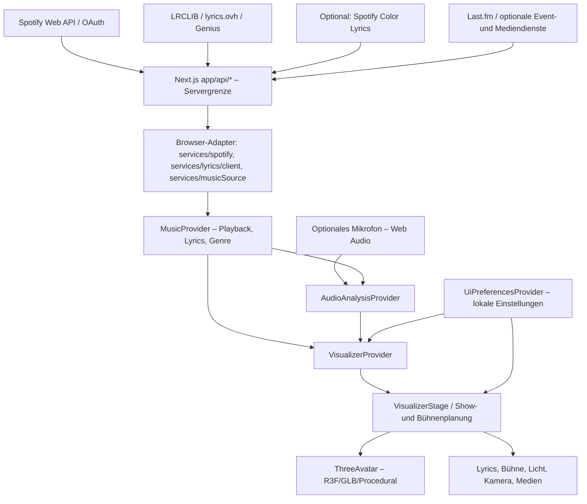
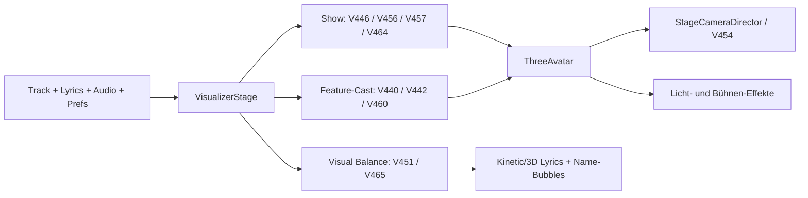

## V651 – Smart Preset Automation (28.10.2026)

`components/smartPresetAutomationV651.ts` ordnet ausschließlich sicher erkannte, gemeldete Track-/Künstler-Genres V650-Werksprofilen zu (0–100 heuristische Vertrauensskala, Track ≥80 / Künstler ≥88). Unklare, unbekannte und manuell korrigierte Genres werden nicht automatisch angewendet. `components/useSmartPresetAutomationV651.ts` bleibt in `components/TouchKioskControls.tsx` auch bei geschlossener Steuerzentrale montiert. Betriebsarten Off (Standard), Vorschlag und Auto werden in einem separaten lokalen Storage-Key gehalten. Auto wartet 900 ms auf stabile Angaben und funktioniert nur zu Beginn eines neuen, gerade abgespielten Songs (≤12 s); das erstmalige Einschalten darf den aktuellen Song nicht ändern. Manuelle Änderungen sperren automatische Änderungen für diesen Titel; pro Titel höchstens eine Anwendung. Sicherheitsfreigabe über V650-Validator und V649-Allowlist. Rückgängig stellt nur betroffene Settings und V648-Anzeigewerte für denselben Track wieder her. Weder Spotify-Daten/-Playback noch Sänger-/Kamera-/Show-Timelines, Viseme, Audio, WebGL-Schleifen oder GLB-Dateien werden modifiziert. Genre-Score ist keine wissenschaftlich kalibrierte Wahrscheinlichkeit. Tests: `tests/v651-smart-preset-automation-regression.cjs`, `tests/tsconfig.v651-core.json`; Doku `V651-SMART-PRESET-AUTOMATION.md`, `V651-VERIFICATION.md`.

## V650 – Smart Concert Presets (28.10.2026)

`components/concertPresetsV650.ts` erlaubt ausschließlich eine strikte, versionierte Teilmenge der V649-Steuerfelder für lokale Presets. Sechs vordefinierte Genres/Touchprofile, maximal zwölf eigene Profile, validierter JSON-Import/Export ohne Überschreiben vorhandener IDs/Namen. `components/ConcertPresetManagerV650.tsx` liest und schreibt allein die eigene lokale Profilliste, nicht die `UiPreferences`. Im vorhandenen Touch-Control-Center `components/ConcertControlCenterV649.tsx` werden Presets atomar auf vorhandene UI-Preferences plus V648-Ansicht/Lesbarkeit und optional vorhandenes V388-Displayprofil angewandt und selektiv rückgängig gemacht. Auth, V496-Sängerzeiten, V644-Viseme und manuelle Show-/Kamera-Timelines werden nicht serialisiert. Keine neuen GPU-Objekte/Renderloops. Tests `tests/v650-smart-concert-presets-regression.cjs`, `tests/tsconfig.v650-core.json`. Doku `V650-SMART-CONCERT-PRESETS.md`; Nachweis `V650-VERIFICATION.md`.

## V647 – Cinematic Stage Environments 2.0 (27.10.2026)

`components/visualizer/cinematicStageEnvironmentsV647.ts` ergänzt die in V635 vorhandene, **eine** LED-Rückwand mit sechs shaderbasierten Architekturmotiven (Deutschrap-Industriehallen-Pfeiler, Hardstyle-Festivaltraverse, Hardtekk-Tunnel, Rock-Verstärkerwand, Pop-Prismen, Electronic-Neon-Gewölbe). Die neue pure Regie folgt ausschließlich `verified-v600`-Akt, bestehendem V622-Transform und V635-Fade sowie demselben Spotify-Zeitsignal. In `components/visualizer/DynamicStage.tsx` ersetzt sie nur den bestehenden Plane-Fragment-Shader und belegt fünf neue Uniforms; es entstehen keine neuen Meshes, Draw Calls, Stage-GLBs, Lichter, WebGL-Schleifen oder Texturen. Nutzer-Theme, Songposition, manuelle Lichtprogramme, Blackouts, Lyrics-/Vocal-Zonen, Reduced Motion, Low-Tier und V640-Grafikbudget behalten Vorrang. Zusätzliche Architekturmuster liegen überwiegend am Bildrand. Keine behauptete reale 3D-Geometrie oder optische Leistungsverbesserung; Browser-/GLB-Benchmark bleibt offen. `npm run test:v647`, `npm run test:v647:types`, `npm run verify:v647`. Dokumentation `V647-CINEMATIC-STAGE-ENVIRONMENTS-2.md` und `V647-VERIFICATION.md`.

## V646: Read-only Intelligent Concert Timeline

`components/visualizer/intelligentConcertTimelineV646.ts` validates the **same track/duration/act boundaries** for V600 `ConcertArc` and V604 `NarrativePlan` (no fabricated sections), and adds only opt-in V354 manual clips and V496/V547 *explicitly authored* vocal slots. `components/visualizer/ConcertTimelineOverlayV646.tsx` is a collapsed HTML overlay inside `components/visualizer/VisualizerStage.tsx`, relying on the **existing** Spotify progress, arc and V354 event; no R3F callback, new clock, audio interception, storage mutation or auto camera/light commands. All camera/formation/light labels are planning, not physically recorded changes. Read-only local JSON export. Docs: `V646-INTELLIGENT-CONCERT-TIMELINE.md`; tests: `tests/v646-intelligent-concert-timeline-regression.cjs`, `tests/tsconfig.v646-core.json`. Browser/GLB validation and Next.js build remain open.

## V641: Opt-in Vollsong-QA

`fullConcertQualityAuditV641.ts` wertet ausschließlich gemessene V466-Snapshots und vorhandene V604/V478/V568-Bühnenmetadaten aus. Der opt-in Rekorder `FullConcertQualityAuditV641.tsx` hängt im bestehenden QA-Panel und liest `data-v641-*` des Stage-Wrappers. Keine Motion-/Lyrics-/Stage-/GPU-Steuerung durch den Auditor; keine automatische Qualitätsfreigabe.

> **V639 – Intelligent Motion Library (27.10.2026):** `components/visualizer/intelligentMotionLibraryV639.ts` ergänzt nach V536/V588/V615 die vorhandene automatische GLB-Auswahl im bestehenden `components/visualizer/useGenreAwareMotionDirectorV536.ts`. Eine pro Song und Avatar geführte, auf acht Einträge begrenzte Historie, frequenzabhängige Nutzungsgewichte und kleine Metadatenhinweise fördern Vielfalt ausschließlich innerhalb der bereits genre-/abschnittskompatiblen Kandidaten. V639 bezieht sich nur auf geladene Clips, mit mindestens 10 s Cooldown, Pending-Auswahl ohne fortlaufendes Neuranking und Reset bei Song, Modell, Pause, Seek, Reduced Motion oder manueller Regie. Es gibt weder Clip-Downloads noch einen Mixer-/Renderloop, keine Vocal-Raterei oder GLB-Änderung. V492 bleibt Transition- und Fußkontakt-Eigentümer. Tests `npm run test:v639`, `npm run test:smoke:v639`, `npm run verify:v639`; docs `V639-INTELLIGENT-MOTION-LIBRARY.md`, `V639-VERIFICATION.md`. Browser/GLB und vollständiger Next.js-Build weiterhin gesondert erforderlich.

> **V638 – Advanced Ensemble Choreography (27.10.2026):** `components/visualizer/advancedEnsembleChoreographyV638.ts` adds deterministic role-aware, staggered gestures and V494-contact-gated shallow Z formation arcs to the **already-authorised** V517/V495 automatic 3/4-person group. In the existing `components/visualizer/GroupDancersV326SceneV492.tsx` frame loop, V638 is applied after V548, before the existing collision attenuation and before the existing root interpolation. Two-performer authored vocal duets use the same gesture planning in `components/visualizer/DanceFormationActorsV492.tsx`, but **never** receive V638 root travel. V517/V496 manually verified cast roles are respected; no visual lead is promoted to singer, and no speaker diarization is added. Existing imported GLB clips, V494 foot IK, V506/V508 risk and fixed X-lanes remain authoritative. All source gates (track/clock, manual, pause, reduced motion, low tier) fail closed. No new renderloop or GPU assets. Checks: `npm run test:v638`, `npm run test:smoke:v638`, `npm run verify:v638`; docs: `V638-ADVANCED-ENSEMBLE-CHOREOGRAPHY.md` / `V638-VERIFICATION.md`. Real GLB visual quality and the full Next.js production build still need local verification.

> **V637:** Genre Performance Intelligence (`genrePerformanceIntelligenceV637.ts`) komponiert nach V610/V624/V625 auf den bestehenden 4 automatischen Consumers; kein neuer Renderer, keine erfundene Vocal-/Instrument-/Drop-Erkennung, manuelle und Lyrics-Grenzen bleiben bestehen.

## V635: Dynamic Concert Stages – verifizierte LED-Bühnenmotive

`dynamicConcertStagesV635.ts` prüft die gleiche `verified-v600`-V604-Aktidentität wie V622 inklusive `trackId`, Dauer, Position, Abschnitt, Kapitel, Wiederholungsindex und Playback. Ein einzelnes rückwärtiges LED-Plane-Mesh in `DynamicStage.tsx` zeigt drei zurückhaltende Muster (Streifen, Grid, Diagonalen) sowie ein radiales Drop-Motiv, ohne Bilddateien, Partikel, neue Lichtquellen oder Renderloops. Der Shader ändert nur vorbereitete Uniforms in der bestehenden `useFrame`-Schleife; im Low-Tier, bei pausierter Wiedergabe, manuell authorisierten Licht-Cues, Blackout und Reduced Motion bleibt das Mesh verborgen. Motivwechsel werden an bestätigten Abschnittsgrenzen nach null überblendet. Bei dichter Lyrics-Anzeige und vier Avataren sind die LED-Werte geringer. Die bestehende V622-Boden-/Hintergrundfärbung erhält kleine Zusatzwerte und die **von V308 selbst erzeugte** Nebelschicht eine begrenzte Abschwächung. Keine neuen Künstler-, Song- oder Drop-Erkennungen, keine automatischen Bühnenwechsel. `V635-DYNAMIC-CONCERT-STAGES.md`, `V635-VERIFICATION.md`, `npm run verify:v635`. Sichtbarkeit/Ästhetik und Next.js-Produktionsbuild lokal prüfen.

## V634: Beautiful Lyrics 2.0 – ruhige und überprüfbare Wortbetonung

`components/visualizer/beautifulLyricsV634.ts` komponiert die bereits vorhandenen V477/V541/V549/V578/V598/V606/V619-Lyrics-Leitplanken. `components/KineticLyrics.tsx` verwendet sie im normalen und immersiven DOM-Lyrics-Renderer; `components/visualizer/Lyrics3DScene.tsx` in der bestehenden Troika-Textbühne. Die Ausgabebreite wird **nur verengt**, eine bereits gesetzte Backdrop-Deckkraft nie reduziert, lange Rap-Zeilen erhalten mehr Zeilenabstand. Der zusätzliche Glühakzent entsteht **nur aus vollständig geprüften Wortzeitstempeln**, beginnt nie vor dem aktuellen Wort und endet rechtzeitig; besonders schnelle Wortabfolgen bekommen schwächere, kürzere Übergänge. Manuelle Fonts/Positionen, Synchronisation, Karaoke-Füllung, V528-Cast-Rollen, V351-Kamera-/Lyric-Schutzzonen und Reduced Motion bleiben maßgeblich. Keine zusätzlichen GLB-Meshes, Canvas, Animationstimer, Audioanalyse oder neue Show-Cues. Prüfungen: `tests/v634-beautiful-lyrics-2-regression.cjs`, `tests/tsconfig.v634-core.json`, `npm run verify:v634`. Die echte Lesbarkeit auf dem geplanten 10-Zoll-Display bedarf weiterhin einer Browser- und Geräteprüfung.

## V633: Cinematic Camera 2.0 (verified stage and singer cinematography)

`cinematicCameraDirectorV633.ts` is a **pure, stateless** planner and conservative camera composition finisher. Inside the existing `StageCameraDirectorV289.tsx` `useFrame`, AFTER V613/V620 and BEFORE the final V351 lyrics safety gate, it uses the same `V528` editorially assigned artist scene, sampled V377 actual stage anchors, and optionally verified V604 full-song act/cue. Active but stale or malformed vocal assignments fail closed; a verified V604 act alone can request only a **wide stage** view, never a guessed vocalist. Portrait, two-shot, handoff and chorus decisions can only originate in V528 explicit singer roles. The handoff aim is blended from the exiting to the entering vocalist within the authenticated cue, with an intentionally slower camera interpolation during the exchange.

All automatic candidate poses are limited in horizontal aim (≤0.34 world units * gain), vertical aim (≤0.25 * gain), field of view (≤0.58 * gain), and distance. `measureConcertFrameV550` checks head and foot bounds for **all visible cast** and the selected singer; `measureScreenFrameV540` checks the safe viewport, including the existing lyric sidebar. A candidate is rejected unless all existing safety measurements are non-worse. Bottom lyrics disable extra horizontal camera movement. Existing V351 automatic-lyrics guard is retained as the **last** camera safety stage. Inactive playback, reduced motion, low tier, manual V299 camera mode, authored V400 camera timeline / V354 cues / presets / live editor / V430 overrides and song-ID mismatches preserve the original camera. No extra R3F camera, frame callback, separate render, external audio or API calls. Tests: `npm run test:v633`, `npm run verify:v633`.

## V632: Multi-Artist Vocal Director (explicit authored roles)

`multiArtistVocalDirectorV632.ts` prüft pro Frame den trackgebundenen V385-/V416-/V496-Sängercue (2–4 Sänger, Playback-Zeit und validierte Singer-Slots). Die bestehende `GroupDancersV326SceneV492` veröffentlicht genau einen gemeinsamen Ref für die vorhandenen GLB- und prozeduralen Gesichtsrenderer. `VocalRigV368` und `ProceduralDancerAvatarV492` wenden nur auf ihre **automatischen** Jaw-/Wide-/Round-Zielwerte eine rollenabhängige Reduktion an: nur der Sänger erhält den Lead-Wert, Duette/Hooks erhalten gemeinsames, schwächeres Backing, explizite Adlibs noch dezenter, nicht zugewiesene Avatare bleiben für die automatische Vocal-Mimik stumm und behalten ihre bestehenden Tanzclips. Hörbasierte Sprecheridentifikation, automatische Adlib-Zuordnung oder Vocal-Stem-Separation gibt es ausdrücklich nicht. V420 Silbenedit, V423 Audiomund, GLB-Authoring, Preview, V384 B/P/M-Lippensiegel und V562 Kalibrierung gewinnen immer; die aktive Lip-Seal-Komponente und alle Nicht-Mund-Kanäle werden nie überschrieben. Die bestehenden Kamerapläne lesen weiterhin denselben V385/V416/V496-Cue; keine neue Kamera-, GPU-, Drei.js- oder Render-Schleife.

## V631: Timed-word natural vocal continuity

`components/visualizer/advancedVocalLipSyncV631.ts` ist ein stateless, pure Frame-Policy-Modul über **bereits vorhandenen** V538/V546/V597/V612/V617-Gesichtszielwerten. Es prüft V415-Sync-Wortzeiten, passende Gesangsrolle, Genre Rap, authentische Manual-/Audio-/Preview-Prioritäten, Tier und den aktuellen geschlossenen Mund. Nur bestätigte eng verbundene Wörter erhalten schwache, begrenzte bestehende Jaw-/Wide-/Round-Antwortgeschwindigkeiten; große Morph-Differenzen unmittelbar an belegten Wortgrenzen werden etwas geglättet. Es werden **keine** neuen Viseme, Phoneme, Silbenzeiten, Morphwerte, Sängererkennungen, Song-Clocks oder Render-Loops erzeugt. In `components/visualizer/VocalRigV368.tsx` wird der V631-Multiplikator als letzte Korrektur der bereits bestehenden exponentiellen Morph-Antwort angewendet, bei `components/visualizer/ProceduralDancerAvatarV492.tsx` entsprechend an den vorhandenen Mundmesh-Skalen. Die V384-Lippenkontaktbegrenzung und V562-Kalibrierung bleiben hinter dem Multiplikator erhalten. Tests: `tests/v631-advanced-vocal-lip-sync-regression.cjs`, `tests/tsconfig.v631-core.json`; Doku: `V631-ADVANCED-VOCAL-LIP-SYNC.md`, `V631-VERIFICATION.md`. Tatsächliche Lippen-Audio-Synchronität nur durch realen Browser-/GLB-Test prüfbar.

## V630: Natural Dance Performance – konservatives Keyframe-basiertes Übergangsblending

`components/visualizer/naturalDancePerformanceV630.ts` liest **nur bei einem bestehenden GLB-Clipwechsel** die bereits geladenen Keyframe-Kurven für Hüfte, Oberschenkel, Unterschenkel und Füße. Quaternion- und Positionssamples am von V537/V492 ausgewählten Ein-/Austritt bilden ein begrenztes Pose-Mismatch-Signal; unvollständige oder ungültige Rigtracks sind Nulloperationen. Der Planner darf eine von V565/V614 genehmigte automatische Überblenddauer **nur verlängern**, nie verkürzen, Clip-Zeitpunkte ändern oder IK-Fußkontakte überschreiben. Eingriff erfordert beidseitige Beinevidenz, mindestens vier passende Tracks, laufende Wiedergabe, ausreichende Qualität und keine manuelle Priorität. Foot-Plant (V135/V494), schnelle Wechsel und BPM begrenzen den möglichen Zusatz; die Gesamtdauer bleibt musikalisch und durch die kürzere echte Clipdauer limitiert. `components/visualizer/useGltfClipTransitionsV492.ts` verwendet den Planner nach V614 und vor dem bestehenden `AnimationAction.fadeIn()/fadeOut()`; `components/visualizer/GltfDancerAvatarV492.tsx` und V530/V536 bestimmen weiterhin, **welche** Clips gespielt werden. Die V536-Auswahl berücksichtigt bereits die letzten Clips zur Wiederholungsvermeidung, V630 ersetzt sie nicht. Kein weiterer `useFrame`, Scheduler, Mixer, GLB-Asset oder GPU-Objekt. Nicht als sichtgeprüfte Tanzqualität auszugeben; die Wirkung hängt von realen GLB-Kurven und Fuß-IK ab. Tests: `tests/v630-natural-dance-performance-regression.cjs`, `tests/tsconfig.v630-core.json`; Details `V630-NATURAL-DANCE-PERFORMANCE.md`, Prüfung `V630-VERIFICATION.md`.

## V629: Evidence-bound complete-song story on the single V623 lane

`components/visualizer/intelligentSongDramaturgyV629.ts` compiles all confirmed V604 acts **once per V604 plan with `useMemo`**. Its verified hook counts, breaks, recovery moments and finale condition are deterministic and derive no new events. Each frame `VisualizerStage.tsx` checks the current V604 cue, current section, V628 result, track/time and manual overrides before composing a tiny, boundary-faded amendment to the existing **single** `concertDramaturgyV623` score. All downstream V619/V620/V621/V623 stage consumers remain unchanged. `data-v629-*` diagnostics only. No new GLB motion, render loops, lighting assets or GPU allocations. Stage/lyric guards and manual overrides remain authoritative.

## V628: Single editorial cue over V623

`components/visualizer/concertExperienceV628.ts` liest den vorhandenen bestätigten V604/V623-Akt (Track-ID, Segment, Quelle, Zeitposition, Kapitel, Motiv, Wiederholungsindex) und komponiert ausschließlich bestehende Auto-Gains. `VisualizerStage.tsx` verteilt den gemeinsamen V628/V629-komponierten V623-Cue an die bereits bestehenden 3D-Bühnen-, Kamera-, Lyrics- und Lichtverbraucher. An wirklichen Segmentgrenzen läuft die Zusatzamplitude gegen null. Inaktive, widersprüchliche oder unsichere Quellen sind Nulloperationen. Keine neuen GPU-Objekte oder Timer. Die V351-Kameraprüfung und V621-Budgets bleiben hinter dem Komponisten bestehen.

## V627 – Automated Concert Quality Inspector (27.10.2026)

`services/monitoring/automatedConcertQualityInspectorV627.ts` fasst die **tatsächlich gemessenen** V518/V522-Browser-Benchmarkdurchläufe (drei vergleichbare Durchläufe je bestehender V522-Szene), ausdrücklich **manuell** bestätigte V543-Sichtprüfpunkte und optional einen importierten **echten** V593-Screenshot-Hinweisbericht zusammen. Die Einbindung in `components/visualizer/PiConcertBenchmarkStudioV522.tsx` zeigt eine nach Schweregrad sortierte Maßnahmenliste mit getrennten Quellenlabels und bietet JSON-Export. V593-Dateien werden lokal auf Format, Herkunftsmetadaten, Größen und nachvollziehbare Screenshot-Belege geprüft, **nicht kryptografisch authentifiziert**. Ohne Bildimport erscheinen keine angeblich erkannten Kamera-/Lyrics-Probleme; ohne Bedienerbestätigung erscheinen keine automatisch bestandenen Lippen-/Tanztests. Die vorhandene V553-Freigabe bleibt unabhängig. Drei definierte V522-Szenen (Langzeittest maximal 3 Minuten) sind **keine lückenlose Ganzsong-Inspektion**. Keine Änderungen an Avataren, Spotify, Kamera, Lyrics, Renderloop, Qualitätseinstellungen oder Bühnenregie. Tests: `tests/v627-automated-concert-quality-inspector-regression.cjs` und `tests/tsconfig.v627-core.json`; Details in `V627-AUTOMATED-CONCERT-QUALITY-INSPECTOR.md` und `V627-VERIFICATION.md`. Echt-GLB-Ansicht und kompletter Next.js-Build müssen weiterhin auf dem Windows-PC geprüft werden.

## V621 – Advanced Stage Lighting Director (27.10.2026)

`components/visualizer/advancedStageLightingV621.ts` koordiniert die **bereits vorhandenen** V462/V542/V551/V608-Lichtquellen in `DynamicStage.tsx` und `ConcertAtmosphereRendererV308.tsx` und die vorhandenen V555/V601-LED-/Gobo-/Bodennebel-Projektionen in `ConcertDetailStageV555.tsx`. Es werden keine neuen Spotlights, Shader, Geometrien, Materialinstanzen, Audioquellen, WebGL-Renderloops oder Timer erzeugt. Die automatische Regie folgt **ausschließlich** einer zum aktuellen Playback passenden, im V604/V600 bestätigten Songphase und vorhandenen Energie-/Kick-Werten; die Synchronisierung ist seek-stabil und auf maximal vier Performer begrenzt. Verse betonen Lesbarkeit/Gesichter, bestätigte Hooks LED und Gruppenlicht, Builds steigen langsam an und Drops reagieren nur bei tatsächlich gemessenen Kick-Akzenten. Wiederholte Hooks erhalten andere LED-/Spotlight-Schwerpunkte. Bei Lyrics werden Beams, Gobos, LED-Ablenkung, Bodennebel und Schwenks reduziert. Die vorhandenen V556/V601/V602-Gesamtbudgets und alle Null-/Manuell-/Blackout-/Reduced-Motion-/Low-Tier-Sperren bleiben bindend. Im Dekorationszweig wird nach der bestehenden Pi-Qualitätsbremse ausschließlich ein bereits zugewiesenes Budget **umverteilt**, nicht erweitert. Tests: `tests/v621-advanced-stage-lighting-regression.cjs`, `tests/tsconfig.v621-core.json`; Dokumentation `V621-ADVANCED-STAGE-LIGHTING-DIRECTOR.md`. Die visuelle GLB-/10-Zoll-Prüfung sowie der komplette Next.js-Produktionsbuild bleiben lokal offen.

## V620 – Intelligent Concert Camera Composition (27.10.2026)

`components/visualizer/intelligentCameraCompositionV620.ts` ergänzt die *bestehende* R3F-Kamera-Regie durch eine begrenzte Kompositionsstufe **nach V613/V610 und vor dem abschließenden V351-Lyrics-Sicherheitsguard**. Nur zum aktuellen Song passende, ausdrücklich bestätigte V528-Vokal-Cues dürfen Porträt-, Duett- oder Ensemblebildausschnitte steuern. Liegt ausschließlich eine vollständig bestätigte V604-Songphase vor, ist allenfalls eine Gruppen-/Bühnenkomposition möglich; einzelne Sänger werden nicht geraten. Die vorhandenen real gemessenen Bühnen-Roots von V377 (maximal vier) werden auf sicheren horizontalen und vertikalen Bildbereich geprüft. Jede mögliche Kamerapose wird mit V550-Head-/Full-Body-Grenzen und V540-Screen-Grenzen gegen das unveränderte Eingangspose verglichen; bei schlechterem Zuschnitt bleibt die Kamera *exakt* unverändert. Bei Lyrics ohne Seitenpanel sind neue Seitenschwenks gesperrt. Manuelle Kamera-Cues, Keyframes, Timeline, Live-Editor, Pause, Low-Tier und Reduced Motion haben Vorrang. Keine neuen Kameras, Audio-/Sängererkennung, WebGL-Renderer oder Update-Loops. Für die tatsächliche optische Bewertung sind die echten GLB-Bühnen im Browser weiterhin erforderlich. Tests: `tests/v620-intelligent-camera-composition-regression.cjs`, `tests/tsconfig.v620-core.json`; Dokumentation `V620-INTELLIGENT-CAMERA-COMPOSITION.md`.

## V619 – Cinematic Lyrics Performance (27.10.2026)

`components/visualizer/cinematicLyricsPerformanceV619.ts` vereinheitlicht die dekorativen DOM-Lyrics-Akzente mit der bestätigten Songregie V606 und den Lesbarkeitsgrenzen V578/V598. Hook-Markierungen benötigen den belegten V604-Cue aus V606; Wortakzente benötigen echte, gültige V477-Zeitmarken und aktivierte Wort-Hervorhebung. Ein gemeinsamer maximaler Textbereich sowie der kräftigste der bestehenden Backdrops stabilisieren Rap-Zeilen auch bei 3–4 Performern. Bei langen Texten und dichtem Rap werden zusätzliche Akzente deutlich reduziert; bereits vorhandene V598/V606-Effekte und der unveränderte V541/V549-Karaoke-Füllstand bleiben erhalten. Pausen, Reduced Motion, manuelle Schriftgröße/Position und unbestätigte Songabschnitte werden respektiert. Diese Änderung gilt für DOM-/immersive Lyrics und verändert keine WebGL-Wortmeshes, R3F-Kamera, Sängerzuordnung, Audioanalyse oder Animationen. Tests `tests/v619-cinematic-lyrics-performance-regression.cjs` und `tests/tsconfig.v619-core.json` sowie `V619-CINEMATIC-LYRICS-PERFORMANCE.md`. Visuelle Abnahme und vollständiger Next.js-Build bleiben lokal offen.

## V618 – Full-Body Performance Coordination (27.10.2026)

`components/visualizer/fullBodyPerformanceCoordinationV618.ts` verknüpft das **bereits zeitlich bestätigte** V582-Körper-Cue und das **identische** V617-Gesichtscue mit den vorhandenen V492-Fußkontaktmessungen des vorherigen Animationsframes. Nur bei erkannter, ausreichend sicherer Standphase entstehen kleine stützende Brustkorb-, Schlüsselbein- und Oberarm-Zusätze (max. 0,012/0,007/0,009/0,0035 rad); bei Einbeinstand besonders gedämpft. Fehlt IK, ein echtes Wort-Cue oder eine passende GLB-Bone, bleibt die V582-Basis unverändert. Keine neuen Ganzkörper-Clips, Beat-/Sängererkennung, Schritte, Wurzelbewegungen oder eigene Renderloops. Vorhandene GLB-Keyframes werden durch additive V582-Helper nicht überschrieben; manuelle Priorität, Reduced Motion, Low-Tier sowie Pause bleiben geschützt. Nur GLB-Live-Avatar: Voransichten ohne Fuß-IK nutzen weiterhin V582 ohne V618-Zusatz. Eine visuelle Verbesserung am tatsächlichen GLB-Modell muss im Browser geprüft werden. `tests/v618-full-body-performance-coordination-regression.cjs`, `tests/tsconfig.v618-core.json`, `V618-FULL-BODY-PERFORMANCE-COORDINATION.md`.

## V617 – Advanced Vocal & Facial Realism (27.10.2026)

`components/visualizer/advancedVocalFacialRealismV617.ts` ergänzt die vorhandene V538→V546→V597→V612-Facial-Pipeline mit rein frame-lokaler, begrenzter **Wortgrenzen-Dynamik**, ohne neue phonemgenaue Timestamps, Audio-/Sprecherklassifikatoren oder Gesichtspose zu erzeugen. Ein echtes synchronisiertes Wort, unveränderte manuelle Sängerzuordnung, gültige Rig-Werte und die bestehenden V384/V415/V420/V423/V562-Prioritäten sind zwingend. Der Planer ändert ausschließlich kleine Brow-/Cheek-/Squint-Morph-Ausdruckswerte (≤ 0,009 pro Frame) sowie die Attack-/Release-Rate bereits bestehender offener Kiefer-/Vokalzielwerte (Faktor 1 bis 1,055). Bei B/P/M-Wörtern, kommenden B/P/M-Lippenschlüssen oder geschlossenen Lippen bleiben die Raten neutral. Vorhandene V581/V574-Bone-Cues erlauben nur winzige zusätzliche Kopf- bzw. Augenbewegungen (maximal 0,004/0,003 rad), nie erfundene Blickrichtungen oder eigene Tracking-Ziele. Die existierenden maximalen GLB-Rotationsgrenzen, GLB-Keyframes, additive Bone-Releases und Kalibrierungen bleiben erhalten. Der prozedurale Avatar erhält dieselbe Mimik und Wort-Ratenregel, keine künstliche Bone-Blickbewegung. Pause, Seek, anderes Lied, falscher Sänger, Low-Tier, Reduced Motion, Demo/Preview und manuelle Audiospuren bleiben geschützt. **Eine objektiv bessere reale Lippensynchronität ist damit nicht nachgewiesen**; reale Spotify-/GLB-Sichtprüfungen bleiben erforderlich. Tests `tests/v617-advanced-vocal-facial-realism-regression.cjs`, `tests/tsconfig.v617-core.json`, Doku `V617-ADVANCED-VOCAL-FACIAL-REALISM.md`.

## V616 – Natural Multi-Performer Interaction (27.10.2026)

`components/visualizer/naturalMultiPerformerInteractionV616.ts` ergänzt **die bereits vorhandenen** V500-/V607-Duettpläne und die V539-Ensembleplanung (jeweils 2–4 Performer) durch kleine, musikalisch versetzte Arm-/Schulter-Antworten. V500 wird über `components/visualizer/duetResponseV575.ts` erweitert; V539 verwendet V616 als seine letzte reine Overlay-Stufe und wird auf der Duo- sowie Gruppenbühne unverändert eingebunden. Ausgehend von **bereits editorseitig bestätigten, zum Song passenden Sängerrollen** reagiert ein zweiter Performer zeitversetzt; V416-Reply-Cues warten auf die gespeicherte 62%-Grenze, V496-Segmente folgen der tatsächlichen Segmentzeit. Kurzzeitiger Blickkontakt verstärkt ausschließlich bereits vorhandene, korrekt ausgerichtete Blick-Cues. Hooks bleiben publikumsorientiert. Support-Tänzer erhalten leicht unterschiedliche statt identische Impulse. Alle Bewegungen bleiben in den bestehenden V144/V145/V452-Grenzen; vorhandene Kollisionsrisiko-/Abstandssicherungen, manuelle Szenen, Pausen, Reduced Motion und Low-Tier haben Vorrang. Visual-only-Gruppen werden ausdrücklich **nicht** als Sänger eingestuft. Keine neuen GLB-Clips, Sängererkennung, Root-Bewegung, IK-/Mundsteuerung, Render-Loops oder neuen Effekte. Neu: `tests/v616-natural-multi-performer-interaction-regression.cjs` und `tests/tsconfig.v616-core.json`; Dokumentation: `V616-NATURAL-MULTI-PERFORMER-INTERACTION.md`. Sichtprüfung auf echter Browser-/GLB-Bühne offen.

## V615 – Intelligent Choreography Variety (27.10.2026)

`components/visualizer/intelligentChoreographyVarietyV615.ts` ergänzt die bereits vorhandene V536-/V588-Auswahl von **geladenen** GLB-Animationen um eine pro Song und Avatar geführte Sechs-Clip-Historie und begrenzte Nutzungsgewichte. Die eigentliche Clip- und Regieauswahl bleibt im bestehenden Hook `components/visualizer/useGenreAwareMotionDirectorV536.ts`: V615 wählt ausschließlich musikalisch ähnlich bewertete, sichere Alternativen, berücksichtigt bereits geladene Library-Clips ohne starre Obergrenze und hält mindestens neun Sekunden zwischen automatischen Clipwechseln. Bereits vorhandene V614-Crossfades bleiben verantwortlich für die Wiedergabe. `components/visualizer/intelligentMotionPresetDirectorV493.ts` verhindert zusätzlich unnötige Wiederholungen bei vorhandenen maskierten Oberkörper-Gesten (mindestens zehn Sekunden zwischen Wechseln). Pausen, manuelle Motion-/Timeline-/Loop-Steuerung, Reduced Motion, Track-/Avatarwechsel und Seeks bleiben geschützt. Keine neuen GLB-Dateien, Audio-/Sängererkennung, Renderer oder Frame-Loops. Tests: `tests/v615-choreography-variety-regression.cjs`, `tests/tsconfig.v615-core.json`; Details: `V615-INTELLIGENT-CHOREOGRAPHY-VARIETY.md`, `V615-VERIFICATION.md`. Optische Browser-/GLB-Freigabe weiterhin offen.

## V614 – Natural Motion Flow (27.10.2026)

`components/visualizer/naturalMotionFlowV614.ts` berechnet eine **begrenzte, rein deterministische Überblenddauer** für bereits ausgewählte automatische GLB-Animationsclips. Es integriert sich in `components/visualizer/useGltfClipTransitionsV492.ts` **nach** V537-Pose-Matching und V565-Intelligent-Transitions, aber **vor** den bestehenden Drei-/Three.js-Crossfade-Aktionen. Bestehende Songabschnitt-Hinweise, gemessene Kick-/Snare-Onsets, vorhandene Foot-IK-Kontakte, GLB-Clipdauer und ein bereits verfügbarer Songzeitstempel führen zu ruhigeren Verse-/Break-/Build-Übergängen und musikalisch kürzeren, belegten Drop-Akzenten. Kurz nacheinander vorgeschlagene automatische Wechsel erhalten zusätzliche Überlappung. **Keine** zusätzlichen Animationen, Mixers, Renderer, Timer, Frameschleifen, Sänger- oder Audio-Detektoren. Der Planer verändert weder Clip-Auswahl noch Motion-Entry-Seeking, gespeicherte Loops, Keyframe-Timelines, Bühnenpositionen, Foot-IK oder Lyrics. Manual-/Group-/Sequencer-/Blend-Prioritäten, Pause, Reduced Motion, Low-Tier und ungültige Clipdauer deaktivieren V614; bestehende Logik bleibt dann aktiv. Tests `tests/v614-natural-motion-flow-regression.cjs` und `tests/tsconfig.v614-core.json`; Details `V614-NATURAL-MOTION-FLOW.md` und `V614-VERIFICATION.md`. Visuelle Browser-/GLB-Prüfung ausstehend.

## V613 – Cinematic Concert Shot Pacing (27.10.2026)

`components/visualizer/concertShotPacingV613.ts` ergänzt die einzige automatische R3F-Kamera um mehrere Sekunden lange, auf bestehender Spotify-Songzeit beruhende Kamera-Haltephasen. Die verifizierten V600/V604-Akte liefern Genre, dramaturgisches Motiv und Wiederholung; ohne bestätigte Daten bleiben die alten Aufnahmen unverändert. Wiederholte Hooks unterscheiden sich in ihren Shot-Folgen; Builds, Verse und nur anhand gemessener Energie/Kick zugelassene Drops besitzen eine eigene, ruhige Framing-Grammatik. Ein echtes V528-Sänger-Cue darf vorhandene, geprüfte Performer-Marker minimal für ein Portrait verwenden, ohne neue Sängerrollen, Phonem- oder Lipsync-Zeitstempel abzuleiten. Die Ergänzung sitzt in `components/visualizer/StageCameraDirectorV289.tsx` zwischen V606 und V610 und behält die finale V351-Lyrics-Bildschirmsicherung sowie V550/V540-Frameüberlauf-Prüfungen. Manuelle Kameras und V400/V354-Keyframes, Reduce-Motion, Low-Tier und inaktive Songs haben Vorrang. Keine neuen WebGL-Objekte, Timer, Frameschleifen, Motion-Clips oder Audioanalysen. Tests: `tests/v613-concert-shot-pacing-regression.cjs`, `tests/tsconfig.v613-core.json`; Details `V613-CINEMATIC-SHOT-PACING.md`. Offener Punkt: visuelle Browser-/GLB-/FPS-Abnahme. `npm run test:all` führt optional alle 642 aktuell registrierten atomaren npm-Tests einzeln aus, damit Fehler gesammelt werden können.

## V612 – Expressive Vocal & Facial Performance 7.0 (27.10.2026)

`components/visualizer/expressiveVocalFaceV612.ts` ergänzt die vorhandene V538→V546→V597→V581-/V582-Mund-/Mimikpipeline um **sehr kleine, deterministische und wortzeitgebundene** Ausdruckshinweise. In `components/visualizer/VocalRigV368.tsx` werden vorhandene (optional gescannte) Augenbrauen-/Wangen-/Squint-Morphs, bereits gültige Vokal-/Kieferwerte und vorhandene GLB-Head-Bones konservativ ergänzt: maximal ca. 0,012 zusätzlicher Vokalgewichtswert, maximal 0,009 rad zusätzlicher Kopfneigung, mit dem bestehenden V581-Kopfoverlay zu maximal 0,030 rad gedeckelt. Der Schutz für B/P/M, Manual/V420-Edits, V423-Audio, V562-Mundkalibrierung und V383-Vorschau bleibt unverändert; kein zusätzlicher Skeleton-Scan, GLB-Clip, Frame-Loop oder Renderobjekt. `components/visualizer/ProceduralDancerAvatarV492.tsx` nutzt dieselbe V612-Wortverfeinerung für Mund-/Brauen-Projektion. **Keine echten Silbenzeitstempel oder Phoneme werden detektiert**, kein Stimm- oder Emotionsklassifikator. Die neue Ausdrucksebene ist bei Pause, unsynchronisierten Lyrics, falschem Sänger, Seek ohne gültiges Wort, Reduced Motion, Low-Tier und manueller Priorität inaktiv. Zum optischen Qualitätsnachweis fehlen echte WebGL-/GLB-/Spotify-Vergleichsaufnahmen. Tests: `tests/v612-expressive-vocal-facial-performance-regression.cjs` und `tests/tsconfig.v612-core.json`, vollständiger Bericht `V612-VERIFICATION.md`.

## Neu: V611 – Ultimate Continuous Concert Experience 6.0

Die V600/V604-Songregie, V607-Interaktionen, V608-Beleuchtung, V609-Übergänge und V610-Genreplanung werden nun mit `components/visualizer/continuousConcertExperienceV611.ts` auf eine gemeinsame, **beleggebundene Songzeit- und Aktquelle** abgestimmt. Ein erster belegter Hook nutzt ein breiteres Ensemble-Motiv, der wiederholte Hook einen kleineren Spotlight-Fokus; raplastige Verse beruhigen Kamera, Deko-Beams und Tanz, ein echter Break senkt die Intensität, ein Drop benötigt separate gemessene Kick-Unterstützung. Ein Finale wird nur aus hinreichender bestätigter Trackende-Evidenz akzentuiert. Zusatzgains liegen eng um 1 und laufen an belegten Szenenrändern gegen neutral. Kein neuer Regieclock, keine erfundenen Stimm- oder Wortzeiten.

Verwendet werden ausschließlich vorhandene automatische Bewegungs-/Kamerakanäle und existierende Stage-Lichter in `components/visualizer/VisualizerStage.tsx`, `components/visualizer/StageCameraDirectorV289.tsx`, `components/visualizer/DynamicStage.tsx` und `components/visualizer/ConcertAtmosphereRendererV308.tsx`. Bestehende V351-Lyrics-Sicherheitsprüfung, manuelle Kamera/Choreografie/Licht-Blackouts, Low-Tier, Pause, Reduced Motion, Sängerrollen, GLB, IK und Wortzeitstempel behalten Vorrang. Kein neuer Shader, Renderloop, Laser oder GPU-Licht. **Nicht nachgewiesen:** echter Next.js-Build, Browser-/GLB-Konzertwirkung, reale FPS. Der Nutzer hat noch keinen Raspberry Pi gekauft; geplant ist vor Hardwareauswahl V618 als universeller Benchmark.

Tests: `tests/v611-continuous-concert-experience-regression.cjs`, `tests/tsconfig.v611-core.json`; Anleitung `V611-ULTIMATE-CONTINUOUS-CONCERT-EXPERIENCE-6.md`; Ergebnis `V611-VERIFICATION.md`.

## Neu: V610 – Genre-Specific Concert Experience 6.0

Sonic Display erhält drei **beleggebundene** Regievarianten für Deutschrap, Hardstyle und Hardtekk. Die vorhandenen automatischen Tänzer-Intensitäten, die einzelne R3F-Kamera und die beiden bestehenden Licht-/Atmosphären-Renderloops werden gemeinsam von einem konservativen V604/V600-Songakt abgestimmt. Deutschrap setzt auf klar lesbare Rap-Strophen und Close-ups; Hardstyle auf große bestätigte Hook-/Kick-Drop-Momente; Hardtekk auf etwas schnellere begrenzte Bewegungsakzente. Wiederholte Hooks unterscheiden sich. Keine zusätzlichen Renderloops, GLB-Clips, Spotlights, Shader, Laser oder erfundenen Songabschnitte. Manuelle Choreografie, Kamera-Keyframes und Lichttimelines behalten Vorrang. Ohne bestätigte Songstruktur greift V610 nicht ein.

Tests: `npm run test:v610`, `npm run test:v610:types`, `npm run test:smoke:v610`, `npm run verify:v610`. Details in `V610-GENRE-SPECIFIC-CONCERT-EXPERIENCE-6.md`. Die tatsächliche optische Wirkung bleibt am PC-Browser zu prüfen; Raspberry-Pi-Beschaffung ist vorerst nicht erforderlich.

## V609 – Seamless Concert Scene Transitions 5.0 (26.10.2026)

`components/visualizer/seamlessConcertTransitionsV609.ts` nutzt **nur** die bestätigte V604-/V600-Aktfolge samt Spotify-Zeit für eine gemeinsame sanfte Übergangskurve. Sie verändert in `components/visualizer/StageCameraDirectorV289.tsx` ausschließlich den Interpolationsfaktor der bestehenden automatischen R3F-Kamera; ausdrücklich gesetzte Cut-Keyframes und manuelle Editorposen gewinnen immer. In `components/visualizer/DynamicStage.tsx` und `components/visualizer/ConcertAtmosphereRendererV308.tsx` wird die bereits existierende Licht-/Fog-/Farbinterpolation an denselben Aktgrenzen kurzzeitig beruhigt, bei unveränderten Ressourcen. `components/visualizer/VisualizerStage.tsx` erweitert nur die Smoothstep-Blendzeiten tatsächlich automatisch erzeugter V442-/V446-Gruppenformationen – keine neuen Posen, GLB-Clips oder Sängerrollen. Lücken in Aktgrenzen, Trackwechsel, Pause, Reduced Motion, Low Tier, manuell gespeicherte Kamera-/Licht-Regie und ausdrückliche Cuts bleiben geschützt. Belegt sind nur Offline-Funktionen, nicht die Sichtqualität einer echten Show. Tests: `tests/v609-seamless-concert-transitions-regression.cjs`, `tests/tsconfig.v609-core.json`; technische Details `V609-SEAMLESS-CONCERT-SCENE-TRANSITIONS-5.md` und `V609-VERIFICATION.md`.

## V608 – Dynamic Concert Lighting & Atmosphere 5.0 (26.10.2026)

`components/visualizer/dynamicConcertLightingV608.ts` steuert in der **bestehenden** V308/V462/V542/V551-Lichtpipeline einen konservativen, trackgebundenen Lichtspannungsbogen. Voraussetzung ist ein zeitlich passender und bestätigter `components/visualizer/fullSongConcertDramaturgyV604.ts`-Akt; ohne passende `lightingPlayback`-Track-ID, Trackdauer, bestätigte Live-Sektion und aktuelles Cue läuft die bestehende Beleuchtung **unverändert**. Rap-Verse verbessern die Gesichtsausleuchtung und dämpfen Haze/Beams; Builds erhalten kleine Steigerungen; wiederholte Hooks wechseln zwischen Beam- und Spotlight-Fokus; Hardstyle-/Hardtekk-Drops benötigen zusätzlich tatsächlich gemessene Kick-/Energiewerte. V551-Sänger-Zuordnungen dürfen die bereits existierenden Spotlights bei explizitem Duett/Handoff leicht verfeinern; das ist **keine** neue Sängererkennung. Nur ein abgesichertes V604-Ending erhält eine Finale-Lichtsteigerung. Geschützte Lyrics erhalten Vorrang vor Haze oder Sweeps; manuelle Timeline/Blackout, Pause, Reduced Motion, deaktivierte Lichtreaktivität und Pi-Low-Tier schalten V608 aus. Eingebaut in `components/visualizer/DynamicStage.tsx` und `components/visualizer/ConcertAtmosphereRendererV308.tsx` über `components/visualizer/ThreeAvatar.tsx`; verwendet dieselben drei Spot/Key-/Fill-Kanäle, Haze/Beam-Meshes, kein neuer Frame-Callback, Shader, Laser oder WebGL-Spot. Tests `tests/v608-dynamic-concert-lighting-regression.cjs`, `tests/tsconfig.v608-core.json`; Anleitung `V608-DYNAMIC-CONCERT-LIGHTING-ATMOSPHERE-5.md`, Bericht `V608-VERIFICATION.md`. Optische/Hardware-Abnahme offen.

## V607 – Natural Multi-Artist Concert Interaction 5.0 (26.10.2026)

`components/visualizer/naturalMultiArtistInteractionV607.ts` erweitert den bestehenden **einen** V500-Sänger- und Gestenplaner nach V584/V585/V599 um deterministische, dezente Interaktionen für zwei bis vier Performer. Die authentifizierte Sänger-Cuequelle bleibt der manuell zugewiesene, trackgebundene V416-/V496-Abschnitt. Zwei zugewiesene Duettstimmen bekommen abwechselnde sparsame Schulter-/Arm-Akzente; ein bestätigter Reply wechselt seinen Akzent **erst am editorseitig belegten V416-62%-Zeitpunkt** (bei V496 direkt am Segmentanfang). Zuhörende Tänzer reagieren phasenversetzt; vollständig bestätigte Hooks variieren die Armgeste nach Song/Cue/Slot, **ohne Gesichter vom Publikum abzudrehen**. Bereits korrekt ausgerichtete V500-Blicke werden sehr gering verstärkt, aber niemals neue Blickziele erzeugt. Die tatsächlichen 2- und 3/4-Avatar-Bühnen benutzen bereits beide `components/visualizer/intelligentRapDuetPerformanceV500.ts` via `components/visualizer/duetResponseV575.ts`. **Kein** Sänger- oder Stimmerkennen, keine erfundenen Wortzeitmarken, keine neuen GLB-Animationsclips, kein Root Travel, Foot-IK, Mundsteuerung, Kamera-, Licht- oder Lyrics-Besitz. Schutz für Trackwechsel, widersprüchliche Casts, zu enge/ferne Körper, manuelle Choreografie, Pausen, Reduced Motion, Low-Tier. Keine neuen Renderloops/Objekte. Tests: `tests/v607-natural-multi-artist-concert-interaction-regression.cjs`, `tests/tsconfig.v607-core.json`; Dokumentation `V607-NATURAL-MULTI-ARTIST-CONCERT-INTERACTION-5.md`, `V607-VERIFICATION.md`. Echte GLB-/Browser-Sichtfreigabe weiterhin notwendig.

## V606 – Cinematic Lyrics & Performer Harmony 11.0 (26.10.2026)

`components/visualizer/concertLyricsPerformerHarmonyV606.ts` liefert einen **gemeinsamen, deterministischen Songzeit- und Szenenabgleich** für `components/KineticLyrics.tsx` und die vorhandene R3F-Kamera in `components/visualizer/StageCameraDirectorV289.tsx`. Keine neuen Renderloops, keine Phonem-/Sänger-/Section-Erkennung oder Änderung an Karaoke-Fill/Timecodes. Bei belegter Zeilensynchronisation verbessern statische Breiten-/Hintergrund-Puffer den 10-Zoll-Lesekomfort; zeitmarkierte Wörter erhalten nur minimale Glanzakzente, und ein Hook-Akzent entsteht nur aus live bestätigtem V604/V600-Hook-Cue. V528-Lead-/Duettbezüge erfordern explizit bestätigte Sänger- und Trackzuordnungen. Kamera: Nach `composeFullSongCameraV605` prüft `composeConcertHarmonyCameraV606` eine kleine zusätzliche Tiefen-/Fokussierung für dichte Rap-/Duett-Texte anhand tatsächlicher sichtbarer Avatar-Anker gegen **beide** bestehenden V540/V550-Bildrahmen-Messungen. Bei schlechterem Ausschnitt unveränderte Pose; anschließend greift weiter `guardAutomaticCameraV351`. Alle manuellen Kameras, Reduced Motion, Pause, niedrige Pi-Qualität, nicht belegte Lyrics und manuelle Typography gewinnen. Das vorhandene 3D-Textmesh ist unverändert; die visuelle Harmonisierung betrifft das DOM-Karaoke und seine immersive Bühnenüberlagerung. Reale Browser-/GLB-Sichtprüfung noch erforderlich. Tests: `tests/v606-cinematic-lyrics-performer-harmony-regression.cjs`, `tests/tsconfig.v606-core.json`; Anleitung: `V606-CINEMATIC-LYRICS-PERFORMER-HARMONY-11.md`; Verifikation: `V606-VERIFICATION.md`.

## V605 – Cinematic Concert Camera Director 6.0 (26.10.2026)

`components/visualizer/cinematicFullSongCameraV605.ts` ergänzt eine echte, **eng begrenzte** Kameraposen-Verfeinerung der bereits vorhandenen einzelnen R3F-Kamera aus `components/visualizer/StageCameraDirectorV289.tsx`. Die neue Stufe folgt auf V540-/V550-/V585-Komposition und unmittelbar vor dem bestehenden letzten V351-Lyrics-Sicherheitscheck. Quelle ist **ausschließlich** der zum aktuell laufenden Track gehörende, bestätigte `fullSongCueV604` aus der belegt importierten V600/V318-Aktfolge. Wiederholte Hooks haben verschiedene V604-Motive, kleine verschiedene Camera-Drift-Variationen und zurückhaltende Push-/Wide-Fahrten. Echte Sänger-Lead- und Duettfokussierungen sind nur bei zusätzlich **explizit** verifizierten V528-Rollen erlaubt. Unbekannte Sänger werden nicht erraten, unlabeled Passagen haben keinen neuen Kamera-Cue. Keine weiteren Kameras/Canvas/Renderloops, keine erfundenen Timeline-Keyframes, keine Änderung von Lyrics- oder Audiozeit. Der neue Kamera-Pose-Kandidat wird vor Anwendung mit `measureConcertFrameV550` und `measureScreenFrameV540` gegen die Ausgangspose geprüft; sichtbares Verschlechtern der zuvor berechneten Bildrahmen führt zum exakten Originalobjekt. Authored/Live-Edits, V400-Timeline, V430/V432-Shots, Reduce Motion, Low-Quality, Pausen und Lyrics bleiben vorrangig. Ein alternatives Motiv wird nicht als neuer V318-Abschnitt ausgegeben; die Prüfgrößen sind mathematische Bildrahmen-Näherungen und ersetzen **keine reale Browser-Sichtprüfung**. Regression: `tests/v605-cinematic-concert-camera-regression.cjs`; isolierter Typcheck: `tests/tsconfig.v605-core.json`; Anleitung: `V605-CINEMATIC-CONCERT-CAMERA-DIRECTOR-6.md`; Verifikation: `V605-VERIFICATION.md`.

## V604 – Intelligent Full-Song Concert Dramaturgy 6.0 (26.10.2026)

`components/visualizer/fullSongConcertDramaturgyV604.ts` baut ausschließlich auf `components/visualizer/ultimateConcertDirectorV600.ts` und dessen streng verifizierten V318-Songabschnitten auf. Die einmal pro Track memoisierte Regie vergibt songübergreifend motivische Kapitel (`setup`, `rise`, `payoff`, `respite`, `ending-arc`), variiert ausdrücklich mehrfach belegte Hook-Motive und schwächt Licht und Tanz in markierten Breaks ab. **`ending-arc` bedeutet ausschließlich ein Beleg-gebundenes dynamisches Schlussmotiv – keine erfundene Outro- oder Silbenerkennung.** Der V604-Zusatz nutzt die bestehende V568/V577/V600-Tanz-/Kamera-/Lichtintensität und wird an jedem belegten Abschnittsrand auf die vorherige V600-Wirkung ausgeblendet. Live wird zusätzlich die **exakte Übereinstimmung** mit dem durch V600 bestätigten V318-Abschnitt geprüft; unbeschriftete Passagen bleiben unberührt. Drei- und Vier-Avatar-Gruppen erhalten nur dann alternative Formationen, wenn sie aus bestehenden V442/V446-Auto-Cues stammen – ohne neue Cuezeitpunkte oder Sängerrollen, und ohne Änderungen an markierten Hooks, Drops oder manuellen Gruppen. Manuelle Regie, Pi-Low-Tier, Reduced Motion, deaktivierte Direktoren und Lyrics-Schutz haben Vorrang. **Motivnamen steuern keine tatsächlichen Kameraeinstellungen und es wurden keine zusätzlichen React-/WebGL-Renderloops geschaffen**; die sichtbare Änderung betrifft kontrollierte Intensitätsverläufe und zulässige Gruppenformationen. DOM-Probe-Metadaten weisen das aktive Kapitel nach, sind keine künstlichen Musikabschnitte. Benötigt echte Browser-GLB-/Spotify-Sichtprüfung. Regression: `tests/v604-full-song-dramaturgy-regression.cjs`; isolierter Typcheck `tests/tsconfig.v604-core.json`; Anleitung `V604-INTELLIGENT-FULL-SONG-CONCERT-DRAMATURGY-6.md`; Verifikation `V604-VERIFICATION.md`.

## V604 – Intelligent Full-Song Concert Dramaturgy 6.0 (26.10.2026)

`components/visualizer/fullSongConcertDramaturgyV604.ts` baut auf der streng geprüften, trackgebundenen V600-Aktfolge einen zweiten deterministischen **Gesamtsong-Regieplan** auf: erste und zweite Hooks erhalten verschiedene Motive und unterschiedlich abgestufte Intensitäten, Builds führen zu Höhepunkten, letzte tatsächlich gelabelte Songabschnitte können ein Finale bilden. Die ursprünglichen V568/V577/V600-Automatikkanäle werden in `components/visualizer/VisualizerStage.tsx` nach den bestehenden manuellen Schutzregeln weich mit höchstens kleinen Zusatzfaktoren moduliert; neutraler Rand jeder bestätigten Szene vermeidet abrupte Sprünge. Keine echten Kamera-Keyframes oder neuen Shot-Cuts, keine Interpretation unbekannter Passagen als Hook/Drop, keine erfundenen Sänger, keine neuen Renderloops, Netzwerkzugriffe oder GPU-Objekte. Nicht bestätigte Abschnitte bleiben unberührt. Die diagnostischen `data-v604-*`-Attribute markieren ausschließlich belegte Regie-Cues. Regression `tests/v604-full-song-dramaturgy-regression.cjs`, isolierter Typcheck `tests/tsconfig.v604-core.json`; Anleitung `V604-INTELLIGENT-FULL-SONG-CONCERT-DRAMATURGY-6.md`, Prüfbericht `V604-VERIFICATION.md`.

## V603 – Complete Concert Experience Validation 4.0 (26.10.2026)

`scripts/v603-full-concert-review.cjs` führt **1–16 echte, gemessene V592-Chromium-Liveberichte desselben Spotify-Tracks** zu einem konservativen Gesamtshow-Bericht zusammen. Der bereits lokale `components/visualizer/LiveStageDomProbeV592.tsx` gibt dafür die von Spotify gelieferte `durationMs` weiter, und `scripts/v592-live-stage-benchmark.cjs` speichert `trackDurationMs`. **Fehlt sie bei alten Berichten, wird kein Vollsong-Anteil erfunden.** Es werden nur durch reale rAF-Messzeit bestätigte aufeinanderfolgende Songfenster als belegt geführt; ungemessene Pausen bleiben sichtbar. Echte Stage-Cues (Verse, Hook usw.) und Kamera-Shot-Labels werden ausdrücklich als UI-Metadaten behandelt, nicht als Musikerkennung. Häufige Bildwarnungen, wiederholte Kamera-Cues, fehlende Abschnitte und Browser-rAF werden zur **menschlichen Sichtabnahme** bereitgestellt; eine bestandene künstlerische Freigabe gibt es niemals automatisch. **V592-Standbilder belegen weder durchgehendes Video, Fußkontakt, Phonem-Lip-Sync noch Lighting-FX- oder GPU-Pi-Qualität.** `scripts/v603-full-concert-cli.cjs` archiviert lokal geprüfte PNG-Dateien und `scripts/v603-full-concert-report.cjs` erzeugt einen statischen, HTML-escaped Bericht. Kein Spotify-Seek, kein anderer Renderloop, keine Änderung an GLB, Songregie, Kamera, Lyrics oder manuellen V601-/V602-Stufen. Tests: `tests/v603-full-concert-validation-regression.cjs` und `tests/tsconfig.v603-core.json`. Anleitung `V603-COMPLETE-CONCERT-EXPERIENCE-VALIDATION-4.md`; Prüfung `V603-VERIFICATION.md`.

## V602 – Real Raspberry Pi Concert Optimization 6.0 (26.10.2026)

Die V479-**gemessenen Browser-FPS/p95-Fenster**, Pi-Profilumschaltung und Cooldowns bleiben die einzige Pi-Last-Evidenz. `components/visualizer/piConcertOptimizationV602.ts` berechnet ausschließlich daraus und aus der echten 1–4-Avatar-Anzahl ressourcenschonende V601-Bühnen-FX-Grenzen und Auto-DPR-Obergrenzen. `components/visualizer/ConcertDetailStageV555.tsx` verwendet weiterhin seine drei existierenden Shaderpässe und denselben Frame-Loop; `components/visualizer/adaptivePerformance.tsx` deckelt nur die automatische DPR (manuelle Profile bleiben unverändert); `components/visualizer/ThreeAvatar.tsx` übermittelt die tatsächliche Anzahl. Authored-Licht, statische Bühnen-FX bei `stageReactive=false`, Karaoke, importierte GLB-Clips, Foot-IK, Sänger und die V600-Gesamtdramaturgie bleiben erhalten. Ein FPS-/GPU-/Thermikgewinn ist ohne reale Pi-Messung nicht bewiesen. Tests: `tests/v602-pi-concert-optimization-regression.cjs`, `tests/tsconfig.v602-core.json`. Anleitung `V602-REAL-RASPBERRY-PI-CONCERT-OPTIMIZATION-6.md`; Prüfbericht `V602-VERIFICATION.md`.

## V601 – Advanced Concert Stage FX 4.0 (26.10.2026)

`components/visualizer/advancedConcertStageFxV601.ts` erweitert die schon vorhandene `components/visualizer/ConcertDetailStageV555.tsx` um eine rein additive Effektauswertung der vorhandenen Stage-Sektionen: ruhige Verse, stärker akzentuierte Hooks und Drops, LED-Wellen, Gobo-Ringe und sanfte Übergänge. Die drei V555-Shader/Geometrien werden **wiederverwendet**, kein neuer Shaderpass. Ein einzelnes optionales, schattenfreies Spotlight nutzt die bestehenden V555-Schalter und wird bei Low-Tier, reduziertem Bewegungsmodus, dichter Lyrics-Passage oder manueller Regie nicht aktiviert. V556-Lichtbudget und Autor-Priorität bleiben erhalten. Importierte Songabschnitte werden nicht automatisch erkannt; Stage-Hinweise sind keine überprüfte Sprechererkennung. Integration aus `components/visualizer/ThreeAvatar.tsx`; Tests `tests/v601-advanced-concert-stage-fx-regression.cjs` und `tests/tsconfig.v601-core.json`, Anleitung `V601-ADVANCED-CONCERT-STAGE-FX-4.md`, Verifikation `V601-VERIFICATION.md`. Keine Laser, keine Änderungen an GLB, Mund, Fuß-IK oder Lyrics.

## V600 – Complete Song Arc / Ultimate Concert Director 5.0 (26.10.2026)

`components/visualizer/ultimateConcertDirectorV600.ts` plant für den ganzen Track aus *wirklich hochkonfident beschrifteten* `services/musicAnalysis/trackAnalysisV318.ts`-Abschnitten eine begrenzte, deterministische Abfolge von Konzert-Akten. Wiederholte Hook- und Drop-Passagen erhalten abwechslungsreiche, nicht unmittelbar doppelte Bildkompositions-Motive; Opening/Develop/Peak/Release steuern **ausschließlich** kleine, gemeinsame Intensitätsmultiplikatoren der bereits laufenden V568/V577-Tanz-/Kamera-/Lichtkanäle. Ohne verlässliche Label gibt es nur eine schwache generische Verlaufskontur, **keinen** erfundenen Verse-/Hook-/Drop-Cue. Bei aktuellen V442/V446-**automatisch generierten** 3/4-Avatar-Cues darf `refineAutomaticConcertGroupV600` einzelne vorhandene Formationspositionen aus der V326-Kollisionsschutz-Bibliothek ersetzen, bei unveränderten Zeitpunkten, Fokus- und Sängerrollen. Manuelle Gruppen und ausdrücklich markierte Hook-Drops sind geschützt. Shot-Labels sind diagnostische Regiemotive; **keine neue Kamerapose, kein eigener Kameraregler, keine Kamera-Auto-Cuts** werden behauptet. Bereits vorhandene V287/V306-Kameraschnitt-Mechanismen bleiben zuständig. V598-Lyrics und V597-Lip-Sync bleiben zeitlich und räumlich unverändert. Trackwechsel, Seek, Reduced Motion, niedrige Qualitätsstufe und manuelle Kamera/Bewegung/Licht-Priorität sind testbar. Ohne neue Animation-Actions, GPU-Objekte, Timer, Requests oder Persistenz. Tests: `tests/v600-ultimate-concert-director-regression.cjs` und `tests/tsconfig.v600-core.json`; Anleitung: `V600-ULTIMATE-CONCERT-DIRECTOR-5.md`; Prüfbericht: `V600-VERIFICATION.md`.

## V599 – Intelligent Feature & Duet Performance 4.0 (26.10.2026)

`components/visualizer/featureDuetPerformanceV599.ts` hängt als letzter, **rein additiver** Schritt am vorhandenen V500/V575/V584/V585-Duettplaner. Der Planer wird bereits von 2er- und 3/4er-GLB-Avatarbühnen genutzt. Nur explizit track- und zeitgeprüfte V416/V496-Sängerrollen lösen gestaffelte Hand-off-Gesten, zurückhaltende Duett-Blicke und gemeinsame Hook-Akzente aus. V416-Antwortpassagen starten erst an der autorisierten In-Line-Schwelle, während V496 echte Abschnittsgrenzen verwendet. Die Änderung berührt nur bestehende `LookAtCue.weight`- und `PartnerGestureCue`-Felder (V144/V145/V452), nie Sänger-/Munddaten, IK, AnimationActions, Bühnenroots oder Kameras. Niedrige Leistungsstufe, Reduced Motion, manuelle Bühnensteuerung und fremde Track-IDs sind gesperrt. `tests/v599-feature-duet-performance-regression.cjs` und `tests/tsconfig.v599-core.json` sichern die Kette ab. Dokumentation: `V599-INTELLIGENT-FEATURE-DUET-PERFORMANCE-4.md`.

## V596 – Natural Dance & Footwork Quality 6.0 (26.10.2026)

`components/visualizer/naturalFootworkQualityV596.ts` ergänzt eine **zustandsbehaftete, testbare Freigabe bestehender Fußbewegungen** nach real gemeldetem Bodenkontakt (vorheriger Frame aus der V492-IK). Die beiden Füße in automatisch gesteuerten 3/4er-Gruppen werden separat behandelt. Bei erneutem plant stoppt zusätzlicher Lift sofort, beim Loslösen wird die bereits vorhandene V486/V524/V587-Bewegung über eine kurze genreabhängige Zeitkonstante zurückgeführt. V596 ändert niemals Bühnenposition, Reisegeschwindigkeit, GLB-AnimationAction, Foot-IK oder neue Kontakte.

Die Gruppeneinbindung ist *optional* und läuft als letzter Schritt innerhalb der bestehenden V524-Pipeline, über den bereits vorhandenen `GroupDancersV326`-Framecallback. In GLB-Rigs dämpft ein eigener Zustandsautomat *nur vorhandene* additive `footStep`, `legGroove`, `weightShift` **nach** V545 und V587, **vor** `applyAvatarRigMotion` und der einzigen V492-Fuß-IK. Manuell gewählte Motion, reduzierter Bewegungsmodus, Low Tier, deaktivierte IK, Pause, Seek und Track-/Modellwechsel werden mit Identitäts- bzw. Reset-Garantien behandelt. Keine zusätzlichen Renderloops, externen Requests oder neuen Audio-Timestamps. Tests: `tests/v596-natural-dance-footwork-quality-regression.cjs`; isolierter Typcheck `tests/tsconfig.v596-core.json`. Grenzen: tatsächliches Fußrutschen importierter GLB-Clips lässt sich nur mit echten GLB- und Hardwareaufnahmen bewerten. Siehe `V596-NATURAL-DANCE-FOOTWORK-QUALITY-6.md` und `V596-VERIFICATION.md`.

## V595 – Automated Live Concert Visual Regression 2.0 (26.10.2026)

`scripts/v595-visual-regression.cjs` verbindet **zwei gültige V592-Livebühnenberichte** mit der strengen V594-Prüfung auf gleichen Spotify-Track, Browser, WebGL, Bildschirm und Avatarzahl. Bildpaare benötigen jetzt höchstens 1,2 Sekunden Versatz. `scripts/v592-live-stage-benchmark.cjs` liest während echter Spotify-Wiedergabe zusätzlich nur die vorhandenen, tatsächlich gerenderten V456-/V464-/V568-/V478-/V502-Stage-Labels pro Screenshot. V595 weist Solo, Duett, Hook oder Drop **nur anhand belegter, identischer Szenen-Cues** oder expliziter manueller Markierungen zu; keine geratenen Sängerrollen, fehlende Abschnitte gelten **nicht** als bestanden. `scripts/v595-visual-regression.cjs` blendet in echten PNG-Vergleichen die projizierten Tänzer- und Lyrics-Rechtecke aus, bewertet alle übrigen Bildunterschiede vorsichtig und sammelt **wiederholte** neue GLB-/Framing-/Lyrics-Warnungen. `scripts/v595-visual-regression-cli.cjs` und `scripts/v595-visual-regression-report.cjs` erzeugen ausschließlich lokale JSON-/HTML-Berichte ohne Auto-Freigabe. Kein Spotify-Seek, keine Änderung an Renderloop, Choreografie, Kamera oder UI, kein Performancegewinn behauptet. Tests: `tests/v595-automated-live-visual-regression.cjs`. Anleitung: `V595-AUTOMATED-LIVE-CONCERT-VISUAL-REGRESSION-2.md`, Verifikation: `V595-VERIFICATION.md`.

## V594 – Concert Quality Comparison & Optimization History 3.0 (26.10.2026)

`scripts/v594-concert-quality-comparison.cjs` vergleicht nur **zwei gültige, tatsächlich gemessene V592-Liveberichte** zum gleichen Spotify-Track. Identische Bildschirm-/Browser-/WebGL-Konfiguration, GLB-Zahl, Aufnahmemodus und genügend gemeinsame Songpositionen sind Pflicht für ein direktes FPS-/Qualitätswarnungs-Delta; andernfalls werden Metriken ausdrücklich als nicht vergleichbar markiert. `scripts/v594-concert-quality-cli.cjs` stellt die Browser-rAF-/p95-/p99-/Draw-Call-/Triangle-Deltas, echte zeitlich gepaarte PNGs (optional) und wiederholte Kamera-, Lyrics- und Formationwarnungen gegenüber. `scripts/v594-concert-quality-report.cjs` schreibt XSS-geschützte statische HTML-Vergleiche und eine lokale Verlaufshistorie. Keine automatischen Änderungen an Livebühne, Spotify, Lyrics, Choreografie oder Kamera; keine freigegebene Bildqualität ohne manuelle Kontrolle. Dokumentation: `V594-CONCERT-QUALITY-COMPARISON-OPTIMIZATION-HISTORY-3.md`, `V594-VERIFICATION.md`, Test: `tests/v594-concert-quality-comparison-regression.cjs`.

## V593 – evidenzbasierte Qualitätsvorschläge aus V592-Livebühne (26.10.2026)

`scripts/v592-live-stage-benchmark.cjs` behält den produktiven, nur auf Loopback aktivierbaren read-only Probe-Pfad unverändert bei und speichert zu jedem echten Screenshot jetzt auch projizierte GLB-Actor-Bounds, Bühnen- und DOM-Lyrics-Rechtecke. Nach einem gültigen gemessenen Lauf erzeugt `scripts/v593-concert-quality-advisor.cjs` ausschließlich aus echten V592-Bild- und Framezeit-Belegen wiederholbare Handlungsempfehlungen. `scripts/v593-concert-quality-cli.cjs` kann eine vorhandene Messdatei offline erneut bewerten, `scripts/v593-concert-quality-report.cjs` ergänzt die bisherige HTML-Ansicht um belegte Empfehlungen (separate `report-v593.html`, `advice-v593.json`). Bei `blocked`, synthetischer Szenenquelle, fehlendem Songfortschritt, nur einem Screenshot oder ungültigen Metriken erfolgt **keine** Freigabe und keine Vorschlagsdatei. Ein Fullscreen-Lyrics-DOM-Overlay gilt nicht als Text-Überlappungsbeweis. Gemessene rAF-Werte sind keine GPU-/Pi-FPS. V593 schreibt niemals Spotify-Zustand, GLB-Clips, manuelle Kameras, Lyrics-Timestamps oder Benutzer-Presets um. Siehe `V593-CONCERT-QUALITY-AUTO-IMPROVEMENT-2.md`, `V593-VERIFICATION.md`, `tests/v593-concert-quality-auto-improvement-regression.cjs`.

## V592 – echte Spotify-Livebühne im Chromium-Qualitätsbenchmark (26.10.2026)

`LiveStageDomProbeV592.tsx` hängt am produktiven `VisualizerStage` und gibt unter explizitem `?benchmarkV592=1` **ausschließlich auf localhost/127.0.0.1/::1** einen read-only Status aus. `LiveStageCanvasProbeV592.tsx` wird innerhalb der vorhandenen `ThreeAvatar`-R3F-`Canvas` eingesetzt und liest dort Kamera, GLB-Skelett-Bounds, WebGL-Draw-Calls, Triangle Count und Kontextstatus. Echte `GltfDancerAvatarV492`-Wurzeln tragen eine reine `userData`-Markierung; es wird weder eine neue Bühnenwelt erzeugt noch werden Animationen, Lyrics, Playback, Sprecherrollen oder IK überschrieben. Die teurere Analyse läuft nur mit Opt-in etwa alle 400 ms. `liveStageQualityV592.ts` validiert Quelle und messbare Warnungen.

`scripts/v592-live-stage-benchmark.cjs` verbindet sich per CDP mit einer vorhandenen lokal authentifizierten Chromium-Instanz (`--debug-port`) oder startet ein frisches isoliertes Chromium. Es navigiert nur zur lokalen Produktivstartseite, kontrolliert tatsächliche Spotify-Wiedergabe, **mindestens einen real sichtbaren GLB-Darsteller**, Lyrics, WebGL-Status und Fortschritt, erstellt während aktiver Wiedergabe Bildschirm-PNGs, Pixelvergleich und reale rAF-Metriken. Ohne diese Voraussetzungen schreibt es **nur** `blocked`/`report.json`. `scripts/v592-live-stage-report.cjs` erzeugt die HTML-Ansicht nur aus tatsächlich gemessenen Bildern und kennzeichnet jederzeit die notwendige menschliche Qualitätsfreigabe. Keine generierten Songdaten, kein Demo-Renderer und kein automatisch bestandenes visuelles Qualitätsurteil. V590/V591 bleiben für isolierte Clip-/Szenen-Tests erhalten. Siehe `V592-LIVE-CONCERT-STAGE-QUALITY-VALIDATION-4.md`, `V592-VERIFICATION.md` und `tests/v592-live-concert-quality-regression.cjs`.

## V591 – lokaler Multi-GLB-Konzert-Review (26.10.2026)

`components/visualizer/V591ConcertBrowserStage.tsx` ergänzt die dedizierte Route `app/benchmark/v591/page.tsx` für zwei bis vier tatsächlich ladbare GLBs mit eingebetteten `AnimationClip`s. Die unveränderten Quellen laufen über `useGLTF`, `SkeletonUtils.clone` und `THREE.AnimationMixer`; explizit gewählte Zeitmarken setzen echte Posen. Ein separates, bewusst vereinfachtes Fixture rendert reproduzierbar Bühnen-Lichtcues, Kamera-Sichten und Lyrics-Overlay, ohne in den normalen Spotify-`VisualizerStage`-Pfad einzugreifen. `components/visualizer/concertQualityProtocolV591.ts` begrenzt gültige Daten, sichere lokale Modelle/JSON-Cues und zeigt konservative Bounds-/Lyrics-Überlagerungswarnungen.

`scripts/v591-integrated-concert-visual-benchmark.cjs` fotografiert per lokalem Chromium/CDP den kompletten Bühnencontainer (WebGL **und** DOM-Text), prüft tatsächliche GLB-Ready-/Pose-Generationen und misst rAF-Frameintervalle. `scripts/v591-concert-visual-report.cjs` rendert eine HTML-Bildgalerie ausschließlich nach echten Screenshots. Der Status ist bewusst `blocked` oder `measured-needs-human-review`, niemals automatisch bestanden. Auch bei erfolgreichem Lauf kein GPU-Benchmark, kein echter Audio-Lip-Sync-Test und keine Produktionsshow-Abnahme. Dokumentation `V591-INTEGRATED-CONCERT-VISUAL-QUALITY-3.md`, Tests `tests/v591-integrated-concert-visual-regression.cjs`, `tests/tsconfig.v591-core.json`. V590 bleibt eigenständig und unberührt.

## V590 – Real Concert Visual Benchmark 2.0 (26.10.2026)

`app/benchmark/v590/page.tsx` / `components/visualizer/V590BrowserStage.tsx` provide an **independent, local-only WebGL GLB benchmark viewer**. Real model/animation binary files have to be served from the same Sonic Display instance. It clones the skin, uses the existing Three.js `AnimationMixer`, optionally retargets a separate local motion GLB through the same `avatarAnimationRetarget.ts` helper as the V534 preview, evaluates actual clips at specified seconds (no synthetic fallback), and exposes a narrow ready/seek/status interface to Chromium. Incompatible/empty clips and GLBs without a visible mesh are rejected. Shot bounds are projected after the mixer seek; their heuristic framing status is not visual approval. A precise geometry scan runs only once per captured pose, not every frame.

`scripts/v590-real-concert-visual-benchmark.cjs` uses loopback-only Chrome DevTools to screenshot the **actual WebGL canvas**, compare original/following clip pixels with `scripts/v590-visual-image.cjs` (dependency-free Chromium RGB/RGBA PNG decoder), evaluate boundaries (`scripts/v590-visual-geometry.cjs` mirrored against the typed `components/visualizer/realConcertBenchmarkV590.ts`), and sample actual `requestAnimationFrame` timestamps via the V580 stats processor. It saves JSON and PNGs **only after a real local model/scene has rendered**; errors yield `blocked`, never manufactured FPS or automatic artistic signoff. It is not a full Spotify live-show/lyrics or Pi hardware demonstration. The benchmark route does not alter V589's existing manual review, active avatar animation selection, IK, saved settings, or GLB binaries. See `V590-REAL-CONCERT-VISUAL-BENCHMARK-2.md`, `V590-VERIFICATION.md`, `tests/v590-real-concert-visual-benchmark-regression.cjs` and `tests/tsconfig.v590-core.json`.

## V589 – Visual Dance Quality & Real GLB Validation

`components/visualizer/visualDanceReviewV589.ts` erstellt aus echten V534-GLB-Skelettproben begrenzte Zeitleisten und einen **nicht automatisch freizugebenden** Sichtprüfbericht. `VisualDanceReviewPanelV589.tsx` stellt klickbare Zeitmarker sowie manuelle Checklisten/JSON-Export für vorhandene GLB-Vorschauen bereit; angebunden in `components/CharacterMotionBatchInstaller.tsx` und `components/visualizer/MotionQualityOptimizerDashboard.tsx`. `longSongQualityProbeV589.ts` / `LongSongReviewPanelV589.tsx` simulieren eine 2–8-Minuten-V588-Genreauswahl über vorhandene Clipdaten (hypothetische Songabschnitte), mit direkter Auswahl im bestehenden 3D-Viewer. Keine zusätzliche Renderloop, kein tatsächlicher optischer Test, keine Veränderung von Animation/IK/Sprecherzuordnung. `tests/v589-visual-dance-quality-regression.cjs`, `tests/tsconfig.v589-core.json`. Siehe `V589-VISUAL-DANCE-QUALITY-REAL-GLB-VALIDATION.md`.

## V588 – Intelligent Dance Choreography 7.0 (26.10.2026)

`components/visualizer/longFormChoreographyV588.ts` verfeinert die vorhandene V536-GLB-Auswahl, ohne eine zweite Motion-Engine zu installieren. Ausschließlich vorhandene gebundene `AnimationAction`-Namen werden aus dem gesamten **bereits geladenen** Repertoire rotiert – einschließlich optionaler V535-Library-Clips, die `library.automatic` erlaubt. Das System priorisiert die bestehende V536-Genre- und Abschnittsbewertung, berücksichtigt explizit `idle`, Rap, Dance, Hardstyle und Hardtekk und wechselt dann innerhalb musikalisch nahe geeigneter Bewegungen deterministisch über 32-Beat-Fenster. Die Rotation setzt **keine künstliche 20-/64-Clip-Grenze** im Planer. Sie lädt allerdings keine Dateien nach und ändert keine Limitierungen bestehender Import-/Speicherkomponenten.

`components/visualizer/useGenreAwareMotionDirectorV536.ts` benutzt die V588-Planung nach dem alten `stepGenreMotionV536`; das bisherige `useGltfClipTransitionsV492` bleibt einziger Crossfade-Pfad. Eine achtsekündige Umschaltsperre verhindert harte Wechsel bei Abschnittssprüngen; wartende Entscheidungen werden zwischengespeichert, damit während der Sperre kein erneutes Bibliotheksranking pro Renderdurchlauf erfolgt. Die Auswahl ist aus Track, Modell, Genre, Section, BPM, Window und Avatar-Slot reproduzierbar. Songsuche/Seek, neue GLBs, geänderte verfügbare Actions, Pause, `reducedMotion` und manuelle Clip-/Show-Regie bleiben geschützt. V588 verändert keine Clips, Root-Translation, Kontakt-IK, Vocals, Lyrics oder Kameras.

Tests: `tests/v588-long-form-choreography-regression.cjs` und `tests/tsconfig.v588-core.json`; Doku: `V588-INTELLIGENT-DANCE-CHOREOGRAPHY-7.md` und `V588-VERIFICATION.md`. Browser-Sichtprüfung und Raspberry-Pi-Hardwarebenchmark fehlen weiterhin.

## V587 – Expressive Dance & Footwork 5.0 (26.10.2026)

`components/visualizer/expressiveDanceFootworkV587.ts` verfeinert nur vorhandene automatische V486/V524-Gruppenschritte und die bereits etablierte V545-GLB-Motion-Pipeline. `components/visualizer/naturalFullBodyDanceV524.ts` ruft den opt-in-Plan für 3–4 automatische Performer nach seiner bisherigen Standfuß-/Swing-Begrenzung auf; `components/visualizer/GroupDancersV326SceneV492.tsx` übergibt nur Song-Cue, bekannte BPM, Genre, Section und vorhandene Foot-IK-Supportdaten. Die bestehenden V487/V494-Kontakt-Entscheidungen bleiben einzige Grounding-Instanz. Nur Swing-Dämpfung, kleine Gewichtsverlagerungs-Rücknahme und bereits vorhandene Arm-/Follow-Through-Skalarwerte werden beeinflusst; keine neue Schrittfolge, Root-Translation oder Foot-IK-Erkennung. Ohne BPM wird ausdrücklich kein Beat generiert. Die Input-/Rückgabeobjekte sind unverändert bei manueller Priorität, Pause, `reducedMotion`, Low-Tier, unbekanntem GLB-Kontakt und fehlendem Song. Seek und identische Song-Zeitmarken sind reproduzierbar. Für GLB-Avatare liegt V587 nach V545 und vor `applyAvatarRigMotion` in `components/visualizer/GltfDancerAvatarV492.tsx`; GLB-Clips/Morphs, manuelle Kameras und Sängerzuordnung werden nicht geändert.

Tests: `tests/v587-expressive-dance-footwork-regression.cjs`, `tests/tsconfig.v587-core.json`; Doku: `V587-EXPRESSIVE-DANCE-FOOTWORK-5.md` und `V587-VERIFICATION.md`. Offline-Regressionen und isolierte Typprüfung ersetzen keine echte visuelle GLB-/Raspberry-Pi-Hardwarefreigabe.

## V586 – Natural Concert Performance 4.0 (26.10.2026)

`components/visualizer/naturalConcertPerformanceV586.ts` ist ein gemeinsamer, rein funktionaler Song-Zeit-Planer für `components/visualizer/useGltfVocalMotionV492.ts` und `components/visualizer/ProceduralDancerAvatarV492.tsx`. Der Zusatz folgt dem bereits verifizierten V472/V583-/V564-Vocal-/Körperpfad und gibt nur winzige additive Kopf-, Brustkorb- und Arm-Gegengewichte aus. V515 bleibt für das GLB-Smoothing zuständig; die prozedurale Engine verwendet vorhandene lerp-Ziele. Ein wortbezogener Ein-/Ausklang sowie ein langsamer, deterministischer Phrasen-Gegenschwung verbessern Übergänge zwischen Rap-Geste und Tanz. In dichtem Rap werden Armspitzen zurückgenommen, für Hooks sehr sanft verstärkt. Kein eigener Taktgeber, keine neuen Beats oder Sprecher werden erkannt. Für zwei bis vier Performer muss eine belegte Sängerrolle (aus manueller Cast-Zuweisung) vorhanden sein; unzugeordnete Rollen werden nicht hochgestuft. Kein Zugriff auf Gesichtsmorphs, GLB-AnimationActions, Fuß-IK, Hüft-/Bein-Bones, Root-Position, Lyrics oder Kamera. Pause, `reducedMotion`, `low`-Tier, manuelle Choreografie, unsynced/line-only Lyrics und unbestätigte Rollen ergeben unveränderte Eingabeobjekte.

Tests: `tests/v586-natural-concert-performance-regression.cjs`, `tests/tsconfig.v586-core.json`; Release: `V586-NATURAL-CONCERT-PERFORMANCE-4.md`; Prüfbericht: `V586-VERIFICATION.md`. Browser-Sichttest mit echten GLBs und reale Pi-FPS-Messung bleiben separat offen.

## V583 – Intelligent Rap Performance Dynamics 3.0 (26.10.2026)

`components/visualizer/rapPerformanceDynamicsV583.ts` verfeinert die vorhandenen V472/V473/V474-Gesten anhand synchronisierter Lyrics und echter Wortdichte sowie vorhandener Stage-Section-Hinweise. Ruhige Passagen, belegte schnelle Flows, echte Flow-Wechsel, Hook-Szenen und *nur textlich markierte* Adlib-Kandidaten erhalten fein begrenzte Bewegungsgewichtungen. Sieben deterministische Mikrovarianten wechseln von Zeile zu Zeile; jede Figur erhält eine eigene Variation. Timing bleibt an reale Text-Zeitmarken gekoppelt; Phrase-Anfang und -Ende blenden den Zusatz sanft ein und aus. Die GLB-Pipeline `components/visualizer/useGltfVocalMotionV492.ts` führt V583 **vor** V516/V526/V538/V564/V515 ein; die prozedurale Pipeline `components/visualizer/ProceduralDancerAvatarV492.tsx` nutzt V583 vor V526 sowie sehr kleine Kopf-/Rumpf-Gegengewichte.

V583 verändert weder die bestehende Gesangsrollenauflösung noch Mund-/Lippenanimationen, Avatar-GLB-Clips, manuelle Choreografien, Fuß-IK, Kamera oder Licht. Pausierte, nicht-Rap-, Hintergrund- und Low-Tier-Pfade, reduced-motion, fehlende Track-/Lyric-Timings und manuelle Choreografien bleiben unverändert. Keine Audio-Vocal-Isolation, keine erfundenen Silben/Beats und keine zusätzlichen GPU-Effekte oder Renderloops. Tests `tests/v583-rap-performance-dynamics-regression.cjs`, `tests/tsconfig.v583-core.json`; Dokument `V583-INTELLIGENT-RAP-PERFORMANCE-DYNAMICS-3.md`. GLB-Sichtkontrolle und tatsächlicher Pi-Hardwaretest stehen aus.

## V582 – natürliche Koordination von Mimik und Tanz (26.10.2026)

Die bereits bestätigten Wort-/Sänger-Cues von `components/visualizer/coherentRapFacialPerformanceV581.ts` werden von `components/visualizer/naturalDanceFacialCoordinationV582.ts` in kleine Brust- und Schulterbewegungen umgesetzt. Der Renderer `components/visualizer/VocalRigV368.tsx` nutzt dafür nur vorhandene GLB-Brust- und Schlüsselbein-Bones und seine bereits bestehende Frame-Pipeline. Eigene additive Offsets werden über die V581-Mixer-Schutzlogik entfernt, ohne neue Keyframes zu überschreiben. Hände, Hüfte, Beine, IK und Fußkontakt werden nicht verändert. Ohne zeitverifiziertes Deutschrap-Wort, bestätigten Sänger oder bei pausiertem Song, deaktiviertem Tanz, manueller Bewegung, reduzierte Bewegung oder Low-Tier bleibt V582 aus. Kein erfundener Beat, keine neue Silben-/Emotionserkennung und keine GPU-Zusatzlast.

Tests: `tests/v582-natural-dance-facial-coordination-regression.cjs`, `tests/tsconfig.v582-core.json`; Dokumentation: `V582-NATURAL-DANCE-FACIAL-COORDINATION-2.md`, `V582-VERIFICATION.md`. Der echte WebGL-/Audio- und Pi-Hardware-Nachweis bleibt offen.

## V581 – Zusammenhängende Deutschrap-Mimik, Kopf- und Augenreaktion (26.10.2026)

Die GLB-`components/visualizer/VocalRigV368.tsx`-Pipeline ergänzt nach V538/V546/V572 die rein funktionale `components/visualizer/coherentRapFacialPerformanceV581.ts`. Sie verwendet ausschließlich bereits vorhandene, bestätigte **dichte Wortzeiten** als Bewegungshülle: leicht knackigerer Kiefer-Anschlag, minimal langsamere Breiten-/Rundungs-Rücknahme, begrenzte Brauen-/Squint-Akzente und kurze Kopf-Nicks (maximal 0,025 rad) an **vorhandenen** Head-Bones. Keine Silben, Phoneme, Emotionen oder Sprecher werden daraus errechnet.

Augen-Deltas werden **nur** auf ein durch manuelle Szene und Track autorisiertes V574-Blick-Cue addiert; unbestätigte Multi-Avatar-Sänger haben auch keinen V581-Kopfimpuls. Der vorhandene Mixer behält Vorrang. `additiveBoneAxisV581` und `releaseBoneAxisV581` ziehen nur die eigenen, nachweislich verbliebenen Offsets ab; Pausen, Seeks, Ausstieg und per-Frame-Keyframes dürfen kein kumuliertes Head-Rotation-Driften bewirken. GLB-Modelle ohne Head/Eye-Bones bleiben unverändert auf diesen Kanälen.

Mund-Morphziele, B/P/M-Lippenschluss, V562-Facial-Kalibrierung, Audio-Lip-Sync, manuelle Wortedits, selbst gestaltete Gesichtsposen, GLB-Clips, IK, Lyrics, Kamera und Bühneneffekte bleiben autoritativ; Low-Tier und reduzierte Bewegung schalten V581 ab. Es gibt keine neuen Frame-Callbacks, Shaders, Meshes oder Netzwerkanfragen. Offline-Test `tests/v581-coherent-rap-performance-regression.cjs`, TS-Subset `tests/tsconfig.v581-core.json`, Dokument `V581-COHERENT-DEUTSCHRAP-FACIAL-PERFORMANCE.md`. Echtes Audio/GLB/Chromium/Pi-Visual-Review bleibt offen.

## V573–V580 – Concert Experience 3.0: inkrementelle reale Integration (26.10.2026)

- `components/visualizer/naturalRapFaceV573.ts` ergänzt die bestehende V538/V546-GLB-Gesichtspipeline in `components/visualizer/VocalRigV368.tsx` um *ausschließlich* minimale Wangen-, Brauen- und Squint-Akzente bei bestätigter Rap-Wortzeit. Lippen, Kiefer, Blinks, exakte Zeitmarken und manuelle Edits bleiben autoritativ. Keine Phonem- oder Emotionserkennung.
- `components/visualizer/verifiedEyeContactV574.ts` nutzt ausschließlich aktive, track- und zeitgebundene manuelle V528-Sängerzuordnungen für sehr kleine Augenbewegungen an vorhandenen GLB-Augen-Bones. Ohne erkennbare Augen-Bones gibt es keine Knochenanimation. Eigene Offsets werden beim Unmount bzw. vor dem nächsten Animationsmix kontrolliert entfernt; keine neuen Renderloops.
- `components/visualizer/duetResponseV575.ts` erweitert die existierende V500/V504-Sängerwechselchoreografie nach belegtem Cue um einen zeitlich begrenzten Rückblick des übergebenden Performers. Manuelle Choreografie, Low-Tier und fehlende Cast-Evidenz sperren dies; keine Sängerdetektion.
- `components/visualizer/footworkSafetyV576.ts` stabilisiert additive V545-Fußschritt-/Bein-/Gewichtsbewegungen bei belegten Fußkontakten. Nur bekannte Kontakte der vorherigen Frame-Schätzung; keine neue IK und keine neue Clip-Generierung.
- `components/visualizer/showVariationV577.ts` setzt dem vorhandenen `smartConcertShowDirectorV568.ts` gebundene, langsame Variation *nach* der V568-Cuekoordination auf. Manuelle Dance/Camera/Lighting-Kanäle und vorrangige Lyrics bleiben geschützt. V579 ergänzt die visuelle Integration und Regressionen, keine zusätzliche Regie-Engine.
- `components/visualizer/beautifulLyricsV578.ts` und `components/KineticLyrics.tsx` ergänzen eine rein typografische Dichteanpassung für lange Zeilen; `app/globals.css` enthält die begrenzte Zeilenbreite und den Kontrast. `components/visualizer/ConcertDetailStageV555.tsx` verwendet weiterhin **dieselben drei Shader/Plane-Materialien** und variiert bei aktiven Worten die Gobo-/LED-Muster ohne weitere Draw-Calls oder neue Lichter. Kein Ersatz für Karaoke, keine erfundenen Adlibs.
- `scripts/v580-pi-benchmark.cjs` misst **nur beim tatsächlichen Aufruf auf dem lokalen Zielrechner** Browser-rAF-Framepacing, WebGL-Drawingbuffer, Long Tasks, Kontextverluste und (sofern verfügbar) JS-Heap in einer echten Chromium-Sitzung. Standardmäßig wird ein Desktop strikt nicht als Pi gewertet; `--allow-desktop` kennzeichnet Desktop-Tests. Keine simulierten FPS-/Temperaturwerte; das Gerät/GLB-/Spotify-Szenario muss real vorhanden sein. `scripts/v580-benchmark-metrics.cjs` wertet Messwerte aus.
- Gezielte Tests `tests/v580-concert-experience-regression.cjs`, `tests/tsconfig.v580-core.json`, `npm run test:smoke:v580`, `npm run verify:v580`; **echter Next.js-Build, WebGL-Bildqualität, Audio/Lyrics-Lippensynchronität und Pi-Hardware-Freigabe sind nicht durch Offline-Checks bewiesen**. Einzelheiten: `V580-CONCERT-EXPERIENCE-3.md`.

## V572 – Wortdichtebasierte GLB-Mund-Interpolation

`components/visualizer/rapMouthDynamicsV572.ts` wertet nur vorhandene, gültige Wortzeiten und positive zeitliche Nachbarschaft aus. Bei `playing`, bestätigter Sängerrolle, aktiviertem Deutschrap und ohne manuelle/Mouth-Audio-Priorität wählt die rein funktionale Logik einen der drei immutable Geschwindigkeitspläne (off/connected/dense). `components/visualizer/VocalRigV368.tsx` multipliziert ausschließlich die vorhandenen GLB-Interpolationsraten für Kiefer und seitliche Lippenmorphs **nach** V546. B/P/M-Mundverschluss-Raten, Morphziele, V562-Kalibrierung und Gesichts-Emotionskanäle bleiben unverändert. Low-Pi-Tier und reduzierte Bewegung schalten V572 ab; keine neue Speaker-/Phonem-Erkennung, Zeitverschiebung, GLB-Keyframes oder GPU-Last. Tests: `tests/v572-deutschrap-mouth-dynamics-regression.cjs`, `tests/tsconfig.v572-core.json`, Bedienung/Abnahme `V572-ADVANCED-DEUTSCHRAP-LIP-SYNC-5.md`. Fehlende echte npm-Dependencies, Build und GLB/Pi-Sichttest bleiben V571-Blocker.

## V571 – reproduzierbarer Build-Check und reale Browser-Artefakte

`package.json` trennt den schnellen `prebuild`-Test `test:smoke:v571` von der weiterhin vorhandenen sehr umfangreichen `build:preflight`-Regression. `scripts/v571-build-readiness.cjs` validiert Node, vorhandene npm-Pakete und gegebenenfalls das tatsächliche Manifest-/Lockfile-Paar; es behauptet niemals einen Build-Erfolg. `scripts/v571-browser-smoke.cjs` verwendet eine eigenständige Chromium/CDP-Sitzung, wartet auf eine tatsächlich geladene lokale Seite und speichert PNG+JSON. WebGL-/GLB-Status wird nur bei ausdrücklich angeforderten Checks und einem geöffneten Vorschau-Dialog ausgewertet. Verlässliche DOM-Selektoren sind in `components/SmartLazySettings.tsx`, `components/SettingsPanel.tsx`, `components/visualizer/ConcertDetailPreviewLauncherV556.tsx` und `components/visualizer/StagePreviewModal.tsx` angebracht. `tests/v571-build-browser-regression.cjs` deckt fehlende/inkonsistente Locks, Node- und URL-Sicherheit, Build-Skripte und DOM-Verkabelung ab. `.github/workflows/concert-validation-v571.yml` erlaubt echte Next-Builds auf Windows/Linux nach npm-Installation. Details: `V571-PRODUCTION-AND-BROWSER-VALIDATION.md`. Die im Arbeitscontainer nicht auflösbaren Dependencies, dessen restriktive Chrome-Policy und fehlende Raspberry-Pi-Hardware verhindern eine Produktionsfreigabe; es wird bewusst keine Lockdatei fingiert.

## V563 – Zwei reale GLB-Avatare in der Konzert-Duettvorschau (25.10.2026)

`components/visualizer/realDuetPreviewV563.ts` plant optional geladene, getrennte GLB-Modelle, synthetische Demo-Sängerwechsel und ausdrücklich trackgebundene V385-Besetzungen bei vorhandener synchronisierter Spotify-Songzeit. Ohne bestätigte Zuordnung werden keine Sänger geraten. `components/visualizer/StagePreviewModal.tsx` zeigt zwei unabhängig geklonte `components/visualizer/PreviewGlbPortraitV560.tsx` mit separaten `components/visualizer/VocalRigV368.tsx`-Gesichtsanimationen und V562-Avatarprofilen. Der vorhandene `components/visualizer/DynamicStage.tsx`-Key-/Fill-Plan folgt den Szenen-Rollen, während das Demo-/Low-Tier-Fallback bei zwei neutralen Figuren bleibt. Modellauswahl aus `components/SettingsPanel.tsx` fließt über `components/visualizer/ConcertDetailPreviewLauncherV556.tsx` ausschließlich in die 3D-Vorschau. Keine neuen WebGL-Lichter, Schattenpässe, Audioquellen, Spotify-Operationen oder Dateispeicherungen. Tests: `tests/v563-real-glb-duet-preview-regression.cjs`, `tests/tsconfig.v563-core.json`; Details und offene Hardware-Freigabe: `V563-REAL-MULTI-AVATAR-DUET-PREVIEW.md`.

## V562 – Avatarbezogene Advanced Facial Calibration (25.10.2026)

`components/visualizer/advancedFacialCalibrationV562.ts` begrenzt opt-in je GLB-Profil die Kieferöffnung, stärkt den Lippenschluss bei M/B/P und reduziert gleichzeitige breite/runde Lippenformen. Es nutzt weder Audio-Phoneme noch neue Playback-Cues. `components/visualizer/facialRigStudioV370.ts` erweitert das bestehende persistente Profil, `components/visualizer/VocalRigV368.tsx` appliziert dessen korrigierte Morphwerte in Live-Bühne **und** Vorschau und schützt Kieferbewegung auch bei bestehenden Gains über 100%. `components/visualizer/FacialAnimationStudioV370.tsx` bietet manuelle Presets und einzelne Parameter, ohne V424-Kalibrierung und Mapping zu überschreiben. Die temporäre Vorher-/Nachher-Umschaltung in `components/visualizer/StagePreviewModal.tsx` schreibt keine Einstellungen. `components/visualizer/advancedFacialRigV383.ts` sichert den V562-Profilteil beim JSON-Export/-Import mit ab. Kein automatisches Phoneme-Alignment, keine neuen 3D-Lichter oder Renderloops. `tests/v562-advanced-facial-calibration-regression.cjs`, `tests/tsconfig.v562-core.json`; Details `V562-ADVANCED-FACIAL-CALIBRATION.md`.

## V561 – Echte GLB-Lip-Sync-Nahaufnahme und verifizierte Songzeit (25.10.2026)

`components/visualizer/PreviewGlbPortraitV560.tsx` verwendet im optionalen V561-Nahaufnahmemodus dieselbe Gesichts-Morph-/Kiefer-Engine `components/visualizer/VocalRigV368.tsx` wie die Live-GLB-Bühne. `components/visualizer/facialRigStudioV370.ts` erkennt Mund-Blends und manuell zugeordnete Kanäle; ungeeignete Modelle zeigen einen Hinweis statt künstlicher Mundbewegung. Der reine Zeit-/Quellenplaner `components/visualizer/concertLipPreviewV561.ts` trennt synthetische Rap-/Gesangs-Demos von *tatsächlich* synchronisierten Spotify-Lyrics (vorhandene Wörter vor Zeilen), verwendet den Spotify-Fetch-Zeitstempel plus den Nutzer-Lyrics-Offset und stoppt bei pausierten oder über 20 Sekunden alten Daten. Keine neue Audio- oder Phonemerkennung. `components/visualizer/StagePreviewModal.tsx` enthält die Vorschau-Umschaltung; echte Duett-GLBs bleiben V562+ vorbehalten. Die GLB-Klon-/Material-Isolation aus V560 bleibt aktiv; neue Lichtquellen, Shader, Schattenpässe, Netzwerk-/Timerloops werden nicht ergänzt. Tests: `tests/v561-real-glb-lipsync-regression.cjs`, `tests/tsconfig.v561-core.json`; Details `V561-REAL-GLB-LIP-SYNC-PREVIEW.md`.

## V560 – GLB-Porträtmaterial und echte Avatar-Vorschau (25.10.2026)

`components/visualizer/portraitMaterialSafetyV560.ts` plant konservative PBR-Glanzkorrekturen nur für klar benannte Haut/Gesicht-Materialien: minimale Roughness-Anhebung und Metallness-Deckel, kein Farb- oder Texturwechsel. `components/visualizer/applyGlbPortraitMaterialsV560.ts` klont diese Materialien ausschließlich innerhalb der lokalen `SkeletonUtils`-Instanz in `components/visualizer/GltfDancerAvatarV492.tsx`, aktualisiert ohne Frame-Loop und entsorgt nur eigene Materialkopien. Besondere/transparente/emissive PBR-Materialien und Metalness-Maps bleiben unverändert; keine Shadow-Maps, Shader, GPU-Lichter, Geometrie oder Morph-Targets werden verändert. Einstellungen: `components/SettingsPanel.tsx`, `context/UiPreferencesContext.tsx`, `types/music.ts`. `components/visualizer/PreviewGlbPortraitV560.tsx` zeigt auf Wunsch den ausgewählten echten GLB im `components/visualizer/StagePreviewModal.tsx` mit Material-An/Aus und Gesichtsnähe; Duett bleibt Demo. Ein realer GLB-Praxis-/Browser-/Hardwaretest bleibt offen. Tests: `tests/v560-glb-portrait-regression.cjs`, `tests/tsconfig.v560-core.json`; Details `V560-GLB-PORTRAIT-MATERIAL.md`.

## V559 – Beat- & Musikenergie-Porträtlicht (25.10.2026)

`components/visualizer/beatVocalPortraitLightingV559.ts` ergänzt V557/V558 um einen konservativ begrenzten Musiksignal-Akzent für ausschließlich vorhandene Key-/Fill-Lichtquellen in `components/visualizer/DynamicStage.tsx`. Der reine Planer verwendet vorhandene Beat-, Mittenspektrum- und Lautstärke-Werte, aber **keine** echte Stimmseparation oder Gesangserkennung. Effektsteuerung, gespeicherte Optionen und Demo-Vorschau in `components/SettingsPanel.tsx`, `components/visualizer/StagePreviewModal.tsx`, `context/UiPreferencesContext.tsx`. Der Preview-Solo-Hook rendert genau eine aktive Silhouette für echtes Avatar-Tracking; Duette nur mit synthetisch bestätigten Rollen. V559 verändert weder `components/KineticLyrics.tsx` noch GLB-Materialien und führt keine zusätzlichen Lichtquellen oder Schattenpässe ein. Tests: `tests/v559-beat-vocal-portrait-regression.cjs`, `tests/tsconfig.v559-core.json`; Details in `V559-BEAT-VOCAL-PORTRAIT-LIGHTING.md`.

## V558 – Soft Avatar Portrait Lighting und Demo-Vergleich (25.10.2026)

`components/visualizer/avatarPortraitLightingV558.ts` ergänzt die validierte V557-Avatarverfolgung um begrenzte Farbtemperatur- und Gesicht-/Oberkörper-Ausrichtung in den vorhandenen `pointLight`-Key-/Fill-Lichtquellen in `components/visualizer/DynamicStage.tsx`. Hooks geben warmen Key-Akzent, validierte Duette erhalten dezent kühlere Partner-Fill-Tönung; bei schnellen Lyrics wird der Akzent verringert. `components/visualizer/StagePreviewModal.tsx` enthält 3D-Vorher-/Nachher-Umschaltung, Deutschrap-Hook und Duett-Demos mit synthetischen Silhouetten. Die neue Konfiguration fließt über `components/visualizer/VisualizerStage.tsx` und `components/SettingsPanel.tsx` in die reale Bühne. Niedrige Leistungsstufe, reduzierte Bewegung, Pausen, Blackouts und manuelle Licht-Timelines deaktivieren den zusätzlichen Planer. Bestehende Lichtobjekte/Materialien, Haupt-Lyrics und GLB-Daten werden nicht verändert. Tests: `tests/v558-portrait-lighting-regression.cjs`, `tests/tsconfig.v558-core.json`. Einschränkungen und offene Hardware-Abnahme: `V558-SOFT-AVATAR-PORTRAIT-LIGHTING.md`.

## V557 – Konzerteffekte beleuchten echte Avatar-Geometrie (25.10.2026)

`components/visualizer/performerLightingV557.ts` plant eine limitierte, lyrics-schonende Hook-/Duett-Lichtanhebung auf Basis des V555-Lyrics-Cues und nur dann bestätigter V528-Rollen, wenn Track und Besetzung zusammenpassen. `components/visualizer/DynamicStage.tsx` führt die vorhandenen Key-/Fill-PointLights sanft zu den gemessenen Weltkoordinaten sichtbarer Performer (`v377-vocal-stage-slot-*`); kein weiteres Licht, Schatten, Postprocessing oder Frame-Loop. Der bisherige Gobo-/LED-/Projektions-Renderer läuft unabhängig weiter. Blackouts und manuelle Timelines bleiben maßgebend; Low-Tier und reduzierte Bewegung schalten die Nachführung ab. Einstellungen: `components/SettingsPanel.tsx`, `context/UiPreferencesContext.tsx`, `types/music.ts`. V556-Vorschau ergänzt einen expliziten synthetischen Duett-Modus; reale 3D-Avatar-Materialien werden nur in der Live-Bühne gerendert. Tests: `tests/v557-performer-lighting-regression.cjs`, `tests/tsconfig.v557-core.json`. Details und Einschränkungen in `V557-AVATAR-CONCERT-LIGHTING.md`.

## V556 – Live 3D Concert Balance Preview (25.10.2026)

`components/visualizer/concertBalanceV556.ts` enthält das gemeinsame, deterministische additive Budget für Gobo, LED-Pixelwand und dekorative Hook-Projektion. Der bestehende Live-Renderer `components/visualizer/ConcertDetailStageV555.tsx` und die bisherige große Bühnenvorschau `components/visualizer/StagePreviewModal.tsx` verwenden dieselben Grenzwerte. Bei echten Hooks erhält die Wortprojektion Priorität und die anderen Lichtquellen werden gedimmt; dichte Rap-Lyrics unterdrücken die Projektion und beruhigen die LED-Wand. Im Low-Tier entfallen Projektionsschrift, Boden-Gobo und der zusätzliche Nebel; reduzierte Bewegung dämpft statische Effekte. Das Budget verändert keine Lyrics-Zeiten, Sängerzuordnung oder das automatische Kamera-Blocking.

`components/visualizer/concertDetailPreviewV556.ts` erzeugt ausschließlich gekennzeichnete, synthetische Beispielszenen (Strophe, Hook, dichter Deutschrap). `components/visualizer/StagePreviewModal.tsx` verwendet wieder den echten V555-R3F-Renderer; neutrale Silhouetten und eine separate, kontrastreiche Beispiel-Lyrics-Zeile machen die Lesbarkeitsprüfung möglich. Die Vorschau kann über Bühnenkarten oder den zusätzlichen Knopf im `components/SettingsPanel.tsx` geöffnet werden. Kein Abruf echter Song-Lyrics, keine zusätzlichen WebGL-Timer, keine Laser. Tests: `tests/v556-concert-balance-regression.cjs` und `tests/tsconfig.v556-core.json`; Bedienung in `V556-CONCERT-BALANCE-PREVIEW.md`. Ein echter WebGL-, Pi- und Next.js-Produktionsbuild ist weiterhin erforderlich.

## V555 – Konzert-Bühnendetails und Lyrics-Akzente (25.10.2026)

`components/visualizer/concertDetailEffectsV555.ts` liefert einen rein synchronen Cue-Planer: Gobo-/Pixelwand-Faktor, Wortprojektion bei echten Hook-Abschnitten, explizit markierte Adlib-Echos, konservative Reimendungs-Akzente und Lichtbögen nur bei bereits bestätigten V528-Übergaben. Der Renderer `components/visualizer/ConcertDetailStageV555.tsx` ergänzt die vorhandene `ThreeAvatar.tsx`-Bühne um eine einfache shaderbasierte LED-Pixelwand, Boden-Gobo und flachen Nebel, plus einen wiederverwendeten Linienbuffer für den kurzzeitigen Lichtbogen. Die bereits vorhandene Licht- und Nebelsteuerung V308/V551 bleibt verantwortlich für Beleuchtung/Atmosphäre; keine Laser, Schatten, externen Assets, eigenen Timers oder separaten WebGL-Canvas. Der Projektionstext ist ausschließlich dekorativ, maximal 18 Zeichen und lässt die eigentlichen Lyrics unberührt.

`components/KineticLyrics.tsx` zeichnet kurze `(Hey)`-/`[adlib:Hey]`-Echos abseits der Hauptzeile und markiert konservative gemeinsame Drei-Buchstaben-Endungen visuell, ohne eine Phonetik-/Reimerkennung zu behaupten. `components/SettingsPanel.tsx` erlaubt sieben einzelne Schalter sowie Stärke, die in `context/UiPreferencesContext.tsx` gespeichert werden. Auf Low-Tier werden Gobo, Bodenhaze, Verbindung und Bühnenprojektion deaktiviert, die LED-Pixelwand stark reduziert. Kein automatisches Sänger-Erkennen; der Bogen erfordert manuell zugeordnete oder verifizierte V528-Vokalrollen und sichtbare Actor-Anker. Die Shader wurden mit Syntax-/Quelltests geprüft; ein echter WebGL-/Raspberry-Pi-Sicht- und Performance-Test bleibt notwendig. Tests: `tests/v555-concert-details-regression.cjs` und `tests/tsconfig.v555-core.json`. Weitere Hinweise in `V555-CONCERT-STAGE-DETAILS.md`.

## V554 – Lyrics Provider Quality Selection (25.10.2026)

`services/lyrics/server.ts` fragt alle eingerichteten Lyrics-Provider parallel ab und berücksichtigt unabhängig von der Antwortreihenfolge ausschließlich den besten nutzbaren Timestamp-Typ: **Wortzeitmarken vor Zeilenzeitmarken vor reinem Text**. `services/lyrics/selectionV554.ts` prüft vorhandene Wort-/Zeilenzeiten und entscheidet bei gleicher Klasse anhand belegbarer Anzahl, danach in fester Quellreihenfolge. Fehler eines Providers dürfen Treffer anderer Anbieter nicht verdrängen. `services/lyrics/providers/lrclib.ts` wertet parsebare Lyricsfile-Wortzeiten auch bei fehlendem `hasWordSync` aus. Spotify Color Lyrics bleibt ausdrücklich opt-in mit autorisierter Session; es werden keine Wortmarken aus Zeilen interpoliert. HTTP-API und Bühnen-Lyrics-Typen bleiben kompatibel. Tests: `tests/v554-lyrics-provider-selection-regression.cjs` und `tests/tsconfig.v554-core.json`; Details in `V554-LYRICS-PROVIDER-QUALITY-SELECTION.md`.

## V553 – Concert Experience Release Validation (25.10.2026)

`services/monitoring/concertReleaseGateV553.ts` aggregiert vorhandene **echte** V522-Hauptbühnenmessungen mittels `services/monitoring/concertShowReadinessV543.ts`. Ein bestandenes Konzert braucht drei vollständige und vergleichbare Live-Durchläufe je Deutschrap-/Hardstyle-/Langzeitszene, pro Szene vier menschliche Sicht-/Hörbestätigungen sowie manuell dokumentierten vollständigen Next.js-Produktionsbuild, echten Raspberry-Pi-Test, 10-Zoll-Touchscreen-Kontrolle, Hänger- und Thermalprüfung. Die Freigabe wird strikt blockiert, solange ein Nachweis fehlt; bei einem späteren defekten Benchmark fällt der Status zurück. Build-Protokoll, Geräteidentität, Temperatur und die Sichtprüfung sind **Bedieneraussagen und keine kryptografische oder automatische Hardware-/Audio-/Pixelprüfung**.

`components/visualizer/PiConcertBenchmarkStudioV522.tsx` zeigt diese V553-Prüfmatrix im bestehenden V522/V543-Benchmark, samt konkreter Sperrgründe und erweiterbarem JSON-Export. Es werden keine neuen WebGL-Loops, Sampling-Timer, Plugins oder GLB-Assets benötigt. Testmodule: `tests/v553-concert-release-regression.cjs`, `tests/tsconfig.v553-core.json`. Vollständige Dokumentation in `V553-CONCERT-RELEASE-VALIDATION.md` und `V553-VERIFICATION.md`. Die Quelltests sind kein Beleg für einen echten Produktionsbuild oder eine Pi-Freigabe.

## V552 – Raspberry Pi Performance 5.0

`components/visualizer/piConcertDrawBudgetV552.ts` definiert allokationsfreie, hysteresegeschützte Alpha-Draw-Calls für das bestehende V308-Lichtsystem. `ConcertAtmosphereRendererV308.tsx` blendet vorhandene Beam-/Haze-Meshes bei unbedeutendem Alpha ohne Unmount aus; das V479-Profil begrenzt die Sparschwellen, manuelle Lichter bleiben feinauflösend. Auch V542-Laser-Blocking wird als Sichtbarkeit umgesetzt. Spotlight-Ziele vermeiden redundante Matrixupdates. `DanceFX.tsx` beendet Pool-Iterationen nach dem Deaktivieren; `StageVisualEffectsV353.tsx` schreibt dieselbe Draw-Range nicht erneut. Keine zusätzliche Uhr, RAF, React-Subscription, neue GPU-Geometrie, WebGL-Lichtquelle oder Veränderung am Karaoke-/Lip-Sync-/Camera-/Motion-Loop. Reale FPS und Performance-Gewinne bleiben auf dem Zielgerät zu validieren.

## V551 – Intelligent Stage Atmosphere 4.0 (25.10.2026)

`intelligentStageAtmosphereV551.ts` ergänzt die bereits bestehenden V462/V542-Vergleichsfaktoren und die vorhandenen V308-Licht-/Nebelobjekte. Echte bestätigte V528-Sängerrollen erlauben ein sanftes Spotlight-Tracking der vorhandenen V377-Avatar-Weltkoordinaten; ohne Cast- oder Positionsevidenz bleibt das vorherige Verhalten. Energiegestützte Hardstyle-/Hardtekk-Drops, Lyrics-Schutz sowie manuelle Timelines/Blackouts werden priorisiert. Keine neuen WebGL-Lichter, Schatten, Shader oder Loops. `V551-INTELLIGENT-STAGE-ATMOSPHERE-4.md` enthält Details und Prüfgrenzen.

## V550 – Cinematic Concert Camera 4.0

`components/visualizer/cinematicConcertCameraV550.ts` ergänzt die bestehende V528/V540-Bühnenkamera um perspektivische Projektion der V377-Kopf- und Fußpunkte mit konservativer Körperhöhenannahme. Solos erhalten einen moderaten Close-up, handoff-Cues eine sanfte Gewichtung des kommenden Leads, echte bestätigte 2–4-Sänger-Hooks einen leicht weiteren Bildwinkel. V540-Lyrics-/Bildrand-, V351-Finalschutz und manuelle Einstellungen bleiben authoritative. Keine Echtbild-Okklusionserkennung oder neue GPU-Kameras. Prüfungen: `tests/v550-cinematic-concert-camera-regression.cjs` und `tests/tsconfig.v550-core.json`. Details: [V550 Release](V550-CINEMATIC-CONCERT-CAMERA-4.md).

## V548 – Multi-Avatar Crew Choreography 6.0 (25.10.2026)

Der rein deterministische `crewChoreographyV548.ts`-Planer ordnet automatisch musikalische **Bühnenrollen** `lead`, `feature`, `backing`, `dancer` zu. Nur trackgebundene, gültige V385/V416/V496/V547-Sänger-Cues setzen `singing=true`; V547 selektive Hooks bleiben **selektiv**. Die bestehende rein visuelle 3/4er-Gruppenformation bleibt ausdrücklich ohne Sängerbehauptung. Pro Rolle werden kleine, zeitversetzte Arm-, Schulter- und Blickgesten in die bereits vorhandenen V452-Kontexte eingemischt. In Vierergruppen werden nur die Pegel **vorhandener** Beat/Kick-Onsets minimal pro Rolle variiert (nicht synthetisiert). Bei Foot-Lock bleibt deren Pegel unverändert. V506/V508-Kollisionsbegrenzung läuft anschließend; keine neue Bühne, keine Root-Traversierung, GLB-Keyframes, Mischer, IK-Solver oder Renderloop. Duos verwenden nur dieselbe sichere Gestenebene. Manuelle Choreografien, fehlende Singer-Evidenz, Low-Tier, Reduced Motion und falsche Song-IDs sperren diese Verfeinerung.

Tests: `npm run test:v548`, `npm run test:v548:types`, `npm run verify:v548`. Derzeit gibt es maximal **vier gleichzeitige Gruppen-Slots**, auch wenn die Asset-Bibliothek fünf oder mehr verschiedene GLB-Avatare unterstützt. Ein tatsächlicher WebGL- und Pi-Sichttest einschließlich eigener Choreografie-Qualitätsbewertung bleibt notwendig.

## V547 – Feature Vocal Assignment Studio (25.10.2026)

Die V496-Sänger-Timeline wurde um eine interaktive Mehrspuransicht, explizite Lead-/Feature-/Hook-/Adlib-Rollen, selektive Hook-Sänger und additive Background-Adlibs erweitert. Altdaten und die Priorität manueller Zuordnungen bleiben erhalten. Details: `V547-FEATURE-VOCAL-ASSIGNMENT-STUDIO.md`.

## V543 – Concert Show Integration & Performance Validation

Die bereits vorhandenen **Live-Hauptbühnen-Messwerte** aus V518/V522 werden in `services/monitoring/concertShowReadinessV543.ts` zu einer dreiteiligen Prüfmatrix aggregiert: Deutschrap-Feature, Hardstyle-/Hardtekk-Drop und dreiminütige Langzeitshow. Für jeden Modus sind drei erfolgreiche, gleich konfigurierte Durchläufe mit derselben FPS-Zielvorgabe erforderlich. Eine beliebige Mischung aus Geräten, Grafik- oder Pi-Profilen darf nicht als bestanden gelten.

`components/visualizer/PiConcertBenchmarkStudioV522.tsx` zeigt neue V543-Prüfstände pro Szenario (Messanzahl, echte FPS, schlechtestes Fenster-P99, manuelle Sicht-/Hörprüfung von Lyrics, Rap-Lip-Sync, Tanz, Kameralicht), ohne einen weiteren Abtast-Timer oder Renderloop einzuführen. Die manuelle Sichtprüfung gilt **nur für das jeweilige Testszenario**, wird beim erneuten Testlauf bzw. FPS-Zielwechsel zurückgesetzt und zusammen mit der provisorischen Laufzeitfreigabe in den JSON-Export aufgenommen.

`tests/v543-concert-integration-regression.cjs` validiert Zustände des vollständigen V522-Benchmark-Verfahrens und die Interaktion der bereits vorhandenen V535/V536-Motion-, V528/V540-Kamera-, V539-Crew-, V541-Lyrics- sowie V462/V542-Lichtplaner anhand von fünf GLB-Originalmodellen. Die statischen Simulationsfälle messen **keine reale FPS, keinen GPU-Takt und keine optische Tanzqualität**. Sie sind strikte technische Kontrolltests. Ein zusammenfassender Status *lokal geprüft* ist keine Zertifizierung auf einem Raspberry Pi. Erst ein dortiger Live-Benchmark plus eigene Sichtprüfung kann die echte Laufzeitqualität des Geräts beurteilen.

Prüfen: `npm run test:v543 && npm run test:v543:types && npm run check:syntax && npm run check:architecture`; danach mit installierten Abhängigkeiten `npm run build` und Live-Konzert auf dem 10-Zoll-Raspberry-Pi. Details: [V543-Releasebericht](V543-CONCERT-SHOW-VALIDATION.md).

## V542 – Intelligent Concert Lighting & Stage FX

`intelligentConcertLightingV542.ts` verfeinert die bereits gedeckelten V462-Gains in `DynamicStage.tsx` und `ConcertAtmosphereRendererV308.tsx`. 2D/3D-Lyrics und V539-Cast-Größe kommen aus `ThreeAvatar.tsx`. Die vorhandenen Key/Fill/Spotlights, Low-Poly-Beams und Nebel werden weitergenutzt; keine neuen GPU-Ressourcen oder Render-Loops. V462/V387/V394-Limits, manuelle Timelines, Blackouts, Reduced Motion und Low-Tier bleiben führend. Keine Lasereffekte. Songabschnitte bleiben Heuristiken des bestehenden Directors. Tests: `test:v542`, `test:v542:types`.

## V540 – Cinematic Concert Camera 3.0

`cinematicCameraCompositionV540.ts` composes existing V528 verified singer cues with measured V377 avatar roots for aspect- and lyrics-aware framing before the V351 guard. It never overrides authored camera controls.

# Sonic Display – Systemarchitektur

## V546 – Advanced Deutschrap Lip-Sync 4.0

`components/visualizer/advancedDeutschrapArticulationV546.ts` verfeinert die bereits synchronisierte Gesichtspose aus V538 in beiden Bühnenvarianten. Nur bestätigte, getimte Rap-Wörter erlauben eine sehr kurze heuristische B/P/M-Mundschließung, eine vorsichtige Wort-zu-Wort-Vokalüberblendung ohne Zeitstempelerfindung oder einen kleinen Satzzeichenakzent. Der neue Pass erhält autoritative V384/V415-Lippenverschlüsse, V420-Mundkorrekturen, V423-Audio-Mundprofile, reduzierte Bewegung, stumme Rollen und manuelle Vorschauen. GLB-Keyframes bleiben unverändert; kein neuer Mixer, keine zweite Uhr und kein Render-Loop. Es handelt sich nicht um akustisches Phonem-Alignment. Tests unter `tests/v546-advanced-deutschrap-lip-sync-regression.cjs` und `tests/tsconfig.v546-core.json`.

## V545 – Natural Dance Motion 6.0

`components/visualizer/naturalDanceMotionV545.ts` stabilisiert nur fünf **additive** GLB-Rig-Kanäle (hipSway, hipCounter, weightShift, legGroove, footStep). Der bestehende `GltfDancerAvatarV492.tsx`-Framepfad ruft V545 nach V323 auf, vor Rig-Overlay und V492-Fuß-IK. Der Planner wertet ausschließlich vorherige V492-Kontaktphasen aus; keine neuen IK-Solver, AnimationMixer, GLB-Keyframes, Root-Translationen, zusätzlichen Render-Loops oder GPU-Effekte.

Neue Fußkontakte führen unmittelbar zur Reduktion additiver Fußrotationen. Deutschrap erhält sanftere Interpolation, Hardstyle/Hardtekk dürfen auf wechselnde Akzente schneller reagieren. Unbekannte Kontakte, deaktivierte Fuß-IK, Reduced Motion, Pause, Low-Tier, manuelle Choreografien, Loops, Timelines, Blend- und Smart-Dance-Overrides lassen den Originalwert unverändert. Die Stärke lässt sich in `components/visualizer/NaturalDanceControlsV320.tsx` einstellen. Tests: `tests/v545-natural-dance-motion-regression.cjs`, `tests/tsconfig.v545-core.json`; die fünf Original-GLBs dienen ausschließlich strukturellen Fixture-Prüfungen. **Kein optischer/physikalischer Nachweis für Null-Fußrutschen oder reale Pi-FPS**.

## V544 – Real Concert Visual Quality 2.0

`services/show/liveConcertComparisonV544.ts` ergänzt eine reine A/B-Projektionsanalyse auf der bereits opt-in etwa sekündlich messenden V466-WebGL-Qualitätsprobe. `components/visualizer/ConcertVisualCompareV544.tsx` ist unter dem bestehenden QA-Knopf erreichbar und speichert maximal zwei manuell aufgenommene Momentaufnahmen (A/B) im React-UI-Zustand; die Schemabilder verwenden echte normalisierte Kopf- und Lyrics-Rechtecke und zeigen die vorhandenen FPS an, **keine Pixel/Fotos und keine optische Gesichts-/Tanzprüfung**. Der Anwender markiert Fußarbeit, Gesicht/Lip-Sync und Lyrics getrennt; `createComparisonReportV544` exportiert auf Klick einen JSON-Bericht, keine Auto-Freigabe. Bildrand-/Lyrics-Nähe werden heuristisch beurteilt, nicht über Objekt-Okklusion. Original-Bühnenkamera, Motion, Beleuchtung, GLBs, FPS-Messintervall und QA-Gating bleiben unangetastet. `tests/v544-visual-quality-regression.cjs`, `tests/tsconfig.v544-core.json`. Der Next.js-Build braucht vollständig installierte Abhängigkeiten.


> **Dokumentationsstand:** V651 (27.10.2026)

## V539 – Multi-Avatar Concert Interaction 5.0

`components/visualizer/crewConcertInteractionV539.ts` ergänzt die bestätigten V517-Sängerrollen und die V527-Crew-Styles um kurze Partner-Blicke, Reaktionen auf explizit zugeordnete Vocal-Handoffs und abgestimmte Hook-Gesten. `components/visualizer/GroupDancersV326SceneV492.tsx` und `components/visualizer/DanceFormationActorsV492.tsx` integrieren die reine V539-Planung in ihre bestehenden Frame-Callbacks. Für Vocal-Wechsel und Duette wird eine zum Track passende manuelle V385/V416/V496-Zuordnung vorausgesetzt. Rein automatische Vierer-/Dreier-Hooks erhalten nur visuelle Choreografie-Akzente, **keine fingierten Sängerrollen**. V452-Clamps und V506/V508-Kollisionsprüfung, V494-Fuß-IK, Avatar-Mixer und Stage-Root-Animation bleiben unverändert. Kein eigener Render-Loop. Prüfungen: `tests/v539-crew-concert-interaction-regression.cjs`, `tests/tsconfig.v539-core.json`. Die eigentliche WebGL-Wirkung muss am Display geprüft werden.

## V538 – Advanced Deutschrap Vocal Performance

`components/visualizer/deutschrapVocalPerformanceV538.ts` verfeinert **nur** bereits bestätigte Deutschrap-Wort-Zeitmarken mit geringfügig angepassten Mundöffnungen, Wangen-/Brauenakzenten und gebremsten, phrasierten Rap-Gesten. `VocalRigV368.tsx` verwendet diese ergänzenden Facial-Werte über den bestehenden kalibrierten Morph-/Kieferpfad; `ProceduralDancerAvatarV492.tsx` verwendet dieselbe reine Auswertung. `useGltfVocalMotionV492.ts` übergibt die präzisierte additive Geste weiterhin an die V515-Begrenzung. Kein weiterer Frame-Loop, keine Änderungen an Original-GLBs, manuellen Choreografien, IK, Songuhr oder Vocal-Casting. V420-Edits, V423-Audio-Munddaten, Lippenverschluss, manuelle Vorschau und Track-gebundene Sängerzuordnung behalten Vorrang. Texte erzeugen **keine gemessenen Phoneme**, und technisch korrekte Zeitmarken garantieren noch keine optisch perfekte Lippensynchronität. Test: `tests/v538-advanced-deutschrap-vocal-regression.cjs`, `tests/tsconfig.v538-core.json`.


## V537 – Natural Motion Transitions 4.0

`components/visualizer/naturalMotionTransitionsV537.ts` ist ein deterministischer, begrenzter und rein datenlesender Pose-Matcher. Für **automatische** Live-GLB-Clipwechsel vergleicht er kompatible Hüft-, linke/rechte Bein- und Fuß-Kanäle anhand originaler Interpolationskurven; tatsächliche IK-`planted`-Zustände verstärken die Gewichtung betroffener Gelenke. `useGltfClipTransitionsV492.ts` verwendet den empfohlenen Einstieg und ggf. etwas längeren bestehenden Fade **nur bei erfolgreichem Match**. Der bestehende V232/V489/V492-Weg ist Fallback für manuelle Eingriffe, Low-Poses, reduzierte Animation, unpassende Rigs oder schlechte Kurven. GLB-Keyframes, IK-Anker, Mixer, Lip-Sync und Choreografien bleiben unberührt. Technische Rotationsübereinstimmung ist keine visuelle Fußkontakt-Garantie. Dokumentation `V537-NATURAL-MOTION-TRANSITIONS-4.md`; Tests `tests/v537-natural-motion-transitions-regression.cjs` und `tests/tsconfig.v537-core.json`.

## V536 – Genre-Aware Dance Intelligence 3.0

`components/visualizer/genreAwareMotionDirectorV536.ts` bewertet bereits geladene Animationen nach Kategorie, Genre, Songabschnitt und Energie mit stabilen Vier-Takt-Entscheidungen (mindestens 8 Sekunden Verweildauer) sowie kleiner Wiederholungsstrafe und Favoriten-Bonus. `components/visualizer/useGenreAwareMotionDirectorV536.ts` ist der render-loop-freie Adapter. `components/visualizer/GltfDancerAvatarV492.tsx` kombiniert für den Hybridmodus vorhandene eingebettete/V531-Clips mit den **tatsächlich geladenen, für das Modell retargeteten** V535-Bibliotheksclips (maximal die 24 bisher vorgehaltenen Einträge). V536 ist nur unter bestehendem Auto-Bühnenbesitz wirksam; manuelle Loops, Timelines, Choreografien, V328/V329, V356, V481, Rap-Live, V440-Präferenzen und kuratierte Evolution/Adaptive-Pläne haben Vorrang. V530 und alte Bibliotheksregie bleiben als Rückfall. Kein neuer Mixer, keine neue GLB-Ladung, keine Audio-Sängerinferenz. Details `V536-GENRE-AWARE-DANCE-INTELLIGENCE-3.md`; Tests `tests/v536-genre-aware-dance-intelligence-regression.cjs`, `tests/tsconfig.v536-core.json`.

## V535 – Intelligent Motion Library 2.0

`components/visualizer/motionLibraryIntelligenceV535.ts` ergänzt conservative, per Clip konfigurierbare Kategorien, Favoriten-/Suche-Filter und kryptografische SHA-256-Fingerprints der Animations-**Kurven** (Kanäle, Zeit, Werte, Interpolation). `components/visualizer/characterMotionLibrary.ts` erhält optionale, rückwärtskompatible Metadaten und drosselt wie bisher auf 250 installierte separate Motions. `components/CharacterMotionLibraryPanel.tsx` bietet Filter/Favoriten, bis zu 64 auf ausdrücklichen Klick geladene **eingebettete Avatarclips** aus Full-GLB oder V531-Shared-Source mit Vorschau und rein lokalen Lieblings-/Kategorievorgaben sowie den manuellen Nachscan von maximal 24 alten separaten Einzelclip-Dateien pro Durchlauf. `components/CharacterMotionBatchInstaller.tsx` lädt identische separate Clips **nur bei bereits bekanntem identischem Hash desselben Ziel-Avatars** nicht erneut hoch; ältere/unbekannte Fingerprints werden nicht als Dublette gewertet. Kein automatisches Entfernen von Dateien, keine Choreografie-/V530-Director-Änderung und kein Rig-unabhängiges Retargeting. Details: `V535-INTELLIGENT-MOTION-LIBRARY-2.md`; Tests: `tests/v535-intelligent-motion-library-regression.cjs`, `tests/tsconfig.v535-core.json`.

## V534 – Advanced Motion Quality Inspector

Der **Character & Motion Library**-Import bietet neben dem V533-Keyframe-Check jetzt eine **optionale Pose- und Übergangsprüfung**. Ein ausgewählter GLB-Clip wird auf einem isolierten Skelett mit bis zu 81 echten Animationsposen ausgewertet: mögliche Fußrutscher nahe der niedrigsten beobachteten Höhe, auffällige Hüftbewegungen, Quaternion-/Zeitstempel-Warnungen und der Vergleich von End- und Startposen mit einem wählbaren Folgeclip. Meldungen lassen sich in der bestehenden **3D-Vorschau an den betreffenden Zeitpunkten** untersuchen. Kein automatischer Eingriff in Animationen oder laufende Choreografien. Der Hinweis "Fuß am Boden" ist eine heuristische Annahme ohne reale Bodenmessung; **manuelle Sichtprüfung bleibt Pflicht**. Details: [V534-Dokumentation](V534-ADVANCED-MOTION-QUALITY-INSPECTOR.md), Tests `npm run test:v534 && npm run test:v534:types`.

## V533 – Erweiterbare Motion-Bibliothek & technischer Motion Quality Inspector

`components/visualizer/expandableMotionLibraryV533.ts` validiert für zukünftige Animationspakete den ausgewählten oder vollständigen Clip-Import (maximal 64 einzelne Clips pro GLB) und die Priorität der bereits aktiven Motion. `components/CharacterMotionBatchInstaller.tsx` bietet zwei **explizit zuschaltbare** Optionen: zusätzliche Motion-Clips ohne Änderung des aktiven Overrides in die bestehende Bibliothek aufnehmen und aus einer neuen Motion-GLB alle Clips einzeln importieren. Die GLB wird nicht nachträglich mit dem Avatar zusammengeführt; jeder Clip bekommt einen eigenen Bibliothekseintrag für den ausgewählten Avatar. Der alte Einzelclip-Import bleibt Standard. Die Bibliothek ist mit dem bisherigen lokalen Store auf 250 Einträge begrenzt, nicht unbegrenzt. Ein vollautomatischer Transfer auf alle Avatare oder hochwertiges Retargeting ist nicht Teil von V533.

`components/visualizer/motionClipInspector.ts` ergänzt eine nur auf Knopfdruck ausgeführte, einzelne `analyzeGLBMotionClip`-Diagnose für den gewählten importierten Clip: sprunghafte Kurven, ungewöhnliche Translation und mögliche Fußverschiebungen. Die Diagnose ist rein heuristisch, kein visueller WebGL-Test. Manuelle Vorschau und V532 A/B bleiben unverändert. Tests: `tests/v533-expandable-motion-library-regression.cjs`, `tests/tsconfig.v533-core.json`; Grenzen in `V533-EXPANDABLE-MOTION-LIBRARY-QUALITY.md`.

## V532 – Avatar-3D-Vorschau Qualitätscheck (A/B)

`components/visualizer/avatarPreviewQualityV532.ts` definiert drei bewusst kuratierte und bei den fünf echten GLB-Beispielen vorhandene Vergleichsclips (`Idle_Groove`, `Dance_RapTwoStep`, `Dance_ClubGroove`) und deren unverwechselbare Review-IDs. `components/CharacterMotionBatchInstaller.tsx` zeigt für **installierte** Avatare einen direkt wählbaren Original-/Installiert-Modus, einzeln anklickbare Clip-Kürzel und pro Clip zwei nachvollziehbare Wiedergabe-Starts. Erst nachdem beide Versionen per „Tanz testen“ gestartet wurden, ist die *manuelle* Checkbox „Beide Ansichten geprüft – Bewegung sieht für mich gut aus“ verfügbar. Bestätigungen gelten nur in der momentanen Warteschlange, nicht global oder als automatische Bildprüfung.

`components/visualizer/AvatarPreview3D.tsx` meldet einen Wiedergabe-Start optional an den Installer. Beim Moduswechsel wird der Renderer neu montiert, auf Clipzeit 0 gesetzt und wartet auf erneutes Play; kein zweiter eigener Renderer, kein neuer Frame-Loop. Das Shared-Motion-Handling und seine Fallbacks werden nicht geändert. Die gespeicherte GLB, Choreografien und globale Bewegungsvorgaben werden durch die Review nicht verändert. Der bestehende Haken „Speicheroptimierung aktivieren“ bleibt **standardmäßig aus**; eine A/B-Bestätigung ist kein Benchmark für FPS oder Fußkontakt.

`tests/v532-preview-quality-regression.cjs` prüft alle fünf ursprünglichen GLBs mit drei Namen, 165 Kanälen pro Clip und 2.475 Kanalziel-Zuordnungen insgesamt gegen die Original-Motion-Signaturen: Identische Animationen und vorhandene Bone-Namen beweisen lediglich Daten-/Binding-Parität, **nicht** visuelle WebGL-Qualität. TypeScript-Kernprüfung: `tests/tsconfig.v532-core.json`. Ein echter Raspberry-Pi-Browser-Sichttest ist weiterhin erforderlich. Ausführliche Hinweise: `V532-AVATAR-PREVIEW-QUALITY-COMPARISON.md`.

## V531 – Gemeinsame Avatar-Motions ohne sichtbare Änderungen

`components/visualizer/sharedEmbeddedMotionV531.ts` erstellt zwei kryptografische Inhaltsfingerprints: Rig/Haltung und tatsächliche GLB-Animationssampler einschließlich Kanalzuordnung; nur exakte Übereinstimmung erlaubt deduplizierte Uploads. `components/CharacterMotionBatchInstaller.tsx` bietet die Optimierung bewusst **standardmäßig deaktiviert** an. Eine vollständige GLB bleibt Quelle; nur weitere im Import geprüfte GLBs werden um redundante Animationsaccessors/-BufferViews verkleinert. Der vollständige Mesh-/Skin-/Morph-/Material-/Texturinhalt bleibt bitgenau erhalten. `app/api/avatars/models/install/route.ts` und `app/api/avatars/config/route.ts` speichern die Quellverknüpfung und deren Fingerprints, `app/api/avatars/route.ts` liefert sie zusammen mit den Modellen zurück. Die Links bleiben bei späteren Metadaten-Edits erhalten.

In `components/visualizer/GltfDancerAvatarV492.tsx`, `components/visualizer/DanceFormationActorsV492.tsx` und `components/visualizer/GroupDancersV326SceneV492.tsx` werden die geteilten GLB-Clips direkt auf identischen Avatar-Skeletten abgespielt (kein heuristisches Retarget). `components/visualizer/AvatarPreview3D.tsx` und `components/SettingsPanel.tsx` laden dieselbe Quelle für die **installierte 3D-Vorschau** einschließlich Clipauswahl. Vorhandene externe Motions behalten Priorität. Tests: `tests/v531-shared-embedded-motion-regression.cjs` (fünf Original-GLBs, bytegenaue neutrale Pose/Mesh/Morph/Material-Prüfung), `tests/tsconfig.v531-core.json`; Einschränkung: keine Echtzeit-WebGL-Sichtprüfung, kein Pi-Produktionsbuild. Details: `V531-SHARED-AVATAR-MOTION-LIBRARY.md`.

## V530 – Automatische Regie für eingebettete Avatar-GLB-Motions

`components/visualizer/embeddedMotionDirectorV530.ts` wählt nur vorhandene, eingebaute GLB-Animationsclips anhand von Clip-Name, Spielzeit, Genre, Song-Sektion, Track-Zeit, Avatar-Slot und Energie. Er ist deterministisch (Vier-Takt-Phrasen, acht Sekunden Cooldown) und verändert keine Dateien, Sängerrollen oder IK-Ziele. `components/visualizer/useEmbeddedMotionDirectorV530.ts` übernimmt ausschließlich die bereits vorhandenen Render-Updates, ohne `useFrame`/Mixer. Die Auswahl wird nur unterhalb der manuellen Clips, Choreografien, Live-Rap-, Low-Pose-, Gruppen- und V356-Auto-Regie in `components/visualizer/GltfDancerAvatarV492.tsx` aktiviert; der bestehende `components/visualizer/useGltfClipTransitionsV492.ts` übernimmt Pose-Matching und Crossfade. Tests: `tests/v530-embedded-motion-director-regression.cjs`, `tests/tsconfig.v530-core.json`; Nutzungsgrenzen: `V530-INTELLIGENT-EMBEDDED-MOTION-DIRECTOR.md`.

## V529 – Ein-Datei-Import von Avatar und Animationen

`components/visualizer/embeddedAvatarBundleV529.ts` inspiziert GLB-2.0-Header und den begrenzten JSON-Chunk ohne GPU/Canvas/Upload. Clips werden per unveränderlichem Index identifiziert; Namen, Keyframe-Endzeiten, Skelett- und Morph-Target-Daten dienen als Hinweise. `components/CharacterMotionBatchInstaller.tsx` scannt mehrere Charaktere nacheinander, zeigt die eingebetteten Animationen und deren Morph-Targets und ermöglicht eine direkte 3D-Vorschau per Auswahl. `components/visualizer/AvatarPreview3D.tsx` akzeptiert dazu einen optionalen `selectedEmbeddedClipIndex`, ohne andere Studios oder die bestehende Live-Bühne zu beeinflussen. **Installation sendet immer die unmodifizierte GLB mit allen Clips**; der frühere separate Motion-Import exportiert weiterhin ausschließlich den ausgewählten Clip und belässt die bestehende Retargeting-Heuristik. Kein zusätzlicher Renderer/Loop, keine Änderung an Sängerregie, Kamera, Lyrics, IK oder Clip-Auswahl der Hauptbühne. Beispiele und Testgrenzen: `V529-EMBEDDED-AVATAR-ANIMATION-IMPORT.md`, `tests/v529-embedded-avatar-import-regression.cjs`, `tests/tsconfig.v529-core.json`.

## V528 – Cinematic Concert Camera & Lyrics Coordination

`components/visualizer/cinematicSceneIntentV527.ts` stellt die schon in V527 verwendeten Szenenabsichten (`lead`, `handoff`, `ensemble`, `drop`) ohne Composer-Abhängigkeiten bereit. `components/visualizer/cinematicConcertSceneSourceV528.ts` liest ausschließlich ausdrücklich zugewiesene, aktuelle Sängerrollen aus V385/V496/V416 (V385 vor V496 vor V416), mit gültigem Track und Cue-Zeitfenster. Artist-Credits und visuelle Leads sind **kein** Sängerbeweis. Der stateless Plan `components/visualizer/cinematicConcertCoordinationV528.ts` prüft 2–4 Personen, Grenzen, Song/Pause/Seek/Reduced Motion und Qualitätsstufe. Der einzelne vorhandene R3F-Director `components/visualizer/StageCameraDirectorV289.tsx` komponiert dezente, real an den aktuell sichtbaren Avatar-Ankern orientierte Portrait-/Handoff-/Hook-Gruppenbilder **nach** den bestehenden Kameracues, **vor** V351-Sicherheitsguard; V400-/V432-Kamera-Edits, manuelle Presets, Show-Timelines, ausdrücklich ausgeschaltete Vocal-Kameras und der Live-Editor haben Vorrang. Das vorhandene Kameraglätten übernimmt die weichen Bewegungen, es gibt keinen zweiten Frame-Loop.

Die gemeinsam aus dem Track-Zeitstempel abgeleitete V528-Regie reduziert in `components/KineticLyrics.tsx` und `components/visualizer/Lyrics3DScene.tsx` ausschließlich zusätzliche Wortanimationen und hebt bei aktiven Regiemomenten Schrift-/Kontrastwerte geringfügig an. Schriftlayout, manuelle räumliche Platzierung, Songtext, Wort-/Zeilentimestamps und die V477-Karaoke-Füllung bleiben unverändert. Innerhalb der normalen Hauptseiten-Lyrics außerhalb der immersiven Bühne ist V528 nicht aktiviert; dort gilt unverändert V525/V526. Tests: `tests/v528-cinematic-concert-coordination-regression.cjs`, `tests/tsconfig.v528-core.json`. Integrationstest auf echten GLBs und Raspberry Pi bleibt nötig.

## V526 – Unified Concert Performance Director

`components/visualizer/unifiedConcertPerformanceV526.ts` verwendet ausschließlich den **vorhandenen verifizierten V415-Wortzeitstempel** als gemeinsame Quelle für milde Rap-Mimik, kleine automatische V472/V516-Additivgesten und ruhigere V525-Textbewegung. In `components/visualizer/VocalRigV368.tsx` und `components/visualizer/ProceduralDancerAvatarV492.tsx` darf V526 nur nach **V523** und dessen Singer-/Audio-/Manual-Prüfungen geringe Wangen-/Brauenakzente ergänzen; Kieferöffnung, Lippenverschlüsse, Phoneme und vorhandenes GLB-Overlay bleiben bei V523/V384/V415/V423. Die zusätzliche GLB-Tanzdämpfung liegt in `components/visualizer/useGltfVocalMotionV492.ts` **nach V516, vor dem V515-Geschwindigkeitsbegrenzer**. Der prozedurale Tanzpfad darf im automatisch unbekannten Mehrpersonenfall keinen Sänger erschließen; solche V526-Zusatzgesten bleiben deaktiviert. `components/KineticLyrics.tsx` und `components/visualizer/Lyrics3DScene.tsx` verwenden dieselbe Wortplanungsfunktion nach V525, ohne Timestamps, Karaoke-Füllung, Position, Schriftgröße oder Kamera zu beeinflussen. Kein zusätzlicher Frame-Loop oder Sprach-/Phonem-Detektor. Kein Sängerwechsel ohne bereits zugewiesene V385/V416/V496-Cues. Tests: `tests/v526-unified-concert-performance-regression.cjs`, `tests/tsconfig.v526-core.json` und `V526-UNIFIED-CONCERT-PERFORMANCE-DIRECTOR.md`.

## V525 – Cinematic Lyrics Experience 6.0

`components/visualizer/cinematicLyricsExperienceV525.ts` erweitert **nur** V501/V477-Textplanung um bounded `readingBoost`, Kontrastplatte und dichte Worttiming-Akzentdämpfung. `components/KineticLyrics.tsx` und `components/visualizer/Lyrics3DScene.tsx` wenden dieselbe pure Planung auf bestehende DOM- und 3D-Ausgaben an. Die ursprünglichen tatsächlichen Wort-Zeitmarken und der `lyricPlaybackFractionV477`-Fortschritt sind unverändert. Responsive CSS im vorhandenen `app/globals.css` schützt den zentralen Bühnenbereich auf 10-Zoll-Displays, ohne Nutzer-Spatial-Koordinaten zu überschreiben. Keine neue Audio-/Zeitquelle, keine Änderung an Singer-Cast, V523-Facial-Rig, V524-Footwork, Bühnenkameras oder manuell importierten Clips. Die Layout-Heuristik kennt keine tatsächlichen Körper-/Gesichtsboxen. Tests `tests/v525-cinematic-lyrics-regression.cjs` und `tests/tsconfig.v525-core.json`.

## V524 – Natural Full-Body Dance 3.0

`components/visualizer/naturalFullBodyDanceV524.ts` sitzt in der existierenden `GroupDancersV326SceneV492.tsx`-Frame-Schleife direkt **nach V486**, vor V487-/V494-Kontakt und den Root-/Kontextverbrauchern. Der rein funktionale Zeitfilter reduziert **ausschließlich** optionale V486-Schwingungen, die kleine visuelle Gewichtsverlagerung und die optionale Reisegeschwindigkeit; V486 X-/Z-Zielkoordinaten passieren unverändert. Verifizierte Planted-Foot-Flags stoppen das betroffene Zusatz-Bein sofort. Die vorhandenen V494-Fußkontakt- und IK-Controller bleiben alleinige Eigentümer der tatsächlichen Gelenk-/Ankerpositionen. Bei User-/Manual-/Choreografie-Priorität, Low, Reduced Motion, Pause, fehlendem Track und Seeks gibt es keine V524-Zusatzsteuerung. Keine Mutation importierter GLB-Clips, Sängerrollen, Lip-Sync oder Lyrics. Tests: `tests/v524-natural-full-body-dance-regression.cjs`, `tests/tsconfig.v524-core.json`. Siehe `V524-NATURAL-FULL-BODY-DANCE-3.md`.

## V523 – Advanced Deutschrap Lip-Sync 2.0

`components/visualizer/advancedDeutschrapLipSyncV523.ts` verfeinert ausschließlich verifizierte, schnelle Deutschrap-Wortfolgen, nachdem V499 eventuelle manuelle Sängerübergänge aufgelöst hat. Kleine Kiefer-/Wangen-/Brauenakzente und bereits begrenzte Kopfbewegungen greifen niemals in belegte Audio-Posen V423, V420-Handkorrekturen, B/P/M-Verschlüsse oder Sängerrechte ein. Der prozedurale Pfad führt V523 vor der vorhandenen V503-/V510-Gesichtskomposition aus; beim GLB-Pfad wird der bestehende `VocalRigV368.tsx` (Morph-Targets und Kieferknochen) mit der V523-Pose versorgt, ohne einen zweiten Jaw-Overlay einzuführen. Keine isolierten Phonem-Zeitmarken, keine Stimmentrennung, keine neuen Frame-Loops. `tests/v523-advanced-deutschrap-lip-sync-regression.cjs`, `tests/tsconfig.v523-core.json`, `V523-ADVANCED-DEUTSCHRAP-LIP-SYNC-2.md`.

## V522 – Concert Benchmark & Quality Validation

`services/monitoring/concertBenchmarkValidationV522.ts` implementiert einen rein lesenden, inkrementellen Sitzungsbenchmark aus der vorhandenen 1-Hz-Hauptbühnenabtastung. `components/visualizer/PiConcertBenchmarkStudioV522.tsx` ist über `components/visualizer/PiConcertPerformanceStudioV518.tsx` im existierenden Renderdiagnosepanel eingebunden und bietet Szenenrezepte (Deutschrap-Feature, Hardstyle/Hardtekk-Drop, drei Minuten Langlauf), Aufwärmphase, Konfigurations-/Gap-Guards, drei gleiche Wiederholungen, manuelle Qualitäts-Checkliste und optionalen JSON-Export. `components/visualizer/adaptivePerformance.tsx` ermittelt P99 aus **denselben tatsächlich gemessenen Frame-Dauern** wie P95; `services/monitoring/piConcertPerformanceStudioV518.ts` akzeptiert optionale Fenster-P99- und WebGL-Ressourcenzähler. Weder neue Timer/Renderer noch Settings-Schreibzugriffe, Avatar-/GLB-/Foot-IK-/Vocal-/Lyrics-Mutationen. **Fenster-P99-Maximum ≠ globales Frame-P99**; kein hardwaregestützter Pi- oder audio-visueller Synchronitätsnachweis. Details `V522-CONCERT-BENCHMARK-QUALITY-VALIDATION.md`, Tests `tests/v522-concert-benchmark-regression.cjs`, `tests/tsconfig.v522-core.json`.

## V521 – Smart Concert Quality Presets & Benchmark Comparison

`services/monitoring/concertQualityPresetsV521.ts` definiert drei **explizite Vorschauprofile** Bildqualität (High/2 Avatare), Vier-Avatar-Balance (Balanced/4) und Leistungsreserve (Low/4). Profil-Empfehlungen für Avatarzahl/Licht werden nicht als reale Einstellungen angewandt. Der reine Kern sucht ausschließlich passende **echte** V518-Messpunkte; ohne Messwerte werden keine FPS oder Verbesserungen erfunden. `components/visualizer/PiConcertQualityPresetsV521.tsx` zeigt die Profilvorschau über `components/visualizer/PiConcertAutoTuningStudioV520.tsx`. Eine Änderung kann nur durch dieselbe bereits abgesicherte **V520**-Sitzungs-/Rücknahmeprozedur starten, sofern die V519-Empfehlung exakt zum gewählten Profil passt. High-Hochstufung und mehrere gekoppelte Änderungen sind im Auto-Tuning nicht möglich; dafür bleiben die bestehenden manuellen Einstellungen verfügbar. Keine Effekte auf GLB-Clipdaten, Motion, Vocal, Sängerrollen, IK oder Lyrics, kein neuer Renderer, Timer, Dependency. Tests: `tests/v521-concert-quality-presets-regression.cjs`, `tests/tsconfig.v521-core.json`.

## V520 – Concert Performance Auto-Tuning Studio

`services/monitoring/concertAutoTuningV520.ts` schützt einen explizit gestarteten, rücknehmbaren Qualitäts-Test anhand aktueller V518-Aufnahmen und der V519-Messempfehlung. `components/visualizer/PiConcertAutoTuningStudioV520.tsx` ergänzt direkt im `PiConcertPerformanceStudioV518.tsx` Opt-in, Vorher-/Nachher-Werte, Sitzungsspeicher vor dem Schreiben, manuelle Rücknahme sowie Beibehalten erst nach gültiger Folgemessung. Nur die vorhandene `setPerformanceMode`-Qualitätssteuerung wird verändert; ihre gekoppelte DPR-Folge wird transparent ausgewiesen. Keine neuen WebGL-Runs oder Timer und keine automatische Manipulation von Lyrics, Vocal-Lip-Sync, Licht, GLB-Clips oder Avatar-Besetzung. Siehe `V520-CONCERT-PERFORMANCE-AUTO-TUNING-STUDIO.md`, `tests/v520-concert-performance-auto-tuning-regression.cjs`, `tests/tsconfig.v520-core.json`.

## V519 – Adaptive Concert Performance Optimization

`services/monitoring/concertOptimizationAdvisorV519.ts` leitet eine reine, nach Datenqualität abgesicherte Empfehlungsliste aus **V518-Captures echter Browser-Renderfenster** ab. `PiConcertOptimizationAdvisorV519.tsx` ist rein lesend im `PiConcertPerformanceStudioV518.tsx` eingebunden, bietet ein wählbares 30/45/60-FPS-Ziel, einen priorisierten manuellen Testplan und eine Einzeländerungsanalyse zwischen zwei Captures. Kein automatisches Ändern von Qualitätsstufen, keine neue Browser-Render-Schleife, keine V517-Gruppen-/GLB-/Vocal- oder Foot-IK-Änderung. `V519-ADAPTIVE-CONCERT-PERFORMANCE-OPTIMIZATION.md`, `tests/v519-adaptive-concert-performance-optimization-regression.cjs`, `tests/tsconfig.v519-core.json`.

## V518 – Raspberry Pi Concert Performance Studio

`services/monitoring/piConcertPerformanceStudioV518.ts` validiert echte einsekündige V218/V479-Fenster und bildet bis zu 20 zusammenhängende, identisch konfigurierte Messfenster zu einer read-only Capture. `components/visualizer/adaptivePerformance.tsx` sendet die **bereits erfassten Renderwerte**, Qualitätsstufe und optionales Chromium-JS-Heap an `piConcertPerformanceRuntimeV518.tsx`. `ThreeAvatar.tsx` stellt tatsächliche Lyrics-/Lip-Sync-/reaktive Bühnenlicht-Zustände bereit; das Frontend `PiConcertPerformanceStudioV518.tsx` in `RenderDiagnosticsPanel.tsx` bietet bis zu acht direkt vergleichbare Captures und opt-in-JSON-Export. Keine neue Frame- oder WebGL-Schleife, keine Mode-Schreibzugriffe, keine importierten GLB-/Vocal-/Foot-IK-Änderungen. GPU, Pi-RAM und Temperatur werden **nicht** gemessen. Quelle und Grenzen: `V518-RASPBERRY-PI-CONCERT-PERFORMANCE-STUDIO.md`, `tests/v518-raspberry-pi-concert-performance-studio-regression.cjs` und `tests/tsconfig.v518-core.json`.

## V517 – Advanced Group Performance Director (Deutschrap)

`components/visualizer/advancedGroupPerformanceV517.ts` ergänzt V509/V516 im bestehenden V326-Gruppen- und Duo-Framepfad um kleine, zeitversetzte Bühnenreaktionen bei Deutschrap-Verses, expliziten Feature-Handoffs und gemeinsamen Hooks. **Singer evidence:** Nur bereits verifizierte, zum Track passende manuelle V385- oder V416/V496-Rollenzuweisungen dürfen einen echten Vocal-Lead bestimmen. Die V495-Automatik darf bei 3/4 Avataren einen **rein visuellen** Lead liefern, niemals Sängeridentitäten behaupten. Begleiter blicken diskret zum zugewiesenen Lead; bei Hooks bleiben alle nach vorne orientiert. V506-/V508-Risiken dämpfen zusätzliche Gesten. Die neue Regie nutzt ausschließlich die bestehenden V452-Blick-/Gesten-Overlays und höchstens minimale automatische visuelle Drehakzente; **keine** Positions-/Root-Änderungen, keine eigenen Mixer, Glb-Knochenmanipulation, Fuß-/Hand-IK, Änderungen an Lip-Sync/Originalclips oder neue Frame-Loops/Abhängigkeiten. Getestet in `tests/v517-advanced-group-performance-regression.cjs` und `tests/tsconfig.v517-core.json`; Details `V517-ADVANCED-GROUP-PERFORMANCE-DIRECTOR.md`.

## V516 – Natural Vocal & Dance Synchronization (Deutschrap)

`components/visualizer/naturalDeutschrapSyncV516.ts` liest bestätigte Wort-Timestamps und modelliert einen langsamen, deterministischen Phrasenverlauf. `components/visualizer/useGltfVocalMotionV492.ts` ergänzt V516 zwischen V474 und der bestehenden V515-Geschwindigkeitsgrenze für kleine automatische Rap-Zusatzgesten. Der V510-Mimik-/Körperpfad wird in `components/visualizer/gltfVocalPerformanceV492.ts`, `components/visualizer/ProceduralDancerAvatarV492.tsx` und `components/visualizer/VocalRigV368.tsx` vor der bestehenden Komposition verfeinert. Bei dichtem Deutschrap-Flow werden Armbewegungen reduziert; Wortlücken, Pausen, fehlende Sängerrechte und manuelle Choreografien werden respektiert. **Kein** Eingriff in Lip-Sync, Mund-/Kieferkanäle, Original-Motions, IK, Sängeridentitäten oder Root. Keine neuen Loop-/npm-Abhängigkeiten. Siehe `V516-NATURAL-VOCAL-DANCE-SYNCHRONIZATION.md`; Tests `tests/v516-natural-vocal-dance-sync-regression.cjs` und `tests/tsconfig.v516-core.json`.

## V515 – Intelligent Motion Correction

`components/visualizer/intelligentMotionCorrectionV515.ts` setzt eine deterministische, zeitdiskrete **Geschwindigkeits- und Beschleunigungsgrenze** ausschließlich auf den **additiven, automatisch erzeugten Vocal-/Rap-Gestenkanal** `V472/V474`. Der bereits bestehende `components/visualizer/useGltfVocalMotionV492.ts`-Frame-Aufruf nutzt einen rein lokalen Zustand mit expliziter Rücksetzung bei Modell-/Trackwechsel, Pausen, Reduced Motion und unplausibler Framezeit. `hooks/useAudioMotionEngine.ts` mischt die korrigierten Kopf-, Brust- und Armakzente weiter additiv, ohne neue AnimationMixer oder Fuß-/Hüft-/Gesichts-Bones zu kontrollieren. Automatisch ist hier nur die Glättung dieses Zusatzkanals; **keine** automatische Korrektur von GLB-Motions, manuell editierten Choreografien oder belegten Fußkontakten.

Die V514-Qualitätstimeline aus `components/visualizer/RealConcertPreviewCanvasV513.tsx` nennt über `correctionAdviceV515` **Prüfempfehlungen**, niemals erfundene automatische Reparaturen: Bei Foot-Slide wird ausschließlich eine IK-/Kontaktkalibrierung empfohlen. Die separate GLB-Vorschau und die gespeicherten Clips werden nicht mutiert. Grenzen, Tests und Arbeitsweise: `V515-INTELLIGENT-MOTION-CORRECTION.md`, `tests/v515-intelligent-motion-correction-regression.cjs` und `tests/tsconfig.v515-core.json`. Keine neuen npm-Abhängigkeiten und kein zusätzlicher WebGL-/Renderloop.

## V514 – Smart Concert Motion Quality Inspector

`components/visualizer/motionQualityInspectorV514.ts` wertet beim bereits von V513 gedrosselten Sampling ermittelte **tatsächlich animierte** GLB-Gelenkpositionen read-only aus. Es entstehen vorsichtige Hinweise auf extreme Ellbogen-/Kniewinkel, sehr starke Oberkörperneigung, schnelle Hand-/Kopf-/Hüftpositionänderungen und mögliche Verschiebung eines nahezu bodennahen Fußes. `components/visualizer/sampleMotionQualityV514.ts` liest dieselbe Bone-Map wie die Kapselmessung. Die Prüfung ist ausschließlich im **explizit geöffneten** 3D-Vorschau-Canvas aktiv, bei Low deaktiviert und auf dessen 2–8 Hz begrenzt. `components/visualizer/RealConcertPreviewCanvasV513.tsx` zeigt Risikomarkierungen und eine auf 80 Einträge begrenzte, zeitlich anspringbare Timeline; die Schalter liegen in `components/visualizer/RealConcertQualityStudioV513.tsx`. Die Ausgabe ist eine Heuristik, keine definitive Bewertung oder echte Fußkontaktmessung. Fehlende Knochen und unzulässige Zeitsprünge führen nicht zu erfundenen Auffälligkeiten. Keine Änderungen an Original-Clips, IK, Lippen, Hauptshow, auf Servern gespeicherten Daten oder WebGL-Loop. Tests: `tests/v514-smart-concert-motion-quality-regression.cjs`, `tests/tsconfig.v514-core.json`. Details: `V514-SMART-CONCERT-MOTION-QUALITY-INSPECTOR.md`.

## V512 – Visual Concert Quality Studio

`visualConcertQualityV512.ts` ist ein reiner, strenger Positions-/Status-/Risiko-Validator und Storyboard-Planer (max. 45 Samples) mit rein hypothetischem High/Balanced/Low-Knochenabtastbudget nach V511. `visualConcertQualityRuntimeV512.ts` übernimmt die **bestehende V511-Grenze von maximal einem akzeptierten Sample pro Sekunde**; `concertStageQualityRuntimeV511.ts` veröffentlicht V512-Daten nur nach einer tatsächlichen V511-Akzeptanz und löscht den V512-Sitzungsstore gemeinsam mit V511. Der Duo- und 3-/4er-R3F-Bühnenpfad reicht reale World-Root-Koordinaten mit. `VisualConcertQualityStudioV512.tsx` ist eine bei geöffneten Diagnosen interaktive **2D-Draufsicht** mit separater, offengelegter Demo-Simulation, Live-History-Scrubber, unprüfbaren Null-Risiken und Pi-Qualitätsvergleich. Sie erzeugt **keine** neue Mess-/Render-Frame-Schleife, keine animierten GLB-Objekte und keine Änderungen an IK, Clips, Lip-Sync, manueller Pose, Kollisionseinwirkung oder echten Performance-Einstellungen. Keine 3D-Mesh-/Knochenkontaktanalyse durch das Studio selbst. Siehe `V512-VISUAL-CONCERT-QUALITY-STUDIO.md`; Tests: `tests/v512-visual-concert-quality-studio-regression.cjs` und `tests/tsconfig.v512-core.json`.

## V510 – Expressive Rap Performance 7.0

`components/visualizer/expressiveRapPerformanceV510.ts` erzeugt ausschließlich bei verifizierten synchronisierten Rap-Wörtern eine **statische/seek-sichere** kleine Kopf-, Brust-, Arm- und Mimik-Ergänzung. Die genaue Markierung wird aus bereits vorliegenden V372- und V415-Wortzeitpunkten geprüft; bei Wortlücken, Zeilensynchronisierung allein, Pausen, unpassenden Tracks und fehlender Sängerfreigabe im V496-Editor bleibt sie inaktiv. Schnelle Wörter werden bewusst schwächer betont, um kein Silben-Stakkato zu erzeugen. GLB-Körperpfad `gltfVocalPerformanceV492.ts`, prozeduraler Pfad `ProceduralDancerAvatarV492.tsx` und GLB-Face-Rig `VocalRigV368.tsx` erhalten additive, stark begrenzte Änderungen. Lippen, Zunge, Kiefer, bestehende Audio-Mundformen, V420-Edits, P/B/M-Lippenschluss, Augen/Blick-Yaw, Roots, manuelle Choreografien, Handkontakt und Foot-IK bleiben unverändert. Keine neuen Timings, Stimmenidentitäten, Render-Loops oder Abhängigkeiten. Tests: `npm run test:v510`, `npm run test:v510:types`. Dokumentation: `V510-EXPRESSIVE-RAP-PERFORMANCE-7.md`.

## V509 – Natural Ensemble Choreography

`components/visualizer/naturalEnsembleChoreographyV509.ts` verfeinert die bestehenden V495-**visuellen** Lead-/Support-Rollen zu langsamen, zeitlich versetzten Formationsreaktionen für automatisch generierte Gruppen mit drei oder vier Avataren. Ein musikalischer Phrasenrhythmus (nicht einzelne Rap-Silben) steuert äußerst kleine Arm-, Schulter-, Blick- und Drehakzente; Hook bleibt publikumsgerichtet. Die vorhandenen V506-/V508-Kollisionsrisiken schwächen neue Akzente ab. Optionaler zusätzlicher Gruppen-Tiefenversatz bleibt unter 2 cm und muss ausnahmslos durch den vorhandenen V494-Fußkontaktbericht via `safeEnsembleTravelV509` freigegeben werden. Beim echten **Duett** gibt es *keine* zusätzliche Root-Translation: Nur vorhandene, trackgebundene V504-Rollenzuweisungen erhalten ruhige alternierende Reaktionen über die bestehenden V452-Kombinierer; V506/V508 dämpfen diese anschließend wieder. Keine Sänger-/Beat-Timestamp-Erfindung, keine X-Lane-Wechsel, neuen Render-Loops, GLB-Bone-/Lip-Sync-/IK-Eingriffe oder neuen Abhängigkeiten. Tests: `tests/v509-natural-ensemble-choreography-regression.cjs`, TypeScript: `tests/tsconfig.v509-core.json`. Details: `V509-NATURAL-ENSEMBLE-CHOREOGRAPHY.md`.

## V508 – Advanced Motion Collision Intelligence

`components/visualizer/measureAnimatedGlbV508.ts` ermittelt aus **animierten** Schulter-/Ellbogen-/Handgelenk-/Hüft-Koordinaten der geklonten GLB-Modelle höchstens fünf Weltkoordinaten-Kapseln pro Avatar. Die Knochenzuordnung verwendet V507; der neue Hook `components/visualizer/useAnimatedCollisionSamplingV508.ts` tastet die Bone-Weltpositionen mit höchstens 12/7 Hz ab und publiziert diese Bilder über den neuen `AnimatedBodyContextV508` aus `components/visualizer/ThreeAvatarContextsV492.tsx`. Der deterministische, dependency-freie 3D-Segment-Rechenkern `components/visualizer/animatedCollisionV508.ts` liest nur frische Snapshots und kennt manuelle, Pause-, Reduced-Motion- und Performance-Sperren. In `components/visualizer/DanceFormationActorsV492.tsx` und `components/visualizer/GroupDancersV326SceneV492.tsx` wird zusätzliche Gefahr ausschließlich auf die **automatische Gesten-/Dreh-Dämpfung** der bestehenden V506-Kollisionsebene übertragen. Root-Ausweichbewegungen entstehen nur in V506 und bleiben V494-fußkontaktgeschützt. Keine Veränderungen importierter Clips, Lippen, IK oder GLB-Knochen. Die Kapseln sind approximativ, keine Garantie auf Mesh-Kollisionsfreiheit. Test: `tests/v508-advanced-motion-collision-regression.cjs`, TypeScript: `tests/tsconfig.v508-core.json`. Details: `V508-ADVANCED-MOTION-COLLISION-INTELLIGENCE.md`.

## V507 – Advanced Avatar Body Awareness

`components/visualizer/measureGlbBodyV507.ts` liest ausschließlich **beim GLTF-Laden** die Rest-Pose-Bone-Landmarks und gegebenenfalls `Box3`-Abmessungen. `components/visualizer/avatarBodyAwarenessV507.ts` plausibilisiert Körperhöhe/Schultern/Arm-/Beinlängen und leitet daraus begrenzte V506-Torso-/Armreichweiten ab; ein unvollständiger Rig erhält grobe Bounds oder konservative Fallbacks. Der neue `AvatarBodyContextV507` in `components/visualizer/ThreeAvatarContextsV492.tsx` erlaubt den bestehenden `GltfDancerAvatarV492.tsx`-Instanzen, ihr Profil pro Slot ohne Frame-Rerenders an `components/visualizer/GroupDancersV326SceneV492.tsx` und `components/visualizer/DanceFormationActorsV492.tsx` zu melden. Diese Bühnenpfade geben ausschließlich die gemessenen `torsoRadii`/`armReaches` an den vorhandenen V506-Collision-Planer. Manuell gesetzte Positionen, V494-Fußkontakt, V506-Ausweich-/Gestensperren, importierte GLB-Motions und Lip-Sync bleiben unverändert. Keine skinned Mesh- oder animierte Bone-Kollisionsgarantie. Details: `V507-ADVANCED-AVATAR-BODY-AWARENESS.md`; Tests: `tests/v507-avatar-body-awareness-regression.cjs`, `tests/tsconfig.v507-core.json`.

## V506 – Realistic Multi-Avatar Collision Avoidance

`components/visualizer/multiAvatarCollisionAvoidanceV506.ts` ist ein reiner geometrischer Safety-Planer für 2–4 Avatare mit konservativen Torso-/Armreichweiten und **swept-path**-Vorhersage aus aktuellen und kommenden Bühnen-Root-Positionen. `components/visualizer/DanceFormationActorsV492.tsx` dämpft bei enger Duo-Nähe nur optionale Gesten; `components/visualizer/GroupDancersV326SceneV492.tsx` kann bei automatischer 3-/4er-Bühne riskante Zusatzgesten/Formationsdrehungen reduzieren und äußerst kleine Z-Ausweichbewegungen versuchen. Jede tatsächliche Root-Ausweichbewegung benötigt V494-Fußkontaktfreigabe über `safeCollisionDepthV506`; bei manuell gesetzten Bühnen und Choreografien darf V506 keine Pose verändern. V505 behält seine allgemeine räumliche Blick- und Gruppenlogik; V506 kann eine unpassende V505-Mikroverschiebung bei akuter Gefährdung ersetzen. Es werden **keine** skinned GLB Meshes, Hand-/Armknochen, Lippen, importierte Motions oder authored Handkontakte verändert. Die Hüllkörper sind Näherungen und keine Kollisionsgarantie. Test `tests/v506-realistic-multi-avatar-collision-regression.cjs` mit TypeScript-Kernprüfung `tests/tsconfig.v506-core.json`. Siehe `V506-REALISTIC-MULTI-AVATAR-COLLISION-AVOIDANCE.md`.

## V505 – Intelligent Stage Interaction 2.0

`components/visualizer/stageSpatialInteractionV505.ts` ist ein reiner zeit-/positionsbasierter Spatial-Refiner mit 2–4 Akteuren. Die vorhandenen `components/visualizer/DanceFormationActorsV492.tsx` und `components/visualizer/GroupDancersV326SceneV492.tsx` verwenden ihn **nach** V504 über die schon existierenden V452-Look/Gesture-Kanäle. Für echte Duo-Bühnen gibt es niemals neue Root-Translation; beim automatisch erstellten V442-Gruppenmodus darf nur ein sehr kleiner zusätzlicher Z-Offset in die bestehende Gruppen-Root-Zielberechnung gelangen, wenn `safeStageDepthV505` die Bewegungs-/Fußdiagnose V494 akzeptiert. Bei Manual-, Pause-, Reduced-Motion- oder ungültigen/anderen Trackdaten ist der Refiner gesperrt. Unter Low-Tier werden alle zusätzlichen Raumkorrekturen abgeschaltet. Es gibt keine Stimmenerkennung, keine IK-Änderung und keinen eigenen `useFrame`. Test: `tests/v505-stage-spatial-interaction-regression.cjs`, Typ-Config `tests/tsconfig.v505-core.json`, Übersicht: `V505-INTELLIGENT-STAGE-INTERACTION-2.md`.

## V504 – Natural Multi-Avatar Stage Interaction

`components/visualizer/naturalMultiAvatarStageInteractionV504.ts` erweitert ausschließlich die ausdrücklich trackgebundenen V416/V496-Sänger-Cues **nach** `components/visualizer/intelligentRapDuetPerformanceV500.ts` um kleine, zeitlich versetzte Bühnenreaktionen. Die bestehenden `components/visualizer/DanceFormationActorsV492.tsx` und `components/visualizer/GroupDancersV326SceneV492.tsx` leiten die neuen Look-/Gesture-Cues über die etablierten V452-Sicherheitskombinierer an dieselben Avatar-Rigs weiter. Gruppen- und Duett-Reaktionen erfordern den bereits gültigen V500-Plan; V385/V326-Choreografien, Pause, Reduced Motion und Trackwechsel sperren V504. Keine Sprechererkennung, kein neues Bone-/IK-/Mund-System und keine neuen Render-Loops. Tests: `tests/v504-natural-multi-avatar-stage-regression.cjs`, isolierte Typprüfung `tests/tsconfig.v504-core.json`; Details in `V504-NATURAL-MULTI-AVATAR-STAGE-INTERACTION.md`.

## V503 – Intelligent Concert Performance 6.0

`components/visualizer/intelligentConcertPerformanceV503.ts` erzeugt **deterministische, kleine und beschränkte** Kopf-/Schulter-/Oberkörper-Akzente und zusätzliche Augenbrauen-/Wangen-Mikromimik – ausschließlich bei **vorhandenen Wort-Timestamps** und der bestehenden V372/V374-Vocal-Regie. Schnelle Rap-Wortfolgen reduzieren die Gestenstärke, anstatt neue Gesten pro Silbe auszulösen. Unterstützte Renderwege sind `components/visualizer/gltfVocalPerformanceV492.ts`, `components/visualizer/ProceduralDancerAvatarV492.tsx` und `components/visualizer/VocalRigV368.tsx`; jede neue Animation ist ein Zusatz-Overlay, **keine** neue IK-/Clip-/Mund-Animation. Die eingebauten Preview-, Choreografie-, Rollen-, Wiedergabe- und Reduced-Motion-Sperren haben Vorrang. Es gibt keine Stimm- oder Phonemerkennung und keine Behauptung echter Beat-/Punchline-Timestamps. Kern- und 20.000-Fälle-Regressionen: `tests/v503-intelligent-concert-performance-regression.cjs`. Details: `V503-INTELLIGENT-CONCERT-PERFORMANCE-6.md`.

## V496 – Vocal-Aware Performance 4.0

Explizite trackgebundene Time-Cues in `vocalTimeDirectorV496.ts` und `VocalTimeEditorV496.tsx` steuern vorhandene V385/V416-Sänger-Cues und V368-Lip-Sync; V385 gewinnt vor V496, V496 vor V416. Siehe `V496-VOCAL-AWARE-PERFORMANCE-4.md`.

## V502 – Smart Concert Dynamics

`components/visualizer/smartConcertDynamicsV502.ts` setzt bereits vorhandene V318-Zeit- und Songstrukturangaben in zurückhaltende, genreabhängige **visuelle** Intensitätsfaktoren für Tanz, Kamerastärke, reaktives Bühnenlicht sowie 2D/3D-Lyrics-Kontrast um. Der gemeinsame Cue wird einmal in `components/visualizer/VisualizerStage.tsx` berechnet und bestehende Systeme werden **nur moduliert**, niemals eingeschaltet. Geschützte manuelle Animationen, Kamera-Timelines, deaktivierte Lichteffekte und reduzierte Bewegung behalten Vorrang. Die reine Regie unterscheidet importierte und tatsächlich beschriftete Abschnittsmarken von unsicheren Live-Schätzungen. Bei letzteren wird die Stärke deutlich reduziert. Die Lyrics-Wortzeitstempel und ihre Fortschrittsanzeige bleiben unverändert. Test: `tests/v502-smart-concert-dynamics-regression.cjs`. Siehe `V502-SMART-CONCERT-DYNAMICS.md`.
> **Quellbasis:** Sonic Display V528 auf vollständiger V527-Basis; npm-Paketversion `0.1.0-v528`.
> **Zweck:** Aktuelle Architektur und Verantwortlichkeiten, nicht chronologische Release-Historie.  
> **Pflege:** Bei neuen/umgebauten Komponenten, Datenflüssen, Routen und Prioritätsregeln mitaktualisieren. Der Build kontrolliert referenzierte Quelldateien; fachliche Aussagen benötigen weiterhin ein Review.

## 1. System auf einen Blick

Sonic Display ist eine Next.js-15-/React-/TypeScript-Anwendung mit Spotify-Wiedergabedaten, Lyrics, optionaler Mikrofonanalyse und einer 3D-Konzertbühne auf Basis von React Three Fiber/Three.js. Die Anzeige spielt Spotify-Musik **nicht selbst ab**: Wiedergabestatus und Position werden abgefragt und die Darstellung darauf synchronisiert. Das Raspberry-Pi-/Touchscreen-Ziel beeinflusst die Render- und Laufzeitstrategie. **Versionierte `Vxxx`-Dateien sind die Entwicklungshistorie; dieses Dokument beschreibt den gegenwärtigen Aufbau.**



**Zentrale Grenzen:** Tokens und Zugangsdaten bleiben in Server-Routen; Browser-Komponenten erhalten normalisierte Modelle aus `types/music.ts`, keine Spotify-Rohantworten. Mikrofonanalyse ist freiwillig. Aufnahme-/Analyseergebnisse dürfen nicht als echte Spotify-Audio-Analyse oder Sängererkennung ausgegeben werden.

### ThreeAvatar – Modulgrenzen (V492 Refactor)

Der öffentliche `ThreeAvatar`-Export bleibt in `components/visualizer/ThreeAvatar.tsx`. Der ehemalige monolithische Renderer ist ohne Änderung seiner Animationsentscheidungen in unabhängige Quellmodule aufgeteilt:

| Modul | Verantwortung |
| --- | --- |
| `ThreeAvatar.tsx` | Öffentlicher Einstieg, Canvas, Kamera/Lyrics/Bühnenintegration, WebGL-Recovery |
| `ThreeAvatarContextsV492.tsx` | Gemeinsame stabile React-Kontexte für Gruppe, Posen, Fußkontakt und Partnergesten; Provider und Consumer importieren identische Context-Instanzen |
| `ProceduralDancerAvatarV492.tsx` | Prozeduraler Tänzer, Ganzkörperpose und musiksynchrone Gesten |
| `GltfDancerAvatarV492.tsx` | GLB-Klon, AnimationMixer, Blending-Presets, IK/Foot-Lock, Lip-Sync |
| `DanceFormationActorsV492.tsx` | Avatar-Auswahl, Duo-Regie, 2er-Formationen und Choreografie-Ticks |
| `GroupDancersV326SceneV492.tsx` | Automatische 3-/4er-Gruppen, synchronisierte Posen und Bodenkontakt-Cues |

Der Split erzeugt **keinen** zusätzlichen R3F-Canvas, Animationsmixer oder Frame-Loop. Die älteren quelltextbasierten Regressionstests lesen nach der Modularisierung die tatsächlichen neuen Module über `tests/helpers/threeAvatarSourcesV492.cjs`; es wird kein alter Renderer-Snapshot mit ausgeliefert. `npm run test:three-avatar-split` prüft Import-/Provider-Grenzen und den öffentlichen Export.

## 2. Einstiegspunkte, Provider und Datenfluss

| Schicht | Aktueller Einstieg / Verantwortung |
| --- | --- |
| Next.js App Router | `app/layout.tsx` setzt die globale `UiPreferencesProvider`-Grenze. |
| Startseite | `app/page.tsx` schachtelt `MusicProvider` → `AudioAnalysisProvider` → `VisualizerProvider` → `SonicDisplay`. |
| Anzeige | `components/SonicDisplay.tsx` verarbeitet Track-/Lyrics-Zustand, Lazy-Loading, Kiosk-/Ambient-Ansichten und Visual-Balance. |
| Musik | `context/MusicContext.tsx` kombiniert `hooks/usePlaybackPolling.ts` und `hooks/useGenreDetection.ts` mit manuellen Genre-Korrekturen. |
| Audio | `context/AudioAnalysisContext.tsx` wählt Live-Mikrofonmesswerte oder geschätzte Beat-Metriken und gibt den aktiven Quellentyp weiter. |
| Visualizer | `context/VisualizerContext.tsx` bündelt Playback, Genre, Audio und Präferenzen zu `useVisualizer()`. |
| Präferenzen | `context/UiPreferencesContext.tsx` hält UI-Einstellungen getrennt vom Playback in Browser-`localStorage`. |
| Typen | `types/music.ts` definiert unter anderem `Track`, `Lyrics`, `MusicState`, `MusicSource` und `UiPreferences`; `types/audio.ts` die Audiomesswerte. |

**Wiedergabeablauf:** `services/musicSource.ts` → `services/spotify/client.ts` → `/api/spotify/current` → `hooks/usePlaybackPolling.ts` → `MusicContext`. Die Abfrage erfolgt normal alle 5 Sekunden; Fehler führen zu begrenztem Backoff bzw. `reconnecting`. Bei Trackwechsel werden Lyrics neu geladen. `SonicDisplay` interpoliert die Fortschrittsanzeige zwischen den Serverabfragen; das ist keine samplegenaue Audiouhr. Bei Seek, Pause, Trackwechsel und Tab-Wechsel müssen die Direktor-Module ihre Zustände prüfen bzw. zurücksetzen.

**Präferenzen:** Manuelle Optionen, gespeicherte Rap-/Kamera-Edits und Avatar-Auswahl sind getrennt von der Spotify-Session. `localStorage` ist eine browser-/gerätegebundene Speicherung und keine automatische geräteübergreifende Synchronisierung. Einstellungen können vor der Hydrierung zunächst Defaults verwenden.

## 3. Serverseitige Integration und Sicherheit

### Spotify-Anmeldung und Wiedergabe

- `app/api/spotify/login/route.ts`: OAuth-Einstieg mit CSRF-`state`; kanonischer Callback-Ursprung aus `lib/spotify-origin.ts` (wichtig für `localhost` gegenüber `127.0.0.1`).
- `app/api/spotify/callback/route.ts`: `state`-Validierung und Code-Austausch; danach Session-Cookie.
- `lib/spotify.ts`, `lib/session.ts`: Token-Aktualisierung und AES-256-GCM-verschlüsseltes, `HttpOnly`/`SameSite=Lax`-Session-Cookie; keine Browserausgabe von Spotify-Tokens.
- `app/api/spotify/current/route.ts`: Spotify-Status in das `Track`-Modell umwandeln, 401/204/429 und Refresh behandeln. Die API liefert auch Contributor-/Artist-Credits, **keine** zeitcodierten Sängerrollen.
- `app/api/spotify/artists/follow/route.ts` und die Discovery-/Library-Routen: eigene serverseitige Spotify-Zugriffe; Benutzeraktionen bleiben ausdrücklich zugeordnet.
- `app/api/canvas/route.ts`: optionaler, inoffizieller Spotify-Canvas-Endpunkt; Verfügbarkeit ist nicht garantiert.

Konfiguration und Secrets kommen aus `.env.example`/Serverumgebung, **nicht** aus `NEXT_PUBLIC_*` (ausgenommen ausdrücklich öffentliche Werte wie ein VAPID-Public-Key). Spotify-OAuth-Redirect-URL, Origin und Cookies müssen zusammenpassen. Die Version unterstützt nur die in `lib/env.ts` definierten gültigen Konfigurationen.

### Lyrics und Genius

`services/lyrics/client.ts` fragt `/api/lyrics` an. `services/lyrics/server.ts` ist der zentrale Provider-Orchestrator:

1. **Optional zuerst Spotify Color Lyrics**, wenn `SPOTIFY_INTERNAL_LYRICS_ENABLED=true`, ein gültiger Spotify-Track und ein autorisierter Session-Token vorliegen. `services/lyrics/providers/spotifyColorLyrics.ts` nutzt einen **nicht öffentlichen/undokumentierten Endpoint**: Web-API-Tokens können mit 401/403 abgewiesen werden, dann folgt normaler Fallback; keine Cookie-/Token-Extraktion aus dem Spotify-Webplayer.
2. **LRCLIB** (`services/lyrics/providers/lrclib.ts`), insbesondere für echte synchronisierte Lyrics.
3. **lyrics.ovh** (`services/lyrics/providers/lyricsOvh.ts`) als Text-Fallback.
4. **Genius** (`services/lyrics/providers/genius.ts`) als weiterer Text-Fallback, soweit konfiguriert.

Ergebnisse werden zu `Lyrics`/`LyricLine`/optional `LyricWord` normalisiert. `synced: false` bedeutet **keine** belegbare zeitgenaue Karaoke-Zuordnung. Ab V554 erfolgt nach Abschluss aller Provider-Abfragen ein Qualitätsvergleich (Wort- > Zeilenzeitmarken > Plaintext); Provider-Reihenfolge zählt nur bei gleichem Timing und gleicher Abdeckung. Genius-Metadaten sind separat: `/api/genius/insights` und `services/genius/songInsightsV447.ts`, `services/genius/cinematicInsightsV448.ts`, `services/genius/musicDiscoveryV449.ts`, `services/genius/musicConnectionsSpotlightV450.ts` liefern vorsichtig zugeordnete Credits, Samples und Verknüpfungen. **Genius liefert hier keine verifizierten Zeitstempel für den tatsächlich singenden Feature-Künstler.**

### Genre und externe Inhalte

- `app/api/genre/route.ts` + `hooks/useGenreDetection.ts`: genrebezogene Last.fm-Tags/Heuristiken, Fusion/Overrides; `services/genre/genreCorrectionMemory.ts` verwaltet gespeicherte Korrekturen. Genre bleibt eine Zuordnung/Heuristik, nicht Audiosignalerkennung.
- `app/api/stage-content/concerts/route.ts` + `services/stageContent/concertProvidersV336.ts`: optionale österreichische **oeticket/Eventim**-Abfrage (`STAGE_OETICKET_ENABLED=true`) und Ticketmaster bei vorhandenem Schlüssel; validierte Künstler-/Eventlinks, deduplizierte Events. Keine Bandsintown-Abhängigkeit.
- `services/stageContent/*` enthält Foto-/Galerie-, Layout-, Regie-, Echtzeit- und Quellenlogik; passende serverseitige Endpunkte liegen in `app/api/stage-content/`.
- `app/api/avatars/` + `lib/avatarBlob.ts`: administrativer Avatar-/Motion-Import, Konfiguration, lokaler JSON-Fallback oder optionaler Vercel-Blob-Speicher. Keine Annahme, dass Blob in jeder Installation eingerichtet ist.
- `app/api/push/subscription/route.ts` und `app/api/cron/release-push/route.ts`: optionale Web-Push-/Release-Workflows; zugehörige Server-Credentials müssen konfiguriert sein.

**Integrationsprinzip:** Externe Daten sind untrusted. IDs, URLs und API-Ergebnisse werden serverseitig validiert/normalisiert. Optionale Quellen dürfen die Grundanzeige bei Ausfall nicht blockieren.

## 4. Visualisierung und Bühnenarchitektur

`components/visualizer/registry.tsx` registriert `VisualizerProps` und die wählbaren Modi (`wave`, `particles`, `album-glow`, `avatar`). `components/visualizer/VisualizerStage.tsx` ist heute der **zentrale Orchestrator**: Dort laufen Präferenzen, Audio, Lyrics, Sänger-Credits, Bühneninhalte sowie Kamera-, Licht-, Tanz- und Show-Cues zusammen. `components/visualizer/ThreeAvatar.tsx` setzt die 3D-Performance in React Three Fiber um – für skinnte GLB-Modelle und die prozedurale Ausweichdarstellung.



### Tanz, Avatare, GLB und Motion-Bibliothek

- Avatarauswahl und GLTF-Modelle: `components/visualizer/avatarModels.ts`, `hooks/useAvatarModel.ts`, `components/visualizer/AvatarEditor.tsx`; Import und Bibliothek: `components/visualizer/characterMotionLibrary.ts` und Avatar-API-Routen.
- Motion-Playback, GLB-Clip-Analyse und Auswahl: `components/visualizer/glbMotionAnalyzerV439.ts`, `components/visualizer/automaticMotionIntelligenceV438.ts`, `components/visualizer/rapFlowIntelligenceV473.ts`, `components/visualizer/naturalRapGestureVarietyV474.ts`, `components/visualizer/intelligentMultiAvatarInteractionV475.ts`. Rhythmus-/Genre-/Vocal-Cues ergänzen die vorhandenen Bewegungen und ersetzen weder echte Clip-Anatomie noch unbekannte Gesangsdaten.
- Multi-Avatar-Formationen und Interaktionen: `components/visualizer/automaticFeatureShowV440.ts`, `components/visualizer/automaticMultiArtistStageV442.ts`, `components/visualizer/intelligentFeaturePerformanceV460.ts`, `components/visualizer/advancedMultiAvatarPerformanceV452.ts`.
- Bei Feature-Songs kann die Spotify-Credit-Liste die **Anzahl und Beschriftung** von bis zu vier Avataren steuern. **Credits sind keine Stimmtrennung.** Exakte Rollen-/Zeitzuweisungen bleiben ein eigener, manueller/autorisiert annotierter Vorgang.

### V489 – GLB-Hockbewegungen und Clipübergänge

Die automatische Choreografie nutzt die vorhandene Clipauswahl aus
`components/visualizer/intelligentLowPoseV481.ts` und die Hysterese aus
`components/visualizer/naturalLowPoseTransitionsV482.ts`. Neu in
`components/visualizer/naturalGlbFullBodyMotionV489.ts` ist ein reiner, begrenzter
Planer für Crossfade-Dauer und Pose-Match-Freigabe. **Nur** wenn ein bestehender
GLB-Hock-/Knieclip automatisch beginnt, endet oder auf einen anderen Low-Clip
wechselt, verfeinert `components/visualizer/ThreeAvatar.tsx` die bereits vorhandene
V311-Blend-Entscheidung. Linke/rechte Fußkontaktphasen aus V322/V487 werden
nur als konservatives Indiz verwendet. Die eigentliche IK-Skelettkorrektur,
manuelle Timeline, importierte Clipdateien, Sänger-/Lyrics-Timing und reguläre
Tanzclips bleiben unangetastet. Kein neuer Animator, kein dauernder React-State
für die Crossfades und kein universelles IK-Retargeting.

### Lippensynchronisation und Rap-Performance

- Gemeinsame Performance-Integration in `components/visualizer/ThreeAvatar.tsx` und die passenden Rig-/Face-Module; Lyrics und Playback-Zeit stammen aus den zentralen Zuständen.
- `components/visualizer/rapSyllableArticulationV419.ts` nutzt geschätzte Silbenformung; `components/visualizer/rapSyllableKeyframesV420.ts` hält benutzereditierte Keyframes vor; `components/visualizer/rapAudioAwareV423.ts` erlaubt explizit bereitgestellte Audiodaten – **keine** heimliche Spotify-Audioaufnahme.
- `components/visualizer/rapFlowIntelligenceV473.ts` nutzt **nur** belegbare Lyrics-Zeitpunkte, Zeilen-/Wortdichte und dezente *Text*-Ad-lib-Hinweise für bounded Gestik; keine Vocal-Isolation, Sprecher-Diarisierung oder automatisch erfundenen Wort-Timestamps.
- `components/visualizer/naturalRapGestureVarietyV474.ts` variiert diese bestehenden Bewegungen mit fünf deterministischen Gestenmotiven pro Track/Zeile/Avatar. Bei Hooks teilen sich die Avatare ein Motiv, behalten aber eine dezente Seiten-Asymmetrie. Anwender-Choreografien, pausierte Darstellung und unbekannte Sängerrollen bleiben unverändert.
- `components/visualizer/expressiveLipSyncV476.ts` ist ein kleiner, deterministischer **Finishing-Pass hinter V453/V459**: Er formt Mundöffnung und -breite sehr vorsichtig anhand des schon bestätigten Wortfensters und von **geschriebenen** Vokalhinweisen (keine Phonemerkennung), akzentuiert Braue/Wange und passt die Attack-/Release-Glättung innerhalb dieses Fensters an. **V420-editiertes Mund-Material und V423-Audio-Mundsignale bleiben unverändert**, ebenso V415-Lippenverschluss sowie der V459-Kopf-/Körperpfad. `components/visualizer/VocalRigV368.tsx` übernimmt den Pass für GLB-Morphs und das Jaw-Bone-Overlay; `components/visualizer/ThreeAvatar.tsx` für den prozeduralen Mund. Demo-/Editorvorschauen und unbekannte Lyrics-Zeitstempel erhalten keine erfundenen Bewegungen.
- `components/visualizer/beautifulLyricsV477.ts` erweitert den V455/V461-Typografiepfad. Das Modul unterscheidet **validierte Wortmarken**, **reinen Zeilenfortschritt** und **unsynchronisierten Text**. Für 3–4 Avatare wird die visuelle Beschriftung verkleinert oder die immersive Anzeige auf die aktive Zeile reduziert; die vorhandenen Lyrics, Künstlerrollen und Wort-Zeitstempel bleiben unverändert. `components/KineticLyrics.tsx` zeichnet Wortkaraoke nur mit echten Wortmarken; andernfalls eine zeilenbezogene Farbfüllung. `components/visualizer/Lyrics3DScene.tsx` reduziert Wortmeshes bei fehlenden validierten Zeitstempeln und benutzt die vorhandene Qualitätsstufe.
- `components/visualizer/cinematicLyricsExperienceV501.ts` ergänzt die V477-Schutzgrenzen um **deterministische playbackzeitgesteuerte Zeilen- und Wortakzente** ohne neue Timings. `components/KineticLyrics.tsx` und `components/visualizer/Lyrics3DScene.tsx` verwenden die gemeinsame reine Funktion für Backdrop-Kontrast, eingeschränkte 3D-Breite und auf echte Wortmarken begrenztes Hervorheben. Bei Pause/Reduced Motion werden Bewegungsakzente unterdrückt; die Anzeige priorisiert Lesbarkeit auch vor drei bis vier Avataren. Die bestehenden Stage-Positionen, Render-Qualitätsstufen, Spotify-Zeitmarken und V500-Tänzer bleiben unverändert.
- `components/visualizer/intelligentMultiAvatarInteractionV475.ts` verfeinert den V444/V460-Auto-Cast (3–4 Artists) mit leichten Blick-, Schulter- und Gestenreaktionen für Verses, visuelle Reply-Szenen und Hooks. Die vorhandenen Look-/Gesture-Mixer begrenzen die Ausgabe; gespeicherte Sängerrollen und manuelle Stage-Steuerung werden nicht überschrieben. 2er-Duette verbleiben im eigenen vorhandenen Renderer.
- `components/visualizer/rapDuetStudioV416.ts` und die entsprechenden Panels erlauben manuelle Zuordnungen; sie haben Vorrang vor automatisch geschätzten Rollen.

### Lyrics, Kamera, Licht und visuelle Balance

- Lyrics-Darstellung: `components/KineticLyrics.tsx`, `components/visualizer/Lyrics3DScene.tsx`, `components/visualizer/kineticLyricsV382.ts`, `components/visualizer/cinematicLyricsV461.ts`; vorhandene Timing-Information wird genutzt, bei fehlendem Sync gelten Fallbacks.
- Kamera: `components/visualizer/StageCameraDirectorV289.tsx`, `components/visualizer/cinematicRapCameraV429.ts`, `components/visualizer/cinematicConcertCameraV454.ts`; gespeicherte Keyframes, manuelle Kamera und Lyrics-Lesbarkeit begrenzen automatische Kamerabewegungen.
- Licht: `components/visualizer/concertLightingDirectorV462.ts`, zusätzlich bestehende Bühnen-/Lichtcontroller. Effekte sind nach Leistungsprofil und Schutzregeln begrenzt. Eine Laser-Show gehört nicht zum gewünschten Standard; die vorhandene Laser-Option ist in den UI-Defaults deaktiviert.
- Gemeinsame Show-Regie: `components/visualizer/smartAutomaticRapShowV446.ts`, `services/show/ultimateAutomaticShowV456.ts`, `services/show/showContinuityV457.ts`, `services/show/automaticConcertExperienceV464.ts`.
- **V478 – autonome visuelle Konzertregie:** `services/show/autonomousConcertDirectorV478.ts` arbeitet **nach** der V464-Bühnen-Dramaturgie in `components/visualizer/VisualizerStage.tsx`. Es koordiniert die vorhandenen automatischen V454-Kamera-Cues mit den bereits aktiven V456-Lichtstärken: Intro/Finale und Hooks als Ensemble, Verse eher als Portrait, visuelle Replies als Ensemble. Der Lyrics-Fokus unterbindet neue Kameraentscheidungen, um die Lesbarkeit zu sichern; schwache Geräteprofile, Pausen, reduzierte Animationen, manuelle Sänger- und Kamera-Einstellungen sind Schutzbedingungen. Dies ist eine **visuelle Regie auf Basis des vorhandenen zeitlichen Plans**, keine Erkennung echter Song-Sections oder Feature-Stimmen. Die nachgelagerten Kamera-Haltezeiten, manuelle Licht-Timelines, Blackouts und Renderbudgets bleiben zuständig. Keine zusätzlichen Lichter, Kamerarenderer, Timer oder Spotify-Zugriffe.
- `services/show/visualBalanceV451.ts` und `services/show/visualShowQualityV465.ts` begrenzen Informationsdichte, Lyrics-Überlagerungen und Beschriftungen. Die sichtbare Umsetzung ist weiterhin von gewählten Modi/Präferenzen abhängig.

**Vorrangregeln (designorientiert, durch Tests abgesichert):** explizite manuelle Vorgaben und gespeicherte Keyframes vor automatischen Vorschlägen; echte synchronisierte Lyrics vor Schätzungen; Pause, Seek, fehlende Daten und `reducedMotion` werden berücksichtigt. Automatik ist keine Garantie dafür, dass in jedem Song Künstlerwechsel, Drop oder Gesangsstimme korrekt erkannt werden.

**V492 – GLB Blending Preset Studio:** `components/visualizer/glbBlendPresetsV492.ts` validiert und speichert modell- und animationsquellgebundene Presets mit Basis-/Gestenclip-ID und Originalnamen, Region, Gewicht, Genre und Auto-Opt-in. `AvatarPreview3D.tsx` bietet Speichern/Aktualisieren/Löschen, gespeicherte Vorschau und begrenzten JSON-Import/-Export. `ThreeAvatar.tsx` bindet maximal acht gültige automatisch freigegebene sichere Oberkörper-Overlays in den vorhandenen GLB-Mixer ein, ausschließlich bei bereits ausgewähltem Basisclip; manuelle Choreografie, Foot-IK, reduzierte Bewegung und niedrige Qualität haben Vorrang. Tests: `tests/v492-glb-blending-presets-regression.cjs`, `tests/tsconfig.v492-core.json`.

**V491 – GLB Motion Preview & Blending Studio:** `components/visualizer/AvatarPreview3D.tsx` bietet im bestehenden Avatar-3D-Studio eine bedienbare Vorschau mit zwei bereits installierten Clips, eigener Basisclip-Timeline, maskiertem zweitem Gestenclip, Körperbereich (Arme oder Arme/Brust), 0–50 % Mischgewicht und pausiertem Scrubbing. `components/visualizer/glbMotionBlendPreviewV491.ts` validiert Masken und Gewichte ohne Nebenwirkungen und verwendet den konservativen V490-Bone-Filter. Das Overlay wird im vorhandenen Vorschau-`AnimationMixer` auf einem geklonten Rig abgespielt; Original-GLBs, Live-Bühne, Fuß-IK, Kopf und Lip-Sync bleiben unverändert. Bei reduzierter Bewegung/fehlenden Clips ist die Mischung deaktiviert. Tests: `tests/v491-glb-motion-preview-blending-regression.cjs`, `tests/tsconfig.v491-core.json`.

**V490 – automatisches GLB-Oberkörper-Masking:** Bei einer aktiven automatischen Low-Pose kann `components/visualizer/automaticGlbUpperBlendV490.ts` aus vorhandenen Gestenclips nur sichere Arm-/Brustrotationen auswählen; `components/visualizer/automaticGlbUpperClipV490.ts` klont diese Tracks und `components/visualizer/ThreeAvatar.tsx` mischt sie im bestehenden GLB-Mixer zum primären Knie-/Hockclip. Root, Becken, Beine, Füße, Kopf und Face-Morphs sind ausgeschlossen. Manuelle Animation, Timeline, Reduced Motion und Low-Tier deaktivieren die zusätzliche Ebene. V487-Foot-IK bleibt nach dem Mixer verantwortlich.

## 5. Audio- und Zeitquellen: Messung ≠ Schätzung

- **Spotify:** Track-ID, Play/Pause, Zeitposition und Metadaten. `hooks/useEstimatedBeat.ts` liefert daraus eine geschätzte Musikbewegung ohne Zugang zu Spotify-Roh-Audio.
- **Mikrofon optional:** `hooks/useMicrophoneAnalysis.ts` verarbeitet Web-Audio-Daten nach ausdrücklichem Opt-in; `hooks/audioRhythm.worker.ts`, `hooks/beatTempoTracker.ts`, `hooks/beatPhaseTracker.ts` und `hooks/rhythmLearningEngine.ts` enthalten zusätzliche Rhythmus-/Timing-Komponenten.
- **Lyrics:** Zeilen- und gegebenenfalls Wort-Timestamps sind eine dritte, getrennte Quelle; sie belegen weder Kick-Onsets noch Sängeridentität.
- **Abstimmung:** `context/AudioAnalysisContext.tsx` steuert, welche Metriken als live bzw. geschätzt gelten. Confidence, Pausen-/Seek-Handling und Offset-Vorgaben sollen diese Unterscheidung durch alle Darstellungen bewahren.

Die Mikrofonanalyse erkennt keine Instrumente oder Sprecher sicher. Geschätzte Phrasen-/Hook-Zuordnungen dürfen nicht als verifizierte Songstruktur dargestellt werden.

## 6. Laufzeit, Ressourcen und Raspberry Pi

- `components/SonicDisplay.tsx` lädt nicht notwendige Oberfläche und Bühnenansicht mit `next/dynamic` nach; Mikrofon und Audio-Visualizer werden nicht für bloße Spotify-Metadaten benötigt.
- `components/visualizer/ThreeAvatar.tsx` verwendet Qualitätsstufen, gezielte Aktualisierungsraten, begrenzte Avatar-/Animationsberechnung sowie GLB-/Motion-Fallbacks; tatsächliche FPS bleiben geräte- und szenenabhängig.
- `services/monitoring/piSessionStabilityV463.ts` und `services/monitoring/performanceStabilityGuardV272.ts` implementieren Stabilitäts-/Erholungsrichtlinien; Messwerte und Tests sind **keine** Hardware-FPS-Garantie.
- **V479 – Pi-Konzertbudget:** `components/visualizer/RaspberryPiEdition.tsx` aktiviert nur nach expliziter Profilauswahl (oder opt-in *Auto* bei Linux-ARM-Hinweis) die reine Zustandsmaschine `services/monitoring/piConcertBudgetV479.ts`. Der einmal pro Sekunde gemessene FPS-/P95-Framezeit-Block aus `components/visualizer/adaptivePerformance.tsx` wird durch `components/visualizer/piConcertRuntimeV479.tsx` an `components/visualizer/ThreeAvatar.tsx` weitergereicht; es gibt keine zusätzliche RAF-Schleife. Fünf schlechte Messfenster reduzieren optionale automatische Postprocessing-/Shader-/DanceFX-Effekte; nach 18 guten Fenstern und mindestens 30 Sekunden Cooldown wird wieder mehr Automatik erlaubt. Bei drei bis vier Avataren unterbleibt bereits in Balanced automatisches Postprocessing. *Pi Low* bleibt ausdrücklich Eco; manuell eingeschaltete Effekte bleiben erhalten. Pausen, versteckte Tabs und veraltete/ungültige Messwerte führen nicht zu einer Herabstufung. Die Qualität wird weiterhin maßgeblich durch DPR-/V388-/V403-Pixelbudget und den übrigen Renderer-Schutz gesteuert. Dies misst keine GPU-Temperatur und garantiert keine feste Pi-Bildrate.
- **V480 – passives Konzert-Diagnose-Dashboard:** `components/visualizer/piConcertRuntimeV479.tsx` reicht dieselben V479-Ein-Sekunden-Messfenster zusammen mit `components/visualizer/renderDiagnostics.ts` an die reine Session-Policy `services/monitoring/concertPerformanceDiagnosticsV480.ts` weiter. `components/visualizer/concertDiagnosticsRuntimeV480.tsx` hält einen begrenzten, nicht persistenten Store (90 valide Messungen/24 tatsächliche Pi-Budgetwechsel). Das Diagnosepanel `components/visualizer/ConcertPerformanceDiagnosticsV480.tsx` ist nur über `components/visualizer/RenderDiagnosticsPanel.tsx` im Diagnose-Tab geladen; es zeigt FPS/P95-/Avatar-/Draw-Call-Verläufe und erlaubt einen **lokalen JSON-Export**. Ungültige, pausierte oder versteckte Fenster werden nicht gezählt. Keine weitere Render- oder Netzwerk-Messschleife und keine zusätzliche Qualitätsregelung. Die Statushinweise sind Schwellenheuristiken; keine echten GPU-/Temperaturmessungen.
- **V487 – Realistic Ground Contact Studio 3.0:** `components/visualizer/groundContactStudioV487.ts` bewertet bereits vorhandene GLB-Foot-IK-Standanker und Knöchel-Weltpositionen **modellbezogen** (Konfidenz ≥ 0,35; Drift-Schwellen 1,5 cm und 4 cm). Im alten `components/visualizer/ThreeAvatar.tsx`-Frame-Callback publizieren vier unabhängige Context-Refs Messwerte; die vorhandene optionale V485/V486-Bühnen-Schrittverschiebung wird bei gemeldeter Drift weiter verlangsamt, *nicht* die ursprünglichen Formations- oder Clip-Ziele. `components/visualizer/GroundContactPanelV487.tsx` ist eine leichte, lesende Diagnose im `components/visualizer/StageDirectorControlsV287.tsx`: zwei Updates pro Songsekunde, maximal 40 Verlaufspunkte im RAM, keine zweite Render-Schleife. Standankerabweichung ist keine garantierte reale Bodenberührung, keine physikalische Kollision und keine neue Foot-IK. Keine GLB-Korrektur bei unbekanntem Rig. Tests: `tests/v487-realistic-ground-contact-regression.cjs`, `tests/tsconfig.v487-core.json`.
- **V486 – Advanced Dance Footwork 2.0:** `components/visualizer/advancedDanceFootworkV486.ts` verfeinert ausschließlich V485s opt-in Formationsschritte: der prozedurale Fußhub kommt aus Song-/Cue-Zeit und optional vorhandenem BPM, ist links/rechts abwechselnd und hat glatte Fußaufsetzpunkte. Bei importierten GLB-Avataren meldet die **bestehende** `components/visualizer/avatarFootIK.ts` über ein mutables Context-Ref die tatsächlich beobachteten `planted`-Zustände an die Gruppe; die optionale Bühnenverschiebung wird bei beiden Stützfüßen merklich gebremst. Ohne aktive IK gibt es keine unterstellten Fußkontaktmessungen. Root-Verschiebungen werden auf 90 % des V485-Offsets begrenzt; die V485-Abstandsprüfung und alle manuellen, Lyrics-/Foot-Lock-/Pause-/Low-Tier-Schutzregeln bleiben vorgeordnet. Die ursprünglichen GLB-Keyframes bleiben unverändert. Root-Drosselung ersetzt **keine** Kontaktphysik und ist keine Garantie gegen Rig-spezifisches Fußgleiten. Keine zusätzlichen Frame-Loops oder Animation-Mixer. Tests: `tests/v486-advanced-dance-footwork-regression.cjs` und `tests/tsconfig.v486-core.json`.
- **V485 – Natural Dance Motion Studio 5.0:** `components/visualizer/naturalDanceMotionStudioV485.ts` plant für automatisch dirigierte Dreier-/Vierergruppen einen kleinen **seitlichen Schritt mit Vorder-/Hintergrundstaffelung** zwischen einem stehenden und einem hockenden Bühnenpartner. Die ursprüngliche Slot-Reihenfolge bleibt fest; es gibt kein tatsächliches Durchlaufen der GLB-Modelle oder automatisches Umordnen der Rollen. Der Ausdruck „Vorbeitanzen“ bedeutet hier eine optische, begrenzte Annäherung **vor** dem Partner (max. 10,5 cm seitlich/20 cm Tiefe), nicht kollisionsgeprüftes Überholen. Bei jeder Tanzphrase fahren alle optionalen Verschiebungen sanft auf Null zurück. Die Policy nutzt nur vorhandene V481/V483-Tiefposen, Cue-/Beat-/Kick-/Energiewerte und die Performance-Tier-Information. Sie deaktiviert sich vollständig bei manueller Choreografie/Vocal-Rolle, Foot-/Contact-IK-Lock, `reducedMotion`, Lyrics-Vordergrund, Pause, schwacher Evidenz, Low-Tier oder eng beieinanderliegenden Stage-Roots (unter 1,03 m). Sie überprüft Stage-Root-Abstände, **nicht** die Mesh-/Fuß-Kollisionen. Die prozedurale Ersatzfigur benutzt die bestehende 2-Segment-Beinkette für eine kleine zusätzliche Schritthebung nur bei fast vollständig aufgerichtetem Bein; importierte GLB-Rigs bleiben bei ihren vorhandenen Clips und können bei Root-Bewegung weiterhin rigabhängiges Fußgleiten zeigen. Integration ausschließlich in dem schon bestehenden `components/visualizer/ThreeAvatar.tsx`-`useFrame`, keine neuen Timer, Dienste, GPU-Objekte oder Animationsmixer. Tests: `tests/v485-natural-dance-motion-studio-regression.cjs` und `tests/tsconfig.v485-core.json`.
- **V484 – Expressive Dance Performance 4.0:** `components/visualizer/expressiveLowPosePerformanceV484.ts` wertet ausschließlich die bereits von V481/V483 genehmigten automatischen Tiefposen aus und erzeugt begrenzte additive `PartnerGestureCue`-Akzente für vorhandene Schulter-, Arm- und Oberkörper-Rigkanäle. Bei Deutschrap verteilen sich linke/rechte Arm-Akzente asymmetrisch, bei Hardstyle-/Hardtekk-Drops gibt es sanft eingefadete Gruppenakzente, bei einem stehenden Lead nur eine zurückhaltende Reaktion. Der Algorithmus verwendet vorhandene Beat-/Kick-/Snare-/Energiewerte; er erkennt **keine** Punchline-Timestamps oder Singstimmen und bleibt ohne hinreichende rhythmische Evidenz neutral. Die bestehende GLB-Animation/Foot-IK darf nicht retargetiert oder überschrieben werden. In der prozeduralen Ersatzfigur ergänzt `components/visualizer/ThreeAvatar.tsx` eine kleine, auf 0,11 rad begrenzte Vorwärtsdrehung beider bereits vorhandener Arme. Manuelle Sänger- und Motion-Keyframes, `reducedMotion`, Pause, Lyrics-Vordergrund und nichtautomatische Formationen unterdrücken den Zusatz. Die Leistungsstufe reduziert nur diese optionalen Akzente. Keine neue RAF-Schleife, kein Animationsmixer und keine zusätzlichen 3D-Objekte. Tests: `tests/v484-expressive-dance-performance-regression.cjs` und `tests/tsconfig.v484-core.json`.
- **V483 – Natural Dance Interaction 3.0:** `components/visualizer/naturalLowPoseInteractionV483.ts` ergänzt die bestehende V481-Tiefposen-Policy und V482-Übergänge um leichtes partnerbezogenes Head-/Eye-Tracking, kleine asymmetrische Schulter-/Armakzente sowie **maximal 240 ms versetztes Aufrichten** nach automatisch gespielten Low-Pose-Abschnitten. Die vier festen Slot-Zustände laufen ausschließlich in `components/visualizer/ThreeAvatar.tsx` im vorhandenen V326-`useFrame`, ohne eigenen Taktgeber, neue React-Frame-Updates oder zusätzliche GPU-Ressourcen. Offizielle Rollen-Zeitstempel werden nicht behauptet: Blickrichtung folgt allein sichtbaren Bühnenpositionen. Bei manueller Choreografie, manuell zugeordneten Sängern, Pause, Seek, Lyrics-Vordergrund, `reducedMotion` oder Trackwechsel wird der kurzzeitige Release-Cache verworfen. Ein neuer aktiver Plan behält Vorrang und beachtet die eingestellte Normal-Höchstzahl; der Nachlauf eines explizit erlaubten synchronen Vierer-Drops darf die Vierergruppe für maximal 240 ms freigeben; die V475-/V458-Gesten werden nur vorsichtig über die bestehenden V452-Sicherheits-Clamps ergänzt. Der zusätzliche Blickkontakt beeinflusst weder GLB-Keyframes noch Clips, Foot-IK, Root-Positionen oder Lippenbewegungen. Prüfungen: `tests/v483-natural-dance-interaction-regression.cjs` und `tests/tsconfig.v483-core.json`.
- **V482 – natürliche Tiefposen-Übergänge:** `components/visualizer/naturalLowPoseTransitionsV482.ts` ergänzt V481 um pro Avatar **eine** kritisch gedämpfte Tiefenposition und eine begrenzte Oberkörper-Gewichtsverschiebung. In `components/visualizer/ThreeAvatar.tsx` treiben derselbe Tiefenwert und `solveProceduralLowLegV481` die prozedurale Beckenabsenkung und beide Bein-Ketten gemeinsam an; normale Beat-Bounce-Bewegung wird getrennt geglättet. Bei GLB-Tänzern bleiben vorhandene importierte Squat-/Kneel-Clips Pflicht. Ein kleiner Clip-Latch verhindert hektische Wechsel zwischen unterschiedlichen Low-Pose-Clips, hebt aber Stand/Pause/Manuell sofort auf. Die V481-Gruppen-Policy, das V326-UI, Foot-IK und die manuellen Eingriffe behalten Vorrang. Keine neue Rigsynthese, kein Physiksimulationsversprechen, kein zusätzlicher Frame-Sampler. Tests: `tests/v482-natural-low-pose-transitions-regression.cjs` und `tests/tsconfig.v482-core.json`.
- **V481 – intelligente Tiefposen/Formation:** `components/visualizer/intelligentLowPoseV481.ts` erstellt aus V326-Gruppen-Cues, Echtzeit-Beat-/Kick-Energie, V442-Automatik, Genre und Leistungsstufe pro Avatar eine deterministische Low-Pose-Absicht. Die Policy läuft in `components/visualizer/ThreeAvatar.tsx` nur für automatisch inszenierte Dreier-/Vierergruppen, nach manuellen Sänger- und Gruppen-Vorrangprüfungen. Eine für jeden Tänzer stabile Context-Ref wird pro Frame aktualisiert, ohne React-Render-Loop. Der bestehende GLB-Mixer verwendet Low-Pose-Animationsclips **nur dann, wenn sie vorhanden sind**, sonst bleiben normale Clip- und Foot-IK-Steuerung erhalten. Der prozedurale Renderer besitzt eigene zweigliedrige Beine (Hüft- und Kniebewegung) und senkt den Körperschwerpunkt kompensiert ab. `components/visualizer/LowPoseControlsV481.tsx` ist in `components/visualizer/MultiAvatarStageStudioV326.tsx` als Steuerung für Intensität, Normal-Limit und explizite gemeinsame Drops eingebunden. Automatische Tiefposen sind bei manueller Regie, Pause, `reducedMotion`, Lyrics-Vordergrund oder kritischem Performance-Tier eingeschränkt. Kein zweiter Animation-Mixer, kein zusätzlicher Audio-Analyzer und keine behauptete echte Bodenkollision. **GLB-Squat-Clips können weiterhin rigabhängige Fußrutsch-/Retargeting-Artefakte besitzen.**

- `components/visualizer/glbMotionAnalyzerV439.ts` und die Caches sollen Clipanalysen von Live-Frames entkoppeln. Riesige GLB-Dateien und vier komplexe Avatare können dennoch stark belasten.
- Keine dauerhaften per-Frame-React-State-Updates für hochfrequente Rendering-Telemetrie; Einstellungen, Audiosignale und Frame-Sampling bewusst entkoppeln.

### V488 – Ausdrucksstarke Ganzkörper-Koordination

`components/visualizer/naturalFullBodyDanceV488.ts` berechnet **nur für prozedurale Multi-Avatar-Tänzer** kleine, deterministische, pro-Avatar differenzierte Zielwerte für Hüftgewichtung, Oberkörperneigung, Schulter-/Armschwung, Blickausgleich und den Knie-Fuß-Schwung. Die Eingaben stammen aus dem bestehenden V482-Hockfilter und den V486-Footwork-Signalen und der Songzeit, nicht aus einer neuen Audio- oder Render-Schleife. `components/visualizer/ThreeAvatar.tsx` mischt diese Werte in vorhandene ProceduralAvatar-Rig-Refs; kein neues GLB-Retargeting oder Fuß-IK-Override. Bei Pause, manueller Choreografie, Reduced Motion, niedriger Qualitätsstufe, fehlender Track-ID oder deaktivierter automatischer Gruppe bleibt die Zusatzpose neutral. Aufgesetzte Füße werden von V488 nicht angehoben. V487 bleibt für importierte GLB-Fußkontakte verantwortlich. Rein visuelle Oberkörperbewegungen sind **keine** physikalische Gewichtsschwerpunkt- oder Bodenkontaktsimulation.

## 7. Datenspeicher und Schutzgrenzen

| Daten | Speicher/Verantwortung | Hinweise |
| --- | --- | --- |
| Spotify-Session / OAuth-State | `lib/session.ts`, serverseitig verschlüsselte Cookies | Cookies sind `HttpOnly`; Refresh bleibt serverseitig. |
| UI-, Rap-, Kamera- und Avatar-Präferenzen | `context/UiPreferencesContext.tsx` / Browser-`localStorage` | Lokal, nicht automatisch synchronisiert; Normalisierung einzelner Versionen beim Laden. |
| Genre-Korrekturen | `services/genre/genreCorrectionMemory.ts` | Gespeicherte Nutzerkorrekturen und temporäre Session-Overrides. |
| Avatar-Konfiguration/Modelle | `lib/avatarBlob.ts` / lokale Dateien oder optional Vercel Blob | Administration und öffentliche Blob-URLs sind getrennt von Spotify-Tokens. |
| Release Push | `lib/push-storage-v365.ts` und Push-API | Nur bei entsprechend konfigurierten Diensten/Schlüsseln funktionsfähig. |
| Playback-/Renderdaten | Context, Browserzustand, temporäre Caches | Keine automatische Langzeitspeicherung vollständiger Audioaufnahmen zugesichert. |

## 8. Test- und Build-Architektur

In `package.json` ruft `npm run build` zuerst `prebuild` → `build:preflight` auf, **danach** `next build`. In der V488-Kette liegen `check:syntax`, versionsspezifische Regressionstests (u. a. V483, V482, V481, V480, V479, V478, V477, V473.7, V473.5, V473.4 und Kamera-/Lyrics-/Rap-Tests), `scripts/build-preflight.cjs` (Node, Lockfile, installierte Pakete) und `typecheck` (`tsc --noEmit`). Die Suite enthält auch isolierte TypeScript-Checks unter `tests/tsconfig.v*.json`.

Der vorherige Testfehler bei V454/V456/V460/V464 war eine **fragile exakte Quelltextprüfung**, kein nachgewiesener Kamera-Laufzeitfehler. `tests/v4737-camera-test-compatibility-regression.cjs` sichert die semantische Auswertung der Kamera-Cues und die Genius-Track-Zuordnung ab. Für weitere Änderungen nach Möglichkeit konkrete Eingabe-/Ausgabe-Verträge testen statt unveränderte Schreibweisen von Source-Zeilen.

**Dokumentationsprüfung:** `tests/check-architecture.cjs` überprüft bei `npm run check:architecture`, ob die hier ausdrücklich referenzierten Quellpfade noch existieren und die Kernabschnitte vorhanden sind. Das ersetzt kein Architektur-Review und kann insbesondere semantische Verhaltensänderungen nicht automatisch erkennen.

### Lokale Prüfkommandos

```powershell
npm run check:architecture
npm run check:syntax
npm run typecheck
npm run build
```

Der zuletzt vom Nutzer unter Windows gemeldete vollständige **V473.7-Produktions-Build war erfolgreich** (Next.js 15.5.27, TypeScript, statische Seiten und Preflight). Ein vollständiger V498-Next.js-Build muss auf einer Umgebung mit installierten npm-Abhängigkeiten separat bestätigt werden.

## 9. Erweiterungspunkte und Wartungsregeln

1. **Neuer Musik-/Lyrics-Anbieter:** Serveradapter und Normalisierung ergänzen; `types/music.ts` als Client-Vertrag erhalten; Zeitquelle/Vertrauensniveau dokumentieren.
2. **Neue Visualizer-/Avatarfunktion:** `registry.tsx`-Vertrag und `VisualizerStage`/`ThreeAvatar`-Durchleitung betrachten; manuelle Priorität, `reducedMotion`, Pause und Seek testen.
3. **Neue Show-Regie:** Ein klar abgegrenzter Pure-Planner statt zusätzlicher unkoordinierter Live-Korrekturen; Konflikte zwischen Kamera, Lyrics, Licht und Motion explizit auflösen.
4. **Neue externe API/Cloudspeicherung:** serverseitige Schlüssel, Opt-in, Fallback, Länderbezug und Ausfallverhalten dokumentieren.
5. **Neue Version:** `ARCHITECTURE.md` bei Architekturänderungen im selben Commit anpassen; Version-Release-Notes separat belassen; `npm run check:architecture` und anschließend `npm run build` ausführen.

### Bekannte technische Risiken

- **Große Orchestratoren:** `VisualizerStage.tsx` und `ThreeAvatar.tsx` bündeln viele Versionen und haben hohe Änderungs-/Integrationskosten. Langfristig in testbare Controller, Datenverträge und schlankere R3F-Adapter zerlegen, **nicht** ungetestet in einem großen Refactoring.
- **Präferenzschema:** Viele versionierte optionale Felder in `types/music.ts` erleichtern Rückwärtskompatibilität, erschweren aber Migration, Validierung und Übersicht.
- **Undokumentierte Spotify-Endpoints:** Color Lyrics und Canvas sind best effort, keine unterstützten öffentlichen API-Verträge. Es muss immer eine funktionierende Grundanzeige ohne diese Daten geben.
- **Feature-Song-Zuordnung:** Artist-Credits, Genius-Informationen und heuristische Vokalwechsel dürfen nicht zu behaupteten exakten Sprecher-Timestamps verschmelzen.
- **Testabdeckung:** Statische Tests und simulierte Langlaufszenarien ergänzen, ersetzen aber keinen echten Raspberry-Pi-Dauertest, WebGL-Gerätetest oder echten Spotify-Integrationslauf.

## 10. Weitere Referenzen

- [README](README.md) – Installation und Einstieg.
- [Spotify-Setup](SPOTIFY_LOCAL_SETUP.md) – OAuth/Entwicklungsumgebung.
- [V488 – Natural Full-Body Dance 5.0](V488-NATURAL-FULL-BODY-DANCE-5.md)
- [V492 – GLB Blending Preset Studio](V492-GLB-BLENDING-PRESET-STUDIO.md)
- [V491 – GLB Motion Preview & Blending Studio](V491-GLB-MOTION-PREVIEW-BLENDING-STUDIO.md)
- [V490 – Intelligent GLB Motion Blending 2.0](V490-INTELLIGENT-GLB-MOTION-BLENDING-2.md)
- [V489 – Natural GLB Full-Body Motion](V489-NATURAL-GLB-FULL-BODY-MOTION.md)
- [V488 – Natural Full-Body Dance 5.0](V488-NATURAL-FULL-BODY-DANCE-5.md)
- [V487 – Realistic Ground Contact Studio 3.0](V487-REALISTIC-GROUND-CONTACT-STUDIO-3.md)
- [V486 – Advanced Dance Footwork 2.0](V486-ADVANCED-DANCE-FOOTWORK-2.md)
- [V485 – Natural Dance Motion Studio 5.0](V485-NATURAL-DANCE-MOTION-STUDIO-5.md)
- [V484 – Expressive Dance Performance 4.0](V484-EXPRESSIVE-DANCE-PERFORMANCE-4.md)
- [V483 – Natural Dance Interaction 3.0](V483-NATURAL-DANCE-INTERACTION-3.md)
- [V482 – Natural Low-Pose Transitions](V482-NATURAL-LOW-POSE-TRANSITIONS.md)
- [V481 – Intelligent Stage Formation + Low Pose Choreography](V481-INTELLIGENT-STAGE-FORMATION-LOW-POSES.md)
- [V480 – Concert Performance Diagnostics](V480-CONCERT-PERFORMANCE-DIAGNOSTICS.md)
- [V479 – Raspberry Pi Concert Performance Optimization](V479-RASPBERRY-PI-CONCERT-PERFORMANCE.md)
- [V478 – Autonomous Concert Director 4.0](V478-AUTONOMOUS-CONCERT-DIRECTOR-4.md)
- [V477 – Beautiful Lyrics 4.0](V477-BEAUTIFUL-LYRICS-4.md)
- [V476 – Expressive Lip-Sync 3.0](V476-EXPRESSIVE-LIP-SYNC-3.md)
- [V475 – Intelligent Multi-Avatar Interaction](V475-INTELLIGENT-MULTI-AVATAR-INTERACTION.md)
- [V474 – Natural Rap Gesture Variety](V474-NATURAL-RAP-GESTURE-VARIETY.md)
- [Letzter Build-Fix](V473.4-TYPESCRIPT-BUILD-HOTFIX.md) und [V473-Feature](V473-AUTOMATIC-RAP-FLOW-ADLIBS.md).
- [Automatische Show V456](V456-ULTIMATE-AUTOMATIC-SHOW-DIRECTOR.md), [Multi-Artist V442](V442-MULTI-ARTIST-STAGE-DIRECTOR.md), [Lip-Sync V453](V453-EXPRESSIVE-LIP-SYNC-2.md), [Performance V463](V463-RASPBERRY-PI-PERFORMANCE-STABILITY.md).

**Abgrenzung:** Diese Architekturdatei beschreibt das reale Modulnetz in V492. V492 – GLB Blending Preset Studio und V491 – GLB Motion Preview & Blending Studio und V490 – Intelligent GLB Motion Blending 2.0 und V489 – Natural GLB Full-Body Motion und V488 – Natural Full-Body Dance 5.0 und V487 – Realistic Ground Contact Studio 3.0 und V486 – Advanced Dance Footwork 2.0 und V485 – Natural Dance Motion Studio 5.0 und V484 – Expressive Dance Performance 4.0 und V483 – Natural Dance Interaction 3.0 und V482 – Natural Low-Pose Transitions und V481 – Intelligent Stage Formation und V480 – Concert Performance Diagnostics sowie V479 – Raspberry Pi Concert Performance Optimization sind implementiert. Eine feste FPS-Zusage für einen Raspberry Pi erfordert reale Geräte- und Langlauftests.


## V492 – GLB Avatar Hook Modularisierung (zweiter Refactoring-Schritt)

Die GLB-Avatar-Komponente wurde in zuständige Hooks für **AnimationMixer**, **Foot-IK/Kontakt**, **Vocal-Reaktionen**, **Vocal-Frame-Komposition**, **Preset-Clip-Vorbereitung**, **automatische/manuelle Blends** und **Clipüberblendungen** gegliedert. Dadurch sinkt `GltfDancerAvatarV492.tsx` von 1.516 auf 1.169 Zeilen. Der öffentliche Einstieg, die Reihenfolge von Animation/Hand-IK/Foot-IK sowie manuelle Prioritäten bleiben erhalten. Details, Risiken und Tests: [`V492-GLB-AVATAR-HOOK-MODULARIZATION.md`](V492-GLB-AVATAR-HOOK-MODULARIZATION.md).


## V493 – Intelligent Motion Preset Director

Pure, deterministische Entscheidungslogik in `intelligentMotionPresetDirectorV493.ts`, React-Lifecycle in `useGltfMotionPresetDirectorV493.ts`. `GltfDancerAvatarV492.tsx` behält seine Clip-Prioritäten und delegiert ausschließlich die Auswahl vorbereiteter V492-Overlays. `useGltfBlendPlaybackV492.ts` blendet alte und neue Overlay-Actions innerhalb des bestehenden Mixers gegeneinander.


## V495 – Automatic Multi-Avatar Formation Director 4.0

Die automatische V442-Gruppenbühne nutzt `components/visualizer/multiAvatarFormationDirectorV495.ts` für stabile visuelle Lead-/Support-/Background-Rollen. Kleine Z-Offset-Bewegungen sind nur nach V494-Kontaktschutz erlaubt; V326-Formationsabstände und manuelle Steuerung bleiben unverändert. Siehe `V495-MULTI-AVATAR-FORMATION-DIRECTOR-4.md`.

## V494 – Realistic GLB Motion & Foot Contact

Automatische GLB-Gruppen-Schrittversätze aus V486 werden im vorhandenen Gruppen-`useFrame` durch `stepGlbGroundingV494` mit den **vorherigen** V487-Foot-IK-Kontaktberichten und den bestehenden V481/V483-Hockabsichten gedämpft. Auch modellbezogene Kalibrierung wird ohne neuen Animationsmixer, IK-Solver oder Update-Loop über den Stage Director angeboten. Siehe `V494-REALISTIC-GLB-MOTION-AND-FOOT-CONTACT.md`.

## V497 – Cinematic Concert Choreography

Der reine Planer `components/visualizer/cinematicConcertChoreographyV497.ts` verbindet vorhandene V496-Sänger-Zeitmarken mit automatischer Kamera, bestehendem Spot-/Keylicht und Smart-Stage-Lyrics-Schutz. Drei Renderer bzw. zweite Animations-Mixer werden ausdrücklich vermieden; Autoren-Cues gewinnen. Siehe `V497-CINEMATIC-CONCERT-CHOREOGRAPHY.md`.

## V498 – Natural Vocal Handoffs

Der reine Verfeinerer `components/visualizer/vocalHandoffDirectorV498.ts` wendet sanfte Kamera-/Licht-Attack- und Release-Hüllkurven auf die bereits autorisierten V497-Akzente an. `components/visualizer/ThreeAvatar.tsx` verteilt das verfeinerte Cue unverändert an die bestehenden Kamera-, Licht- und Lyrics-Komponenten. `components/visualizer/DynamicStage.tsx` blendet den vorhandenen Spotlightfokus zeitgesteuert zwischen der tatsächlichen alten/neuen Sängerposition. Der V496-Editor, seine V385/V416-Prioritäten, autorisierte Sänger-Zeitmarken sowie bestehende Kamera-/Licht-Timelines bleiben die Quelle der Wahrheit. Keine neue WebGL-Szene, Render-Schleife oder Sängererkennung. Tests: `tests/v498-vocal-concert-handoff-regression.cjs`, `tests/tsconfig.v498-core.json`. Siehe `V498-NATURAL-VOCAL-HANDOFFS.md`.


## V499 – Natural Vocal Expression 4.0

`components/visualizer/naturalVocalExpressionV499.ts` verfeinert ausschließlich die optionalen V476-Ausdrucksakzente bei gültiger, trackgebundener V496-Sänger-Zeitleiste. Es benutzt unveränderte V453/V459-Mund-Frames als Basis und `V496`-letzter-Eintrag-gewinnt-Rollenwahl; an tatsächlichen neuen Sängergrenzen wird der rein zusätzliche V476-Ausdruck weich eingeblendet, am Segmentende weich ausgeblendet. Durchgängige Sänger, auch über kurze Pausen, werden nicht erneut eingeblendet. Bestehende V420-/V423-Mundhoheit, `lipsClosed`, synchronisierte Lyrics-Wörter sowie die V385-Rollen- und Choreografiepriorität bleiben unverändert. `components/visualizer/VocalRigV368.tsx` und `components/visualizer/ProceduralDancerAvatarV492.tsx` steuern damit GLB und Fallback; `components/visualizer/gltfVocalPerformanceV492.ts` dämpft die zusätzlichen automatischen Kopfakzente. `components/visualizer/GltfDancerAvatarV492.tsx` liefert hierfür die reale aktive Track-ID. Ohne aktive, passende V496-Intervalle bleibt der V476-Frame unverändert. Details und Grenzen: `V499-NATURAL-VOCAL-EXPRESSION-4.md`; Tests: `tests/v499-natural-vocal-expression-regression.cjs`, `tests/tsconfig.v499-core.json`. Keine zusätzliche Render-Loop oder Audio-Erkennung.

## V500 – Intelligent Rap Duet Performance

`components/visualizer/intelligentRapDuetPerformanceV500.ts` ist ein deterministischer, trackgebundener Planer für dezente visuelle Duett-/Hook-Reaktionen aus expliziten V416-/V496-Rollen. In `components/visualizer/DanceFormationActorsV492.tsx` und `components/visualizer/GroupDancersV326SceneV492.tsx` fließen seine gebundenen Blicke und Mikrogesten über die vorhandenen V452-Combiner in V144/V145-Kontexte ein. Singer-Identität wird nicht erkannt, keine neuen Lyrics-Timestamps oder IK-/GLB-Clips erstellt. Das bestehende Prioritätssystem schützt V385, manuelle Stage-Timelines, choreografische GLB-Clips, Pause/Reduced Motion und Songwechsel. Test und isolierter Typecheck: `tests/v500-intelligent-rap-duet-regression.cjs`, `tests/tsconfig.v500-core.json`; siehe `V500-INTELLIGENT-RAP-DUET-PERFORMANCE.md`.

## V501 – Cinematic Lyrics Experience 5.0

Die reine Planungsfunktion `components/visualizer/cinematicLyricsExperienceV501.ts` ergänzt vorhandene V477-Zeilen-/Wortdarstellung. Echte V477-Wortmarken erhalten begrenzte, deterministische Startakzente; unsynchronisierte und zeilensynchronisierte Lyrics bekommen **keine** erfundenen Wortmarken. `components/KineticLyrics.tsx`, `components/visualizer/Lyrics3DScene.tsx` und `app/globals.css` realisieren die 2D-/3D-Darstellung mit höherem Kontrast für volle Bühnen, ohne manuelle Positionierung oder Pi-Performance-Tiers zu überschreiben. Tests: `tests/v501-cinematic-lyrics-experience-regression.cjs`, `tests/tsconfig.v501-core.json`; Dokumentation: `V501-CINEMATIC-LYRICS-EXPERIENCE-5.md`.

### V513 – Real 3D Concert Quality Preview

`components/visualizer/RealConcertQualityStudioV513.tsx` lädt ausgewählte installierte GLB-Modelle erst auf explizite Bedienung hin. `components/visualizer/RealConcertPreviewCanvasV513.tsx` verwendet isolierte SkeletonUtils-Klone und individuelle AnimationMixer (eingebettete oder aus der Motion-Bibliothek retargetete GLBs). `components/visualizer/realConcertQualityV513.ts` berechnet Bühnenprojektion, optionale Abtastrate und risikobewusste Paardeckung aus vorhandenen V508-Kapselgeometrien. Der Vorschau-Canvas greift weder auf den Live-Renderer noch auf dessen AnimationMixer zu; ein globaler Renderloop wird nicht ergänzt. Nicht ladbare Rigs erhalten sichtbare Demo-Figuren und bleiben für Kapseln ungemessen. Paare ohne vollständige Skelette melden **nicht geprüft**. Open/Close steuert die zusätzliche WebGL-Last, Pi Eco senkt die Prüfrate. Das Modell-/Motion-Laden ist nicht gleichbedeutend mit einem synchronen Live-Mitschnitt.


### V523 / additive Rap-Lip-Sync
`advancedDeutschrapLipSyncV523.ts` refines confirmed short-word gestures downstream of V499 and upstream of V503/V510; guards V420, V423 and singer assignments; a separate tiny optional GLB jaw channel is attached to the existing rig pass. No timing inference, new renderer or animation mutation.

## V527 – Cinematic Multi-Avatar Performance 2.0

`cinematicMultiAvatarV527.ts` übernimmt die ausschließlich lesende und überprüfte V517-Gruppenrolle. Feste Performer-Persönlichkeiten, Call-and-Response und langsame Phrasenakzente werden in den bestehenden V452-Overlay-Kontexten verarbeitet; V506/V508 dämpfen Kollisionsrisiken. Nur visuelle automatische Gruppen dürfen eine zusätzliche minimale Drehung erhalten; Sänger-Casts sind track- und zeitgebunden. Keine Kamera-Steuerung, IK-Änderung, Lyrics-Füllstandänderung, Clip-Overrides oder Zusatzloops. `focus` bleibt eine rein informative Planabsicht für künftige Kamerakopplung.

## V541 – Cinematic Lyrics Experience 7.0

`components/visualizer/cinematicLyricsExperienceV541.ts` liefert einen deterministischen, rein visuellen Planer für verifizierte Wortmarken, ruhige Deutschrap-Hervorhebung, Kontrast und die maximale Zahl einzelner 3D-Wortmeshes nach Geräteprofil. Integration: `components/KineticLyrics.tsx`, `components/visualizer/Lyrics3DScene.tsx` und `app/globals.css`. Keinerlei neue Wort-/Sänger-Timestamps oder zusätzliche Render-/Audio-Uhren, keine Eingriffe in manuelle Lyric-Position oder V540-Kameraplan. Tests: `tests/v541-cinematic-lyrics-regression.cjs` und `tests/tsconfig.v541-core.json`. Details: [V541](V541-CINEMATIC-LYRICS-EXPERIENCE-7.md).


## V549 Cinematic Lyrics Experience 8.0

`cinematicLyricsExperienceV549.ts` ist eine reine Funktionsebene über V541: Die verifizierten Wortzeitstempel und der bestehende Playback-Clock bestimmen weiterhin die Karaoke-Füllung. In DOM und WebGL werden nur dekorative Bewegungen, Glow und kontrastschützende Werte reduziert. Eine optionale Beschriftung verwendet ausschließlich eine bereits geprüfte, trackgebundene V528-Sängerregie; eine rein visuelle Bühnenrolle führt niemals zu einer Sprecherbehauptung. Die V549-Logik fügt keine neuen Renderloops, Audiozugriffe oder 3D-Meshes hinzu.

## V558 – Sanftes 3D-Avatar-Porträtlicht

Das vorhandene Key-/Fill-Licht führt jetzt sanft wärmere Farbanteile zu Gesichtern und Oberkörpern; bei nachgewiesenen Duetten wird der Partner kühler aufgehellt. Dieselben bestehenden Lichter, keine zusätzlichen Schatten. Die Einstellungen enthalten Licht-Wärme und An/Aus. In der 3D-Vorschau sind Deutschrap-Hook, Duett und Vorher/Nachher-Vergleich verfügbar (synthetische Szenen). Details: `V558-SOFT-AVATAR-PORTRAIT-LIGHTING.md`.

## V559 – Beat- & Musikenergie-Porträtlicht

V559 ergänzt auf der echten 3D-Bühne eine sanft geglättete, begrenzte Beat-/Mittensignal-Reaktion für die bereits vorhandenen Avatar-Key-/Fill-Lichter. Die Mitten sind ein Musikenergie-Indikator, keine isolierte Stimme. Authored Cues, Blackouts, Low-Pi, reduzierte Bewegung und lesbare Haupt-Lyrics bleiben geschützt. Große Preview mit Beat-Licht An/Aus. Siehe `V559-BEAT-VOCAL-PORTRAIT-LIGHTING.md`.

## V564 · Natural Deutschrap Performance

`naturalDeutschrapBodyV564.ts` ergänzt die bestehende V472→V538→V515-Kette: nur echte synchronisierte Wortfenster, bestätigte Besetzung bei Mehrfach-Avataren und aktive Rap-Genreerkennung. `useAudioMotionEngine` verwendet vorhandene Kopf-/Nacken-Bones sowie Oberkörper-/Arm-Bones für geglättete, additive Winkel – keine neuen GLB-Clips, keine Kieferüberschreibung, keine zusätzlichen R3F-Schleifen. Die Vorschau bietet eine ausdrücklich synthetische, abschaltbare Rap-Körperdemo.

## V565 · Intelligent Dance Transitions

`components/visualizer/intelligentDanceTransitionsV565.ts` verfeinert nur automatische GLB-Crossfades aus der bestehenden `useGltfClipTransitionsV492.ts`-Pipeline nach V489/V537/V311. Nachgewiesene Kick-/Snare-Onsets, benannte Songabschnitte und echte Fußkontakte begrenzen die Übergangsdauer; Clip-Einstieg und IK-Anker werden nicht geändert. Die optionale 3D-Vorschau `components/visualizer/PreviewGlbPortraitV560.tsx` zeigt bei mindestens zwei geeigneten GLB-Clips einen zeitlich simulierten A/B-Überblendvergleich, ohne Spotify oder Live-Mixer zu verändern.

## V567 · Word-Synced Concert Performance

`wordSyncedConcertV567.ts` verwendet ausschließlich die vorhandenen, überprüften Wortfenster aus `rapLipWordAtV415` und den bereits konfigurierten Medien- oder Visualisierungs-Zeitversatz. Es erzeugt ein gemeinsames, deterministisches Zeitfenster für sehr kleine Gesichtsausdrucks-, Gesten- und 3D-Karaoke-Akzente. **Keine** neuen Phonem-/Stimmerkennung, keine extrapolierten Wortmarken. Der Rap-Gesichtskanal verändert ausschließlich Brauen/Wangen, nicht Kiefer/Mund/Visemes. V564-Körperbewegungen werden am Wortanfang gedämpft und verbleiben unter V515-Sicherheitsgrenzen. Bei mehreren Avataren ist eine belegte Besetzung zwingend. Der Wort-Accent des 3D-Karaokes verändert nur Outline und Mikro-Skalierung, nicht Text, Farb-Füllfortschritt, Layout oder Pausenschutz. Diagnose in V373. Bestehende Sprecher-/Choreografie-Timelines behalten Vorrang.

## V568 · Smart Concert Show Director

`smartConcertShowDirectorV568.ts` plant pro Render-Snapshot gemeinsam Tanz-, Kamera-, Licht- und dekorative Lyrics-Multiplikatoren. Die Quelle ist V502 (V318-Sektion und Evidenz); V528-Rollen werden nur bei korrekter Song-ID, Cast-Größe, Slot- und Zeitvalidierung verwendet. V451 schützt aktive Textzeilen vor aufdringlichen Akzenten. V568 wird in `VisualizerStage.tsx` vor den nachgelagerten Systemen berechnet; V528 bleibt für den tatsächlichen Singer-Camera-Pose-Workflow zuständig. Deaktivieren ergibt identische V502-Ausgaben. Niedrige Pi-Stufe, Pausen, fehlende valide Daten und reduzierte Bewegung führen zu keinen neuen V568-Akzenten. Alle Nutzer-Schalter und autorisierten Timelines bleiben vorrangig. Keine neuen GPU-Objekte, Loop-Events oder angepassten Wortzeiten.

## V569 · Raspberry Pi Performance & Long-Run Stability

`lodPlaybackBufferV569.ts` wiederverwendet die laufenden GLB-Clip-Zustandsobjekte im bestehenden Frame-Callback. `lodPlaybackContinuity.ts` begrenzt Quellenmetadaten; `lodContinuityDiagnostics.ts` führt ohne Übergang keine Posevergleiche und React-Benachrichtigungen aus. Keine Begrenzung für Motion-Clips, keine eigenen Canvas/Timer und keine Änderung an Tempo, Pose-Mixer, Sängerrollen oder Lyrics. Details: `V569-RASPBERRY-PI-LONG-RUN-STABILITY.md`.

## V570 · Concert Experience 2.0 – überprüfbarer Qualitätsabschluss

`components/visualizer/concertExperienceAuditV570.ts` beurteilt **nur überprüfbare Eingänge** in der bereits vorhandenen Konzert-Vorschau: gültige GLB-Quellen, tatsächlich durch `PreviewGlbPortraitV560.tsx` gemeldete Morph-/Mund-Rigs, eingebettete Tanzclips, vorhandene Lyrics-Zeiten und nur bestätigte manuelle V385-Sängerrollen. `components/visualizer/StagePreviewModal.tsx` bietet dafür einen aufklappbaren Qualitätscheck mit positiv/eingeschränkt/offen pro Prüfpunkten. Eine Demo wird niemals als realer Spotify-Lip-Sync, echte WebGL-Sichtprüfung oder Pi-Messung klassifiziert. Keine Änderungen an Original-GLBs, keinen neuen Renderloop, keine zusätzlichen Lampen, keine erfundenen Singer-/Phonem-Informationen.

`scripts/v570-release-readiness.cjs` prüft die **lokalen Buildvoraussetzungen** und zeigt offene Browser-/Hardware-/Spotify-Prüfungen an; es führt keinen Build aus und meldet ohne Messwerte keine Freigabe. `tests/v570-concert-experience-regression.cjs` sichert den Preview-Eingangsaudit gegen false positives ab; `tests/tsconfig.v570-core.json` enthält die gezielte isolierte Typprüfung. Das visuelle Testprotokoll steht in `V570-CONCERT-EXPERIENCE-QUALITY.md`.

## V584 – Natural Duet & Stage Interaction 3.0 (26.10.2026)

`components/visualizer/naturalDuetStageInteractionV584.ts` verfeinert ausschliesslich die trackgebundene V500/V575-Duett-Planung. Mit dem bereits validierten V416/V496-Sänger-Cue reagieren zugewiesene Performer durch zurückhaltende Übergabe-Gesten, phasenweise gegenseitige Blicke im Duett und kleine, versetzte Hook-Akzente. Alle Blicke behalten ihre bestehenden Zielrichtungen; ohne den etablierten V500-Plan werden keine neuen Rollen, Sprecher oder Zeiten erfunden. V452 beschränkt die Ausgabe; manuelle Timelines, Pausen, Reduced Motion und Low-Pi-Tier sind geschützt. Keine Eingriffe in Morph-Targets, GLB-Clip-Mixer, Fuß-IK oder Root. Validierung: `npm run test:smoke:v584` und `npm run verify:v584`; offene echte GLB-/Chromium-/Pi-Prüfungen: `V584-NATURAL-DUET-STAGE-INTERACTION-3.md`.

## V585 – Cinematic Duet Camera & Facial Interaction 4.0 (26.10.2026)

`components/visualizer/cinematicDuetInteractionV585.ts` erweitert die bestehende V528→V540→V550-Kamerakette **vor** dem finalen V351-Lyrics-Schutz in `components/visualizer/StageCameraDirectorV289.tsx`. Nur aktive, zeit- und songgebundene, ausdrücklich zugewiesene Sänger-Cues und tatsächlich sichtbare Avatar-Roots dürfen einen maximal 0,22 Einheiten großen, sanften Kameraschwenk beim Übergang oder die behutsame Weitung einer bestätigten Hook auslösen. V540- und V550-Screen-/Head-/Fullbody-Checks müssen das Resultat akzeptieren; ansonsten bleibt der ursprüngliche Kamerapose-Wert unangetastet. Gespeicherte Presets, Live-Edits, Studio-Modus, manuelle Rap-Kamera und Timelines sowie Pause, Reduced Motion und niedrige Performance-Stufe behalten Vorrang.

Im existierenden V500→V575→V584-Duettplan erhält bei ausdrücklich bestätigter Reply-Passage nur das alte und neue Mitglied ein kurzzeitiges, defensives V144-Kopf-/Augen-Blick-Cue. Solo-Leads bleiben vorne ausgerichtet. Es werden **keine** Stimmen identifiziert, Köpfe geriggt, neue Augen- oder Mund-Morphs angelegt, Audio analysiert oder zusätzliche Canvas-/Renderloops erzeugt. V584-Bühnenrollen, GLB-Clip- und Foot-IK-Prioritäten bleiben erhalten. Tests: `tests/v585-cinematic-duet-camera-face-regression.cjs`, `tests/tsconfig.v585-core.json`. Details: `V585-CINEMATIC-DUET-CAMERA-FACIAL-INTERACTION-4.md` und `V585-VERIFICATION.md`.


## V597 – Advanced Deutschrap Lip-Sync 6.0 (26.10.2026)

`components/visualizer/advancedDeutschrapLipFlowV597.ts` ist ein rein wortgebundener, deterministischer Zusatz *nach* V546 in der echten `VocalRigV368.tsx`-Morph-Steuerung und im vorhandenen `ProceduralDancerAvatarV492.tsx`-Mundpfad. Bei tatsächlich verbundenen Wortzeiten verfeinert er Vokalform und die **bestehende** exponentielle Kiefer-/Vokal-Glättung geringfügig; bei explizitem Phrasenende wird eine offene Kieferpose sehr behutsam beruhigt. Die vorhandenen V384/V415-B/P/M-Lippensiegel sowie die V420-Wort-Edits, V423-Audio-Mundsteuerung, manuell gesetzte Gesichtsanimationen, verifizierte Sängerzuweisungen, Pausen, Reduced Motion und Low-Tier besitzen Vorrang. Keine Phonem-, Silben- oder Stimmerkennung; kein neuer R3F-Loop, Mixer, Avatar, Audiozugriff oder GLB-Clip. Tests `tests/v597-advanced-deutschrap-lip-flow-regression.cjs` und `tests/tsconfig.v597-core.json`. Details in `V597-ADVANCED-DEUTSCHRAP-LIP-SYNC-6.md`.

## V598 – Beautiful Lyrics Experience 10.0

`beautifulLyricsExperienceV598.ts` erstellt reine, deterministische Sichtbarkeits- und Wort-Akzentpläne. Die gemeinsame DOM-Lyrics-Komponente `KineticLyrics.tsx` verwendet sie sowohl für reguläre als auch für immersive Bühnen-Lyrics; ein bereits vorhandener Bühnen-Hook-Cue darf die Hervorhebung beeinflussen. Quelle, Wortzeitstempel, Sängerrollen, manuelle Einstellungen, GLB-Geometrie und Kameraposition bleiben unverändert. Details: `V598-BEAUTIFUL-LYRICS-EXPERIENCE-10.md`.

### V622 – Dynamic Stage Transformation

Der reine, verifizierte Song-Abschnittsplaner `components/visualizer/dynamicStageTransformationV622.ts` ändert ausschließlich dezente Farbziele vorhandener Bühnenmaterialien. `components/visualizer/DynamicStage.tsx`, `components/visualizer/ConcertAtmosphereRendererV308.tsx` und `components/visualizer/ConcertDetailStageV555.tsx` verwenden denselben V604-Takt, grenzen manuelle Lichtregie/Blackouts ab und morphen kontinuierlich über benachbarte Abschnittsgrenzen. Kein Renderloop, Bühnenmodell, GLB-Import oder Lichtkörper wird hinzugefügt. Test: `tests/v622-dynamic-stage-transformation-regression.cjs` und `tests/tsconfig.v622-core.json`.

### V623 – Ultimate Concert Dramaturgy
Die gemeinsame, deterministische Prioritätswertung in `components/visualizer/ultimateConcertDramaturgyV623.ts` wertet ausschließlich die bereits bestätigten V604/V600-Songabschnitte aus. Die bisherige Kamera V620, die Karaoke-Regie V619, die automatic dance intensity und das bestehende V621-Lichtbudget verwenden diese Wertung, ohne eigene Sektionen, Sänger, Beats oder zusätzliche Renderloops zu erzeugen. Autorschaft, Lyrics-Lesbarkeit, GLB-Schutz und der abschließende Kamera-Guard V351 behalten Vorrang.


### V624 – Hardstyle & Hardtekk Performance Director

Die zustandslose Regie `components/visualizer/festivalPerformanceDirectorV624.ts` ergänzt das schon vorhandene, quellgebundene V610-Genreprogramm: Der V610-Plan wird nur bei bestätigten V600/V604-Abschnitten nachbearbeitet; Tanz, Kamera und Scheinwerfer erhalten denselben begrenzten Cue. Gemessene Energie und Kick bestimmen Drop-Akzente. Build-Steigerung basiert auf Aktzeit, wiederholte Hooks wechseln ihren Fokus. Manuelle Kanäle, reduzierte Bewegung und niedrige Gerätestufen bleiben unverändert; keine neuen Beleuchtungselemente, Animationsclips, Timer oder Renderloops. `tests/v624-hardstyle-hardtekk-performance-regression.cjs` und `tests/tsconfig.v624-core.json` prüfen diese Grenzen.


## V626 – Adaptive 3D Concert Performance & Benchmarking

`components/visualizer/adaptivePerformance.tsx` erfasst weiterhin nur die bereits vorhandenen einsekündigen Hauptcanvas-Renderfenster. V626 schreibt die tatsächliche Renderbuffer-Auflösung in `services/monitoring/piConcertPerformanceStudioV518.ts` und sperrt den V522-Lauf gegen Größenwechsel. `services/monitoring/hardwareSizingBenchmarkV626.ts` prüft jeweils drei echte vollständige Durchläufe für 2/3/4 Avatare bei identischen Einstellungen. `components/visualizer/PiConcertBenchmarkStudioV522.tsx` bietet Vergleich und JSON-Export (keine neue Renderloop). Keine automatische Hardware-Zusage: Windows-FPS belegen keine Raspberry-Pi-FPS; GPU, VRAM, Temperatur und Geräte-RAM sind nicht gemessen.


### V640 – Adaptive Performance Optimization

`components/visualizer/adaptiveVisualBudgetV640.ts` ist eine deterministische reine
Messfenster-Politik, die von `components/visualizer/adaptivePerformance.tsx`
nur innerhalb der bereits bestehenden V218/V518-Frame-Messung (einmal je Sekunde)
weitergeschaltet wird. Der `full / trimmed / minimal`-Status reduziert die
optionalen LED-, Gobo-, Haze- und Shaft-Transparenzstufen in
`components/visualizer/DynamicStage.tsx`,
`components/visualizer/ConcertDetailStageV555.tsx` und
`components/visualizer/ConcertAtmosphereRendererV308.tsx`.

Der vorhandene V552-Visibility-Guard spart bei verschwindender Transparenz Draw Calls.
Vor der V253/DPR-Qualitätsabsenkung steht ein stufenweiser Abbau freiwilliger
Dekoration. Nach der Minimalstufe bleiben die bisherigen V253/254/355/602-Regeln
unverändert zuständig. Eigene Lichtprogramme, manuelle Qualitätsmodi, Blackouts,
Songtransport, Lyrics, Vocal-/GLB-Animationen und Kamerauhr bleiben unangetastet.
`tests/v640-adaptive-performance-optimization-regression.cjs` enthält die
Regressionen für Framevalidierung, Hysterese, Erholung und Renderer-Schutzzonen.
**Messgrenze:** P95/P99 stammen aus R3F-Frame-Deltas. Draw Calls und Dreiecke
sind GPU-Lastindikatoren und **keine** direkten GPU-Zeitmessungen.

## V642 – gemeinsamer Konzert-Feinschliff

`concertEditionV642.ts` hängt als ein einziger, an bestätigte V604-Abschnitte
gebundener automatischer Coordinator **hinter** dem V629-Songbogen und **vor**
dem gemeinsamen V623-Score. Damit bleiben vorhandene Render-/Kamera-/Lyrics-
Verbraucher sowie ihre manuellen und Performance-Grenzen unverändert. Die
kleinen V642-Multiplikatoren laufen an Abschnittsgrenzen aus, bevorzugen
Vocal-/Lyrics-Schutz und verteilen Hook-Schwerpunkte. Die V641-QA-Ergebnisse
werden ausschließlich über `concertEditionReviewV642.ts` als read-only Hinweise
angezeigt und beeinflussen die laufende Show nicht.


## V643 – isolierte Vocal-Dateien lokal analysieren (opt-in)

`vocalStemAnalysisV643.ts` verarbeitet ausschließlich lokal vom Nutzer ausgewählte,
**zuvor isolierte** Gesangsdateien. Das im `SettingsPanel.tsx` eingebundene
`VocalStemLabV643.tsx` verwaltet höchstens vier manuelle Performer-Slots,
verlangt zeitlich zum aktuellen Song passende vollständige Dateien und dekodiert
sie nur bei aktivem Benutzeraufruf über `AudioContext.decodeAudioData`.

Die deterministische Analyse erzeugt 80-ms-Merkmale (normalisierte RMS-Energie,
Einsatz, Periodizitätsproxy) und grobe Phrasenbereiche; ihre Quellenbezeichnung
`user-declared-isolated-vocal` ist eine Benutzerangabe und **kein Nachweis**
einer wirklich isolierten Stimme. Export/Import als validierte JSON-Merkmale ist
lokal und trackgebunden. Es findet keine automatische Spotify-Audioextraktion,
Netzwerkübertragung, Sänger- oder Phonemerkennung, Stem-Separation, persistente
Speicherung oder Änderung am bestehenden V423/V632-Live-Lip-Sync statt.

Das vorbereitete, versionierte Merkmalformat kann bei V644 nach expliziter
Prüfung für weiterführende Artikulationsmodelle genutzt werden. Audiofiles,
Lyrics und Künstleridentitäten sind nicht Teil der gespeicherten Merkmaldaten.

## V644: Manuell ausgerichtete Visem-Spur (opt-in)

Die visuelle Lippenregie `VocalRigV368` konsumiert bei explizit aktiviertem lokalen
V644-Dokument ausschließlich dessen **manuell gesetzte** Zeitintervalle für
Jaw/Wide/Round/LipsClosed. Die V643-Energiemerkmale enthalten keine erkannten
Phoneme; V644 ist keine automatische Stimm-/Sprecher-/Phonemerkennung.

Der reine Validator und Sampler (`phonemeLipSyncV644.ts`) bindet jeden Track und
Avatar-Slot an eine höchstens zwölfminütige, validierte Zeitspur. Der einmalig
aufgebaute Slot-Index gestattet binäre Suche im **vorhandenen** `useFrame` der
Gesichtsregie; keine zusätzlichen Audio-/GLB-Render-Schleifen und keine Persistenz.
Nicht markierte Zeitbereiche und deaktivierter Modus nutzen die bisherige Pipeline.
V370/V383-Vorschau, bereits authored Animations und manuelle V420-/V423-Korrekturen
haben Vorrang; die reguläre V562-Kalibrierung, Morph-Priorität und additive GLB-Overlays
bleiben erhalten.

## V645 – Expressive Artist Performance

`expressiveArtistPerformanceV645.ts` verwendet ausschließlich schon bestätigte
V581-Rap-Wort-/Sängercues, die trackgebundenen V574-Blickrollen und die bestehende
V618-Fußkontaktbestätigung. Das Modul variiert über jeweils sieben Sekunden
kleine Augenbrauen-, Wangen-, Augen- und Kopfakzente; Hand-/Armakzente werden
nur an die bereits fußkontaktfreigegebene V618-Armpose angehängt. Kein neues
Emotionsmodell, keine Phonemerkennung, keine automatischen Künstlerrollen, keine
zusätzlichen GLB-Clips, Render-Loops oder Three.js-Ressourcen. Jedes Signal
wird bei Pause, Reduced Motion, Low Tier, unpassender Sängerrolle, fehlendem
Wortbeleg oder handautorisierten Einstellungen deaktiviert. In
`VocalRigV368.tsx` bleiben Bilabialkontakt, V644-Mundformen, V562-Kalibrierung,
V631-Mundraten und alle Keyframes in den bisherigen Besitzbereichen. Tests:
`npm run test:v645`, `npm run test:v645:types`, `npm run verify:v645`.

## V648 – Ultimate 10-inch Display Experience

- `components/touchDisplayPolicyV648.ts` is the pure 10-inch, landscape/portrait/readability policy.
- `TouchKioskControls.tsx` persists voluntary readability settings and detects viewport changes at resize only, not on animation frames. Touch wake affordance remains visible when toolbar hidden, 48×48+ buttons support touch and keyboard users.
- `SonicDisplay.tsx` scopes `touch-v648-*` classes exclusively to enabled kiosk mode; `app/globals.css` adds compact landscape and portrait layouts, measured text sizes and safe-area-aware controls.
- `VisualizerStage.tsx` optionally scales immersive WebGL lyric text without modifying user preference storage; screen-only changes do not alter stage render DPR, Spotify controls, camera or choreography.
- Stage theme, manually edited lyrics, lyrics timing, real/estimated word alignment, and low-tier rendering remain owned by predecessors.

## V649 – Interactive Concert Control Center
- Kiosk-only Sidecar in `TouchKioskControls.tsx`: lazy loaded `ConcertControlCenterV649.tsx`, keyboard Escape and accessible tab interface. Touch readibility and stage/lyrics/split views remain driven by `useTouchKiosk` (V648).
- Existing settings source of truth via `useUiPreferences().updatePreferences()`. `concertControlPolicyV649.ts` validates an explicit allowlist and builds a one-change undo snapshot; no second settings cache, audio capture, or new 3D stage.
- Manual authored camera/vocal assignments remain untouched. Live interaction can alter renderer modes; it is not a benchmark and does not claim gap-free GPU reconfiguration.
