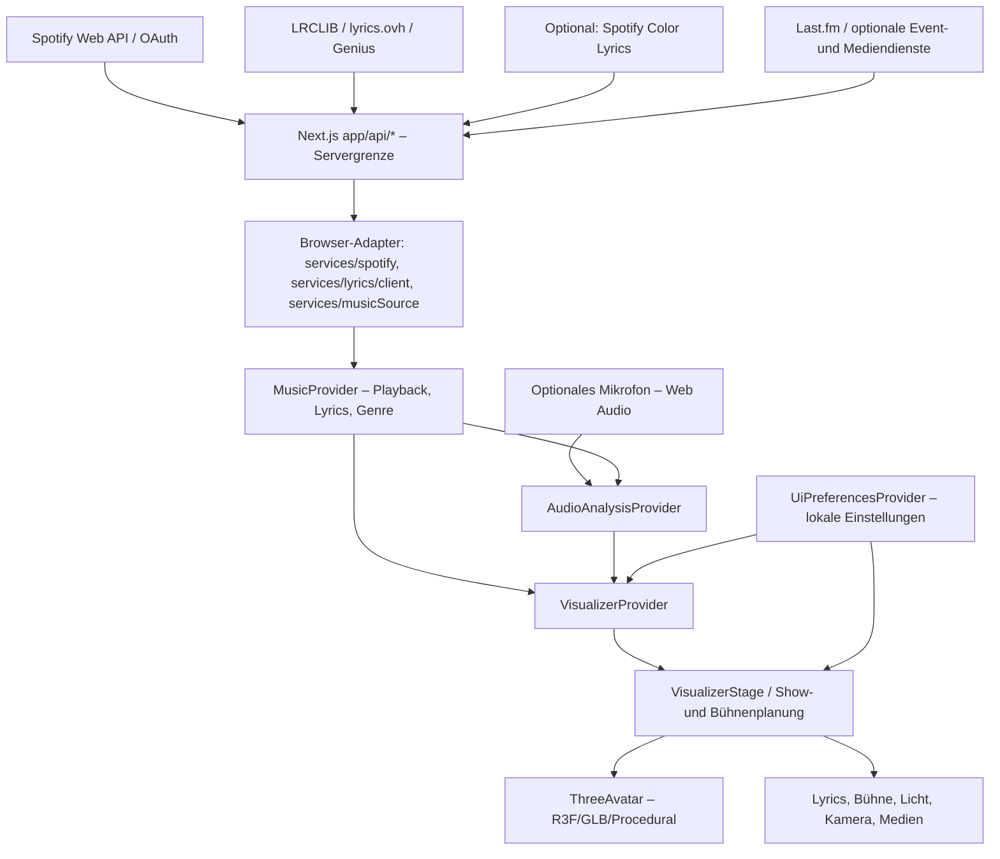
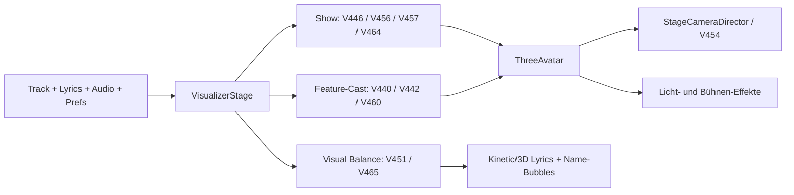

# Sonic Display – Systemarchitektur

> **Dokumentationsstand:** V492 Modular Refactor (24.10.2026)
> **Quellbasis:** Sonic Display V492; der npm-Paketversionsstring lautet `0.1.0-v492`.
> **Zweck:** Aktuelle Architektur und Verantwortlichkeiten, nicht chronologische Release-Historie.  
> **Pflege:** Bei neuen/umgebauten Komponenten, Datenflüssen, Routen und Prioritätsregeln mitaktualisieren. Der Build kontrolliert referenzierte Quelldateien; fachliche Aussagen benötigen weiterhin ein Review.

## 1. System auf einen Blick

Sonic Display ist eine Next.js-15-/React-/TypeScript-Anwendung mit Spotify-Wiedergabedaten, Lyrics, optionaler Mikrofonanalyse und einer 3D-Konzertbühne auf Basis von React Three Fiber/Three.js. Die Anzeige spielt Spotify-Musik **nicht selbst ab**: Wiedergabestatus und Position werden abgefragt und die Darstellung darauf synchronisiert. Das Raspberry-Pi-/Touchscreen-Ziel beeinflusst die Render- und Laufzeitstrategie. **Versionierte `Vxxx`-Dateien sind die Entwicklungshistorie; dieses Dokument beschreibt den gegenwärtigen Aufbau.**



**Zentrale Grenzen:** Tokens und Zugangsdaten bleiben in Server-Routen; Browser-Komponenten erhalten normalisierte Modelle aus `types/music.ts`, keine Spotify-Rohantworten. Mikrofonanalyse ist freiwillig. Aufnahme-/Analyseergebnisse dürfen nicht als echte Spotify-Audio-Analyse oder Sängererkennung ausgegeben werden.

### ThreeAvatar – Modulgrenzen (V492 Refactor)

Der öffentliche `ThreeAvatar`-Export bleibt in `components/visualizer/ThreeAvatar.tsx`. Der ehemalige monolithische Renderer ist ohne Änderung seiner Animationsentscheidungen in unabhängige Quellmodule aufgeteilt:

| Modul | Verantwortung |
| --- | --- |
| `ThreeAvatar.tsx` | Öffentlicher Einstieg, Canvas, Kamera/Lyrics/Bühnenintegration, WebGL-Recovery |
| `ThreeAvatarContextsV492.tsx` | Gemeinsame stabile React-Kontexte für Gruppe, Posen, Fußkontakt und Partnergesten; Provider und Consumer importieren identische Context-Instanzen |
| `ProceduralDancerAvatarV492.tsx` | Prozeduraler Tänzer, Ganzkörperpose und musiksynchrone Gesten |
| `GltfDancerAvatarV492.tsx` | GLB-Klon, AnimationMixer, Blending-Presets, IK/Foot-Lock, Lip-Sync |
| `DanceFormationActorsV492.tsx` | Avatar-Auswahl, Duo-Regie, 2er-Formationen und Choreografie-Ticks |
| `GroupDancersV326SceneV492.tsx` | Automatische 3-/4er-Gruppen, synchronisierte Posen und Bodenkontakt-Cues |

Der Split erzeugt **keinen** zusätzlichen R3F-Canvas, Animationsmixer oder Frame-Loop. Die älteren quelltextbasierten Regressionstests lesen nach der Modularisierung die tatsächlichen neuen Module über `tests/helpers/threeAvatarSourcesV492.cjs`; es wird kein alter Renderer-Snapshot mit ausgeliefert. `npm run test:three-avatar-split` prüft Import-/Provider-Grenzen und den öffentlichen Export.

## 2. Einstiegspunkte, Provider und Datenfluss

| Schicht | Aktueller Einstieg / Verantwortung |
| --- | --- |
| Next.js App Router | `app/layout.tsx` setzt die globale `UiPreferencesProvider`-Grenze. |
| Startseite | `app/page.tsx` schachtelt `MusicProvider` → `AudioAnalysisProvider` → `VisualizerProvider` → `SonicDisplay`. |
| Anzeige | `components/SonicDisplay.tsx` verarbeitet Track-/Lyrics-Zustand, Lazy-Loading, Kiosk-/Ambient-Ansichten und Visual-Balance. |
| Musik | `context/MusicContext.tsx` kombiniert `hooks/usePlaybackPolling.ts` und `hooks/useGenreDetection.ts` mit manuellen Genre-Korrekturen. |
| Audio | `context/AudioAnalysisContext.tsx` wählt Live-Mikrofonmesswerte oder geschätzte Beat-Metriken und gibt den aktiven Quellentyp weiter. |
| Visualizer | `context/VisualizerContext.tsx` bündelt Playback, Genre, Audio und Präferenzen zu `useVisualizer()`. |
| Präferenzen | `context/UiPreferencesContext.tsx` hält UI-Einstellungen getrennt vom Playback in Browser-`localStorage`. |
| Typen | `types/music.ts` definiert unter anderem `Track`, `Lyrics`, `MusicState`, `MusicSource` und `UiPreferences`; `types/audio.ts` die Audiomesswerte. |

**Wiedergabeablauf:** `services/musicSource.ts` → `services/spotify/client.ts` → `/api/spotify/current` → `hooks/usePlaybackPolling.ts` → `MusicContext`. Die Abfrage erfolgt normal alle 5 Sekunden; Fehler führen zu begrenztem Backoff bzw. `reconnecting`. Bei Trackwechsel werden Lyrics neu geladen. `SonicDisplay` interpoliert die Fortschrittsanzeige zwischen den Serverabfragen; das ist keine samplegenaue Audiouhr. Bei Seek, Pause, Trackwechsel und Tab-Wechsel müssen die Direktor-Module ihre Zustände prüfen bzw. zurücksetzen.

**Präferenzen:** Manuelle Optionen, gespeicherte Rap-/Kamera-Edits und Avatar-Auswahl sind getrennt von der Spotify-Session. `localStorage` ist eine browser-/gerätegebundene Speicherung und keine automatische geräteübergreifende Synchronisierung. Einstellungen können vor der Hydrierung zunächst Defaults verwenden.

## 3. Serverseitige Integration und Sicherheit

### Spotify-Anmeldung und Wiedergabe

- `app/api/spotify/login/route.ts`: OAuth-Einstieg mit CSRF-`state`; kanonischer Callback-Ursprung aus `lib/spotify-origin.ts` (wichtig für `localhost` gegenüber `127.0.0.1`).
- `app/api/spotify/callback/route.ts`: `state`-Validierung und Code-Austausch; danach Session-Cookie.
- `lib/spotify.ts`, `lib/session.ts`: Token-Aktualisierung und AES-256-GCM-verschlüsseltes, `HttpOnly`/`SameSite=Lax`-Session-Cookie; keine Browserausgabe von Spotify-Tokens.
- `app/api/spotify/current/route.ts`: Spotify-Status in das `Track`-Modell umwandeln, 401/204/429 und Refresh behandeln. Die API liefert auch Contributor-/Artist-Credits, **keine** zeitcodierten Sängerrollen.
- `app/api/spotify/artists/follow/route.ts` und die Discovery-/Library-Routen: eigene serverseitige Spotify-Zugriffe; Benutzeraktionen bleiben ausdrücklich zugeordnet.
- `app/api/canvas/route.ts`: optionaler, inoffizieller Spotify-Canvas-Endpunkt; Verfügbarkeit ist nicht garantiert.

Konfiguration und Secrets kommen aus `.env.example`/Serverumgebung, **nicht** aus `NEXT_PUBLIC_*` (ausgenommen ausdrücklich öffentliche Werte wie ein VAPID-Public-Key). Spotify-OAuth-Redirect-URL, Origin und Cookies müssen zusammenpassen. Die Version unterstützt nur die in `lib/env.ts` definierten gültigen Konfigurationen.

### Lyrics und Genius

`services/lyrics/client.ts` fragt `/api/lyrics` an. `services/lyrics/server.ts` ist der zentrale Provider-Orchestrator:

1. **Optional zuerst Spotify Color Lyrics**, wenn `SPOTIFY_INTERNAL_LYRICS_ENABLED=true`, ein gültiger Spotify-Track und ein autorisierter Session-Token vorliegen. `services/lyrics/providers/spotifyColorLyrics.ts` nutzt einen **nicht öffentlichen/undokumentierten Endpoint**: Web-API-Tokens können mit 401/403 abgewiesen werden, dann folgt normaler Fallback; keine Cookie-/Token-Extraktion aus dem Spotify-Webplayer.
2. **LRCLIB** (`services/lyrics/providers/lrclib.ts`), insbesondere für echte synchronisierte Lyrics.
3. **lyrics.ovh** (`services/lyrics/providers/lyricsOvh.ts`) als Text-Fallback.
4. **Genius** (`services/lyrics/providers/genius.ts`) als weiterer Text-Fallback, soweit konfiguriert.

Ergebnisse werden zu `Lyrics`/`LyricLine`/optional `LyricWord` normalisiert. `synced: false` bedeutet **keine** belegbare zeitgenaue Karaoke-Zuordnung. Die Reihenfolge ist eine *Fallback-Reihenfolge*, keine parallele Qualitätsbewertung aller Anbieter. Genius-Metadaten sind separat: `/api/genius/insights` und `services/genius/songInsightsV447.ts`, `services/genius/cinematicInsightsV448.ts`, `services/genius/musicDiscoveryV449.ts`, `services/genius/musicConnectionsSpotlightV450.ts` liefern vorsichtig zugeordnete Credits, Samples und Verknüpfungen. **Genius liefert hier keine verifizierten Zeitstempel für den tatsächlich singenden Feature-Künstler.**

### Genre und externe Inhalte

- `app/api/genre/route.ts` + `hooks/useGenreDetection.ts`: genrebezogene Last.fm-Tags/Heuristiken, Fusion/Overrides; `services/genre/genreCorrectionMemory.ts` verwaltet gespeicherte Korrekturen. Genre bleibt eine Zuordnung/Heuristik, nicht Audiosignalerkennung.
- `app/api/stage-content/concerts/route.ts` + `services/stageContent/concertProvidersV336.ts`: optionale österreichische **oeticket/Eventim**-Abfrage (`STAGE_OETICKET_ENABLED=true`) und Ticketmaster bei vorhandenem Schlüssel; validierte Künstler-/Eventlinks, deduplizierte Events. Keine Bandsintown-Abhängigkeit.
- `services/stageContent/*` enthält Foto-/Galerie-, Layout-, Regie-, Echtzeit- und Quellenlogik; passende serverseitige Endpunkte liegen in `app/api/stage-content/`.
- `app/api/avatars/` + `lib/avatarBlob.ts`: administrativer Avatar-/Motion-Import, Konfiguration, lokaler JSON-Fallback oder optionaler Vercel-Blob-Speicher. Keine Annahme, dass Blob in jeder Installation eingerichtet ist.
- `app/api/push/subscription/route.ts` und `app/api/cron/release-push/route.ts`: optionale Web-Push-/Release-Workflows; zugehörige Server-Credentials müssen konfiguriert sein.

**Integrationsprinzip:** Externe Daten sind untrusted. IDs, URLs und API-Ergebnisse werden serverseitig validiert/normalisiert. Optionale Quellen dürfen die Grundanzeige bei Ausfall nicht blockieren.

## 4. Visualisierung und Bühnenarchitektur

`components/visualizer/registry.tsx` registriert `VisualizerProps` und die wählbaren Modi (`wave`, `particles`, `album-glow`, `avatar`). `components/visualizer/VisualizerStage.tsx` ist heute der **zentrale Orchestrator**: Dort laufen Präferenzen, Audio, Lyrics, Sänger-Credits, Bühneninhalte sowie Kamera-, Licht-, Tanz- und Show-Cues zusammen. `components/visualizer/ThreeAvatar.tsx` setzt die 3D-Performance in React Three Fiber um – für skinnte GLB-Modelle und die prozedurale Ausweichdarstellung.



### Tanz, Avatare, GLB und Motion-Bibliothek

- Avatarauswahl und GLTF-Modelle: `components/visualizer/avatarModels.ts`, `hooks/useAvatarModel.ts`, `components/visualizer/AvatarEditor.tsx`; Import und Bibliothek: `components/visualizer/characterMotionLibrary.ts` und Avatar-API-Routen.
- Motion-Playback, GLB-Clip-Analyse und Auswahl: `components/visualizer/glbMotionAnalyzerV439.ts`, `components/visualizer/automaticMotionIntelligenceV438.ts`, `components/visualizer/rapFlowIntelligenceV473.ts`, `components/visualizer/naturalRapGestureVarietyV474.ts`, `components/visualizer/intelligentMultiAvatarInteractionV475.ts`. Rhythmus-/Genre-/Vocal-Cues ergänzen die vorhandenen Bewegungen und ersetzen weder echte Clip-Anatomie noch unbekannte Gesangsdaten.
- Multi-Avatar-Formationen und Interaktionen: `components/visualizer/automaticFeatureShowV440.ts`, `components/visualizer/automaticMultiArtistStageV442.ts`, `components/visualizer/intelligentFeaturePerformanceV460.ts`, `components/visualizer/advancedMultiAvatarPerformanceV452.ts`.
- Bei Feature-Songs kann die Spotify-Credit-Liste die **Anzahl und Beschriftung** von bis zu vier Avataren steuern. **Credits sind keine Stimmtrennung.** Exakte Rollen-/Zeitzuweisungen bleiben ein eigener, manueller/autorisiert annotierter Vorgang.

### V489 – GLB-Hockbewegungen und Clipübergänge

Die automatische Choreografie nutzt die vorhandene Clipauswahl aus
`components/visualizer/intelligentLowPoseV481.ts` und die Hysterese aus
`components/visualizer/naturalLowPoseTransitionsV482.ts`. Neu in
`components/visualizer/naturalGlbFullBodyMotionV489.ts` ist ein reiner, begrenzter
Planer für Crossfade-Dauer und Pose-Match-Freigabe. **Nur** wenn ein bestehender
GLB-Hock-/Knieclip automatisch beginnt, endet oder auf einen anderen Low-Clip
wechselt, verfeinert `components/visualizer/ThreeAvatar.tsx` die bereits vorhandene
V311-Blend-Entscheidung. Linke/rechte Fußkontaktphasen aus V322/V487 werden
nur als konservatives Indiz verwendet. Die eigentliche IK-Skelettkorrektur,
manuelle Timeline, importierte Clipdateien, Sänger-/Lyrics-Timing und reguläre
Tanzclips bleiben unangetastet. Kein neuer Animator, kein dauernder React-State
für die Crossfades und kein universelles IK-Retargeting.

### Lippensynchronisation und Rap-Performance

- Gemeinsame Performance-Integration in `components/visualizer/ThreeAvatar.tsx` und die passenden Rig-/Face-Module; Lyrics und Playback-Zeit stammen aus den zentralen Zuständen.
- `components/visualizer/rapSyllableArticulationV419.ts` nutzt geschätzte Silbenformung; `components/visualizer/rapSyllableKeyframesV420.ts` hält benutzereditierte Keyframes vor; `components/visualizer/rapAudioAwareV423.ts` erlaubt explizit bereitgestellte Audiodaten – **keine** heimliche Spotify-Audioaufnahme.
- `components/visualizer/rapFlowIntelligenceV473.ts` nutzt **nur** belegbare Lyrics-Zeitpunkte, Zeilen-/Wortdichte und dezente *Text*-Ad-lib-Hinweise für bounded Gestik; keine Vocal-Isolation, Sprecher-Diarisierung oder automatisch erfundenen Wort-Timestamps.
- `components/visualizer/naturalRapGestureVarietyV474.ts` variiert diese bestehenden Bewegungen mit fünf deterministischen Gestenmotiven pro Track/Zeile/Avatar. Bei Hooks teilen sich die Avatare ein Motiv, behalten aber eine dezente Seiten-Asymmetrie. Anwender-Choreografien, pausierte Darstellung und unbekannte Sängerrollen bleiben unverändert.
- `components/visualizer/expressiveLipSyncV476.ts` ist ein kleiner, deterministischer **Finishing-Pass hinter V453/V459**: Er formt Mundöffnung und -breite sehr vorsichtig anhand des schon bestätigten Wortfensters und von **geschriebenen** Vokalhinweisen (keine Phonemerkennung), akzentuiert Braue/Wange und passt die Attack-/Release-Glättung innerhalb dieses Fensters an. **V420-editiertes Mund-Material und V423-Audio-Mundsignale bleiben unverändert**, ebenso V415-Lippenverschluss sowie der V459-Kopf-/Körperpfad. `components/visualizer/VocalRigV368.tsx` übernimmt den Pass für GLB-Morphs und das Jaw-Bone-Overlay; `components/visualizer/ThreeAvatar.tsx` für den prozeduralen Mund. Demo-/Editorvorschauen und unbekannte Lyrics-Zeitstempel erhalten keine erfundenen Bewegungen.
- `components/visualizer/beautifulLyricsV477.ts` erweitert den V455/V461-Typografiepfad. Das Modul unterscheidet **validierte Wortmarken**, **reinen Zeilenfortschritt** und **unsynchronisierten Text**. Für 3–4 Avatare wird die visuelle Beschriftung verkleinert oder die immersive Anzeige auf die aktive Zeile reduziert; die vorhandenen Lyrics, Künstlerrollen und Wort-Zeitstempel bleiben unverändert. `components/KineticLyrics.tsx` zeichnet Wortkaraoke nur mit echten Wortmarken; andernfalls eine zeilenbezogene Farbfüllung. `components/visualizer/Lyrics3DScene.tsx` reduziert Wortmeshes bei fehlenden validierten Zeitstempeln und benutzt die vorhandene Qualitätsstufe.
- `components/visualizer/intelligentMultiAvatarInteractionV475.ts` verfeinert den V444/V460-Auto-Cast (3–4 Artists) mit leichten Blick-, Schulter- und Gestenreaktionen für Verses, visuelle Reply-Szenen und Hooks. Die vorhandenen Look-/Gesture-Mixer begrenzen die Ausgabe; gespeicherte Sängerrollen und manuelle Stage-Steuerung werden nicht überschrieben. 2er-Duette verbleiben im eigenen vorhandenen Renderer.
- `components/visualizer/rapDuetStudioV416.ts` und die entsprechenden Panels erlauben manuelle Zuordnungen; sie haben Vorrang vor automatisch geschätzten Rollen.

### Lyrics, Kamera, Licht und visuelle Balance

- Lyrics-Darstellung: `components/KineticLyrics.tsx`, `components/visualizer/Lyrics3DScene.tsx`, `components/visualizer/kineticLyricsV382.ts`, `components/visualizer/cinematicLyricsV461.ts`; vorhandene Timing-Information wird genutzt, bei fehlendem Sync gelten Fallbacks.
- Kamera: `components/visualizer/StageCameraDirectorV289.tsx`, `components/visualizer/cinematicRapCameraV429.ts`, `components/visualizer/cinematicConcertCameraV454.ts`; gespeicherte Keyframes, manuelle Kamera und Lyrics-Lesbarkeit begrenzen automatische Kamerabewegungen.
- Licht: `components/visualizer/concertLightingDirectorV462.ts`, zusätzlich bestehende Bühnen-/Lichtcontroller. Effekte sind nach Leistungsprofil und Schutzregeln begrenzt. Eine Laser-Show gehört nicht zum gewünschten Standard; die vorhandene Laser-Option ist in den UI-Defaults deaktiviert.
- Gemeinsame Show-Regie: `components/visualizer/smartAutomaticRapShowV446.ts`, `services/show/ultimateAutomaticShowV456.ts`, `services/show/showContinuityV457.ts`, `services/show/automaticConcertExperienceV464.ts`.
- **V478 – autonome visuelle Konzertregie:** `services/show/autonomousConcertDirectorV478.ts` arbeitet **nach** der V464-Bühnen-Dramaturgie in `components/visualizer/VisualizerStage.tsx`. Es koordiniert die vorhandenen automatischen V454-Kamera-Cues mit den bereits aktiven V456-Lichtstärken: Intro/Finale und Hooks als Ensemble, Verse eher als Portrait, visuelle Replies als Ensemble. Der Lyrics-Fokus unterbindet neue Kameraentscheidungen, um die Lesbarkeit zu sichern; schwache Geräteprofile, Pausen, reduzierte Animationen, manuelle Sänger- und Kamera-Einstellungen sind Schutzbedingungen. Dies ist eine **visuelle Regie auf Basis des vorhandenen zeitlichen Plans**, keine Erkennung echter Song-Sections oder Feature-Stimmen. Die nachgelagerten Kamera-Haltezeiten, manuelle Licht-Timelines, Blackouts und Renderbudgets bleiben zuständig. Keine zusätzlichen Lichter, Kamerarenderer, Timer oder Spotify-Zugriffe.
- `services/show/visualBalanceV451.ts` und `services/show/visualShowQualityV465.ts` begrenzen Informationsdichte, Lyrics-Überlagerungen und Beschriftungen. Die sichtbare Umsetzung ist weiterhin von gewählten Modi/Präferenzen abhängig.

**Vorrangregeln (designorientiert, durch Tests abgesichert):** explizite manuelle Vorgaben und gespeicherte Keyframes vor automatischen Vorschlägen; echte synchronisierte Lyrics vor Schätzungen; Pause, Seek, fehlende Daten und `reducedMotion` werden berücksichtigt. Automatik ist keine Garantie dafür, dass in jedem Song Künstlerwechsel, Drop oder Gesangsstimme korrekt erkannt werden.

**V492 – GLB Blending Preset Studio:** `components/visualizer/glbBlendPresetsV492.ts` validiert und speichert modell- und animationsquellgebundene Presets mit Basis-/Gestenclip-ID und Originalnamen, Region, Gewicht, Genre und Auto-Opt-in. `AvatarPreview3D.tsx` bietet Speichern/Aktualisieren/Löschen, gespeicherte Vorschau und begrenzten JSON-Import/-Export. `ThreeAvatar.tsx` bindet maximal acht gültige automatisch freigegebene sichere Oberkörper-Overlays in den vorhandenen GLB-Mixer ein, ausschließlich bei bereits ausgewähltem Basisclip; manuelle Choreografie, Foot-IK, reduzierte Bewegung und niedrige Qualität haben Vorrang. Tests: `tests/v492-glb-blending-presets-regression.cjs`, `tests/tsconfig.v492-core.json`.

**V491 – GLB Motion Preview & Blending Studio:** `components/visualizer/AvatarPreview3D.tsx` bietet im bestehenden Avatar-3D-Studio eine bedienbare Vorschau mit zwei bereits installierten Clips, eigener Basisclip-Timeline, maskiertem zweitem Gestenclip, Körperbereich (Arme oder Arme/Brust), 0–50 % Mischgewicht und pausiertem Scrubbing. `components/visualizer/glbMotionBlendPreviewV491.ts` validiert Masken und Gewichte ohne Nebenwirkungen und verwendet den konservativen V490-Bone-Filter. Das Overlay wird im vorhandenen Vorschau-`AnimationMixer` auf einem geklonten Rig abgespielt; Original-GLBs, Live-Bühne, Fuß-IK, Kopf und Lip-Sync bleiben unverändert. Bei reduzierter Bewegung/fehlenden Clips ist die Mischung deaktiviert. Tests: `tests/v491-glb-motion-preview-blending-regression.cjs`, `tests/tsconfig.v491-core.json`.

**V490 – automatisches GLB-Oberkörper-Masking:** Bei einer aktiven automatischen Low-Pose kann `components/visualizer/automaticGlbUpperBlendV490.ts` aus vorhandenen Gestenclips nur sichere Arm-/Brustrotationen auswählen; `components/visualizer/automaticGlbUpperClipV490.ts` klont diese Tracks und `components/visualizer/ThreeAvatar.tsx` mischt sie im bestehenden GLB-Mixer zum primären Knie-/Hockclip. Root, Becken, Beine, Füße, Kopf und Face-Morphs sind ausgeschlossen. Manuelle Animation, Timeline, Reduced Motion und Low-Tier deaktivieren die zusätzliche Ebene. V487-Foot-IK bleibt nach dem Mixer verantwortlich.

## 5. Audio- und Zeitquellen: Messung ≠ Schätzung

- **Spotify:** Track-ID, Play/Pause, Zeitposition und Metadaten. `hooks/useEstimatedBeat.ts` liefert daraus eine geschätzte Musikbewegung ohne Zugang zu Spotify-Roh-Audio.
- **Mikrofon optional:** `hooks/useMicrophoneAnalysis.ts` verarbeitet Web-Audio-Daten nach ausdrücklichem Opt-in; `hooks/audioRhythm.worker.ts`, `hooks/beatTempoTracker.ts`, `hooks/beatPhaseTracker.ts` und `hooks/rhythmLearningEngine.ts` enthalten zusätzliche Rhythmus-/Timing-Komponenten.
- **Lyrics:** Zeilen- und gegebenenfalls Wort-Timestamps sind eine dritte, getrennte Quelle; sie belegen weder Kick-Onsets noch Sängeridentität.
- **Abstimmung:** `context/AudioAnalysisContext.tsx` steuert, welche Metriken als live bzw. geschätzt gelten. Confidence, Pausen-/Seek-Handling und Offset-Vorgaben sollen diese Unterscheidung durch alle Darstellungen bewahren.

Die Mikrofonanalyse erkennt keine Instrumente oder Sprecher sicher. Geschätzte Phrasen-/Hook-Zuordnungen dürfen nicht als verifizierte Songstruktur dargestellt werden.

## 6. Laufzeit, Ressourcen und Raspberry Pi

- `components/SonicDisplay.tsx` lädt nicht notwendige Oberfläche und Bühnenansicht mit `next/dynamic` nach; Mikrofon und Audio-Visualizer werden nicht für bloße Spotify-Metadaten benötigt.
- `components/visualizer/ThreeAvatar.tsx` verwendet Qualitätsstufen, gezielte Aktualisierungsraten, begrenzte Avatar-/Animationsberechnung sowie GLB-/Motion-Fallbacks; tatsächliche FPS bleiben geräte- und szenenabhängig.
- `services/monitoring/piSessionStabilityV463.ts` und `services/monitoring/performanceStabilityGuardV272.ts` implementieren Stabilitäts-/Erholungsrichtlinien; Messwerte und Tests sind **keine** Hardware-FPS-Garantie.
- **V479 – Pi-Konzertbudget:** `components/visualizer/RaspberryPiEdition.tsx` aktiviert nur nach expliziter Profilauswahl (oder opt-in *Auto* bei Linux-ARM-Hinweis) die reine Zustandsmaschine `services/monitoring/piConcertBudgetV479.ts`. Der einmal pro Sekunde gemessene FPS-/P95-Framezeit-Block aus `components/visualizer/adaptivePerformance.tsx` wird durch `components/visualizer/piConcertRuntimeV479.tsx` an `components/visualizer/ThreeAvatar.tsx` weitergereicht; es gibt keine zusätzliche RAF-Schleife. Fünf schlechte Messfenster reduzieren optionale automatische Postprocessing-/Shader-/DanceFX-Effekte; nach 18 guten Fenstern und mindestens 30 Sekunden Cooldown wird wieder mehr Automatik erlaubt. Bei drei bis vier Avataren unterbleibt bereits in Balanced automatisches Postprocessing. *Pi Low* bleibt ausdrücklich Eco; manuell eingeschaltete Effekte bleiben erhalten. Pausen, versteckte Tabs und veraltete/ungültige Messwerte führen nicht zu einer Herabstufung. Die Qualität wird weiterhin maßgeblich durch DPR-/V388-/V403-Pixelbudget und den übrigen Renderer-Schutz gesteuert. Dies misst keine GPU-Temperatur und garantiert keine feste Pi-Bildrate.
- **V480 – passives Konzert-Diagnose-Dashboard:** `components/visualizer/piConcertRuntimeV479.tsx` reicht dieselben V479-Ein-Sekunden-Messfenster zusammen mit `components/visualizer/renderDiagnostics.ts` an die reine Session-Policy `services/monitoring/concertPerformanceDiagnosticsV480.ts` weiter. `components/visualizer/concertDiagnosticsRuntimeV480.tsx` hält einen begrenzten, nicht persistenten Store (90 valide Messungen/24 tatsächliche Pi-Budgetwechsel). Das Diagnosepanel `components/visualizer/ConcertPerformanceDiagnosticsV480.tsx` ist nur über `components/visualizer/RenderDiagnosticsPanel.tsx` im Diagnose-Tab geladen; es zeigt FPS/P95-/Avatar-/Draw-Call-Verläufe und erlaubt einen **lokalen JSON-Export**. Ungültige, pausierte oder versteckte Fenster werden nicht gezählt. Keine weitere Render- oder Netzwerk-Messschleife und keine zusätzliche Qualitätsregelung. Die Statushinweise sind Schwellenheuristiken; keine echten GPU-/Temperaturmessungen.
- **V487 – Realistic Ground Contact Studio 3.0:** `components/visualizer/groundContactStudioV487.ts` bewertet bereits vorhandene GLB-Foot-IK-Standanker und Knöchel-Weltpositionen **modellbezogen** (Konfidenz ≥ 0,35; Drift-Schwellen 1,5 cm und 4 cm). Im alten `components/visualizer/ThreeAvatar.tsx`-Frame-Callback publizieren vier unabhängige Context-Refs Messwerte; die vorhandene optionale V485/V486-Bühnen-Schrittverschiebung wird bei gemeldeter Drift weiter verlangsamt, *nicht* die ursprünglichen Formations- oder Clip-Ziele. `components/visualizer/GroundContactPanelV487.tsx` ist eine leichte, lesende Diagnose im `components/visualizer/StageDirectorControlsV287.tsx`: zwei Updates pro Songsekunde, maximal 40 Verlaufspunkte im RAM, keine zweite Render-Schleife. Standankerabweichung ist keine garantierte reale Bodenberührung, keine physikalische Kollision und keine neue Foot-IK. Keine GLB-Korrektur bei unbekanntem Rig. Tests: `tests/v487-realistic-ground-contact-regression.cjs`, `tests/tsconfig.v487-core.json`.
- **V486 – Advanced Dance Footwork 2.0:** `components/visualizer/advancedDanceFootworkV486.ts` verfeinert ausschließlich V485s opt-in Formationsschritte: der prozedurale Fußhub kommt aus Song-/Cue-Zeit und optional vorhandenem BPM, ist links/rechts abwechselnd und hat glatte Fußaufsetzpunkte. Bei importierten GLB-Avataren meldet die **bestehende** `components/visualizer/avatarFootIK.ts` über ein mutables Context-Ref die tatsächlich beobachteten `planted`-Zustände an die Gruppe; die optionale Bühnenverschiebung wird bei beiden Stützfüßen merklich gebremst. Ohne aktive IK gibt es keine unterstellten Fußkontaktmessungen. Root-Verschiebungen werden auf 90 % des V485-Offsets begrenzt; die V485-Abstandsprüfung und alle manuellen, Lyrics-/Foot-Lock-/Pause-/Low-Tier-Schutzregeln bleiben vorgeordnet. Die ursprünglichen GLB-Keyframes bleiben unverändert. Root-Drosselung ersetzt **keine** Kontaktphysik und ist keine Garantie gegen Rig-spezifisches Fußgleiten. Keine zusätzlichen Frame-Loops oder Animation-Mixer. Tests: `tests/v486-advanced-dance-footwork-regression.cjs` und `tests/tsconfig.v486-core.json`.
- **V485 – Natural Dance Motion Studio 5.0:** `components/visualizer/naturalDanceMotionStudioV485.ts` plant für automatisch dirigierte Dreier-/Vierergruppen einen kleinen **seitlichen Schritt mit Vorder-/Hintergrundstaffelung** zwischen einem stehenden und einem hockenden Bühnenpartner. Die ursprüngliche Slot-Reihenfolge bleibt fest; es gibt kein tatsächliches Durchlaufen der GLB-Modelle oder automatisches Umordnen der Rollen. Der Ausdruck „Vorbeitanzen“ bedeutet hier eine optische, begrenzte Annäherung **vor** dem Partner (max. 10,5 cm seitlich/20 cm Tiefe), nicht kollisionsgeprüftes Überholen. Bei jeder Tanzphrase fahren alle optionalen Verschiebungen sanft auf Null zurück. Die Policy nutzt nur vorhandene V481/V483-Tiefposen, Cue-/Beat-/Kick-/Energiewerte und die Performance-Tier-Information. Sie deaktiviert sich vollständig bei manueller Choreografie/Vocal-Rolle, Foot-/Contact-IK-Lock, `reducedMotion`, Lyrics-Vordergrund, Pause, schwacher Evidenz, Low-Tier oder eng beieinanderliegenden Stage-Roots (unter 1,03 m). Sie überprüft Stage-Root-Abstände, **nicht** die Mesh-/Fuß-Kollisionen. Die prozedurale Ersatzfigur benutzt die bestehende 2-Segment-Beinkette für eine kleine zusätzliche Schritthebung nur bei fast vollständig aufgerichtetem Bein; importierte GLB-Rigs bleiben bei ihren vorhandenen Clips und können bei Root-Bewegung weiterhin rigabhängiges Fußgleiten zeigen. Integration ausschließlich in dem schon bestehenden `components/visualizer/ThreeAvatar.tsx`-`useFrame`, keine neuen Timer, Dienste, GPU-Objekte oder Animationsmixer. Tests: `tests/v485-natural-dance-motion-studio-regression.cjs` und `tests/tsconfig.v485-core.json`.
- **V484 – Expressive Dance Performance 4.0:** `components/visualizer/expressiveLowPosePerformanceV484.ts` wertet ausschließlich die bereits von V481/V483 genehmigten automatischen Tiefposen aus und erzeugt begrenzte additive `PartnerGestureCue`-Akzente für vorhandene Schulter-, Arm- und Oberkörper-Rigkanäle. Bei Deutschrap verteilen sich linke/rechte Arm-Akzente asymmetrisch, bei Hardstyle-/Hardtekk-Drops gibt es sanft eingefadete Gruppenakzente, bei einem stehenden Lead nur eine zurückhaltende Reaktion. Der Algorithmus verwendet vorhandene Beat-/Kick-/Snare-/Energiewerte; er erkennt **keine** Punchline-Timestamps oder Singstimmen und bleibt ohne hinreichende rhythmische Evidenz neutral. Die bestehende GLB-Animation/Foot-IK darf nicht retargetiert oder überschrieben werden. In der prozeduralen Ersatzfigur ergänzt `components/visualizer/ThreeAvatar.tsx` eine kleine, auf 0,11 rad begrenzte Vorwärtsdrehung beider bereits vorhandener Arme. Manuelle Sänger- und Motion-Keyframes, `reducedMotion`, Pause, Lyrics-Vordergrund und nichtautomatische Formationen unterdrücken den Zusatz. Die Leistungsstufe reduziert nur diese optionalen Akzente. Keine neue RAF-Schleife, kein Animationsmixer und keine zusätzlichen 3D-Objekte. Tests: `tests/v484-expressive-dance-performance-regression.cjs` und `tests/tsconfig.v484-core.json`.
- **V483 – Natural Dance Interaction 3.0:** `components/visualizer/naturalLowPoseInteractionV483.ts` ergänzt die bestehende V481-Tiefposen-Policy und V482-Übergänge um leichtes partnerbezogenes Head-/Eye-Tracking, kleine asymmetrische Schulter-/Armakzente sowie **maximal 240 ms versetztes Aufrichten** nach automatisch gespielten Low-Pose-Abschnitten. Die vier festen Slot-Zustände laufen ausschließlich in `components/visualizer/ThreeAvatar.tsx` im vorhandenen V326-`useFrame`, ohne eigenen Taktgeber, neue React-Frame-Updates oder zusätzliche GPU-Ressourcen. Offizielle Rollen-Zeitstempel werden nicht behauptet: Blickrichtung folgt allein sichtbaren Bühnenpositionen. Bei manueller Choreografie, manuell zugeordneten Sängern, Pause, Seek, Lyrics-Vordergrund, `reducedMotion` oder Trackwechsel wird der kurzzeitige Release-Cache verworfen. Ein neuer aktiver Plan behält Vorrang und beachtet die eingestellte Normal-Höchstzahl; der Nachlauf eines explizit erlaubten synchronen Vierer-Drops darf die Vierergruppe für maximal 240 ms freigeben; die V475-/V458-Gesten werden nur vorsichtig über die bestehenden V452-Sicherheits-Clamps ergänzt. Der zusätzliche Blickkontakt beeinflusst weder GLB-Keyframes noch Clips, Foot-IK, Root-Positionen oder Lippenbewegungen. Prüfungen: `tests/v483-natural-dance-interaction-regression.cjs` und `tests/tsconfig.v483-core.json`.
- **V482 – natürliche Tiefposen-Übergänge:** `components/visualizer/naturalLowPoseTransitionsV482.ts` ergänzt V481 um pro Avatar **eine** kritisch gedämpfte Tiefenposition und eine begrenzte Oberkörper-Gewichtsverschiebung. In `components/visualizer/ThreeAvatar.tsx` treiben derselbe Tiefenwert und `solveProceduralLowLegV481` die prozedurale Beckenabsenkung und beide Bein-Ketten gemeinsam an; normale Beat-Bounce-Bewegung wird getrennt geglättet. Bei GLB-Tänzern bleiben vorhandene importierte Squat-/Kneel-Clips Pflicht. Ein kleiner Clip-Latch verhindert hektische Wechsel zwischen unterschiedlichen Low-Pose-Clips, hebt aber Stand/Pause/Manuell sofort auf. Die V481-Gruppen-Policy, das V326-UI, Foot-IK und die manuellen Eingriffe behalten Vorrang. Keine neue Rigsynthese, kein Physiksimulationsversprechen, kein zusätzlicher Frame-Sampler. Tests: `tests/v482-natural-low-pose-transitions-regression.cjs` und `tests/tsconfig.v482-core.json`.
- **V481 – intelligente Tiefposen/Formation:** `components/visualizer/intelligentLowPoseV481.ts` erstellt aus V326-Gruppen-Cues, Echtzeit-Beat-/Kick-Energie, V442-Automatik, Genre und Leistungsstufe pro Avatar eine deterministische Low-Pose-Absicht. Die Policy läuft in `components/visualizer/ThreeAvatar.tsx` nur für automatisch inszenierte Dreier-/Vierergruppen, nach manuellen Sänger- und Gruppen-Vorrangprüfungen. Eine für jeden Tänzer stabile Context-Ref wird pro Frame aktualisiert, ohne React-Render-Loop. Der bestehende GLB-Mixer verwendet Low-Pose-Animationsclips **nur dann, wenn sie vorhanden sind**, sonst bleiben normale Clip- und Foot-IK-Steuerung erhalten. Der prozedurale Renderer besitzt eigene zweigliedrige Beine (Hüft- und Kniebewegung) und senkt den Körperschwerpunkt kompensiert ab. `components/visualizer/LowPoseControlsV481.tsx` ist in `components/visualizer/MultiAvatarStageStudioV326.tsx` als Steuerung für Intensität, Normal-Limit und explizite gemeinsame Drops eingebunden. Automatische Tiefposen sind bei manueller Regie, Pause, `reducedMotion`, Lyrics-Vordergrund oder kritischem Performance-Tier eingeschränkt. Kein zweiter Animation-Mixer, kein zusätzlicher Audio-Analyzer und keine behauptete echte Bodenkollision. **GLB-Squat-Clips können weiterhin rigabhängige Fußrutsch-/Retargeting-Artefakte besitzen.**

- `components/visualizer/glbMotionAnalyzerV439.ts` und die Caches sollen Clipanalysen von Live-Frames entkoppeln. Riesige GLB-Dateien und vier komplexe Avatare können dennoch stark belasten.
- Keine dauerhaften per-Frame-React-State-Updates für hochfrequente Rendering-Telemetrie; Einstellungen, Audiosignale und Frame-Sampling bewusst entkoppeln.

### V488 – Ausdrucksstarke Ganzkörper-Koordination

`components/visualizer/naturalFullBodyDanceV488.ts` berechnet **nur für prozedurale Multi-Avatar-Tänzer** kleine, deterministische, pro-Avatar differenzierte Zielwerte für Hüftgewichtung, Oberkörperneigung, Schulter-/Armschwung, Blickausgleich und den Knie-Fuß-Schwung. Die Eingaben stammen aus dem bestehenden V482-Hockfilter und den V486-Footwork-Signalen und der Songzeit, nicht aus einer neuen Audio- oder Render-Schleife. `components/visualizer/ThreeAvatar.tsx` mischt diese Werte in vorhandene ProceduralAvatar-Rig-Refs; kein neues GLB-Retargeting oder Fuß-IK-Override. Bei Pause, manueller Choreografie, Reduced Motion, niedriger Qualitätsstufe, fehlender Track-ID oder deaktivierter automatischer Gruppe bleibt die Zusatzpose neutral. Aufgesetzte Füße werden von V488 nicht angehoben. V487 bleibt für importierte GLB-Fußkontakte verantwortlich. Rein visuelle Oberkörperbewegungen sind **keine** physikalische Gewichtsschwerpunkt- oder Bodenkontaktsimulation.

## 7. Datenspeicher und Schutzgrenzen

| Daten | Speicher/Verantwortung | Hinweise |
| --- | --- | --- |
| Spotify-Session / OAuth-State | `lib/session.ts`, serverseitig verschlüsselte Cookies | Cookies sind `HttpOnly`; Refresh bleibt serverseitig. |
| UI-, Rap-, Kamera- und Avatar-Präferenzen | `context/UiPreferencesContext.tsx` / Browser-`localStorage` | Lokal, nicht automatisch synchronisiert; Normalisierung einzelner Versionen beim Laden. |
| Genre-Korrekturen | `services/genre/genreCorrectionMemory.ts` | Gespeicherte Nutzerkorrekturen und temporäre Session-Overrides. |
| Avatar-Konfiguration/Modelle | `lib/avatarBlob.ts` / lokale Dateien oder optional Vercel Blob | Administration und öffentliche Blob-URLs sind getrennt von Spotify-Tokens. |
| Release Push | `lib/push-storage-v365.ts` und Push-API | Nur bei entsprechend konfigurierten Diensten/Schlüsseln funktionsfähig. |
| Playback-/Renderdaten | Context, Browserzustand, temporäre Caches | Keine automatische Langzeitspeicherung vollständiger Audioaufnahmen zugesichert. |

## 8. Test- und Build-Architektur

In `package.json` ruft `npm run build` zuerst `prebuild` → `build:preflight` auf, **danach** `next build`. In der V488-Kette liegen `check:syntax`, versionsspezifische Regressionstests (u. a. V483, V482, V481, V480, V479, V478, V477, V473.7, V473.5, V473.4 und Kamera-/Lyrics-/Rap-Tests), `scripts/build-preflight.cjs` (Node, Lockfile, installierte Pakete) und `typecheck` (`tsc --noEmit`). Die Suite enthält auch isolierte TypeScript-Checks unter `tests/tsconfig.v*.json`.

Der vorherige Testfehler bei V454/V456/V460/V464 war eine **fragile exakte Quelltextprüfung**, kein nachgewiesener Kamera-Laufzeitfehler. `tests/v4737-camera-test-compatibility-regression.cjs` sichert die semantische Auswertung der Kamera-Cues und die Genius-Track-Zuordnung ab. Für weitere Änderungen nach Möglichkeit konkrete Eingabe-/Ausgabe-Verträge testen statt unveränderte Schreibweisen von Source-Zeilen.

**Dokumentationsprüfung:** `tests/check-architecture.cjs` überprüft bei `npm run check:architecture`, ob die hier ausdrücklich referenzierten Quellpfade noch existieren und die Kernabschnitte vorhanden sind. Das ersetzt kein Architektur-Review und kann insbesondere semantische Verhaltensänderungen nicht automatisch erkennen.

### Lokale Prüfkommandos

```powershell
npm run check:architecture
npm run check:syntax
npm run typecheck
npm run build
```

Der zuletzt vom Nutzer unter Windows gemeldete vollständige **V473.7-Produktions-Build war erfolgreich** (Next.js 15.5.27, TypeScript, statische Seiten und Preflight). Ein vollständiger V488-Next.js-Build muss auf einer Umgebung mit installierten npm-Abhängigkeiten separat bestätigt werden.

## 9. Erweiterungspunkte und Wartungsregeln

1. **Neuer Musik-/Lyrics-Anbieter:** Serveradapter und Normalisierung ergänzen; `types/music.ts` als Client-Vertrag erhalten; Zeitquelle/Vertrauensniveau dokumentieren.
2. **Neue Visualizer-/Avatarfunktion:** `registry.tsx`-Vertrag und `VisualizerStage`/`ThreeAvatar`-Durchleitung betrachten; manuelle Priorität, `reducedMotion`, Pause und Seek testen.
3. **Neue Show-Regie:** Ein klar abgegrenzter Pure-Planner statt zusätzlicher unkoordinierter Live-Korrekturen; Konflikte zwischen Kamera, Lyrics, Licht und Motion explizit auflösen.
4. **Neue externe API/Cloudspeicherung:** serverseitige Schlüssel, Opt-in, Fallback, Länderbezug und Ausfallverhalten dokumentieren.
5. **Neue Version:** `ARCHITECTURE.md` bei Architekturänderungen im selben Commit anpassen; Version-Release-Notes separat belassen; `npm run check:architecture` und anschließend `npm run build` ausführen.

### Bekannte technische Risiken

- **Große Orchestratoren:** `VisualizerStage.tsx` und `ThreeAvatar.tsx` bündeln viele Versionen und haben hohe Änderungs-/Integrationskosten. Langfristig in testbare Controller, Datenverträge und schlankere R3F-Adapter zerlegen, **nicht** ungetestet in einem großen Refactoring.
- **Präferenzschema:** Viele versionierte optionale Felder in `types/music.ts` erleichtern Rückwärtskompatibilität, erschweren aber Migration, Validierung und Übersicht.
- **Undokumentierte Spotify-Endpoints:** Color Lyrics und Canvas sind best effort, keine unterstützten öffentlichen API-Verträge. Es muss immer eine funktionierende Grundanzeige ohne diese Daten geben.
- **Feature-Song-Zuordnung:** Artist-Credits, Genius-Informationen und heuristische Vokalwechsel dürfen nicht zu behaupteten exakten Sprecher-Timestamps verschmelzen.
- **Testabdeckung:** Statische Tests und simulierte Langlaufszenarien ergänzen, ersetzen aber keinen echten Raspberry-Pi-Dauertest, WebGL-Gerätetest oder echten Spotify-Integrationslauf.

## 10. Weitere Referenzen

- [README](README.md) – Installation und Einstieg.
- [Spotify-Setup](SPOTIFY_LOCAL_SETUP.md) – OAuth/Entwicklungsumgebung.
- [V488 – Natural Full-Body Dance 5.0](V488-NATURAL-FULL-BODY-DANCE-5.md)
- [V492 – GLB Blending Preset Studio](V492-GLB-BLENDING-PRESET-STUDIO.md)
- [V491 – GLB Motion Preview & Blending Studio](V491-GLB-MOTION-PREVIEW-BLENDING-STUDIO.md)
- [V490 – Intelligent GLB Motion Blending 2.0](V490-INTELLIGENT-GLB-MOTION-BLENDING-2.md)
- [V489 – Natural GLB Full-Body Motion](V489-NATURAL-GLB-FULL-BODY-MOTION.md)
- [V488 – Natural Full-Body Dance 5.0](V488-NATURAL-FULL-BODY-DANCE-5.md)
- [V487 – Realistic Ground Contact Studio 3.0](V487-REALISTIC-GROUND-CONTACT-STUDIO-3.md)
- [V486 – Advanced Dance Footwork 2.0](V486-ADVANCED-DANCE-FOOTWORK-2.md)
- [V485 – Natural Dance Motion Studio 5.0](V485-NATURAL-DANCE-MOTION-STUDIO-5.md)
- [V484 – Expressive Dance Performance 4.0](V484-EXPRESSIVE-DANCE-PERFORMANCE-4.md)
- [V483 – Natural Dance Interaction 3.0](V483-NATURAL-DANCE-INTERACTION-3.md)
- [V482 – Natural Low-Pose Transitions](V482-NATURAL-LOW-POSE-TRANSITIONS.md)
- [V481 – Intelligent Stage Formation + Low Pose Choreography](V481-INTELLIGENT-STAGE-FORMATION-LOW-POSES.md)
- [V480 – Concert Performance Diagnostics](V480-CONCERT-PERFORMANCE-DIAGNOSTICS.md)
- [V479 – Raspberry Pi Concert Performance Optimization](V479-RASPBERRY-PI-CONCERT-PERFORMANCE.md)
- [V478 – Autonomous Concert Director 4.0](V478-AUTONOMOUS-CONCERT-DIRECTOR-4.md)
- [V477 – Beautiful Lyrics 4.0](V477-BEAUTIFUL-LYRICS-4.md)
- [V476 – Expressive Lip-Sync 3.0](V476-EXPRESSIVE-LIP-SYNC-3.md)
- [V475 – Intelligent Multi-Avatar Interaction](V475-INTELLIGENT-MULTI-AVATAR-INTERACTION.md)
- [V474 – Natural Rap Gesture Variety](V474-NATURAL-RAP-GESTURE-VARIETY.md)
- [Letzter Build-Fix](V473.4-TYPESCRIPT-BUILD-HOTFIX.md) und [V473-Feature](V473-AUTOMATIC-RAP-FLOW-ADLIBS.md).
- [Automatische Show V456](V456-ULTIMATE-AUTOMATIC-SHOW-DIRECTOR.md), [Multi-Artist V442](V442-MULTI-ARTIST-STAGE-DIRECTOR.md), [Lip-Sync V453](V453-EXPRESSIVE-LIP-SYNC-2.md), [Performance V463](V463-RASPBERRY-PI-PERFORMANCE-STABILITY.md).

**Abgrenzung:** Diese Architekturdatei beschreibt das reale Modulnetz in V492. V492 – GLB Blending Preset Studio und V491 – GLB Motion Preview & Blending Studio und V490 – Intelligent GLB Motion Blending 2.0 und V489 – Natural GLB Full-Body Motion und V488 – Natural Full-Body Dance 5.0 und V487 – Realistic Ground Contact Studio 3.0 und V486 – Advanced Dance Footwork 2.0 und V485 – Natural Dance Motion Studio 5.0 und V484 – Expressive Dance Performance 4.0 und V483 – Natural Dance Interaction 3.0 und V482 – Natural Low-Pose Transitions und V481 – Intelligent Stage Formation und V480 – Concert Performance Diagnostics sowie V479 – Raspberry Pi Concert Performance Optimization sind implementiert. Eine feste FPS-Zusage für einen Raspberry Pi erfordert reale Geräte- und Langlauftests.


## V492 – GLB Avatar Hook Modularisierung (zweiter Refactoring-Schritt)

Die GLB-Avatar-Komponente wurde in zuständige Hooks für **AnimationMixer**, **Foot-IK/Kontakt**, **Vocal-Reaktionen**, **Vocal-Frame-Komposition**, **Preset-Clip-Vorbereitung**, **automatische/manuelle Blends** und **Clipüberblendungen** gegliedert. Dadurch sinkt `GltfDancerAvatarV492.tsx` von 1.516 auf 1.169 Zeilen. Der öffentliche Einstieg, die Reihenfolge von Animation/Hand-IK/Foot-IK sowie manuelle Prioritäten bleiben erhalten. Details, Risiken und Tests: [`V492-GLB-AVATAR-HOOK-MODULARIZATION.md`](V492-GLB-AVATAR-HOOK-MODULARIZATION.md).
