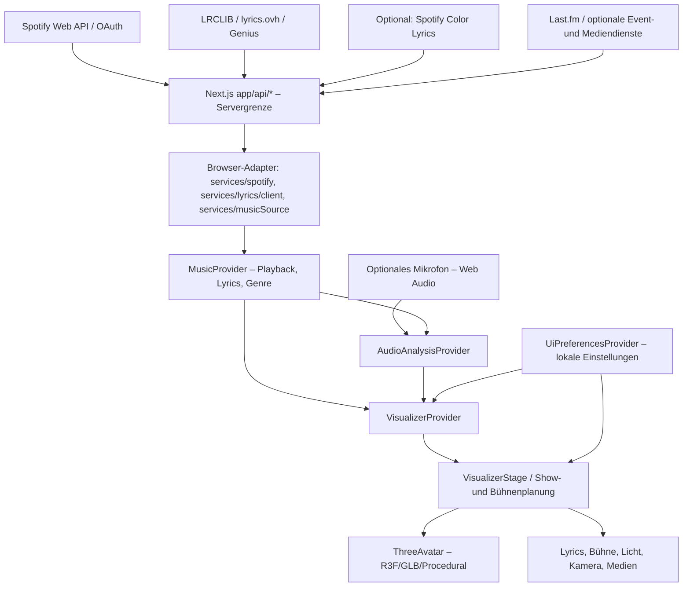
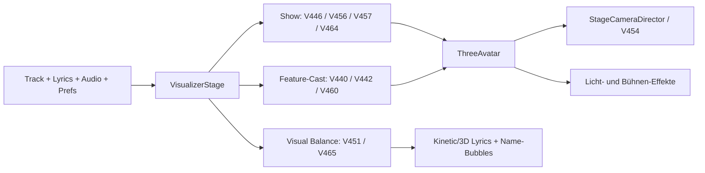

## V1102 – Govee Scene Zone Choreographer

Opt-in automatische **Raumlicht-Zonen-Choreografie** für die bereits autorisierten vier Govee-Leuchten. Deutschrap-/Hardtekk-/Deutschrock- oder Pop-Songabschnitte werden nur nach gültiger **V318-Bestätigung** kreativ zwischen Bühnenwand, Rhythmus, Neon und Ambiente gewichtet. Ausgewogen, Cinematic und Festival; Stärke und Szenen-Vorschau im Govee-Panel. Nur gedimmte V1096-Farbanteile, kein automatisches Anschalten und keine erfundenen Beats/Drops; V1100 Handgewichtung, V1096-/V961-Limits sowie der einzelne V909 LAN-Sendeweg bleiben verbindlich.

Tests: `npm run test:v1102`, `npm run test:v1102:types`, `npm run verify:v1102:focused`.

## V1101 – Govee Scene Transition Smoother

Sanfte, opt-in Einblendung der zusätzlichen Govee-Raumlichtfarben zu Beginn **bestätigter V318-Songabschnitte**. Drei zeitlich unterschiedliche Styles (Sanft, Cinematic, Festival), Stärke 0–80 Prozent sowie eine gerätefreie Vorschau direkt im Govee-Panel. Die Funktion nutzt ausschließlich den vorhandenen V909-Sendetakt und V1096/V961-Sicherheitsweg und dimmt den zusätzlichen Farbanteil; manuelle Shows und alle höheren Freigaben haben Vorrang. Unbestätigte Abschnitte, Pausen oder verbotene Cues lösen nichts aus. Tests: `npm run test:v1101`, `npm run test:v1101:types` und `npm run verify:v1101:focused`.

## V1100 – Govee Room Zone Mixer

Vier getrennte, ausschließlich reduzierende Zonen-Regler für die bestehende V1096-Raumbeleuchtung: Bühnenwand, Bass/Rhythmus, Neon und Ambiente. Opt-in, drei Voreinstellungen und Hardware-freie Vorschau. V1096, V1097, V1098 und V1099 bleiben unverändert und der V961-Governor, die V909-LAN-Grenzen und manuelle Freigaben bleiben abschließend wirksam.

## V1099 – Govee Live Beat Accent

Aktivierbare, sanft abklingende Govee-Farbakzente für bis zu vier Raumlicht-Zonen.
Nur **tatsächlich beobachtete frische Mikrofon-Beats** bei bestätigten Hooks/Drops;
keine erfundenen Musikabschnitte. Stile: Sanft/Dynamisch; hardwarefreie Vorschau.
Die bestehende V1096/V1097/V1098-Regie, der V961-Governor und der einzelne V909-Sender
bleiben maßgeblich; manuelle und höher priorisierte Shows sperren V1099.
`npm run verify:v1099:focused` prüft die neue Version und ihre direkten Vorgänger.

## V1098 · Govee Immersive Color Journey

Die neue Govee-Farbdramaturgie gestaltet innerhalb bestätigter V318-Musikphasen einen sanften Farbverlauf über bis zu vier Zonen: kühl in der Strophe, spannungsvoll im Aufbau, warm in Hook und Drop. Einstellungen (Ausgewogen, Cinematic, Festival; Stärke 0–60 %) und eine rein lokale Vorschau findest du im Govee-Panel. V1096 muss aktiv sein; V1097-Wellen können parallel laufen. Alle bestehenden manuellen Vorränge, LAN-Sendewege, Helligkeitsgrenzen und der V961-Governor bleiben erhalten. Standardmäßig ist V1098 aus.

Tests: `npm run test:v1098`, `npm run test:v1098:types` und `npm run verify:v1098:focused`.

## V1097 · Govee Spatial Light Waves

Bis zu vier Govee-LAN-Zonen erhalten eine weiche, räumlich wandernde Farbwelle. Drei Stile (rundum, gespiegelt, gemeinsam pulsierend), Vorschau ohne Hardwarebefehle, Stärke 0–60 %. Voraussetzung sind ausdrücklich aktivierte V1096-Raumbeleuchtung, V909-LAN-Synchronisierung und bestätigte V318-Songabschnitte. Das neue Signal verändert nur die bereits begrenzte V1096-Farbmischung, überschreitet keine Helligkeit und nutzt den einzigen V909-LAN-Sendetakt. Manuelle und höher priorisierte Quellen bleiben vorrangig. Standardmäßig ausgeschaltet.

Prüfen: `npm run test:v1097`, `npm run test:v1097:types`, `node scripts/v1097-release-readiness.cjs`.

## V1096 · Govee Room Lighting 5.0

Vier-Zonen-Raumlichtharmonie als freiwilliger Zusatz im vorhandenen Govee-LAN-Panel. Zuordnung aus V1027, separate Opt-in-Freigabe, drei Stile (Ausgewogen/Cinematic/Festival), Farbvorschau ohne Hardwarebefehle. Nur bestätigte V318-Musikphasen; manuelle Shows und höher priorisierte Steuerungen haben Vorrang. Kein neuer Netzwerk-Timer und niemals automatische Power- oder Blitzbefehle. `npm run test:v1096`, `npm run test:v1096:types` und `npm run verify:v1096:focused` prüfen das Release.

## V1095 – Live Show Learning

Im Arena Show Designer können vorhandene Showpläne ausdrücklich bewertet
(„Stil merken“ / „Weniger davon“) und **abwechslungsreiche Vorschläge**
angefordert werden. Nur Genre und abstrakte Szenenmuster landen lokal im
Browser (max. 24 Feedback-Einträge und sechs zuletzt gezeigte Kombinationen);
kein Songtitel, Prompt, Songtext, Künstler oder Verlauf wird dabei gespeichert.
Ein Vorschlag wird **nicht automatisch** auf die Bühne übernommen. Ein
Löschen-Knopf entfernt die gelernten Stile. Die Kamera-/Tanz-Cues und alle
Timeline-Grenzen bleiben auch nach ausdrücklicher Übernahme unverändert.

Checks: `npm run test:v1095 && npm run test:v1095:types`.

## V1094 · Concert Timeline Studio 3.0

Bearbeitbare Zeitgrenzen für die sieben vorhandenen Arena-Show-Szenen samt visueller Timeline, unabhängiger Vorschau und sicherem Zurücksetzen. Keine neuen Effektsysteme oder Hardwarezugriffe; die 360°-Bühne liest den gespeicherten V1040-Plan direkt.

## V1093 · Genre Show Intelligence

Die optionale Genre-Dramaturgie (`lib/arena360GenreShowIntelligenceV1093.ts`)
regelt die bestehenden virtuellen LED-, Laser- und Arena-Publikumslichter
je nach **Deutschrap, Hardtekk, Deutschrock oder Pop**. Das aktuelle Genre
wird konservativ aus vorhandenen Metadaten erkannt oder im Arena Show Designer
manuell gewählt. Sechs Showabschnitte (Intro, Strophe, Aufbau, Hook, Break,
Finale) definieren reine optische Look-Hinweise, keine erfundenen Beats/Drops.
Messbare starke Beat-Flanken können die Helligkeit lediglich bis zum ursprünglichen
Limit erholen lassen. Alle drei Instanced-Renderer werden weiterverwendet;
keine neuen Draw Calls, hardware commands, fullscreen flashes oder Timer.

Die Funktion ist Opt-in, standardmäßig deaktiviert, und setzt ihren State bei
Pause, Songwechsel, Seek, Low Tier oder Reduced Motion zurück. Manuelle LED-/Laser-
und Handy-Modi bleiben vorrangig. `npm run verify:v1093:focused` und
`node scripts/v1093-release-readiness.cjs` prüfen Implementierung und Übergaben.

## V1092 · Audience & Stage Emotion Sync

Der optionale Publikums-Regisseur nutzt die vorhandenen Handylichter, virtuellen Armbänder sowie Körper-/Kopf-Instanzen der 360°-Arena. In ruhigen Songpassagen werden Lichter sanft gedimmt, bei gemessenen Beats und Energieveränderungen folgen kleine, räumlich verteilte Bewegungswellen. Drei Geschwindigkeitsstile im Arena Show Designer. Opt-in und standardmäßig aus. Kein zusätzlicher Renderer, keine Govee-/Hardwaresteuerung, keine erfundenen Beats oder Drops. Manuelle Pulse-/Chase-Modi, Pause, Seek, Songwechsel, Low Tier und Reduced Motion schalten die neue Reaktion ab.

## V1091 · Smart Concert Story Arc Director

Der optionale dramaturgische Lichtbogen verbindet gemessene Energie, stabile Live-Abschnitte und die relative Songposition zu sanften LED- und Laserblenden. Songposition und automatisch geplante Abschnitte sind nur Gestaltungshinweise, niemals ein Beweis für einen Drop. Aktivierung und Modi: Arena Show Designer. Standardmäßig aus.

## V1090 · Musical Dynamics & Show Transitions

V1090 ergänzt eine standardmäßig deaktivierte, songbezogene Musikdynamik für LED-Wand,
Laserfächer und Lasertunnel. Eine deterministische Frame-Kurve dimmt die bestehenden
virtuellen Lichtquellen in ruhigen Passagen und fährt sie bei gemessenen Akzenten
fließend höchstens bis zur alten Helligkeit hoch. Drei Stile im Arena Show Designer,
manuelle Muster haben Vorrang. Kein zusätzlicher Renderpass, keine Hardware-Steuerung,
keine erfundenen Drops. Umfangreiche Regressionen und Release-Kontrollen enthalten.

### V1089 – Beat & Drop Intelligence 4.0

Der optionale **Beat-Filter** im Arena Show Designer ergänzt V1087 um
qualifizierte Beat-Flanken (Stärke/Bass/Attack/Energieanstieg) mit zwei
Empfindlichkeitsstufen. Er verhindert gehaltene und zu schnelle Akzente;
beobachteter Drop und alle bestehenden Schutz- und Manual-Regeln bleiben Pflicht.
Das Feature verändert keine Govee-Steuerung oder Songstruktur und ist zunächst aus.
`npm run verify:v1089:focused` prüft den neuen Analyzer und V1080–V1088.

## V1088 · Smart Song Structure Detection

**Song Understanding / Live FX Deck:** Die neue V1088-Anzeige unterscheidet zwischen
wirklich bestätigten Abschnitten aus der V604/V763-Song-Timeline (Strophe, Hook,
Aufbau, Drop, Break) und lediglich **vorläufigen** Aufbau-/Break-Hypothesen aus
der gemessenen V896-Live-Energie. Die Beobachtungen müssen mindestens drei
Sekunden zusammenhängend, positionsrichtig und songbezogen sein. Spotify-
Metadaten oder ein lauter Bass allein können damit **keine Hooks, Drops oder
Abschnittsgrenzen bestätigen**. Ein visueller Positionshinweis für Songanfang
und Songende ist ausdrücklich keine Strukturdiagnose.

**Stabilität:** Pause, Seek, Titelwechsel, ungültige Werte und unterbrochene
Messreihen setzen die Kandidaten zurück. Gleiche Wiedergabeposition zählt nicht
als neue Beobachtung. Es gibt keine zusätzlichen Audio-Streams, API-Abfragen,
Speicherung, 3D-Effekte, Lichtblitze oder Hardware-Kommandos. Der bestehende
Show Director behält die Autorität für Effekt- und Drop-Signale. Das Modul ist
bereits für spätere V1089/V1090-Auswertungen typisiert, greift aber nicht in
die Bühnensignale ein. Tests: `npm run verify:v1088:focused` und
`node scripts/v1088-release-readiness.cjs`.

## V1087 · Ultimate Festival Drop

Mit einem gültigen Showplan im **Arena Show Designer** V1087 aktivieren. Gemessene
Drops synchronisieren eine dezente virtuelle Schockwelle mit bereits aktivierten
Lasern, LED-Wand und V1084-Konfetti. Mindestens zwei dieser Effektsysteme müssen
eingeschaltet sein. 3,6 Sekunden Trigger-Sperre und separate Performance-Guards.
Keine physischen Gerätebefehle, keine zusätzliche Konfetti-Partikelgruppe.

Tests: `npm run test:v1087`, `npm run test:v1087:types`,
`node scripts/v1087-release-readiness.cjs`.

## V1086 · Epic Stage Transformation 4.0

Im Arena Show Designer lassen sich eine gemeinsame optische Bühnenregie, Intensität und die Modi Automatisch, Cinematic, Festival oder Minimal aktivieren. Die Regie koordiniert ausschließlich separat aktivierte Systeme, respektiert die manuelle Musterauswahl und dimmt innerhalb der vorhandenen Grenzen.

## V1085 · 360° Projection Mapping

Enable **Arena Show Designer → V1085 360° Projection Mapping** to project virtual
floor ripples, orbital light strips, platform accents and scenic washes, using
existing show timeline and verified audio beats. Requires an active show plan;
platform and scenery accents follow their corresponding V1038/V1082 controls.
Disabled by default. Nothing sends commands to real projectors.

## Neu in V1084 · Festival Atmosphere FX

Im Arena Show Designer einen aktiven Showplan wählen und anschließend **V1084
Festival Atmosphere FX** einschalten. Wählbar sind automatische Festivaleffekte,
ein ruhiges Arrangement, Seifenblasen, Konfetti, Papierluftschlangen und rein
virtuelle CO₂-Jets. Der vorhandene Bodennebel lässt sich separat zuschalten.
V1084 erzeugt **keine physischen Gerätebefehle**; CO₂-Stöße erscheinen nur bei
tatsächlich beobachtetem Drop und gemessenen Beats. Ältere Szenen und Settings
bleiben erhalten. Niedrige Qualitätsstufe oder Reduced Motion schaltet ab.

## Neu in V1083 · Advanced LED Wall 5.0

Im Arena Show Designer zuerst **V1059 LED-Wand** einschalten, dort **Auto** wählen,
anschließend **V1083 Advanced LED Wall 5.0** aktivieren. Auswählbar sind
3D-Tunnel, Geometrie, echte synchronisierte Lyrics und musikalisch bestätigte
Drop-Visuals. Bei fehlenden Lyrics erscheint Geometrie. Zusätzliche Hardware
ist dafür nicht erforderlich. Abhängig vom Audiozugriff sind Drop-Effekte
möglicherweise nicht sichtbar. Rückfall auf V1059 ist durch Ausschalten möglich.

## V1082 · Dynamic Stage Architecture

V1082 bringt sechs dynamische **mehrstöckige Kulissenformationen** für die
360°-Konzertbühne: Gate, Arcade, Staircase, Terraces, Colonnade und Crown.
Außerhalb der zentralen Künstlerplattform werden drei Ebenen aus
Traversen, Verbindungen und LED-Kanten optisch arrangiert, ohne Avatare
zu bewegen. Die neue Architektur ist freiwillig aktivierbar unter
**AI Show Designer → V1082** und folgt ausschließlich einem gültigen,
automatisch geführten Showplan. Nur beobachtete Beat-Signale erzeugen
rhythmische Lichtakzente. Manuelle Steuerung, Pause, Reduced Motion und
Low-Tier genießen Vorrang. Höchstens drei zusätzliche Instanced-Mesh-Batches
mit 64 Segmenten; keine physische Laser-/Govee-Ausgabe.

Lokale Tests: `npm run test:v1082`, `npm run test:v1082:types`,
`npm run verify:v1082:focused`, `node scripts/v959-source-preflight.cjs`.
Die Produktionsfreigabe braucht gesondert grünes GitHub Actions und Vercel.

## V1081 · Holographic Dancers 2.0

V1081 erweitert die **bestehenden** holografischen Silhouetten zu virtuellen
Tänzerprojektionen mit sechs begrenzten Bewegungsstilen: Intro, Strophe,
Aufbau, Hook (gespiegelte Paare), Interlude und Finale. Die Arm-Highlights
werden als eine zusätzliche Instanced-Mesh-Gruppe gerendert (höchstens
18 Instanzen), ohne GLB-Kopien oder zusätzliche Audio- und Frame-Controller.
Die optische Choreografie folgt dem bereits freigegebenen V1068-Show-Cue
sowie V1070/V1071-Fades. Beats werden nicht aus Songabschnitten erfunden;
Akzente benötigen gemessene Signale. Bei Pause, reduzierter Bewegung,
niedrigem GPU-Profil, manuellen Portalmustern oder inaktiven Show-Plänen
bleibt die neue Funktion aus. Aktivierung: AI Show Designer → V1068 und V1081.

Lokale Checks: `npm run test:v1081`, `npm run test:v1081:types`,
`npm run verify:v1081:focused` und `node scripts/v959-source-preflight.cjs`.
Production & Playwright erfordern anschließend einen GitHub-Actions-Lauf.

## V1080 · Laser Show Experience 5.0

Die 360°-Bühne erhält mehrdimensionale virtuelle **Laserfächer, Lichttunnel,
Helix- und Kronenformationen**. Sie werden entlang des vorhandenen siebenteiligen
Showplans variiert; ein zusätzlicher Puls wird nur bei tatsächlich beobachteten
Beat-Signalen aktiviert. Die Umsetzung verwendet die bestehenden Instanced-Mesh-
Laser aus V1036/V1039, erzeugt keine neuen GPU-Batches und steuert keine physischen
Laser oder Govee-Geräte an. Manuelle Muster, Low-GPU-Qualität, Pausen und
„Reduced Motion“ haben Vorrang. Aktivierung über **AI Show Designer → V1057
Intelligent Laser Director** bei automatischem Lasermuster.

Lokale Prüfungen: `npm run verify:v1080:focused` und
`node scripts/v959-source-preflight.cjs`. Die vollständige Produktionsfreigabe
(Windows/Ubuntu, Next.js, Playwright, Vercel) erfolgt erst durch GitHub Actions
**nach dem Import** des vollständigen Projekt-ZIPs.

## V1071 · Smart Concert Flow 3.0

V1071 ergänzt eine lokale, optionale Acht-Kanal-Übergangsregie für den **geplanten** V1040-Showablauf. Sie gewichtet die bereits aktiven Bühnen-, Floating-, Hologramm-, Laser-, LED-, Kamera-, Rap- und Gruppenkanäle mit begrenzten Faktoren von 0,50 bis 1,00. Die zweite Strophe erhält einen anderen Fokus. Ein sanfter Übergang zur neutralen Regie übergibt das Finale an V1070. Manuelle Vorgaben und deaktivierte Effekte bleiben unverändert. Weder echte Songstruktur noch Beats werden hier erkannt oder ausgelöst. Keine zusätzlichen Timer, Govee-Kommandos oder WebGL-Objekte.

## V1070 – Ultimate Concert Finale 2.0

Eine optionale, gemeinsame Vier-Phasen-Regie fuer das letzte Achtel des Songs:
Buehne (V1066), Satelliten (V1067), Hologramme (V1068), vorhandene
Laser- und LED-Effekte sowie automatische Avatar- und Kameraregie folgen
demselben Song-Zeitplan. Es werden nur bestehende Effekte abgeschwaecht,
nie manuell deaktivierte Systeme eingeschaltet. Kein neuer Renderer, Beat,
Pyro- oder Govee-Befehl. AI Show Designer: standardmaessig AUS.

## V1069 – Epic Drop Experience

Neue optionale Drop-Regie für die 360°-Bühne: existierende Basswellen,
Konfetti, LED-Farben und virtuelle Pyrotechnik werden nur bei beobachteten
Drop-Abschnitten und verifizierten Beat-Flanken koordiniert. Keine künstlich
erfundenen Drops, keine Hardware-Steuerung, keine Flashes oder neuen Meshes.
AI Show Designer → V1069 Epic Drop Experience (standardmäßig AUS).

## V1068 · Holographic Concert FX 3.0

Optional world-fixed portal choreography and lightweight performer **silhouette projections**
for the 360° arena, synced to the local concert-show timeline. Enabled from the AI Show
Designer, initially off. V1066 stage and V1067 floating platforms can share the same
normalized show phase. No extra dancer or singer, no laser projector, Govee control or
remote AI call. Run `npm run verify:v1068:focused` before import.

## V1063 · Ensemble Choreography 4.0

Optionale lokale Ensemble-Regie für die bestehende 360°-Bühne. Sie ergänzt automatische Gruppenformationen (2–4 Avatare) um sehr kleine Fächer-, Bogen- und diagonale Versätze und einen optisch wechselnden Ensemble-Blickfokus. **Kein physischer Partner-Platztausch, keine neuen Singer-Zuordnungen oder erkannten Beats.** Die bestehende Animations-, Fußkontakt- und Kollisionsregie behält Vorrang; manuelle Shows, niedrige GPU-Stufe, Pausen und Reduced Motion deaktivieren den Zusatz. Nutzt einen vorhandenen gemeinsamen Frame-Loop; keine neue Netzwerk-/Govee-Aktion. Die Funktion muss unter **AI Show Designer → V1063 Ensemble Choreography 4.0** aktiviert werden.

Qualitätsprüfungen: `npm run test:v1063`, `npm run test:v1063:types`, `npm run verify:v1063:focused`, `node scripts/v959-source-preflight.cjs`. Vollständiger Next.js-/Playwright-Build über GitHub Actions nach Import.

## V1062 · Advanced Rap Performance 7.0

Die optionale **Advanced Rap Performance 7.0** erweitert bestehende, bereits verifizierte Rap-Wort-Cues. Sie verfeinert bei GLB-Avataren gestische Betonungen von Kopf, Brust und Armen mit weicher Einschwing-/Ausblendkurve; vorhandene V515-Korrekturen und Clip-/IK-Priorität bleiben erhalten. Der vorhandene V837-Lip-Sync gewinnt winzige additive Rate-Anpassungen für Kiefer, `wide` und `round` sowie minimale Augenbrauen-/Wangenakzente. **Keine** Änderung an `lipsClosed`, manuell gesetzten Visemen, morph targets, Lippen-Quellinformationen, Sängerrollen oder Fußkontakten. Nur bei beobachteten synchronisierten Wörtern, verifiziertem Slot, laufendem Deutschrap/Rap und ausreichender GPU-Qualität aktiv. Die Funktion ist im **AI Show Designer → V1062 Advanced Rap Performance 7.0** abschaltbar und standardmäßig deaktiviert. Keine neuen Ticker, Audio-Abfragen, KI-Dienste, Kameras oder Gerätebefehle.

Qualitätsprüfungen: `npm run test:v1062`, `npm run test:v1062:types`, `npm run verify:v1062:focused`, `node scripts/v959-source-preflight.cjs`. Produktionsfreigabe weiterhin über GitHub Actions (Windows/Ubuntu, Next.js/Playwright).


## V1061 · Natural Avatar Motion 3.0

Die optionale **Natural Avatar Motion 3.0** ergänzt die GLB-Rig-Bewegung um winzige, musikalisch modulierte Schulter-, Brust- und Wirbelsäulenakzente sowie eine **rotatorische** Hüftbewegung nur bei beobachteter Fußkontakt-Freigabe. Bei zwei gepflanzten Füßen oder unbekanntem Kontakt bleibt die Hüftzugabe null. Der vorhandene finale V839-Footwork-Guardian und Foot IK bleiben verantwortlich. Für den prozeduralen Fallback wird ausschließlich der Oberkörper animiert. Aktivierung unter **AI Show Designer → V1061 Natural Avatar Motion 3.0**, standardmäßig aus; gültiger Showplan und 360°-Bühne erforderlich. Manuelle GLB-Clips, explizite Timelines, Pausen, Reduced Motion und Low-GPU-Voreinstellungen haben Vorrang. Der Planner nutzt den vorhandenen Songfortschritt und ein beobachtetes BPM; er erkennt keine eigenen Beats und ruft keine Cloud-KI auf.

Prüfung: `npm run test:v1061`, `npm run test:v1061:types`, `npm run verify:v1061:focused`, `node scripts/v959-source-preflight.cjs`. Die GitHub-Matrix für Windows und Ubuntu mit Next.js/Playwright bleibt die Produktionsfreigabe.

## V1060 · AI Lighting Choreographer

Die lokale Konzertlichtregie koordiniert die bisher getrennten Effekte V1056–V1059. Aktivierung: **AI Show Designer → V1060 AI Lighting Choreographer** (standardmäßig aus). Ein gültiger Showplan und mindestens ein bereits separat eingeschalteter visueller Effekt sind erforderlich. Die sieben Kapitel wechseln die Aufmerksamkeit zwischen Scheinwerfern, Lasern, Nebel und LED-Panorama; alle Modulationen **senken höchstens** vorhandene optische Werte ab. Der Choreograf führt keine Cloud-KI-Abfragen durch, besitzt keine Geräte-/Musiksteuerung und umgeht keine manuellen Vorgaben oder Performance-Schutzmechanismen.

```sh
npm run verify:v1060:focused
node scripts/v959-source-preflight.cjs
```

## V1059 · Advanced LED Wall 4.0

Die opt-in 360°-LED-Panoramabänder sind über **AI Show Designer → Advanced LED Wall 4.0** steuerbar. Das LED-Muster folgt dem siebenaktigen Showplan (Auto) oder einer manuellen Auswahl (Equalizer, Geometrie, Orbit, Pulse). Der Equalizer verwendet ausschließlich bereits vorhandene Audioenergie. Ein einzelnes Instanced-Mesh mit höchstens 256 offenen LED-Pixeln, kein zusätzliches Licht, keine neuen Govee- oder Netzwerkbefehle. Bei Low-Tier, Pause, Reduced Motion, ungültigem Plan oder ohne Song ist die Funktion ausgeschaltet. Tests: `npm run test:v1059`, `npm run test:v1059:types`, `npm run verify:v1059:focused`.

## V1058 · Volumetric Light Experience

Die 360°-Konzertbühne verfügt nun über **optionale, weiche Lichtkegel und dramaturgisch abgestimmten Nebel**. V1058 nutzt weiterhin die zwei bereits vorhandenen Spot-Kegel der V1032-Bühne sowie beide GPU-Instanz-Batches des V1036-Nebels. Ein sparsamer Transparenz-Shader verleiht den vorhandenen Kegeln einen sanfteren Tiefenverlauf; Nebelfarben und die auf 0,16/0,095 gedeckelten Nebel-Deckkräfte werden mit dem siebenkapiteligen V1040-Showplan abgestimmt. Die Atmosphäre-Regie V1045 und manuell abgeschaltete Effekte behalten Vorrang. **Keine echten Raymarch-Volumetrics** und keine zusätzlichen Lampen, Shader-Meshes oder Nebelpartikel.

**Aktivierung:** Display → 360°-Bühne → AI Show Designer → gültigen Showplan aktivieren → *V1058 Volumetric Light Experience* einschalten (0–80 %, standardmäßig AUS). Bei Pause, Reduced Motion, fehlendem Zeitbezug, niedriger Grafikqualität oder deaktivierten Lichtern/Nebel bleibt der bisherige Look. V1056-Verfolger und V1057-Laser bleiben unabhängig; keine Govee-Befehle oder physischen Laser.

Änderungen: `lib/arena360VolumetricLightingV1058.ts`, `components/visualizer/stages/ArenaLightsV1032.tsx`, `components/visualizer/stages/ArenaLowFogV1036.tsx`, `tests/v1058-volumetric-light-regression.cjs`, `changelog/V1058-VOLUMETRIC-LIGHT-EXPERIENCE.md`. Lokal: `npm run verify:v1058:focused`. Vollständiger Next-/Playwright-Build erfolgt in GitHub Actions (Node 24).

## V1057 · Intelligent Laser Director

Die bestehende **360°-Konzertbühne** nutzt ihre vorhandenen V1036-Laserfächer und V1039-Lasertunnel für eine neue optionale Laserdramaturgie. Ein selbst erzeugter oder bearbeiteter **V1040-Showplan** lenkt über sieben Kapitel langsam die Fächer, Farbakzente und Tunnel-/Spiral-/Halo-Looks. Ein manuell ausgewähltes Lasermuster hat weiterhin Vorrang; die geplanten Szenen simulieren **keine erkannten Echtzeit-Drops**.

**Aktivierung:** Display → AI Show Designer → Showplan aktivieren; V1036-Laser und V1039-Laserarchitektur einschalten; **V1057 Intelligent Laser Director** separat einschalten und Stärke zwischen 0 und 80 % wählen. Standardmäßig ausgeschaltet. Bei Pause, unplausiblen Songzeiten, niedrigem Grafikbudget, reduzierter Bewegung oder deaktivierten Effekten inaktiv. Keine zusätzlichen Shader-/Laser-Batches, Hardware-Laser, Govee-Befehle, Strobes oder externe APIs.

Technische Dateien: `lib/arena360IntelligentLaserV1057.ts`, `components/visualizer/stages/ArenaLaserFansV1036.tsx`, `components/visualizer/stages/ArenaLaserTunnelsV1039.tsx`, `tests/v1057-intelligent-laser-regression.cjs`, `changelog/V1057-INTELLIGENT-LASER-DIRECTOR.md`.

## V1056 · Cinematic Concert Lighting 2.0

Die bestehende 360°-Bühne nutzt ihre **zwei vorhandenen V1032-Verfolger-Spots** jetzt auf Wunsch als filmische Lichtregie. Die Positionen der wirklich gerenderten Avatare werden direkt aus der Three.js-Szene ermittelt (auch während sich die Rundbühne dreht); bei nicht vorhandenen oder unsichtbaren Darstellern gelten die herkömmlichen Lichtziele. Die sieben V1040-Showkapitel steuern sanfte Farbwechsel, Duo-Fokus, Totalen und zurückhaltende Beleuchtungsakzente. Die jeweiligen Akzente sind **geplante Szenen, keine künstlich erkannten Beats oder Gesangsrollen**.

**Aktivierung:** 360°-Bühne wählen, AI Show Designer und V1040-Showplan aktivieren, vorhandene V1032-Bühnenlichter einschalten; danach **V1056 Cinematic Concert Lighting 2.0** separat aktivieren und Stärke (0–80 %) wählen. V1056 ist standardmäßig deaktiviert. Pausen, reduzierte Bewegung, niedriger Grafikmodus, unzuverlässige Songzeiten, deaktivierte Lichter und ungültige Pläne schalten den Zusatz aus. Keine neuen Leuchten, Schatten, Kamera, Netzwerkverbindungen, Mikrofonnutzung oder Govee-Befehle. Die Farbe und Zielpositionen ändern sich sanft; vorhandene Qualitätsgrenzen und manuellen Einstellungen bleiben erhalten.

Technische Quellen: `lib/arena360CinematicLightingV1056.ts`, `components/visualizer/stages/ArenaLightsV1032.tsx`, `tests/v1056-cinematic-lighting-regression.cjs`, `changelog/V1056-CINEMATIC-CONCERT-LIGHTING-2.md`. Verifikation: `npm run verify:v1056:focused`; GitHub Actions baut auf Node 24 zusätzlich TypeScript, Next.js und Playwright.

## V1055 · Dynamic Concert Stage & Avatar Interaction Engine

Eine neue optionale Arena-Regie erweitert die automatischen **prozeduralen Duos** um
ruhige Positionswechsel auf der *mittleren drehenden 360°-Bühne*. Sieben
Showkapitel verbinden sichere Innenbereich-Positionen, kleine Blickrichtungswechsel
und einen gemeinsamen Fokus für Kamera, Publikum und schwebende Bühnendekoration.
Schwebende Plattformen bleiben Kulisse, die Avatare steigen **nicht** darauf.

**Einschalten:** Display → AI Show Designer → Showplan erstellen/aktivieren,
V1041 automatische Avatar-Choreografie aktivieren und anschließend V1055
Dynamic Concert Stage & Avatar Interaction (0–80 %) aktivieren.
Standardmäßig ausgeschaltet. Optionale Kamera-, Publikums- und Plattformmodule
werden nur koordiniert, wenn sie ohnehin aktiviert sind.

Kein zusätzliches 3D-Objekt, Timer, Mikrofon, physischer Lichteffekt oder Govee-Aufruf.
Beim Pausieren, bei Reduced Motion und niedrigem Grafikprofil ist die Zusatzregie
inaktiv. Eigene Formationen, Foot-IK, Kollisionsschutz, Timeline und importierte
Avatar-Animationen haben Vorrang. Die Planer sind lokal und deterministisch,
kein echtes KI-Modell oder eine neue Beat-Erkennung.

Details und Tests: `changelog/V1055-DYNAMIC-STAGE-AVATAR-INTERACTION.md`,
`lib/arena360StageInteractionV1055.ts`, `tests/v1055-stage-interaction-regression.cjs`.
`npm run verify:v1055:focused` prüft V1055 plus bisherige Konzertfunktionen.

## V1054 · Advanced Avatar Performance Intelligence

Die neue, zunächst deaktivierte Avatar-Regie verfeinert die vorhandene automatische
V1041-Duo-Choreografie für die 360°-Arena. Sie wählt lokale genreabhängige
Gestenakzente für Rap, Gesang und Gruppenszenen. Echte synchronisierte
Wort-Zeitstempel können kleine Rap-Akzente oder länger gehaltene Gesangsgesten
auslösen. Ohne Wort-Zeitstempel verwendet V1054 ausschließlich den bestehenden
Showplan und eine lokale, deterministische Variation – keine Sängererkennung,
keine künstlichen Beats.

**Aktivierung:** Display → AI Show Designer → Showplan erzeugen und aktivieren,
V1041 Avatar-Choreografie einschalten, dann **V1054** aktivieren.
Stärke von 0–80 %. Standardmäßig deaktiviert. Das vorhandene Duo- und
Fußkontakt-System bleibt alleiniger Besitzer der Bewegung. Keine zusätzlichen
Animationsmixer, GLB-Clips, Netzwerkanfragen, Govee-Befehle oder 3D-Objekte.
Eigene Formationen, manuelle Rollen, gespeicherte Animationen, Pausen,
Reduced Motion und geringe Renderleistung behalten Vorrang.

Implementierung: `lib/arena360AvatarPerformanceV1054.ts`, Integration in
`components/visualizer/ThreeAvatar.tsx`, Funktionstests in
`tests/v1054-avatar-performance-regression.cjs`. Release-Prüfung und
isolierter TypeScript-Test: `npm run verify:v1054:focused`.
Siehe `changelog/V1054-ADVANCED-AVATAR-PERFORMANCE-INTELLIGENCE.md`.

## V1054 · Advanced Avatar Performance Intelligence

Optionaler, lokaler Choreografie-Feinschliff für die **bestehende Zwei-Avatar-
Formation** der V1041-360°-Arena. V1054 kombiniert sanfte Phrase-Einblendungen,
leicht variierte Bewegungsintensitäten und dezente Reaktiv-Gesten passend zum
Showplan. Bei wirklich synchronisierten Wort-Zeitstempeln unterscheidet die
Steuerung kurze Akzente und länger gehaltene Silben. Das ist **keine**
Sängeridentifikation oder Audio-Klassifikation; ohne Wortzeiten wird nur ein
transparentes, genreabhängiges Bewegungsmotiv verwendet.

**Aktivierung:** Display → AI Show Designer → Showplan aktivieren → V1041
Choreografie einschalten → V1054 aktivieren (0–80 %). Standardmäßig aus.
Bei Pause, reduzierter Bewegung, Low-Performance oder manuellen Choreografien
bleiben die bisherigen Bewegungen unverändert. Gespeicherte Gruppen (3/4),
Solo-Avatare, Duo-/Vocal-Rollen, importierte GLB-Clips, Fuß-IK und
Kollisionsvermeidung behalten Vorrang. Keine zusätzliche Figur, kein Mixer,
keine neuen Render-Pässe, keine Govee-Kommandos.

Technik: `lib/arena360AvatarPerformanceV1054.ts` liefert nur begrenzte
Zusatz-Cues an `components/visualizer/ThreeAvatar.tsx` und den vorhandenen
`components/visualizer/DanceFormationActorsV492.tsx`. Die beiden
Regressionstufen `tests/v1054-avatar-performance-regression.cjs` und
`tests/tsconfig.v1054-core.json` sind in Prebuild und Produktionsgates
integriert. Freigabe: `npm run verify:v1054:focused` sowie Full Build nach
`npm ci` in GitHub/Vercel; das lokale Quellcode-Gate ist kein Browser-/GPU-Test.
Details: `changelog/V1054-ADVANCED-AVATAR-PERFORMANCE.md`.

---

## V1053 · Intelligent Concert Camera Experience 2.0

Die optionale, lokale Regie ergänzt die **bestehende** Konzertkamera um ruhige
360°-Schwenks, automatische Höhenfahrten und weite Arenaperspektiven.
Bei *tatsächlich synchronisierten Wort-Zeitstempeln* können sanfte
Lead-Close-ups vorgeschlagen werden, ohne daraus Sängeridentität abzuleiten.
Die Kamera im Vordergrund wird weiterhin von den vorhandenen Vocal-/Lyrics-/
Duett-/Manuellregisseuren gesteuert; deren Priorität bleibt erhalten.

**Einschalten:** Display → AI Show Designer → Showplan erzeugen und aktivieren,
V1043 Kamera-Automatik aktivieren und danach V1053 einschalten. Standardmäßig
ist V1053 aus. Stärke 0–80 %. Bei Pause, Reduced Motion, unvollständiger
Zeitbasis, niedrigem Performance-Profil oder manueller Kamera bleibt der
bisherige Bildausschnitt unverändert. Keine zusätzliche Kamera, kein Shader,
kein separates Render-Pass, kein Mikrofon- oder Netzwerkeffekt.

Neue Dateien: `lib/arena360CinematicCameraV1053.ts`,
`tests/v1053-cinematic-camera-regression.cjs`,
`tests/tsconfig.v1053-core.json` und `scripts/v1053-release-readiness.cjs`.
Der Cue wird von `components/visualizer/ThreeAvatar.tsx` an
`components/visualizer/StageCameraDirectorV289.tsx` und
`components/visualizer/SmartStageCameraV236.tsx` weitergereicht. Beide
wenden ihn erst nach der bestehenden Kamerakomposition und nur bei
unprotected auto shots an. CI: `npm run verify:v1053:focused`.
Siehe `changelog/V1053-INTELLIGENT-CONCERT-CAMERA.md`.

---

## V1052 · Ultimate Live Concert Experience

Die neue, opt-in-aktivierbare V1052-Regie synchronisiert die vorhandenen 360°-Bühnenaktionen, V1051-Publikumsanimationen, V1044-Handylichter, V1043-Kameravorschläge und V1041-Choreografie über denselben deterministischen Songabschnittsplan. Fokuswechsel zwischen Bühne, Publikum, Kamera und Ensemble erfolgen sanft; das Interlude bleibt ruhig und das Finale klingt weich aus. Bestehende manuelle Einstellungen, Lyrics-/Gesangs-Kameraprioritäten, Pausen und Grafikgrenzen bleiben unangetastet. Keine neuen 3D-Objekte, keine Govee-Netzwerkbefehle, keine erfundenen Beats oder KI-Cloud-Abfragen. Die einzelnen Effekte müssen weiterhin separat aktiviert sein. Siehe `changelog/V1052-ULTIMATE-LIVE-CONCERT-EXPERIENCE.md`.

## V1051 · Immersive Concert Crowd Experience

Optional crowd reactions in the V1032 world-fixed instanced arena audience: genre-neutral smooth La-Ola, 360° wave, arms-up cheering, reduced interlude and finale ovation with phone-light coordination. The V1051 local planner uses authored V1040 chapters, not detected music events. Manual phone modes, pauses, reduced-motion and low-tier performance win; no additional Govee instructions or synthesized crowd audio. Off by default, intensity 0–80%. See `changelog/V1051-IMMERSIVE-CONCERT-CROWD-EXPERIENCE.md`.

## V1050 · Adaptive Concert Storytelling

Die neue optionale Konzertdramaturgie ergänzt V1040/V1048 um einen **Spannungsbogen
über den ganzen Song**: Intro, Strophe, Aufbau, Hook, Atemholen im Interlude,
erneute Steigerung, Finale mit sanftem Ausklang. Die Szenen bleiben **geplante
Zeitabschnitte**, keine automatisch erkannten musikalischen Ereignisse.

**Aktivieren:** Einstellungen → Display → AI Show Designer → Showplan erzeugen,
aktivieren und anschließend **V1050 Adaptive Concert Storytelling** einschalten.
Die Intensität lässt sich von 0–80 % einstellen. Standardmäßig ist V1050 aus.
Zusätzlich bleibt die separate Govee-Freigabe für reale Leuchten notwendig.

Keine neuen Lichteffekte, Partikel, Hardwarebefehle oder KI-Cloud-Abfragen.
Manuell angepasste Kameras/Schwebeplatformen werden nicht verändert.
Eine aktive manuelle Kamera, reduzierte Bewegung oder niedrige GPU-Leistung
hat weiterhin Vorrang. V1049 kann darüber hinaus gemessene Live-Energie nutzen.

**Tests:** `npm run verify:v1050:focused`; bei vorhandenen npm-Abhängigkeiten
`npm run build`. Releases bleiben kompakt ohne `releases/`, `node_modules/`, `.next/`.

---

## V1049 · Live Concert Intelligence Engine

Die optionale Live-Regie koppelt die bestehende V1040/V1048-Konzertshow an
**tatsächlich gemessene Mikrofonwerte**: Energie, Attack/Decay und qualifiziert
bestätigte Beats. Auf- und Abbau musikalischer Energie verändern ausschließlich
die bestehende Intensität innerhalb des vom Nutzer festgelegten Grenzwerts.
Keine automatische Abschnittserkennung, kein Cloud-KI-Aufruf, keine neuen GPU-Objekte,
keine zusätzlichen Govee-Netzwerkbefehle oder stroboskopischen Vollblitze.

**Einschalten:** Einstellungen → Display → AI Show Designer →
V1049 Live Concert Intelligence Engine. Erst einen Showplan erzeugen und aktivieren,
danach Mikrofonzugriff separat erlauben. Bei deaktiviertem/fehlendem Mikrofon,
Pause, reduzierter Bewegung oder niedrigem Performance-Profil bleibt V1048
unverändert. Govee benötigt zusätzlich die bisherige V1042-/LAN-Freigabe.

**GitHub-Import:** Neue `.github/workflows`-Dateien im ZIP werden vom vorhandenen
Importer bewusst geschützt/nicht übernommen. Die V1049-Tests sind deshalb
zusätzlich im bestehenden Vercel-Build und Production-Gate registriert.
Für einen neuen eigenständigen Actions-Workflow ist eine separate, berechtigte
GitHub-Änderung erforderlich.

**Prüfen:** `npm run verify:v1049:focused`,
`node scripts/v959-source-preflight.cjs`. Der vollständige `npm run build:next`
benötigt installierte npm-Abhängigkeiten.

---

## V1048 · Next Generation Concert Director

Die optionale V1048-Regie macht die lokale 360°-Konzertshow pro Song einzigartiger:
vier Regiemotive kombinieren vorhandene Bühnenformen, Laser/Hologramme,
Kameravorschläge und Avatarformationen in unterschiedlichen Folgen. Keine
zwei benachbarten Abschnitte benutzen dasselbe Motiv. Die Song-ID erzeugt
**reproduzierbare** Abläufe, die auch nach Pause oder Neustart gleich bleiben.

**Aktivieren:** 360° Ultimate Concert Arena → AI Show Designer → einen Showplan
anlegen und aktivieren → **V1048 Next Generation Concert Director** einschalten.
Variation einstellbar von 0–70 %. Manuell bearbeitete Abschnitte werden
nicht überschrieben; andere Effekte müssen weiterhin einzeln aktiviert sein.
Die Govee-Ausgabe bleibt separat bei V1042/LAN-Sync freizugeben und verlangt
verifizierte Musikphasen. Keine KI-Cloud, keine neuen Hardware-Kommandos und
keine erfundenen Audioereignisse. Bei Pause/Reduced Motion/Low-Tier wird die
virtuelle Regie zurückgenommen. Standardmäßig AUS.

**Tests:** `npm run verify:v1048:focused` sowie
`node scripts/v959-source-preflight.cjs`. Ein vollständiger Next.js-Build ist
mit installiertem `npm ci` und Node 24.x auf GitHub/Vercel vorgesehen.
Details: `changelog/V1048-NEXT-GENERATION-CONCERT-DIRECTOR.md`.

## V1047 · Immersive Arena Experience 3.0

Die 360°-Arena erhält **bewegliche virtuelle Hologramme über dem Publikum**,
**360°-Lichttunnel** und subtile **Kamerafahrten**, jeweils passend zu Intro,
Strophe, Aufbau, Hook und Finale des **lokalen V1040-Showplans**.
In **Einstellungen → Display → AI Show Designer** den V1047-Schalter aktivieren
und die Intensität (0–75 %) wählen. Standardmäßig bleibt er AUS.
Die bisherigen Hologramm- und Laserschalter sowie die V1043-Automatik für
Kamera-Akzente gelten weiterhin. Manuelle/geschützte Kameraperspektiven,
Pause, Reduced Motion und Grafikleistungsgrenzen haben Vorrang. Keine echten
Laser, Govee-Kommandos, künstlichen Drops oder Stroboskope.

Tests: `npm run verify:v1047:focused` und
`node scripts/v1047-release-readiness.cjs`.
Details: `changelog/V1047-IMMERSIVE-ARENA-EXPERIENCE-3.md`.

## V1046 · Cinematic Concert Finale Engine

In der **360° Ultimate Concert Arena** lässt sich im **AI Show Designer** die
optionale **Cinematic Concert Finale Engine** aktivieren (Intensität 0–80 %).
Die letzten 12 % des Songs folgen einem vierteiligen dramaturgischen Finale:
Sammeln, Steigern, Höhepunkt und Ausklang. Ein virtueller 360°-Konfettiregen
und ein 3D-Bass-Schockwellenring erweitern die Bühne; **die Schockwelle
benötigt einen echten starken, neu erkannten Beat**. Bereits aktive Laser,
Publikums-Handylichter, die Bühnenbeleuchtung und optional die V1041-Avatare
werden sanft akzentuiert. Keine echten Govee- oder Lasersignale, keine
Stroboskopblitze, kein zusätzlicher Audiozugriff. Pausen, manuelle Modi,
Reduced Motion und Leistungsgrenzen behalten Vorrang.

Tests: `npm run verify:v1046:focused` und
`node scripts/v1046-release-readiness.cjs`.
Details: `changelog/V1046-CINEMATIC-CONCERT-FINALE-ENGINE.md`.

## V1045 · Intelligent Concert Atmosphere 2.0

Die 360°-Arena inszeniert virtuellen Bodennebel, Laserfächer und den LED-Himmel mit passenden Genre-Farbpaletten und fließenden Szenenwechseln. In **Einstellungen → Display → AI Show Designer** einen Showplan aktivieren und **Intelligent Concert Atmosphere 2.0** einschalten (Intensität 0–75 %). Die bestehenden GPU-instanzbasierten Effekte werden wiederverwendet; keine zusätzlichen Render-Passes, Hardware-Ansteuerung oder automatischen Stroboskop-Effekte. Pause, Reduced Motion und manuell deaktivierte Effekte bleiben vorrangig. Details: `changelog/V1045-INTELLIGENT-CONCERT-ATMOSPHERE-2.md`.

## V1044 · Audience Light Orchestra

Jetzt bekommt die 360°-Arena eine zusätzliche, optional aktivierbare Publikums-Lichtshow. Die virtuellen Handylichter erzeugen sechs ruhige, showphasenabhängige Muster (Intro, Verse, Aufbau, Hook, Zwischenspiel, Finale) mit Genre-Farbpaletten. Unter **Einstellungen → Display → AI Show Designer** einen Showplan erzeugen/aktivieren und **Audience Light Orchestra** einschalten. Verwendet nur die bestehenden virtuellen Publikumslichter – keine zusätzlichen Leuchten oder Govee-Kommandos. Bei Pause, Reduced Motion, niedriger Grafikstufe oder manuellen Handylichtmodi bleibt die bisherige Darstellung erhalten. Details: `changelog/V1044-AUDIENCE-LIGHT-ORCHESTRA.md`.

## V1043 · Intelligent Show Camera Director

Der editierbare V1040-Showplan kann nun optional und ohne externe KI die bestehende 360°-Kameraregie mit Totalen, Orbit, Lead- und Gruppenperspektiven ergänzen. Die Kamera-Option ist separat deaktiviert, bis sie unter Einstellungen → Display → 360° Arena eingeschaltet wird. Manuelle Kamerapresets, Sänger- und Lyrics-Szenen sowie `Reduced Motion` behalten Vorrang. Siehe `changelog/V1043-INTELLIGENT-SHOW-CAMERA-DIRECTOR.md`.

## V1041 · Intelligent Avatar Choreography Director

Der opt-in Showplan aus V1040 steuert jetzt die bestehenden Solo-/Duo-Tanzformationen der 360°-Arena. Eigene Freigabe und Intensität in Einstellungen → Display → 360° Arena. Manuelle Bühnen-, Gruppen-, Gesangs- und GLB-Animationen behalten Vorrang. Auf niedriger Grafikstufe keine zusätzlichen Darsteller.

# V1040 · AI Show Designer (aufbauend auf V1039)

# V1038 · Floating Stage (aufbauend auf V1037)

## GitHub-Release-ZIPs mit langen Namen (V1037 Import-Fix)

Der geschützte Importer `scripts/project-archive-import.py` akzeptiert jetzt sowohl
`releases/SonicDisplay-V1037.zip` als auch beschreibende Dateinamen, z. B.
`releases/SonicDisplay-V1037-Arena-Transformation-2-Long-Filename-Support.zip`.
Die Versionsnummer muss zuerst stehen und mit `package.json` -> `sonicRoadmapRelease`
übereinstimmen. Erlaubt sind ASCII-Buchstaben, Zahlen, Bindestriche, Unterstriche
und Punkte im optionalen Namenszusatz (maximal 255 Byte pro Dateiname). Pro
Push darf weiterhin nur **ein** neues/geändertes Versions-ZIP in `releases/`
liegen; für Wiederholungen kann der Import-Workflow per `workflow_dispatch`
mit dem vollständigen Dateinamen gestartet werden.

Wichtig: Der Importer schützt seine eigene Datei und seinen Test vor Änderungen
**innerhalb** eines ZIPs. Die Importer-Korrektur muss deshalb separat auf `master`
vorliegen. Details: `docs/versions/V1037-LONG-RELEASE-FILENAMES.md`.
Test: `python3 -m unittest discover -v -s tests -p test_project_archive_import.py`.

## Implementiert

* 4/6/8 animierte Bühnen-Petalen am äußeren Rand der 360°-Rundbühne (low/balanced/high).
* Sanfte radiale Translation (max. 46 cm) und Anhebung (max. 16 cm) mit begrenztem Drehen.
* Auto-Modus: Verse = Halo, Build = Spirale, Hook/Drop = Fächer, Break = geschlossen.
  Alternativ manuell Fächer, Spirale oder Halo; Stärkeregelung 0–100 %.
* Szene dreht sich unverändert zusammen mit den Avataren; die zentralen Bühnenbretter,
  Fuß-Kontakte und Avatarrigs werden **nicht** verschoben oder skaliert.
* Erhalt aller V1031–V1036-Elemente, keine neuen Netzwerkaufrufe oder zusätzlichen
  WebGL-Lichtquellen. Bei Musikpause wird die letzte Bühnenposition eingefroren,
  bei reduzierter Bewegung wird die Mechanik zurückgesetzt.
* Einstellungen → Dynamic Stage → Arena; aktualisierte Bühnenvorschau.

## Tests und reale Einschränkungen

`npm run test:v1037`, `npm run test:v1037:types`, `npm run check:syntax`,
`npm run check:architecture`, `npm run verify:v959:source`.
Nach `npm ci` sind zusätzlich `npm run typecheck` und `npm run build:next`
über GitHub Actions (Ubuntu + Windows) vorgesehen. Eine echte Browser- und
WebGL-Prüfung ist zusätzlich erforderlich.

## Priorisierung V1038–V1042

1. V1038: Floating Stage – separat steuerbare, schwebende, rein dekorative
   Plattformen mit klaren Avatar-Kollisions-/Sichtbarkeitsgrenzen.
2. V1039: Laser/Hologramme 2.0 – erweiterte Formationen mit GPU-Budget.
3. V1040: KI-Showplanner – optionale API, Datenminimierung, lokaler Fallback,
   Vorschau und nachvollziehbare Cues.
4. V1041: Avatar-Formations-/Choreografie-Director – nur vorhandene passende
   Animationen, Foot-IK und Übergangsprüfungen.
5. V1042: Govee Sync – lokale/API-Limits, Gerätezuordnung, Ausfall-/Offline-
   Fallback und sichere Begrenzung der Lichtwechsel.

Bewusst noch nicht in V1037 implementiert: schwebende Avatarplattformen, neue
Hologrammsysteme, generative KI-Abfragen oder reale Govee-Gerätesteuerung.

# V1036 · Laser & Atmospheric Arena

Erweitert die V1035-Rundbühne um drei separat einstellbare, ressourcenschonende Effekte:
- 6/12/18 transparente Laserfächer je nach Grafikstufe (keine echten Lichtstrahlen, kein Stroboskop).
- 24/60/120 Segmente eines beweglichen LED-Himmels, ohne eine blickdichte Decke.
- 5/9/14 shaderbasierte Bodennebelflächen mit 2/4/6 transparenten Rauchschwaden (keine echte volumetrische Rauchsimulation).
- Gemeinsame Showhöhepunkt-Regie: ein klassifizierter Hook oder Drop **und** eine kräftige gemessene Beatflanke,
  danach 18 Sekunden Sperrzeit. Zeitleiste allein triggert keine Höhepunkte und keine Pyro.
- Pause, reduzierte Bewegung, deaktivierte Musikreaktion und deaktivierte Einstellungen unterdrücken Bewegung;
  keine zusätzlichen Spotlights, externe APIs, Intervalle oder Postprocessing-Instanzen.

V1031–V1035 bleiben erhalten. Optionen unter Einstellungen → Dynamic Stage → 360° Arena.
Die bisherigen Stages, Lyrics und Kamerapositionen bleiben unberührt.

Prüfung: `npm run test:v1036`, `npm run test:v1036:types`, `npm run check:syntax`,
`npm run verify:v959:source`; vollständiger Next.js-Build wird in GitHub Actions unter Windows und Ubuntu geprüft.

# V1035 · AI Arena Show Director (regelbasiert)

Auf Basis V1034: Acht bis sechzehn unabhängige, weltfeste LED-Säulen (Instancing, 2 Draw Calls),
virtuelle Pyro-Spark-Jets (12–48 Partikelinstanzen) und ein stärker reagierendes 360°-Publikum.
Eine lokale Showdramaturgie berücksichtigt tatsächlichen Songfortschritt, vorhandene Verse-/Hook-/Drop-Markierungen und gemessene Audioenergie.
Bei fehlender Songdauer bleibt der Showbogen konservativ; ein Drop wird niemals allein aus Songfortschritt angenommen.
Virtuelle Funken benötigen einen erkannten Drop, einen Beat mit >= 0,72 Stärke und >= 0,45 Energie, plus 5,5 s Cooldown.
Eine Pause oder „Bewegung reduzieren“ setzt das Feuerwerk sofort zurück. Keine HTTP-/KI-Anfrage, keine echte Pyrotechnik.
Die vier neuen Schalter und eine Intensitätsregelung sind unter Dynamic Stage / 360° Arena erreichbar.
Die vorhandenen Bühnen, Avatare, Kameras, Lyrics und V1031–V1034-Funktionen bleiben unverändert.

Validierung: `npm run test:v1035`, `npm run test:v1035:types`, `npm run check:syntax`,
`npm run check:architecture`, `npm run verify:v959:source`; vollständiger Next.js-Build in GitHub Actions
über Windows und Ubuntu vorgesehen.

## V1034 – Ultimate 360° Concert Experience

V1034 verbindet die 360°-Live-Arena mit einer zweiten, unabhängig anhebbaren Bühnenring-Ebene (Künstler bleiben sicher im Hauptdeck), einem zusätzlichen Ring aus adaptiven Overhead-LED-Formationspunkten sowie automatisch verschiedenen Verse-/Hook-/Build-/Break-/Drop-Looks. Die reinen Phasenpläne liegen in `lib/arena360ShowV1034.ts`; die beiden vorhandenen Kamera-Owner komponieren ausschließlich auf autorisierte automatische Shots. Alle Optionen können unter Dynamic Stage / 360° einzeln abgeschaltet werden. Regressionstests und Build-Workflow: `changelog/V1034-ULTIMATE-ARENA.md`. Die Showregie verwendet vorhandene Songabschnitts-Cues und führt keine neuen externen KI- oder Netzwerkanfragen durch.

## V1033 – Immersive Arena Show

Die Rundbühne ergänzt `lib/arena360ImmersionV1033.ts` mit drei deterministischen Lichtmustern für virtuelle Handys und einem durch Beat-Onsets ausgelösten Publikumswellen-Plan. In `components/visualizer/stages/ArenaAudienceV1032.tsx` bewegen sich die bestehenden GPU-Instanzen in begrenzter Frequenz. `components/visualizer/stages/ArenaLedDomeV1033.tsx` erzeugt eine feststehende schwebende LED-Kuppel mit adaptiven Segmentmengen. Beide Kamera-Owner integrieren einen bis 3,4 Sekunden dauernden Flyover über die bestehende Kamera, geschützt gegen manuelle Aufnahmen, Lyrics und reduzierte Bewegung. Settings, Tests und CI-Integration sind in `changelog/V1033-IMMERSIVE-ARENA-SHOW.md` dokumentiert. Ohne starke verifizierte Musik-Onsets bleiben Wellen und Drop-Kameraflüge ruhig; die LED-Kuppel kann weiter sanft leuchten.

## V1032 – 360° Live Arena Experience

Die rotierende V1031 Rundbühne erhält ein 360°-Publikum mit qualitätsabhängigem Instancing, bewegliche Scheinwerfer, einen begrenzten Drop-Lichtring und eine optionale Arena-Kamerafahrt (`arc`/`orbit`). Alle Funktionen sind in Settings → Dynamic Stage separat schaltbar. Künstler und Plattform rotieren weiter gemeinsam. Die bestehende Konzertregie behält die Autorität über manuelle, gesprochene, Gesangs- und Lyrics-Kameraansichten. Siehe `changelog/V1032-LIVE-ARENA-EXPERIENCE.md`.

## V1031 · Rotating 360° Arena

Unter **Einstellungen → Dynamic Stage** steht die neue **360° Rotating Arena** zur Auswahl. Die metallische Rundbühne mit 32 gebündelten LED-Segmenten, zwei leuchtenden Außenringen, feststehendem Traversenkreis und drehbarer Künstlerplattform kann auf 0–180°/Minute eingestellt oder angehalten werden. Solisten, Duette und Ensembles drehen sich gemeinsam mit der Bühne; bestehende Kamera-, Lyrics-, Licht- und Musikregie bleiben erhalten. Bei Pause oder „Bewegung reduzieren“ stoppt die Rotation. Tests: `npm run test:v1031`, `npm run test:v1031:types`, `npm run check:syntax`, `npm run check:architecture`. Changelog: `changelog/V1031-ROTATING-360-ARENA.md`.

## V1026 – Intelligent Stage Lighting 4.0

Verifizierte Songakte (V604) und filmische Kameraabschnitte (V761) stimmen nun die **vier vorhandenen virtuellen Lichtkanäle** präziser auf Sänger, Duette, Hooks und Breaks ab. Handgeschriebene Licht-Timelines/Blackout sowie Lyrics-Lesbarkeit bleiben oberste Priorität. Das Feature enthält **keine physische Govee-Steuerung** und keine zusätzliche Lichtquelle. Einzelheiten: `changelog/V1026-INTELLIGENT-STAGE-LIGHTING-4.md`.

# V1025 – Cinematic Camera Intelligence 4.0

Die Konzertkamera fährt sanfter durch verifizierte Song-Akte (V604/V895) und berücksichtigt tatsächliche Avatar-Anker sowie bestätigte V528-Sänger-/Ensemble-Rollen. Leise Lead-Nahaufnahme, Song-Handoff, Ensemble- und Hook-/Arena-Fahrten mit V540/V550-Framingprüfung für jeden Avatar. Lyrics, manuelle Keyframes/Presets, Pause, Seek, reduzierte Bewegung und schwache Hardware bleiben geschützt. Integration direkt in `StageCameraDirectorV289.tsx`, **eine** bestehende R3F-Kamera. Keine erfundene KI-Erkennung, keine zusätzlichen Timer oder Geräte-Kommandos. `npm run test:v1025`, `npm run test:v1025:types` und Release-Preflight prüfen alle Sicherheitsregeln. Siehe `changelog/V1025-CINEMATIC-CAMERA-INTELLIGENCE-4.md`.

# V1024 – AI Dance Choreography 4.0

Die Live-GLB-Dancer erhalten eine dezente, kontakterhaltende Phrasenvariation und Ensemble-Rollen ohne zusätzliche Animationen oder konkurrierende Foot-IK. Es werden nur vorhandene additive Oberkörperkanäle und die vorhandene BPM-/Songabschnitts-Evidenz verwendet. `npm run test:v1024` prüft Glättung, Wiederholungsvermeidung, Kontaktschutz und manuelle Vorrangschaltung; `npm run test:v1024:types` prüft die Modul-Typen. Vollständiger Next.js-Produktionsbuild bleibt GitHub Actions vorbehalten. Details: `changelog/V1024-AI-DANCE-CHOREOGRAPHY-4.md`.

# V1023 – Advanced Rap Performance 6.0

Die produktive Avatar-Pipeline verfeinert verifizierte Wort-Gesten und die Geschwindigkeit des vorhandenen Lip-Sync-Interpolators, ohne zusätzliche Viseme oder Stimmen zu erfinden. Der V1016–V1022-Schutz für manuelle Eingriffe, Sängerzuordnung, GLB-Kurven, Foot-IK und reduzierte Bewegung gilt weiterhin. Tests: `npm run test:v1023`, `npm run test:v1023:types`. Details: `changelog/V1023-ADVANCED-RAP-PERFORMANCE-6.md`.

# V1022 — AI Live Show Adaptation

V1022 verknüpft verifizierte V604/V763 Songakte mit frischen V896-Audiomessungen und echten V826-Rendererfenstern. Genreabhängige Showintensität wird nur vorsichtig vorgeschlagen; bei begrenzter Framerate sinken FX-Dichte und Kamerabewegung. Pause, Seek, manuelle Regie, Lyrics und reduzierte Bewegung haben Vorrang. Keine neue HTTP-Anfrage, keine Govee-/FX-/Kamera-Befehle, keine Speicherung. Details: `changelog/V1022-AI-LIVE-SHOW-ADAPTATION.md`.

# V1021 — Genre Intelligence 3.0

Genrebezogene Show-Vorschau für Deutschrap, Hardtekk, Hardstyle, Deutschrock/NDH und unbekannte Genres. Ausschließlich verifizierte Songstruktur; keine erfundenen Drops, Beats oder BPM. Safety: Pause, Seek, Blackout, manuelle Übersteuerung, Lyrics-Schutz, reduzierte Bewegung. UI im Live-FX-Deck. Tests: `npm run test:v1021` und `npm run test:v1021:types`. Außerdem wurde der V1020-CI-Fehler `TS2307` in isolierten Netzwerk-TypeScript-Prüfungen durch die kompatible Extraktion von `types/playbackCore.ts` behoben. Details: `changelog/V1021-GENRE-INTELLIGENCE-3.md`.

# V1020 — AI Concert Storytelling (Stand 2026-11-06)

V1020 ergänzt den V1019-Planer um eine verifizierte Dramaturgie-Vorschau: zusammenhängende Akte, Spannungsaufbau, Atempause und bedingtes Finale. Die Darstellung erzeugt weder neue Songmarker noch Befehle für Kamera, Lichter oder Hardware. Manuelle Eingriffe, Seek und Blackout haben Vorrang. Details: `changelog/V1020-AI-CONCERT-STORYTELLING.md`.

---

> **V1016 – Smart Offline Experience + Action-Lauftitel:** Kurzzeitige Offline-Fallbacks für bestätigte Titel/Lyrics (nur RAM und kontogebunden), sichere Reconnect-Anzeige und versionierte GitHub-Workflows. Details: `changelog/V1016-SMART-OFFLINE-AND-ACTION-TITLES.md`.

## V1015 – Adaptive Request Intelligence (2026-11-06)

Die vorhandene Netzwerkanfragesteuerung passt die Parallelität ausschließlich bei Lyrics/Genre und optionalen Inhalten anhand abgeschlossener Antwortzeiten und Fehler automatisch an. Bei Spotify-429-Limits wird Hintergrundlast sofort abgesenkt, ohne die separate Retry-After-Sperre zu umgehen. Nach mehreren schnellen erfolgreichen Antworten wird die Parallelität stufenweise wiederhergestellt. Benutzeraktionen und Wiedergabe behalten eigene feste Kapazitäten. Neue Live-Daten stehen im Service-Status-Dashboard; die anonymen Zähler werden beim Spotify-Kontowechsel zurückgesetzt. Vollständiger Produktionsbuild: über GitHub Actions zu bestätigen.

Details: `changelog/V1015-ADAPTIVE-REQUEST-INTELLIGENCE.md`.

> **V1014 – Network Diagnostics 2.0:** Laufzeit- und Wartezeit-P50/P95, altersbasierte Engpasserkennung, sichere Dienstgruppen, begrenzte Fünf-Minuten-Historie und Diagnosekarten im Netzwerk-Dashboard. Details in `changelog/V1014-NETWORK-DIAGNOSTICS-2.md`.

> **V1013 – Production Build Stabilization:** Release-/Lockfile-Prüfungen vor npm ci, Pflichtregressionen V1010–V1013 in der gesamten Produktionspipeline und Fail-Closed-Negativtests. Siehe `changelog/V1013-PRODUCTION-BUILD-STABILIZATION.md`.

> **V1012 – Intelligent Network Health & Auto Recovery:** Automatische Diagnose für Offline-, Authentifizierungs-, Rate-Limit- und Dienstfehler, gestaffelte Wiederaufnahme und geschützte Benutzeraktionen. Siehe `changelog/V1012-INTELLIGENT-NETWORK-HEALTH-AUTO-RECOVERY.md`. Das GitHub-Import-Skript übernimmt neue `.github/workflows/`-Dateien nicht automatisch; die zusätzliche V1012-Validierung kann bei Bedarf separat committed werden.

## V1011 – Network Performance Dashboard & CI-Fix (2026-11-06)

Unter **Einstellungen → Dashboard** gibt es jetzt den Bereich „Internetabfragen in
Echtzeit“ mit tatsächlicher Browser-Koordinator-Telemetrie: parallele Slots,
begrenzte Queue, geteilte Requests, Cache-Treffer, Spotify-429-Sperren, Dienstpausen
und Fehler. Keine Netzwerkabfragen nur für das Dashboard und keine sensitiven
Konten-/Requestdaten in der Telemetrie. Schreibaktionen bleiben höher priorisiert;
beim Kontowechsel werden alle Zähler verworfen. Zusätzlich repariert V1011 die
Versionsinkonsistenz, die am 6. November 2026 den GitHub-Run 42202961731
auf Windows und Ubuntu im V1003-Historientest blockierte. Zusätzlich wird der V359-Spotify-Follow-Test
mit realistischem `Response.headers` und einem 429-`Retry-After`-Fall repariert.

**Einspielen:** `SonicDisplay-V1011.zip` in `releases/` auf `master` hochladen.
Der Projektimport übernimmt die Quellcodeänderungen; bestehende GitHub-Workflows
werden durch den Importer absichtlich nicht überschrieben. Der bereits eingerichtete
Produktionsworkflow validiert die neuen V1011-Tests. Für eine neue dedizierte
`.github/workflows/v1011-network-dashboard-validation.yml` wäre ein gesonderter
Repository-Commit nötig. Weitere Hinweise:
[changelog/V1011-NETWORK-PERFORMANCE-DASHBOARD.md](changelog/V1011-NETWORK-PERFORMANCE-DASHBOARD.md).

## V1010 – Zentrale Anfragesteuerung (2026-11-06)

Neu: gemeinsame, kontogebundene Browser-Warteschlange für Spotify, Lyrics, Genre und
Bühneninhalte. Benutzeraktionen und Wiedergabestatus haben eigene Kapazität; hängende
Dienste blockieren die Anzeige nicht dauerhaft. HTTP 429 pausiert Spotify-Abfragen nach
`Retry-After`, und Follow-Aktionen werden bei unklaren Fehlern geprüft statt blind
wiederholt. Das vollständige Projekt-ZIP kann unter `releases/` eingespielt werden;
die automatischen GitHub-Checks müssen danach einen **echten Node-24-TypeScript-/Next.js-
Produktionsbuild** bestätigen. Lokale Isoliertests ersetzen diesen Build nicht.
[Details](changelog/V1010-CENTRAL-NETWORK-COORDINATION.md).

## V1009 – Hintergrundabfragen und Sicherheitsfixes (2026-11-06)

Zuerst [PR #10](https://github.com/christianlinzatti/sonic-display/pull/10) zusammenführen, dann das ZIP unter `releases/` hochladen.

Veralteter Genius-Unterbau entfernt, betroffene Abhängigkeiten aktualisiert und echte
Netzwerkabbrüche ergänzt. Anzeige und Bedienung bleiben bei langsamen Abfragen nutzbar.
48 Produktions-Browsertests plus ein kurzer Speichertest laufen im bestehenden Workflow.
Ein längerer Speichertest ist lokal mit `npm run test:soak:production -- 60` möglich.
Ein nachgewiesenes GLB-/Canvas-Speicherleck ist ebenfalls behoben. Alle V1008-Alexa-Funktionen sind enthalten.
[Details und Einspielen](changelog/V1009-BACKGROUND-NETWORK-AND-SECURITY.md).

## V1008 – Alexa: alle Künstler, Rückgängig und Anzeige (2026-11-06)

„Alexa, sage Sonic Display, bitte allen Künstlern folgen“ folgt allen Künstlern des aktuellen
Titels. Hinzu kommen Künstlerauswahl bei Kollaborationen, Statusabfrage, Rückgängig,
Lyrics-/Avatarsteuerung, ruhige Darstellung, Verbindungsdiagnose und eine geprüfte lokale
Git-Wiederherstellung. Bestehende Künstler-Abonnements bleiben beim Rückgängig erhalten.

**Alexa-Modell neu bauen, `integrations/alexa/lambda-v1008.zip` hochladen und Lambda-Timeout
auf mindestens 8 Sekunden setzen.** Künstler- und Anzeigesteuerung separat im Display freigeben.
46 Playwright-Fälle prüfen den echten Produktionsbuild auf Desktop und Touch.
Einspiel-, Alexa- und Wiederherstellungsanleitung:
[V1008 Alexa & Wiederherstellung](changelog/V1008-ALEXA-EXTRAS-AND-RECOVERY.md).

## V1007 – Alexa: Künstler liken/entliken und Vercel-302-Fix (2026-11-06)

„Alexa, sage Sonic Display, bitte like den Künstler“ folgt dem Hauptkünstler des aktuellen
Spotify-Titels. „Bitte entlike den Künstler“ entfolgt ihm. Die vorhandene signierte Alexa-
Verbindung und Spotify-Künstler-API werden weiterverwendet; das Display zeigt nur bestätigte
Änderungen. In Settings → Govee LAN → Alexa den Künstler-Zugriff zusätzlich freigeben.

**Einmalig auch das Alexa-Interaktionsmodell neu bauen und die Lambda aktualisieren.**
Beide Dateien und ein fertiges kleines Lambda-ZIP liegen unter `integrations/alexa/`.
Der Vercel-Erreichbarkeitstest nutzt jetzt den bereits konfigurierten Protection-Bypass;
Redirects und Login-Seiten werden weiterhin nicht als Erfolg gezählt.
Alle V1006-Avatar-Tests bleiben erhalten, insgesamt 36 Playwright-Tests.
Anleitung: [V1007 Alexa & Build-Fix](changelog/V1007-ALEXA-ARTIST-AND-DEPLOYMENT.md).

## V1006 – Avatar- und Bedienungstests am Produktionsbuild (2026-11-06)

Die Playwright-Suite wächst auf **32 Tests** (Desktop und Touch). Sie lädt den eingebauten
Procedural-Avatar und einen echten kleinen, animierten GLB-Avatar über die vorhandene
Avatar-Bibliothek. Geprüft werden sichtbares WebGL-Rendering, Animation/Timeline,
Abspielen/Pausieren, Tempo, Avatar-Wechsel und die Auswahl nach Neuladen.
Weitere Tests decken Settings-Suche und Tastatur, fehlerhafte JSON-Importe, beschädigte
Browserdaten, bestätigtes Löschen und API-Schutzgrenzen ab.

`SonicDisplay-V1006.zip` unter `releases/` auf `master` hochladen. Der bereits eingerichtete
Produktionsworkflow prüft die neue Version automatisch. Lokal führt
`npm run test:e2e:production` den Produktionsbuild und alle Tests aus.
Details: [V1006 Avatar Production Tests](changelog/V1006-AVATAR-PRODUCTION-TESTS.md).

## V1005 – Automatische Playwright-Tests am Produktionsbuild (2026-11-06)

`SonicDisplay-V1005.zip` unter `releases/` auf `master` hochladen und committen.
Der bestehende ZIP-Importer startet den Linux-/Windows-Produktionscheck; dieser führt nun
nach erfolgreichem `next build` automatisch zwölf Playwright-Tests gegen `next start` aus
(Desktop und Touch). Keine zusätzliche Workflow-Datei und keine GitHub-Secrets nötig.
Fehlgeschlagene Browsertests lassen den Check fehlschlagen. Ergebnisse stehen in der
GitHub-Job-Zusammenfassung und im vorhandenen Produktionsartefakt. Der vorhandene
Vercel-Parity-Workflow führt die Tests außerdem bei Quellcode-Pushes und Pull Requests aus.
Lokal: `npm ci --include=dev`, `npx playwright install --with-deps chromium`,
`npm run test:e2e:production`.
Details und Testgrenzen: [V1005 Playwright Production](changelog/V1005-PLAYWRIGHT-PRODUCTION.md).

## V1004 – Production Reliability 2.0 (2026-11-05)

V1004 fixes current failed GitHub Actions regression checks by replacing brittle
V908/V910/V925/V929 assumptions about the **first** prebuild command and an exact
historic architecture version with forward-compatible assertions that still
require the original safety checks, the V752 quick gate, and the real Node 24
TypeScript/Next.js production build. No Govee or avatar production logic was
weakened. Run `npm run verify:v1004:focused` for the targeted checks. The new
V1004 workflow runs complete TypeScript and Next.js on Linux and Windows.
The protected `.github` workflow requires a separate GitHub commit after ZIP import.
**Do not claim production success until both CI platforms are green.**

## V1003 – AI Auto-Improvement Director (2026-11-05)

Im **Live FX Deck** analysiert V1003 die aktuelle **V1002-Qualitätsdiagnose** und
bietet prüfbare Verbesserungen an. Nur bestätigte Songpläne plus **frische V466-Messungen**
mit unzureichender FPS/P95 können eine vorsichtige Reduktion *bereits aktivierter*
Bühnen- und virtueller Lichtintensität vorschlagen. Kamera-Wiederholungen, fehlende
Breaks, Lyrics-Lücken und Projektionwarnungen führen **nur zu manuellen Hinweisen**;
es entstehen weder neue Szenenzeitpunkte noch Kameracues.

Eine 20 Sekunden gültige Vorher/Nachher-Vorschau erfordert ausdrückliche Freigabe,
aktuelle Songbindung, unveränderte Regler und fehlende Schutzsperren. Das Rückgängig
überschreibt keine zwischenzeitlichen Änderungen. Der optionale KI-Knopf benutzt
`/api/ai/concert-qa`, verarbeitet **nur aggregierte Befunde** und kann
**keine Änderungen ausführen**. Offline-Vorschläge sind ohne API-Schlüssel verfügbar.

Tests: `npm run test:v1003 && npm run test:v1003:types`;
Regression: `npm run verify:v1003:focused`.
**V1003 ist ohne Node-24-Produktionsbuild noch nicht produktionsvalidiert.**
GitHub-Workflow-Dateien sind im ZIP-Importer geschützt und separat einzuspielen.
Siehe `changelog/V1003.md`.

## V1002 – AI Concert Quality Assurance (2026-11-05)

Neu im **Concert Quality Dashboard**: eine read-only Qualitätsdiagnose, die die
**bestätigte V801-Szenenstruktur** getrennt von **frischen V466-WebGL-Frame-Messungen**
bewertet. Der Strukturindex ist kein gemessener visueller Qualitätswert. Prüfkriterien:
Kamera-Intent-Vielfalt, wiederholte Perspektiven, Szenenabdeckung, Ruhephasen,
Lyrics-Verifikation, gemessene FPS/P95 (nur bei aktivierter Probe) und Projektionswarnungen.
Tanz, Lip-Sync, tatsächlich sichtbare Kameras, Bühnenwirkung und Govee bleiben explizit
**nicht objektiv gemessen**.

Auf ausdrücklichen Klick „KI-Empfehlungen anfordern“ sendet die neue
`/api/ai/concert-qa`-Route **nur aggregierte Diagnosecodes und Kennzahlen** an die
konfigurierte OpenAI-API. Ohne `OPENAI_API_KEY` stehen lokale, priorisierte Befunde
vollständig bereit. Keine Titel, Song-IDs, Lyrics, Zugangsdaten, Audioanalyse,
Hardwarebefehle oder automatische Änderungen an Cues. Der Endpunkt prüft Spotify-Login,
Origin, Eingabegröße, erlaubte Diagnosecodes, Anfragelimit und strukturiertes Modelloutput.

Tests: `npm run test:v1002 && npm run test:v1002:api && npm run test:v1002:types` sowie V1001/V801/V466-Regressionen.
**Keine Produktionsfreigabe ohne kompletten TypeScript-Check und Next.js-Build mit Node 24.**
Der ZIP-Importer schützt GitHub-Workflows; die V1002-CI-Datei muss gesondert eingebracht werden.

## V1001 – Interactive Concert Control (Touch-Zentrale)

Im **Live FX Deck** erscheint eine neue Touch-Konsole für die bereits aktivierten
virtuellen Intensitätsregler **Bühnenregie (V1000), Kamera (V992), Tanz (V993)
und Licht (V885)**. Vier Profile (Intim, Ausgewogen, Festival, Finale), ein
Gesamtintensitätsregler und Kanal-Auswahl erzeugen erst eine **Vorschau**.
Übernahme ist nur bei laufendem Song, bestätigten Songabschnitten und aktiver
Automatik zulässig. Rückgängig prüft Songbindung und unveränderten Zustand.

Deaktivierte Systeme bleiben aus. Keine Änderungen an Govee/Alexa, Audio,
Spotify, Hardware oder manuellen Timelines. Für Textanweisungen weiterhin den
Live AI Assistant V998 benutzen. V1001 ist lokale deterministische Steuerung,
keine neue KI-API. Die Live-Ausgabe respektiert weiterhin die eigenen
Sicherheits- und Performance-Gates der einzelnen Systeme.

Prüfung: `npm run test:v1001 && npm run test:v1001:types`;
volle Freigabe erst nach `npm run typecheck && npm run build:next` unter Node 24.
Siehe `changelog/V1001.md`.

## V1000 – Sonic Display Immersive 1.0

Optionale und standardmäßig deaktivierte gemeinsame Konzertkoordination für **bestätigte** Songabschnitte: das Concert Quality Dashboard bietet Filmisch/Festival/Vocal-Fokus, Intensität und Lyrics-Schutz. V1000 reduziert oder lässt die bereits autorisierten LED-, Bass- und Publikumsakzente durch; niemals werden abgeschaltete Effekte aktiviert, neue Beat-Zeitpunkte geschätzt, Kamera-/Avatar-/Lip-Sync-Cues umgeschrieben oder Govee-/Spotify-Befehle versendet. V999-Performancegrenzen bleiben gültig. Keine zusätzliche Render-Schleife. Tests: `npm run verify:v1000:focused`; Produktion: Node 24 + `npm ci` + `npm run typecheck` + `npm run build:next`.

## V999 Intelligent Performance Governor (2026-11-05)

- Eine zusätzliche **reduktionsbasierte** Dekorationsqualität nutzt die bestehenden R3F-Messfenster (FPS, P95, Slow Frames); keine weitere RAF-Schleife und keine GPU-Timestamp-Messung.
- Progressive Reduktion der optionalen V989-Nebeltiefe, V996-Publikumslichtstäbe, V990-LED-Akzente und V991-Bass-Bodenwellen. Bestehende V640-, V825- und V835-Regler bleiben zuständig und werden nicht ersetzt.
- Der Quality-Dashboard-Schalter ist nur im Auto-Modus wirksam; Zielwerte 30/45/60 FPS, Stufen 0–3, Hysterese/Cooldown und stale-/pause-/hidden-fail-open. Keine Änderung von Lyrics, Tanz, Lip-Sync, Kamera, GLB-Materialien, Govee oder Spotify.
- Keine garantierten FPS oder automatische Reduktion von Avataranzahlen. Der vollständige Produktionsbuild muss mit Node 24, npm ci, TypeScript und Next.js in CI bestätigt werden.

## V998 – Live AI Concert Assistant (05.11.2026)

**Neu:** Live-Regie per Text (KI optional / lokal offline), mit echten Vorher/Nachher-Diffs und ausdrücklicher Freigabe. Nur bereits aktive **virtuelle** Farb-/Bühnen-/Kamera-Parameter und eine ausschließlich absenkbare FX-Obergrenze werden angepasst. Spotify-Playback, Govee-Geräte, manuelle Szenen und Lyrics bleiben unberührt. Die letzte Übernahme kann rückgängig gemacht werden, wenn sich der aktuelle Song und die betroffenen Regler nicht verändert haben. Details: `docs/versions/V998-LIVE-AI-CONCERT-ASSISTANT.md`. Live-KI braucht `OPENAI_API_KEY` auf dem Server; Offline-Entwurf ohne API möglich.

**Buildstatus:** Lokale isolierte Tests und Syntax-Checks sind nicht gleichbedeutend mit einer Produktionsfreigabe; vollständiges TypeScript und Next.js unter Node 24 in GitHub Actions noch erforderlich.

## V997 – Continuous Concert Flow

V997 adds a **visual-only** 1.8–2.7-second handover on plausible observed Spotify end→start title changes. The user explicitly enables it in Concert Studio. The cross-song cue is bound to the new track, validated in the V882 stage bridge, and rendered as two dim rings in the existing R3F loop. It performs no audio crossfade, playlist prediction, manual timeline edits, camera takeover or Govee commands. Pauses, seeks, missing metadata, manual interventions and reduced motion fail closed; a manual skip very near the end cannot be distinguished from natural advance. See `docs/versions/V997-CONTINUOUS-CONCERT-FLOW.md`. Full Node 24/Next production verification is required before claiming production readiness.

## V994 – Vocal Performance Intelligence (05.11.2026)

Neue, **standardmäßig ausgeschaltete** Rap-Phrasen-Performance im Concert Studio: sanftere Mund-Filtergeschwindigkeit, kleine Gesichts- und Kopfakzente für nachweislich synchronisierte Wörter und korrekt zugeordnete Sänger. Drei Stile (Natürlich, Rap-Flow, Bühne), Regler für Intensität und separate Schalter. Es werden keine neuen Stimmen, Phoneme, Silben, Animation-Clips oder Lippentargets generiert. GLB und prozedurale Avatare nutzen dieselbe geschützte V538/V415-Verarbeitung. Details: `docs/versions/V994-VOCAL-PERFORMANCE-INTELLIGENCE.md`.

**Lokale Prüfung:** Neue V994-Regressionen (13 Gruppen inkl. 10.000 Zuständen) und V631/V837/V869 gezielt bestanden; die vollständige TypeScript-/Next.js-Produktion ist ohne Node 24 und npm-Abhängigkeiten nicht bestätigt.

## V993 – AI Choreography Director (opt-in)

V993 ergänzt die bestehende V666/V759-Avatar-Rig-Pipeline um eine regelbasierte,
genreabhängige Choreografie-Inszenierung. Im Concert FX Studio lässt sich der
Choreography Director aktivieren und für Deutschrap, Hardtekk, Hardstyle, Rock,
Pop oder ein bekanntes Track-Genre konfigurieren. Features: gemeinsame
Ensemble-Akzente, weiche Übergänge, opt-in-Messwerte aus V896 und
Lyrik-/Fußschutz. V993 verändert **ausschließlich vorhandene additive
Oberkörper-Rigkanäle**. Importierte Tanzclips, Morphs, Foot-IK, Positionen,
Lyrics, Sängerzuordnung und manuelle Cues haben Vorrang. Standard: AUS.

Voraussetzung für automatische Choreografie ist ein zu Track-ID und Dauer
passender, bestätigter V604/V895-Szenenplan. Ohne diesen, bei Pause,
Songwechsel, unbestätigtem Genre oder Low-Tier bleibt die Erweiterung inaktiv.
Die Anzeigen im Concert Studio sind dramaturgische Vorschauen, keine KI-generierten
Motion-Clips oder Beatmessungen. Live-Energie wird nur mit passender V896-Quelle
berücksichtigt. Keine API-Abfrage während der laufenden 3D-Frames.

Prüfungen: `npm run test:v993`, `npm run test:v993:types`,
`npm run verify:v993:focused`, `npm run check:syntax`,
`npm run check:architecture`, `npm run typecheck`, `npm run build:vercel`.
Der vollständige TypeScript-/Next.js-Produktionsbuild benötigt Node 24 und
installierte npm-Pakete; der Release ist bis zu grünem GitHub CI nicht
produktionsfreigegeben. Für den ZIP-Importer `releases/SonicDisplay-V993.zip`
hochladen; geschützte `.github/workflows`-Änderungen separat übernehmen.

---

# V992 – Cinematic Camera Director 3.0

- A new **opt-in** camera director in the existing Live FX / Concert Studio, preserving the V897 camera and V898 dance-coordination pipeline.
- Three cinematic languages: Songgeschichte, Künstler-Nähe, Festival-Arena. Deterministic, conservative framing changes per confirmed V604 scene, without hard cuts, new Canvas, or 3D allocations.
- Only a real V433 live-normalized kick transient can trigger a very short, bounded camera accent in verified hook/drop/finale scenes. Requires a quiet-to-loud edge. No audio means no accent.
- Pause, seeks, track changes, authored timelines, manual camera, blackout, low tier, reduced motion and guarded lyrics block and reset the new director. Final V351 framing protection remains downstream.
- Save/reload normalized settings locally, publish through the existing V882 signal, show confirmed scene preview. Default OFF.
- V992 regressions, isolated TypeScript check, Vercel gate and V832 CI task are included. GitHub importer may protect workflow changes; deploy the workflow separately.
- **Build status:** Complete TypeScript and Next.js production build must still be verified in Node 24 CI; locally unavailable if npm dependencies are absent.

---

## V991 – Bass Impact Physics (2026-11-05)

Neue optionale, gemessene Bass-Schockwellen auf dem virtuellen Bühnenboden. Seek-sicher am Songzeitpunkt, ohne neue Beat-Quelle; ergänzt vorhandene V816-Partikelringe, respektiert manuelle Shows, Lyrics, Blackouts, Low-Tier und Pausen. Siehe `docs/versions/V991-BASS-IMPACT-PHYSICS.md`. Standardmäßig deaktiviert. Der vollständige Node-24/TypeScript/Next.js-Produktionsbuild muss in CI bestätigt werden.

## V990 – Living LED Wall 3.0 (2026-11-05)

- Vier neue, genrespezifische LED-Muster auf der bestehenden Bühne: Deutschrap City Pulse, Hardtekk/Hardstyle Neon Matrix, Deutschrock Arena Beams und Pop Prism Flow. Automatik anhand bestätigter V810-Musikabschnitte.
- **Concert FX Studio → V990**: eigener Opt-in-Schalter (standardmäßig aus), Look, Stärke, Bewegung und Lyrics-/Kameraschutz. Die Vorschau ist simuliert, nicht als gemessene Musik deklariert.
- Wiederverwendeter V635/V886-Shader, keine zusätzliche Render-Schleife, kein neuer Draw-Call, keine Govee-Steuerung, kein Strobe. Low-Tier und manuelle Shows haben Vorrang.
- Tests: `npm run test:v990`; CI: V832/V931 und Vercel (mit Node 24 und installierten Abhängigkeiten). Lokale Produktionsvalidierung erst nach vollständigem CI-Build.

## V988 – Holographic Stage Portal (2026-11-05)

- Neue **optionale** virtuelle Lichtbögen und holografische 3D-Lichttunnel im bestehenden React-Three-Fiber-Konzert-Canvas. Sichtbar bei bestätigten Songabschnitten, nicht aufgrund geschätzter KI-Timings.
- **Concert Studio → V988**: Schalter, Stil `Dynamisch / Holografische Bögen / 3D-Lichttunnel` und Intensität 0–100 %. V988 ist standardmäßig **aus**, V966 Immersion muss zusätzlich aktiv sein.
- Automatik wählt bei ruhigeren Passagen dezente Bögen, bei verifizierten Höhepunkten einen Lichttunnel. Reduzierte Bewegung zeigt nur zwei unbewegte Lichtbögen/Ringe, das Performance-Sparprofil unterdrückt den Effekt vollständig.
- Portale liegen hinter den Avataren und der LED-Bühnenwand (`z ≤ -5.30`), nutzen bis zu vier glühende Ring-Meshes plus vier transparente Tiefenlinien, **keine zusätzlichen Lichter**, Timer, Shader-Pässe, Hardware-Ansteuerung oder stroboartige Spitzen.
- Freigaben für V966, Alexa-Visual-Zonen, manuelle Bühnencues, vorhandene Timeline und Lyrics-Kontext bleiben erhalten. Bestehende Govee-Automation bleibt unverändert.
- Automatisierte V988-Tests, TypeScript-Teilprüfung und GitHub/Vercel-Produktionsgates registriert. **Lokal**: Regressionen, Syntax/Architektur und ZIP-Importer verifiziert; **vollständiger TS-/Next-Build noch offen** (Node 24 sowie vollständige npm-Abhängigkeiten erforderlich).

## V987 – Govee Immersive Sync 2.0

- Nach ausdrücklicher Freigabe aus dem V986 Atmosphere Designer kann die
  Palette der fünf kreativen Akte auf vorhandene V909-Govee-LAN-Looks wirken.
- Die aktuelle V604/V763-Szenentimeline muss **bestätigt**, songgebunden,
  aktuell und synchron zur Spotify-Wiedergabe sein. Die fünf visuellen Akte
  bleiben kreative Motive, keine behaupteten akustisch gemessenen Abschnitte.
- Reine RGB-Farbüberblendung (max. 24 % Gewicht), Helligkeit ausschließlich
  reduzierend (max. 10 %), RGB-Ratenbegrenzung 24 Kanalschritte je vorhandenem
  LAN-Sendedurchlauf. Bestehende Master-/Gerätegruppen-Limits werden nie erhöht.
- Gespeicherte V912-Shows, manuelle V354-Cues, Alexa-Govee-Befehle,
  Geräte-Recovery, reduzierte Bewegung, Pausen und versteckte Tabs haben Vorrang.
- Die Erlaubnis ist nur im aktuellen Tab für den aktuellen Titel im Speicher,
  wird bei einem Trackwechsel oder beim Verlassen des Studios widerrufen und
  verfällt nach spätestens einer Stunde. Ein Stop-Button widerruft sofort.
- Keine zusätzlichen Govee-Netzwerkaufrufe, keine neuen Timer, keine
  Hardware-On/Off-Befehle, keine Lichtblitze und keine KI-API-Aufrufe.


---

## V986 – AI Atmosphere Designer

V986 erstellt aus der V983-Songidee und V984-Konzertgeschichte **fünf kohärente
virtuelle Atmosphärenakte** (Farbwelt, Licht, Nebel-/LED-Ideen). Wahlweise
**lokal ohne API** oder als bewusste KI-Abfrage. Erst nach Freigabe kann ein
bestehender virtueller V982-Look übernommen werden; auf Wunsch können
virtuelle Licht-Cues nur an **bestätigten V604/V763-Szenengrenzen** zur V354-
Timeline hinzugefügt werden, ohne manuelle Cues zu überschreiben.
Reale Govee-Leuchten werden nicht angesteuert. Per-Akt-LED-/Nebelideen werden
noch nicht automatisch live gerendert.

**ZIP-Upload:** `releases/SonicDisplay-V986.zip` (`sonicRoadmapRelease=v986`).
Tests: `npm run test:v986`, `npm run test:v986:types`.
Vollständige TypeScript-/Next.js-Produktionsfreigabe bleibt erforderlich.
[Dokumentation](docs/versions/V986-AI-ATMOSPHERE-DESIGNER.md).

---

## V985 – Predictive Show Timeline

Die V984-Konzertgeschichte kann jetzt **nur auf bestätigte V604/V763-Szenen** in
prüfbare, songgebundene Kamera-/virtuelle Licht-/Tanz-/FX-Cues für die bestehende
V354-Timeline übertragen werden. Ein Zwei-Sekunden-Vorlauf ist nur eine
**Vorschau**, keine vorgezogene Effektauslösung. Die Clips werden ausschließlich
nach Auswahl und Freigabe übernommen, überlappen keine manuellen Vorgaben und
aktivieren die Show nicht automatisch. Ohne verifizierte Quelle keine Cues.
Keine BPM-Schätzung als Messung und keine KI-/Govee-Gerätebefehle.

**ZIP-Upload:** `releases/SonicDisplay-V985.zip` (`sonicRoadmapRelease=v985`).
Tests: `npm run test:v985`, `npm run verify:v985:focused`. Vollständiger
TypeScript-/Next.js-Produktionsbuild bleibt Voraussetzung für die Freigabe.
[Dokumentation](docs/versions/V985-PREDICTIVE-SHOW-TIMELINE.md).

---

> **V982 – AI Immersive Show Studio:** Neuer Regie-Dialog im Live FX Deck (optionale serverseitige OpenAI Responses API oder lokaler Entwurf), überprüfbarer Show-Look, manuelle Übernahme und Undo; zusätzliche sparsame 3D-Tiefenringe. Siehe [V982-Anleitung](docs/versions/V982-AI-IMMERSIVE-SHOW-STUDIO.md) und [Teststatus](docs/versions/V982-VERIFICATION.md). Vollständige GitHub-/Vercel-Produktionsfreigabe bleibt erforderlich.

## V981 – Concert Performance Intelligence 2.0

Read-only performance trends from the existing V826 ~0.5-second renderer measurement
windows. The live quality dashboard displays a 12-window FPS history, a trend
and carefully labelled suspected bottlenecks (frame spikes, renderer complexity,
FX-budget pressure). No CPU/GPU profiling claims; no Govee/Alexa, camera or
automatic FX changes. History resets on song/seek, pause and invalid telemetry.

**GitHub upload:** `releases/SonicDisplay-V981.zip`, marker
`sonicRoadmapRelease=v981`. V980 memory-safe Vercel build remains intact.
Production release requires GitHub Actions full Linux+Windows build and
successful Vercel deployment; public deployment HTTP-302 smoke is separately
under investigation. Details: [V981 release notes](docs/versions/V981-CONCERT-PERFORMANCE-INTELLIGENCE.md).

## V980 – Concert Quality & Performance Director

Optionale, messbasierte Konzertqualität mit den bestehenden V825–V827-Renderfenstern:
mehrere langsame FPS-Fenster führen zu priorisierter Drosselung dekorativer FX,
anhaltend stabile Frames erlauben eine langsame Qualitätswiederherstellung.
Live-Dashboard und Regieprofile im *Concert FX Studio*. Raspberry-Pi-Diagnose
(30 FPS) ist separat zuschaltbar; die vorhandene Eco-FX-Sperre bleibt erhalten.
Ohne zusätzliche Renderer-Loop, externe Hardwarebefehle oder Kamera-/Avatar-Eingriff.
Details: [V980-Dokumentation](docs/versions/V980-CONCERT-QUALITY-PERFORMANCE-DIRECTOR.md).
Der vollständige Next.js-/TypeScript-Produktionsbuild bleibt CI-Freigabebedingung.

## V977 – Smart Concert Storytelling

Opt-in für einen dramaturgischen Konzertbogen über den ganzen Song: ruhiger Einstieg, bestätigte Verse/Hooks/Builds/Drops, bewusste Breaks und ein nur bei bestätigtem Outro angezeigtes Finale. Die neue Regie wird **nach V975/V976** auf die virtuelle Bühne angewendet, bietet die Stile *Dezent / Filmisch / Festival* und bewahrt manuelle Timelines, Kamera, Alexa, Govee und Raspberry-Pi-Eco. Details: [V977 Smart Concert Storytelling](docs/versions/V977-SMART-CONCERT-STORYTELLING.md). Der vollständige TypeScript-/Next.js-Produktionsbuild muss noch in CI bestätigt werden.

## V975 – Adaptive Concert Energy Director

Opt-in für eine genre- und abschnittssensible virtuelle Konzert-Energiekurve im Ultimate Concert Experience Studio. Details: [V975 Dokumentation](docs/versions/V975-ADAPTIVE-CONCERT-ENERGY-DIRECTOR.md). Govee, Alexa und die bestehenden Windows-/Raspberry-Pi-Bridges bleiben erhalten.

# Sonic Display V973 – Living Audience 3.0

V973 erweitert die **bereits bestehende, instanzierte V815/V874–V893-Publikumsdarstellung** um unterschiedliche Kopf-, Körper- und Armbewegungen je Person, eine räumlich fortlaufende Sektor-Welle sowie separate Stimmungen für Verse, Hooks, Builds, Drops und Finales. Die Konzertregie bestimmt weiterhin ausschließlich anhand verifizierter Musikabschnitte, welche Reaktionen stattfinden.

**Performance:** Eco bis 24 Personen (Raspberry Pi), Balanced bis 48, Cinematic bis 72; die zulässige V815/V825-Personenzahl wird nie erhöht. Es gibt keine zusätzlichen Meshes, Renderloops oder Govee-/Alexa-Kommandos. Die visuellen Effekte unterliegen weiterhin Pause, manueller Licht-/Kameraregie, Blackout, Lyrics-Schutz und reduzierter Bewegung. Alle Einstellungen unter *Concert FX Studio → V973 Living Audience 3.0*.

**GitHub-Upload:** `releases/SonicDisplay-V973.zip` mit `sonicRoadmapRelease=v973`. Die Windows-/Raspberry-Pi-Govee-Bridge und der V971-Alexa-Skill bleiben enthalten. Der vollständige TypeScript-Check und der Next.js-Produktionsbuild müssen im Node-24-CI-Workflow bestätigt werden. Dokumentation: `docs/versions/V973-LIVING-AUDIENCE-3.md`.

---

# Sonic Display V972 – Volumetric Stage Atmosphere

V972 ergänzt in der bestehenden 3D-Bühne **weiche gestaffelte Lichtvolumen**, **ruhigen Hintergrunddunst** und **dezenten Bodennebel**. Als Performance-Profile stehen Eco (Raspberry Pi), Balanced und Cinematic zur Verfügung. Die Funktion ist **opt-in**, wird nur bei bereits freigegebener V966-Immersion und bestätigten V318-Songabschnitten dargestellt und benötigt keine neue Render-Schleife, kein Hardware-Interface und keine zusätzlichen Lichter.

**GitHub-Upload:** `releases/SonicDisplay-V972.zip` mit `sonicRoadmapRelease=v972`. Die bestehende V971-Alexa- und Govee-LAN-Bridge bleiben enthalten. Der Produktionsbuild ist erst nach erfolgreichem TypeScript-Check, Next.js-Build und späterem Hardwaretest freigegeben. Details: `docs/versions/V972-VOLUMETRIC-STAGE-ATMOSPHERE.md`.

---

## V971 – Windows- und Raspberry-Pi-Govee-LAN-Bridge & Alexa Setup Center

Das V971-Einrichtungscenter unterstützt **Windows und Raspberry Pi OS (64-bit)**. Eigenständige Bridge-Pakete mit lokalen Start-, Diagnose- und Token-Skripten liegen unter `integrations/govee-bridge-windows/` und `integrations/govee-bridge-raspberry-pi/`. Für bereits eingerichtete V910-Kiosks keine zweite Bridge am selben Port starten. Alle Integrationen bleiben opt-in; siehe `docs/versions/V971-INTEGRATION-SETUP-CENTER.md`.

## V971 – Alexa-/Govee-Einrichtungscenter und Windows-LAN-Bridge

Im Govee-LAN-Tab gibt es jetzt einen geführten Assistenten mit lokalen Prüfschritten, Bridge-Test und Geräteerkennung. Eine vollständig separat startbare Windows-Bridge liegt unter `integrations/govee-bridge-windows/`; sie ist auch als `SonicDisplay-Govee-LAN-Bridge-V971.zip` verfügbar. Der private Alexa-Skill-Code und das deutsche Sprachmodell bleiben unter `integrations/alexa/` enthalten, benötigen aber weiterhin eine persönliche AWS-/Vercel-/Upstash-Konfiguration. Alle Freigaben bleiben opt-in, und die Cloud wird ohne echten Test niemals als verbunden angezeigt. Details: `docs/versions/V971-INTEGRATION-SETUP-CENTER.md`.

**GitHub-Upload:** `releases/SonicDisplay-V971.zip` mit `sonicRoadmapRelease=v971`. Produktionsfreigabe erfordert grünen vollständigen TypeScript-/Next.js-Build und einen Hardwaretest.

---

## V970 – Alexa & Govee Room Immersion (separate Freigabe)

Im Ultimate Concert Experience Studio kannst du nun nach ausdrücklicher zweiter Freigabe und bestehender Govee-Musik-Synchronisation Alexa-Farbwelten für bereits ausgewählte, aktive LAN-Lampen wählen (Arena, Festival, Club, Calm, Dim, Auto). Die bereits konfigurierte Bridge und ihre Geschwindigkeitsbegrenzungen werden wiederverwendet. Keine Lampen-Ein-/Aus-Befehle und keine Spotify-Sprachsteuerung. Dokumentation: [`docs/versions/V970-ALEXA-GOVEE-ROOM-IMMERSION.md`](docs/versions/V970-ALEXA-GOVEE-ROOM-IMMERSION.md).

**Import:** `releases/SonicDisplay-V970.zip` mit `sonicRoadmapRelease=v970`. Checks: `npm run test:v970`, `npm run test:v970:lambda`, `npm run test:v970:types`. Vollständigen Node-24-/Next.js-Build und echtes Echo/Govee-Gerät separat in GitHub/auf Hardware prüfen.

---

# V968 – Alexa Concert Commands 2.0

Die virtuelle Konzertregie lässt sich jetzt pro Bühnenbereich (Bühne / LED-Wand / Publikum),
Lichtpalette (Warm / Kühl / Neon / Genreautomatik) und gezieltem virtuellem Effekt
(Lichtkegel, Nebel, Konfetti, Luftschlangen) über den privaten Alexa-Skill oder die
lokalen Studio-Auswahllisten steuern. Manuelle Shows, Eco-Budget und verifizierte
Songphasen bleiben maßgeblich; keine Spotify- oder Govee-Sprachsteuerung.

**Details:** `docs/versions/V968-ALEXA-CONCERT-COMMANDS-2.md`

---

## V967 – Alexa Skill Integration (private virtuelle Konzertsteuerung)

V967 ergänzt den bereits vorhandenen V958/V966-Konzertregisseur um einen **privaten
Alexa Custom Skill via AWS Lambda**. Unterstützt werden Arena, Festival, Club,
ruhige Atmosphäre, virtuelle FX ein/aus und Konzertautomatik beenden.
Das Konzertstudio besitzt einen eigenen **opt-in Alexa-Empfänger** und einen
lokalen Festival-Testknopf. Alle Befehle sind auf virtuelle Shows begrenzt,
HardwareSync wird bei Übernahme eines Alexa-Kommandos ausgeschaltet.

Das Relay verwendet Upstash Redis, HMAC, Zeitfenster und einmalige Nonces;
Alexa Skill ID und Amazon User ID werden in der Lambda strikt geprüft. **Noch
nicht mit einem echten Alexa-Konto verbunden**: AWS-Lambda- und Vercel-Secrets,
Upstash und der private Skill müssen vom Betreiber konfiguriert werden.
Kein Spotify per Sprache, kein Govee-Hardwarebefehl, kein Multi-User-Pairing.

[Ausführliche Anleitung](docs/versions/V967-ALEXA-ANBINDUNG.md) und
`integrations/alexa/interaction-model.de-DE.json`. Tests:
`npm run test:v967`, `npm run test:v967:types`, `npm run test:structure`.
Die vollständige Freigabe verlangt einen erfolgreichen GitHub-Produktionsbuild.
Der alte V965-Importer erfordert weiterhin den ZIP-Namen `SonicDisplay-V965.zip`
sowie `sonicRoadmapRelease=v965`; `sonicFeatureRelease=v967` kennzeichnet den
neuen funktionalen Stand, ohne die historischen V908/V965-Tests zu brechen.

## V966 – Immersive Concert Engine 3.0 (Feature-Upgrade)

Neue optionale 3D-Konzertatmosphäre **innerhalb der vorhandenen R3F-Bühne**:
seitliche räumliche Lichtkegel, Bühnenbogen, Bodenglows, dezenter Hintergrunddunst
und Publikumsrandbeleuchtung. Die Effekte reagieren auf verifizierte
V318-Songphasen und die bestehenden V958-Genrepaletten. Keine neue Kamera-,
Publikums-, Govee- oder Audio-Autorität; manuelle V354-Shows und der Pi-Eco-Modus
haben Vorrang. Einstellungen unter **Govee LAN → Ultimate Concert Experience
Studio → V966 Immersive Konzertatmosphäre**. Standard: AUS.

Details: [V966-Implementierung](docs/versions/V966-IMMERSIVE-CONCERT-ENGINE.md),
[geplante Alexa-Anbindung V967](docs/versions/V967-ALEXA-ANBINDUNG-PLAN.md).
Tests: `npm run test:v966`, `npm run test:v966:types`, `npm run test:structure`.
Der volle Next.js-Produktionsbuild muss in GitHub Actions grün werden.
Die ZIP-Datei heißt wegen des bereits installierten Importers weiterhin
`SonicDisplay-V965.zip`; das Label `sonicRoadmapRelease` bleibt ebenfalls
auf `v965` bis zur unabhängigen Importer-Migration.

## V908 – Live Avatar & FX Benchmark Verification

Das V905/V907 Benchmark-Studio prüft jetzt pro realem V826-Messfenster
zusätzlich die sichtbaren **geriggten Avatar-Slots (V830)** und tatsächlich
beobachtete V826-Effekte. Fehlende Szenen-Evidenz führt ausdrücklich zu
**nicht bestätigt**. Das bisherige V907-Label für **FX reduziert / Standard / stark**
bleibt eine Nutzerangabe und wird nicht als automatisch verifiziert ausgegeben.
Keine neuen Renderer, Listener oder automatischen Einstellungsänderungen.

`npm run verify:v908:focused` prüft V908 und frühere Versionen. Der vollständige
Produktionsbuild benötigt installierte npm-Abhängigkeiten.

## V966 – Bereinigte Projektstruktur (kompatibel zum V965 ZIP-Import)

Die alten duplizierten `v874/` bis `v878/`-Ordner wurden entfernt.
Frühere Feature-Anleitungen sind nun nach Themen unter `docs/features/`
sortiert, Verifikationsdateien unter `artifacts/historical/`, archivierte
Installer unter `docs/history/retired-installers/`.
Produktive Komponenten und ihre Regressionstests bleiben unter
`components/visualizer/` und `tests/` unverändert. Die frühere
`ARCHITECTURE.md` bleibt aus Rücksicht auf historische Testreferenzen
im Root. Alle Details: [Struktur und GitHub-Import](docs/structure/README.md).
Prüfung: `npm run test:structure`. Die `V965`-Importbenennung und
die `v908`-Paketversion sind aus Kompatibilitätsgründen vorerst unverändert.

## V922 – Bass Shockwave Room FX

Neue optionale, per V917-Mikrofonerkennung ausgelöste Govee-Raumwelle: vier Richtungen,
getrennte Verzögerung je Lampenposition, Ausklang und Intensitätsgrenzen. Ein einziger
vorhandener LAN-Sender, keine zusätzlichen RGBIC- oder Stroboskop-Befehle; V915-Gruppendimmung
bleibt maßgeblich. Bedienung unter **Govee LAN → V922** mit Offline-Vorschau.
Anleitung: `docs/versions/V922-BASS-SHOCKWAVE-ROOM-FX.md`; Tests: `npm run test:v922`,
`npm run test:v922:types`, `npm run test:v922:ui-types`.
Der vollständige Next.js-Produktionsbuild muss vor Veröffentlichung bestätigt werden.

## V921 – Cinematic Concert Light Synchronization

Zusätzliche opt-in Govee-Regie für dieselben aktiven V354-/V356-Kamera-, Tanz-,
Bühnenlicht- und Lyrics-Cues, die Sonic Display auf der 3D-Bühne verwendet.
Rollenabhängige, sanft begrenzte Helligkeitsänderungen, keine neuen LAN-Kommandos.
V915-Gruppendimmung behält Vorrang; fremde/alte Track-Cues werden verworfen.
Einstellungsoberfläche unter **Govee LAN → V921** mit Offline-Vorschau.
Anleitung: `docs/versions/V921-CINEMATIC-CONCERT-LIGHT-SYNCHRONIZATION.md`.
Tests: `npm run test:v921`, `test:v921:types`, `test:v921:ui-types`.
Ein vollständiger Next.js-Produktionsbuild benötigt installierte Abhängigkeiten.


## V907 – Performance Profile Comparison Studio

- Ergänzt V905/V906 um einen kontrollierten Profilvergleich verschiedener
  Performance-Tiers, **selbst deklarierter** 2/3/4 GLB-Avatare und FX-Aufbauten.
- Anwender stellt Bühne und Avatarzahl **selbst** um und etikettiert den
  Benchmark vor dessen Start; die Etiketten werden nicht technisch verifiziert.
- Echte V826-Renderer-Messwerte und V905-Messfenster, mindestens drei
  abgeschlossene Wiederholungen je Konfiguration für vorsichtige Vergleiche.
- Datenstrikte Song-/Szenen-/FPS-Ziel-/Preset-Trennung und datensparsamer
  JSON-Export ohne private Spotify-IDs. Keine automatische Performance-Tuning-
  Aktion, keine GPU-/WebGL-Neuobjekte und keine Raspberry-Pi-Prognose.
- `npm run verify:v907:focused`, `test:v907:types`, `test:v907:ui-types`;
  vollständiger Build weiterhin nur nach erfolgreichem `npm ci` verifizierbar.

## V906 – Concert Benchmark Report Studio

V906 erstellt aus den abgeschlossenen, echten V905-Messläufen einen detaillierten,
**datensparsamen Benchmarkbericht**: FPS-Median, Spannweite, IQR, Framezeit,
mittleres V826-P95-Fenster, FX-Druck und konkrete vorsichtige Hinweise.
Ein Report kann als JSON oder Markdown exportiert werden. V906 vergleicht
niemals unterschiedliche Songs, Szenen, FPS-Ziele, Messpresets oder
Performance-Profile und kann die Leistung eines Raspberry Pi **nicht** aus
den Messungen eines anderen Geräts vorhersagen.

Details: `docs/versions/V906-CONCERT-BENCHMARK-REPORT-README.md`, `docs/versions/V906-VERIFICATION.md`.

## V905 – Guided Concert Benchmark Studio

Neu in **✦ LIVE FX → Concert Quality Intelligence**: echte, manuell gestartete
Benchmarks mit drei Messumfängen, kontrollierter Stabilisierung, schützender
Song-/Szenen-/Profilkontrolle, FPS/Framezeit/FX-Druck, gruppierter Wiederholung
und privatem JSON-Export. Keine automatische Änderung der Show. Siehe
`docs/versions/V905-GUIDED-CONCERT-BENCHMARK-STUDIO-README.md` und `docs/versions/V905-VERIFICATION.md`.

## V904 – Concert Quality Regression Guard

**Neu:** Wiederholte, vollständige V903-Vorher/Nachher-Vergleiche derselben
Songszene und exakt derselben Einstellungsänderung werden als vorsichtige
Performance-Tendenz ausgewertet. Das neue Dashboard unter **LIVE FX → V901
Concert Quality Intelligence → V904 Regression Guard** zeigt den Median der
FPS-/Framezeit-Differenzen, die Spannweite der FPS-Ergebnisse und Warnungen
bei schwankenden, negativen oder nicht nachvollziehbaren Verbesserungen.

**Mindestens drei** eigene V902-Anwenden/V903-Nachmessen-Durchläufe sind für
eine Tendenz nötig. Nur gleicher Song, bestätigter Szenenindex, identischer
Patch, FPS-Ziel und Performance-Tier werden verglichen. Unvollständige,
pausierte und ungültige Messungen werden nicht aufgenommen. Alle Werte sind
beobachtete Renderer-Frameabstände, **keine GPU-Zeit und kein Kausalbeweis**.
Der Verlauf ist auf 24 Messungen im Arbeitsspeicher begrenzt; Export der
Zusammenfassung ohne Track-ID, Löschen ausschließlich nach zweiter
Bestätigung. **Keine automatische Einstellungskorrektur**, keine neuen
Draw Calls, Abonnements, Timer oder Netzwerkzugriffe.

Details: `docs/versions/V904-CONCERT-QUALITY-REGRESSION-GUARD-README.md`,
`docs/versions/V904-VERIFICATION.md`. Für eine Produktionsfreigabe fehlen weiterhin der
vollständige TypeScript-Check, Next.js-Build und ein realer WebGL-Test.

## V903 – Concert Quality Before/After Review

V903 ergänzt den V902 Quality Advisor um einen **echten, beobachtenden Vorher/Nachher-Vergleich** aus den vorhandenen V826-Renderer-Framefenstern. Nach einer ausdrücklich bestätigten Vorschlagsübernahme werden mindestens drei frische Vorher-Messfenster mit drei Nachher-Fenstern verglichen. Zwei Nachher-Fenster werden als Übergangszeit verworfen. Nur gleicher Songabschnitt, FPS-Ziel und Performance-Profil gelten als vergleichbar. Pausen, Szenenwechsel, fehlende Daten oder ein abweichendes Profil machen den Vergleich ungültig; es wird kein FPS-Gewinn versprochen.

Die bisherige Einstellung kann über **Rücksetzen prüfen → Jetzt ausdrücklich zurücksetzen** wiederhergestellt werden, solange derselbe optimierte Wert aktiv ist. Nachträgliche manuelle Änderungen bleiben geschützt. Session-Daten bleiben im Arbeitsspeicher und JSON-Exporte enthalten **keine Track-IDs**. Keine neuen WebGL-Objekte, GPU-Abfragen, Polling-Timer oder automatischen Änderungen. Mehr: `docs/versions/V903-CONCERT-QUALITY-REVIEW-README.md` und `docs/versions/V903-VERIFICATION.md`.

**Noch kein Produktionsbuild:** npm-Abhängigkeiten müssen vollständig installiert sein, bevor Gesamt-Typecheck, Next.js-Build und Browser/WebGL-Test nachgewiesen werden können.

## V902 – Automatic Concert Quality Advisor

Neu: Transparente, datenbasierte Qualitätsvorschläge mit **Vorschau, Ist-/Soll-Werten und ausdrücklicher Bestätigung** unter LIVE FX → V901 Concert Quality Intelligence. Nur bestätigte V900-Szenen, vorhandene V826-Renderermessungen und bestehende automatische Regieoptionen; **keine stillen Änderungen**, keine neuen Renderobjekte. Infos: `docs/versions/V902-AUTOMATIC-CONCERT-QUALITY-ADVISOR-README.md` und `docs/versions/V902-VERIFICATION.md`.

## V901 – Concert Quality Intelligence 2.0

Neu: read-only Live-Regie-Dashboard in LIVE FX mit V826-FPS/Framezeit/FX-Druck, bestätigten V900-Szenen und konkreten Schutz- und Konfigurationshinweisen. Bewertet **keine** optisch ungemessene Kamera-, Tanz- oder Lyricsqualität. Details: `docs/versions/V901-CONCERT-QUALITY-INTELLIGENCE-README.md`, `docs/versions/V901-VERIFICATION.md`.

## V900 – Ultimate Concert Experience 5.0

Die neue durchgängige Regie-Partitur koordiniert bestehende Bühne, LED-Wall,
Scheinwerfer, automatische Kamera und Tanzenergie über den gesamten Song.
Verifizierte V604/V895-Szenen steuern unterschiedliche Motive und Akte,
abwechslungsreiches Pacing, ruhige Strophen, sanften Bühnenaufbau und
nach hinten stärkere Höhepunkte. Optional fließen echte V896-Audiomesswerte ein.

Unter **✦ LIVE FX → V900 Ultimate Concert Experience 5.0** lassen sich
Kontrast, Übergänge, Intensität, Lyrics-Schutz und die fünf Kanäle getrennt
konfigurieren. Ein JSON-Export enthält die gesamte bestätigte Partitur.
V900 aktiviert keine vorher deaktivierten Effekte und verändert keine
manuellen Timelines, GLB-Animationen oder Sängerzuweisungen.

**Entwicklungsfassung:** Die Produktionsfreigabe erfordert `npm ci`,
`npm run verify:v900:focused`, `npm run typecheck`, `npm run build` und einen
realen Browser/WebGL-Test. Isolierte Typ- und Regressionstests ersetzen
keinen Next.js-Produktionsbuild.

[Details](docs/versions/V900-ULTIMATE-CONCERT-EXPERIENCE-README.md) · [Prüfstatus](docs/versions/V900-VERIFICATION.md).

## V899 – Advanced Dance Show Director

Die neue, optionale Show-Regie koordiniert sanfte Duettaufstellungen und
dezente, nicht komprimierende 3-/4-Personen-Gruppenaufstellungen in
bestätigten V604-Szenen, nutzt optional echte V896-Audioenergie und stimmt
Kamera-Übergänge in der vorhandenen V898/V351-Pipeline ab. Sie schützt
manuelle Timelines, Fußkontakt und Lyrics. Einstellungen:
**✦ LIVE FX → V899 Advanced Dance Show Director**. Der JSON-Export enthält
nur den verifizierten Szenenplan und Regieeinstellungen, keine erzeugten
Tänzer-Motionclips.

**Release-Status:** Technische Entwicklungsfassung. Für die Freigabe unter
Windows/Linux bitte `npm ci`, `npm run verify:v899:focused`,
`npm run typecheck`, `npm run build` und eine echte WebGL-/Avatarsichtprüfung
ausführen. Isolierte Typ- und Regessionstests sind kein vollständiger Build.

## V898 – Intelligent Dance & Camera Coordination

Solo-, Zwei-Personen- und Ensemble-Kamerabilder auf Basis tatsächlich sichtbarer
3D-Bühnenpositionen und der bestätigten Songstruktur. Nutzt weiterhin die
bestehende R3F-Kamera; V550/V540 schützen Kopf-, Fuß- und Lyrics-Framing.
**✦ LIVE FX → V898 Intelligent Dance & Camera Coordination**.
[Details](docs/versions/V898-DANCE-CAMERA-COORDINATION-README.md) · [Tests](docs/versions/V898-VERIFICATION.md).

## Neu in V897: Cinematic Camera 4.0

Fünf filmische Perspektiven auf der **bestehenden R3F-Kamera**: Portrait,
Orbit, Dolly, Kranfahrt und Weitwinkel. V895/V604-bestätigte Abschnitte
wählen die Perspektive deterministisch und blenden kurze, begrenzte
Kamerabewegungen weich ein. Gespeicherte Kamera-Presets, Keyframes,
Live-Editor, V848-Künstlerframing und V351-Lyrics-Schutz bleiben maßgeblich.
**✦ LIVE FX → V897 Cinematic Camera 4.0**.
[Details](docs/versions/V897-CINEMATIC-CAMERA-4-README.md) · [Prüfstatus](docs/versions/V897-VERIFICATION.md).

## Neu in V896: Musical Energy Intelligence

Gemessene Audio-Energie, Bass und Anschlagimpulse steuern **dezent** die vorhandene
Konzertregie, automatische Kamera, Tänzer, Spotlights und LED-Wall innerhalb
bestätigter Songabschnitte. Zwei geglättete Energiepegel liefern einen
adaptiven Trend – kein neuer Drop-Detektor und keine externe generative KI.
**✦ LIVE FX → V896 Musical Energy Intelligence.**
[Details](docs/versions/V896-MUSICAL-ENERGY-INTELLIGENCE-README.md) · [Prüfstatus](docs/versions/V896-VERIFICATION.md).
Gesamt-TypeScript/Next.js-Produktionsbuild und WebGL-Browserprüfung sind noch offen.

## Neu in V895: AI Concert Director 3.0

Regelbasierte, durchgehende Konzert-Partitur für **Künstler, Lyrics, Ensemble, Bühne und Drops**.
Der Director balanciert die **bestehenden** Kamera-, Tanz-, Spotlight-, LED-Wall- und
3D-Bühneneffekte über bestätigte Songabschnitte. **✦ LIVE FX → V895 AI Concert Director 3.0.**
[Details](docs/versions/V895-AI-CONCERT-DIRECTOR-README.md) · [Prüfstatus](docs/versions/V895-VERIFICATION.md).
Kein externes generatives KI-Modell; vollständiger Next.js-Produktionsbuild bleibt offen.

## Neu in V894: Ultimate Genre Stage

Vier virtuelle Bühnenwelten für Deutschrap, Hardtekk, Deutschrock und Pop.
Die bestehende Bühne erhält optionale Instancing-Architektur und dezente,
genreabhängige Licht-/LED-Farbakzente nur bei bestätigten Songabschnitten.
**✦ LIVE FX → V894 Ultimate Genre Stage.**
[Details](docs/versions/V894-ULTIMATE-GENRE-STAGE-README.md) · [Prüfstatus](docs/versions/V894-VERIFICATION.md).

## Neu in V893: Arena Crowd Atmosphere

Aktualisierte virtuelle Handylichter, Publikumswellen und Silhouetten-Glow
basierend auf bestätigten Songabschnitten – ohne zusätzliche Draw Calls.
**✦ LIVE FX → V893 Arena Crowd Atmosphere**.
[Details](docs/versions/V893-ARENA-CROWD-ATMOSPHERE-README.md) · [Prüfstatus](docs/versions/V893-VERIFICATION.md).

## Neu in V892: Epic Drop Experience

Die neue gemeinsame Drop-Regie verbindet bestehende Bass-Schockwellen,
LED-Wall, Laser, Spotlights, rein virtuelle Pyro, Kamera-Dämpfung und automatische
Tänzer-Akzente in den sanften Phasen **Impact → Drive → Release**.
Nur bestätigte V883/V604-Showmomente werden verwendet; manuelle Steuerung,
Lyrics und Performance-Budgets bleiben geschützt.
Konfiguration: **✦ LIVE FX → V892 Epic Drop Experience**.
[Details](docs/versions/V892-EPIC-DROP-EXPERIENCE-README.md) · [Prüfstatus](docs/versions/V892-VERIFICATION.md).

## Neu in V891: Virtual Pyrotechnics

Drei rein digitale 3D-Bühneneffekte – **virtuelle Flammen, CO₂-Jets und
Funkenfontänen** – als kurze, bestätigte Show-Momente. Einstellbar unter
**LIVE FX DECK → V891 Virtual Pyrotechnics**. Standardmäßig ausgeschaltet.
Keine Geräteansteuerung, kein Stroboskop, kein zusätzlicher Audio-Analysator.
Anleitung: [`VIRTUAL_PYROTECHNICS_V891.md`](docs/features/stage/VIRTUAL_PYROTECHNICS_V891.md),
Prüfstatus: [`docs/versions/V891-VERIFICATION.md`](docs/versions/V891-VERIFICATION.md).

## Neu in V889: Advanced Particle FX

V889 erweitert das **Live FX Deck** um eine genre- und szenenabhängige Partikelregie
für bereits vorhandene Seifenblasen, Schaumkanonen, Papier-Luftschlangen und
Konfetti. Die 3D-Emitter bleiben dieselben; vorhandene Budget-, manuelle FX-
und Lyrics-Schutzregeln haben Vorrang. Details: `ADVANCED_PARTICLE_FX_V889.md`
und `docs/versions/V889-VERIFICATION.md`. **Gesamt-Typecheck und Next.js-Produktionsbuild sind noch offen.**

> **V888 · Laser Show Director**: Vier szenengesteuerte, virtuelle Laser-Looks auf dem vorhandenen V811-Shader – mit Schutz für Lyrics, manuelle Lichtregie und Blackouts. [Details](docs/features/stage/LASER_SHOW_DIRECTOR_V888.md).

> **V887 · Cinematic Fog & Haze**: Cinematic Nebel-Looks auf den vorhandenen V814-Flächen. [Details](docs/versions/V887-CINEMATIC-FOG-HAZE-README.md).

> **Neu in V886:** [LED Wall Creative Director](docs/versions/V886-LED-WALL-CREATIVE-DIRECTOR-README.md)
> mit vier neuen, szenengebundenen Shader-Animationen auf der vorhandenen LED-Wand.
> [Prüfstatus und Build-Einschränkungen](docs/versions/V886-VERIFICATION.md).

> **Neu in V885:** [Dynamic Concert Atmosphere](docs/versions/V885-DYNAMIC-CONCERT-ATMOSPHERE-README.md)
> mit genre- und szenenabhängigen Bühnenfarben, Live-FX-Reglern und JSON-Export.
> [Prüfstatus und Build-Einschränkungen](docs/versions/V885-VERIFICATION.md).

> **Neu in V882:** 3D Concert Sync, 3D-Bass-Welle, instanziertes Konfetti,
> Spotlight- und automatische Tänzer-Akzente. Details: [V882-CONCERT-STAGE-SYNC-README.md](docs/versions/V882-CONCERT-STAGE-SYNC-README.md).
> Der vollständige Produktionsbuild ist mangels installierter Dependencies hier nicht bestätigt.

> **Aktuelle Vollversion: V895 – AI Concert Director 3.0.**
> Installation, Funktionen und Tests: [V880-FULL-RELEASE-README.md](docs/versions/V880-FULL-RELEASE-README.md).
> Kein manuelles Anwenden früherer Upgrade-Dateien erforderlich.

## V873 – Cinematic Lyrics 10.0

Neuer rein visueller Lyrics-Polish: höherer Kontrast für die aktive Zeile,
kurze animierte Übergänge bei echten Rap-Wortzeiten und moderat vergrößerte
Hook-Projektionen auf der vorhandenen V813-Bühnenwand. Die Einstellungen stehen
im Concert FX Studio. Keine zusätzlichen Renderobjekte, keine unverifizierten
Lyrics-Zeitmarken und kein Eingriff in manuelle Kameras oder Lyrics-Positionen.

`npm run test:v873`, `npm run test:v873:types`; für die Freigabe zusätzlich
`npm ci` und `npm run verify:production:v867` auf Windows und Linux.

## V871 – Festival FX 4.0 (gemeinsamer Effekt-Sichtschutz)

V871 ergänzt `components/visualizer/festivalFxCoordinationV871.ts` als reine,
deterministische Koordination **nach** allen bestehenden V817/V823/V825/
V844–V850-Sicherheits- und Performance-Gates. CO₂, Schaum, Seifenblasen,
Luftschlangen und Finale-Effekte werden nicht neu gestartet, sondern
konservativ nach bereits bestätigten Musikabschnitten gewichtet.

Manuelle V823-Effektspuren werden bitgenau bewahrt, opt-in Full-Stage-Flashes
nicht verändert. Der Sichtschutz wirkt stärker bei Lyrics, Vocal-Fokus,
Nahaufnahmen und größeren Ensembles. Er erzeugt weder neuen Renderpass noch
neues Timing, keine echten GPU-Messwerte oder simulierte Beats. Das bestehende
`components/visualizer/DynamicStage.tsx` übernimmt nur reduzierte Cues;
`components/visualizer/ConcertFxStudioPanelV810.tsx` bietet Ein/Aus und
0–100 % Klarheitsgrad mit explizit **simulierter** Vorschau.

Siehe `docs/versions/V871-FESTIVAL-FX-4.md` und `docs/versions/V871-VERIFICATION.md`.

## V870 – LED Wall Experience: dynamische Muster und Drop-Fokus

V870 erweitert die **bereits vorhandene** V842-LED-Rückwand um frequenzreaktive
Equalizer-Säulen, konzentrische Prismengeometrie und begrenzte Bassringe bei
**verifizierten** Drops/Finales. Ein einziger Shader, ein Mesh und eine
vorhandene V810-Musikphase bleiben maßgeblich. Keine unabhängigen Timings,
zusätzlichen Lichtquellen, WebGL-Pässe oder Vollbildblitze.

`components/visualizer/ledWallMotifDirectorV870.ts` verwendet ausschließlich
V810/V821/V842-bestätigte Musik-Cues. Bei Blackout, Pausen, Reduced Motion,
Low-Tier, manuellen V823-LED-Spuren, gesperrter Lichtregie oder festem
V821/V842-Look bleiben die Ergänzungen ausgeschaltet. Aktive Lyrics,
Vocal-Fokus, mehrere Avatare und manuelle Kamera-/Nahaufnahme-Situationen
dimmen die zusätzliche LED-Intensität. Der Shader begrenzt ihren Zusatzbeitrag
auf .09 und erhält die bestehende finale Alpha-Grenze von .15.

Im `ConcertFxStudioPanelV810` lassen sich zusätzliche Muster, Stärke und
Kameradimmung einstellen. Das Dashboard zeigt eine **simulierte** Vorschau
statt echter Spotify- oder Mikrofondaten. Die Änderungen sind in den
Versions-Regressionen, den isolierten TypeScript-Core-Prüfungen und den
Windows-/Ubuntu-CI-Gates integriert.

Details: `docs/versions/V870-LED-WALL-MOTIFS.md` und `docs/versions/V870-VERIFICATION.md`.

## V869 – Advanced Deutschrap Lip-Sync 6.0

Schnellere, aber behutsame Reaktionszeiten für bestätigte Rap-Wortgrenzen.
Ausdrücklich zugewiesene V632-Adlibs und Duett-Partner werden getrennt
behandelt, ohne Lyrics als erfundene Stimmen oder Phoneme zu interpretieren.
V869 übernimmt keine eigenen Animationen und respektiert die bisherigen
Autoren-/Audio-Prioritäten. Details: `docs/versions/V869-ADVANCED-DEUTSCHRAP-LIP-SYNC-6.md`.

## V866 – Genre-Aware Concert Show

Die bestehende automatische Festivalregie passt den **Vordergrund**
an verifizierte Musikabschnitte und Genre an, ohne neue Effekte zu starten.
Deutschrap schützt den Vocal-Fokus; Hardtekk/Hardstyle betonen Drop-Looks;
Rock/Pop variieren die Hook. Manuelle V823-Effekte und Sicherheitseinstellungen
haben weiterhin Vorrang. Details: `docs/versions/V866-GENRE-AWARE-CONCERT-SHOW.md`.

## V865 – Smart History Fusion 2.0

Im Bereich **Statistiken / Entdeckungen** die Datenquelle **Gemeinsam** auswählen. Die neue Übersicht erklärt mögliche Spotify-/Last.fm-Dopplungen, quellenexklusive Einträge und Tage ohne archivierte Daten über 30, 90 oder 365 Tage. Tagesbalken lassen sich auf Touchdisplays öffnen. Die 90-Sekunden-Zuordnung bleibt eine Heuristik und ist kein Nachweis identischer Wiedergaben. Die Funktion verwendet lokale Daten; die Originalarchive bleiben getrennt. Details und Tests in `docs/versions/V865-SMART-HISTORY-FUSION.md`.

## V864 · Spotify Playlist Taste Analyzer

Playlist-Detailansicht mit manueller Analyse (bis zu 500 Einträge) und optionalem, lokalem Last.fm-Archivvergleich. Details in `docs/versions/V864-PLAYLIST-TASTE-ANALYZER.md` und `docs/versions/V864-VERIFICATION.md`.

## V863 · Listening Session Analyzer

Neue History-Auswertung über zusammenhängende Last.fm-Scrobbles, Tagesstunden, Wochentage und Künstler nach Tageszeit. Abstand 20/30/60 Minuten, 30/90/365 Tage oder gesamtes Archiv, Wiener Ortszeit / UTC und Explorer-Navigation. **Zeitspannen sind keine echten Hörzeiten.** Keine zusätzlichen API-Abfragen. Details: `docs/versions/V863-LISTENING-SESSION-ANALYZER.md` und `docs/versions/V863-VERIFICATION.md`.

## V862 · Genre Evolution Studio

Neue, freiwillig aktivierbare Genre-Zeitreise direkt in der Last.fm-History: 24-Monats- und 10-Jahres-Ansicht, interaktive Zeiträume, Genre-Fokus, belegte Tag-Verteilung und sichtbare Datenabdeckung. Last.fm-Track-/Künstler-Tags werden getrennt ausgewiesen. Höchstens 72 unterschiedliche Songs werden pro Ansicht und Klick geprüft; keine automatische Spotify-Wiedergabe und keine Änderungen am Archiv. Details und Prüfgrenzen: `docs/versions/V862-GENRE-EVOLUTION-STUDIO.md` und `docs/versions/V862-VERIFICATION.md`.

## V861 · Song Rediscovery Intelligence 2.0

Langfristige Song-Wiederentdeckungen und früher oft gehörte Titel direkt im Last.fm-Verlauf. 90/180/365-Tage-Filter, Suche, Seitenansicht und History-Explorer-Verknüpfung ohne neue API-Anfragen. Siehe `docs/versions/V861-SONG-REDISCOVERY.md`.

## V860 · Artist Deep Dive

Künstlerdaten aus dem bereits gespeicherten Last.fm-Archiv: Suchbare Künstlerprofile, erste/letzte archivierte Wiedergabe, Jahresanteile, selektierbare Jahre, meistgehörte Titel und bekannte Alben. Ohne neue Last.fm-Anfragen, siehe `docs/versions/V860-ARTIST-DEEP-DIVE.md`.

## V859 · Interaktive Musik-Zeitreise

Mehrjährige Last.fm-History mit klickbaren Jahres- und Monatsbalken, Künstler-Zeitreise (erste/letzte Aufzeichnung, stärkster Monat, Wiederentdeckungen nach 90 Tagen) und direkter Artist-Explorer-Navigation. Keine zusätzlichen API-Anfragen oder neuen gespeicherten Daten. Siehe `docs/versions/V859-INTERACTIVE-MUSIC-TIMELINE.md`.

## Sonic Display V854 – Spotify Connect Sound Control

Die Mini-Steuerung bietet einen touch-optimierten Sound-Dialog für den
Lautsprecherwechsel, Lautstärke (wenn vom Gerät unterstützt), Shuffle und
Repeat (Aus/Playlist/Titel). Vorhandene Playlist-Favoriten und der Spotify-Player
bleiben erhalten. Anleitung: `docs/versions/V854-SPOTIFY-CONNECT-SOUND-CONTROL.md`.

## Sonic Display V852 – Concert Music Library

Die Spotify-Playlists aus V851 haben jetzt ein neues, in die Konzertoberfläche
integriertes Design: Musikbibliothek mit Cover-Kacheln, Playlist-Hero,
Spotify-Connect-Geräteleiste und Direktstart je Playlist. Die favorisierten
Playlists werden übernommen; die APIs bleiben kompatibel.

Spotify nach dem Update gegebenenfalls neu verbinden, unten **Meine Musik** öffnen,
Lautsprecher wählen und Play drücken. Dokumentation: `docs/versions/V852-CONCERT-MUSIC-LIBRARY.md`.
Prüfungen: `npm run test:v852`, `npm run test:v851`, `npm run check:syntax`.
Ein kompletter Produktionsbuild ist noch auf einer Maschine mit installierten
Projektabhängigkeiten auszuführen.

## Sonic Display V850 – Smart Festival Show Director 4.0

V850 ergänzt eine deterministische Konzertdramaturgie für wiederholte Songabschnitte.
Einstellungen, Implementierung und Teststatus: `docs/versions/V850-SMART-FESTIVAL-SHOW-DIRECTOR-VERIFICATION.md`.

## Sonic Display V849 – Intelligent Concert Transitions 5.0

Gemeinsame Kamera-, Licht-, LED- und Spezialeffekt-Übergänge auf Basis
verifizierter V791-Szenengrenzen. Das Concert FX Studio bietet Aktivierung,
Stärke und die Stile Sanft, Filmisch und Festival. Kein neuer Render-Pass;
manuelle Regie, Lyrics- und Performance-Schutz behalten Vorrang.
Tests: `npm run test:v849` und `npm run test:v849:types`.
Siehe `docs/versions/V849-INTELLIGENT-CONCERT-TRANSITIONS-VERIFICATION.md`.

## Sonic Display V848 - Cinematic Camera Director 4.0

Neu: sanfte Portrait-, Duett- und Drop-Totalen mit abgesicherten V528/V797
Stimmrollen bzw. bestaetigter V792-Szene. Die V377-Positionen werden real
aus der Szene gelesen. V540/V550/V351 behalten Kopf-, Fuss- und Lyrics-Schutz.
Keine neuen Kamera-Renderloops; manuelle Einstellungen haben Vorrang.

Tests: `npm run test:v848`, `npm run test:v848:types`.
Weitere Details: `docs/versions/V848-CINEMATIC-CAMERA-DIRECTOR-VERIFICATION.md`.

## Sonic Display V838 – Intelligent Vocal & Duet Director 3.0

Neuer gemeinsamer, streng songgebundener Regieplan für verifizierte Lead-/Feature-Wechsel: sanfte Kameraakzente mit V540/V550-Bildsicherheitsprüfung, begrenzte V797-Lichtmodulation und kurze Blickreaktionen bei sichtbaren GLB-Gruppenperformern. Adlib-Reaktionen verwenden nur bestätigte V632-Backing-Rollen. Manuelle Kamera, Lyrics, Vocal-Casting, Lippenanimation und Dance-IK bleiben geschützt. Automatische Tests in der Release-Kette; vollständiger Next.js-Build und echte GPU-Abnahme bleiben ausstehend. Siehe `docs/versions/V838-INTELLIGENT-VOCAL-DUET-DIRECTOR-VERIFICATION.md`.

## Sonic Display V837 – Advanced Deutschrap Lip-Sync 7.0

V837 verbessert ausschließlich die Reaktionsgeschwindigkeit vorhandener Gesichts-Morphs bei bestätigten, synchronisierten Deutschrap-Wörtern und bereits autorisierten Sängern. B/P/M-Verschlüsse, manuelle Viseme, Audio-Overrides und gesperrte Performer behalten Vorrang. Keine automatische Audio-Phonemerkennung; volle Produktions-/GPU-Abnahme bleibt ausstehend. Die technischen Tests werden über die bestehende Windows/Linux-GitHub-Actions-Freigabekette ausgeführt. Siehe `docs/versions/V837-ADVANCED-DEUTSCHRAP-LIP-SYNC-7-VERIFICATION.md`.

## Sonic Display V820 – Vocal & Adlib FX Studio

Neue, dezente und strikt songgebundene Seitenbuehnen-Effekte fuer bestaetigte Lead-, Feature- und Adlib-Passagen. Adlib-Text erscheint nur mit expliziter V496-Zuordnung, [vocal:adlib:Slot]-Tag und echter Wort-Zeitmarke. Individuelle Schalter im Concert FX Studio. Keine neue Kamera-/Lichtregie; Performance/Balanced/Ultra und Karaoke-/Face-Schutz bleiben erhalten. Siehe `docs/versions/V820-VOCAL-ADLIB-FX-VERIFICATION.md`.

## Sonic Display V783 – Lip-Sync Quality Guard (Benchmark)

Optionale Mund-Morph-Glättung für die GLB-Konzert-Testumgebung. Keine Änderung am produktiven Avatar-Director. Vergleiche mit echten Benchmarkdaten über `npm run benchmark:v783:lip`; siehe [V783-LIP-SYNC-QUALITY-GUARD.md](docs/versions/V783-LIP-SYNC-QUALITY-GUARD.md).

## V781 Motion Smoothness Benchmark

Neue reine Offline-/Browser-Diagnose unter `/diagnostics/motion-smoothness`; Anleitung in `docs/versions/V781-MOTION-SMOOTHNESS.md`.

## Neu in V780: Visuelle Qualitätskontrolle

Mit `npm run benchmark:v780:visual` Screenshots der echten V777-Konzerntestbühne für Cinematic, Balanced und Economy erzeugen; ausführlich: `docs/versions/V780-VISUAL-QUALITY-REVIEW.md`.

## V777 — Real GLB Concert Benchmark

Separate, opt-in diagnostic: `/diagnostics/concert-benchmark?concertBenchV777=1` on localhost. Real GLB with animation/mouth morph, 2 or 4 performers, stage lighting, 3D text and DanceFX, deterministic simulated beat. Details: `docs/versions/V777-CONCERT-BENCHMARK.md`.

> **V776 · Stage Benchmark:** Reproduzierbare WebGL-Bühnenmessung mit sechs Szenen, P95/FPS/Draw Calls und Vorher-nachher-JSON. Anleitung: [V776-STAGE-BENCHMARK.md](docs/versions/V776-STAGE-BENCHMARK.md). Die Messung benötigt einen echten lokalen Browser und ist kein vollständiger Konzertbenchmark.

## Sonic Display V765 - Concert Show Library Studio

V765 erweitert die V764-Mehrsongbibliothek um Suche, Sortierung, sicheres Umbenennen, Einzelshow-Export und einen JSON-Import mit Konfliktvorschau. Vorhandene Shows werden standardmaessig nicht ueberschrieben. Die Songwechsel-Automatik und die laufende V354-Show bleiben unveraendert. Siehe `docs/versions/V765-CONCERT-SHOW-LIBRARY-STUDIO.md` und `docs/versions/V765-VERIFICATION.md`.

## Sonic Display V764 - Smart Concert Timeline Automation

V764 adds review-only V761-scene suggestions to V763 and a local 32-song timeline library. All suggestions need explicit approval and do not overwrite manual V354 cues. Saved shows can be restored explicitly, or at real song changes after opt-in. The previous V354 song is backed up before switching; storage failures prevent replacement. The library is part of portable backups. No invented voices, beat timestamps or renderers. Details: `docs/versions/V764-SMART-CONCERT-TIMELINE-AUTOMATION.md`, `docs/versions/V764-VERIFICATION.md`.

## V763 – Interactive Concert Timeline Studio

Verifizierte V761-Szenen sind neben den manuell wirksamen V354-Kamera-, Licht-, Tanz-, FX-, Foto- und Lyrics-Cues sichtbar. Songgebundener Editor im Dynamic-Stage-Settings-Tab, bestätigungspflichtiges Ersetzen der einzigen V354-Show, JSON-Export und Schutz der V762-Lichtakzente. Siehe `docs/versions/V763-INTERACTIVE-CONCERT-TIMELINE.md` und `docs/versions/V763-VERIFICATION.md`.

## V762 – Dynamic Stage & Lighting 4.0

Neue optionale Gobo-, LED-, Spotlight- und Haze-Inszenierung auf Basis verifizierter V761-/V604-Szenen; alle manuellen Prioritäten bleiben erhalten. Details: `docs/versions/V762-DYNAMIC-STAGE-LIGHTING.md` und `docs/versions/V762-VERIFICATION.md`. Ein vollständiger Next.js-Build ist ohne npm-Abhängigkeiten noch nicht verifiziert.

## V758 – Natural Dance Motion 4.0

Zusätzliche kontaktbasierte Gewichtsverlagerung und Oberkörperbewegungen für automatische GLB-Tänze. Einstellungen unter Avatar → Natural Dance Motion 4.0. Live-Renderer und GLB-Vorschau teilen dieselbe additive Logik; Foot-IK, GLB-Clips und manuelle Timelines haben Vorrang. Siehe `docs/versions/V758-NATURAL-DANCE-MOTION.md` und `docs/versions/V758-VERIFICATION.md`.

## V757 – Vocal & Body Synchronization 3.0

Zusätzliche Wortanfangs-Akzente für bestätigte Sängerrollen. Details: `docs/versions/V757-VOCAL-BODY-SYNCHRONIZATION.md` und `docs/versions/V757-VERIFICATION.md`. Vollständiger Build nur mit installierten npm-Abhängigkeiten verifizierbar.

## V756 – Advanced Vocal Assignment

Neues optionales Korrekturstudio im bestehenden V547 Vocal Assignment Studio: Sänger, Features, Duette und Hooks auf 2–4 Avatar-Slots bearbeiten, Konflikte vor dem Speichern prüfen, explizite Overrides mit Intervall-Splitting und eine nicht-seekende Rollen-Vorschau. Redaktionelle Hinweise, **keine akustische Sprechererkennung**. Die bestehenden V496-Zeitmarken versorgen nach Bestätigung die vorhandene Live-Regie.

Details: `docs/versions/V756-ADVANCED-VOCAL-ASSIGNMENT.md` und `docs/versions/V756-VERIFICATION.md`. Vollständiger Next.js-Build ohne installierte npm-Abhängigkeiten **nicht verifiziert**.

## V755 – Smart Quality Auto-Tuning

Optionales, standardmäßig deaktiviertes Auto-Tuning unter Concert Quality Dashboard. Nutzt echte WebGL-Telemetrie und schützt manuelle Regie. Details: `docs/versions/V755-SMART-QUALITY-AUTO-TUNING.md` und `docs/versions/V755-VERIFICATION.md`.

# Sonic Display V753 - Real Concert Performance Benchmark

Neu: freiwilliger WebGL-Benchmark im V751-Concert-Quality-Dashboard mit 1-4 echten GLB-Avataren, 12 gemessenen Renderer-Fenstern, Renderpixel-/Profil-Schutz, tabellarischem Vergleich und CSV-Export. Keine GPU-Speicher- oder erfundenen FPS-Werte. Siehe `docs/versions/V753-REAL-CONCERT-PERFORMANCE-BENCHMARK.md` und `docs/versions/V753-VERIFICATION.md`.

# Sonic Display V751 - Concert Quality Dashboard

Neu: read-only Live-Status unter Einstellungen > Dashboard und Anzeige > Dynamic Stage. Sieben Regie-Module mit getrennten Konfigurations-, Aktivierungs- und Planungsinformationen. Echte WebGL-Leistungswerte nur bei aktivierter QA-Probe; keine erfundenen FPS. Siehe `docs/versions/V751-CONCERT-QUALITY-DASHBOARD.md` und `docs/versions/V751-VERIFICATION.md`.

# Sonic Display V734 � Anfrage- und Ressourcenfreigabe

Zeitlimits f�r Spotify, Lyrics, Bildgr��en und Animationen; Freigabe tempor�rer Animationsmodelle; Push-Rotation ohne 100-Konten-Abschneidung. Siehe [V734-BUGFIXES.md](docs/versions/V734-BUGFIXES.md) und [V734-VERIFICATION.md](docs/versions/V734-VERIFICATION.md).

# Sonic Display V733 – Stabilitätskorrekturen

Korrekturen für Uploads, Spotify/Lyrics, Backups, Push, Timeline, Bühneninhalte und Vorschauen. Details und Grenzen: [V733-BUGFIXES.md](docs/versions/V733-BUGFIXES.md). Tatsächlicher Prüfstatus: [V733-VERIFICATION.md](docs/versions/V733-VERIFICATION.md).

# Sonic Display V732

Musikkalender, erweiterter Zeitraumvergleich, Monats-/Jahresrückblicke, Albumfavoriten, Merkliste, Datenqualitätsanzeige und Dateiimport für Backups. Details: [V732-FEATURES.md](docs/versions/V732-FEATURES.md). Prüfstatus: [V732-VERIFICATION.md](docs/versions/V732-VERIFICATION.md).

## V731 – Alben, Wiederentdeckungen und Favoriten-Backup

Siehe docs/versions/V731-VERIFICATION.md für Funktionen und tatsächlichen Prüfstatus.

## V730 – Profile vertiefen, vergleichen und merken

Der Last.fm Artist & Track Explorer bietet Zeitraumfilter, zwölf Monatswerte pro ausgewähltem Jahr, Jahresvergleiche, zwei vergleichbare Profile, lokale Favoriten pro Last.fm-Konto und CSV-Statistiken. Details: docs/versions/V730-EXPLORER-PLUS.md. Tatsächlicher Prüfstatus: docs/versions/V730-VERIFICATION.md.

## V729 – Advanced Artist & Track Explorer

In Last.fm History findest du den neuen Explorer mit Suche nach Künstlern und Songs. Jeder Chronikeintrag bietet Künstlerprofil und Songprofil. Profile zeigen archivierte Wiedergaben, Jahresstatistiken, Top-Songs und beobachtete Rückkehr nach mindestens 90 lokalen Kalendertagen. Spotify-Suchlinks benötigen keine neue Berechtigung. Details und Prüfstatus: docs/versions/V729-ADVANCED-EXPLORER.md und docs/versions/V729-VERIFICATION.md.

## V728 – On This Day (29.10.2026)

Musik-Zeitreise: Wiedergaben am selben lokalen Kalendertag früherer Jahre, aufklappbare Jahreskarten mit Top-Künstlern, Songs und Einzelereignissen, Wiederholungs-Highlights aus mindestens zwei Jahren und direkte Navigation zur Chronik. Volle Archivbasis, read-only und ohne zusätzliche API/Scrobble-Schreibwege. Details: `docs/versions/V728-ON-THIS-DAY.md`, `docs/versions/V728-VERIFICATION.md`.

## V726 – Intelligent History Filters

Gemeinsamer Zeitraumfilter für Personal Insights und History Explorer: gesamtes Archiv, letzte 7/30/90 lokale Archivkalendertage, Jahr, gültiger benutzerdefinierter Zeitraum und Künstler. Zeitfenster relativ zum letzten gespeicherten Scrobble, nicht zur Uhrzeit. Vertiefende Langzeitberichte bleiben ausdrücklich Vollarchiv-Auswertungen. Keine neuen API-Abfragen oder Last.fm-Schreiboperationen. Details: `docs/versions/V726-INTELLIGENT-HISTORY-FILTERS.md`.

## V725 – Connected Services Monitor

Neue Service-Übersicht unter **Einstellungen → Dienste & Status**: Spotify, Last.fm-Archiv, Lyrics und optionale Dienste mit nachvollziehbaren Konfigurations-, Aktivierungs- und Laufzeitsignalen. Keine externen Prüfanfragen oder zusätzlichen Scrobbles. Details: `docs/versions/V725-CONNECTED-SERVICES-MONITOR.md`.

## V724 – Smart Dashboard Presets (29.10.2026)

Im Last.fm Personal Music Insights Dashboard gibt es jetzt fünf mit einem Fingertipp umschaltbare Ansichten („Mein Dashboard“, „Konzert“, „Musikgeschichte“, „Entdeckungen“, „Statistiken“), anpassbare Kachel-Layouts pro Ansicht und eigene kopierbare, umbenennbare/löschbare Presets. Das bisherige V723-Layout wird beim ersten Aufruf verlustfrei nach „Mein Dashboard“ übernommen und sein ursprünglicher Speicherwert nicht verändert. Rein lokal, kontogebunden, touch- und tastaturgeeignet, ohne neue Scrobbles. Details: `docs/versions/V724-SMART-DASHBOARD-PRESETS.md`, `docs/versions/V724-VERIFICATION.md`.

## V723 – Personal Dashboard Studio (29.10.2026)

Das zentrale Last.fm-Dashboard kann je Konto konfiguriert werden: Sechs vorhandene Bereiche sichtbar/unsichtbar schalten, ihre Reihenfolge ändern (Maus-Drag & Drop oder barrierefreie 44-Pixel-Pfeiltasten) und zwischen Halb- und Vollbreite wechseln. Änderungen werden mit einer streng validierten V723-Konfiguration im lokalen Browser-Speicher abgelegt und beim Kontowechsel bzw. bei Änderungen in anderen Tabs neu geladen. Ein Knopf stellt das Standardlayout wieder her. Keine Änderung der scrobble-Daten, keine doppelte Spotify→Last.fm-Übertragung. Details: `docs/versions/V723-PERSONAL-DASHBOARD-STUDIO.md` und `docs/versions/V723-VERIFICATION.md`.

# Sonic Display V722 – Personal Music Insights Dashboard

**Zuletzt gespielt → Last.fm-History → Personal Music Insights:** Kompakte Startseite mit Archivkennzahlen, Tages-/Monatsrekorden, meistgehörten Künstlern und Songs, sechs Archivmonaten, Künstleraufstiegen, Langzeitfavoriten, Comebacks und jüngsten ersten Archiv-Beobachtungen. Jeder Link öffnet eine vorhandene Detailansicht oder gefilterte Chronik. Rein lokales Last.fm-IndexedDB-Archiv; keine weiteren API-Abfragen oder doppeltes Spotify→Last.fm-Scrobbling. Quellen und Limits: `docs/versions/V722-PERSONAL-MUSIC-INSIGHTS.md`, `docs/versions/V722-VERIFICATION.md`.

## V721 – Artist Discovery Dashboard

**Zuletzt gespielt → Last.fm-History → Artist Dashboard**: Aufstrebende Künstler über zwei 30-Tage-Fenster mit expliziter Mindestdatenmenge, langjährige Favoriten mit Aktivität über mindestens drei Kalenderjahre und nach mindestens 90 archiv-relativen Kalendertagen nachgewiesene Künstler-Comebacks. Die Ansicht ist durchsuchbar, touch- und tastaturbedienbar und öffnet passende Zeiträume direkt in der vorhandenen Chronik. Alle Daten kommen aus dem bereits geladenen Last.fm-IndexedDB-Archiv; keine weiteren API-Anfragen oder Spotify→Last.fm-Scrobbles. Details: `docs/versions/V721-ARTIST-DISCOVERY-DASHBOARD.md`, `docs/versions/V721-VERIFICATION.md`.

## V720 – Music Discovery Timeline

„Zuletzt gespielt → Last.fm-History → Discovery Timeline“: Erstmals im lokalen Archiv erfasste Künstler nach Jahr, Suchfunktion, interaktive Künstlerporträts mit definierter Monats-Favoritenschwelle, zwölf Monatsbalken, Top-5-Songs und direkter Navigation in die bereits vorhandene Chronik. Rein lesend ohne doppeltes Scrobbling. Einzelheiten: `docs/versions/V720-MUSIC-DISCOVERY-TIMELINE.md` und `docs/versions/V720-VERIFICATION.md`.

## V719 – Musikjahre im Vergleich

In der Last.fm-History lassen sich jetzt zwei Musikjahre frei vergleichen. A/B-Werte, Monatsverlauf, Veränderungen bei Künstlern, Archiv-Neuzugänge sowie nachgewiesene Wiederentdeckungen (mindestens 90 Kalendertage Archiv-Pause) bleiben lokal, ohne zusätzliches Last.fm-Scrobbling. Details in `docs/versions/V719-MUSIC-YEAR-COMPARISON.md`.

# Sonic Display V718 – Music Taste Story

**Zuletzt gespielt → Last.fm-History → Music Taste Story**: Interaktive Jahres-Zeitachse, persönliche Jahreskapitel, Jahres-Top-Künstler/Songs, erstmals im lokalen Archiv beobachtete Künstler und monatliche Scrobble-Balken. Öffnet ausgewählte Jahre/Monate/Künstler direkt in der vorhandenen History-Chronik. Das vollständige IndexedDB-Archiv wird ausschließlich gelesen; kein zusätzliches Last.fm-Scrobbling. Die Interpretation ist ausdrücklich auf archivierte Daten begrenzt. Details: `docs/versions/V718-MUSIC-TASTE-STORY.md` und `docs/versions/V718-VERIFICATION.md`.

# V716 – History Calendar

In „Zuletzt gespielt → Last.fm-History“ öffnet sich der Monatskalender im V715-History-Explorer. Er zeigt Scrobble-Zahlen je lokalem Kalendertag; Tippen auf einen Tag setzt den History-Datumsfilter und springt zu dessen Songs. Monatsnavigation, Tagesmarkierung und Legende sind touch- und tastaturbedienbar. Künstler- und Suchfilter gelten auch für die Kalenderfarben; kein doppelter Spotify→Last.fm-Scrobbler. Dokumentation: `docs/versions/V716-HISTORY-CALENDAR.md`, `docs/versions/V716-VERIFICATION.md`.

# V714 – Music Taste Evolution

In „Zuletzt gespielt → Last.fm-History“ zeigt „Dein Musikgeschmack im Wandel“ Jahresverläufe, erstmals im lokalen Archiv auftauchende Künstler, Wiederentdeckungen nach mindestens einem ganzen Kalenderjahr ohne erfasste Scrobbles, Jahresdifferenzen und langjährige Favoriten. Es liest das vollständige, kontogebundene IndexedDB-Archiv aus V713 nur lesend. Zeitzone Wien (inklusive Sommerzeit) / UTC; Genre-Trends werden mangels verlässlicher Tags nicht erfunden. Keine weiteren Last.fm-Abfragen oder doppelten Scrobble-Übertragungen. Details: `docs/versions/V714-MUSIC-TASTE-EVOLUTION.md`, `docs/versions/V714-VERIFICATION.md`.

## V713 – Unlimited Listening History (IndexedDB)

Last.fm-Scrobbles werden in IndexedDB pro Konto und eindeutigem Ereignisschlüssel gespeichert. Das alte V706-`localStorage`-Archiv wird verlustfrei hinzugefügt (nie gelöscht); es bleibt als höchstens 8.000 Einträge großer Kompatibilitätsspiegel für die automatische Sicherung und Recovery bestehen. Manuelle Seitenimporte und JSON-Backups nutzen das vollständige IndexedDB-Archiv. Die V708-/V710-Sammler spiegeln neue lokale Ereignisse auch bei geschlossenem History-Dialog in IndexedDB. „Meine Statistik“, „Entdeckungen“, V711 und V712 erhalten die vollständige Datenmenge. IndexedDB ist durch die tatsächlich verfügbare Browser-Speicherquote begrenzt; weder vollständiger Last.fm-Verlauf noch grenzenlose Kapazität werden garantiert. V713 ist ausschließlich ein Lesearchiv, das keine zusätzlichen Scrobbles übermittelt.

Details und Einschränkungen: `docs/versions/V713-UNLIMITED-LISTENING-HISTORY.md`, `docs/versions/V713-VERIFICATION.md`.

# Sonic Display V712 – Personal Music Wrapped

In **Zuletzt gespielt → Last.fm-History** zeigt V712 einen Jahresrückblick: Scrobble-Zahlen, Top-Künstler, Top-Songs und Alben, aktive Hörtage sowie zwölf Monate. Jahre anhand der tatsächlich archivierten Scrobbles frei wählbar, Zeitgrenzen für Wien (Sommerzeit) oder UTC. Das aktuelle Jahr und die eingeschränkte Datenabdeckung werden erläutert. Der Rückblick ist rein lesend und sendet **keine** Scrobbles an Last.fm: Deine vorhandene Spotify-Scrobbling-Verbindung reicht aus. Details in `docs/versions/V712-PERSONAL-MUSIC-WRAPPED.md` und `docs/versions/V712-VERIFICATION.md`.

# Sonic Display V711 – Last.fm History Intelligence

Die neue Ansicht unter **Zuletzt gespielt → Last.fm-History** erweitert V710 um Künstler- und Songrankings, Wochentage, Tageszeiten, Monatsentwicklungen und zwei 30-Tage-Künstlertrends. Zeitangaben lassen sich zwischen Wien (einschließlich Sommerzeit) und UTC umstellen. Es werden ausschließlich lokal gespeicherte Scrobbles gelesen; keine zusätzliche Last.fm-Abfrage, keine Spotify-Änderung und keine automatische Speicherung. Details unter `docs/versions/V711-LASTFM-HISTORY-INTELLIGENCE.md` und `docs/versions/V711-VERIFICATION.md`.

# Sonic Display V710 – Last.fm History Health & Auto Recovery

In **Zuletzt gespielt → Last.fm-History** zeigt V710 den letzten automatischen Abgleich, eine mögliche Lückenwarnung und den Fortschritt der Nachholung. Nach zweiter ausdrücklicher Einwilligung kann die History-Recovery bei aktivem Tab höchstens eine Last.fm-Seite alle fünf Minuten automatisch ergänzen (bis 100 Seiten, nur wenn ein Vor-Lücken-Anker vorliegt). Zwölf-Monats-Auswertung, 30-Tage-Vergleich und erfasste Hörtage. Details: `docs/versions/V710-LASTFM-HISTORY-HEALTH.md`, `docs/versions/V710-VERIFICATION.md`.

# Sonic Display V709 – Last.fm History Recovery

Unter **Zuletzt gespielt → Last.fm-History** warnt V709 vor möglichen Lücken nach langen Abständen und ermöglicht bewusst gestartetes Nachladen älterer Last.fm-Seiten. Höchstens 1.000 Scrobbles je Klick und eine feste Zeitobergrenze. Das eigene Last.fm- und Spotify-Archiv bleiben getrennt; Last.fm muss die Scrobbles tatsächlich enthalten. Details: `docs/versions/V709-LASTFM-HISTORY-RECOVERY.md` und `docs/versions/V709-VERIFICATION.md`.

# Sonic Display V708 – Automatische Last.fm-History-Synchronisierung

Nach ausdrücklicher Aktivierung in **Zuletzt gespielt → Last.fm-History** übernimmt Sonic Display in der geöffneten und fokussierten Browseransicht höchstens alle fünf Minuten neue, tatsächlich gescrobbbelte Last.fm-Ereignisse in das bereits bestehende lokale Last.fm-Archiv. Die Automatik ist getrennt von Spotify und standardmäßig aus, berücksichtigt API-Limits, speichert keine Passwörter und kann jederzeit ausgeschaltet werden. Details: `docs/versions/V708-AUTOMATIC-LASTFM-HISTORY.md` und `docs/versions/V708-VERIFICATION.md`.

# Sonic Display V707 – Last.fm / Spotify Quellenvergleich

In **Zuletzt gespielt → Meine Statistik** und **Entdeckungen** kannst du als Datenquelle **Spotify**, **Last.fm** oder **Gemeinsam** wählen. Der gemeinsame Modus gleicht gleiche Künstler-/Song-Credits mit Zeitstempeln innerhalb von 90 Sekunden heuristisch und paarweise ab. Er ist keine garantierte Deduplizierung, beide Archive bleiben unverändert und getrennt. Last.fm muss vorher im V706-Panel importiert werden. Dokumentation: `docs/versions/V707-LASTFM-SPOTIFY-SOURCE-COMPARISON.md`, `docs/versions/V707-VERIFICATION.md`.

# Sonic Display V706 – Last.fm-History

Neuer Bereich **„Zuletzt gespielt → Last.fm-History“** für den paginierten Import von Last.fm-Scrobbles. In `.env.local` muss der Server-Schlüssel `LASTFM_API_KEY=...` hinterlegt werden. Das Last.fm-Archiv ist lokal und separat zum Spotify-Hörarchiv. Details unter `docs/versions/V706-LASTFM-HISTORY.md`.

# Sonic Display V705 – Smart Music Discovery Studio

Neuer Tab **Zuletzt gespielt → ♫ Musikvorschläge** mit nutzergesteuerter Spotify-Katalogsuche nach Deutschrap, Hardstyle und Hardtekk. Die Ansicht kann archivierte Titel aus V701/V702 anhand ihrer Spotify-Track-ID ausblenden, weitere Titel häufiger Künstler suchen oder Künstler-Credits des Archivs ausschließen. Suchresultate sind *Katalogvorschläge*, **keine** bestätigten Spotify-Personalisierungen, „garantiert ungehörten Titel“ oder vollständig erschlossene Künstlergenres. Erst ein Klick auf „Musikvorschläge suchen“ startet maximal drei Spotify-Katalogabfragen. Ohne Archiv ist nur unpersonalisierte Genresuche möglich. Bestehende Hörstatistiken und das Archiv werden nicht geändert.

Mehr in `docs/versions/V705-SMART-MUSIC-DISCOVERY-STUDIO.md` und im Testbericht `docs/versions/V705-VERIFICATION.md`.

## V704 – Music Discovery Dashboard

„Zuletzt gespielt → Entdeckungen“ zeigt aus dem opt-in gespeicherten V701-Musikarchiv Comebacks, selten erfasste Songs, erstmals archivierte Titel, aktuelle Wiederholungen und sample-basierte Künstler-Credit-Änderungen. Keine zusätzlichen Spotify-Verlaufsabfragen oder Serverübertragung; die Ansicht benötigt zuvor gespeicherte Ereignisse. Details: `docs/versions/V704-MUSIC-DISCOVERY-DASHBOARD.md`.

# Sonic Display V703 – Listening Statistics Dashboard

Unter **Zuletzt gespielt → Meine Statistik** gibt es jetzt ein eigenständiges Langzeit-Dashboard für das **bewusst aktivierte, lokale Spotify-Hörarchiv** (V701/V702): letzte 30/90/365 Tage oder gesamtes Archiv, zwölf lokale Kalendermonate einschließlich 0-Werten, Vergleich der letzten **zwei abgeschlossenen** Kalendermonate, Lieblingssongs, Künstler-Credits sowie Uhrzeit- und Wochentags-Verteilung. Konto wird serverseitig per bestehendem GET-Endpunkt identifiziert; das Archiv selbst wird nur im Browser gelesen und niemals übertragen. Keine neuen Scopes, kein zusätzlicher Spotify-Recently-Played-GET, keine automatische Aktivierung oder Datenänderung. Zahlen sind **archivierte Abspielereignisse**, keine gemessenen Hörminuten; ein nicht erfasster Monat ist keine bewiesene Hörpause. Test-/Buildstatus siehe `docs/versions/V703-VERIFICATION.md`, Beschreibung in `docs/versions/V703-LISTENING-STATISTICS-DASHBOARD.md`.

# Sonic Display V702 – Automatische Hörverlaufsicherung (Opt-in)

Nach dem bewussten Anlegen des lokalen V701-Archivs kann unter **Zuletzt gespielt → Mein Archiv** eine **zusätzliche** automatische Sicherung aktiviert werden. Solange Sonic Display mit Spotify verbunden und der Browser-Tab sichtbar/fokussiert ist, synchronisiert es höchstens alle drei Minuten die jüngsten Spotify-Wiedergaben in das kontoabhängige lokale Archiv. Die Automatik ist standardmäßig aus, lässt sich jederzeit ausschalten und läuft **nicht** bei geschlossenem Browser. Kein Cloud-Backup, keine vollständige Spotify-Historie und keine neue Spotify-Berechtigung; siehe `docs/versions/V702-AUTOMATIC-LISTENING-HISTORY.md` und `docs/versions/V702-VERIFICATION.md`.

# Sonic Display V700 – Smart Listening History

Neuer **◈ Smart History**-Tab im Dialog „Zuletzt gespielt“: interaktive 14-Tage-Timeline, nachvollziehbare Song-Wiederholungen (mit erstem/letztem geladenen Abspielzeitpunkt), 10 meistgehörte Künstler-Credits und gezielte Filter aus V699. Statistiken gelten ausschließlich für freiwillig geladene Spotify-Wiedergaben; keine automatische Speicherung, kein zusätzliches Tracking und keine erfundenen Hördauern. Siehe `docs/versions/V700-SMART-LISTENING-HISTORY.md` und `docs/versions/V700-VERIFICATION.md`.

# Sonic Display V699 – Zuletzt gespielt: History Explorer

Die bestehende „Zuletzt gespielt“-Ansicht bietet jetzt Filter für Heute / letzte 7 Tage / letzte 30 Tage / alle **geladenen** Ereignisse, Song-Wiederholungen oder eindeutige Titel, Sortierung auf- und absteigend, eine akzent-insensitive Suche und einen expliziten **CSV-Export** der aktuell gefilterten Wiedergaben. V673–V676 (Highlights, Galerie, Genre-Mix, Musikprofil, Designer) bleiben erhalten; keine zusätzlichen Spotify-Scopes, kein Polling, kein automatisches Speichern. Der Dialog hält Tastaturfokus und sperrt das Scrollen des Hintergrunds. Anleitung `docs/versions/V699-RECENTLY-PLAYED-EXPLORER.md`; tatsächlicher Prüfstatus `docs/versions/V699-VERIFICATION.md`.

# Sonic Display V698 – Visual Concert Review Studio

Interaktiver Bildvergleich innerhalb `/acceptance` mit manuellen Beobachtungen, Nachbesserungen, Zeitmarken, Prioritäten und optionaler lesender Referenz auf V694-QA-Historieneinträge. Keine automatische GLB-/Screenshot-Prüfung, keine Cloud-Uploads. Näheres in `docs/versions/V698-VISUAL-CONCERT-REVIEW-STUDIO.md`.

## V697 – Concert Acceptance Dashboard (neue QA-Oberfläche)

Unter `/acceptance` (direkt aus der V641/V692-QA-Ansicht verlinkt) jetzt 6 profilbezogene manuelle Abnahmeprüfblätter, Song-Zeitmarken, lokale V592-JSON-/PNG-Vorschau, vorsichtiger 1-/2-/4-GLB-FPS-Vergleich und V696-kompatibler `review.json`-Import/-Export. Prüfstatus explizit im Browser speichern, keine Serveruploads, keine automatisch bestätigte Qualität. CLI bleibt die maßgebliche V696-/V695-Abnahme. Details: `docs/versions/V697-CONCERT-ACCEPTANCE-DASHBOARD.md` und `docs/versions/V697-VERIFICATION.md`.

## V696 – Produktionsnahe Konzertabnahme mit 1/2/4 GLB-Avataren

Sechs Live-Benchmark-Profile (Deutschrap + Hardstyle/Hardtekk × 1, 2, 4 Avatare), manuelle Abnahme für Lyrics, Kamera, Licht, Gestik, Lip-Sync und musikalische Dynamik, separate FPS/P95-Vergleiche und reproduzierbarer HTML-/JSON-Bericht. Ohne echte lokale Spotify-/GLB-Bühne bleibt die Aufnahme konsequent gesperrt. **Anleitung:** `docs/versions/V696-PRODUCTION-CONCERT-ACCEPTANCE.md`; **Prüfstatus:** `docs/versions/V696-VERIFICATION.md`. Keine zusätzliche Renderlast und keine Veränderung der Show-Regie durch V696.

## V695 – Release- und Browser-Qualitätsprüfung

Neues ausführbares, vorsichtiges Freigabe-Gate für Lockfile, 17 npm-Abhängigkeiten, vollständigen TypeScript-Check, tatsächlichen Next.js-Produktionsbuild, reale Chromium-QA-/localStorage-Neustartprüfung, WebGL-Canvas und echten V592-GLB-Live-Nachweis. Fehlt etwas, bleibt die Freigabe **blockiert**. Der abgesetzte Chromium-Fixture-Test beweist **nicht** das Verhalten der Anwendung. Alle positiven automatischen Nachweise führen höchstens zu einer manuellen visuellen Abnahme – niemals zu einer erfundenen Konzertqualitätsnote. Befehle/Prüfprotokoll: `docs/versions/V695-RELEASE-BROWSER-QUALITY.md` und `docs/versions/V695-VERIFICATION.md`.

## V693 – Concert Quality Improvement Studio

Der bestehende QA-Dialog enthält jetzt nach einer **freiwilligen Vollsong-Aufzeichnung** eine nach Evidenz priorisierte Prüfliste für Tanz/Framing, Kamera, Lyrics, Licht und Performance. Aufgaben werden nur manuell als „Offen“, „In Prüfung“ oder „Von mir geprüft“ markiert. Vorher-/Nachher-Vergleiche sind nur mit zwei explizit gewählten, vergleichbaren Songaufnahmen möglich; „Warnung nicht wiederholt“ bedeutet keine bestätigte Fehlerbehebung. Nur im QA-Panel gehaltene Daten, keine dauerhafte Speicherung oder automatische Show-Änderungen. Details `docs/versions/V693-CONCERT-QUALITY-IMPROVEMENT-STUDIO.md` und `docs/versions/V693-VERIFICATION.md`.

## V692 – Concert Quality Inspector

Der bestehende QA-Dialog zeigt jetzt fünf evidenzgekennzeichnete Qualitätsbereiche für Tanz/Avatar-Framing, Kamera, Lyrics, Licht und Performance – live und bei optionaler Vollsong-Aufzeichnung mit nachvollziehbaren Zeitmarken und konkreten Prüfschritten. Keine automatisch erfundene Tanz-/Lichtbewertung und keine Show-Änderungen. Siehe `docs/versions/V692-CONCERT-QUALITY-INSPECTOR.md` und `docs/versions/V692-VERIFICATION.md`.

## V691 – Music Mood Fusion

Musikalisch einheitlichere Farben und bestehende Bühnenprojektionen aus bestätigten V604-Abschnitten. Keine zusätzlichen Render-Pässe oder künstliche Emotionsanalyse. Siehe `docs/versions/V691-MUSIC-MOOD-FUSION.md`.

## V690 – Adaptive Stage Transformation

V690 erweitert die vorhandene Bühne über geprüfte Songabschnitte mit sanfter Perspektivöffnung, Bodentönung und leicht größerer Nebelsichtweite. Keine zusätzlichen Bühnenobjekte, Render-Pässe oder manuelle Überschreibungen. Siehe `docs/versions/V690-ADAPTIVE-STAGE-TRANSFORMATION.md`.

## V688 – Cinematic Lyrics 2.0

Bessere Textlesbarkeit bei 3–4 Avataren, zurückhaltende wortgenaue Akzente bei bestätigten Zeitmarken und gleichbleibende manuelle Lyric-Position. `npm run test:v688`, `npm run test:v688:types` und `npm run test:quick` prüfen die neue Stufe. Details in `docs/versions/V688-CINEMATIC-LYRICS-2.md`.

## V687 – Feature & Duet Performance (aktuell)

Bestätigte Sängerwechsel und Duette erhalten kurze Blicke und dezente Oberkörperreaktionen, ohne neue Sänger zu erraten. V385/V416/V496/V517 bleiben für Sprecherrollen zuständig, V506/V508 für den Kollisionsschutz. Automatische visuelle Lead-Auswahl ohne Sänger-Cue löst **keine** Gesangsinteraktion aus. Details: [`docs/versions/V687-FEATURE-DUET-PERFORMANCE.md`](docs/versions/V687-FEATURE-DUET-PERFORMANCE.md). Tests: `npm run test:v687`, `npm run test:v687:types`, `npm run test:quick`.

## V686 – Vocal & Lip-Sync Precision

Bessere Wortanfangs- und -endreaktion bei schnellen Deutschrap-Lyrics, mit Schutz für autorisierte Sänger, bestehende Lippenverschlüsse und alle manuell/aus Audio stammenden Mouth-Quellen. Details: [`docs/versions/V686-VOCAL-LIP-SYNC-PRECISION.md`](docs/versions/V686-VOCAL-LIP-SYNC-PRECISION.md).

## V685 – Advanced Rap Performance (aktuell)

Automatische Deutschrap-/Hip-Hop-Gesten auf bestehenden GLB-Overlays: dezente Unterschiede zwischen Strophe und Hook, variierende Performer-Phrasen und optionale Akzente aus synchronisierten Lyrics-Zeitmarken. Keine neuen Clips, keine Gesangs-/Sängererkennung; Face-, Lip-Sync-, Root- und Foot-IK-Owner bleiben unverändert. V685-Details: `docs/versions/V685-ADVANCED-RAP-PERFORMANCE.md`. Prüfungen: `npm run test:v685`, `npm run test:v685:types`, `npm run test:quick`. Der Produktionsbuild ist in der Offline-Umgebung noch nicht abgeschlossen.

## V684 – Natural Dance Evolution

V684 bringt sanfte, wiederholungsarme Variationen in die bestehenden **automatischen**
GLB-Arm- und Oberkörper-Overlays und in die begrenzten 3-/4-Performer-Gruppenschritte.
Rap- und Hardstyle/Hardtekk-Klangwelten nutzen verschiedene Phrasenprofile.
Erkannte Fußkontakte werden berücksichtigt, ohne Foot IK, importierte GLB-Clips,
V683-Ensembleformationen, Sänger-Lip-Sync oder Lyrics zu überschreiben.
Der Modus verwendet vorhandene Songzeit und bestehende Bewegungen; er
**erkennt keine neuen Beats** und erzeugt keine neuen Tanzclips.
`npm run test:v684`, `npm run test:v684:types`; Details in
`docs/versions/V684-NATURAL-DANCE-EVOLUTION.md` und `docs/versions/V684-VERIFICATION.md`.

## V683 – Smart Ensemble Director

Die automatisch erzeugten 3-/4-Avatar-Bühnenformationen reagieren auf **bestätigte V681-Songabschnitte**: Solofokus in Strophen, dialogartige Hooks, breites Ensemble in Drops, ruhige Breaks und gestaffelte Builds. Keine Stimmenerkennung, keine zusätzlichen Songabschnitte oder Kameraschnitte. Manuelle Formationen sowie die bestehenden Sänger-/Lyrics-/Tanzregeln haben Vorrang. Die Vorschau erscheint in *Unified Track Analysis*. Details: `docs/versions/V683-SMART-ENSEMBLE-DIRECTOR.md`; Prüfliste: `docs/versions/V683-VERIFICATION.md`.

## V680 – Zuverlässiger Build & Quality Gate

Der normale `npm run build` prüft jetzt **nur die schnelle, aktuelle Pflichtsuite**, den
Abhängigkeitsstatus und den vollständigen TypeScript-Code, bevor `next build` startet.
Für die komplette historische Testkette bitte bewusst `npm run check:release`
ausführen; `npm run verify:historical` bleibt separat für CI. Ohne installierte
Pakete zuerst `npm install` ausführen und das erzeugte `package-lock.json`
versionieren. Siehe `docs/versions/V680-BUILD-QUALITY-GATE.md`.

> **V678:** Opt-in-Live-Mood aus echten Mikrofonmerkmalen für dezente Bühnenlicht- und Tanzakzente. Keine Spotify-Emotionsanalyse. Siehe `docs/versions/V678-LIVE-ACOUSTIC-MOOD.md` und `docs/versions/V678-VERIFICATION.md`.

## V676 – Persönlicher Konzert-Designer

Unter **Zuletzt gespielt → Konzert-Designer** kannst du bis zu 24 eigene Bühnen-Looks mit Licht, Tanzstil und DanceFX entwerfen, für einzelne Genres oder universell taggen, speichern, bearbeiten, kopieren und nur auf ausdrücklichen Klick anwenden. Optional lassen sich V675-Musikprofil-Vorschläge als Entwurf laden. Die Looks sind lokal gespeichert, als JSON übertragbar und in der Gerätesicherung enthalten. Keine Änderung der automatischen Konzertregie, Lyrics, Kamera oder Sängerzuordnungen. Details in `docs/versions/V676-CONCERT-LOOK-DESIGNER.md`, Prüfstatus in `docs/versions/V676-VERIFICATION.md`. Produktionsbuild noch nicht verifiziert.

## V671 – Automatische Songdramaturgie

V671 stimmt die bestehende Full-Song-Regie über bestätigte Songabschnitte hinweg feiner ab: Aufbau, Höhepunkt, Ruhe und Finale mit sanften Übergängen und einer Vorschau im Track-Analyse-Dialog. Bestehende Kamera-, Licht-, Tanz- und Ensemble-Regie bleibt erhalten; V670 ist weiterhin die letzte Qualitätsschranke. Ohne verifizierte Abschnittsdaten gibt es nur eine neutrale zeitbasierte Kontur, keine erfundenen Songabschnitte. Details in `docs/versions/V671-FULL-SONG-DRAMATURGY.md`.

## V670 – Automatischer Show-Qualitätswächter

Aktiv bei automatischer Smart-Concert-Regie: begrenzt überstarke automatische Kamera-, Licht- und Tanz-Intensitätsmultiplikatoren; schützt Lyrics-Priorität, manuelle Regievorgaben und bestätigte Songabschnitte. Wiederholungen werden ausschließlich bei verifizierten Song-Acts markiert und ihr Tanz-Gain gedeckelt. **Keine echte Bildanalyse oder tatsächliche Erkennung von Lyrics-Überdeckung/Kameracuts.** Details `docs/versions/V670-SHOW-QUALITY-GUARD.md`. Tests `npm run test:v670`, `npm run test:v670:types`, `npm run test:smoke:v670`. Produktionsbuild bleibt zu verifizieren.

## V666 – Genre-Specific Dance Intelligence

Der vorhandene GLB-Motion-Director priorisiert Rock und Pop getrennt; ein optionaler, begrenzter Overlay-Regler setzt unterschiedliche Akzente für Deutschrap, Hardstyle, Hardtekk, Rock und Pop. Konfiguration: **Einstellungen → Natürlicher Tanz → V666**. Standardmäßig ausgeschaltet; manuelle Animationen, Sänger-/Visem- und Fuß-IK-Systeme behalten Vorrang. Siehe `docs/versions/V666-GENRE-SPECIFIC-DANCE-INTELLIGENCE.md` und `docs/versions/V666-VERIFICATION.md`.

> Aktueller Entwicklungsstand: **V666 – Genre-Specific Dance Intelligence** (Produktionsbuild ausständig).


**V666 – Genre-Specific Dance Intelligence:** Die vorhandene V536-Motion-Auswahl behandelt Rock und Pop jetzt unterschiedlich. Optionaler, standardmäßig abgeschalteter V666-Regler gewichtet bereits vorhandene GLB-Oberkörper-Overlays je nach Deutschrap, Hardstyle, Hardtekk, Rock und Pop; manuelle Choreografien, V665-Grounding, Fuß-IK und Lip-Sync bleiben geschützt. Die Einstellung wird in der Gesamtsicherung übernommen. Tests: `npm run test:v666`, `npm run test:v666:types`; Produktionsfreigabe ausständig. Details `docs/versions/V666-GENRE-SPECIFIC-DANCE-INTELLIGENCE.md`.

**V665 – Realistic Dance Physics & Grounding:** Opt-in-Beruhigung der bestehenden GLB-Zusatzrotationen bei bestätigtem IK-Fußkontakt und beim Wechsel in einen tatsächlich gewählten Hocke-Clip. Reine Overlay-Modulation nach V596, vor der einzigen bestehenden V492-Fuß-IK. Kein neuer Solver, keine neue Fußkontakt-Annahme, keine Root-Translation, keine Änderung an importierten Animationen. Über Einstellungen → Natürlicher Tanz. Tests: `npm run test:v665`, `npm run test:v665:types`; Produktionsfreigabe weiterhin ausständig.

**V664 – Natural Duet & Feature Interaction:** Unter **Einstellungen → V416 Multi-Avatar Rap Duet Studio** kann pro Song optional eine zurückhaltende oder bühnentaugliche Duett-Interaktion aktiviert werden. V664 ergänzt die bestehende V500/V616-Regie mit sehr kleinen, abwechslungsreichen Blick- und Oberkörperreaktionen auf ausdrücklich gespeicherte V416-/V496-Zuordnungen (Sängerwechsel, Duett, gemeinsame Hook). Keine Sängererkennung, keine neuen Renderloops, keine Manipulation an Mund, Fuß-IK oder Animationen. Bei geschlossenen Einstellungen wird der Modus beim Songwechsel ebenfalls gelöscht. Tests: `npm run test:v664`, `npm run test:v664:types`, `npm run test:smoke:v664`. Details `docs/versions/V664-NATURAL-DUET-FEATURE-INTERACTION.md`.

**V663 – Expressive Deutschrap Performance:** Per-Song-Opt-in mit zwei Intensitäten für die Koordination von Kopf, manuell bestätigtem Blick, Schulter und IK-gestütztem Arm während bereits verifizierter Rap-Wörter. Verses bleiben ruhiger als Hooks; manuelle GLB-Bewegungen und die gesamten V644/V662-Mundformen behalten Vorrang. V663 deaktiviert sich beim Songwechsel. Keine neue Sänger-/Phonemerkennung. `npm run test:v663`, `npm run test:v663:types`, `npm run test:smoke:v663`. Details `docs/versions/V663-EXPRESSIVE-DEUTSCHRAP-PERFORMANCE.md`.

**V662 – Advanced Phoneme Lip-Sync:** Die manuell markierte V644-Visem-Timeline bietet jetzt optional zwei V662-Kurvenprofile: Deutschrap (präzise Konsonanten) und Gesang (weichere Übergänge). Kurze, zeitlich begrenzte Übergänge zwischen *direkt benachbarten* manuell markierten Visemen lassen den Mittelpunkt der artikulierten Laute unverändert und respektieren B/P/M-Lippenverschlüsse. Ohne ausdrückliche Aktivierung bleibt V644 unverändert; Authored-Animationen, V420-Edits, Preview und V562-Rigkalibrierung haben weiterhin Vorrang. Keine automatische Laut-/Spracherkennung, kein Spotify-PCM, keine neue Render-/Audio-Schleife. `npm run test:smoke:v662`; Details `docs/versions/V662-ADVANCED-PHONEME-LIP-SYNC.md`.

**V661 – Vocal Analysis Studio:** Erweiterung des V643-Stem-Labs um mögliche Einsatzimpulse, Pausen und signalbasierte Qualitätswarnungen für vom Nutzer bereitgestellte isolierte Vocals. Optional (standardmäßig aus) eine subtile Verstärkung des Kiefers bei wortgenauen Lyrics und bestätigtem Avatar-Slot; weder Spotify-Audio noch erkannte Silben/Phoneme oder Sprecheridentitäten. Die Session-Hilfe verschwindet beim Songwechsel. Tests: `npm run test:v661`, `npm run test:v661:types`, `npm run test:smoke:v661`. Details: `docs/versions/V661-VOCAL-ANALYSIS-STUDIO.md`.

**V660 – Smart Vocal Assignment:** Der V547-Zeitachseneditor enthält nun einen Vorschlagsassistenten für ausdrücklich gespeicherte V385-/V416-Sängerrollen und streng markierte, synchronisierte Lyrics. Er schlägt Lead, Feature, Duett, Hook und Adlib vor, ohne Spotify-Credits als Stimmbeweis auszugeben. Die Vorschläge sind einzeln überprüfbar; keine automatische Übernahme, keine Änderung alter manueller Zeitmarken oder Show-Overrides. Details: `docs/versions/V660-SMART-VOCAL-ASSIGNMENT.md`; Tests: `npm run test:smoke:v661`.

**V659 – Unlimited Motion Playback:** Die feste 24-Motions-Grenze im 3D-Renderer entfällt. Die komplette installierte Motion-Bibliothek bleibt für Autodance, adaptive Auswahl und Vorhersage verfügbar. Ein begrenzter Decoding-/Retarget-Cache lädt nur die aktuell gewählte, laufende und bevorstehende Motion sowie manuelle Rap-Live-Cues. Unbenutzte Clips werden verdrängt, aktive Clips beim asynchronen Nachladen erhalten. Die bisherige 250-Einträge-Beschränkung der lokalen Bibliothek und des Autodance-Profils entfällt ebenfalls; Browser-Speicherquota sowie die separate 64-Clips-pro-GLB-Bulk-Importgrenze bleiben bestehen. Details: `docs/versions/V659-UNLIMITED-MOTION-PLAYBACK.md`. Tests: `npm run test:smoke:v659`.

**V658 – Reliable Configuration & Recovery:** Admin-geschützte Avatar-Konfigurationen verwenden SHA-256-basierte Versionskennungen; veraltete Editoren erhalten HTTP 409 statt unbemerkt neuere Änderungen zu überschreiben. Lokale Daten werden atomar geschrieben und eine letzte gültige Sicherung (`data/avatars.local.json.bak`) kann bei Fehlern wiederhergestellt werden. Der Blob-Eventverlauf meldet konkurrierende Änderungen und defekte Einträge; beschädigte Snapshots erhalten einen lesbaren Fallback, während unsichere Journals weitere Schreibversuche sperren. Unter **Einstellungen → Avatar-Bibliothek → V658** stehen Status und lokale Recovery zur Verfügung. Details: `docs/versions/V658-RELIABLE-CONFIGURATION-RECOVERY.md`. Tests: `npm run test:smoke:v658`, danach `npm run verify`.

**V657 – Complete Portable Backup:** Übertragbare Sicherung mit verwalteten GLB-Avataren, Motion-Dateien, Vorschaugrafiken, gefilterten Avatar-Metadaten und den bisherigen Browser-Einstellungen. Unter **Einstellungen → Display → V657 · Vollständige Geräteübertragung** lassen sich Archive exportieren, vor dem Import auf SHA-256-Integrität prüfen und nach ausdrücklicher Bestätigung wiederherstellen. Externe/temporäre Dateien werden als offene Referenzen ausgewiesen. Grenzen und Admin-Voraussetzungen: `docs/versions/V657-COMPLETE-PORTABLE-BACKUP.md`. Tests: `npm run test:v657`, `npm run test:smoke:v657`.

**V656 – Production Stability & Quality Gate:** Verbindliche, schnellere Release-Gates für Windows/Linux, neue Last- und Fehlerfalltests für Import/Spotify/GLTF/Mixer/Backup und getrennte historische CI-Regressionen. `npm run verify` führt den Produktionsbuild samt `prebuild` mit vollem TypeScript-Check aus; `npm run test:v656` prüft die neuen Invarianten ohne Next.js. Ohne `package-lock.json` ist CI noch nicht reproduzierbar. Details: `docs/versions/V656-PRODUCTION-STABILITY-QUALITY-GATE.md`.

**V655 – Natural Concert Camera Intelligence:** Verifizierte Saenger erhalten ueber laengere Kamerahaltungen einen ruhigeren Fokus, wiederholte Verse/Hook-Aufnahmen wechseln zwischen drei vorsichtigen Bildvarianten. Die Regie arbeitet im bestehenden Three.js-Kamera-Loop ohne zusaetzliche Timer; bei manuellen Einstellungen, unbekannten Songabschnitten und ungueltigen Ankern bleibt sie inaktiv. Bildbeschnitt- und Lyrics-Schutz haben Vorrang. Tests: `npm run test:smoke:v655`, `npm run verify`. Details: `docs/versions/V655-NATURAL-CONCERT-CAMERA.md`.

**V654 – Intelligent Concert Flow:** Eine gemeinsame, verifizierte Songregie verbindet weiche Kamera-Haltephasen, reduzierte Fotobewegung und zurückhaltende Licht-/Tanzakzente. Wiederholte Hooks variieren über bestehende Motive, ohne neue Kameraposen oder Songabschnitte zu erfinden. Manuelle Einstellungen, Lyrics und Lip-Sync bleiben vorrangig. Tests: `npm run test:smoke:v654`, `npm run verify`. Mehr: `docs/versions/V654-INTELLIGENT-CONCERT-FLOW.md`.

**V653 – Smart Artist Visual Director:** Verse, Hook, Drop und Instrumentalpausen steuern vorhandene V652-Künstlerfotos und Biografie-Texte. Lyrics-/Lip-Sync-Fokus und manuelle V350-Einstellungen haben Vorrang. Unter Galerie-Vorschau können Fotoanzahl, Übergänge, Lyrics-Schutz und Hook-Energie angepasst werden. Details: `docs/versions/V653-SMART-ARTIST-VISUAL-DIRECTOR.md`. Prüfen: `npm run test:smoke:v653`, `npm run verify`.

**V652 – Intelligente Musik-Metadaten:** Sonic Display führt Künstler-IDs aus MusicBrainz und Last.fm konfliktbewusst zusammen, entfernt doppelte Genre-Tags, liefert Datenquellen je Feld und sortiert lizenzgeprüfte Künstlerfotos abhängig von Lyrics, Hook/Drop oder neutraler Konzertszene. Im *Gallery Preview Editor* kann man die drei Bildauswahlen vergleichen. Die API-Schlüssel-Einstellungen bleiben die aus `docs/versions/V651-ARTIST-METADATA-PROVIDERS.md`. Details: `docs/versions/V652-INTELLIGENT-METADATA-AND-PHOTOS.md`. Prüfungen: `npm run test:smoke:v652`, `npm run verify`.

**V651 – Smart Preset Automation:** Touchmodus → Steuerzentrale → Profile: Profilwahl Aus (Standard), nur Vorschläge oder automatische Anwendung bei hoher Heuristik-Sicherheit und ausschließlich am Songbeginn. Pro Titel maximal ein automatischer Wechsel; manuelle Einstellungen, Korrekturen und Rückgängig haben Vorrang. Details: `docs/versions/V651-SMART-PRESET-AUTOMATION.md`, Tests `npm run verify:v651`.

**V650 – Smart Concert Presets:** Die Touch-„Steuerzentrale“ hat jetzt einen Tab **„Profile“** mit sechs Vorlagen (Deutschrap, Hardtekk, Hardstyle, Rock, Pop, 10-Zoll-Lyrics), bis zu 12 lokal gespeicherten eigenen Profilen, sicherem JSON-Import/-Export und Rückgängig nach Anwendung. Profile ändern ausschließlich V649-Regler und V648-Ansicht/Lesbarkeit sowie optional das V388-Displayprofil, nicht Spotify oder manuelle Sängerregie. Siehe `docs/versions/V650-SMART-CONCERT-PRESETS.md` und `docs/versions/V650-VERIFICATION.md`.

**V649 – Interactive Concert Control Center:** Touch-only Live-Steuerzentrale für Bühne, Kamera, Lyrics, Avatare und Licht. Die vorhandenen UI-Einstellungen bleiben alleinige Quelle, jede letzte Änderung kann zurückgenommen werden. Details: `docs/versions/V649-INTERACTIVE-CONCERT-CONTROL-CENTER.md`.

## V648 – Ultimate 10-Inch Display Experience

Aktiviere den vorhandenen **Touchmodus**. Mit `Aa · Klar/Groß/Normal` stellst du die Darstellungsgröße ein. Eine kompakte 10-Zoll-Querformatansicht und das Hochformat passen sich dem tatsächlich gemessenen Browserfenster an. Nach dem automatischen Verbergen der Leiste bleibt eine 52×52-Taste zum Wiederöffnen sichtbar. Einstellungen werden lokal gespeichert. Keine zusätzlichen GLB-Assets oder GPU-Render-Pässe.

## V647 – Cinematic Stage Environments 2.0

Neu sind sechs stilisierte, genreabhängige LED-Bühnenkulissen innerhalb der **bestehenden V635-Rückwand**: Concrete Warehouse (Deutschrap), Festival Truss (Hardstyle), Rave Tunnel (Hardtekk), Amplifier Wall (Rock), Prism Studio (Pop) und Neon Vault (Electronic). Bestätigte Songabschnitte steuern die Akzente und sorgen für unterschiedliche Hook-Varianten. Die bereits ausgewählten Bühnen-Themes, Lyrics, Sängerporträts sowie manuell gesetzte Licht- und Showregie haben Vorrang. Es werden keine 3D-Modelle/Bühnen nachgeladen und keine Draw Calls hinzugefügt; die längere Shaderberechnung muss auf der späteren Zielhardware getestet werden.

**Prüfen:** `npm run test:v647`, `npm run test:v647:types`, `npm run verify:v647`, danach lokal `npm install && npm run build`. Siehe `docs/versions/V647-CINEMATIC-STAGE-ENVIRONMENTS-2.md` und `docs/versions/V647-VERIFICATION.md`.

## V646 – Intelligent Concert Timeline

**Neu:** ein standardmäßig geschlossener, über „Regie-Zeitplan“ in der Avatar-Bühne erreichbarer Mehrspur-Überblick mit validierter Songstruktur, als *Planung* gekennzeichneten Kamera-, Formations- und Lichtmotiven, expliziten Sängerzeitmarken und manuell aktiven Show-Clips. Aktposition per Spotify-Uhr, unanalysierte Zeitfenster sichtbar, JSON-Export nur lokal und read-only. Keine behaupteten tatsächlichen Kameraschnitte oder Vocal-Erkennung. Details: `docs/versions/V646-INTELLIGENT-CONCERT-TIMELINE.md`.

## V645 – Expressive Artist Performance

Bestätigte Deutschrap-Wörter steuern jetzt eine kleine zusätzliche,
phraseweise wechselnde Ausdrucksschicht (Augenbrauen, Wangen, Kopf, Blick).
Armakzente erfordern von V618 bestätigten sicheren Fußkontakt. Manuelle
Animationsspuren, Lippenversiegelung und V644-Visem-Timeline werden nicht
überschrieben. Keine automatische Emotionserkennung oder Phonemerkennung.

Details: `docs/versions/V645-EXPRESSIVE-ARTIST-PERFORMANCE.md` · Nachweise:
`docs/versions/V645-VERIFICATION.md` · Tests: `npm run verify:v645`.

## V644 – Advanced Phoneme Lip-Sync (manuell ausgerichtete Viseme)

Im Avatar-/Vocal-Einstellungsbereich gibt es eine **freiwillige, lokale**
Visem-Timeline mit vier Avatar-Slots, Markierungen für typische Mundformen
und JSON-Import/-Export. Im Livebetrieb werden nur manuell markierte Zeitfenster
für denselben Song zur kontrollierten Artikulation herangezogen. Es gibt eine
kurze, auf echte Ereignisgrenzen beschränkte Coartikulation. Für unmarkierte
Passagen bleibt die bisherige automatische Regie erhalten.

**Keine automatische Phonemerkennung:** V643-Stem-Merkmale sind nur Audio-
indikatoren, keine Phonem- oder Silbenzeitstempel. Ohne extern oder manuell
ausgerichtete Daten kann V644 keine nachgewiesen phonetisch korrekten
Lippenbewegungen erzeugen. Weder Spotify-Audio noch Audiodateien werden
hochgeladen. Siehe [`docs/versions/V644-ADVANCED-PHONEME-LIP-SYNC.md`](docs/versions/V644-ADVANCED-PHONEME-LIP-SYNC.md).
Tests: `npm run test:smoke:v644`, `npm run verify:v644`.

## V643 – Real Vocal Stem Analysis (lokales Vocal-Labor)

Im Einstellungsbereich für Vocal-/Avatar-Performance kann man jetzt **bereits
isolierte** Vocal-Dateien für bis zu vier manuell benannte Performer analysieren.
Alle Dateien werden nur lokal im Browser dekodiert, Merkmale für Lautstärke,
Einsatz und Periodizität mit 80-ms-Schritten berechnet und als JSON exportiert.
Mit der Songlänge und Track-ID wird verhindert, dass ein fremdes Analyseformat
versehentlich als passender Song geladen wird. Die Merkmale sind **keine
Phoneme, keine Sprechererkennung** und beweisen keine echte Stem-Isolation.
Spotify-PCM wird nicht gelesen; der laufende Lip-Sync und V423 bleiben unberührt. Die bisherigen Artikulationsregeln aus
[`docs/versions/V384-NATURAL-VOCAL-ARTICULATION.md`](docs/versions/V384-NATURAL-VOCAL-ARTICULATION.md)
bleiben ebenso bestehen.

Details: [`docs/versions/V643-REAL-VOCAL-STEM-ANALYSIS.md`](docs/versions/V643-REAL-VOCAL-STEM-ANALYSIS.md).
Tests: `npm run test:smoke:v643`, `npm run verify:v643`, `npm run build`.

## V642 – Sonic Display Concert Edition

Der **V642-Coordinator** harmonisiert die vorhandene automatische Konzertregie
(V604/V623/V628/V629): bestätigte Hook-Wiederholungen variieren den Schwerpunkt
zwischen Tanz/Kamera/Licht; Lyrics und autorisierte Sängerrollen gewinnen gegen
Dekoration. Im bestehenden V641-QA-Panel erscheinen jetzt konkrete, nicht
automatisch angewandte Vorschläge zur Nachprüfung. Details:
[`docs/versions/V642-SONIC-DISPLAY-CONCERT-EDITION.md`](docs/versions/V642-SONIC-DISPLAY-CONCERT-EDITION.md).

Tests: `npm run test:smoke:v642`, `npm run verify:v642`, `npm run build`.

# Sonic Display V641 – Full Concert Quality Validation

**Neu:** Manuell gestarteter lokaler Vollsong-Qualitätsrekorder im bestehenden QA-Panel. Misst tatsächliche Songabdeckung und vorhandene Browser-QA-Messwerte; Export ohne Audio-/Lyrics-Texte. Siehe `docs/versions/V641-FULL-CONCERT-QUALITY-VALIDATION.md`.

## V640 – Adaptive Performance Optimization

V640 ergänzt die automatische Konzert-Performance-Regie: Messfenster mit
FPS, P95-Framezeit, Draw Calls und Dreiecken reduzieren zuerst **optionale**
LED-Wände, Gobos und Nebel/Lichtkegel. Erst danach darf der vorhandene
Adaptive-DPR-Controller stärker herunterregeln. Die vorhandenen Renderpfade und
manuelle Einstellungen bleiben erhalten. Tests: `npm run verify:v640` und
`npm run test:smoke:v640`. Siehe `docs/versions/V640-ADAPTIVE-PERFORMANCE-OPTIMIZATION.md`.

> **V639 – Intelligent Motion Library (27.10.2026):** Erweiterte, qualitätsbewusste Auswahl bereits geladener GLB-Motions nach V536/V588/V615. Die automatische Song-Rotation balanciert musikalische Eignung, bisherige Nutzung, Wiederholung, Clipdauer und verifizierbare Metadaten. Mindestens 10 s zwischen neuen Clipwechseln; keine künstliche 20-/64-Clip-Grenze. Manuelle GLB-, Timeline-, Loop- und Preset-Steuerung bleibt unangetastet. Tests: `npm run test:smoke:v639`, `npm run verify:v639`; Details: `docs/versions/V639-INTELLIGENT-MOTION-LIBRARY.md` und `docs/versions/V639-VERIFICATION.md`.

> **V638 – Advanced Ensemble Choreography:** automatisches, genresensibles Ensemble-Counterpoint mit unterschiedlichen Lead-/Support-Gesten, trackgebundenem Duett-Antwortspiel und kleinen fußkontaktgeprüften Z-Tiefenformationen für automatische 3/4-Avatar-Gruppen. Manuelle Choreografien, GLB-Animationen, Sängerzuweisungen, Fuß-IK und X-Abstände bleiben unverändert. Tests: `npm run verify:v638`, Details: `docs/versions/V638-ADVANCED-ENSEMBLE-CHOREOGRAPHY.md`.

> **V637 – Genre Performance Intelligence:** Abstimmung der fünf Konzertgenres im vorhandenen V610/V624/V625-Tanz-, Kamera- und Lichtpfad, ausschließlich aus verifizierten Songabschnitten. Tests: `npm run verify:v637`. Details: `docs/versions/V637-GENRE-PERFORMANCE-INTELLIGENCE.md`.

> **V636 – Professional Lighting Show:** bestehende V308-Moving-Heads und V555-Gobo-Projektion verwenden eine bestätigte, lyrics-sichere V604-Songregie. Tests: `npm run verify:v636`. Details: `docs/versions/V636-PROFESSIONAL-LIGHTING-SHOW.md`.

## V635 – Dynamic Concert Stages

Die V604-bestätigte Konzertdramaturgie steuert eine einfache rückwärtige LED-Pixelwand, sanfte Hintergrund- und Bodenfarbe sowie begrenzte Nebelabnahme. Die bestehenden V622/V621- und V634-Schutzbedingungen gelten weiterhin. Neue Tests: `npm run test:v635`, `npm run test:smoke:v635`, `npm run verify:v635`. Browser- und echter 10-Zoll-Sichttest noch offen.

## V634 – Beautiful Lyrics 2.0 (27.10.2026)

V634 verfeinert die bestehenden regulären und 3D-Konzertlyrics: schmalere, adaptive Captionbreite für 10-Zoll-Ansichten, längere Zeilenabstände bei sehr dichten Rap-Lyrics, nie schwächere Backdrop-Kontraste und einen sanften **ausschließlich auf echten Wortzeitstempeln** beruhenden Glühakzent. Schnelle Rap-Zeilen, mehrere Avatare und bestätigte Duette wirken absichtlich ruhiger. V477/V541/V549-Karaoke-Füllung, eigene Schriftgrößen, Lyrics-Positionen und Sängerrollen bleiben unverändert. Keine zusätzliche Szene oder Renderloop. Tests: `npm run test:smoke:v634`, `npm run verify:v634`. Details: `docs/versions/V634-BEAUTIFUL-LYRICS-2.md`.

## V633 – Cinematic Camera 2.0 (27.10.2026)

V633 verbessert die bereits vorhandene **automatische** R3F-Kameraregie: trackgebundene, manuell zugewiesene Sänger (V528/V632) können ausgewogene Porträts, bestätigte Übergaben mit langsamem Schwenk, echte Duette und sichere Ensemblebilder auslösen. Die verifizierte V604-Songstruktur allein berechtigt ausschließlich zu einer dezenten Bühnentotale, nicht zu erfundenen Künstler-Soloshots. Bestehende V550 Kopf-/Fußprojektionen und V540 Lyrics-Schutzzonen werden vor **jeder** finalen Kamerakorrektur kontrolliert, V351 bleibt die letzte Sicherheitsinstanz; manuelle Editor- und Keyframe-Vorgaben bleiben unangetastet. Kein neuer Canvas, Shader oder zusätzlicher Animationsloop. Tests: `npm run test:smoke:v633`, `npm run verify:v633`. Details: `docs/versions/V633-CINEMATIC-CAMERA-2.md`.

## V632 – Multi-Artist Vocal Director (27.10.2026)

V632 verbessert die Sängerrollen für zwei bis vier Avatare. Ein gemeinsamer, **editorial bestätigter** V385/V416/V496-Cue steuert nun auch die automatischen Jaw-/Wide-/Round-Mundziele des echten GLB-Morph-Renderers und des prozeduralen Fallbacks. Solo/Antwort: nur zugewiesener Sänger artikuliert. Duett/Hook: gemeinsame, aber unterschiedlich gewichtete Performance. Authored Adlibs: dezenter zusätzliche Gesangsslot. Handovers: ein leicht abgeschwächter Anfang für den neuen Lead, ohne die Mundverschlüsse zu verzögern. Es werden keine Sänger aus Audio, Künstlernamen oder Lyrics geraten. V420, V423, manuelle Animationen und Vorschau haben Vorrang. Tests `npm run test:smoke:v632` und `npm run verify:v632`. **Keine echte Audio-Diarisierung/Phonem-Erkennung.** Details: `docs/versions/V632-MULTI-ARTIST-VOCAL-DIRECTOR.md`.

## V631 – Advanced Vocal Lip-Sync (27.10.2026)

V631 erweitert die existierende V384→V415→V546→V597→V612→V617-Pipeline um **wortgebundene Kontinuität der tatsächlich berechneten Mundbewegungen**. Schnelle, eng benachbarte und eindeutig synchronisierte Deutschrap-Wörter beeinflussen ausschließlich die exponentiellen Attack-/Release-Raten vorhandener Jaw-/Wide-/Round-Morphs (maximal Faktor 0,85–1,15); kleine Artikulationswechsel reagieren etwas schneller, große Sprünge nahe Wortgrenzen werden leicht beruhigt. B/P/M-Verschlüsse, manuelle Sänger- und Silbeneditoren, gültige V423-Audio-Tracks, V562-Kalibrierung, Preview, Low-Tier und Reduced Motion behalten vollen Vorrang. Sowohl `VocalRigV368.tsx` (echte GLB-Morphs) als auch `ProceduralDancerAvatarV492.tsx` nutzen dieselbe pure Policy. **Wortzeiten liefern keine echten Phoneme oder Silbenzeiten**; visuell bestätigter Lip-Sync ist deshalb weiterhin offen. Kein zusätzlicher Renderloop, kein neues Modell oder GPU-Asset. Tests: `npm run test:smoke:v631` / `npm run verify:v631`; Details `docs/versions/V631-ADVANCED-VOCAL-LIP-SYNC.md`.

## V630 – Natural Dance Performance (27.10.2026)

V630 ergänzt die vorhandene automatische V537/V565/V614-GLB-Crossfade-Pipeline um eine echte **Lower-Body-Keyframe-Kontinuitätsprüfung**. Bei ausreichend belegter Hüft-/Bein-Pose-Diskrepanz werden Überblendzeiten im bestehenden Mixer sanft verlängert; Fußkontakt und aufeinanderfolgende automatische Wechsel erhalten zusätzliche Vorsicht. Bereits gematchte Entry-Times, manuelle Choreografien, gezielte Clip-Auswahl, Lip-Sync und IK bleiben vollständig in den zuständigen Modulen. V536 vermeidet schon zuvor wiederholte Clips; V630 verbessert die Übergänge, erfindet aber keine Animationen. Keine neuen Renderloops oder GPU-Assets. `npm run test:smoke:v630`, `npm run verify:v630`. Details `docs/versions/V630-NATURAL-DANCE-PERFORMANCE.md`.

## V629 – Intelligent Song Dramaturgy (27.10.2026)

V629 ergänzt V628 um eine nachgewiesene **Ganzsong-Abfolge** mit voneinander unterscheidbaren ersten, zweiten und dritten Refrains, gezielten Ruhephasen nach Höhepunkten und einem nur bei belegter Ende-Evidenz zulässigen Finale. Die vorhandenen Tanz-, Kamera-, Lyrics- und Lichtverbraucher erhalten nach wie vor **nur einen** gemeinsamen V623-Cue, nun nach V628 plus einem kleinen, an Segmentgrenzen ausgeblendeten V629-Finishing. Keine neuen GLB-Clips, GPU-Ressourcen, Renderloops, Sänger- oder Songstruktur-Erkennungen. `npm run test:smoke:v629`, `npm run verify:v629`; Details `docs/versions/V629-INTELLIGENT-SONG-DRAMATURGY.md`.

## V628 – Concert Experience 2.0 (27.10.2026)

V628 gibt der bestehenden, geprüften Konzertregie eine zusätzliche, sehr begrenzte gemeinsame Kompositionsebene. Die bereits aus V600/V604 belegten Motive für Portrait, Dialog, Ensemble, Panorama, Atempausen und Crescendo werden einheitlich an die existierenden V623-Kanäle für Tanz, Kamera, Licht und Lyrics durchgereicht. Die wiederholten Hooks wechseln ihren Schwerpunkt ohne neue Bühnenmodelle, Renderloops, Audioannahmen oder Sängerrollen. Manuelle Vorgaben und Schutzbereiche behalten Vorrang. Tests: `npm run test:smoke:v628`, `npm run verify:v628`; weitere Details in `docs/versions/V628-CONCERT-EXPERIENCE-2.md`.

## V625 – Rock & Pop Live Performance

V625 verbindet Rock- und Pop-Dramaturgie mit der V600/V604/V610-Regie. Siehe `docs/versions/V625-ROCK-POP-LIVE-PERFORMANCE.md`.

**Früher: V624 – Hardstyle & Hardtekk Performance Director**. Siehe `docs/versions/V624-HARDSTYLE-HARDTEKK-PERFORMANCE-DIRECTOR.md`.

**Vorversion: V623 – Ultimate Concert Dramaturgy**. Siehe `docs/versions/V623-ULTIMATE-CONCERT-DRAMATURGY.md`.

## V622 – Dynamic Stage Transformation

V622 verändert bei bestätigten Songabschnitten automatisch, aber sehr zurückhaltend, die bestehende Bühnenfarbigkeit, LED/Gobo-Tönung und die Nebelstimmung. Manuelle Vorgaben und Lyrics-Schutz behalten Vorrang. Details: `docs/versions/V622-DYNAMIC-STAGE-TRANSFORMATION.md`.

# Sonic Display V621 – Advanced Stage Lighting Director

V621 integriert eine evidenzbasierte, begrenzte Lichtregie über vorhandene Moving-Beam-/Spotlight-, LED-Pixelwand-, Gobo- und Nebel-Renderer. Release Notes: `docs/versions/V621-ADVANCED-STAGE-LIGHTING-DIRECTOR.md`. Prüfungen: `npm run test:smoke:v621`, `npm run verify:v621`, danach `npx tsc --noEmit` und `npm run build` auf dem Entwicklungsrechner.

## Neu: V620 – Intelligent Concert Camera Composition

V620 verbessert das automatische Framing für **bestätigte** Solo-Rapper, Duette und Gruppen auf der bestehenden R3F-Kamera. Die schon vorhandenen Bühnenpositionen, V528-Sängerrollen und V604-Songabschnitte liefern die Grundlage; Kameraänderungen werden nur übernommen, wenn die V550-/V540-Sicherheitsprüfungen für die ganze Besetzung keine stärkere Kopf-, Fuß- oder Seitenabschneidung feststellen. Manuelle Einstellungen, Lyrics, V613-Kamera-Holds, V619-Lyrics, V618-Gesicht/Körper und Low-/Reduced-Motion bleiben geschützt. Lokal prüfen: `npm run test:smoke:v620`, `npx tsc --noEmit`, `npm run build`. Details `docs/versions/V620-INTELLIGENT-CAMERA-COMPOSITION.md`.

## Neu: V619 – Cinematic Lyrics Performance

V619 ergänzt eine gemeinsame, rein dekorative Lyrics-Regie: sanftere Highlights auf exakt verifizierten Wortzeiten, dezente Hook- und Duett-Unterstreichungen nur bei bestätigten V606/V604-Cues sowie ruhigere, kontrastreiche Zeilen bei sehr schnellem Deutschrap und mehreren Tänzern. Die vorhandenen Karaoke-Zeitstempel, Sängerrollen und userdefinierte Layouts bleiben maßgeblich. Prüfen: `npm run test:smoke:v619`, `npx tsc --noEmit`, `npm run build`. Details `docs/versions/V619-CINEMATIC-LYRICS-PERFORMANCE.md`.

## Neu: V618 – Full-Body Performance Coordination

V618 koppelt die **bereits bestätigte V582-Rap-Oberkörpergeste** mit der **passenden V617-Gesichtsanimation** und den **tatsächlich gemessenen V492-Fußkontakten**. Ein sicherer Stand erlaubt nur minimale, körperlich abgestützte Brustkorb-/Schulter- und Oberarm-Bewegungen; beim Einbeinstand wird die zusätzliche Bewegung gedämpft. Fehlende IK-Messungen, unbekannte Avatar-Bones, manuelle Choreografien oder nicht verifizierte Wort-Cues deaktivieren diese Zusätze. Vorhandene GLB-Keyframes, Füße, Hüfte, Kopf-/Augensteuerung und Lippenanimationen bleiben unter der Kontrolle ihrer bisherigen Systeme. Kein zusätzlicher Renderloop. `npm run test:smoke:v618`, `npx tsc --noEmit`, `npm run build`. Details: `docs/versions/V618-FULL-BODY-PERFORMANCE-COORDINATION.md` und `docs/versions/V618-VERIFICATION.md`. Echte visuelle GLB-Sichtprüfung bleibt erforderlich.

## Neu: V617 – Advanced Vocal & Facial Realism

V617 ergänzt die bestehende wortzeitgebundene Deutschrap-Gesichtsanimation um kleinere, gleichmäßigere Bewegungsreaktionen und eine abgesicherte Augen-/Kopfgeste, **ausschließlich auf bestätigte Sänger-/Wort-/Blick-Cues**. B/P/M-Verschlüsse, manuelle Morphs, Audio-Mouth, echte GLB-Keyframes und V562-Kalibrierung gewinnen. Keine erfundene Phonemerkennung und keine zusätzlichen Renderloops. Die bisherige prozedurale Ersatzfigur verwendet die gleiche Mimik- und Ratenlogik, aber keine künstlichen Augen-Bones. Prüfen: `npm run test:smoke:v617`, `npx tsc --noEmit`, `npm run build`. Details `docs/versions/V617-ADVANCED-VOCAL-FACIAL-REALISM.md`.

## Neu: V612 – Expressive Vocal & Facial Performance 7.0

V612 ergänzt `components/visualizer/expressiveVocalFaceV612.ts` als kleine **nachweislich wortzeitgebundene** Erweiterung der bereits existierenden Deutschrap-Lip-Sync- und Facial-Rig-Pipeline: bessere, konservativ modulierte Kiefer-/Vokalübergänge, dezente Brauen-/Wangenreaktionen und bei echter V581-Head-Bone-Erkennung winzige zusätzliche Kopfakzente. Die bestehende V384-B/P/M-Lippenschließung, V420-Editor, V423-Audio-Mouth, V562-Mundkalibrierung, Preview und manuelle Animationen haben Vorrang. Der prozedurale Ersatzavatar verwendet dieselbe Expressionskurve. Unbekannte Silben, phonemgenaue Timings oder Sprecher werden **nicht erfunden**. Keine neuen Renderer, GLB-Animationsclips, Shader oder Renderloops.

Prüfung: `npm run test:v612`, `npm run test:v612:types`, `npm run test:smoke:v612`, `npm run verify:v612`. Details: `docs/versions/V612-EXPRESSIVE-VOCAL-FACIAL-PERFORMANCE-7.md` und `docs/versions/V612-VERIFICATION.md`. Echte GLB-/Spotify-Sichtprüfung sowie Next.js-Produktionsbuild bleiben offen; ein Raspberry Pi ist nicht Voraussetzung.

## Neu: V611 – Ultimate Continuous Concert Experience 6.0

Die V600/V604-Songregie, V607-Interaktionen, V608-Beleuchtung, V609-Übergänge und V610-Genreplanung werden nun mit `components/visualizer/continuousConcertExperienceV611.ts` auf eine gemeinsame, **beleggebundene Songzeit- und Aktquelle** abgestimmt. Ein erster belegter Hook nutzt ein breiteres Ensemble-Motiv, der wiederholte Hook einen kleineren Spotlight-Fokus; raplastige Verse beruhigen Kamera, Deko-Beams und Tanz, ein echter Break senkt die Intensität, ein Drop benötigt separate gemessene Kick-Unterstützung. Ein Finale wird nur aus hinreichender bestätigter Trackende-Evidenz akzentuiert. Zusatzgains liegen eng um 1 und laufen an belegten Szenenrändern gegen neutral. Kein neuer Regieclock, keine erfundenen Stimm- oder Wortzeiten.

Verwendet werden ausschließlich vorhandene automatische Bewegungs-/Kamerakanäle und existierende Stage-Lichter in `components/visualizer/VisualizerStage.tsx`, `components/visualizer/StageCameraDirectorV289.tsx`, `components/visualizer/DynamicStage.tsx` und `components/visualizer/ConcertAtmosphereRendererV308.tsx`. Bestehende V351-Lyrics-Sicherheitsprüfung, manuelle Kamera/Choreografie/Licht-Blackouts, Low-Tier, Pause, Reduced Motion, Sängerrollen, GLB, IK und Wortzeitstempel behalten Vorrang. Kein neuer Shader, Renderloop, Laser oder GPU-Licht. **Nicht nachgewiesen:** echter Next.js-Build, Browser-/GLB-Konzertwirkung, reale FPS. Der Nutzer hat noch keinen Raspberry Pi gekauft; geplant ist vor Hardwareauswahl V618 als universeller Benchmark.

Tests: `tests/v611-continuous-concert-experience-regression.cjs`, `tests/tsconfig.v611-core.json`; Anleitung `docs/versions/V611-ULTIMATE-CONTINUOUS-CONCERT-EXPERIENCE-6.md`; Ergebnis `docs/versions/V611-VERIFICATION.md`.

## Neu: V610 – Genre-Specific Concert Experience 6.0

Sonic Display erhält drei **beleggebundene** Regievarianten für Deutschrap, Hardstyle und Hardtekk. Die vorhandenen automatischen Tänzer-Intensitäten, die einzelne R3F-Kamera und die beiden bestehenden Licht-/Atmosphären-Renderloops werden gemeinsam von einem konservativen V604/V600-Songakt abgestimmt. Deutschrap setzt auf klar lesbare Rap-Strophen und Close-ups; Hardstyle auf große bestätigte Hook-/Kick-Drop-Momente; Hardtekk auf etwas schnellere begrenzte Bewegungsakzente. Wiederholte Hooks unterscheiden sich. Keine zusätzlichen Renderloops, GLB-Clips, Spotlights, Shader, Laser oder erfundenen Songabschnitte. Manuelle Choreografie, Kamera-Keyframes und Lichttimelines behalten Vorrang. Ohne bestätigte Songstruktur greift V610 nicht ein.

Tests: `npm run test:v610`, `npm run test:v610:types`, `npm run test:smoke:v610`, `npm run verify:v610`. Details in `docs/versions/V610-GENRE-SPECIFIC-CONCERT-EXPERIENCE-6.md`. Die tatsächliche optische Wirkung bleibt am PC-Browser zu prüfen; Raspberry-Pi-Beschaffung ist vorerst nicht erforderlich.

## Neu: V609 – Seamless Concert Scene Transitions 5.0

V609 stimmt die **vorhandenen** Kamera-, Licht- und automatischen 3-/4-Tänzer-Übergänge an den **belegten** Songabschnittsgrenzen besser aufeinander ab. Kameraschnitte, eigene Timelines, Sängerzuordnung, GLB-Animationen, Lip-Sync und Lyrics behalten Vorrang. Ein zusätzlicher Renderloop, neue GPU-Effekte oder erfundene Abschnittslabels werden nicht eingeführt. Tests: `npm run test:v609`, `npm run test:smoke:v609`, `npm run verify:v609`. Dokumentation: `docs/versions/V609-SEAMLESS-CONCERT-SCENE-TRANSITIONS-5.md`.

## Neu: V608 – Dynamic Concert Lighting & Atmosphere 5.0

V608 verbindet die bestehende Konzertbeleuchtung mit dem belegten **Gesamt-Song-Spannungsbogen aus V604**. Verse wirken ruhiger und beleuchten die Sänger besser; Builds steigern die Stimmung, wiederholte Hooks variieren zwischen Beam- und Spotlight-Motiven, und bestätigte Hardstyle-/Hardtekk-Drops setzen einen begrenzten zusätzlichen Akzent nur bei gemessener Kick-/Energieunterstützung. Bei eindeutig bestätigten Sängerwechseln oder Duetten folgen die vorhandenen V551-Spots weiterhin den tatsächlichen Avatarpositionen, ergänzt um sehr kleine Fokusakzente. Das Finale wird nur bei ausreichender belegter Songstruktur betont. Die Stage-FX aus V601 und Pi-Budgets aus V602 bleiben bestehen; die neuen Gains betreffen **nur existierende V308-/DynamicStage-Lampen, Strahlen und Nebel**. Kein Laser, kein neuer Shader, kein zusätzliches Licht oder Renderloop.

Sicherheitsregeln: Manuell gespeicherte Lichttimelines/Blackouts, deaktivierte Lichtreaktivität, Pause, reduzierte Bewegung, Pi-Low-Tier, fremder Spotify-Track und nicht bestätigte Songabschnitte haben Vorrang. Bei dichten Lyrics werden Haze und Sweep zurückgenommen. Die V604-Dramaturgie benutzt bestätigte V318-Labels: Ohne diese bleibt V608 neutral; eine automatisch perfekt interpretierte Show wird **nicht** behauptet.

Prüfung: `npm run test:v608`, `npm run test:v608:types`, `npm run test:smoke:v608`, `npm run verify:v608`. Details: `docs/versions/V608-DYNAMIC-CONCERT-LIGHTING-ATMOSPHERE-5.md` und `docs/versions/V608-VERIFICATION.md`. Die echte Wirkung muss im Browser mit Spotify/GLB und auf dem Raspberry Pi beurteilt werden.

## Neu: V607 – Natural Multi-Artist Concert Interaction 5.0

Die aus V599 bekannten ausdrücklich zugewiesenen Sängerrollen werden jetzt bei **Duetten, bestätigten Rap-Übergaben und Gruppen-Hooks** noch vielfältiger und vorsichtiger auf der Bühne gespiegelt. Gegenseitig kurze Blicke sind nur möglich, wenn die vorhandene Bühne bereits eine zum zugewiesenen Partner passende Blickrichtung berechnet hat. Begleittänzer setzen deutlich versetzte und schwächere Gesten, statt dem Lead synchron jede Bewegung nachzumachen. Bei vier Künstlern bleibt eine Hook gemeinschaftlich, aber nicht spiegelgleich. Keine Änderungen an Mundbewegungen, GLB-Clips, Animationstracks, Fuß-IK, Lyrics, Kamera, Licht, Genreerkennung oder manueller Choreografie. Diese Regeln sind reine Upper-Body-Overlays und erfordern echte optische Kontrolle mit GLBs.

Tests: `npm run test:v607`, `npm run test:v607:types`, `npm run test:smoke:v607`, `npm run verify:v607`. Mehr: `docs/versions/V607-NATURAL-MULTI-ARTIST-CONCERT-INTERACTION-5.md` und `docs/versions/V607-VERIFICATION.md`.

## Neu: V606 – Cinematic Lyrics & Performer Harmony 11.0

V606 verbindet das Lyrics-DOM-Overlay und die bestehende einzelne Bühnenkamera über einen konservativen, gemeinsamen Songzeit-/Sänger-/Cue-Planer: ruhige, besser abgegrenzte Rap-Zeilen, geschützte bestätigte Duettkompositionen und kleine, nur bei belegten Hooks aktivierte Lyrics-Akzente. Die neue Kamerastufe bewegt die vorhandene Kamera für dichte Lyrics/Duette nur dann, wenn V540/V550 keine Verschlechterung der projizierten Avatar-Bildrahmen feststellen. Manuelle Kamera, Layout/Fonts, Karaoke-Fill, echte Wortzeitstempel, Lip-Sync und V351-Lyrics-Sicherheitscheck gewinnen immer. Keine zusätzlichen Timer, Shader, 3D-Textobjekte oder Renderloops. Das alternative WebGL-Textmesh bleibt unverändert.

Prüfung: `npm run test:v606`, `npm run test:v606:types`, `npm run test:smoke:v606`, `npm run verify:v606`. Dokumentation: `docs/versions/V606-CINEMATIC-LYRICS-PERFORMER-HARMONY-11.md` und `docs/versions/V606-VERIFICATION.md`. Für einen bestätigten visuellen Gewinn sind echte Spotify-/GLB-WebGL-Aufnahmen erforderlich.

## Neu: V605 – Cinematic Concert Camera Director 6.0

V605 übersetzt die trackgebundene, streng bestätigte Gesamtshow-Dramaturgie von V604 erstmals in **echte, konservative Kameraposen**: abwechslungsreiche leichte Tracking-Bewegungen, stärkere Ensemble-/Hook-Weiten und – ausschließlich bei vorhandener, korrekt zugewiesener Sängerrolle – vorsichtige Lead-/Duett-Kompositionen. Die ersten und wiederholten Hooks verwenden unterschiedliche Regiemotive. Ein vorhandenes V540-/V550-/V585-Framing darf sich durch die zusätzliche Stufe **nicht nachweislich verschlechtern**; sonst bleibt die unveränderte Kamerapose erhalten. Authored Shot, Live-Editor, Keyframe-Timeline, manuelle Regie, Reduced Motion und Pi-Low-Tier genießen Vorrang. V351 schützt Lyrics weiterhin **als allerletzte automatische Kamerastufe**.

Tests: `npm run test:v605`, `npm run test:v605:types`, `npm run test:smoke:v605` und `npm run verify:v605`. Dokumentation: `docs/versions/V605-CINEMATIC-CONCERT-CAMERA-DIRECTOR-6.md`, `docs/versions/V605-VERIFICATION.md`. Reale Spotify/GLB-WebGL-Sichtprüfung bleibt notwendig.

## Neu: V604 – Intelligent Full-Song Concert Dramaturgy 6.0

V604 erweitert die bewährte V600-Trackregie um einen musikalisch nachvollziehbaren, **abschnittsgebundenen Spannungsbogen**. Wiederholte Hooks bekommen abwechslungsreiche Regiemotive; Build-ups wachsen kontrolliert, Breaks nehmen Energie zurück, und nur bei tatsächlich bis nahe ans Songende belegten Abschnitten entsteht ein zurückhaltender Schlussakzent. Tanz, Kameraintensität und Bühneneffekte gehen an jedem Abschnittsrand fließend in V600 über. Automatische 3-/4-Avatar-Formationen können vorhandene Cue-Zeitpunkte variieren; manuelle Regie und Sängerrollen bleiben geschützt. Voraussetzung für die starke Wirkung sind zu Track und Laufzeit passende V318-Songabschnittslabels – ohne diese werden keine Hooks oder Drops erfunden.

Prüfen: `npm run test:smoke:v604` / `npm run verify:v604`. Anleitung: `docs/versions/V604-INTELLIGENT-FULL-SONG-CONCERT-DRAMATURGY-6.md`. **Die echte Qualität einer Konzertshow muss im Browser und auf dem Raspberry Pi mit deinen GLB-Tänzern und Spotify überprüft werden.**

## V604 – Intelligent Full-Song Concert Dramaturgy 6.0

Aus belegten V318-Songabschnitten entstehen variierte Hooks, sanfte Szenenwechsel und ein erkennbarer Gesamtspannungsbogen über die vorhandene V600/V568-Konzertregie. Ohne zusätzliche Kamera-Engines, erfundene Songmarken oder Eingriffe in manuell festgelegte Bühnensteuerungen. `npm run verify:v604` prüft den Release. Siehe `docs/versions/V604-INTELLIGENT-FULL-SONG-CONCERT-DRAMATURGY-6.md`.

## Neu: V603 – Complete Concert Experience Validation 4.0

V603 fasst mehrere **echte** lokale V592-Live-Songaufnahmen zu einem Bericht über die gesamte Konzertshow zusammen. Er zeigt Songfortschritt anhand der **Spotify-Trackdauer**, noch unaufgenommene Bereiche, mögliche Wiederholung von Kamera-Cues sowie Lyrics-/GLB-/Performance-Prüfhinweise. Ein Umfang von 90 % gemessener Abschnitte bedeutet **keine automatische künstlerische Abnahme**. Insbesondere echte Tanzqualität, Lip-Sync und Stage FX müssen anhand der realen Bühne gesehen werden.

Befehle: `npm run test:smoke:v603` und `npm run verify:v603` sowie `npm run benchmark:v603:review -- --run=artifacts/run-a/report.json --run=artifacts/run-b/report.json --out=artifacts/v603/review`. Ausgabe `review-v603.json`, `review-v603.html`, `images/`. Quelle und Ziel **in getrennten Ordnern** halten. Alle Runs: derselbe Spotify-Track, dieselbe Bildschirmauflösung, Browser/WebGL-Konfiguration und GLB-Zahl. Ausführliche Grenzen in `docs/versions/V603-COMPLETE-CONCERT-EXPERIENCE-VALIDATION-4.md`.

## Neu: V602 – Real Raspberry Pi Concert Optimization 6.0

Die bestehende V479-Pi-Hysterese steuert nun zusätzlich **Auto-DPR** und die optionalen V601-LED-/Gobo-/Nebel-/Spotlight-Anteile. Bei drei oder vier Avataren und aktiviertem Pi-Profil wird die automatische Bühnenlast vorsichtig begrenzt; bei durch V479 gemessener anhaltender Bildlast wird auf eco reduziert. **Keine automatische Sänger-/Musikstruktur-Erkennung, keine Änderung an manuellen Renderprofilen oder Lichtregien.** Details: `docs/versions/V602-REAL-RASPBERRY-PI-CONCERT-OPTIMIZATION-6.md`, Tests `npm run verify:v602`.

## V601 – Advanced Concert Stage FX 4.0 (26.10.2026)

Weiterentwicklung der existierenden V555-Bühneneffekte: rhythmisch differenzierte LED-Muster, Gobo-Ringe, ruhiger Bodennebel und ein sparsames bewegtes Spotlight. Dichte Rap-Lyrics, manuelle Lichtregie, Reduced Motion und niedrige Raspberry-Pi-Stufen bleiben geschützt. Keine neue Beat-/Hook-Erkennung und keine Laser. Tests: `npm run test:smoke:v601` und `npm run verify:v601`. Details: [V601-ADVANCED-CONCERT-STAGE-FX-4.md](docs/versions/V601-ADVANCED-CONCERT-STAGE-FX-4.md).

## V600 – Ultimate Concert Director 5.0 (26.10.2026)

Der gesamte Song erhält einen **deterministischen dramaturgischen Regiebogen**. Eindeutig beschriftete V318-Musikabschnitte steuern subtile, gemeinsame Kamera-/Tanz-/Lichtakzente mit Opening, Aufbau, Höhepunkt und ruhigem Ausklang. Wiederholte Hooks erhalten unterschiedliche Bildkompositionsmotive; bei unbeschrifteten Songs kommt nur eine bewusst schwache Playback-Kontur ohne erfundene Hook-/Drop- oder Sängererkennung zum Einsatz. Die automatisch generierte 3/4-Avatar-Aufstellung kann innerhalb vorhandener Zeitmarken abwechslungsreicher werden; manuelle Formationen, Sängerrollen, GLB-Clips und Fuß-IK bleiben unangetastet. Die **Shot-Namen sind Planungsmetadaten, keine bereits implementierte direkte Kameraposensteuerung**.

Schnelltest: `npm run test:smoke:v600`, umfangreich: `npm run verify:v600`. Details: [V600-ULTIMATE-CONCERT-DIRECTOR-5.md](docs/versions/V600-ULTIMATE-CONCERT-DIRECTOR-5.md), [V600-VERIFICATION.md](docs/versions/V600-VERIFICATION.md). Echte WebGL-/GLB-Sichtprüfung, Spotify-Browserlauf, Next.js-Gesamtbuild und Raspberry-Pi-Hardwaremessung sind separat nötig.

## V599 – Intelligent Feature & Duet Performance 4.0 (26.10.2026)

Explizit zugewiesene Deutschrap-Sänger erhalten natürlichere, zeitlich versetzte **Upper-Body-Reaktionen** bei Übergaben, Duetten und gemeinsamen Hooks. Beide vorhandenen Bühnenvarianten (2 oder 3/4 Performer) nutzen denselben V500-Planer, erweitert um `featureDuetPerformanceV599.ts`. Der ursprüngliche Track-Match, manuelle Bühnen-/Vokalpriorität, eingespielte GLB-Clips, Fuß-IK, Mundbewegungen und Kamera bleiben geschützt. Keine neu erkannte Stimme, keine zusätzlichen Song-/Silbenzeitmarken. Tests: `npm run test:smoke:v599` und `npm run verify:v599`. Details: [V599-INTELLIGENT-FEATURE-DUET-PERFORMANCE-4.md](docs/versions/V599-INTELLIGENT-FEATURE-DUET-PERFORMANCE-4.md).

## V598 – Beautiful Lyrics Experience 10.0 (26.10.2026)

Neue lesbare Karaoke-Wortakzente mit **echten** Wortzeitstempeln, dezenter Hook-Hervorhebung aus der vorhandenen Bühnenregie und textlängenabhängigem Zeilenlayout für 10-Zoll-Anzeigen und Mehrfach-Avatare. An derselben `KineticLyrics`-Komponente hängen die normale Songansicht und die immersive Bühnenüberlagerung. Bestehende Lyrics-Position, Schrift-/Farbwahl, Karaoke-Fill, Sängerzuordnung, GLB und Kamera bleiben unverändert. **Keine** neue Phonem-/Hook-Zeiterkennung.

`npm run test:smoke:v598` / `npm run verify:v598`. Dokumentation: [V598-BEAUTIFUL-LYRICS-EXPERIENCE-10.md](docs/versions/V598-BEAUTIFUL-LYRICS-EXPERIENCE-10.md).

## V597 – Advanced Deutschrap Lip-Sync 6.0 (26.10.2026)

Sanfte, **an nachgewiesene Wortzeitstempel** gebundene Übergänge bei schnellem Rap: sehr kleine Vokalform-Übergänge zwischen verbundenen Wörtern, behutsames Ausklingen am Phrasenende sowie dezente Kiefer-/Vokal-Glättung. In der echten GLB-Gesichts-Morphsteuerung und der prozeduralen Vorschau integriert. B/P/M-Lippenverschluss, manuelle Wort-/Gesichtsedits, Audio-Mundsteuerung, Track- und Sängerrollen bleiben vorrangig. **Keine** tatsächlich gemessene Phonemsynchronisation oder Stimme-zu-Sänger-Erkennung.

Tests: `npm run test:v597`, `npm run test:v597:types`, `npm run test:smoke:v597`, `npm run verify:v597`. Erläuterungen und Testgrenzen: `docs/versions/V597-ADVANCED-DEUTSCHRAP-LIP-SYNC-6.md` / `docs/versions/V597-VERIFICATION.md`. Vollständige visuelle GLB-Abnahme und Raspberry-Pi-Performance bleiben nötig.

## V596 – Natural Dance & Footwork Quality 6.0 (26.10.2026)

V596 verbessert die *bereits existierenden* automatischen Tanzbewegungen beim Übergang von einem real gemeldeten Standfuß zur nächsten Bewegung. In 3-/4-Tänzer-Szenen wird der Lift von links und rechts unabhängig voneinander freigegeben; die vorhandene Fuß-IK bleibt alleiniger Besitzer echter Kontakte. Bei GLB-Avataren werden die schon generierten additiven Schritt- und Balanceimpulse nach V545/V587 sanft an den Bodenkontakt angepasst. **Keine neuen Clips, Beats, Steps, Root-Travels oder manuellen Überschreibungen.** Mit Testbefehlen `npm run test:smoke:v596` und `npm run verify:v596`. Details: [V596-NATURAL-DANCE-FOOTWORK-QUALITY-6.md](docs/versions/V596-NATURAL-DANCE-FOOTWORK-QUALITY-6.md). Echte WebGL-/GLB-Sichtprüfung und Pi-Hardwarebenchmark weiterhin ausstehend.

## V595 – Automated Live Concert Visual Regression 2.0 (26.10.2026)

Zwei **echte**, an denselben Songstellen aufgenommene V592-Livebühnen-Berichte werden für Solo-, Duett-, Hook- und Drop-Szenen verglichen. Die verwendeten Konzert-Cues werden aus den tatsächlichen `VisualizerStage`-Daten gelesen; fehlende Zuordnungen können optional in einer manuellen Markerdatei dokumentiert werden. Normale GLB-Bewegungen und Lyrics werden beim Pixelvergleich maskiert; Kamerawarnungen und Überlagerungen bleiben sichtbar. Der Bericht `report-v595.html` zeigt beide Bilder und alle nicht abgedeckten Szenen, fordert aber immer eine **manuelle Abnahme**. Befehl: `npm run benchmark:v595:regress -- --baseline=BEFORE/report.json --candidate=AFTER/report.json`. Siehe [`docs/versions/V595-AUTOMATED-LIVE-CONCERT-VISUAL-REGRESSION-2.md`](docs/versions/V595-AUTOMATED-LIVE-CONCERT-VISUAL-REGRESSION-2.md). Tests: `npm run test:smoke:v595`, ausführlich `npm run verify:v595`.

## V594 – Concert Quality Comparison & Optimization History 3.0 (26.10.2026)

Zwei tatsächliche V592-Livebenchmarkberichte werden offline **Vorher/Nachher** verglichen. Die neue statische `report-v594.html` stellt Original- und Folgeaufnahmen (gleicher Spotify-Track und nachweisbar ähnliche Songpositionen), Browser-rAF-/p95-/p99-Werte, Renderlast und heuristische Kamera-/Lyrics-/Avatarwarnungen gegenüber. Ein `history-v594.html` protokolliert weitere lokale Vergleiche (gekürzter Track-Hash, keine Zugangsdaten). Unterschiedliche Browser-/GLB-/Songpositionen werden ausdrücklich als nur begrenzt vergleichbar markiert. Pixelunterschiede sind keine automatische Qualitätswertung; die Show wird nicht automatisch verändert. Anleitung: [`docs/versions/V594-CONCERT-QUALITY-COMPARISON-OPTIMIZATION-HISTORY-3.md`](docs/versions/V594-CONCERT-QUALITY-COMPARISON-OPTIMIZATION-HISTORY-3.md). Tests: `npm run test:smoke:v594`; ausführlich: `npm run verify:v594`.

## V593 – Concert Quality Auto-Improvement 2.0 (26.10.2026)

Die **reale, lokal gemessene** Spotify-Bühne aus V592 wird jetzt nach dem Browser-Test auf wiederkehrende Probleme hin ausgewertet. Der Advisor gibt konkrete, durch Screenshot-Nummern belegte Vorschläge für Kameraausschnitt, GLB-Darstellung und Avatar-Überlagerungen, DOM-Lyrics-Kollisionen, Lyrics-Sync, Bildabdeckung und Browser-Frame-Pacing aus. Schutzregeln verhindern falsche automatische Qualitätsfreigaben. **Keine Show-Einstellungen werden automatisch verändert.**

Bei erfolgreichem `npm run benchmark:v592:live -- --debug-port=9222 --seconds=15` erscheinen zusätzlich `advice-v593.json` und `report-v593.html` in `artifacts/v592/live/`. Ein vorhandener V592-Report kann mit `npm run benchmark:v593:advise -- --report=artifacts/v592/live/report.json` ausgewertet werden. Nur echte gemessene V592-Berichte werden akzeptiert; Offline-Tests dienen ausschließlich der Funktionsprüfung.

Siehe `docs/versions/V593-CONCERT-QUALITY-AUTO-IMPROVEMENT-2.md` und `docs/versions/V593-VERIFICATION.md`.

## V592 – Live Concert Stage Quality Validation 4.0 (26.10.2026)

V592 erweitert die Browser-Messung auf die **tatsächliche** laufende Spotify-`VisualizerStage`, inklusive des echten R3F-Canvas, vorhandener GLB-Tänzer, Spotify-Lyrics, Kamera und Licht. Anders als V591 wird **keine** separate Konzert-Testszene verwendet. Nur bei expliziter Aktivierung auf `localhost` erlaubt die zusätzliche read-only Instrumentierung Messwerte; der Benchmark benötigt einen verbundenen Spotify-Account, tatsächlich laufende Wiedergabe, Lyrics und mindestens einen geladenen GLB-Avatar. `report.json`/`report.html`/PNG-Bilder entstehen nur nach echter Wiedergabemessung, andernfalls `blocked` ohne Erfolgsbehauptung. Für einen bereits angemeldeten Chromium-Testbrowser siehe [`docs/versions/V592-LIVE-CONCERT-STAGE-QUALITY-VALIDATION-4.md`](docs/versions/V592-LIVE-CONCERT-STAGE-QUALITY-VALIDATION-4.md). Tests: `npm run test:smoke:v592`, Gesamtprüfungen: `npm run verify:v592`.

## V591 – Integrated Concert Visual Quality 3.0 (26.10.2026)

Ein neuer **lokaler Browser-Konzertreview** zeigt zwei bis vier tatsächliche GLB-Avatare, explizite Song-/Lyrics-Testcues, unterschiedliche Kameraperspektiven und vereinfachte LED-/Gobo-Lichtstimmungen in einer 16:9-Szene. Der CDP-Lauf erfasst die **gesamte Szene einschließlich Lyrics-Overlay** als echte Browser-PNGs und schreibt ein `report.html` plus JSON mit Frameintervallen, Pixeländerungen und vorsichtigen Framing-/Lyrics-Warnungen. Ohne GLB/WebGL-Erfolg gibt es nur `blocked`; echte visuelle Freigabe bleibt Aufgabe des Menschen. **Dies ist eine eigenständige Review-Fixture, nicht die komplette Spotify-Produktionsshow.** Details: [`docs/versions/V591-INTEGRATED-CONCERT-VISUAL-QUALITY-3.md`](docs/versions/V591-INTEGRATED-CONCERT-VISUAL-QUALITY-3.md). Tests: `npm run test:smoke:v591`; Browser: `npm run benchmark:v591:concert -- --models=/benchmark/a.glb,/benchmark/b.glb --clips=0,0`.

## V590 – Real Concert Visual Benchmark 2.0 (26.10.2026)

Ein neuer **lokaler Browser-GLB-Benchmark** kann echte eingebettete oder separat geladene/retargetete Animationsclips zu festgelegten Sekunden in einer unabhängigen WebGL-Vorschau aufnehmen. Der Node/Chromium-CDP-Lauf speichert Original-/Folgeclip-PNGs, quantitativen Pixelvergleich, vorsichtige Projektion-/Bildausschnittwarnungen und gemessene rAF-Framezeiten als `report.json` und eine lokal öffnungsfähige `report.html` mit paarweisen Screenshots. Ohne echte lokale GLB-Quelldatei entsteht **kein** Fake-Screenshot oder Erfolgsbericht. Eine automatische visuelle Qualitätsfreigabe findet nicht statt; das ist kein realer Spotify-Liveshow- oder Pi-Hardwaretest. Anleitung: [`docs/versions/V590-REAL-CONCERT-VISUAL-BENCHMARK-2.md`](docs/versions/V590-REAL-CONCERT-VISUAL-BENCHMARK-2.md). Tests `npm run test:smoke:v590`.

## V589 – Visual Dance Quality & Real GLB Validation (26.10.2026)

Die vorhandene V534-Skelettanalyse und echte GLB-3D-Vorschau sind jetzt mit einer klickbaren Zeitachsen-Auswertung, Hinweisen zu möglichen Fußrutschern und Clipübergängen, einer expliziten manuellen Sichtprüf-Checkliste sowie einem exportierbaren JSON-Bericht verbunden. Dies gilt beim Import und in der installierten Motion-Bibliothek. Ein 2–8-Minuten-Szenario simuliert die **V588-Clipauswahl** mit tatsächlichen geladenen GLB-Clips; **es rendert keine komplette Konzertshow und analysiert keinen echten Track**. Original-GLBs, Fuß-IK und manuelle Regie bleiben unverändert. Mehr: [`docs/versions/V589-VISUAL-DANCE-QUALITY-REAL-GLB-VALIDATION.md`](docs/versions/V589-VISUAL-DANCE-QUALITY-REAL-GLB-VALIDATION.md). Tests: `npm run test:smoke:v589`.

> **V588 (26.10.2026):** Intelligent Dance Choreography 7.0 – lange Genre-spezifische GLB-Choreografie über 32 Beat-Fenster; deterministische, abwechslungsreiche Rotation aus bereits geladenen Embedded-/Shared-/Library-Clips (kein neues 20-/64-Clip-Limit im Planer), acht Sekunden Schutz zwischen Clipwechseln, bestehender V536-/V492-Crossfade, Vorrang aller manuellen Regie. `npm run test:smoke:v588`, zusätzliche Regression `npm run verify:v588`. Siehe `docs/versions/V588-INTELLIGENT-DANCE-CHOREOGRAPHY-7.md`. Reale WebGL-, Next.js- und Pi-Abnahme offen.

> **V587 (26.10.2026):** Expressive Dance & Footwork 5.0: sanftere vorhandene Schrittbewegungen und Gewichtsverlagerungen anhand realer Standfuß-Cues; kleine, standphasenabhängige Arm-/Oberkörper-Balance für echte GLBs. Kontakt-IK, Root-Position, manuelle Choreografien, AnimationClips und Lip-Sync bleiben unter Kontrolle ihrer ursprünglichen Systeme. `npm run test:smoke:v587`; siehe `docs/versions/V587-EXPRESSIVE-DANCE-FOOTWORK-5.md`. Produktionsbuild, WebGL-Sichtprüfung und Pi-Benchmark weiterhin offen.

> **V586 (26.10.2026):** Natural Concert Performance 4.0: weichere wortgebundene Rap-/Tanz-Übergänge, kleine additive Oberkörper- und Arm-Gegenbewegungen sowie mehr Ruhe bei dichten Deutschrap-Passagen. Gemeinsamer GLB-/Prozedural-Pfad, Schutz bestätigter Sängerrollen, manuelle Choreografie und Foot-IK. `npm run test:smoke:v586`; Details `docs/versions/V586-NATURAL-CONCERT-PERFORMANCE-4.md`. Echter Browser-, Build- und Pi-Test noch offen.

> **V585 (26.10.2026):** Cinematic Duet Camera & Facial Interaction 4.0: sehr sanfte, trackgebundene Kameraübergaben und kurze wechselseitige Blicke bei bestätigten Sängerwechseln; breite, bildausschnittsichere Hook-Aufnahmen. `npm run test:smoke:v585`; Details `docs/versions/V585-CINEMATIC-DUET-CAMERA-FACIAL-INTERACTION-4.md`. Echte GLB-/Browser-/Pi-Abnahme bleibt offen.

> **V584 (26.10.2026):** Natürlichere Sängerwechsel, Blickantworten, Duett- und Hook-Gesten bei belegten Rap-Feature-Songs. `npm run test:smoke:v584`, Details `docs/versions/V584-NATURAL-DUET-STAGE-INTERACTION-3.md`.

## V583 – Intelligent Rap Performance Dynamics 3.0 (26.10.2026)

Kontrastreichere, dennoch dezente Tanzdynamik für **ruhigen Deutschrap, dichte wortmarkierte Flows, belegte Flow-Wechsel und Hooks**. Nur ausdrücklich geklammerte Adlib-Texte gelten als *Kandidaten*, nie als erkanntes Backing-Vocal. Die GLB- und Procedural-Engines nutzen denselben Zusatzplan mit sieben aufeinanderfolgenden Zeilen wechselnden, trackfesten Motiven. Alles läuft im vorhandenen Frame-Update mit vorhandenen Sänger-/Lyric-Cues und Schutz für Pausen, manuelle Choreografien, Low-Tier und reduzierte Bewegung. Test: `npm run test:smoke:v583`; erweiterte Regression: `npm run verify:v583`. Siehe `docs/versions/V583-INTELLIGENT-RAP-PERFORMANCE-DYNAMICS-3.md` und `docs/versions/V583-VERIFICATION.md`. Ein echter GLB-/Audio-/Pi-Sichttest bleibt offen.

## V582 – Natural Dance & Facial Coordination 2.0 (26.10.2026)

Kurze wortgebundene Brust-/Schulterakzente ergänzen die bestehenden V581-Deutschrap-Gesichts- und Kopfanimationen, **ohne** Kieferziele, Augen, Hände, Hüfte oder Foot-IK zu überschreiben. Der Renderer nutzt echte optionale GLB-Bones und ausschließlich bereits bestätigte V581-Sänger-/Wort-Cues. Manuelle Bewegung, Pausen, Low-Tier und `reducedMotion` behalten Priorität. Kein neuer Frame-Loop. `npm run test:smoke:v582` und `npm run verify:v582`; Dokumente: `docs/versions/V582-NATURAL-DANCE-FACIAL-COORDINATION-2.md` und `docs/versions/V582-VERIFICATION.md`. Audio-/GLB-Sichttest, gesamter Produktionsbuild und Pi-Hardwarefreigabe müssen noch separat geprüft werden.

## V581 – Coherent Deutschrap Facial Performance (26.10.2026)

Bei **bereits wortgenau zeitmarkierten, dicht gesprochenen Deutschrap-Passagen** koordiniert V581 die vorhandene GLB-Gesichtsengine: dezente Kopf-Nicks auf vorhandenen Head-Bones, minimal angepasste Kiefer-/Vokal-Interpolationsgeschwindigkeit sowie kleine Brauen- und Blickakzente. Zusätzliche Augenbewegungen setzen einen **nachgewiesenen manuellen V574-Sänger-/Blick-Cue** voraus. Ohne passende Augen-/Kopf-Bones erscheinen diese Zusatzbewegungen nicht. Auf Low-Tier, bei reduzierter Bewegung, fehlender eindeutiger Sängerzuordnung oder manuellen Lippen-/Gesichtsvorgaben bleibt V581 aus. Keine Sprach-/Phonem-/Emotionserkennung.

`npm run test:smoke:v581` ist der neue schnelle `prebuild`-Check; `npm run verify:v581` prüft zusätzlich sechs relevante frühere GLB-/Vocal-/Pi-Regressionen; die vollständige historische Testkette bleibt separat. **Ein bestandener Offline-Test ist keine GLB-/Browser- oder Raspberry-Pi-Freigabe.** Details: [`docs/versions/V581-COHERENT-DEUTSCHRAP-FACIAL-PERFORMANCE.md`](docs/versions/V581-COHERENT-DEUTSCHRAP-FACIAL-PERFORMANCE.md).

## V580 – Concert Experience 3.0 (26.10.2026)

Ausgehend von V572: V573 natürliche kleine Gesichtsakzente, V574 bestätigter Blickkontakt bei GLB-Augen-Bones, V575 zurückhaltende Duett-Handoffs, V576 Kontaktstabilisierung der Fußarbeit, V577/579 automatische Showvariation mit manueller Priorität, V578 besser lesbare Lyrics und abwechslungsreichere Gobo-/LED-Shadermuster sowie V580 **echter** lokaler Chromium-/Raspberry-Pi-Benchmark als ausführbares Skript. Kein neuer Avatar-Clip, keine neue Phonem-/Stimmerkennung, keine Laser.

**Entwicklung:** `npm run test:smoke:v580` oder `npm run verify:v580`. **Hardware:** auf dem Raspberry Pi die echte App starten und `npm run benchmark:v580:pi -- --seconds=120 --url=http://127.0.0.1:3000/ --out=artifacts/v580/pi` ausführen. Abhängigkeiten und echten Next-Produktionsbuild gemäß V571 auflösen; ein TypeScript-Subset-Check ist keine Build-Freigabe. Details: [V580-CONCERT-EXPERIENCE-3.md](docs/versions/V580-CONCERT-EXPERIENCE-3.md).

## V572 – Advanced Deutschrap Lip-Sync 5.0 (25.10.2026)

Der echte GLB-Gesichts-Renderer reagiert bei **geprüften, dicht zeitmarkierten Deutschrap-Wörtern** mit einem leicht schnelleren Kiefer-Anschlag und ruhigeren Breiten-/Rundungsübergängen. Das verändert nur die Interpolation bereits vorhandener Morphs, nicht deren Sollpositionen, Lippenverschlüsse, Sängerrollen oder manuelle Choreografien. Kein Phonem-Alignment, keine neuen Renderloops; auf Low-Tier, ohne Wortbeweis oder bei manuellen V420-/V423-Munddaten bleibt das bisherige Verhalten. Tests: `npm run test:smoke:v572` bzw. `npm run verify:v572`; Details: [`docs/versions/V572-ADVANCED-DEUTSCHRAP-LIP-SYNC-5.md`](docs/versions/V572-ADVANCED-DEUTSCHRAP-LIP-SYNC-5.md). Echter Windows-Next-Build/GLB/Pi-Test bleibt offen (siehe V571).

## V571 – Production Build & Browser Validation (25.10.2026)

Schnelle `prebuild`-Tests von der breiten historischen Release-Prüfung getrennt. Ein offline ausführbarer Build-/Lockfile-Audit prüft fehlende Pakete explizit, **ohne** einen erfolgreichen Next-Build zu behaupten. Das Chromium-CDP-Smoketest-Skript erzeugt Bildschirmaufnahme und JSON-Diagnose, verlangt für echte GLB-/WebGL-Checks ausdrücklich einen geladenen Avatar/Canvas und blockiert fremde URLs. **Offen:** npm-Registry war hier nicht erreichbar; die noch fehlende echte `package-lock.json` muss per `npm install` erstellt und versioniert werden; vollständiger Build, echter Browser-/GLB-Test und Raspberry-Pi-Langzeitlauf bleiben ausstehend. Aufruf: `npm run test:smoke:v571`; Anleitung: [`docs/versions/V571-PRODUCTION-AND-BROWSER-VALIDATION.md`](docs/versions/V571-PRODUCTION-AND-BROWSER-VALIDATION.md).

## V564 · Natural Deutschrap Performance

Wortbasierte, geglättete Rap-Gesten für echte GLB-Avatare; animierte Kopf-/Nacken-Bones, dezente Oberkörperakzente, zurückhaltende schnelle Rap-Strophen und abwählbare synthetische Vorher-/Nachher-Demo in der Bühnenvorschau. Details: `docs/versions/V564-NATURAL-DEUTSCHRAP-PERFORMANCE.md`.

## V563 – Real Multi-Avatar Duet Preview

Die große 3D-Konzertvorschau zeigt optional **zwei echte GLB-Avatare** gleichzeitig. Getrennte GLB-/Material-Klone, separate Gesichtsprofile, V562-Mundkalibrierung und animierte Sängerwechsel/Gesangs-Hooks. Synthetische Deutschrap-/Gesangsdemos sind klar markiert; echte Song-Sängerzuordnung nur mit aktivierten, **trackgebundenen manuellen V385-Zuordnungen**. Ohne geeignete Quelle wird kein Sänger erfunden; bei Low-Tier und fehlendem zweitem Modell bleiben die leichten Demofiguren. Kein neuer Schattenpass. Aufruf: **Einstellungen → Konzert-Bühneneffekte → 3D-Effekte & echtes GLB-Duett ansehen · V563**. Prüfung: `npm run verify:v563`; Details: [`docs/versions/V563-REAL-MULTI-AVATAR-DUET-PREVIEW.md`](docs/versions/V563-REAL-MULTI-AVATAR-DUET-PREVIEW.md).

## V562 – Advanced Facial Calibration

Pro Avatar lässt sich die Gesichtsartikulation jetzt **bewusst manuell** verbessern: Presets Neutral / Deutschrap / Gesang, sichere Kieferöffnung, Lippenverschluss und getrennte breite/runde Vokale. Unter *Einstellungen → Gesichtsanimation Studio* speichern; in *Konzert-Bühneneffekte → 3D-Effekte & GLB-Lip-Sync kalibrieren* live vergleichen, ohne die Show zu pausieren. Ohne Opt-in ist die V561-Mundanimation unverändert. Kompatibel mit den Morph-Zuordnungen des älteren [`docs/versions/V383-ADVANCED-FACIAL-RIG.md`](docs/versions/V383-ADVANCED-FACIAL-RIG.md). `npm run verify:v562`; Details [`docs/versions/V562-ADVANCED-FACIAL-CALIBRATION.md`](docs/versions/V562-ADVANCED-FACIAL-CALIBRATION.md).

## V561 – Real GLB Lip-Sync Preview

Die 3D-Bühnenvorschau kann jetzt im **opt-in echten GLB-Modus** die vorhandene Gesichts-Engine animieren: Deutschrap-/Gesangs-Demo oder bestehende wort-/zeitsynchronisierte Lyrics des aktuellen Spotify-Songs. Inklusive Gesicht-Nahaufnahme, erkanntem Morph-/Kiefer-Rig und dem gespeicherten Gesichtsprofil. Keine Phonem- oder Gesangsisolierung, kein Eingriff in den Live-Avatar. Bedienung, Testanweisungen und Grenzen: [`docs/versions/V561-REAL-GLB-LIP-SYNC-PREVIEW.md`](docs/versions/V561-REAL-GLB-LIP-SYNC-PREVIEW.md).

## V560 – GLB-Porträtmaterial und echte Avatar-Vorschau (25.10.2026)

`components/visualizer/portraitMaterialSafetyV560.ts` plant konservative PBR-Glanzkorrekturen nur für klar benannte Haut/Gesicht-Materialien: minimale Roughness-Anhebung und Metallness-Deckel, kein Farb- oder Texturwechsel. `components/visualizer/applyGlbPortraitMaterialsV560.ts` klont diese Materialien ausschließlich innerhalb der lokalen `SkeletonUtils`-Instanz in `components/visualizer/GltfDancerAvatarV492.tsx`, aktualisiert ohne Frame-Loop und entsorgt nur eigene Materialkopien. Besondere/transparente/emissive PBR-Materialien und Metalness-Maps bleiben unverändert; keine Shadow-Maps, Shader, GPU-Lichter, Geometrie oder Morph-Targets werden verändert. Einstellungen: `components/SettingsPanel.tsx`, `context/UiPreferencesContext.tsx`, `types/music.ts`. `components/visualizer/PreviewGlbPortraitV560.tsx` zeigt auf Wunsch den ausgewählten echten GLB im `components/visualizer/StagePreviewModal.tsx` mit Material-An/Aus und Gesichtsnähe; Duett bleibt Demo. Ein realer GLB-Praxis-/Browser-/Hardwaretest bleibt offen. Tests: `tests/v560-glb-portrait-regression.cjs`, `tests/tsconfig.v560-core.json`; Details `docs/versions/V560-GLB-PORTRAIT-MATERIAL.md`.

## V559 – Beat- & Musikenergie-Porträtlicht · Neu

Die bestehenden Key-/Fill-Lichter reagieren dezent auf Beat-Impulse und gemessene Audioenergie, besonders während Hooks und bestätigten Duetten. Schneller Deutschrap und laufende Haupt-Lyrics reduzieren die Zusatzeffekte. Einstellungen für Reaktion an/aus und Stärke. Große 3D-Demo mit Beat-Lichtvergleich für Solo-Hook und Duett; **kein** isoliertes Gesangssignal, keine realen Spotify-Zeitmarken. Keine neuen Lichter oder Schatten. Test: `npm run verify:v559`. Details: `docs/versions/V559-BEAT-VOCAL-PORTRAIT-LIGHTING.md`.

## V558 – Soft Portrait Lighting · Neu

**Sanfte Farb- und Gesichts-/Oberkörperbeleuchtung** in der echten 3D-Bühne; warmer Hook-Fokus, dezent kühleres Duett-Fill bei bestätigter Sängerzuordnung. **Einstellungen → Konzert-Bühneneffekte**: neuer Schalter und Wärme-Regler. Die große 3D-Demo unterstützt Deutschrap-Hook sowie Porträtlicht an/aus. Keine zusätzlichen 3D-Lichter, Shadows oder Lyrics-Eingriffe. Lokal prüfen mit `npm run verify:v558`; echter Produktionsbuild sowie Live-WebGL-/GLB-/Pi-Prüfung bleiben offen. Mehr in `docs/versions/V558-SOFT-AVATAR-PORTRAIT-LIGHTING.md`.

## V557 – Avatar-Licht für Hooks & Duette

Die vorhandenen Key-/Fill-Lichter richten sich in der echten 3D-Bühne nach sichtbaren Avatar-Positionen und (bei Mehrpersonenauftritten) ausschließlich nach bestätigten Sänger-Zuordnungen. Knackige, aber begrenzte Hook-Akzente, kurzes Duett-Handoff, dichte Rap-Zeilen mit weniger Zusatzlicht. Schalter **Avatar-Beleuchtung V557** und Regler **Avatar-Lichtbalance** in **Einstellungen → Konzert-Bühneneffekte**. **3D-Effektvergleich öffnen · V556** bietet jetzt zusätzlich **Duett (Demo)** mit zwei neutralen Vorschaufiguren. Manuelle Blackouts, Low-Tier, reduzierte Bewegung und Lyrics-Kontrast bleiben geschützt. Mehr: `docs/versions/V557-AVATAR-CONCERT-LIGHTING.md`. Test: `npm run verify:v557`.

## V556 – Konzert-Lichtbalance und 3D-Vorschau

In **Einstellungen → Konzert-Bühneneffekte** öffnet **3D-Effektvergleich öffnen · V556** die echte Bühnen-3D-Vorschau. Wechsle zwischen **Strophe**, **Hook** und **Dichter Deutschrap**, um Gobo-Muster, LED-Pixelwand und projizierte Hook-Wörter mit einer klar sichtbaren Beispiel-Lyrics-Anzeige zu vergleichen. Für eine sichere Darstellung werden die additiven Intensitäten automatisch begrenzt. Alle bestehenden V555-Schalter und der Stärkeregler gelten unverändert. Siehe `docs/versions/V556-CONCERT-BALANCE-PREVIEW.md`.

## V553 – Concert Experience Release Validation

Eine strenge Freigabematrix verbindet echte V522/V543-Browser-Messungen, manuelle Qualitätsprüfungen, externes Next.js-Build-Protokoll und bestätigte Raspberry-Pi-/10-Zoll-/Thermal-/Langzeitkontrollen. Fehlende oder schlechte Nachweise verhindern den Freigabestatus. Details: `docs/versions/V553-CONCERT-RELEASE-VALIDATION.md`. Prüfen: `npm run verify:v553`; die komplette Produktionsfreigabe erfordert weiterhin `npm install && npm run typecheck && npm run build` und Messungen am Zielgerät.

## V553 – Concert Experience Release Validation (25.10.2026)

`services/monitoring/concertReleaseGateV553.ts` aggregiert vorhandene **echte** V522-Hauptbühnenmessungen mittels `services/monitoring/concertShowReadinessV543.ts`. Ein bestandenes Konzert braucht drei vollständige und vergleichbare Live-Durchläufe je Deutschrap-/Hardstyle-/Langzeitszene, pro Szene vier menschliche Sicht-/Hörbestätigungen sowie manuell dokumentierten vollständigen Next.js-Produktionsbuild, echten Raspberry-Pi-Test, 10-Zoll-Touchscreen-Kontrolle, Hänger- und Thermalprüfung. Die Freigabe wird strikt blockiert, solange ein Nachweis fehlt; bei einem späteren defekten Benchmark fällt der Status zurück. Build-Protokoll, Geräteidentität, Temperatur und die Sichtprüfung sind **Bedieneraussagen und keine kryptografische oder automatische Hardware-/Audio-/Pixelprüfung**.

`components/visualizer/PiConcertBenchmarkStudioV522.tsx` zeigt diese V553-Prüfmatrix im bestehenden V522/V543-Benchmark, samt konkreter Sperrgründe und erweiterbarem JSON-Export. Es werden keine neuen WebGL-Loops, Sampling-Timer, Plugins oder GLB-Assets benötigt. Testmodule: `tests/v553-concert-release-regression.cjs`, `tests/tsconfig.v553-core.json`. Vollständige Dokumentation in `docs/versions/V553-CONCERT-RELEASE-VALIDATION.md` und `docs/versions/V553-VERIFICATION.md`. Die Quelltests sind kein Beleg für einen echten Produktionsbuild oder eine Pi-Freigabe.

## V552 – Raspberry Pi Performance 5.0

`components/visualizer/piConcertDrawBudgetV552.ts` definiert allokationsfreie, hysteresegeschützte Alpha-Draw-Calls für das bestehende V308-Lichtsystem. `ConcertAtmosphereRendererV308.tsx` blendet vorhandene Beam-/Haze-Meshes bei unbedeutendem Alpha ohne Unmount aus; das V479-Profil begrenzt die Sparschwellen, manuelle Lichter bleiben feinauflösend. Auch V542-Laser-Blocking wird als Sichtbarkeit umgesetzt. Spotlight-Ziele vermeiden redundante Matrixupdates. `DanceFX.tsx` beendet Pool-Iterationen nach dem Deaktivieren; `StageVisualEffectsV353.tsx` schreibt dieselbe Draw-Range nicht erneut. Keine zusätzliche Uhr, RAF, React-Subscription, neue GPU-Geometrie, WebGL-Lichtquelle oder Veränderung am Karaoke-/Lip-Sync-/Camera-/Motion-Loop. Reale FPS und Performance-Gewinne bleiben auf dem Zielgerät zu validieren.

## V551 – Intelligent Stage Atmosphere 4.0 (25.10.2026)

`intelligentStageAtmosphereV551.ts` ergänzt die bereits bestehenden V462/V542-Vergleichsfaktoren und die vorhandenen V308-Licht-/Nebelobjekte. Echte bestätigte V528-Sängerrollen erlauben ein sanftes Spotlight-Tracking der vorhandenen V377-Avatar-Weltkoordinaten; ohne Cast- oder Positionsevidenz bleibt das vorherige Verhalten. Energiegestützte Hardstyle-/Hardtekk-Drops, Lyrics-Schutz sowie manuelle Timelines/Blackouts werden priorisiert. Keine neuen WebGL-Lichter, Schatten, Shader oder Loops. `docs/versions/V551-INTELLIGENT-STAGE-ATMOSPHERE-4.md` enthält Details und Prüfgrenzen.

## V550 – Cinematic Concert Camera 4.0

`components/visualizer/cinematicConcertCameraV550.ts` ergänzt die bestehende V528/V540-Bühnenkamera um perspektivische Projektion der V377-Kopf- und Fußpunkte mit konservativer Körperhöhenannahme. Solos erhalten einen moderaten Close-up, handoff-Cues eine sanfte Gewichtung des kommenden Leads, echte bestätigte 2–4-Sänger-Hooks einen leicht weiteren Bildwinkel. V540-Lyrics-/Bildrand-, V351-Finalschutz und manuelle Einstellungen bleiben authoritative. Keine Echtbild-Okklusionserkennung oder neue GPU-Kameras. Prüfungen: `tests/v550-cinematic-concert-camera-regression.cjs` und `tests/tsconfig.v550-core.json`. Details: [V550 Release](docs/versions/V550-CINEMATIC-CONCERT-CAMERA-4.md).

## V548 – Multi-Avatar Crew Choreography 6.0 (25.10.2026)

Der rein deterministische `crewChoreographyV548.ts`-Planer ordnet automatisch musikalische **Bühnenrollen** `lead`, `feature`, `backing`, `dancer` zu. Nur trackgebundene, gültige V385/V416/V496/V547-Sänger-Cues setzen `singing=true`; V547 selektive Hooks bleiben **selektiv**. Die bestehende rein visuelle 3/4er-Gruppenformation bleibt ausdrücklich ohne Sängerbehauptung. Pro Rolle werden kleine, zeitversetzte Arm-, Schulter- und Blickgesten in die bereits vorhandenen V452-Kontexte eingemischt. In Vierergruppen werden nur die Pegel **vorhandener** Beat/Kick-Onsets minimal pro Rolle variiert (nicht synthetisiert). Bei Foot-Lock bleibt deren Pegel unverändert. V506/V508-Kollisionsbegrenzung läuft anschließend; keine neue Bühne, keine Root-Traversierung, GLB-Keyframes, Mischer, IK-Solver oder Renderloop. Duos verwenden nur dieselbe sichere Gestenebene. Manuelle Choreografien, fehlende Singer-Evidenz, Low-Tier, Reduced Motion und falsche Song-IDs sperren diese Verfeinerung.

Tests: `npm run test:v548`, `npm run test:v548:types`, `npm run verify:v548`. Derzeit gibt es maximal **vier gleichzeitige Gruppen-Slots**, auch wenn die Asset-Bibliothek fünf oder mehr verschiedene GLB-Avatare unterstützt. Ein tatsächlicher WebGL- und Pi-Sichttest einschließlich eigener Choreografie-Qualitätsbewertung bleibt notwendig.

## V547 – Feature Vocal Assignment Studio (25.10.2026)

Die V496-Sänger-Timeline wurde um eine interaktive Mehrspuransicht, explizite Lead-/Feature-/Hook-/Adlib-Rollen, selektive Hook-Sänger und additive Background-Adlibs erweitert. Altdaten und die Priorität manueller Zuordnungen bleiben erhalten. Details: `docs/versions/V547-FEATURE-VOCAL-ASSIGNMENT-STUDIO.md`.

## V543 – Concert Show Integration & Performance Validation

Die bereits vorhandenen **Live-Hauptbühnen-Messwerte** aus V518/V522 werden in `services/monitoring/concertShowReadinessV543.ts` zu einer dreiteiligen Prüfmatrix aggregiert: Deutschrap-Feature, Hardstyle-/Hardtekk-Drop und dreiminütige Langzeitshow. Für jeden Modus sind drei erfolgreiche, gleich konfigurierte Durchläufe mit derselben FPS-Zielvorgabe erforderlich. Eine beliebige Mischung aus Geräten, Grafik- oder Pi-Profilen darf nicht als bestanden gelten.

`components/visualizer/PiConcertBenchmarkStudioV522.tsx` zeigt neue V543-Prüfstände pro Szenario (Messanzahl, echte FPS, schlechtestes Fenster-P99, manuelle Sicht-/Hörprüfung von Lyrics, Rap-Lip-Sync, Tanz, Kameralicht), ohne einen weiteren Abtast-Timer oder Renderloop einzuführen. Die manuelle Sichtprüfung gilt **nur für das jeweilige Testszenario**, wird beim erneuten Testlauf bzw. FPS-Zielwechsel zurückgesetzt und zusammen mit der provisorischen Laufzeitfreigabe in den JSON-Export aufgenommen.

`tests/v543-concert-integration-regression.cjs` validiert Zustände des vollständigen V522-Benchmark-Verfahrens und die Interaktion der bereits vorhandenen V535/V536-Motion-, V528/V540-Kamera-, V539-Crew-, V541-Lyrics- sowie V462/V542-Lichtplaner anhand von fünf GLB-Originalmodellen. Die statischen Simulationsfälle messen **keine reale FPS, keinen GPU-Takt und keine optische Tanzqualität**. Sie sind strikte technische Kontrolltests. Ein zusammenfassender Status *lokal geprüft* ist keine Zertifizierung auf einem Raspberry Pi. Erst ein dortiger Live-Benchmark plus eigene Sichtprüfung kann die echte Laufzeitqualität des Geräts beurteilen.

Prüfen: `npm run test:v543 && npm run test:v543:types && npm run check:syntax && npm run check:architecture`; danach mit installierten Abhängigkeiten `npm run build` und Live-Konzert auf dem 10-Zoll-Raspberry-Pi. Details: [V543-Releasebericht](docs/versions/V543-CONCERT-SHOW-VALIDATION.md).

## V542 – Intelligent Concert Lighting & Stage FX

`intelligentConcertLightingV542.ts` verfeinert die bereits gedeckelten V462-Gains in `DynamicStage.tsx` und `ConcertAtmosphereRendererV308.tsx`. 2D/3D-Lyrics und V539-Cast-Größe kommen aus `ThreeAvatar.tsx`. Die vorhandenen Key/Fill/Spotlights, Low-Poly-Beams und Nebel werden weitergenutzt; keine neuen GPU-Ressourcen oder Render-Loops. V462/V387/V394-Limits, manuelle Timelines, Blackouts, Reduced Motion und Low-Tier bleiben führend. Keine Lasereffekte. Songabschnitte bleiben Heuristiken des bestehenden Directors. Tests: `test:v542`, `test:v542:types`.

## V540 – Cinematic Concert Camera 3.0

`cinematicCameraCompositionV540.ts` composes existing V528 verified singer cues with measured V377 avatar roots for aspect- and lyrics-aware framing before the V351 guard. It never overrides authored camera controls.

# Sonic Display – Systemarchitektur

## V546 – Advanced Deutschrap Lip-Sync 4.0

`components/visualizer/advancedDeutschrapArticulationV546.ts` verfeinert die bereits synchronisierte Gesichtspose aus V538 in beiden Bühnenvarianten. Nur bestätigte, getimte Rap-Wörter erlauben eine sehr kurze heuristische B/P/M-Mundschließung, eine vorsichtige Wort-zu-Wort-Vokalüberblendung ohne Zeitstempelerfindung oder einen kleinen Satzzeichenakzent. Der neue Pass erhält autoritative V384/V415-Lippenverschlüsse, V420-Mundkorrekturen, V423-Audio-Mundprofile, reduzierte Bewegung, stumme Rollen und manuelle Vorschauen. GLB-Keyframes bleiben unverändert; kein neuer Mixer, keine zweite Uhr und kein Render-Loop. Es handelt sich nicht um akustisches Phonem-Alignment. Tests unter `tests/v546-advanced-deutschrap-lip-sync-regression.cjs` und `tests/tsconfig.v546-core.json`.

## V545 – Natural Dance Motion 6.0

`components/visualizer/naturalDanceMotionV545.ts` stabilisiert nur fünf **additive** GLB-Rig-Kanäle (hipSway, hipCounter, weightShift, legGroove, footStep). Der bestehende `GltfDancerAvatarV492.tsx`-Framepfad ruft V545 nach V323 auf, vor Rig-Overlay und V492-Fuß-IK. Der Planner wertet ausschließlich vorherige V492-Kontaktphasen aus; keine neuen IK-Solver, AnimationMixer, GLB-Keyframes, Root-Translationen, zusätzlichen Render-Loops oder GPU-Effekte.

Neue Fußkontakte führen unmittelbar zur Reduktion additiver Fußrotationen. Deutschrap erhält sanftere Interpolation, Hardstyle/Hardtekk dürfen auf wechselnde Akzente schneller reagieren. Unbekannte Kontakte, deaktivierte Fuß-IK, Reduced Motion, Pause, Low-Tier, manuelle Choreografien, Loops, Timelines, Blend- und Smart-Dance-Overrides lassen den Originalwert unverändert. Die Stärke lässt sich in `components/visualizer/NaturalDanceControlsV320.tsx` einstellen. Tests: `tests/v545-natural-dance-motion-regression.cjs`, `tests/tsconfig.v545-core.json`; die fünf Original-GLBs dienen ausschließlich strukturellen Fixture-Prüfungen. **Kein optischer/physikalischer Nachweis für Null-Fußrutschen oder reale Pi-FPS**.

## V544 – Real Concert Visual Quality 2.0

`services/show/liveConcertComparisonV544.ts` ergänzt eine reine A/B-Projektionsanalyse auf der bereits opt-in etwa sekündlich messenden V466-WebGL-Qualitätsprobe. `components/visualizer/ConcertVisualCompareV544.tsx` ist unter dem bestehenden QA-Knopf erreichbar und speichert maximal zwei manuell aufgenommene Momentaufnahmen (A/B) im React-UI-Zustand; die Schemabilder verwenden echte normalisierte Kopf- und Lyrics-Rechtecke und zeigen die vorhandenen FPS an, **keine Pixel/Fotos und keine optische Gesichts-/Tanzprüfung**. Der Anwender markiert Fußarbeit, Gesicht/Lip-Sync und Lyrics getrennt; `createComparisonReportV544` exportiert auf Klick einen JSON-Bericht, keine Auto-Freigabe. Bildrand-/Lyrics-Nähe werden heuristisch beurteilt, nicht über Objekt-Okklusion. Original-Bühnenkamera, Motion, Beleuchtung, GLBs, FPS-Messintervall und QA-Gating bleiben unangetastet. `tests/v544-visual-quality-regression.cjs`, `tests/tsconfig.v544-core.json`. Der Next.js-Build braucht vollständig installierte Abhängigkeiten.


> **Dokumentationsstand:** V1088 (27.10.2026)

## V539 – Multi-Avatar Concert Interaction 5.0

`components/visualizer/crewConcertInteractionV539.ts` ergänzt die bestätigten V517-Sängerrollen und die V527-Crew-Styles um kurze Partner-Blicke, Reaktionen auf explizit zugeordnete Vocal-Handoffs und abgestimmte Hook-Gesten. `components/visualizer/GroupDancersV326SceneV492.tsx` und `components/visualizer/DanceFormationActorsV492.tsx` integrieren die reine V539-Planung in ihre bestehenden Frame-Callbacks. Für Vocal-Wechsel und Duette wird eine zum Track passende manuelle V385/V416/V496-Zuordnung vorausgesetzt. Rein automatische Vierer-/Dreier-Hooks erhalten nur visuelle Choreografie-Akzente, **keine fingierten Sängerrollen**. V452-Clamps und V506/V508-Kollisionsprüfung, V494-Fuß-IK, Avatar-Mixer und Stage-Root-Animation bleiben unverändert. Kein eigener Render-Loop. Prüfungen: `tests/v539-crew-concert-interaction-regression.cjs`, `tests/tsconfig.v539-core.json`. Die eigentliche WebGL-Wirkung muss am Display geprüft werden.

## V538 – Advanced Deutschrap Vocal Performance

`components/visualizer/deutschrapVocalPerformanceV538.ts` verfeinert **nur** bereits bestätigte Deutschrap-Wort-Zeitmarken mit geringfügig angepassten Mundöffnungen, Wangen-/Brauenakzenten und gebremsten, phrasierten Rap-Gesten. `VocalRigV368.tsx` verwendet diese ergänzenden Facial-Werte über den bestehenden kalibrierten Morph-/Kieferpfad; `ProceduralDancerAvatarV492.tsx` verwendet dieselbe reine Auswertung. `useGltfVocalMotionV492.ts` übergibt die präzisierte additive Geste weiterhin an die V515-Begrenzung. Kein weiterer Frame-Loop, keine Änderungen an Original-GLBs, manuellen Choreografien, IK, Songuhr oder Vocal-Casting. V420-Edits, V423-Audio-Munddaten, Lippenverschluss, manuelle Vorschau und Track-gebundene Sängerzuordnung behalten Vorrang. Texte erzeugen **keine gemessenen Phoneme**, und technisch korrekte Zeitmarken garantieren noch keine optisch perfekte Lippensynchronität. Test: `tests/v538-advanced-deutschrap-vocal-regression.cjs`, `tests/tsconfig.v538-core.json`.


## V537 – Natural Motion Transitions 4.0

`components/visualizer/naturalMotionTransitionsV537.ts` ist ein deterministischer, begrenzter und rein datenlesender Pose-Matcher. Für **automatische** Live-GLB-Clipwechsel vergleicht er kompatible Hüft-, linke/rechte Bein- und Fuß-Kanäle anhand originaler Interpolationskurven; tatsächliche IK-`planted`-Zustände verstärken die Gewichtung betroffener Gelenke. `useGltfClipTransitionsV492.ts` verwendet den empfohlenen Einstieg und ggf. etwas längeren bestehenden Fade **nur bei erfolgreichem Match**. Der bestehende V232/V489/V492-Weg ist Fallback für manuelle Eingriffe, Low-Poses, reduzierte Animation, unpassende Rigs oder schlechte Kurven. GLB-Keyframes, IK-Anker, Mixer, Lip-Sync und Choreografien bleiben unberührt. Technische Rotationsübereinstimmung ist keine visuelle Fußkontakt-Garantie. Dokumentation `docs/versions/V537-NATURAL-MOTION-TRANSITIONS-4.md`; Tests `tests/v537-natural-motion-transitions-regression.cjs` und `tests/tsconfig.v537-core.json`.

## V536 – Genre-Aware Dance Intelligence 3.0

`components/visualizer/genreAwareMotionDirectorV536.ts` bewertet bereits geladene Animationen nach Kategorie, Genre, Songabschnitt und Energie mit stabilen Vier-Takt-Entscheidungen (mindestens 8 Sekunden Verweildauer) sowie kleiner Wiederholungsstrafe und Favoriten-Bonus. `components/visualizer/useGenreAwareMotionDirectorV536.ts` ist der render-loop-freie Adapter. `components/visualizer/GltfDancerAvatarV492.tsx` kombiniert für den Hybridmodus vorhandene eingebettete/V531-Clips mit den **tatsächlich geladenen, für das Modell retargeteten** V535-Bibliotheksclips (maximal die 24 bisher vorgehaltenen Einträge). V536 ist nur unter bestehendem Auto-Bühnenbesitz wirksam; manuelle Loops, Timelines, Choreografien, V328/V329, V356, V481, Rap-Live, V440-Präferenzen und kuratierte Evolution/Adaptive-Pläne haben Vorrang. V530 und alte Bibliotheksregie bleiben als Rückfall. Kein neuer Mixer, keine neue GLB-Ladung, keine Audio-Sängerinferenz. Details `docs/versions/V536-GENRE-AWARE-DANCE-INTELLIGENCE-3.md`; Tests `tests/v536-genre-aware-dance-intelligence-regression.cjs`, `tests/tsconfig.v536-core.json`.

## V535 – Intelligent Motion Library 2.0

`components/visualizer/motionLibraryIntelligenceV535.ts` ergänzt conservative, per Clip konfigurierbare Kategorien, Favoriten-/Suche-Filter und kryptografische SHA-256-Fingerprints der Animations-**Kurven** (Kanäle, Zeit, Werte, Interpolation). `components/visualizer/characterMotionLibrary.ts` erhält optionale, rückwärtskompatible Metadaten und drosselt wie bisher auf 250 installierte separate Motions. `components/CharacterMotionLibraryPanel.tsx` bietet Filter/Favoriten, bis zu 64 auf ausdrücklichen Klick geladene **eingebettete Avatarclips** aus Full-GLB oder V531-Shared-Source mit Vorschau und rein lokalen Lieblings-/Kategorievorgaben sowie den manuellen Nachscan von maximal 24 alten separaten Einzelclip-Dateien pro Durchlauf. `components/CharacterMotionBatchInstaller.tsx` lädt identische separate Clips **nur bei bereits bekanntem identischem Hash desselben Ziel-Avatars** nicht erneut hoch; ältere/unbekannte Fingerprints werden nicht als Dublette gewertet. Kein automatisches Entfernen von Dateien, keine Choreografie-/V530-Director-Änderung und kein Rig-unabhängiges Retargeting. Details: `docs/versions/V535-INTELLIGENT-MOTION-LIBRARY-2.md`; Tests: `tests/v535-intelligent-motion-library-regression.cjs`, `tests/tsconfig.v535-core.json`.

## V534 – Advanced Motion Quality Inspector

Der **Character & Motion Library**-Import bietet neben dem V533-Keyframe-Check jetzt eine **optionale Pose- und Übergangsprüfung**. Ein ausgewählter GLB-Clip wird auf einem isolierten Skelett mit bis zu 81 echten Animationsposen ausgewertet: mögliche Fußrutscher nahe der niedrigsten beobachteten Höhe, auffällige Hüftbewegungen, Quaternion-/Zeitstempel-Warnungen und der Vergleich von End- und Startposen mit einem wählbaren Folgeclip. Meldungen lassen sich in der bestehenden **3D-Vorschau an den betreffenden Zeitpunkten** untersuchen. Kein automatischer Eingriff in Animationen oder laufende Choreografien. Der Hinweis "Fuß am Boden" ist eine heuristische Annahme ohne reale Bodenmessung; **manuelle Sichtprüfung bleibt Pflicht**. Details: [V534-Dokumentation](docs/versions/V534-ADVANCED-MOTION-QUALITY-INSPECTOR.md), Tests `npm run test:v534 && npm run test:v534:types`.

## V533 – Erweiterbare Motion-Bibliothek & technischer Motion Quality Inspector

`components/visualizer/expandableMotionLibraryV533.ts` validiert für zukünftige Animationspakete den ausgewählten oder vollständigen Clip-Import (maximal 64 einzelne Clips pro GLB) und die Priorität der bereits aktiven Motion. `components/CharacterMotionBatchInstaller.tsx` bietet zwei **explizit zuschaltbare** Optionen: zusätzliche Motion-Clips ohne Änderung des aktiven Overrides in die bestehende Bibliothek aufnehmen und aus einer neuen Motion-GLB alle Clips einzeln importieren. Die GLB wird nicht nachträglich mit dem Avatar zusammengeführt; jeder Clip bekommt einen eigenen Bibliothekseintrag für den ausgewählten Avatar. Der alte Einzelclip-Import bleibt Standard. Die Bibliothek ist mit dem bisherigen lokalen Store auf 250 Einträge begrenzt, nicht unbegrenzt. Ein vollautomatischer Transfer auf alle Avatare oder hochwertiges Retargeting ist nicht Teil von V533.

`components/visualizer/motionClipInspector.ts` ergänzt eine nur auf Knopfdruck ausgeführte, einzelne `analyzeGLBMotionClip`-Diagnose für den gewählten importierten Clip: sprunghafte Kurven, ungewöhnliche Translation und mögliche Fußverschiebungen. Die Diagnose ist rein heuristisch, kein visueller WebGL-Test. Manuelle Vorschau und V532 A/B bleiben unverändert. Tests: `tests/v533-expandable-motion-library-regression.cjs`, `tests/tsconfig.v533-core.json`; Grenzen in `docs/versions/V533-EXPANDABLE-MOTION-LIBRARY-QUALITY.md`.

## V532 – Avatar-3D-Vorschau Qualitätscheck (A/B)

`components/visualizer/avatarPreviewQualityV532.ts` definiert drei bewusst kuratierte und bei den fünf echten GLB-Beispielen vorhandene Vergleichsclips (`Idle_Groove`, `Dance_RapTwoStep`, `Dance_ClubGroove`) und deren unverwechselbare Review-IDs. `components/CharacterMotionBatchInstaller.tsx` zeigt für **installierte** Avatare einen direkt wählbaren Original-/Installiert-Modus, einzeln anklickbare Clip-Kürzel und pro Clip zwei nachvollziehbare Wiedergabe-Starts. Erst nachdem beide Versionen per „Tanz testen“ gestartet wurden, ist die *manuelle* Checkbox „Beide Ansichten geprüft – Bewegung sieht für mich gut aus“ verfügbar. Bestätigungen gelten nur in der momentanen Warteschlange, nicht global oder als automatische Bildprüfung.

`components/visualizer/AvatarPreview3D.tsx` meldet einen Wiedergabe-Start optional an den Installer. Beim Moduswechsel wird der Renderer neu montiert, auf Clipzeit 0 gesetzt und wartet auf erneutes Play; kein zweiter eigener Renderer, kein neuer Frame-Loop. Das Shared-Motion-Handling und seine Fallbacks werden nicht geändert. Die gespeicherte GLB, Choreografien und globale Bewegungsvorgaben werden durch die Review nicht verändert. Der bestehende Haken „Speicheroptimierung aktivieren“ bleibt **standardmäßig aus**; eine A/B-Bestätigung ist kein Benchmark für FPS oder Fußkontakt.

`tests/v532-preview-quality-regression.cjs` prüft alle fünf ursprünglichen GLBs mit drei Namen, 165 Kanälen pro Clip und 2.475 Kanalziel-Zuordnungen insgesamt gegen die Original-Motion-Signaturen: Identische Animationen und vorhandene Bone-Namen beweisen lediglich Daten-/Binding-Parität, **nicht** visuelle WebGL-Qualität. TypeScript-Kernprüfung: `tests/tsconfig.v532-core.json`. Ein echter Raspberry-Pi-Browser-Sichttest ist weiterhin erforderlich. Ausführliche Hinweise: `docs/versions/V532-AVATAR-PREVIEW-QUALITY-COMPARISON.md`.

## V531 – Gemeinsame Avatar-Motions ohne sichtbare Änderungen

`components/visualizer/sharedEmbeddedMotionV531.ts` erstellt zwei kryptografische Inhaltsfingerprints: Rig/Haltung und tatsächliche GLB-Animationssampler einschließlich Kanalzuordnung; nur exakte Übereinstimmung erlaubt deduplizierte Uploads. `components/CharacterMotionBatchInstaller.tsx` bietet die Optimierung bewusst **standardmäßig deaktiviert** an. Eine vollständige GLB bleibt Quelle; nur weitere im Import geprüfte GLBs werden um redundante Animationsaccessors/-BufferViews verkleinert. Der vollständige Mesh-/Skin-/Morph-/Material-/Texturinhalt bleibt bitgenau erhalten. `app/api/avatars/models/install/route.ts` und `app/api/avatars/config/route.ts` speichern die Quellverknüpfung und deren Fingerprints, `app/api/avatars/route.ts` liefert sie zusammen mit den Modellen zurück. Die Links bleiben bei späteren Metadaten-Edits erhalten.

In `components/visualizer/GltfDancerAvatarV492.tsx`, `components/visualizer/DanceFormationActorsV492.tsx` und `components/visualizer/GroupDancersV326SceneV492.tsx` werden die geteilten GLB-Clips direkt auf identischen Avatar-Skeletten abgespielt (kein heuristisches Retarget). `components/visualizer/AvatarPreview3D.tsx` und `components/SettingsPanel.tsx` laden dieselbe Quelle für die **installierte 3D-Vorschau** einschließlich Clipauswahl. Vorhandene externe Motions behalten Priorität. Tests: `tests/v531-shared-embedded-motion-regression.cjs` (fünf Original-GLBs, bytegenaue neutrale Pose/Mesh/Morph/Material-Prüfung), `tests/tsconfig.v531-core.json`; Einschränkung: keine Echtzeit-WebGL-Sichtprüfung, kein Pi-Produktionsbuild. Details: `docs/versions/V531-SHARED-AVATAR-MOTION-LIBRARY.md`.

## V530 – Automatische Regie für eingebettete Avatar-GLB-Motions

`components/visualizer/embeddedMotionDirectorV530.ts` wählt nur vorhandene, eingebaute GLB-Animationsclips anhand von Clip-Name, Spielzeit, Genre, Song-Sektion, Track-Zeit, Avatar-Slot und Energie. Er ist deterministisch (Vier-Takt-Phrasen, acht Sekunden Cooldown) und verändert keine Dateien, Sängerrollen oder IK-Ziele. `components/visualizer/useEmbeddedMotionDirectorV530.ts` übernimmt ausschließlich die bereits vorhandenen Render-Updates, ohne `useFrame`/Mixer. Die Auswahl wird nur unterhalb der manuellen Clips, Choreografien, Live-Rap-, Low-Pose-, Gruppen- und V356-Auto-Regie in `components/visualizer/GltfDancerAvatarV492.tsx` aktiviert; der bestehende `components/visualizer/useGltfClipTransitionsV492.ts` übernimmt Pose-Matching und Crossfade. Tests: `tests/v530-embedded-motion-director-regression.cjs`, `tests/tsconfig.v530-core.json`; Nutzungsgrenzen: `docs/versions/V530-INTELLIGENT-EMBEDDED-MOTION-DIRECTOR.md`.

## V529 – Ein-Datei-Import von Avatar und Animationen

`components/visualizer/embeddedAvatarBundleV529.ts` inspiziert GLB-2.0-Header und den begrenzten JSON-Chunk ohne GPU/Canvas/Upload. Clips werden per unveränderlichem Index identifiziert; Namen, Keyframe-Endzeiten, Skelett- und Morph-Target-Daten dienen als Hinweise. `components/CharacterMotionBatchInstaller.tsx` scannt mehrere Charaktere nacheinander, zeigt die eingebetteten Animationen und deren Morph-Targets und ermöglicht eine direkte 3D-Vorschau per Auswahl. `components/visualizer/AvatarPreview3D.tsx` akzeptiert dazu einen optionalen `selectedEmbeddedClipIndex`, ohne andere Studios oder die bestehende Live-Bühne zu beeinflussen. **Installation sendet immer die unmodifizierte GLB mit allen Clips**; der frühere separate Motion-Import exportiert weiterhin ausschließlich den ausgewählten Clip und belässt die bestehende Retargeting-Heuristik. Kein zusätzlicher Renderer/Loop, keine Änderung an Sängerregie, Kamera, Lyrics, IK oder Clip-Auswahl der Hauptbühne. Beispiele und Testgrenzen: `docs/versions/V529-EMBEDDED-AVATAR-ANIMATION-IMPORT.md`, `tests/v529-embedded-avatar-import-regression.cjs`, `tests/tsconfig.v529-core.json`.

## V528 – Cinematic Concert Camera & Lyrics Coordination

`components/visualizer/cinematicSceneIntentV527.ts` stellt die schon in V527 verwendeten Szenenabsichten (`lead`, `handoff`, `ensemble`, `drop`) ohne Composer-Abhängigkeiten bereit. `components/visualizer/cinematicConcertSceneSourceV528.ts` liest ausschließlich ausdrücklich zugewiesene, aktuelle Sängerrollen aus V385/V496/V416 (V385 vor V496 vor V416), mit gültigem Track und Cue-Zeitfenster. Artist-Credits und visuelle Leads sind **kein** Sängerbeweis. Der stateless Plan `components/visualizer/cinematicConcertCoordinationV528.ts` prüft 2–4 Personen, Grenzen, Song/Pause/Seek/Reduced Motion und Qualitätsstufe. Der einzelne vorhandene R3F-Director `components/visualizer/StageCameraDirectorV289.tsx` komponiert dezente, real an den aktuell sichtbaren Avatar-Ankern orientierte Portrait-/Handoff-/Hook-Gruppenbilder **nach** den bestehenden Kameracues, **vor** V351-Sicherheitsguard; V400-/V432-Kamera-Edits, manuelle Presets, Show-Timelines, ausdrücklich ausgeschaltete Vocal-Kameras und der Live-Editor haben Vorrang. Das vorhandene Kameraglätten übernimmt die weichen Bewegungen, es gibt keinen zweiten Frame-Loop.

Die gemeinsam aus dem Track-Zeitstempel abgeleitete V528-Regie reduziert in `components/KineticLyrics.tsx` und `components/visualizer/Lyrics3DScene.tsx` ausschließlich zusätzliche Wortanimationen und hebt bei aktiven Regiemomenten Schrift-/Kontrastwerte geringfügig an. Schriftlayout, manuelle räumliche Platzierung, Songtext, Wort-/Zeilentimestamps und die V477-Karaoke-Füllung bleiben unverändert. Innerhalb der normalen Hauptseiten-Lyrics außerhalb der immersiven Bühne ist V528 nicht aktiviert; dort gilt unverändert V525/V526. Tests: `tests/v528-cinematic-concert-coordination-regression.cjs`, `tests/tsconfig.v528-core.json`. Integrationstest auf echten GLBs und Raspberry Pi bleibt nötig.

## V526 – Unified Concert Performance Director

`components/visualizer/unifiedConcertPerformanceV526.ts` verwendet ausschließlich den **vorhandenen verifizierten V415-Wortzeitstempel** als gemeinsame Quelle für milde Rap-Mimik, kleine automatische V472/V516-Additivgesten und ruhigere V525-Textbewegung. In `components/visualizer/VocalRigV368.tsx` und `components/visualizer/ProceduralDancerAvatarV492.tsx` darf V526 nur nach **V523** und dessen Singer-/Audio-/Manual-Prüfungen geringe Wangen-/Brauenakzente ergänzen; Kieferöffnung, Lippenverschlüsse, Phoneme und vorhandenes GLB-Overlay bleiben bei V523/V384/V415/V423. Die zusätzliche GLB-Tanzdämpfung liegt in `components/visualizer/useGltfVocalMotionV492.ts` **nach V516, vor dem V515-Geschwindigkeitsbegrenzer**. Der prozedurale Tanzpfad darf im automatisch unbekannten Mehrpersonenfall keinen Sänger erschließen; solche V526-Zusatzgesten bleiben deaktiviert. `components/KineticLyrics.tsx` und `components/visualizer/Lyrics3DScene.tsx` verwenden dieselbe Wortplanungsfunktion nach V525, ohne Timestamps, Karaoke-Füllung, Position, Schriftgröße oder Kamera zu beeinflussen. Kein zusätzlicher Frame-Loop oder Sprach-/Phonem-Detektor. Kein Sängerwechsel ohne bereits zugewiesene V385/V416/V496-Cues. Tests: `tests/v526-unified-concert-performance-regression.cjs`, `tests/tsconfig.v526-core.json` und `docs/versions/V526-UNIFIED-CONCERT-PERFORMANCE-DIRECTOR.md`.

## V525 – Cinematic Lyrics Experience 6.0

`components/visualizer/cinematicLyricsExperienceV525.ts` erweitert **nur** V501/V477-Textplanung um bounded `readingBoost`, Kontrastplatte und dichte Worttiming-Akzentdämpfung. `components/KineticLyrics.tsx` und `components/visualizer/Lyrics3DScene.tsx` wenden dieselbe pure Planung auf bestehende DOM- und 3D-Ausgaben an. Die ursprünglichen tatsächlichen Wort-Zeitmarken und der `lyricPlaybackFractionV477`-Fortschritt sind unverändert. Responsive CSS im vorhandenen `app/globals.css` schützt den zentralen Bühnenbereich auf 10-Zoll-Displays, ohne Nutzer-Spatial-Koordinaten zu überschreiben. Keine neue Audio-/Zeitquelle, keine Änderung an Singer-Cast, V523-Facial-Rig, V524-Footwork, Bühnenkameras oder manuell importierten Clips. Die Layout-Heuristik kennt keine tatsächlichen Körper-/Gesichtsboxen. Tests `tests/v525-cinematic-lyrics-regression.cjs` und `tests/tsconfig.v525-core.json`.

## V524 – Natural Full-Body Dance 3.0

`components/visualizer/naturalFullBodyDanceV524.ts` sitzt in der existierenden `GroupDancersV326SceneV492.tsx`-Frame-Schleife direkt **nach V486**, vor V487-/V494-Kontakt und den Root-/Kontextverbrauchern. Der rein funktionale Zeitfilter reduziert **ausschließlich** optionale V486-Schwingungen, die kleine visuelle Gewichtsverlagerung und die optionale Reisegeschwindigkeit; V486 X-/Z-Zielkoordinaten passieren unverändert. Verifizierte Planted-Foot-Flags stoppen das betroffene Zusatz-Bein sofort. Die vorhandenen V494-Fußkontakt- und IK-Controller bleiben alleinige Eigentümer der tatsächlichen Gelenk-/Ankerpositionen. Bei User-/Manual-/Choreografie-Priorität, Low, Reduced Motion, Pause, fehlendem Track und Seeks gibt es keine V524-Zusatzsteuerung. Keine Mutation importierter GLB-Clips, Sängerrollen, Lip-Sync oder Lyrics. Tests: `tests/v524-natural-full-body-dance-regression.cjs`, `tests/tsconfig.v524-core.json`. Siehe `docs/versions/V524-NATURAL-FULL-BODY-DANCE-3.md`.

## V523 – Advanced Deutschrap Lip-Sync 2.0

`components/visualizer/advancedDeutschrapLipSyncV523.ts` verfeinert ausschließlich verifizierte, schnelle Deutschrap-Wortfolgen, nachdem V499 eventuelle manuelle Sängerübergänge aufgelöst hat. Kleine Kiefer-/Wangen-/Brauenakzente und bereits begrenzte Kopfbewegungen greifen niemals in belegte Audio-Posen V423, V420-Handkorrekturen, B/P/M-Verschlüsse oder Sängerrechte ein. Der prozedurale Pfad führt V523 vor der vorhandenen V503-/V510-Gesichtskomposition aus; beim GLB-Pfad wird der bestehende `VocalRigV368.tsx` (Morph-Targets und Kieferknochen) mit der V523-Pose versorgt, ohne einen zweiten Jaw-Overlay einzuführen. Keine isolierten Phonem-Zeitmarken, keine Stimmentrennung, keine neuen Frame-Loops. `tests/v523-advanced-deutschrap-lip-sync-regression.cjs`, `tests/tsconfig.v523-core.json`, `docs/versions/V523-ADVANCED-DEUTSCHRAP-LIP-SYNC-2.md`.

## V522 – Concert Benchmark & Quality Validation

`services/monitoring/concertBenchmarkValidationV522.ts` implementiert einen rein lesenden, inkrementellen Sitzungsbenchmark aus der vorhandenen 1-Hz-Hauptbühnenabtastung. `components/visualizer/PiConcertBenchmarkStudioV522.tsx` ist über `components/visualizer/PiConcertPerformanceStudioV518.tsx` im existierenden Renderdiagnosepanel eingebunden und bietet Szenenrezepte (Deutschrap-Feature, Hardstyle/Hardtekk-Drop, drei Minuten Langlauf), Aufwärmphase, Konfigurations-/Gap-Guards, drei gleiche Wiederholungen, manuelle Qualitäts-Checkliste und optionalen JSON-Export. `components/visualizer/adaptivePerformance.tsx` ermittelt P99 aus **denselben tatsächlich gemessenen Frame-Dauern** wie P95; `services/monitoring/piConcertPerformanceStudioV518.ts` akzeptiert optionale Fenster-P99- und WebGL-Ressourcenzähler. Weder neue Timer/Renderer noch Settings-Schreibzugriffe, Avatar-/GLB-/Foot-IK-/Vocal-/Lyrics-Mutationen. **Fenster-P99-Maximum ≠ globales Frame-P99**; kein hardwaregestützter Pi- oder audio-visueller Synchronitätsnachweis. Details `docs/versions/V522-CONCERT-BENCHMARK-QUALITY-VALIDATION.md`, Tests `tests/v522-concert-benchmark-regression.cjs`, `tests/tsconfig.v522-core.json`.

## V521 – Smart Concert Quality Presets & Benchmark Comparison

`services/monitoring/concertQualityPresetsV521.ts` definiert drei **explizite Vorschauprofile** Bildqualität (High/2 Avatare), Vier-Avatar-Balance (Balanced/4) und Leistungsreserve (Low/4). Profil-Empfehlungen für Avatarzahl/Licht werden nicht als reale Einstellungen angewandt. Der reine Kern sucht ausschließlich passende **echte** V518-Messpunkte; ohne Messwerte werden keine FPS oder Verbesserungen erfunden. `components/visualizer/PiConcertQualityPresetsV521.tsx` zeigt die Profilvorschau über `components/visualizer/PiConcertAutoTuningStudioV520.tsx`. Eine Änderung kann nur durch dieselbe bereits abgesicherte **V520**-Sitzungs-/Rücknahmeprozedur starten, sofern die V519-Empfehlung exakt zum gewählten Profil passt. High-Hochstufung und mehrere gekoppelte Änderungen sind im Auto-Tuning nicht möglich; dafür bleiben die bestehenden manuellen Einstellungen verfügbar. Keine Effekte auf GLB-Clipdaten, Motion, Vocal, Sängerrollen, IK oder Lyrics, kein neuer Renderer, Timer, Dependency. Tests: `tests/v521-concert-quality-presets-regression.cjs`, `tests/tsconfig.v521-core.json`.

## V520 – Concert Performance Auto-Tuning Studio

`services/monitoring/concertAutoTuningV520.ts` schützt einen explizit gestarteten, rücknehmbaren Qualitäts-Test anhand aktueller V518-Aufnahmen und der V519-Messempfehlung. `components/visualizer/PiConcertAutoTuningStudioV520.tsx` ergänzt direkt im `PiConcertPerformanceStudioV518.tsx` Opt-in, Vorher-/Nachher-Werte, Sitzungsspeicher vor dem Schreiben, manuelle Rücknahme sowie Beibehalten erst nach gültiger Folgemessung. Nur die vorhandene `setPerformanceMode`-Qualitätssteuerung wird verändert; ihre gekoppelte DPR-Folge wird transparent ausgewiesen. Keine neuen WebGL-Runs oder Timer und keine automatische Manipulation von Lyrics, Vocal-Lip-Sync, Licht, GLB-Clips oder Avatar-Besetzung. Siehe `docs/versions/V520-CONCERT-PERFORMANCE-AUTO-TUNING-STUDIO.md`, `tests/v520-concert-performance-auto-tuning-regression.cjs`, `tests/tsconfig.v520-core.json`.

## V519 – Adaptive Concert Performance Optimization

`services/monitoring/concertOptimizationAdvisorV519.ts` leitet eine reine, nach Datenqualität abgesicherte Empfehlungsliste aus **V518-Captures echter Browser-Renderfenster** ab. `PiConcertOptimizationAdvisorV519.tsx` ist rein lesend im `PiConcertPerformanceStudioV518.tsx` eingebunden, bietet ein wählbares 30/45/60-FPS-Ziel, einen priorisierten manuellen Testplan und eine Einzeländerungsanalyse zwischen zwei Captures. Kein automatisches Ändern von Qualitätsstufen, keine neue Browser-Render-Schleife, keine V517-Gruppen-/GLB-/Vocal- oder Foot-IK-Änderung. `docs/versions/V519-ADAPTIVE-CONCERT-PERFORMANCE-OPTIMIZATION.md`, `tests/v519-adaptive-concert-performance-optimization-regression.cjs`, `tests/tsconfig.v519-core.json`.

## V518 – Raspberry Pi Concert Performance Studio

`services/monitoring/piConcertPerformanceStudioV518.ts` validiert echte einsekündige V218/V479-Fenster und bildet bis zu 20 zusammenhängende, identisch konfigurierte Messfenster zu einer read-only Capture. `components/visualizer/adaptivePerformance.tsx` sendet die **bereits erfassten Renderwerte**, Qualitätsstufe und optionales Chromium-JS-Heap an `piConcertPerformanceRuntimeV518.tsx`. `ThreeAvatar.tsx` stellt tatsächliche Lyrics-/Lip-Sync-/reaktive Bühnenlicht-Zustände bereit; das Frontend `PiConcertPerformanceStudioV518.tsx` in `RenderDiagnosticsPanel.tsx` bietet bis zu acht direkt vergleichbare Captures und opt-in-JSON-Export. Keine neue Frame- oder WebGL-Schleife, keine Mode-Schreibzugriffe, keine importierten GLB-/Vocal-/Foot-IK-Änderungen. GPU, Pi-RAM und Temperatur werden **nicht** gemessen. Quelle und Grenzen: `docs/versions/V518-RASPBERRY-PI-CONCERT-PERFORMANCE-STUDIO.md`, `tests/v518-raspberry-pi-concert-performance-studio-regression.cjs` und `tests/tsconfig.v518-core.json`.

## V517 – Advanced Group Performance Director (Deutschrap)

`components/visualizer/advancedGroupPerformanceV517.ts` ergänzt V509/V516 im bestehenden V326-Gruppen- und Duo-Framepfad um kleine, zeitversetzte Bühnenreaktionen bei Deutschrap-Verses, expliziten Feature-Handoffs und gemeinsamen Hooks. **Singer evidence:** Nur bereits verifizierte, zum Track passende manuelle V385- oder V416/V496-Rollenzuweisungen dürfen einen echten Vocal-Lead bestimmen. Die V495-Automatik darf bei 3/4 Avataren einen **rein visuellen** Lead liefern, niemals Sängeridentitäten behaupten. Begleiter blicken diskret zum zugewiesenen Lead; bei Hooks bleiben alle nach vorne orientiert. V506-/V508-Risiken dämpfen zusätzliche Gesten. Die neue Regie nutzt ausschließlich die bestehenden V452-Blick-/Gesten-Overlays und höchstens minimale automatische visuelle Drehakzente; **keine** Positions-/Root-Änderungen, keine eigenen Mixer, Glb-Knochenmanipulation, Fuß-/Hand-IK, Änderungen an Lip-Sync/Originalclips oder neue Frame-Loops/Abhängigkeiten. Getestet in `tests/v517-advanced-group-performance-regression.cjs` und `tests/tsconfig.v517-core.json`; Details `docs/versions/V517-ADVANCED-GROUP-PERFORMANCE-DIRECTOR.md`.

## V516 – Natural Vocal & Dance Synchronization (Deutschrap)

`components/visualizer/naturalDeutschrapSyncV516.ts` liest bestätigte Wort-Timestamps und modelliert einen langsamen, deterministischen Phrasenverlauf. `components/visualizer/useGltfVocalMotionV492.ts` ergänzt V516 zwischen V474 und der bestehenden V515-Geschwindigkeitsgrenze für kleine automatische Rap-Zusatzgesten. Der V510-Mimik-/Körperpfad wird in `components/visualizer/gltfVocalPerformanceV492.ts`, `components/visualizer/ProceduralDancerAvatarV492.tsx` und `components/visualizer/VocalRigV368.tsx` vor der bestehenden Komposition verfeinert. Bei dichtem Deutschrap-Flow werden Armbewegungen reduziert; Wortlücken, Pausen, fehlende Sängerrechte und manuelle Choreografien werden respektiert. **Kein** Eingriff in Lip-Sync, Mund-/Kieferkanäle, Original-Motions, IK, Sängeridentitäten oder Root. Keine neuen Loop-/npm-Abhängigkeiten. Siehe `docs/versions/V516-NATURAL-VOCAL-DANCE-SYNCHRONIZATION.md`; Tests `tests/v516-natural-vocal-dance-sync-regression.cjs` und `tests/tsconfig.v516-core.json`.

## V515 – Intelligent Motion Correction

`components/visualizer/intelligentMotionCorrectionV515.ts` setzt eine deterministische, zeitdiskrete **Geschwindigkeits- und Beschleunigungsgrenze** ausschließlich auf den **additiven, automatisch erzeugten Vocal-/Rap-Gestenkanal** `V472/V474`. Der bereits bestehende `components/visualizer/useGltfVocalMotionV492.ts`-Frame-Aufruf nutzt einen rein lokalen Zustand mit expliziter Rücksetzung bei Modell-/Trackwechsel, Pausen, Reduced Motion und unplausibler Framezeit. `hooks/useAudioMotionEngine.ts` mischt die korrigierten Kopf-, Brust- und Armakzente weiter additiv, ohne neue AnimationMixer oder Fuß-/Hüft-/Gesichts-Bones zu kontrollieren. Automatisch ist hier nur die Glättung dieses Zusatzkanals; **keine** automatische Korrektur von GLB-Motions, manuell editierten Choreografien oder belegten Fußkontakten.

Die V514-Qualitätstimeline aus `components/visualizer/RealConcertPreviewCanvasV513.tsx` nennt über `correctionAdviceV515` **Prüfempfehlungen**, niemals erfundene automatische Reparaturen: Bei Foot-Slide wird ausschließlich eine IK-/Kontaktkalibrierung empfohlen. Die separate GLB-Vorschau und die gespeicherten Clips werden nicht mutiert. Grenzen, Tests und Arbeitsweise: `docs/versions/V515-INTELLIGENT-MOTION-CORRECTION.md`, `tests/v515-intelligent-motion-correction-regression.cjs` und `tests/tsconfig.v515-core.json`. Keine neuen npm-Abhängigkeiten und kein zusätzlicher WebGL-/Renderloop.

## V514 – Smart Concert Motion Quality Inspector

`components/visualizer/motionQualityInspectorV514.ts` wertet beim bereits von V513 gedrosselten Sampling ermittelte **tatsächlich animierte** GLB-Gelenkpositionen read-only aus. Es entstehen vorsichtige Hinweise auf extreme Ellbogen-/Kniewinkel, sehr starke Oberkörperneigung, schnelle Hand-/Kopf-/Hüftpositionänderungen und mögliche Verschiebung eines nahezu bodennahen Fußes. `components/visualizer/sampleMotionQualityV514.ts` liest dieselbe Bone-Map wie die Kapselmessung. Die Prüfung ist ausschließlich im **explizit geöffneten** 3D-Vorschau-Canvas aktiv, bei Low deaktiviert und auf dessen 2–8 Hz begrenzt. `components/visualizer/RealConcertPreviewCanvasV513.tsx` zeigt Risikomarkierungen und eine auf 80 Einträge begrenzte, zeitlich anspringbare Timeline; die Schalter liegen in `components/visualizer/RealConcertQualityStudioV513.tsx`. Die Ausgabe ist eine Heuristik, keine definitive Bewertung oder echte Fußkontaktmessung. Fehlende Knochen und unzulässige Zeitsprünge führen nicht zu erfundenen Auffälligkeiten. Keine Änderungen an Original-Clips, IK, Lippen, Hauptshow, auf Servern gespeicherten Daten oder WebGL-Loop. Tests: `tests/v514-smart-concert-motion-quality-regression.cjs`, `tests/tsconfig.v514-core.json`. Details: `docs/versions/V514-SMART-CONCERT-MOTION-QUALITY-INSPECTOR.md`.

## V512 – Visual Concert Quality Studio

`visualConcertQualityV512.ts` ist ein reiner, strenger Positions-/Status-/Risiko-Validator und Storyboard-Planer (max. 45 Samples) mit rein hypothetischem High/Balanced/Low-Knochenabtastbudget nach V511. `visualConcertQualityRuntimeV512.ts` übernimmt die **bestehende V511-Grenze von maximal einem akzeptierten Sample pro Sekunde**; `concertStageQualityRuntimeV511.ts` veröffentlicht V512-Daten nur nach einer tatsächlichen V511-Akzeptanz und löscht den V512-Sitzungsstore gemeinsam mit V511. Der Duo- und 3-/4er-R3F-Bühnenpfad reicht reale World-Root-Koordinaten mit. `VisualConcertQualityStudioV512.tsx` ist eine bei geöffneten Diagnosen interaktive **2D-Draufsicht** mit separater, offengelegter Demo-Simulation, Live-History-Scrubber, unprüfbaren Null-Risiken und Pi-Qualitätsvergleich. Sie erzeugt **keine** neue Mess-/Render-Frame-Schleife, keine animierten GLB-Objekte und keine Änderungen an IK, Clips, Lip-Sync, manueller Pose, Kollisionseinwirkung oder echten Performance-Einstellungen. Keine 3D-Mesh-/Knochenkontaktanalyse durch das Studio selbst. Siehe `docs/versions/V512-VISUAL-CONCERT-QUALITY-STUDIO.md`; Tests: `tests/v512-visual-concert-quality-studio-regression.cjs` und `tests/tsconfig.v512-core.json`.

## V510 – Expressive Rap Performance 7.0

`components/visualizer/expressiveRapPerformanceV510.ts` erzeugt ausschließlich bei verifizierten synchronisierten Rap-Wörtern eine **statische/seek-sichere** kleine Kopf-, Brust-, Arm- und Mimik-Ergänzung. Die genaue Markierung wird aus bereits vorliegenden V372- und V415-Wortzeitpunkten geprüft; bei Wortlücken, Zeilensynchronisierung allein, Pausen, unpassenden Tracks und fehlender Sängerfreigabe im V496-Editor bleibt sie inaktiv. Schnelle Wörter werden bewusst schwächer betont, um kein Silben-Stakkato zu erzeugen. GLB-Körperpfad `gltfVocalPerformanceV492.ts`, prozeduraler Pfad `ProceduralDancerAvatarV492.tsx` und GLB-Face-Rig `VocalRigV368.tsx` erhalten additive, stark begrenzte Änderungen. Lippen, Zunge, Kiefer, bestehende Audio-Mundformen, V420-Edits, P/B/M-Lippenschluss, Augen/Blick-Yaw, Roots, manuelle Choreografien, Handkontakt und Foot-IK bleiben unverändert. Keine neuen Timings, Stimmenidentitäten, Render-Loops oder Abhängigkeiten. Tests: `npm run test:v510`, `npm run test:v510:types`. Dokumentation: `docs/versions/V510-EXPRESSIVE-RAP-PERFORMANCE-7.md`.

## V509 – Natural Ensemble Choreography

`components/visualizer/naturalEnsembleChoreographyV509.ts` verfeinert die bestehenden V495-**visuellen** Lead-/Support-Rollen zu langsamen, zeitlich versetzten Formationsreaktionen für automatisch generierte Gruppen mit drei oder vier Avataren. Ein musikalischer Phrasenrhythmus (nicht einzelne Rap-Silben) steuert äußerst kleine Arm-, Schulter-, Blick- und Drehakzente; Hook bleibt publikumsgerichtet. Die vorhandenen V506-/V508-Kollisionsrisiken schwächen neue Akzente ab. Optionaler zusätzlicher Gruppen-Tiefenversatz bleibt unter 2 cm und muss ausnahmslos durch den vorhandenen V494-Fußkontaktbericht via `safeEnsembleTravelV509` freigegeben werden. Beim echten **Duett** gibt es *keine* zusätzliche Root-Translation: Nur vorhandene, trackgebundene V504-Rollenzuweisungen erhalten ruhige alternierende Reaktionen über die bestehenden V452-Kombinierer; V506/V508 dämpfen diese anschließend wieder. Keine Sänger-/Beat-Timestamp-Erfindung, keine X-Lane-Wechsel, neuen Render-Loops, GLB-Bone-/Lip-Sync-/IK-Eingriffe oder neuen Abhängigkeiten. Tests: `tests/v509-natural-ensemble-choreography-regression.cjs`, TypeScript: `tests/tsconfig.v509-core.json`. Details: `docs/versions/V509-NATURAL-ENSEMBLE-CHOREOGRAPHY.md`.

## V508 – Advanced Motion Collision Intelligence

`components/visualizer/measureAnimatedGlbV508.ts` ermittelt aus **animierten** Schulter-/Ellbogen-/Handgelenk-/Hüft-Koordinaten der geklonten GLB-Modelle höchstens fünf Weltkoordinaten-Kapseln pro Avatar. Die Knochenzuordnung verwendet V507; der neue Hook `components/visualizer/useAnimatedCollisionSamplingV508.ts` tastet die Bone-Weltpositionen mit höchstens 12/7 Hz ab und publiziert diese Bilder über den neuen `AnimatedBodyContextV508` aus `components/visualizer/ThreeAvatarContextsV492.tsx`. Der deterministische, dependency-freie 3D-Segment-Rechenkern `components/visualizer/animatedCollisionV508.ts` liest nur frische Snapshots und kennt manuelle, Pause-, Reduced-Motion- und Performance-Sperren. In `components/visualizer/DanceFormationActorsV492.tsx` und `components/visualizer/GroupDancersV326SceneV492.tsx` wird zusätzliche Gefahr ausschließlich auf die **automatische Gesten-/Dreh-Dämpfung** der bestehenden V506-Kollisionsebene übertragen. Root-Ausweichbewegungen entstehen nur in V506 und bleiben V494-fußkontaktgeschützt. Keine Veränderungen importierter Clips, Lippen, IK oder GLB-Knochen. Die Kapseln sind approximativ, keine Garantie auf Mesh-Kollisionsfreiheit. Test: `tests/v508-advanced-motion-collision-regression.cjs`, TypeScript: `tests/tsconfig.v508-core.json`. Details: `docs/versions/V508-ADVANCED-MOTION-COLLISION-INTELLIGENCE.md`.

## V507 – Advanced Avatar Body Awareness

`components/visualizer/measureGlbBodyV507.ts` liest ausschließlich **beim GLTF-Laden** die Rest-Pose-Bone-Landmarks und gegebenenfalls `Box3`-Abmessungen. `components/visualizer/avatarBodyAwarenessV507.ts` plausibilisiert Körperhöhe/Schultern/Arm-/Beinlängen und leitet daraus begrenzte V506-Torso-/Armreichweiten ab; ein unvollständiger Rig erhält grobe Bounds oder konservative Fallbacks. Der neue `AvatarBodyContextV507` in `components/visualizer/ThreeAvatarContextsV492.tsx` erlaubt den bestehenden `GltfDancerAvatarV492.tsx`-Instanzen, ihr Profil pro Slot ohne Frame-Rerenders an `components/visualizer/GroupDancersV326SceneV492.tsx` und `components/visualizer/DanceFormationActorsV492.tsx` zu melden. Diese Bühnenpfade geben ausschließlich die gemessenen `torsoRadii`/`armReaches` an den vorhandenen V506-Collision-Planer. Manuell gesetzte Positionen, V494-Fußkontakt, V506-Ausweich-/Gestensperren, importierte GLB-Motions und Lip-Sync bleiben unverändert. Keine skinned Mesh- oder animierte Bone-Kollisionsgarantie. Details: `docs/versions/V507-ADVANCED-AVATAR-BODY-AWARENESS.md`; Tests: `tests/v507-avatar-body-awareness-regression.cjs`, `tests/tsconfig.v507-core.json`.

## V506 – Realistic Multi-Avatar Collision Avoidance

`components/visualizer/multiAvatarCollisionAvoidanceV506.ts` ist ein reiner geometrischer Safety-Planer für 2–4 Avatare mit konservativen Torso-/Armreichweiten und **swept-path**-Vorhersage aus aktuellen und kommenden Bühnen-Root-Positionen. `components/visualizer/DanceFormationActorsV492.tsx` dämpft bei enger Duo-Nähe nur optionale Gesten; `components/visualizer/GroupDancersV326SceneV492.tsx` kann bei automatischer 3-/4er-Bühne riskante Zusatzgesten/Formationsdrehungen reduzieren und äußerst kleine Z-Ausweichbewegungen versuchen. Jede tatsächliche Root-Ausweichbewegung benötigt V494-Fußkontaktfreigabe über `safeCollisionDepthV506`; bei manuell gesetzten Bühnen und Choreografien darf V506 keine Pose verändern. V505 behält seine allgemeine räumliche Blick- und Gruppenlogik; V506 kann eine unpassende V505-Mikroverschiebung bei akuter Gefährdung ersetzen. Es werden **keine** skinned GLB Meshes, Hand-/Armknochen, Lippen, importierte Motions oder authored Handkontakte verändert. Die Hüllkörper sind Näherungen und keine Kollisionsgarantie. Test `tests/v506-realistic-multi-avatar-collision-regression.cjs` mit TypeScript-Kernprüfung `tests/tsconfig.v506-core.json`. Siehe `docs/versions/V506-REALISTIC-MULTI-AVATAR-COLLISION-AVOIDANCE.md`.

## V505 – Intelligent Stage Interaction 2.0

`components/visualizer/stageSpatialInteractionV505.ts` ist ein reiner zeit-/positionsbasierter Spatial-Refiner mit 2–4 Akteuren. Die vorhandenen `components/visualizer/DanceFormationActorsV492.tsx` und `components/visualizer/GroupDancersV326SceneV492.tsx` verwenden ihn **nach** V504 über die schon existierenden V452-Look/Gesture-Kanäle. Für echte Duo-Bühnen gibt es niemals neue Root-Translation; beim automatisch erstellten V442-Gruppenmodus darf nur ein sehr kleiner zusätzlicher Z-Offset in die bestehende Gruppen-Root-Zielberechnung gelangen, wenn `safeStageDepthV505` die Bewegungs-/Fußdiagnose V494 akzeptiert. Bei Manual-, Pause-, Reduced-Motion- oder ungültigen/anderen Trackdaten ist der Refiner gesperrt. Unter Low-Tier werden alle zusätzlichen Raumkorrekturen abgeschaltet. Es gibt keine Stimmenerkennung, keine IK-Änderung und keinen eigenen `useFrame`. Test: `tests/v505-stage-spatial-interaction-regression.cjs`, Typ-Config `tests/tsconfig.v505-core.json`, Übersicht: `docs/versions/V505-INTELLIGENT-STAGE-INTERACTION-2.md`.

## V504 – Natural Multi-Avatar Stage Interaction

`components/visualizer/naturalMultiAvatarStageInteractionV504.ts` erweitert ausschließlich die ausdrücklich trackgebundenen V416/V496-Sänger-Cues **nach** `components/visualizer/intelligentRapDuetPerformanceV500.ts` um kleine, zeitlich versetzte Bühnenreaktionen. Die bestehenden `components/visualizer/DanceFormationActorsV492.tsx` und `components/visualizer/GroupDancersV326SceneV492.tsx` leiten die neuen Look-/Gesture-Cues über die etablierten V452-Sicherheitskombinierer an dieselben Avatar-Rigs weiter. Gruppen- und Duett-Reaktionen erfordern den bereits gültigen V500-Plan; V385/V326-Choreografien, Pause, Reduced Motion und Trackwechsel sperren V504. Keine Sprechererkennung, kein neues Bone-/IK-/Mund-System und keine neuen Render-Loops. Tests: `tests/v504-natural-multi-avatar-stage-regression.cjs`, isolierte Typprüfung `tests/tsconfig.v504-core.json`; Details in `docs/versions/V504-NATURAL-MULTI-AVATAR-STAGE-INTERACTION.md`.

## V503 – Intelligent Concert Performance 6.0

`components/visualizer/intelligentConcertPerformanceV503.ts` erzeugt **deterministische, kleine und beschränkte** Kopf-/Schulter-/Oberkörper-Akzente und zusätzliche Augenbrauen-/Wangen-Mikromimik – ausschließlich bei **vorhandenen Wort-Timestamps** und der bestehenden V372/V374-Vocal-Regie. Schnelle Rap-Wortfolgen reduzieren die Gestenstärke, anstatt neue Gesten pro Silbe auszulösen. Unterstützte Renderwege sind `components/visualizer/gltfVocalPerformanceV492.ts`, `components/visualizer/ProceduralDancerAvatarV492.tsx` und `components/visualizer/VocalRigV368.tsx`; jede neue Animation ist ein Zusatz-Overlay, **keine** neue IK-/Clip-/Mund-Animation. Die eingebauten Preview-, Choreografie-, Rollen-, Wiedergabe- und Reduced-Motion-Sperren haben Vorrang. Es gibt keine Stimm- oder Phonemerkennung und keine Behauptung echter Beat-/Punchline-Timestamps. Kern- und 20.000-Fälle-Regressionen: `tests/v503-intelligent-concert-performance-regression.cjs`. Details: `docs/versions/V503-INTELLIGENT-CONCERT-PERFORMANCE-6.md`.

## V496 – Vocal-Aware Performance 4.0

Explizite trackgebundene Time-Cues in `vocalTimeDirectorV496.ts` und `VocalTimeEditorV496.tsx` steuern vorhandene V385/V416-Sänger-Cues und V368-Lip-Sync; V385 gewinnt vor V496, V496 vor V416. Siehe `docs/versions/V496-VOCAL-AWARE-PERFORMANCE-4.md`.

## V502 – Smart Concert Dynamics

`components/visualizer/smartConcertDynamicsV502.ts` setzt bereits vorhandene V318-Zeit- und Songstrukturangaben in zurückhaltende, genreabhängige **visuelle** Intensitätsfaktoren für Tanz, Kamerastärke, reaktives Bühnenlicht sowie 2D/3D-Lyrics-Kontrast um. Der gemeinsame Cue wird einmal in `components/visualizer/VisualizerStage.tsx` berechnet und bestehende Systeme werden **nur moduliert**, niemals eingeschaltet. Geschützte manuelle Animationen, Kamera-Timelines, deaktivierte Lichteffekte und reduzierte Bewegung behalten Vorrang. Die reine Regie unterscheidet importierte und tatsächlich beschriftete Abschnittsmarken von unsicheren Live-Schätzungen. Bei letzteren wird die Stärke deutlich reduziert. Die Lyrics-Wortzeitstempel und ihre Fortschrittsanzeige bleiben unverändert. Test: `tests/v502-smart-concert-dynamics-regression.cjs`. Siehe `docs/versions/V502-SMART-CONCERT-DYNAMICS.md`.
> **Quellbasis:** Sonic Display V528 auf vollständiger V527-Basis; npm-Paketversion `0.1.0-v528`.
> **Zweck:** Aktuelle Architektur und Verantwortlichkeiten, nicht chronologische Release-Historie.  
> **Pflege:** Bei neuen/umgebauten Komponenten, Datenflüssen, Routen und Prioritätsregeln mitaktualisieren. Der Build kontrolliert referenzierte Quelldateien; fachliche Aussagen benötigen weiterhin ein Review.

## 1. System auf einen Blick

Sonic Display ist eine Next.js-15-/React-/TypeScript-Anwendung mit Spotify-Wiedergabedaten, Lyrics, optionaler Mikrofonanalyse und einer 3D-Konzertbühne auf Basis von React Three Fiber/Three.js. Die Anzeige spielt Spotify-Musik **nicht selbst ab**: Wiedergabestatus und Position werden abgefragt und die Darstellung darauf synchronisiert. Das Raspberry-Pi-/Touchscreen-Ziel beeinflusst die Render- und Laufzeitstrategie. **Versionierte `Vxxx`-Dateien sind die Entwicklungshistorie; dieses Dokument beschreibt den gegenwärtigen Aufbau.**



**Zentrale Grenzen:** Tokens und Zugangsdaten bleiben in Server-Routen; Browser-Komponenten erhalten normalisierte Modelle aus `types/music.ts`, keine Spotify-Rohantworten. Mikrofonanalyse ist freiwillig. Aufnahme-/Analyseergebnisse dürfen nicht als echte Spotify-Audio-Analyse oder Sängererkennung ausgegeben werden.

### ThreeAvatar – Modulgrenzen (V492 Refactor)

Der öffentliche `ThreeAvatar`-Export bleibt in `components/visualizer/ThreeAvatar.tsx`. Der ehemalige monolithische Renderer ist ohne Änderung seiner Animationsentscheidungen in unabhängige Quellmodule aufgeteilt:

| Modul | Verantwortung |
| --- | --- |
| `ThreeAvatar.tsx` | Öffentlicher Einstieg, Canvas, Kamera/Lyrics/Bühnenintegration, WebGL-Recovery |
| `ThreeAvatarContextsV492.tsx` | Gemeinsame stabile React-Kontexte für Gruppe, Posen, Fußkontakt und Partnergesten; Provider und Consumer importieren identische Context-Instanzen |
| `ProceduralDancerAvatarV492.tsx` | Prozeduraler Tänzer, Ganzkörperpose und musiksynchrone Gesten |
| `GltfDancerAvatarV492.tsx` | GLB-Klon, AnimationMixer, Blending-Presets, IK/Foot-Lock, Lip-Sync |
| `DanceFormationActorsV492.tsx` | Avatar-Auswahl, Duo-Regie, 2er-Formationen und Choreografie-Ticks |
| `GroupDancersV326SceneV492.tsx` | Automatische 3-/4er-Gruppen, synchronisierte Posen und Bodenkontakt-Cues |

Der Split erzeugt **keinen** zusätzlichen R3F-Canvas, Animationsmixer oder Frame-Loop. Die älteren quelltextbasierten Regressionstests lesen nach der Modularisierung die tatsächlichen neuen Module über `tests/helpers/threeAvatarSourcesV492.cjs`; es wird kein alter Renderer-Snapshot mit ausgeliefert. `npm run test:three-avatar-split` prüft Import-/Provider-Grenzen und den öffentlichen Export.

## 2. Einstiegspunkte, Provider und Datenfluss

| Schicht | Aktueller Einstieg / Verantwortung |
| --- | --- |
| Next.js App Router | `app/layout.tsx` setzt die globale `UiPreferencesProvider`-Grenze. |
| Startseite | `app/page.tsx` schachtelt `MusicProvider` → `AudioAnalysisProvider` → `VisualizerProvider` → `SonicDisplay`. |
| Anzeige | `components/SonicDisplay.tsx` verarbeitet Track-/Lyrics-Zustand, Lazy-Loading, Kiosk-/Ambient-Ansichten und Visual-Balance. |
| Musik | `context/MusicContext.tsx` kombiniert `hooks/usePlaybackPolling.ts` und `hooks/useGenreDetection.ts` mit manuellen Genre-Korrekturen. |
| Audio | `context/AudioAnalysisContext.tsx` wählt Live-Mikrofonmesswerte oder geschätzte Beat-Metriken und gibt den aktiven Quellentyp weiter. |
| Visualizer | `context/VisualizerContext.tsx` bündelt Playback, Genre, Audio und Präferenzen zu `useVisualizer()`. |
| Präferenzen | `context/UiPreferencesContext.tsx` hält UI-Einstellungen getrennt vom Playback in Browser-`localStorage`. |
| Typen | `types/music.ts` definiert unter anderem `Track`, `Lyrics`, `MusicState`, `MusicSource` und `UiPreferences`; `types/audio.ts` die Audiomesswerte. |

**Wiedergabeablauf:** `services/musicSource.ts` → `services/spotify/client.ts` → `/api/spotify/current` → `hooks/usePlaybackPolling.ts` → `MusicContext`. Die Abfrage erfolgt normal alle 5 Sekunden; Fehler führen zu begrenztem Backoff bzw. `reconnecting`. Bei Trackwechsel werden Lyrics neu geladen. `SonicDisplay` interpoliert die Fortschrittsanzeige zwischen den Serverabfragen; das ist keine samplegenaue Audiouhr. Bei Seek, Pause, Trackwechsel und Tab-Wechsel müssen die Direktor-Module ihre Zustände prüfen bzw. zurücksetzen.

**Präferenzen:** Manuelle Optionen, gespeicherte Rap-/Kamera-Edits und Avatar-Auswahl sind getrennt von der Spotify-Session. `localStorage` ist eine browser-/gerätegebundene Speicherung und keine automatische geräteübergreifende Synchronisierung. Einstellungen können vor der Hydrierung zunächst Defaults verwenden.

## 3. Serverseitige Integration und Sicherheit

### Spotify-Anmeldung und Wiedergabe

- `app/api/spotify/login/route.ts`: OAuth-Einstieg mit CSRF-`state`; kanonischer Callback-Ursprung aus `lib/spotify-origin.ts` (wichtig für `localhost` gegenüber `127.0.0.1`).
- `app/api/spotify/callback/route.ts`: `state`-Validierung und Code-Austausch; danach Session-Cookie.
- `lib/spotify.ts`, `lib/session.ts`: Token-Aktualisierung und AES-256-GCM-verschlüsseltes, `HttpOnly`/`SameSite=Lax`-Session-Cookie; keine Browserausgabe von Spotify-Tokens.
- `app/api/spotify/current/route.ts`: Spotify-Status in das `Track`-Modell umwandeln, 401/204/429 und Refresh behandeln. Die API liefert auch Contributor-/Artist-Credits, **keine** zeitcodierten Sängerrollen.
- `app/api/spotify/artists/follow/route.ts` und die Discovery-/Library-Routen: eigene serverseitige Spotify-Zugriffe; Benutzeraktionen bleiben ausdrücklich zugeordnet.
- `app/api/canvas/route.ts`: optionaler, inoffizieller Spotify-Canvas-Endpunkt; Verfügbarkeit ist nicht garantiert.

Konfiguration und Secrets kommen aus `.env.example`/Serverumgebung, **nicht** aus `NEXT_PUBLIC_*` (ausgenommen ausdrücklich öffentliche Werte wie ein VAPID-Public-Key). Spotify-OAuth-Redirect-URL, Origin und Cookies müssen zusammenpassen. Die Version unterstützt nur die in `lib/env.ts` definierten gültigen Konfigurationen.

### Lyrics und Genius

`services/lyrics/client.ts` fragt `/api/lyrics` an. `services/lyrics/server.ts` ist der zentrale Provider-Orchestrator:

**Ab V554** werden alle verfügbaren Provider **parallel** abgefragt und ihre Ergebnisse vor der Entscheidung verglichen:

1. **Wort-Timestamps:** Eine Version mit belegbaren Zeitmarken für einzelne Wörter hat immer Vorrang, auch wenn sie erst später eintrifft.
2. **Zeilen-Timestamps:** Falls keine wortgenaue Version verfügbar ist, wird eine zeilensynchronisierte Version gewählt.
3. **Reiner Text:** Nur wenn keine synchronisierte Version verfügbar ist, wird unsynchronisierter Songtext angezeigt.

Die Provider sind optional **Spotify Color Lyrics** (`SPOTIFY_INTERNAL_LYRICS_ENABLED=true`, gültige Spotify-ID und autorisierter Session-Token erforderlich), **LRCLIB** (einschließlich Lyricsfile mit Wortmarken), **lyrics.ovh** und **Genius** (sofern der Token eingerichtet ist). Gleichwertige Varianten werden nach der Zahl der tatsächlich zeitcodierten Wörter bzw. Zeilen bewertet; bei Gleichstand gilt die feste Reihenfolge Spotify, LRCLIB, lyrics.ovh, Genius. Fehler eines Providers beeinträchtigen die Ergebnisse anderer Provider nicht. Spotify Color Lyrics bleibt ein **undokumentierter** Endpoint, für den öffentliche Spotify-OAuth-Tokens abgelehnt werden können. Es gibt weder Cookie- noch Token-Extraktion aus dem Spotify-Webplayer.

Ergebnisse werden zu `Lyrics`/`LyricLine`/optional `LyricWord` normalisiert. `synced: false` bedeutet **keine** belegbare zeitgenaue Karaoke-Zuordnung; Wortmarken werden nicht künstlich berechnet. Die API liefert nach dem Vergleich die beste Version an die Bühne, nicht alle Varianten. Die Tests liegen in `tests/v554-lyrics-provider-selection-regression.cjs`. Genius-Metadaten sind separat: `/api/genius/insights` und `services/genius/songInsightsV447.ts`, `services/genius/cinematicInsightsV448.ts`, `services/genius/musicDiscoveryV449.ts`, `services/genius/musicConnectionsSpotlightV450.ts` liefern vorsichtig zugeordnete Credits, Samples und Verknüpfungen. **Genius liefert hier keine verifizierten Zeitstempel für den tatsächlich singenden Feature-Künstler.**

### Genre und externe Inhalte

- `app/api/genre/route.ts` + `hooks/useGenreDetection.ts`: genrebezogene Last.fm-Tags/Heuristiken, Fusion/Overrides; `services/genre/genreCorrectionMemory.ts` verwaltet gespeicherte Korrekturen. Genre bleibt eine Zuordnung/Heuristik, nicht Audiosignalerkennung.
- `app/api/stage-content/concerts/route.ts` + `services/stageContent/concertProvidersV336.ts`: optionale österreichische **oeticket/Eventim**-Abfrage (`STAGE_OETICKET_ENABLED=true`) und Ticketmaster bei vorhandenem Schlüssel; validierte Künstler-/Eventlinks, deduplizierte Events. Keine Bandsintown-Abhängigkeit.
- `services/stageContent/*` enthält Foto-/Galerie-, Layout-, Regie-, Echtzeit- und Quellenlogik; passende serverseitige Endpunkte liegen in `app/api/stage-content/`.
- `app/api/avatars/` + `lib/avatarBlob.ts`: administrativer Avatar-/Motion-Import, Konfiguration, lokaler JSON-Fallback oder optionaler Vercel-Blob-Speicher. Keine Annahme, dass Blob in jeder Installation eingerichtet ist.
- `app/api/push/subscription/route.ts` und `app/api/cron/release-push/route.ts`: optionale Web-Push-/Release-Workflows; zugehörige Server-Credentials müssen konfiguriert sein.

**Integrationsprinzip:** Externe Daten sind untrusted. IDs, URLs und API-Ergebnisse werden serverseitig validiert/normalisiert. Optionale Quellen dürfen die Grundanzeige bei Ausfall nicht blockieren.

## 4. Visualisierung und Bühnenarchitektur

`components/visualizer/registry.tsx` registriert `VisualizerProps` und die wählbaren Modi (`wave`, `particles`, `album-glow`, `avatar`). `components/visualizer/VisualizerStage.tsx` ist heute der **zentrale Orchestrator**: Dort laufen Präferenzen, Audio, Lyrics, Sänger-Credits, Bühneninhalte sowie Kamera-, Licht-, Tanz- und Show-Cues zusammen. `components/visualizer/ThreeAvatar.tsx` setzt die 3D-Performance in React Three Fiber um – für skinnte GLB-Modelle und die prozedurale Ausweichdarstellung.



### Tanz, Avatare, GLB und Motion-Bibliothek

- Avatarauswahl und GLTF-Modelle: `components/visualizer/avatarModels.ts`, `hooks/useAvatarModel.ts`, `components/visualizer/AvatarEditor.tsx`; Import und Bibliothek: `components/visualizer/characterMotionLibrary.ts` und Avatar-API-Routen.
- Motion-Playback, GLB-Clip-Analyse und Auswahl: `components/visualizer/glbMotionAnalyzerV439.ts`, `components/visualizer/automaticMotionIntelligenceV438.ts`, `components/visualizer/rapFlowIntelligenceV473.ts`, `components/visualizer/naturalRapGestureVarietyV474.ts`, `components/visualizer/intelligentMultiAvatarInteractionV475.ts`. Rhythmus-/Genre-/Vocal-Cues ergänzen die vorhandenen Bewegungen und ersetzen weder echte Clip-Anatomie noch unbekannte Gesangsdaten.
- Multi-Avatar-Formationen und Interaktionen: `components/visualizer/automaticFeatureShowV440.ts`, `components/visualizer/automaticMultiArtistStageV442.ts`, `components/visualizer/intelligentFeaturePerformanceV460.ts`, `components/visualizer/advancedMultiAvatarPerformanceV452.ts`.
- Bei Feature-Songs kann die Spotify-Credit-Liste die **Anzahl und Beschriftung** von bis zu vier Avataren steuern. **Credits sind keine Stimmtrennung.** Exakte Rollen-/Zeitzuweisungen bleiben ein eigener, manueller/autorisiert annotierter Vorgang.

### V489 – GLB-Hockbewegungen und Clipübergänge

Die automatische Choreografie nutzt die vorhandene Clipauswahl aus
`components/visualizer/intelligentLowPoseV481.ts` und die Hysterese aus
`components/visualizer/naturalLowPoseTransitionsV482.ts`. Neu in
`components/visualizer/naturalGlbFullBodyMotionV489.ts` ist ein reiner, begrenzter
Planer für Crossfade-Dauer und Pose-Match-Freigabe. **Nur** wenn ein bestehender
GLB-Hock-/Knieclip automatisch beginnt, endet oder auf einen anderen Low-Clip
wechselt, verfeinert `components/visualizer/ThreeAvatar.tsx` die bereits vorhandene
V311-Blend-Entscheidung. Linke/rechte Fußkontaktphasen aus V322/V487 werden
nur als konservatives Indiz verwendet. Die eigentliche IK-Skelettkorrektur,
manuelle Timeline, importierte Clipdateien, Sänger-/Lyrics-Timing und reguläre
Tanzclips bleiben unangetastet. Kein neuer Animator, kein dauernder React-State
für die Crossfades und kein universelles IK-Retargeting.

### Lippensynchronisation und Rap-Performance

- Gemeinsame Performance-Integration in `components/visualizer/ThreeAvatar.tsx` und die passenden Rig-/Face-Module; Lyrics und Playback-Zeit stammen aus den zentralen Zuständen.
- `components/visualizer/rapSyllableArticulationV419.ts` nutzt geschätzte Silbenformung; `components/visualizer/rapSyllableKeyframesV420.ts` hält benutzereditierte Keyframes vor; `components/visualizer/rapAudioAwareV423.ts` erlaubt explizit bereitgestellte Audiodaten – **keine** heimliche Spotify-Audioaufnahme.
- `components/visualizer/rapFlowIntelligenceV473.ts` nutzt **nur** belegbare Lyrics-Zeitpunkte, Zeilen-/Wortdichte und dezente *Text*-Ad-lib-Hinweise für bounded Gestik; keine Vocal-Isolation, Sprecher-Diarisierung oder automatisch erfundenen Wort-Timestamps.
- `components/visualizer/naturalRapGestureVarietyV474.ts` variiert diese bestehenden Bewegungen mit fünf deterministischen Gestenmotiven pro Track/Zeile/Avatar. Bei Hooks teilen sich die Avatare ein Motiv, behalten aber eine dezente Seiten-Asymmetrie. Anwender-Choreografien, pausierte Darstellung und unbekannte Sängerrollen bleiben unverändert.
- `components/visualizer/expressiveLipSyncV476.ts` ist ein kleiner, deterministischer **Finishing-Pass hinter V453/V459**: Er formt Mundöffnung und -breite sehr vorsichtig anhand des schon bestätigten Wortfensters und von **geschriebenen** Vokalhinweisen (keine Phonemerkennung), akzentuiert Braue/Wange und passt die Attack-/Release-Glättung innerhalb dieses Fensters an. **V420-editiertes Mund-Material und V423-Audio-Mundsignale bleiben unverändert**, ebenso V415-Lippenverschluss sowie der V459-Kopf-/Körperpfad. `components/visualizer/VocalRigV368.tsx` übernimmt den Pass für GLB-Morphs und das Jaw-Bone-Overlay; `components/visualizer/ThreeAvatar.tsx` für den prozeduralen Mund. Demo-/Editorvorschauen und unbekannte Lyrics-Zeitstempel erhalten keine erfundenen Bewegungen.
- `components/visualizer/beautifulLyricsV477.ts` erweitert den V455/V461-Typografiepfad. Das Modul unterscheidet **validierte Wortmarken**, **reinen Zeilenfortschritt** und **unsynchronisierten Text**. Für 3–4 Avatare wird die visuelle Beschriftung verkleinert oder die immersive Anzeige auf die aktive Zeile reduziert; die vorhandenen Lyrics, Künstlerrollen und Wort-Zeitstempel bleiben unverändert. `components/KineticLyrics.tsx` zeichnet Wortkaraoke nur mit echten Wortmarken; andernfalls eine zeilenbezogene Farbfüllung. `components/visualizer/Lyrics3DScene.tsx` reduziert Wortmeshes bei fehlenden validierten Zeitstempeln und benutzt die vorhandene Qualitätsstufe.
- `components/visualizer/cinematicLyricsExperienceV501.ts` ergänzt die V477-Schutzgrenzen um **deterministische playbackzeitgesteuerte Zeilen- und Wortakzente** ohne neue Timings. `components/KineticLyrics.tsx` und `components/visualizer/Lyrics3DScene.tsx` verwenden die gemeinsame reine Funktion für Backdrop-Kontrast, eingeschränkte 3D-Breite und auf echte Wortmarken begrenztes Hervorheben. Bei Pause/Reduced Motion werden Bewegungsakzente unterdrückt; die Anzeige priorisiert Lesbarkeit auch vor drei bis vier Avataren. Die bestehenden Stage-Positionen, Render-Qualitätsstufen, Spotify-Zeitmarken und V500-Tänzer bleiben unverändert.
- `components/visualizer/intelligentMultiAvatarInteractionV475.ts` verfeinert den V444/V460-Auto-Cast (3–4 Artists) mit leichten Blick-, Schulter- und Gestenreaktionen für Verses, visuelle Reply-Szenen und Hooks. Die vorhandenen Look-/Gesture-Mixer begrenzen die Ausgabe; gespeicherte Sängerrollen und manuelle Stage-Steuerung werden nicht überschrieben. 2er-Duette verbleiben im eigenen vorhandenen Renderer.
- `components/visualizer/rapDuetStudioV416.ts` und die entsprechenden Panels erlauben manuelle Zuordnungen; sie haben Vorrang vor automatisch geschätzten Rollen.

### Lyrics, Kamera, Licht und visuelle Balance

- Lyrics-Darstellung: `components/KineticLyrics.tsx`, `components/visualizer/Lyrics3DScene.tsx`, `components/visualizer/kineticLyricsV382.ts`, `components/visualizer/cinematicLyricsV461.ts`; vorhandene Timing-Information wird genutzt, bei fehlendem Sync gelten Fallbacks.
- Kamera: `components/visualizer/StageCameraDirectorV289.tsx`, `components/visualizer/cinematicRapCameraV429.ts`, `components/visualizer/cinematicConcertCameraV454.ts`; gespeicherte Keyframes, manuelle Kamera und Lyrics-Lesbarkeit begrenzen automatische Kamerabewegungen.
- Licht: `components/visualizer/concertLightingDirectorV462.ts`, zusätzlich bestehende Bühnen-/Lichtcontroller. Effekte sind nach Leistungsprofil und Schutzregeln begrenzt. Eine Laser-Show gehört nicht zum gewünschten Standard; die vorhandene Laser-Option ist in den UI-Defaults deaktiviert.
- Gemeinsame Show-Regie: `components/visualizer/smartAutomaticRapShowV446.ts`, `services/show/ultimateAutomaticShowV456.ts`, `services/show/showContinuityV457.ts`, `services/show/automaticConcertExperienceV464.ts`.
- **V478 – autonome visuelle Konzertregie:** `services/show/autonomousConcertDirectorV478.ts` arbeitet **nach** der V464-Bühnen-Dramaturgie in `components/visualizer/VisualizerStage.tsx`. Es koordiniert die vorhandenen automatischen V454-Kamera-Cues mit den bereits aktiven V456-Lichtstärken: Intro/Finale und Hooks als Ensemble, Verse eher als Portrait, visuelle Replies als Ensemble. Der Lyrics-Fokus unterbindet neue Kameraentscheidungen, um die Lesbarkeit zu sichern; schwache Geräteprofile, Pausen, reduzierte Animationen, manuelle Sänger- und Kamera-Einstellungen sind Schutzbedingungen. Dies ist eine **visuelle Regie auf Basis des vorhandenen zeitlichen Plans**, keine Erkennung echter Song-Sections oder Feature-Stimmen. Die nachgelagerten Kamera-Haltezeiten, manuelle Licht-Timelines, Blackouts und Renderbudgets bleiben zuständig. Keine zusätzlichen Lichter, Kamerarenderer, Timer oder Spotify-Zugriffe.
- `services/show/visualBalanceV451.ts` und `services/show/visualShowQualityV465.ts` begrenzen Informationsdichte, Lyrics-Überlagerungen und Beschriftungen. Die sichtbare Umsetzung ist weiterhin von gewählten Modi/Präferenzen abhängig.

**Vorrangregeln (designorientiert, durch Tests abgesichert):** explizite manuelle Vorgaben und gespeicherte Keyframes vor automatischen Vorschlägen; echte synchronisierte Lyrics vor Schätzungen; Pause, Seek, fehlende Daten und `reducedMotion` werden berücksichtigt. Automatik ist keine Garantie dafür, dass in jedem Song Künstlerwechsel, Drop oder Gesangsstimme korrekt erkannt werden.

**V492 – GLB Blending Preset Studio:** `components/visualizer/glbBlendPresetsV492.ts` validiert und speichert modell- und animationsquellgebundene Presets mit Basis-/Gestenclip-ID und Originalnamen, Region, Gewicht, Genre und Auto-Opt-in. `AvatarPreview3D.tsx` bietet Speichern/Aktualisieren/Löschen, gespeicherte Vorschau und begrenzten JSON-Import/-Export. `ThreeAvatar.tsx` bindet maximal acht gültige automatisch freigegebene sichere Oberkörper-Overlays in den vorhandenen GLB-Mixer ein, ausschließlich bei bereits ausgewähltem Basisclip; manuelle Choreografie, Foot-IK, reduzierte Bewegung und niedrige Qualität haben Vorrang. Tests: `tests/v492-glb-blending-presets-regression.cjs`, `tests/tsconfig.v492-core.json`.

**V491 – GLB Motion Preview & Blending Studio:** `components/visualizer/AvatarPreview3D.tsx` bietet im bestehenden Avatar-3D-Studio eine bedienbare Vorschau mit zwei bereits installierten Clips, eigener Basisclip-Timeline, maskiertem zweitem Gestenclip, Körperbereich (Arme oder Arme/Brust), 0–50 % Mischgewicht und pausiertem Scrubbing. `components/visualizer/glbMotionBlendPreviewV491.ts` validiert Masken und Gewichte ohne Nebenwirkungen und verwendet den konservativen V490-Bone-Filter. Das Overlay wird im vorhandenen Vorschau-`AnimationMixer` auf einem geklonten Rig abgespielt; Original-GLBs, Live-Bühne, Fuß-IK, Kopf und Lip-Sync bleiben unverändert. Bei reduzierter Bewegung/fehlenden Clips ist die Mischung deaktiviert. Tests: `tests/v491-glb-motion-preview-blending-regression.cjs`, `tests/tsconfig.v491-core.json`.

**V490 – automatisches GLB-Oberkörper-Masking:** Bei einer aktiven automatischen Low-Pose kann `components/visualizer/automaticGlbUpperBlendV490.ts` aus vorhandenen Gestenclips nur sichere Arm-/Brustrotationen auswählen; `components/visualizer/automaticGlbUpperClipV490.ts` klont diese Tracks und `components/visualizer/ThreeAvatar.tsx` mischt sie im bestehenden GLB-Mixer zum primären Knie-/Hockclip. Root, Becken, Beine, Füße, Kopf und Face-Morphs sind ausgeschlossen. Manuelle Animation, Timeline, Reduced Motion und Low-Tier deaktivieren die zusätzliche Ebene. V487-Foot-IK bleibt nach dem Mixer verantwortlich.

## 5. Audio- und Zeitquellen: Messung ≠ Schätzung

- **Spotify:** Track-ID, Play/Pause, Zeitposition und Metadaten. `hooks/useEstimatedBeat.ts` liefert daraus eine geschätzte Musikbewegung ohne Zugang zu Spotify-Roh-Audio.
- **Mikrofon optional:** `hooks/useMicrophoneAnalysis.ts` verarbeitet Web-Audio-Daten nach ausdrücklichem Opt-in; `hooks/audioRhythm.worker.ts`, `hooks/beatTempoTracker.ts`, `hooks/beatPhaseTracker.ts` und `hooks/rhythmLearningEngine.ts` enthalten zusätzliche Rhythmus-/Timing-Komponenten.
- **Lyrics:** Zeilen- und gegebenenfalls Wort-Timestamps sind eine dritte, getrennte Quelle; sie belegen weder Kick-Onsets noch Sängeridentität.
- **Abstimmung:** `context/AudioAnalysisContext.tsx` steuert, welche Metriken als live bzw. geschätzt gelten. Confidence, Pausen-/Seek-Handling und Offset-Vorgaben sollen diese Unterscheidung durch alle Darstellungen bewahren.

Die Mikrofonanalyse erkennt keine Instrumente oder Sprecher sicher. Geschätzte Phrasen-/Hook-Zuordnungen dürfen nicht als verifizierte Songstruktur dargestellt werden.

## 6. Laufzeit, Ressourcen und Raspberry Pi

- `components/SonicDisplay.tsx` lädt nicht notwendige Oberfläche und Bühnenansicht mit `next/dynamic` nach; Mikrofon und Audio-Visualizer werden nicht für bloße Spotify-Metadaten benötigt.
- `components/visualizer/ThreeAvatar.tsx` verwendet Qualitätsstufen, gezielte Aktualisierungsraten, begrenzte Avatar-/Animationsberechnung sowie GLB-/Motion-Fallbacks; tatsächliche FPS bleiben geräte- und szenenabhängig.
- `services/monitoring/piSessionStabilityV463.ts` und `services/monitoring/performanceStabilityGuardV272.ts` implementieren Stabilitäts-/Erholungsrichtlinien; Messwerte und Tests sind **keine** Hardware-FPS-Garantie.
- **V479 – Pi-Konzertbudget:** `components/visualizer/RaspberryPiEdition.tsx` aktiviert nur nach expliziter Profilauswahl (oder opt-in *Auto* bei Linux-ARM-Hinweis) die reine Zustandsmaschine `services/monitoring/piConcertBudgetV479.ts`. Der einmal pro Sekunde gemessene FPS-/P95-Framezeit-Block aus `components/visualizer/adaptivePerformance.tsx` wird durch `components/visualizer/piConcertRuntimeV479.tsx` an `components/visualizer/ThreeAvatar.tsx` weitergereicht; es gibt keine zusätzliche RAF-Schleife. Fünf schlechte Messfenster reduzieren optionale automatische Postprocessing-/Shader-/DanceFX-Effekte; nach 18 guten Fenstern und mindestens 30 Sekunden Cooldown wird wieder mehr Automatik erlaubt. Bei drei bis vier Avataren unterbleibt bereits in Balanced automatisches Postprocessing. *Pi Low* bleibt ausdrücklich Eco; manuell eingeschaltete Effekte bleiben erhalten. Pausen, versteckte Tabs und veraltete/ungültige Messwerte führen nicht zu einer Herabstufung. Die Qualität wird weiterhin maßgeblich durch DPR-/V388-/V403-Pixelbudget und den übrigen Renderer-Schutz gesteuert. Dies misst keine GPU-Temperatur und garantiert keine feste Pi-Bildrate.
- **V480 – passives Konzert-Diagnose-Dashboard:** `components/visualizer/piConcertRuntimeV479.tsx` reicht dieselben V479-Ein-Sekunden-Messfenster zusammen mit `components/visualizer/renderDiagnostics.ts` an die reine Session-Policy `services/monitoring/concertPerformanceDiagnosticsV480.ts` weiter. `components/visualizer/concertDiagnosticsRuntimeV480.tsx` hält einen begrenzten, nicht persistenten Store (90 valide Messungen/24 tatsächliche Pi-Budgetwechsel). Das Diagnosepanel `components/visualizer/ConcertPerformanceDiagnosticsV480.tsx` ist nur über `components/visualizer/RenderDiagnosticsPanel.tsx` im Diagnose-Tab geladen; es zeigt FPS/P95-/Avatar-/Draw-Call-Verläufe und erlaubt einen **lokalen JSON-Export**. Ungültige, pausierte oder versteckte Fenster werden nicht gezählt. Keine weitere Render- oder Netzwerk-Messschleife und keine zusätzliche Qualitätsregelung. Die Statushinweise sind Schwellenheuristiken; keine echten GPU-/Temperaturmessungen.
- **V487 – Realistic Ground Contact Studio 3.0:** `components/visualizer/groundContactStudioV487.ts` bewertet bereits vorhandene GLB-Foot-IK-Standanker und Knöchel-Weltpositionen **modellbezogen** (Konfidenz ≥ 0,35; Drift-Schwellen 1,5 cm und 4 cm). Im alten `components/visualizer/ThreeAvatar.tsx`-Frame-Callback publizieren vier unabhängige Context-Refs Messwerte; die vorhandene optionale V485/V486-Bühnen-Schrittverschiebung wird bei gemeldeter Drift weiter verlangsamt, *nicht* die ursprünglichen Formations- oder Clip-Ziele. `components/visualizer/GroundContactPanelV487.tsx` ist eine leichte, lesende Diagnose im `components/visualizer/StageDirectorControlsV287.tsx`: zwei Updates pro Songsekunde, maximal 40 Verlaufspunkte im RAM, keine zweite Render-Schleife. Standankerabweichung ist keine garantierte reale Bodenberührung, keine physikalische Kollision und keine neue Foot-IK. Keine GLB-Korrektur bei unbekanntem Rig. Tests: `tests/v487-realistic-ground-contact-regression.cjs`, `tests/tsconfig.v487-core.json`.
- **V486 – Advanced Dance Footwork 2.0:** `components/visualizer/advancedDanceFootworkV486.ts` verfeinert ausschließlich V485s opt-in Formationsschritte: der prozedurale Fußhub kommt aus Song-/Cue-Zeit und optional vorhandenem BPM, ist links/rechts abwechselnd und hat glatte Fußaufsetzpunkte. Bei importierten GLB-Avataren meldet die **bestehende** `components/visualizer/avatarFootIK.ts` über ein mutables Context-Ref die tatsächlich beobachteten `planted`-Zustände an die Gruppe; die optionale Bühnenverschiebung wird bei beiden Stützfüßen merklich gebremst. Ohne aktive IK gibt es keine unterstellten Fußkontaktmessungen. Root-Verschiebungen werden auf 90 % des V485-Offsets begrenzt; die V485-Abstandsprüfung und alle manuellen, Lyrics-/Foot-Lock-/Pause-/Low-Tier-Schutzregeln bleiben vorgeordnet. Die ursprünglichen GLB-Keyframes bleiben unverändert. Root-Drosselung ersetzt **keine** Kontaktphysik und ist keine Garantie gegen Rig-spezifisches Fußgleiten. Keine zusätzlichen Frame-Loops oder Animation-Mixer. Tests: `tests/v486-advanced-dance-footwork-regression.cjs` und `tests/tsconfig.v486-core.json`.
- **V485 – Natural Dance Motion Studio 5.0:** `components/visualizer/naturalDanceMotionStudioV485.ts` plant für automatisch dirigierte Dreier-/Vierergruppen einen kleinen **seitlichen Schritt mit Vorder-/Hintergrundstaffelung** zwischen einem stehenden und einem hockenden Bühnenpartner. Die ursprüngliche Slot-Reihenfolge bleibt fest; es gibt kein tatsächliches Durchlaufen der GLB-Modelle oder automatisches Umordnen der Rollen. Der Ausdruck „Vorbeitanzen“ bedeutet hier eine optische, begrenzte Annäherung **vor** dem Partner (max. 10,5 cm seitlich/20 cm Tiefe), nicht kollisionsgeprüftes Überholen. Bei jeder Tanzphrase fahren alle optionalen Verschiebungen sanft auf Null zurück. Die Policy nutzt nur vorhandene V481/V483-Tiefposen, Cue-/Beat-/Kick-/Energiewerte und die Performance-Tier-Information. Sie deaktiviert sich vollständig bei manueller Choreografie/Vocal-Rolle, Foot-/Contact-IK-Lock, `reducedMotion`, Lyrics-Vordergrund, Pause, schwacher Evidenz, Low-Tier oder eng beieinanderliegenden Stage-Roots (unter 1,03 m). Sie überprüft Stage-Root-Abstände, **nicht** die Mesh-/Fuß-Kollisionen. Die prozedurale Ersatzfigur benutzt die bestehende 2-Segment-Beinkette für eine kleine zusätzliche Schritthebung nur bei fast vollständig aufgerichtetem Bein; importierte GLB-Rigs bleiben bei ihren vorhandenen Clips und können bei Root-Bewegung weiterhin rigabhängiges Fußgleiten zeigen. Integration ausschließlich in dem schon bestehenden `components/visualizer/ThreeAvatar.tsx`-`useFrame`, keine neuen Timer, Dienste, GPU-Objekte oder Animationsmixer. Tests: `tests/v485-natural-dance-motion-studio-regression.cjs` und `tests/tsconfig.v485-core.json`.
- **V484 – Expressive Dance Performance 4.0:** `components/visualizer/expressiveLowPosePerformanceV484.ts` wertet ausschließlich die bereits von V481/V483 genehmigten automatischen Tiefposen aus und erzeugt begrenzte additive `PartnerGestureCue`-Akzente für vorhandene Schulter-, Arm- und Oberkörper-Rigkanäle. Bei Deutschrap verteilen sich linke/rechte Arm-Akzente asymmetrisch, bei Hardstyle-/Hardtekk-Drops gibt es sanft eingefadete Gruppenakzente, bei einem stehenden Lead nur eine zurückhaltende Reaktion. Der Algorithmus verwendet vorhandene Beat-/Kick-/Snare-/Energiewerte; er erkennt **keine** Punchline-Timestamps oder Singstimmen und bleibt ohne hinreichende rhythmische Evidenz neutral. Die bestehende GLB-Animation/Foot-IK darf nicht retargetiert oder überschrieben werden. In der prozeduralen Ersatzfigur ergänzt `components/visualizer/ThreeAvatar.tsx` eine kleine, auf 0,11 rad begrenzte Vorwärtsdrehung beider bereits vorhandener Arme. Manuelle Sänger- und Motion-Keyframes, `reducedMotion`, Pause, Lyrics-Vordergrund und nichtautomatische Formationen unterdrücken den Zusatz. Die Leistungsstufe reduziert nur diese optionalen Akzente. Keine neue RAF-Schleife, kein Animationsmixer und keine zusätzlichen 3D-Objekte. Tests: `tests/v484-expressive-dance-performance-regression.cjs` und `tests/tsconfig.v484-core.json`.
- **V483 – Natural Dance Interaction 3.0:** `components/visualizer/naturalLowPoseInteractionV483.ts` ergänzt die bestehende V481-Tiefposen-Policy und V482-Übergänge um leichtes partnerbezogenes Head-/Eye-Tracking, kleine asymmetrische Schulter-/Armakzente sowie **maximal 240 ms versetztes Aufrichten** nach automatisch gespielten Low-Pose-Abschnitten. Die vier festen Slot-Zustände laufen ausschließlich in `components/visualizer/ThreeAvatar.tsx` im vorhandenen V326-`useFrame`, ohne eigenen Taktgeber, neue React-Frame-Updates oder zusätzliche GPU-Ressourcen. Offizielle Rollen-Zeitstempel werden nicht behauptet: Blickrichtung folgt allein sichtbaren Bühnenpositionen. Bei manueller Choreografie, manuell zugeordneten Sängern, Pause, Seek, Lyrics-Vordergrund, `reducedMotion` oder Trackwechsel wird der kurzzeitige Release-Cache verworfen. Ein neuer aktiver Plan behält Vorrang und beachtet die eingestellte Normal-Höchstzahl; der Nachlauf eines explizit erlaubten synchronen Vierer-Drops darf die Vierergruppe für maximal 240 ms freigeben; die V475-/V458-Gesten werden nur vorsichtig über die bestehenden V452-Sicherheits-Clamps ergänzt. Der zusätzliche Blickkontakt beeinflusst weder GLB-Keyframes noch Clips, Foot-IK, Root-Positionen oder Lippenbewegungen. Prüfungen: `tests/v483-natural-dance-interaction-regression.cjs` und `tests/tsconfig.v483-core.json`.
- **V482 – natürliche Tiefposen-Übergänge:** `components/visualizer/naturalLowPoseTransitionsV482.ts` ergänzt V481 um pro Avatar **eine** kritisch gedämpfte Tiefenposition und eine begrenzte Oberkörper-Gewichtsverschiebung. In `components/visualizer/ThreeAvatar.tsx` treiben derselbe Tiefenwert und `solveProceduralLowLegV481` die prozedurale Beckenabsenkung und beide Bein-Ketten gemeinsam an; normale Beat-Bounce-Bewegung wird getrennt geglättet. Bei GLB-Tänzern bleiben vorhandene importierte Squat-/Kneel-Clips Pflicht. Ein kleiner Clip-Latch verhindert hektische Wechsel zwischen unterschiedlichen Low-Pose-Clips, hebt aber Stand/Pause/Manuell sofort auf. Die V481-Gruppen-Policy, das V326-UI, Foot-IK und die manuellen Eingriffe behalten Vorrang. Keine neue Rigsynthese, kein Physiksimulationsversprechen, kein zusätzlicher Frame-Sampler. Tests: `tests/v482-natural-low-pose-transitions-regression.cjs` und `tests/tsconfig.v482-core.json`.
- **V481 – intelligente Tiefposen/Formation:** `components/visualizer/intelligentLowPoseV481.ts` erstellt aus V326-Gruppen-Cues, Echtzeit-Beat-/Kick-Energie, V442-Automatik, Genre und Leistungsstufe pro Avatar eine deterministische Low-Pose-Absicht. Die Policy läuft in `components/visualizer/ThreeAvatar.tsx` nur für automatisch inszenierte Dreier-/Vierergruppen, nach manuellen Sänger- und Gruppen-Vorrangprüfungen. Eine für jeden Tänzer stabile Context-Ref wird pro Frame aktualisiert, ohne React-Render-Loop. Der bestehende GLB-Mixer verwendet Low-Pose-Animationsclips **nur dann, wenn sie vorhanden sind**, sonst bleiben normale Clip- und Foot-IK-Steuerung erhalten. Der prozedurale Renderer besitzt eigene zweigliedrige Beine (Hüft- und Kniebewegung) und senkt den Körperschwerpunkt kompensiert ab. `components/visualizer/LowPoseControlsV481.tsx` ist in `components/visualizer/MultiAvatarStageStudioV326.tsx` als Steuerung für Intensität, Normal-Limit und explizite gemeinsame Drops eingebunden. Automatische Tiefposen sind bei manueller Regie, Pause, `reducedMotion`, Lyrics-Vordergrund oder kritischem Performance-Tier eingeschränkt. Kein zweiter Animation-Mixer, kein zusätzlicher Audio-Analyzer und keine behauptete echte Bodenkollision. **GLB-Squat-Clips können weiterhin rigabhängige Fußrutsch-/Retargeting-Artefakte besitzen.**

- `components/visualizer/glbMotionAnalyzerV439.ts` und die Caches sollen Clipanalysen von Live-Frames entkoppeln. Riesige GLB-Dateien und vier komplexe Avatare können dennoch stark belasten.
- Keine dauerhaften per-Frame-React-State-Updates für hochfrequente Rendering-Telemetrie; Einstellungen, Audiosignale und Frame-Sampling bewusst entkoppeln.

### V488 – Ausdrucksstarke Ganzkörper-Koordination

`components/visualizer/naturalFullBodyDanceV488.ts` berechnet **nur für prozedurale Multi-Avatar-Tänzer** kleine, deterministische, pro-Avatar differenzierte Zielwerte für Hüftgewichtung, Oberkörperneigung, Schulter-/Armschwung, Blickausgleich und den Knie-Fuß-Schwung. Die Eingaben stammen aus dem bestehenden V482-Hockfilter und den V486-Footwork-Signalen und der Songzeit, nicht aus einer neuen Audio- oder Render-Schleife. `components/visualizer/ThreeAvatar.tsx` mischt diese Werte in vorhandene ProceduralAvatar-Rig-Refs; kein neues GLB-Retargeting oder Fuß-IK-Override. Bei Pause, manueller Choreografie, Reduced Motion, niedriger Qualitätsstufe, fehlender Track-ID oder deaktivierter automatischer Gruppe bleibt die Zusatzpose neutral. Aufgesetzte Füße werden von V488 nicht angehoben. V487 bleibt für importierte GLB-Fußkontakte verantwortlich. Rein visuelle Oberkörperbewegungen sind **keine** physikalische Gewichtsschwerpunkt- oder Bodenkontaktsimulation.

## 7. Datenspeicher und Schutzgrenzen

| Daten | Speicher/Verantwortung | Hinweise |
| --- | --- | --- |
| Spotify-Session / OAuth-State | `lib/session.ts`, serverseitig verschlüsselte Cookies | Cookies sind `HttpOnly`; Refresh bleibt serverseitig. |
| UI-, Rap-, Kamera- und Avatar-Präferenzen | `context/UiPreferencesContext.tsx` / Browser-`localStorage` | Lokal, nicht automatisch synchronisiert; Normalisierung einzelner Versionen beim Laden. |
| Genre-Korrekturen | `services/genre/genreCorrectionMemory.ts` | Gespeicherte Nutzerkorrekturen und temporäre Session-Overrides. |
| Avatar-Konfiguration/Modelle | `lib/avatarBlob.ts` / lokale Dateien oder optional Vercel Blob | Administration und öffentliche Blob-URLs sind getrennt von Spotify-Tokens. |
| Release Push | `lib/push-storage-v365.ts` und Push-API | Nur bei entsprechend konfigurierten Diensten/Schlüsseln funktionsfähig. |
| Playback-/Renderdaten | Context, Browserzustand, temporäre Caches | Keine automatische Langzeitspeicherung vollständiger Audioaufnahmen zugesichert. |

## 8. Test- und Build-Architektur

In `package.json` ruft `npm run build` zuerst `prebuild` → `build:preflight` auf, **danach** `next build`. In der V488-Kette liegen `check:syntax`, versionsspezifische Regressionstests (u. a. V483, V482, V481, V480, V479, V478, V477, V473.7, V473.5, V473.4 und Kamera-/Lyrics-/Rap-Tests), `scripts/build-preflight.cjs` (Node, Lockfile, installierte Pakete) und `typecheck` (`tsc --noEmit`). Die Suite enthält auch isolierte TypeScript-Checks unter `tests/tsconfig.v*.json`.

Der vorherige Testfehler bei V454/V456/V460/V464 war eine **fragile exakte Quelltextprüfung**, kein nachgewiesener Kamera-Laufzeitfehler. `tests/v4737-camera-test-compatibility-regression.cjs` sichert die semantische Auswertung der Kamera-Cues und die Genius-Track-Zuordnung ab. Für weitere Änderungen nach Möglichkeit konkrete Eingabe-/Ausgabe-Verträge testen statt unveränderte Schreibweisen von Source-Zeilen.

**Dokumentationsprüfung:** `tests/check-architecture.cjs` überprüft bei `npm run check:architecture`, ob die hier ausdrücklich referenzierten Quellpfade noch existieren und die Kernabschnitte vorhanden sind. Das ersetzt kein Architektur-Review und kann insbesondere semantische Verhaltensänderungen nicht automatisch erkennen.

### Lokale Prüfkommandos

```powershell
npm run check:architecture
npm run check:syntax
npm run typecheck
npm run build
```

Der zuletzt vom Nutzer unter Windows gemeldete vollständige **V473.7-Produktions-Build war erfolgreich** (Next.js 15.5.27, TypeScript, statische Seiten und Preflight). Ein vollständiger V498-Next.js-Build muss auf einer Umgebung mit installierten npm-Abhängigkeiten separat bestätigt werden.

## 9. Erweiterungspunkte und Wartungsregeln

1. **Neuer Musik-/Lyrics-Anbieter:** Serveradapter und Normalisierung ergänzen; `types/music.ts` als Client-Vertrag erhalten; Zeitquelle/Vertrauensniveau dokumentieren.
2. **Neue Visualizer-/Avatarfunktion:** `registry.tsx`-Vertrag und `VisualizerStage`/`ThreeAvatar`-Durchleitung betrachten; manuelle Priorität, `reducedMotion`, Pause und Seek testen.
3. **Neue Show-Regie:** Ein klar abgegrenzter Pure-Planner statt zusätzlicher unkoordinierter Live-Korrekturen; Konflikte zwischen Kamera, Lyrics, Licht und Motion explizit auflösen.
4. **Neue externe API/Cloudspeicherung:** serverseitige Schlüssel, Opt-in, Fallback, Länderbezug und Ausfallverhalten dokumentieren.
5. **Neue Version:** `ARCHITECTURE.md` bei Architekturänderungen im selben Commit anpassen; Version-Release-Notes separat belassen; `npm run check:architecture` und anschließend `npm run build` ausführen.

### Bekannte technische Risiken

- **Große Orchestratoren:** `VisualizerStage.tsx` und `ThreeAvatar.tsx` bündeln viele Versionen und haben hohe Änderungs-/Integrationskosten. Langfristig in testbare Controller, Datenverträge und schlankere R3F-Adapter zerlegen, **nicht** ungetestet in einem großen Refactoring.
- **Präferenzschema:** Viele versionierte optionale Felder in `types/music.ts` erleichtern Rückwärtskompatibilität, erschweren aber Migration, Validierung und Übersicht.
- **Undokumentierte Spotify-Endpoints:** Color Lyrics und Canvas sind best effort, keine unterstützten öffentlichen API-Verträge. Es muss immer eine funktionierende Grundanzeige ohne diese Daten geben.
- **Feature-Song-Zuordnung:** Artist-Credits, Genius-Informationen und heuristische Vokalwechsel dürfen nicht zu behaupteten exakten Sprecher-Timestamps verschmelzen.
- **Testabdeckung:** Statische Tests und simulierte Langlaufszenarien ergänzen, ersetzen aber keinen echten Raspberry-Pi-Dauertest, WebGL-Gerätetest oder echten Spotify-Integrationslauf.

## 10. Weitere Referenzen

- [README](README.md) – Installation und Einstieg.
- [Spotify-Setup](docs/setup/SPOTIFY_LOCAL_SETUP.md) – OAuth/Entwicklungsumgebung.
- [V488 – Natural Full-Body Dance 5.0](docs/versions/V488-NATURAL-FULL-BODY-DANCE-5.md)
- [V492 – GLB Blending Preset Studio](docs/versions/V492-GLB-BLENDING-PRESET-STUDIO.md)
- [V491 – GLB Motion Preview & Blending Studio](docs/versions/V491-GLB-MOTION-PREVIEW-BLENDING-STUDIO.md)
- [V490 – Intelligent GLB Motion Blending 2.0](docs/versions/V490-INTELLIGENT-GLB-MOTION-BLENDING-2.md)
- [V489 – Natural GLB Full-Body Motion](docs/versions/V489-NATURAL-GLB-FULL-BODY-MOTION.md)
- [V488 – Natural Full-Body Dance 5.0](docs/versions/V488-NATURAL-FULL-BODY-DANCE-5.md)
- [V487 – Realistic Ground Contact Studio 3.0](docs/versions/V487-REALISTIC-GROUND-CONTACT-STUDIO-3.md)
- [V486 – Advanced Dance Footwork 2.0](docs/versions/V486-ADVANCED-DANCE-FOOTWORK-2.md)
- [V485 – Natural Dance Motion Studio 5.0](docs/versions/V485-NATURAL-DANCE-MOTION-STUDIO-5.md)
- [V484 – Expressive Dance Performance 4.0](docs/versions/V484-EXPRESSIVE-DANCE-PERFORMANCE-4.md)
- [V483 – Natural Dance Interaction 3.0](docs/versions/V483-NATURAL-DANCE-INTERACTION-3.md)
- [V482 – Natural Low-Pose Transitions](docs/versions/V482-NATURAL-LOW-POSE-TRANSITIONS.md)
- [V481 – Intelligent Stage Formation + Low Pose Choreography](docs/versions/V481-INTELLIGENT-STAGE-FORMATION-LOW-POSES.md)
- [V480 – Concert Performance Diagnostics](docs/versions/V480-CONCERT-PERFORMANCE-DIAGNOSTICS.md)
- [V479 – Raspberry Pi Concert Performance Optimization](docs/versions/V479-RASPBERRY-PI-CONCERT-PERFORMANCE.md)
- [V478 – Autonomous Concert Director 4.0](docs/versions/V478-AUTONOMOUS-CONCERT-DIRECTOR-4.md)
- [V477 – Beautiful Lyrics 4.0](docs/versions/V477-BEAUTIFUL-LYRICS-4.md)
- [V476 – Expressive Lip-Sync 3.0](docs/versions/V476-EXPRESSIVE-LIP-SYNC-3.md)
- [V475 – Intelligent Multi-Avatar Interaction](docs/versions/V475-INTELLIGENT-MULTI-AVATAR-INTERACTION.md)
- [V474 – Natural Rap Gesture Variety](docs/versions/V474-NATURAL-RAP-GESTURE-VARIETY.md)
- [Letzter Build-Fix](docs/versions/V473.4-TYPESCRIPT-BUILD-HOTFIX.md) und [V473-Feature](docs/versions/V473-AUTOMATIC-RAP-FLOW-ADLIBS.md).
- [Automatische Show V456](docs/versions/V456-ULTIMATE-AUTOMATIC-SHOW-DIRECTOR.md), [Multi-Artist V442](docs/versions/V442-MULTI-ARTIST-STAGE-DIRECTOR.md), [Lip-Sync V453](docs/versions/V453-EXPRESSIVE-LIP-SYNC-2.md), [Performance V463](docs/versions/V463-RASPBERRY-PI-PERFORMANCE-STABILITY.md).

**Abgrenzung:** Diese Architekturdatei beschreibt das reale Modulnetz in V492. V492 – GLB Blending Preset Studio und V491 – GLB Motion Preview & Blending Studio und V490 – Intelligent GLB Motion Blending 2.0 und V489 – Natural GLB Full-Body Motion und V488 – Natural Full-Body Dance 5.0 und V487 – Realistic Ground Contact Studio 3.0 und V486 – Advanced Dance Footwork 2.0 und V485 – Natural Dance Motion Studio 5.0 und V484 – Expressive Dance Performance 4.0 und V483 – Natural Dance Interaction 3.0 und V482 – Natural Low-Pose Transitions und V481 – Intelligent Stage Formation und V480 – Concert Performance Diagnostics sowie V479 – Raspberry Pi Concert Performance Optimization sind implementiert. Eine feste FPS-Zusage für einen Raspberry Pi erfordert reale Geräte- und Langlauftests.


## V492 – GLB Avatar Hook Modularisierung (zweiter Refactoring-Schritt)

Die GLB-Avatar-Komponente wurde in zuständige Hooks für **AnimationMixer**, **Foot-IK/Kontakt**, **Vocal-Reaktionen**, **Vocal-Frame-Komposition**, **Preset-Clip-Vorbereitung**, **automatische/manuelle Blends** und **Clipüberblendungen** gegliedert. Dadurch sinkt `GltfDancerAvatarV492.tsx` von 1.516 auf 1.169 Zeilen. Der öffentliche Einstieg, die Reihenfolge von Animation/Hand-IK/Foot-IK sowie manuelle Prioritäten bleiben erhalten. Details, Risiken und Tests: [`docs/versions/V492-GLB-AVATAR-HOOK-MODULARIZATION.md`](docs/versions/V492-GLB-AVATAR-HOOK-MODULARIZATION.md).


## V493 – Intelligent Motion Preset Director

Pure, deterministische Entscheidungslogik in `intelligentMotionPresetDirectorV493.ts`, React-Lifecycle in `useGltfMotionPresetDirectorV493.ts`. `GltfDancerAvatarV492.tsx` behält seine Clip-Prioritäten und delegiert ausschließlich die Auswahl vorbereiteter V492-Overlays. `useGltfBlendPlaybackV492.ts` blendet alte und neue Overlay-Actions innerhalb des bestehenden Mixers gegeneinander.


## V495 – Automatic Multi-Avatar Formation Director 4.0

Die automatische V442-Gruppenbühne nutzt `components/visualizer/multiAvatarFormationDirectorV495.ts` für stabile visuelle Lead-/Support-/Background-Rollen. Kleine Z-Offset-Bewegungen sind nur nach V494-Kontaktschutz erlaubt; V326-Formationsabstände und manuelle Steuerung bleiben unverändert. Siehe `docs/versions/V495-MULTI-AVATAR-FORMATION-DIRECTOR-4.md`.

## V494 – Realistic GLB Motion & Foot Contact

Automatische GLB-Gruppen-Schrittversätze aus V486 werden im vorhandenen Gruppen-`useFrame` durch `stepGlbGroundingV494` mit den **vorherigen** V487-Foot-IK-Kontaktberichten und den bestehenden V481/V483-Hockabsichten gedämpft. Auch modellbezogene Kalibrierung wird ohne neuen Animationsmixer, IK-Solver oder Update-Loop über den Stage Director angeboten. Siehe `docs/versions/V494-REALISTIC-GLB-MOTION-AND-FOOT-CONTACT.md`.

## V497 – Cinematic Concert Choreography

Der reine Planer `components/visualizer/cinematicConcertChoreographyV497.ts` verbindet vorhandene V496-Sänger-Zeitmarken mit automatischer Kamera, bestehendem Spot-/Keylicht und Smart-Stage-Lyrics-Schutz. Drei Renderer bzw. zweite Animations-Mixer werden ausdrücklich vermieden; Autoren-Cues gewinnen. Siehe `docs/versions/V497-CINEMATIC-CONCERT-CHOREOGRAPHY.md`.

## V498 – Natural Vocal Handoffs

Der reine Verfeinerer `components/visualizer/vocalHandoffDirectorV498.ts` wendet sanfte Kamera-/Licht-Attack- und Release-Hüllkurven auf die bereits autorisierten V497-Akzente an. `components/visualizer/ThreeAvatar.tsx` verteilt das verfeinerte Cue unverändert an die bestehenden Kamera-, Licht- und Lyrics-Komponenten. `components/visualizer/DynamicStage.tsx` blendet den vorhandenen Spotlightfokus zeitgesteuert zwischen der tatsächlichen alten/neuen Sängerposition. Der V496-Editor, seine V385/V416-Prioritäten, autorisierte Sänger-Zeitmarken sowie bestehende Kamera-/Licht-Timelines bleiben die Quelle der Wahrheit. Keine neue WebGL-Szene, Render-Schleife oder Sängererkennung. Tests: `tests/v498-vocal-concert-handoff-regression.cjs`, `tests/tsconfig.v498-core.json`. Siehe `docs/versions/V498-NATURAL-VOCAL-HANDOFFS.md`.


## V499 – Natural Vocal Expression 4.0

`components/visualizer/naturalVocalExpressionV499.ts` verfeinert ausschließlich die optionalen V476-Ausdrucksakzente bei gültiger, trackgebundener V496-Sänger-Zeitleiste. Es benutzt unveränderte V453/V459-Mund-Frames als Basis und `V496`-letzter-Eintrag-gewinnt-Rollenwahl; an tatsächlichen neuen Sängergrenzen wird der rein zusätzliche V476-Ausdruck weich eingeblendet, am Segmentende weich ausgeblendet. Durchgängige Sänger, auch über kurze Pausen, werden nicht erneut eingeblendet. Bestehende V420-/V423-Mundhoheit, `lipsClosed`, synchronisierte Lyrics-Wörter sowie die V385-Rollen- und Choreografiepriorität bleiben unverändert. `components/visualizer/VocalRigV368.tsx` und `components/visualizer/ProceduralDancerAvatarV492.tsx` steuern damit GLB und Fallback; `components/visualizer/gltfVocalPerformanceV492.ts` dämpft die zusätzlichen automatischen Kopfakzente. `components/visualizer/GltfDancerAvatarV492.tsx` liefert hierfür die reale aktive Track-ID. Ohne aktive, passende V496-Intervalle bleibt der V476-Frame unverändert. Details und Grenzen: `docs/versions/V499-NATURAL-VOCAL-EXPRESSION-4.md`; Tests: `tests/v499-natural-vocal-expression-regression.cjs`, `tests/tsconfig.v499-core.json`. Keine zusätzliche Render-Loop oder Audio-Erkennung.

## V500 – Intelligent Rap Duet Performance

`components/visualizer/intelligentRapDuetPerformanceV500.ts` ist ein deterministischer, trackgebundener Planer für dezente visuelle Duett-/Hook-Reaktionen aus expliziten V416-/V496-Rollen. In `components/visualizer/DanceFormationActorsV492.tsx` und `components/visualizer/GroupDancersV326SceneV492.tsx` fließen seine gebundenen Blicke und Mikrogesten über die vorhandenen V452-Combiner in V144/V145-Kontexte ein. Singer-Identität wird nicht erkannt, keine neuen Lyrics-Timestamps oder IK-/GLB-Clips erstellt. Das bestehende Prioritätssystem schützt V385, manuelle Stage-Timelines, choreografische GLB-Clips, Pause/Reduced Motion und Songwechsel. Test und isolierter Typecheck: `tests/v500-intelligent-rap-duet-regression.cjs`, `tests/tsconfig.v500-core.json`; siehe `docs/versions/V500-INTELLIGENT-RAP-DUET-PERFORMANCE.md`.

## V501 – Cinematic Lyrics Experience 5.0

Die reine Planungsfunktion `components/visualizer/cinematicLyricsExperienceV501.ts` ergänzt vorhandene V477-Zeilen-/Wortdarstellung. Echte V477-Wortmarken erhalten begrenzte, deterministische Startakzente; unsynchronisierte und zeilensynchronisierte Lyrics bekommen **keine** erfundenen Wortmarken. `components/KineticLyrics.tsx`, `components/visualizer/Lyrics3DScene.tsx` und `app/globals.css` realisieren die 2D-/3D-Darstellung mit höherem Kontrast für volle Bühnen, ohne manuelle Positionierung oder Pi-Performance-Tiers zu überschreiben. Tests: `tests/v501-cinematic-lyrics-experience-regression.cjs`, `tests/tsconfig.v501-core.json`; Dokumentation: `docs/versions/V501-CINEMATIC-LYRICS-EXPERIENCE-5.md`.

### V513 – Real 3D Concert Quality Preview

`components/visualizer/RealConcertQualityStudioV513.tsx` lädt ausgewählte installierte GLB-Modelle erst auf explizite Bedienung hin. `components/visualizer/RealConcertPreviewCanvasV513.tsx` verwendet isolierte SkeletonUtils-Klone und individuelle AnimationMixer (eingebettete oder aus der Motion-Bibliothek retargetete GLBs). `components/visualizer/realConcertQualityV513.ts` berechnet Bühnenprojektion, optionale Abtastrate und risikobewusste Paardeckung aus vorhandenen V508-Kapselgeometrien. Der Vorschau-Canvas greift weder auf den Live-Renderer noch auf dessen AnimationMixer zu; ein globaler Renderloop wird nicht ergänzt. Nicht ladbare Rigs erhalten sichtbare Demo-Figuren und bleiben für Kapseln ungemessen. Paare ohne vollständige Skelette melden **nicht geprüft**. Open/Close steuert die zusätzliche WebGL-Last, Pi Eco senkt die Prüfrate. Das Modell-/Motion-Laden ist nicht gleichbedeutend mit einem synchronen Live-Mitschnitt.


### V523 / additive Rap-Lip-Sync
`advancedDeutschrapLipSyncV523.ts` refines confirmed short-word gestures downstream of V499 and upstream of V503/V510; guards V420, V423 and singer assignments; a separate tiny optional GLB jaw channel is attached to the existing rig pass. No timing inference, new renderer or animation mutation.

## V527 – Cinematic Multi-Avatar Performance 2.0

`cinematicMultiAvatarV527.ts` übernimmt die ausschließlich lesende und überprüfte V517-Gruppenrolle. Feste Performer-Persönlichkeiten, Call-and-Response und langsame Phrasenakzente werden in den bestehenden V452-Overlay-Kontexten verarbeitet; V506/V508 dämpfen Kollisionsrisiken. Nur visuelle automatische Gruppen dürfen eine zusätzliche minimale Drehung erhalten; Sänger-Casts sind track- und zeitgebunden. Keine Kamera-Steuerung, IK-Änderung, Lyrics-Füllstandänderung, Clip-Overrides oder Zusatzloops. `focus` bleibt eine rein informative Planabsicht für künftige Kamerakopplung.

## V541 – Cinematic Lyrics Experience 7.0

`components/visualizer/cinematicLyricsExperienceV541.ts` liefert einen deterministischen, rein visuellen Planer für verifizierte Wortmarken, ruhige Deutschrap-Hervorhebung, Kontrast und die maximale Zahl einzelner 3D-Wortmeshes nach Geräteprofil. Integration: `components/KineticLyrics.tsx`, `components/visualizer/Lyrics3DScene.tsx` und `app/globals.css`. Keinerlei neue Wort-/Sänger-Timestamps oder zusätzliche Render-/Audio-Uhren, keine Eingriffe in manuelle Lyric-Position oder V540-Kameraplan. Tests: `tests/v541-cinematic-lyrics-regression.cjs` und `tests/tsconfig.v541-core.json`. Details: [V541](docs/versions/V541-CINEMATIC-LYRICS-EXPERIENCE-7.md).


## V549 Cinematic Lyrics Experience 8.0

`cinematicLyricsExperienceV549.ts` ist eine reine Funktionsebene über V541: Die verifizierten Wortzeitstempel und der bestehende Playback-Clock bestimmen weiterhin die Karaoke-Füllung. In DOM und WebGL werden nur dekorative Bewegungen, Glow und kontrastschützende Werte reduziert. Eine optionale Beschriftung verwendet ausschließlich eine bereits geprüfte, trackgebundene V528-Sängerregie; eine rein visuelle Bühnenrolle führt niemals zu einer Sprecherbehauptung. Die V549-Logik fügt keine neuen Renderloops, Audiozugriffe oder 3D-Meshes hinzu.

## V558 – Sanftes 3D-Avatar-Porträtlicht

Das vorhandene Key-/Fill-Licht führt jetzt sanft wärmere Farbanteile zu Gesichtern und Oberkörpern; bei nachgewiesenen Duetten wird der Partner kühler aufgehellt. Dieselben bestehenden Lichter, keine zusätzlichen Schatten. Die Einstellungen enthalten Licht-Wärme und An/Aus. In der 3D-Vorschau sind Deutschrap-Hook, Duett und Vorher/Nachher-Vergleich verfügbar (synthetische Szenen). Details: `docs/versions/V558-SOFT-AVATAR-PORTRAIT-LIGHTING.md`.

## V559 – Beat- & Musikenergie-Porträtlicht

V559 ergänzt auf der echten 3D-Bühne eine sanft geglättete, begrenzte Beat-/Mittensignal-Reaktion für die bereits vorhandenen Avatar-Key-/Fill-Lichter. Die Mitten sind ein Musikenergie-Indikator, keine isolierte Stimme. Authored Cues, Blackouts, Low-Pi, reduzierte Bewegung und lesbare Haupt-Lyrics bleiben geschützt. Große Preview mit Beat-Licht An/Aus. Siehe `docs/versions/V559-BEAT-VOCAL-PORTRAIT-LIGHTING.md`.


**V565:** Intelligent Dance Transitions – automatische, fußkontakt- und abschnittsabhängige Clip-Überblendung und optionaler A/B-Vergleich zweier eingebetteter GLB-Danceclips. Details: `docs/versions/V565-INTELLIGENT-DANCE-TRANSITIONS.md`.

## V566 – Cinematic Avatar Lighting 2.0
Kameraabhängiges Key-/Fill-Gesichtslicht ohne zusätzliche Scheinwerfer oder Schatten. Siehe `docs/versions/V566-CINEMATIC-AVATAR-LIGHTING.md`.

### V567 – Word-Synced Concert Performance

Gemeinsame, verifizierte Wort-Zeitmarken für minimale Gesichts-, Rap-Gesten- und 3D-Karaoke-Akzente; keine synthetischen Wortzeiten oder Sängerraterei. Diagnose im Vocal Sync Inspector. Details: `docs/versions/V567-WORD-SYNCED-CONCERT-PERFORMANCE.md`.

### V568 – Smart Concert Show Director
Ein gemeinsamer, begrenzter Cue für automatische Tanz-, Kamera-, Bühnenlicht- und dekorative Lyrics-Intensitäten. Nutzt V318/V502-Songstruktur, V451-Lyrics-Schutz und ausschließlich bestätigte V528-Sängerrollen; kein Erraten von Sängern und kein Überschreiben manueller Kameras, Licht-Cues oder Choreografien. Einstellungen unter Konzert-Bühneneffekte, Debug-Attribute `data-v568-*`. Details: `docs/versions/V568-SMART-CONCERT-SHOW-DIRECTOR.md`.

### V569 – Raspberry Pi Performance & Long-Run Stability

Weniger JavaScript-Objektallokationen pro GLB-Renderframe, kein unnötiger LOD-Posevergleich ohne aktiven LOD-Wechsel und begrenzte temporäre Live-LOD-Quellenmetadaten. Bestehende Bewegungs- und Lip-Sync-Frequenzen bleiben erhalten, keine harte Zahlengrenze für Animationsclips. Details: `docs/versions/V569-RASPBERRY-PI-LONG-RUN-STABILITY.md`.

## V570 · Concert Experience 2.0 – überprüfbarer Qualitätsabschluss

`components/visualizer/concertExperienceAuditV570.ts` beurteilt **nur überprüfbare Eingänge** in der bereits vorhandenen Konzert-Vorschau: gültige GLB-Quellen, tatsächlich durch `PreviewGlbPortraitV560.tsx` gemeldete Morph-/Mund-Rigs, eingebettete Tanzclips, vorhandene Lyrics-Zeiten und nur bestätigte manuelle V385-Sängerrollen. `components/visualizer/StagePreviewModal.tsx` bietet dafür einen aufklappbaren Qualitätscheck mit positiv/eingeschränkt/offen pro Prüfpunkten. Eine Demo wird niemals als realer Spotify-Lip-Sync, echte WebGL-Sichtprüfung oder Pi-Messung klassifiziert. Keine Änderungen an Original-GLBs, keinen neuen Renderloop, keine zusätzlichen Lampen, keine erfundenen Singer-/Phonem-Informationen.

`scripts/v570-release-readiness.cjs` prüft die **lokalen Buildvoraussetzungen** und zeigt offene Browser-/Hardware-/Spotify-Prüfungen an; es führt keinen Build aus und meldet ohne Messwerte keine Freigabe. `tests/v570-concert-experience-regression.cjs` sichert den Preview-Eingangsaudit gegen false positives ab; `tests/tsconfig.v570-core.json` enthält die gezielte isolierte Typprüfung. Das visuelle Testprotokoll steht in `docs/versions/V570-CONCERT-EXPERIENCE-QUALITY.md`.

## V598 – Beautiful Lyrics Experience 10.0

Die bestehenden Wort-/Zeilenzeitstempel steuern weiterhin Karaoke. Neu sind dezente, timestamp-sichere Wort-Akzente, ein auf 10-Zoll-Bildschirme abgestimmtes Layout für dichte Lyrics sowie Hook-Akzente aus vorhandenen Bühnen-Cues (keine neu erfundene Hook-Erkennung). Optionen, Pausen und reduzierte Animation bleiben geschützt. Details: [`docs/versions/V598-BEAUTIFUL-LYRICS-EXPERIENCE-10.md`](docs/versions/V598-BEAUTIFUL-LYRICS-EXPERIENCE-10.md). Prüfen: `npm run test:smoke:v598`, `npm run verify:v598`.


## V614 – Natural Motion Flow

V614 integriert einen genre- und abschnittsabhängigen, sicheren GLB-Animations-Crossfade in die bestehenden V492/V537/V565-Übergänge. Manuelle Choreografien und V612-Lipsync bleiben unangetastet. Tests: `npm run test:smoke:v614`; optional alle individuellen Skripte: `npm run test:all`. Details in `docs/versions/V614-NATURAL-MOTION-FLOW.md`.


### V626 – 3D Concert Benchmark & Hardware-Baseline
Unter der vorhandenen V518/V522-Benchmarkoberfläche gibt es nun einen Bericht für je drei gemessene Läufe mit 2, 3 und 4 GLB-Avataren samt tatsächlicher Hauptcanvas-Renderauflösung und Export (`docs/versions/V626-ADAPTIVE-3D-CONCERT-BENCHMARKING.md`). Raspberry-Pi-Auswahl erst mit Messungen auf echter Kandidatenhardware; Windows-Ergebnisse sind keine Pi-Prognose.

### V627 – Automated Concert Quality Inspector
In der bestehenden V522/V626-Benchmarkoberfläche analysiert V627 vorhandene **echte** WebGL-Messläufe, V543-Bedienerbewertungen und optional lokal eingelesene **V593-JSON**-Bildhinweise zu Kamera, Lyrics und Aufstellung. Die Ergebnisliste erklärt jeden Befund und schlägt nur manuelle Prüf- und Optimierungsschritte vor. JSON-Export möglich. Keine neuen Aufnahme- oder Renderloops, kein automatisch bestandener Lip-Sync oder Gesamt-Song, keine Hardwarefreigabe. Mehr in `docs/versions/V627-AUTOMATED-CONCERT-QUALITY-INSPECTOR.md`.


### Historische Feature-Dokumentation

- [V315-VISUAL-DANCE-IMPROVEMENT.md](./docs/versions/V315-VISUAL-DANCE-IMPROVEMENT.md)
- [V379-VISUAL-LYRICS-STUDIO.md](./docs/versions/V379-VISUAL-LYRICS-STUDIO.md)
- [V380-REAL-3D-LYRICS-STUDIO.md](./docs/versions/V380-REAL-3D-LYRICS-STUDIO.md)
- [V381-VISUAL-3D-LYRICS-EDITOR.md](./docs/versions/V381-VISUAL-3D-LYRICS-EDITOR.md)
- [V382-ADVANCED-KINETIC-LYRICS.md](./docs/versions/V382-ADVANCED-KINETIC-LYRICS.md)

## Künstler- und Musikmetadaten (TheAudioDB, Flickr, MusicBrainz, Last.fm)

Die optionalen Provider erweitern Künstlerbiografien, die lizenzgeprüfte Fotogalerie und eine Vorschau mit Album-/Song-Infos. API-Schlüssel nur serverseitig in `.env.local` setzen. Hinweise zu Limits, Lizenzen, fehlenden Keys, Caching und Beispielaufrufen stehen in [V651-ARTIST-METADATA-PROVIDERS.md](docs/versions/V651-ARTIST-METADATA-PROVIDERS.md). Zur Prüfung: `npm run test:metadata:v651`.


## V657 – Complete Portable Backup

Unter **Einstellungen → Display → V657 · Vollständige Geräteübertragung** können Administratoren ein TAR-Archiv mit lokalen Einstellungen **und** verwalteten GLB-Avataren, Motion-Dateien und Vorschaubildern herunterladen. Das Archiv enthält außerdem die gefilterten Avatar-Metadaten und die V190/V492/V290/V354-Konfigurationen. Beim Einlesen werden Dateien und SHA-256-Digests vor jeder Änderung geprüft. Erst nach ausdrücklicher Bestätigung werden Binärdateien unter neuen Namen hochgeladen, Referenzen neu verknüpft und Browser-Einstellungen (standardmäßig ohne Überschreiben) übernommen. Für Default-Avatar-Einstellungen existiert ein gesondertes Opt-in.

**Grenzen:** Administrator-Anmeldung und HTTPS/localhost für SHA-256 erforderlich. Maximal 150 Dateien, 100 MB pro Einzeldatei, 650 MB Gesamtgröße; lokaler Entwicklungsimport 35 MB je GLB/5 MB je Bild. Nur eigenständige GLBs und verwaltete Bilder werden automatisch übertragen; externe URLs, temporäre `blob:`-Objekte, separat gespeicherte Bibliotheken auf anderen Hosts und externe glTF-BIN-Dateien müssen manuell migriert werden. Ein unterbrochener Import kann bereits installierte Dateien zurücklassen. SHA-256 schützt gegen versehentliche Beschädigung, nicht gegen absichtlich manipulierte Archive. Das Backup ist **kein** Export von Spotify-Anmeldedaten. Details: `docs/versions/V657-COMPLETE-PORTABLE-BACKUP.md`. Test: `npm run test:smoke:v657`.

## V666.1 – Automatische Genre-Tanzregie

Die V666-Genre-Ausdrucksebene ist ab V666.1 standardmäßig eingeschaltet und auf `auto` gestellt. Ein erkanntes Song-Genre (Deutschrap, Hardstyle, Hardtekk, Rock, Pop) steuert die stilistische Verstärkung vorhandener Animationen passend zu Verse/Hook/Drop. Der Benutzer muss nichts aktivieren; bewusst gespeicherte Abschaltungen und explizite Stilüberschreibungen bleiben erhalten. Unbekannte Genre-Tags werden nicht geraten. Manuelle Choreografien, Pausen, reduzierte Bewegung und niedrige Renderqualität haben Vorrang. Details: `docs/versions/V666.1-AUTOMATIC-GENRE-DANCE.md`.

### V667 – Status-Dashboard
Unter **Einstellungen → Dashboard** sind Spotify, laufender Song, aktuelle Lyrics-Quelle,
Mikrofon, Vocal-Stems, Genre-/Motion-Automatik, Lip-Sync und externe Dienstkonfigurationen sichtbar.
Die Spalten **Konfiguriert**, **Aktiv** und **Status** sind bewusst getrennt.
Externe Provider werden nicht automatisch getestet; **Nicht geprüft** bedeutet nicht defekt.
Gehe über die Schaltflächen direkt zu Anzeige, Audio, Avataren oder Performance.
Die Aktualisierung läuft etwa einmal pro Minute nur bei geöffneter Ansicht.
Siehe `docs/versions/V667-SYSTEM-SERVICE-DASHBOARD.md` und `docs/versions/V667-VERIFICATION.md`.


### V668 – Intelligente Systemdiagnose
**Einstellungen → Dashboard → Systemdiagnose & Einrichtungshilfe.**
Priorisierte Vorschläge bei fehlender Spotify-Konfiguration, Spotify-Fehlern, Mikrofon-Berechtigungsproblemen,
aktivierter Motion-Automatik ohne GLB-Motions und noch unbekanntem Genre. Fehlende Lyrics werden nur bei vorhandenem
Song als unverifizierter Hinweis ausgegeben. Optionale Dienste lassen sich ausdrücklich einblenden; standardmäßig
werden keine unnötigen Hinweise zu unbenutzten Providern angezeigt.
Die vorgeschlagenen Aktionen öffnen vorhandene Einstellungen oder aktualisieren ausschließlich die bereits
existierende Konfigurationsübersicht; **keine automatischen Reparaturen, kein Anbieter-Ping, keine Zugangsdaten im Browser**.
Siehe `docs/versions/V668-GUIDED-SYSTEM-DIAGNOSTICS.md` und `docs/versions/V668-VERIFICATION.md`.

### V669 – Universal Automatic Concert Show Director
Die automatische Konzertregie verwendet Genre-Profile für Deutschrap/Hip-Hop, Deutschrock/Rock,
Metal/NDH, Pop, Hardstyle/Hardtekk, Techno/EDM, ruhige Musik und unbekannte Genres.
Sie verstärkt ausschließlich bereits vorhandene automatische Bewegungs-, Kamera- und Lichtkanäle
konservativ. Bei nicht belegten Songabschnitten wird kein Refrain/Drop behauptet; manuelle
Einstellungen, Lyrics und bestätigte Sängerzuordnungen behalten Vorrang.
Standardmäßig an, solange der bestehende Smart Concert Director aktiviert ist.
Siehe `docs/versions/V669-UNIVERSAL-AUTOMATIC-CONCERT-SHOW.md` und `docs/versions/V669-VERIFICATION.md`.

### V674 – Cover-Galerie, Genre-Mix und Bühnenvorschläge

Die private Spotify-Chronik bietet zusätzlich eine Cover-Wand (maximal 36 Wiedergaben je Anzeige), eine Detailansicht, Beispielcover der meistgehörten Künstler-Credits und eine Genre-Auswertung. Genre-Abfragen an die bereits vorhandene Last.fm-Anbindung starten **nur nach Klick**, untersuchen maximal 12 unterschiedliche Songs pro Klick (höchstens 2 parallel) und werden nicht gespeichert. Bei fehlendem `LASTFM_API_KEY`, unbekannten Tags oder schwachen Heuristiken bleibt das Genre unbekannt; die Statistik zeigt explizit die Datenabdeckung. Ein passender Bühnen- und Tanzstil lässt sich nur **manuell** übernehmen und mit Rückgängig unmittelbar zurücknehmen. Avatar-Modelle, Kamera, Lyrics und Spotify-Wiedergabe werden dadurch nicht verändert.

Test: `npm run test:v674`. Vollständige Qualitätsprüfung: `npm run check:release && npm run build`.

### V675 – Smart Music Profile

Unter **Zuletzt gespielt → Mein Musikprofil** erstellt Sonic Display eine visuell aufbereitete, **flüchtige** Auswertung der geladenen Wiedergaben: meistgehörte Hauptkünstler, erkannte Musikrichtungen und bis zu drei Show-Look-Empfehlungen. Das Musikprofil wird im Browser aus den Daten von V672/V674 berechnet und **nicht dauerhaft gespeichert**. Genre-Zuordnungen benötigen die freiwillige Last.fm-Abfrage im Tab „Genre-Mix“ (serverseitig `LASTFM_API_KEY`). Bei zu wenig Genre-Daten wird bewusst kein Bühnenvorschlag gemacht. Die Empfehlungen verändern die Bühne nur auf manuellen Klick; DanceFX nur mit zusätzlicher Auswahl. Bestehende Musik-/Lyrics-/Kamera-/Sängerregie bleibt unberührt. Details in `docs/versions/V675-SMART-MUSIC-PROFILE.md`, Tests in `docs/versions/V675-VERIFICATION.md`.

### V677 – Intelligente automatische Konzert-Looks

Im Tab **Zuletzt gespielt → Konzert-Designer** gibt es einen optionalen Schalter **Automatische Look-Auswahl**. Standardmäßig AUS. V677 kann zu Songbeginn anhand eines für den *aktuellen* Track erkannten, ausreichend sicheren Genres einen zuvor gespeicherten Konzert-Look auswählen. Exakte Genre-Zuordnung, verwandte Genre-Familie und Universal-Look haben feste Priorität; mehrere gleich passende Looks variieren stabil nach Song-ID. Nach 20 Sekunden und bei fehlender Genre-Evidenz bleibt der bestehende Look bestehen. Manuelle Änderungen an Bühne, Licht, Tanz oder FX beenden die Automatik. Die eigentliche Konzertregie, Lyrics, Kameras und Vocal-Zuweisung bleiben unangetastet. Details: `docs/versions/V677-SMART-CONCERT-LOOKS.md`, Prüfstatus: `docs/versions/V677-VERIFICATION.md`.


## V689 – Professional Lighting Director
Die vorhandenen Bühnenstrahler, Moving Heads, Boden-Gobos, LED-Pixelwand und Bodennebel werden anhand derselben bestätigten Song-Abschnitte koordiniert. Unterschiedliche Looks für Strophen, Builds, Hooks, Drops und Breaks – keine zusätzlichen Lichtquellen, Lichtblitze oder Regiezeitgeber. Manuelle Licht-Timelines bleiben maßgeblich. Prüfungen: `npm run test:v689`, `npm run test:v689:types`, `npm run test:quick`. Für den tatsächlichen Produktionsbuild nach `npm install` `npm run build` ausführen. Details: `docs/versions/V689-PROFESSIONAL-LIGHTING-DIRECTOR.md`.


### V694 – Dauerhafte Konzert-Qualitätshistorie

In der QA-Ansicht werden manuell gesetzte Prüfstatus und explizit gespeicherte Vorher-/Nachher-Aufnahmen künftig **lokal auf diesem Gerät** über Sitzungen hinweg behalten. Vergleiche lassen sich **ausdrücklich archivieren**, später nach Release/Song erneut ansehen und als kleine JSON-Sicherung auf einen anderen Browser übertragen. Nicht identische Bedingungen verhindern einen irreführenden Versionsvergleich. Der komplette Funktionsumfang steht in `docs/versions/V694-DURABLE-CONCERT-QUALITY-HISTORY.md`; Tests: `npm run test:v694 && npm run test:v694:types && npm run test:quick`. Browserdaten-Löschung entfernt lokale Historie; deshalb JSON-Sicherung vor Gerätewechsel erstellen.

## V727 — Weekly & Monthly Music Recap

V727 ergänzt unter Last.fm History automatisch beim Öffnen berechnete Wochen-/Monatsrückblicke mit historischen Vergleichen, Top-Künstlern, Lieblingssongs und erstmals archivierten Künstlern. Keine zusätzlichen API-Abfragen und keine neuen Scrobbles. Details: [V727-WEEKLY-MONTHLY-RECAP.md](docs/versions/V727-WEEKLY-MONTHLY-RECAP.md).


### V735 – Hip Dance auf GLB-Rigs

Unter **Einstellungen -> Dance Studio -> Hueftbewegungen** sind Hip_Sway, Hip_Circle, Hip_Bounce und Auto, Staerke und Tempo wählbar. In der Avatar-Vorschau stehen fehlende Bewegungen als prozedurale Optionen bereit. Foot IK laeuft nach dem Hueft-Overlay; die originale GLB wird nicht modifiziert. Gesäßverformung benoetigt zusaetzliche Skinning-Bones oder Morph-Targets.


### V736 – Motion Quality Gate und Build-Validierung

V736 prueft die V735-Hueftbewegungen unter ueber 61.000 synthetischen
Bewegungssituationen mit kontrollierten Fusskontakten, manueller Choreografie,
GLB-Overlay-Resets und extremen Zeit-/BPM-Werten.

- `npm ci` (Node.js >=20.9, Node 22 fuer CI empfohlen)
- `npm run test:v736` – GPU-freie Laufzeit- und Matheregression
- `npm run test:v736:types` – isolierter TypeScript-Check
- `npm run verify:v736` – alte Motion-Regressionen, Architektur,
  vollstaendiges TypeScript und realer Next.js-Produktionsbuild.

Bevor V736 als vollstaendig produktionsvalidiert gilt, muessen alle echten
Build-Checks mit installierten Abhaengigkeiten erfolgreich sein. Reale
GLB-/Browser-Fussstabilitaet wird separat geprueft. Siehe `docs/versions/V736-VERIFICATION.md`.


## V747 – Cinematic Camera Director

Die automatische Performance-Kamera ergaenzt Singer-Fokus bei verifizierter
Vocal-Rolle, Duettwechsel sowie sichere Hook-/Drop-Gruppenbilder.
Die Einstellungen unter Avatar & Tanz steuern Intensitaet, Vocal-/Gruppenfokus
und Einblendzeit. Eigene Kamerapresets und Lyrics-Schutz gehen vor.
Details: docs/versions/V747-CINEMATIC-CAMERA-DIRECTOR.md und docs/versions/V747-VERIFICATION.md.


## V748 - Lyrics Performance Studio

Shared 2D/3D lyric emphasis, verified-word-only accents, safe hook/drop highlights
and adaptive contrast for group/vocal stage scenes. Controls under Display / Lyrics.
See docs/versions/V748-LYRICS-PERFORMANCE-STUDIO.md and docs/versions/V748-VERIFICATION.md.


## V754 - Visual Concert Quality Inspector

Read-only 1 Hz browser geometry check for projected anatomical head, hip and foot anchors, camera framing, and active lyrics rectangles. Run it from the Concert Quality Dashboard using the opt-in WebGL probe. Missing measurements are shown as unknown; it does **not** measure pixel visibility, perceived lighting, shadows, fog, GPU time or actual contrast. Results stay in volatile memory, no settings are changed. See docs/versions/V754-VISUAL-CONCERT-QUALITY-INSPECTOR.md and docs/versions/V754-VERIFICATION.md.


## V759 - Intelligent Dance Variety
Adds a phrase-aware, repetition-resistant expressive rig variation controller for Verse/Hook/Drop and a matching GLB studio preview. Manual GLB and timeline choices, IK, hip/foot grounding and vocal assignment retain priority. See docs/versions/V759-INTELLIGENT-DANCE-VARIETY.md.


## V760 - Advanced Ensemble Director
Optional 3-4-person ensemble motifs and visual lead rotation. See `docs/versions/V760-ADVANCED-ENSEMBLE-DIRECTOR.md`. Pure regie preview, contact/collision-gated stage depth; no changes to singer assignments.

## V761 – Cinematic Concert Director 4.0

Verified V604 acts feed a deterministic, repetition-resistant scene storyboard: portrait, dialogue, ensemble, wide, build/rise, pulse and respite. The optional bounded cue is routed through the existing V654/V670/V750 quality-guarded pipeline; no new renderers, clips or inferred singers. Controls in Dynamic Stage; see `docs/versions/V761-CINEMATIC-CONCERT-DIRECTOR.md` and `docs/versions/V761-VERIFICATION.md`.

V762: See `docs/versions/V762-DYNAMIC-STAGE-LIGHTING.md` for optional genre-sensitive scenic accent settings and safeguards.


### V774 - Instanced Dance FX

Die Schockwellen, Fussabdruecke und Leuchtspuren des 3D-Konzerts laufen
in drei InstancedMesh-Batches statt in bis zu 24 Einzelmeshes.
Details und Tests: [V774-INSTANCED-DANCE-FX.md](docs/versions/V774-INSTANCED-DANCE-FX.md).


## V778 – Concert Performance Quality Advisor

Open `/diagnostics/concert-quality` to inspect a locally generated V777 concert benchmark JSON (2/4 GLB performers, 30/45/60 FPS targets). Or run `npm run benchmark:v778:advise -- --input=artifacts/v777/current.json --target=60`. Results include P95 headroom, conservative quality-profile experiments and explicit limits on hardware claims. See `docs/versions/V778-CONCERT-QUALITY-ADVISOR.md`. No browser measurements are simulated by the advisor.

## V782 - Adaptive Animation Interpolation

Opt-in GLB pose interpolation and paired motion/FPS browser comparison in the V777 fixture, see `docs/versions/V782-ADAPTIVE-ANIMATION-INTERPOLATION.md`. Legacy concert modes and the live dance director remain unchanged.


V784: [Cinematic Camera Smoothness](docs/versions/V784-CINEMATIC-CAMERA-SMOOTHNESS.md), local `/diagnostics/camera-smoothness`, `npm run benchmark:v784:camera`.

- [V785 Lyrics Performance Protection](docs/versions/V785-LYRICS-PERFORMANCE-PROTECTION.md): real projected GLB-fixture lyric bounds, line stability and strict paired off/on review.


### V786 Avatar Complexity Profiler

See `docs/versions/V786-REAL-AVATAR-COMPLEXITY.md` for local GLB analysis with optional real V777 benchmark linkage and the `/diagnostics/avatar-complexity` dashboard.

- [V787: Smart Avatar LOD Director](docs/versions/V787-SMART-AVATAR-LOD-DIRECTOR.md): Offline Rig-/Morph-Pruefung, hashgesicherte 3D-Vorschau und distanzbasierte LOD-Hysterese.


### V788 – Intelligent Concert Quality Governor

Lokaler Performance-Benchmark mit Schutzprioritaet fuer Lyrics, Lip-Sync und Saenger: `npm run benchmark:v788:governor -- --url=http://127.0.0.1:3000 --glb=/benchmark/mein-avatar.glb`, Bericht unter `/diagnostics/concert-governor`. Siehe `docs/versions/V788-CONCERT-QUALITY-GOVERNOR.md`.


## V793 – Advanced Light Choreographer

Das bestehende SpotLight und die instanzierte V789-Lichtarchitektur erhalten
zusammenhaengende, genre- und szenenabhaengige Lichtmuster. Manuelle Licht-Cues,
Lyrics, Low-Tier und Saengerfokus bleiben geschuetzt. Details in
`docs/versions/V793-ADVANCED-LIGHT-CHOREOGRAPHER.md`; Testprotokoll `docs/versions/V793-VERIFICATION.md`.


## V822 – Advanced Beat Accent Director

Neue mikrofonbasierte Akzentsteuerung im Concert FX Studio: getrennt regelbare
Kick-, Snare-artige, Bass- und Peak-Akzente mit Empfindlichkeit und Intensitaet.
Die bestehenden LED-/Laser-/Partikel-/Schaumeffekte werden nur innerhalb ihrer
bestehenden Sicherheits- und Leistungsbudgets moduliert. Snare-Bandwerte sind
Heuristiken und keine sichere Instrumentenerkennung. `npm run test:v822` und
`npm run test:v822:types` testen die neue Engine. Vollstaendiger Build und GPU-
Abnahme bleiben vor einer Produktionsfreigabe erforderlich.


## V845 - Soap Bubbles and Optional Full-Stage-Flash
See docs/versions/V845-BUBBLES-FULL-STAGE-FLASH-VERIFICATION.md. The new stage-canvas flash is opt-in only; flash content may be hazardous for photosensitive people. Before any production release the full TypeScript and Next.js builds and real visual/GPU tests are mandatory.


## V856 – Music Memory Insights
Neue monatliche Last.fm-History-Auswertung mit 12-Monats-Vergleich, aufkommenden Künstlerfavoriten und Wiederentdeckungen einzelner Songs nach 90 Tagen erfasster Pause. Lokale Auswertung ohne neue APIs und ohne Änderungen am Archiv. Siehe `docs/versions/V856-MUSIC-MEMORY-INSIGHTS.md`.

### V857 · Personal Music Discovery Intelligence

Im Last.fm-History-Bereich neu: „Dein Musik-Radar“ mit Anteilsveränderungen der Lieblingskünstler (aktueller Monat vs. drei Vormonate), erstmals im Archiv erfassten Künstlern und einem optionalen Genre-Kompass auf Grundlage echter Last.fm-Tags. Nur durch Klick werden höchstens 36 Songs (max. 3 parallele Anfragen) über die vorhandene `/api/genre`-Route abgefragt. Die Anzeige legt erkannte und unbekannte Wiedergaben offen und errät keine Genres aus Künstlernamen. Details: `docs/versions/V857-PERSONAL-MUSIC-DISCOVERY.md`.


## V858 – Music Discovery Dashboard 2.0

Im Last.fm-Hörverlauf erscheint nach dem Archiv-/Importbereich das neue Music Discovery Dashboard. Es nutzt lokal gespeicherte, kontoabhängige Scrobbles und zeigt Monatsvergleich, 12-Monats-Grafik, Top-Künstler und Links zu Künstler-Explorer, Genre-Kompass und Wiederentdeckungen. Die neue Übersicht verwendet bewusst **das ganze Archiv** unabhängig vom gemeinsamen V726-Detailfilter; die vorhandenen Auswertungen und Filter bleiben separat nutzbar. Keine zusätzlichen Spotify-/Last.fm-Berechtigungen oder API-Aufrufe.

Für die lokale Freigabe: `npm ci`, `npm run doctor:v858`, `npm run typecheck`, `npm run build`. Der gezielte Test ist `npm run test:v858`, der UI-Typcheck `npm run test:v858:ui-types`.


## Govee LAN Lichtsteuerung (V909)

Lokale Govee-Beleuchtung mit Geräteerkennung, Farbauswahl, Helligkeit und optionaler musikreaktiver Synchronisierung. Für einen Vercel-Deployment läuft eine lokale Node.js-Bridge (`npm run govee:bridge`) auf dem Display-Gerät. Vollständige Einrichtung und Sicherheitsinformationen: [GOVEE_LAN_V909.md](docs/features/integrations/GOVEE_LAN_V909.md).

## V910 – Raspberry Pi Vercel Kiosk & Govee LAN AutoStart

Vercel hostet die Sonic-Display-Web-App; Raspberry Pi OS Desktop/labwc öffnet diese im Chromium-Kiosk. Eine lokale Govee-Bridge auf dem Pi startet als automatisch neu gestarteter `systemd --user`-Dienst, scannt das LAN nach dem Start und alle zwei Minuten erneut und zeigt Verbindungs-/Gerätestatus in den Govee-Einstellungen an. Automatische Farbsteuerung bleibt opt-in. **Einrichtung:** [V910-RASPBERRY-PI-VERCEL-GOVEE-README.md](docs/versions/V910-RASPBERRY-PI-VERCEL-GOVEE-README.md). V910 ist ohne physisches Pi/Govee-Gerät und ohne vollständigen Produktionsbuild nur teilweise verifiziert.

## V911 – Govee Concert Light Director

Opt-in device-specific light direction for H6063, H610B, H61A2 and H6051 via the existing local Pi Bridge. Select a light role under **Einstellungen → Govee LAN**, activate both music sync and the V911 director. Phase-specific cues require imported and labeled V318 track analysis; otherwise only ambient music lighting is used (no invented drops). See `docs/versions/V911-GOVEE-CONCERT-LIGHT-DIRECTOR.md`.


---

> **Neu: V912 – Visual Govee Light Show Editor.** In Einstellungen → Govee LAN eigene pro-Gerät-/Songphase-Lichtshows gestalten, speichern, als JSON exportieren/importieren. Siehe [V912-GOVEE-LIGHT-SHOW-EDITOR.md](docs/versions/V912-GOVEE-LIGHT-SHOW-EDITOR.md). Der Produktionsbuild ist ohne vollständige npm-Abhängigkeiten noch nicht verifiziert.


## V913 – Smart Color Harmony 2.0

Die neue Farbharmonie ist im V912 Govee-Lichtshow-Editor integriert: fünf Farbschemata, genreabhängige Hauptfarben-Empfehlungen, unabhängige Rollenfarben für H6063/H610B/H61A2/H6051, Vorschau ohne LAN-Kommandos und explizites Übernehmen für eine oder alle Songphasen. Änderungen wirken erst nach dem Speichern der V912-Show. Siehe [V913-SMART-COLOR-HARMONY.md](docs/versions/V913-SMART-COLOR-HARMONY.md).

## V914 – Advanced Light Transitions

Die bestehenden V912-Govee-Lichtshows erhalten sechs wählbare Übergangskurven, sanfte Helligkeitsbewegungen und eine Vorschau mit Kurvenanzeige. Pro Leuchte und Songphase einstellbar, ohne den V910-Raspberry-Pi-Bridge-Dienst zu verändern. Alte Shows bleiben kompatibel. Details: [V914-ADVANCED-LIGHT-TRANSITIONS.md](docs/versions/V914-ADVANCED-LIGHT-TRANSITIONS.md).

## V915 – Govee Device Group Studio

Unter **Einstellungen → Govee LAN → V915 Device Group Studio** können die ausgewählten Leuchten in Gruppen organisiert, synchron oder individuell zur Musik gesteuert, gemeinsam gedimmt und bei Bedarf manuell geschaltet werden. Einstellungen sind standardmäßig deaktiviert, werden lokal gespeichert und lassen sich ohne Bridge-Token exportieren. [V915-Anleitung](docs/versions/V915-GOVEE-DEVICE-GROUP-STUDIO.md).

## V916 – Smart Light Preset Library

- Acht Konzertlicht-Vorlagen für Deutschrap, Hardtekk, Hardstyle und Deutschrock, mit Favoriten und Genre-Filter.
- Vorschau aller sechs Songphasen für H6063, H610B, H61A2 und H6051, ohne LAN-Befehle.
- Vorlagen in eigene V912-Shows übernehmen (nur eine Phase oder alle Phasen), inklusive V914-Übergänge. V915-Gruppen bleiben kompatibel.
- Nur opt-in: Keine automatische Aktivierung, keine Änderung an der V910-Raspberry-Pi-Bridge.
- [V916 Dokumentation](docs/versions/V916-SMART-LIGHT-PRESET-LIBRARY.md); `npm run verify:v916:focused` prüft V916 und die bestehende Govee-Regressionskette.


## V917 – Bass Reactive Lighting 3.0

V917 ergänzt die optional zuschaltbare, mikrofonbasierte Bass-Hüllkurve für Govee LAN. H610B/Rhythmus erhält kräftigere, H6051/Ambient dezentere Akzente. Die bestehende V916-Preset-Bibliothek, V915-Gruppen und V914-Übergänge bleiben erhalten. Ohne aktives Mikrofon gibt es keine V917-Kickreaktion; die Vorschau sendet keine LAN-Befehle.

Details: `docs/versions/V917-GOVEE-BASS-REACTIVE-LIGHTING.md` und `docs/versions/V917-VERIFICATION.md`. Der vollständige Next.js-Build und Raspberry-Pi-Hardwaretests stehen noch aus.


## V918 – Intelligent Beat Prediction

V918 ergänzt die optionale, phasensynchronisierte Govee-Beat-Vorhersage. Bei aktiver
Mikrofonanalyse und hoher BPM-/Phasensicherheit werden die langsamen LAN-Befehle
mit einem **manuell kalibrierbaren Vorlauf** geplant. Die tatsächliche Lampen-Latenz
ist nicht automatisch messbar; die Govee-LAN-Bridge quittiert keine physische Lichtreaktion.
Ohne sichere/aktuelle Beatphase fällt V918 auf die bestehende V917-/Ambient-Automatik zurück.
Mindestens 900 ms zwischen Befehlsdurchläufen, kein Stroboskop, keine automatischen Power-Befehle.
V912–V917-Lichtshows bleiben unverändert. Details: `docs/versions/V918-INTELLIGENT-BEAT-PREDICTION.md`;
Tests: `npm run verify:v918:focused`. Der vollständige Next.js-Build muss in CI verifiziert werden.


## V919 – Verse Hook Drop Lighting Director

Die optionale V919-Dramaturgie verändert ausschließlich die Helligkeit bereits bestehender
Govee-Lichtshows. Verse bleiben zurückhaltend, Hooks kräftiger, verifizierte Builds
steigen an und verifizierte Drops werden kurz akzentuiert. Ein Pre-Drop-Anstieg
erfordert zwei unmittelbar aufeinanderfolgende, vertrauenswürdige V318-Marker.
Ohne bestätigte Songabschnitte bleibt V919 wirkungslos. Kein Stroboskop, keine
automatischen Power-Befehle, keine Änderungen an V912–V918-Speichern.

Details: `docs/versions/V919-VERSE-HOOK-DROP-LIGHTING-DIRECTOR.md`.
Test: `npm run verify:v919:focused`. Vollständiger Typecheck/Next.js-Produktionsbuild
erst mit installierten npm-Abhängigkeiten und erfolgreicher CI verifiziert.


## V920 – Genre Adaptive Light Intelligence

V920 ergänzt die vorhandene V919-Govee-Lichtregie um vier abgestimmte Helligkeitsdramaturgien:
**Deutschrap**, **Hardtekk**, **Hardstyle** und **Deutschrock**. Bestehende Farben,
V912–V916-Lichtshows, Gruppen und sanfte Übergänge werden nicht überschrieben.
Die Funktion ist standardmäßig aus und erfordert aktive Govee-Musiksteuerung,
V911 und V919 sowie sicher markierte, zum Track gehörende V318-Songabschnitte.

Einstellungen unter **Govee LAN → V920 Genre Adaptive Light Intelligence**; die
Vorschau ist rein visuell und sendet keine Netzwerkbefehle. Für nicht erkannte
Genres wird keine zusätzliche V920-Lichtdynamik ausgeführt. Die Versandfrequenz
bleibt unverändert, und der V910-Raspberry-Pi-Bridge-Dienst benötigt kein Update.

Neue Checks: `npm run test:v920`, `npm run test:v920:types`,
`npm run test:v920:ui-types` und `npm run verify:v920:focused`.
Details: `docs/versions/V920-GOVEE-GENRE-ADAPTIVE-LIGHT-INTELLIGENCE.md`.


## V923 – Govee Neon Pulse Experience

V923 ergänzt eine **standardmäßig deaktivierte** Neon-Lichtebene im vorhandenen Govee-LAN-Sendedurchlauf.
Modi: langsamer Farblauf (`flow`), sanftes Lichtatmen (`breathe`) sowie **nur gemessene** frische Mikrofon-Bassimpulse (`bass`).
Standardmäßig reagiert nur die Neon-Rolle (H61A2); optional alle ausgewählten Govee-Leuchten.
Genre-Paletten für Deutschrap, Hardtekk, Hardstyle und Deutschrock, einstellbare Wellenlänge,
Versatz, Farbmischung und maximale zusätzliche Helligkeit. Die V915-Gruppendimmung
wird **zuletzt** angewendet, V911 begrenzt RGB-/Helligkeitssprünge. Keine RGBIC-Segmentsteuerung,
kein Stroboskop, keine separaten LAN-Timer oder Ein-/Aus-Kommandos.

**Bedienung:** Einstellungen → Govee LAN → V923 Neon Pulse Experience.
**Prüfung:** `npm run test:v923`, `npm run test:v923:types`, `npm run test:v923:ui-types`.
Siehe `docs/versions/V923-NEON-PULSE-EXPERIENCE.md` und `docs/versions/V923-VERIFICATION.md`.

## V924 – Intelligent Light Energy Director

Opt-in Helligkeitsdramaturgie über verifizierte V318/V919-Songphasen: drei Regiestile,
Peak-Dämpfung nach wiederholten Hooks/Drops, Erholung in ruhigen Passagen,
Genreanpassung und Offline-Vorschau. V915-Gruppendimmung und V911-Glättung
bleiben maßgeblich; die vorhandene V909-LAN-Bridge wird unverändert genutzt.
Bedienung: **Govee LAN → V924**. Anleitung: `docs/versions/V924-INTELLIGENT-LIGHT-ENERGY-DIRECTOR.md`.
Tests: `npm run test:v924`, `test:v924:types`, `test:v924:ui-types`,
`verify:v924:focused`. Produktionsbuild vor Veröffentlichung weiterhin separat prüfen.

## V925 – Festival Lighting FX Studio

Neue opt-in-Govee-Konzertmuster: Arena Sweep, Symmetric Wave, Color Front und bestätigtes Drop Finale. Die Muster laufen über ganze Geräte, nutzen die aktuelle V318-/V919-Songphase und verwenden den bestehenden LAN-Sendedurchlauf. V915-Gruppendimmung bleibt erhalten. Einstellungen und lokale vier-Leuchten-Vorschau unter **Govee LAN → V925 Festival Lighting FX Studio**.

Details: [V925-FESTIVAL-LIGHTING-FX-STUDIO.md](docs/versions/V925-FESTIVAL-LIGHTING-FX-STUDIO.md) · [V925-VERIFICATION.md](docs/versions/V925-VERIFICATION.md).

## V926 · Smart Spatial Light Director (Govee LAN)

V926 ergänzt zur V925 Festival Lighting FX Studio die opt-in **räumliche Govee-Anordnung**. Unter `Einstellungen → Govee LAN → V926 Smart Spatial Light Director` lassen sich bis zu 32 LAN-Leuchten in einem 2D-Raumplan positionieren (Bühne oben, Publikum unten); Raumvorlagen: Vier Ecken, Bühne → Publikum, Kreis. Wellenrichtungen: links/rechts, rechts/links, Bühne/Publikum, Publikum/Bühne, im oder gegen den Uhrzeigersinn. Eine lokale Vorschau zeigt die Wirkung ohne LAN-Kommandos. Erst der ausdrückliche Klick auf **Raumaufstellung speichern** macht Positionen für die Live-Steuerung verfügbar.

Bei aktivierter Funktion übernehmen V922 Bass-Schockwellen, V923 Neonbewegungen und V925 Festivaleffekte die räumliche Geräte-Reihenfolge. Zusätzlich kann eine langsame, sanfte Raumwelle genreabhängige Farb-/Helligkeitsakzente über die tatsächlichen relativen Positionen verteilen. Die V915-Gruppendimmung bleibt die letzte Helligkeitsbegrenzung vor V911-Glättung; kein zusätzlicher Timer oder LAN-Befehl und keine LED-Segmentsteuerung. Standard: **aus**. Einzelheiten: [`docs/versions/V926-SMART-SPATIAL-LIGHT-DIRECTOR.md`](docs/versions/V926-SMART-SPATIAL-LIGHT-DIRECTOR.md), Prüfstatus: [`docs/versions/V926-VERIFICATION.md`](docs/versions/V926-VERIFICATION.md). Nach Installation der npm-Abhängigkeiten prüfen: `npm run test:v926`, `npm run test:v926:types`, `npm run test:v926:ui-types` und vor Produktion die vollständige CI/den Next.js-Build.

## V927 – Intelligent Room Light Calibration (Govee LAN)

V927 ergänzt eine **standardmäßig ausgeschaltete** manuelle Kalibrierung der *sichtbaren* Reaktionszeit jeder ausgewählten Govee-Leuchte. Einstellbar sind 0–500 ms pro Gerät sowie ein globaler maximaler Vorlauf; V922-/V923-/V925-/V926-Wellenphasen werden ohne neuen LAN-Sendedurchlauf entsprechend vorausberechnet. Verifizierte V318-Songphasen werden durch den Vorlauf **nicht** vorzeitig in die nächste Hook oder einen Drop verschoben. Die V915-Gruppendimmung bleibt maßgeblich.

Unter **Einstellungen → Govee LAN → V927 Intelligent Room Light Calibration** kannst du Offsets ansehen, testen, **explizit speichern oder verwerfen**. Eine manuell gestartete, rein lesende dreifache Bridge-`/status`-Abfrage steht als Diagnose zur Verfügung, wenn die Musik-Auto-Synchronisierung ausgeschaltet ist. Die in der Bridge fest eingebaute Wartezeit von ca. 350 ms bedeutet, dass diese Werte **keine optischen LED-Reaktionszeiten** messen. Nur visuell bestimmte Offsets werden für den Ausgleich verwendet. Es gibt keine automatische Netz-/Hardware-Kalibrierung und keine Garantie für framegenaue Lichtwellen.

Details: [`docs/versions/V927-INTELLIGENT-ROOM-LIGHT-CALIBRATION.md`](docs/versions/V927-INTELLIGENT-ROOM-LIGHT-CALIBRATION.md) · Prüfstatus: [`docs/versions/V927-VERIFICATION.md`](docs/versions/V927-VERIFICATION.md). Lokale Checks: `npm run test:v927`, `npm run test:v927:types`, `npm run test:v927:ui-types`, `npm run verify:v927:focused`. Vollständige CI und Next.js-Produktionsbuild vor Deployment separat erfolgreich nachweisen.

## V928 – Room Light Performance Dashboard (Govee LAN)

V928 ergänzt ein **rein lesendes, lokales Betriebsdashboard** unter `Einstellungen → Govee LAN`. Es zeigt Bridge-Status, Zeitpunkt der letzten erfolgreichen Geräteabfrage, ausschließlich zuletzt per UDP gesehene ausgewählte Leuchten, eingeschaltete Lichtmodule (V911–V927) und die für automatische Musiksteuerung konfigurierten Voraussetzungen. Pro Leuchte sind V915-Gruppe, optischer V927-Zeitversatz, separate HTTP-Statusdiagnose und optionale V926-Raumkoordinaten sichtbar. Ein Status älter als 30 s wird als *veraltet* gekennzeichnet, eine alte oder nie erhaltene Geräteantwort **nicht** als online.

Der Button **Bridge und Geräte jetzt aktualisieren** verwendet die bestehenden V909-Leseendpunkte, ohne zusätzliches Polling; der Button **Diagnosebericht kopieren** erstellt einen anonymisierten JSON-Bericht ohne Token, Bridge-Adresse, IPs, Gerätenamen oder Koordinaten. V928 sendet keine Lichtbefehle und verändert keine gespeicherten Lichtshows oder Gruppen.

Dokumentation: [`docs/versions/V928-ROOM-LIGHT-PERFORMANCE-DASHBOARD.md`](docs/versions/V928-ROOM-LIGHT-PERFORMANCE-DASHBOARD.md). Prüfstatus: [`docs/versions/V928-VERIFICATION.md`](docs/versions/V928-VERIFICATION.md). Tests: `npm run test:v928`, `npm run test:v928:types`, `npm run test:v928:ui-types`, `npm run verify:v928:focused`. Vollständigen npm-Installations-, TypeScript- und Next.js-Produktionsbuild vor dem Deployment in der CI nachweisen.


### V929 – Smart Govee Troubleshooting Assistant

Im **Govee LAN → V928 Room Light Performance Dashboard** sind jetzt die V929-Fehlerdiagnosen integriert: Bridge/Token/UDP, Geräteerkennung, Auto-Sync, V912-Shows, V911-Abhängigkeiten sowie ausdrücklich unbestätigte Mikrofon- und Optiklaufzeiten. Der Assistent zeigt Prioritäten, anklickbare Lösungsschritte und vier Symptom-Checklisten. **Er schaltet selbst nichts um, sendet keine LAN-Kommandos, erzeugt keinen weiteren Poller und exportiert keine IPs oder Zugangsdaten.**

Tests: `npm run test:v929`, `npm run test:v929:types`, `npm run test:v929:ui-types`. Anleitung: `docs/versions/V929-SMART-GOVEE-TROUBLESHOOTING-ASSISTANT.md`. Prüfbericht: `docs/versions/V929-VERIFICATION.md`. Der vollständige Next.js-Produktionsbuild ist noch **nicht** verifiziert und muss vor Deployment in der CI durchlaufen.


## V930–V958 · Ultimate Concert Experience (integrierter Entwicklungsstand)

Die auf V929 aufbauende Konzertregie umfasst Govee-Wiederverbindung, Raumrollen, opt-in Prioritätsmixer, synthetische Probe, Track-Cue-Editor, bestätigte V318-Konzertregie und leichte virtuelle 3D-Effekte. Das neue Studio befindet sich im Govee-LAN-Bereich. Einzelheiten, Versionstabelle und die noch offene vollständige Build-Freigabe: **[`docs/versions/V958-ULTIMATE-CONCERT-EXPERIENCE-ROADMAP.md`](docs/versions/V958-ULTIMATE-CONCERT-EXPERIENCE-ROADMAP.md)**.

```bash
node tests/v958-concert-roadmap-regression.cjs
node scripts/v931-production-gate.cjs  # verlangt vorher npm ci; ohne full Next build kein Release
```


## V959 – Parallele Tests und automatischer Produktionsnachweis

Die 27 neueren Govee-, Konzert-, Build-Gate- und Syntax-Regressionen laufen mit
bis zu drei parallelen Node-Prozessen (`SONIC_TEST_CONCURRENCY=1..4`).
Jeder Test schreibt ein eigenes Log; Fehler schlagen im Gesamtresultat durch.
Auf GitHub Actions laufen Ubuntu und Windows als getrennte Matrix-Jobs.
Die vollständigen TypeScript- und Next.js-Buildprüfungen laufen aus Stabilitätsgründen
anschließend **nacheinander**. Kein grüner Release ohne tatsächlich erfolgreichen Build.

```bash
npm run test:v959:parallel        # reine Regressionen, parallel
npm run verify:v959:production    # volle Prüfung nach npm ci
```

Details: `docs/versions/V959-AUTOMATIC-PARALLEL-PRODUCTION-VALIDATION.md`.

## V961 – Govee Concert Light Governor

Optionaler sanfter Lichtwechsel für automatisch gesteuerte Govee-LAN-Leuchten. 21 neue Testgruppen und 5.000 deterministische Szenarien; 30/30 fokussierte parallele Regressionen bestanden. Gespeicherte V912-Lichtshows, manuelle V354-Bühnencues und Wiederverbindungs-Fallback bleiben unangetastet. Vollständiger TypeScript-/Next.js-Produktionsbuild auf GitHub erforderlich (lokal nicht ausgeführt).


## V962 – Intelligent Concert Narrative

Neue optionale dramaturgische Lichtkurve für bestätigte Verse/Hook/Build/Drop/Break/Outro-Songphasen. Keine zusätzlichen LAN-Ticks und kein Überschreiben gespeicherter oder manuell erstellter Shows. Details: [V962-Dokumentation](docs/versions/V962-INTELLIGENT-CONCERT-NARRATIVE.md).

## V969 – Smart Concert Presets

Im **Ultimate Concert Experience Studio** gibt es jetzt genreabhängige virtuelle Konzertwelten (Smart Automatik, Arena, Festival, Club, Cinematic Night, Hardtekk Reactor und Rock Arena). V969 verwendet bestätigte V318-Songphasen und lässt gespeicherte Shows, Kameraentscheidungen, die Spotify-Wiedergabe und Govee-Hardware unverändert. Alexa-Einrichtung und Tests: [`docs/versions/V969-SMART-CONCERT-PRESETS.md`](docs/versions/V969-SMART-CONCERT-PRESETS.md).


## V976 – Intelligent Concert Transitions

Optionale, sanfte Übergänge für die virtuelle Bühne zwischen bestätigten V318-Songabschnitten: Lichtfarbe, Intensität, Effektfreigaben und automatische Kamerahandovers. Keine zweite Kamera- oder Govee-Steuerung; manuelle Timelines haben Vorrang. Im Ultimate Concert Experience Studio einstellen. Anleitung: [`docs/versions/V976-INTELLIGENT-CONCERT-TRANSITIONS.md`](docs/versions/V976-INTELLIGENT-CONCERT-TRANSITIONS.md). Prüfungen: `npm run test:v976`, `npm run test:v976:types`. Vollständiger Next.js-Build bleibt ein separates Production Gate.

### V979 – Intelligent Live Show Director 3.0

Die gemeinsame, optionale V979-Konzertregie koordiniert V975 Energie, V976
Übergänge, V977 Songdramaturgie und V978 virtuelle Atmosphäre mit einem
konservativen Licht-/Effektbudget über bestätigte V318-Songabschnitte.
Regiestile: Genre-automatisch, Filmisch, Festival und Club. Es gibt einen
Ein-Klick-Schalter zur Aktivierung der zusammengehörenden virtuellen Regiestufen;
manuelle Timelines und Gerätebefehle behalten Vorrang. Details und
Verifizierungsgrenzen: `docs/versions/V979-INTELLIGENT-LIVE-SHOW-DIRECTOR-3.md`
und `docs/versions/V979-VERIFICATION.md`.


## V983 – AI Song Intelligence

Im Live-FX-Deck analysiert **V983 · AI Song Intelligence** auf Wunsch ausschließlich den aktuell angezeigten Songtitel, Künstler, die Songdauer und das angezeigte Genre. Es entstehen fünf **nicht zeitlich verifizierte** Konzertideen und ein übernehmbarer virtueller Look. Es werden ausdrücklich **keine BPM, Audioaufnahmen oder Songabschnittszeiten gemessen**. Erst mit manueller Freigabe gelten die bestehenden V982-Look-Grenzen und die verifizierte Konzert-Timeline; reale Leuchten werden nicht geändert.

Für Online-KI-Abfragen serverseitig `OPENAI_API_KEY` (optional `OPENAI_MODEL`) setzen; ohne Schlüssel jederzeit **Lokale Song-Idee** verwenden. `npm run test:v983` und `npm run test:v983:types`.

## V984 – AI Concert Story Director

Aufbauend auf der V983-Songidee plant **V984 · AI Concert Story Director** eine
zusammenhängende Geschichte aus fünf virtuellen Akten. Die Visualisierung enthält
Leitmotiv, Energieverlauf, Kameraperspektiven und sanfte Übergänge. Zwischen den
Inszenierungsstilen **Filmisch**, **Festival** und **Intim** wechseln. Zwei Optionen:
**Lokale Konzertgeschichte** (ohne Internet) und **KI-Konzertgeschichte entwerfen**
(auf Klick; benötigt serverseitig `OPENAI_API_KEY`, optional `OPENAI_MODEL`).

Nach einer Vorschau darf ein begrenzter **virtueller Bühnen-Look** übernommen werden;
V982 kann ihn rückgängig machen. Die fünf Akte sind **kreative, zeitlich ungebundene
Szenen**, keine aus Musik erkannten Abschnitte. Realweltbeleuchtung, gespeicherte
Timelines und automatische Übergangsauslösung werden nicht geändert.

Tests: `npm run test:v984`, `npm run test:v984:types`,
`npm run verify:v984:focused`. Production Gate: `npm ci`, vollständiger
TypeScript-Check und Next.js-Build über die bestehende CI/Vercel-Prüfung.
Details: [`docs/versions/V984-AI-CONCERT-STORY-DIRECTOR.md`](docs/versions/V984-AI-CONCERT-STORY-DIRECTOR.md).


## V986 – AI Atmosphere Designer

Nach V983-Songidee und V984-Konzertgeschichte ergänzt V986 im Live-FX-Deck
**eine zusammenhängende virtuelle Lichtwelt** für fünf Story-Akte.
**KI-Lichtwelt gestalten** ruft auf Wunsch die OpenAI-API mit der vorhandenen
Story und der Songstimmung auf; **Lokale Lichtwelt erstellen** funktioniert
ohne Internet oder API-Schlüssel. Feste Farbpaletten, begrenzte virtuelle
Licht-/Nebel-/LED-Entwürfe und ein sichtbarer Spannungsbogen werden angezeigt.

Erst die **manuelle Freigabe** übernimmt über V982 den globalen virtuellen Look;
mit bestätigter V604/V763-Timeline können zudem **virtuelle** Lichtstärke-Cues
in V354 importiert werden, ohne bestehende Cues zu überschreiben oder die
Show automatisch zu aktivieren. Einzelne LED-/Nebel-/Farbwechsel pro Akt sind
noch **Gestaltungsideen**, keine live ausgeführten Änderungen. Govee-Geräte
und andere reale Hardware werden nicht angesteuert.

Details: [`V986 – AI Atmosphere Designer`](docs/versions/V986-AI-ATMOSPHERE-DESIGNER.md).
Tests: `npm run test:v986` und `npm run test:v986:types`;
TypeScript- und Next.js-Produktionsbuild nach `npm ci` zusätzlich in der CI.


## V989 — Volumetric Atmosphere 2.0

V989 ergänzt die vorhandene V972-Atmosphäre um schwebende, weiche Lichtkegel und
tiefe Bodennebel-Ebenen. **Nur virtuelle Bühne, explizit aktivierbar**, ausschließlich
für bestätigte aktive Songabschnitte und ohne manuelle Shows zu überschreiben.
Das Eco-Profil benötigt höchstens zwei zusätzliche transparente Shader-Ebenen;
bei schwacher Hardware werden diese Erweiterungen automatisch abgeschaltet.
Die Effekte sind günstige 3D-Illusionen, kein physikalisch korrektes Volumen.
Details: [`V989`](docs/versions/V989-VOLUMETRIC-ATMOSPHERE-2.md).


### V990 – Living LED Wall 3.0

Four opt-in genre patterns on the existing verified LED wall: Deutschrap City Pulse, Hardtekk Neon Matrix, Rock Arena Beams, Pop Prism Flow. See `docs/versions/V990-LIVING-LED-WALL-3.md`.


## V995 – Duet & Ensemble 3.0 (opt-in)

Der neue, standardmäßig deaktivierte V995-Regler im Concert Studio verfeinert
verifizierte Lead-Wechsel, Duette und gemeinsame Hook-Gesten. V416/V496/V528
bleiben die alleinige Quelle für Sängerrollen und Songzeiten; V807/V838
bleiben Eigentümer der Bühnen-/Blickregie. V995 ergänzt ausschließlich
begrenzte Schulter-/Arm-/Blick-Akzente innerhalb des bestehenden 3D-Frames.
Keine weiteren Kameras, Audioaufnahmen, Animationen, Fuß-IK-Eingriffe oder
Govee-Kommandos. Bei manuellen Shows, zu geringen Abständen, niedrigem
Performance-Tier, pausiertem Track oder fehlender Rollenbestätigung deaktiviert.
Tests: `npm run test:v995`, `npm run test:v995:types` und
`npm run verify:v995:focused`. Production: Node 24 + `npm ci` + `npm run build:vercel`.


## V996 – Virtual Crowd Experience (opt-in)

V996 lässt das vorhandene virtuelle Publikum auf **bestätigte** Songphasen
reagieren: dezente Publikumswellen, stärkere Gruppendynamik und bis zu 24
instanzierte virtuelle Lichtstäbe (Balanced: 12). Bassakzente erfordern
zusätzlich ein **gemessenes** Kick-Signal – aus Spotify-Metadaten werden keine
Audioereignisse erfunden. Im Concert Studio: Einschalten, drei Stile
(Dezent/Festival/Arena), Intensität und drei separate Effektkanäle.

Die Funktion ist standardmäßig aus, verwendet die vorhandenen V815/V893/V973-
Instanzen und **eine** zusätzliche, begrenzte Draw-Call-Geometrie.
Keine zusätzlichen Animation-Frames, Timer, physischen Lichtbefehle oder
Render-Schleifen. Manuelle Regie, Lyrics, Blackout, Seek, Songwechsel,
reduzierte Bewegung und schwache Hardware sperren die Automatik.

Tests: `npm run test:v996`, `npm run test:v996:types` und
`npm run verify:v996:focused`. Der vollständige Produktionsbuild benötigt
Node 24, `npm ci` und `npm run build:vercel`; ein lokal fehlender Build ist
**keine** CI-Freigabe. Der GitHub-Importer schützt `.github/workflows`.


## V1017 – Intelligent Cache Manager
Browserlokaler, kontogebundener LRU-Antwortcache mit 120 Einträgen und 2-MiB-Speicherbudget (geschätzte Größe, pro Eintrag 256 KiB). HTTP-GET-Antworten werden nur mit expliziter TTL und innerhalb der Provider-Obergrenzen zwischengespeichert. Aktuelle Spotify-Wiedergabedaten sind ausgeschlossen. Hot-Entry-Warmups erfolgen nur für optionale Anfragen bei freier Kapazität und ohne Online-/Visibility-/Rate-Limit-Konflikt. Das Dashboard zeigt ausschließlich aggregierte Daten; Kontowechsel löscht Cache und Statistik. Details: `changelog/V1017-INTELLIGENT-CACHE-MANAGER.md`.


## V1018 – AI Song Understanding 2.0 (06.11.2026)

- Ergänzte Echtzeit-Songübersicht mit getrenntem Evidenzstatus für V896 Live-Audio und verifizierte V604/V763 Timeline.
- Songabschnitte, Hook und Drop werden ausschließlich aus bestätigten, songgenauen Timelines angezeigt; Genre ist nur ein kreativer Stilhinweis.
- Normierte Energie- und Bassmessung mit Trend ohne zusätzliche Netzwerkzugriffe oder Hardwaresteuerung.
- Abbruchsichere Regeln für Trackwechsel, Pausen, Seeks, veraltete Messungen und fehlerhafte Daten.
- UI in V881 Live-FX-Deck. V983-KI-Interpretationen bleiben separate Opt-in-Ideen und gelten nicht als Audiomessung.
- Pflicht-Regressionscheck in Node-24-CI/Vercel-Gate, versionierte Action-Titel für V1018.

## V1020 – AI Concert Storytelling

Die Live-FX-Ansicht enthält eine **lesende, songgebundene Dramaturgie** aus verifizierten V604/V763-Akten: Auftakt, Fokus, Build, Peak, Atempause und ggf. Finale. Der Plan zeigt Soll-Intensität und genrebezogene Bühnen-/Kamera-/Avatar-/Licht-Vorschläge, ohne echte Messwerte zu erfinden oder Geräte zu steuern. V1019 und die vorhandene Konzertregie behalten die alleinige Autorität über aktive Cues. Pause, Seek, Blackout, manuelle Regie, fehlende oder unvollständige Timeline unterdrücken die Vorschau. Tests: `npm run test:v1020`.

## V1027 · Govee Concert Sync 3.0

Four-zone, explicitly enabled Govee LAN room-light sync with selected fixture mapping, manually observed visual delay, soft color/brightness adjustments, and manual pause. Only verified V318 song sections; no new polling or automatic power commands. Existing V909/V915/V927/V961 protections remain authoritative. See `changelog/V1027-GOVEE-CONCERT-SYNC-3.md`.

## V1028 – Immersive Concert FX 5.0

Visuelle Showchoreografie für die vorhandenen Lichtwellen, Nebel, Konfetti und Schaum-Effekte. V604/V761/V810 bestätigte Abschnitte und gemessene V822-Audioakzente sind die einzige musikalische Evidenz. Reduktion nur nach den vorhandenen Effekt-/Performance-Gates; keine zusätzlichen Draw Calls oder Hardwareaktionen. Einstellbar im Concert FX Studio. Siehe `changelog/V1028-IMMERSIVE-CONCERT-FX-5.md`.

### V1029 – AI Visual Director 5.0

In **Concert FX Studio** activate/deactivate `AI Visual Director 5.0` and adjust the visual hierarchy contrast. The feature coordinates the existing LED wall, haze, stage lighting and bounded particle lanes with verified V604/V761 section and camera intent. Rap portraits and lyrics become calmer, confirmed high-energy peaks retain large FX, and scene changes fade. This is rule-based evidence-gated show direction, not generative music detection. No extra camera, GPU emitter, Govee commands or automatic authoring is introduced. Run `npm run verify:v1029:focused` for the focused tests; full production certification requires Node 24 Windows/Linux CI.


## V1030 – Intelligent Concert Atmosphere 5.0

Atmosphere composer in the existing DynamicStage render loop: evidence-gated cinematic mood, reduction-only crowd lights/movement/phone glow, ambient background/floor tint, haze and beam balance. Enabled and strength-controlled in the Concert FX Studio. No extra scene objects, no hardware calls, no invented music segments. See changelog/V1030-INTELLIGENT-CONCERT-ATMOSPHERE-5.md.

## V1038 — Floating Stage

The 360° Arena now supports 2–6 floating, independently animated decorative platforms on the perimeter. Modes: `auto`, `wave`, `orbit`, `rise`; intensity slider 0–100%. Only rendered in `arena360`. They are not avatar-bearing; performers keep their existing stable 360° deck and Foot-IK. The satellites freeze on pause, park on reduced-motion, and adapt to performance tiers. Use `npm run test:v1038`, `npm run test:v1038:types`, and `npm run check:architecture` to validate. See `changelog/V1038-FLOATING-STAGE.md` for the integration details.

Release ZIP filenames may retain descriptive suffixes, e.g. `SonicDisplay-V1038-Floating-Stage-360-Arena.zip`. The GitHub importer accepts safe descriptive names up to 255 bytes.


### V1039 · Holographic Laser Architecture
Wählbare Hologramm-Portale, 360°-Laser-Tunnel, Spirale und Halo mit Genre-Looks
(Deutschrap, Hardtekk, Deutschrock, Pop). Die Effekte sind rein virtuell,
leistungsbegrenzt und berühren weder Avatare noch Hardware-Lichter. Der zentrale
GitHub-Produktionsworkflow bleibt für Ubuntu/Windows maßgeblich; die neuen
Workflows im ZIP werden von der geschützten GitHub-Importlogik nicht übertragen.


## V1040 · AI Show Designer

Siehe `changelog/V1040-AI-SHOW-DESIGNER.md`. Der lokale, regelbasierte Showdesigner erstellt eine editierbare 7-Szenen-Timeline aus Freitext und Genre. Die Vorlage kann **explizit** aktiviert werden; sie steuert die bestehende 360°-Arena und deren rein virtuelle Bühnen-, Schwebe- und Laserformationen entlang der tatsächlichen Wiedergabeposition. Erkannten Beats, echten Drops, manuellen Kamera-Timelines, individuellen Tänzen und deaktivierten Effekten wird stets Vorrang gegeben. Eine externe LLM-Integration ist in dieser Version **nicht** enthalten. 

## V1042 – Intelligent Govee Concert Integration

Der V1040-Showplan kann jetzt optional in der bestehenden Govee-LAN-Autosync-Schleife bis zu vier zugeordnete Leuchten mit dezenten Genre- und Songabschnittsfarben begleiten. Manuelle Regie, Helligkeitsobergrenzen und Vorhandensein der lokalen Bridge bleiben zwingend. Siehe `changelog/V1042-INTELLIGENT-GOVEE-CONCERT-INTEGRATION.md`.

## V1064 · Intelligent Stage Movement

Die optionale **Bühnen-Wege-Regie** steuert kleine, geplante Vor- und Rückbewegungen
innerhalb der bereits vorhandenen Bühnenzonen für **automatische Gruppen mit 2–4 Avataren**.
V1064 liest ausschließlich den verifizierten V1040-Showplan; keine zusätzliche BPM-,
Musik- oder Fußschritt-Erkennung. Jeder Bewegungsweg kehrt nach 16 Sekunden
in die bestehende Position zurück, ist auf **8 cm seitlich / 16 cm tief** begrenzt,
und die Zusatzbewegung auf **14 cm pro Sekunde**. V494-Grounding, V508-Kollisionen,
Bühnenrand und manuelle Besetzung haben Vorrang; keine Spur- oder Platztauschmanöver.

**Aktivierung:** AI Show Designer → V1064 Intelligent Stage Movement
(standardmäßig ausgeschaltet). Tests: `npm run test:v1064`,
`npm run test:v1064:types`, `npm run verify:v1064:focused`.


## V1065 · AI Performance Director

Die optionale, **lokal und deterministisch** arbeitende Performance-Regie
koordiniert Kamera, Rap-Gesten/Lip-Sync-Stärke, automatisch geplante
Avatar-Choreografie, Ensemble- und Bühnenwege. Intro und Zwischenspiel
werden bewusst ruhiger inszeniert; Strophen fokussieren bestehende Rap-
Animationen, Hooks/Finale unterstützen die Gruppenregie. Sie verwendet
ausschließlich den V1040-Showplan und dimmt bestehende automatische
Effektstärken nur ab; niemals werden Leuchten, Kameras, Bewegungen oder
Sprachphrasen erfunden oder zusätzlich aktiviert.

**Aktivierung:** AI Show Designer → V1065 AI Performance Director;
standardmäßig aus. Tests: `npm run test:v1065`,
`npm run test:v1065:types`, `npm run verify:v1065:focused`.


### V1066 · Transforming Stage 3.0

Im **AI Show Designer** den V1040-Showplan erstellen und aktivieren, die
360°-Arena auswählen, den bestehenden Bühnendeck-Modus auf **Automatisch**
setzen und **V1066 Transforming Stage 3.0** einschalten. Die äußeren
Bühnensegmente erhalten dann sanfte Iris-, Kronen-, Helix-, Fächer-, Halo-
und Bloom-Formationen. V1066 ist standardmäßig aus; manuelle Bühnendeck-Muster
haben Vorrang. Es bewegt niemals den Boden unter den Avataren.


### V1067 · Floating Platform Experience 2.0

Im AI Show Designer aktivierbar: Dekorative Plattformen wechseln zwischen
Halo-, Wellen-, Treppen-, Orbit- und Finale-Formationen. Der Showplan
(V1040) ist erforderlich, V1066 kann die Transformation zeitlich synchronisieren.
Standardmäßig aus; kein Avatar-Transport und keine Govee-Gerätesteuerung.

### V1072 – Concert Camera Director 4.0

Aktivierung im AI Show Designer. Die neue Kamera-Regie komponiert sanft
zwischen 360°-Orbit, Dollys, Kranfahrten, weiten Gruppenansichten und
wortzeit-gestütztem, zentralem Sänger-Framing. Die bestehende automatische
Kamera- und Sänger-Zielsuche bleibt maßgeblich; manuelle Einstellungen werden
nie durch den neuen Director überschrieben. Standardmäßig deaktiviert.
Tests: `npm run test:v1072`, `npm run test:v1072:types`,
`npm run verify:v1072:focused`.

### V1073 – Concert Audience Experience 3.0

Opt-in im AI Show Designer: virtuelle synchronisierte Lichtarmbänder, sanfte
Jubelgesten und unterschiedliche Publikumswellen je Showkapitel; vorhandene
beobachtete Hooks/Drops steuern nur die optische Intensität. Keine Audio-
Jubelerzeugung, keine neuen Publikums-Avatare und keine Gerätebefehle.
Benötigt 360°-Bühne, aktiven Showplan, Publikum und automatischen Phone-Wave-
Modus; aus bei Low-Tier, Reduced Motion und Pause. Tests: `npm run test:v1073`,
`npm run test:v1073:types`, `npm run verify:v1073:focused`.

### V1074 – Avatar & Audience Interaction 2.0

Optional unter AI Show Designer: sanfte Künstler-Blicke/Armgesten und optische
Antworten des vorhandenen Publikums in derselben Liedzeit; kleine Variationen
für 1–4 Sänger. Keine erkannten Publikumszurufe, kein Audio, keine zusätzlichen
Meshes und keine Gerätebefehle. Automatische Szenen sind Vorlagen, keine
analysierten Vocal-Ereignisse. Aus bei manueller Choreografie, Pause, Reduced
Motion und Low-Grafiktier. `npm run verify:v1074:focused`.

### V1075 – Crowd Energy Engine

Im AI Show Designer optional aktivierbar: sanfte Publikumswellen und dynamische
Jubelbewegungen zwischen Strophe, Hook und Finale; Live-Bass und verifizierte
Beat-Stärke verändern nur die visuelle Amplitude. Keine Geräuscherkennung, neue
Meshes, Timer oder Gerätebefehle. Bei manuellen Handylicht-Modi, Pause,
Reduced Motion und Low-Tier automatisch deaktiviert.
Tests: `npm run verify:v1075:focused`.

### V1076 – Advanced Rap Gestures 8.0

Die neue opt-in-Gestenregie im AI Show Designer gibt Deutschrap bei
verifizierten synchronisierten Worten zurückhaltendere Armbewegungen bei
schnellem Flow sowie präzisere Kopf- und Oberkörperbetonungen. Keine zusätzlichen
Animationen, Web-Anfragen oder Gerätebefehle. Manuelle Clips, Rollen,
Fußkontakte und Mundformen bleiben geschützt. Fokus-Tests:
`npm run verify:v1076:focused`.

### V1077 – Duet Performance 3.0

Die optionale Duett-Regie unter AI Show Designer variiert subtile Rap-Gesten
für Hauptstimme und Antwortpartner sowie gemeinsame Hook-Gesten anhand
bereits **manuell zugewiesener** V385/V416-Sängerrollen und tatsächlich
synchronisierter Wörter. Sie weist keine Sänger selbst zu. Clip-/Lippen-
und Fußsteuerung bleiben unverändert, bei Pause oder manueller Animation
hat der Benutzer Vorrang. Tests: `npm run verify:v1077:focused`.

### V1078 – Natural Dance Intelligence 4.0

Optionale Tanz-Feinabstimmung für GLB-Avatare im **AI Show Designer**:
vier musikalische Motive, sanftere Übergänge, dezente Hüft-/Schulterakzente
und kleine vorhandene Fuß-/Gewichts-Grooves. Keine neuen Schrittanimationen.
Für Fußbewegungen sind stabile IK-Kontakte erforderlich; manuelle Clips,
Low-GPU, Pause und Reduced Motion sperren V1078. Tests:
`npm run verify:v1078:focused`.

### V1079 – Live Artist Interaction

Im **AI Show Designer** können subtile Künstler-/Publikumsinteraktionen bei
nachweislich synchronisierten Lyrics-Pausen zugeschaltet werden (standardmäßig
**aus**). Lücken zwischen Textzeilen sind keine automatische Gesangs- oder
Instrumentalerkennung. Vorhandene V1074-Avatar- und Zuschauerinstanzen
werden weiterverwendet; Partner-Blicke sind visuell angedeutet. Manuelle
Animationen, Vocal-Casting, Low-GPU und Reduced Motion bleiben vorrangig.
Tests: `npm run verify:v1079:focused`.
