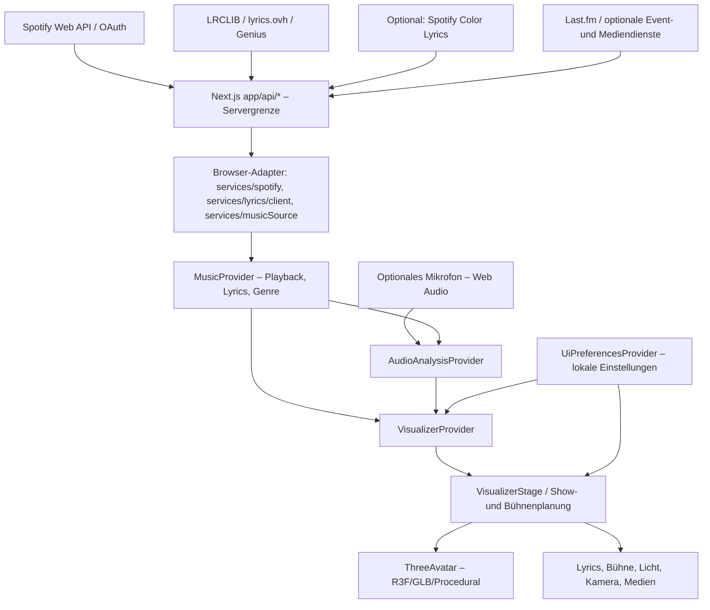
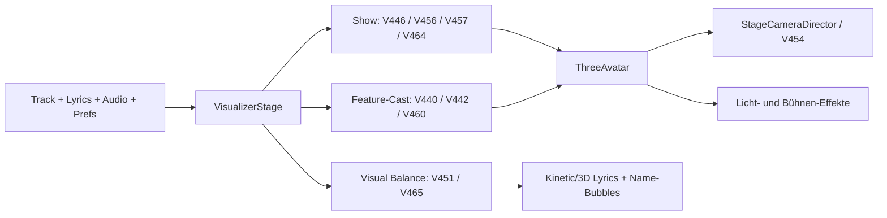

## Neu: V612 – Expressive Vocal & Facial Performance 7.0

V612 ergänzt `components/visualizer/expressiveVocalFaceV612.ts` als kleine **nachweislich wortzeitgebundene** Erweiterung der bereits existierenden Deutschrap-Lip-Sync- und Facial-Rig-Pipeline: bessere, konservativ modulierte Kiefer-/Vokalübergänge, dezente Brauen-/Wangenreaktionen und bei echter V581-Head-Bone-Erkennung winzige zusätzliche Kopfakzente. Die bestehende V384-B/P/M-Lippenschließung, V420-Editor, V423-Audio-Mouth, V562-Mundkalibrierung, Preview und manuelle Animationen haben Vorrang. Der prozedurale Ersatzavatar verwendet dieselbe Expressionskurve. Unbekannte Silben, phonemgenaue Timings oder Sprecher werden **nicht erfunden**. Keine neuen Renderer, GLB-Animationsclips, Shader oder Renderloops.

Prüfung: `npm run test:v612`, `npm run test:v612:types`, `npm run test:smoke:v612`, `npm run verify:v612`. Details: `V612-EXPRESSIVE-VOCAL-FACIAL-PERFORMANCE-7.md` und `V612-VERIFICATION.md`. Echte GLB-/Spotify-Sichtprüfung sowie Next.js-Produktionsbuild bleiben offen; ein Raspberry Pi ist nicht Voraussetzung.

## Neu: V611 – Ultimate Continuous Concert Experience 6.0

Die V600/V604-Songregie, V607-Interaktionen, V608-Beleuchtung, V609-Übergänge und V610-Genreplanung werden nun mit `components/visualizer/continuousConcertExperienceV611.ts` auf eine gemeinsame, **beleggebundene Songzeit- und Aktquelle** abgestimmt. Ein erster belegter Hook nutzt ein breiteres Ensemble-Motiv, der wiederholte Hook einen kleineren Spotlight-Fokus; raplastige Verse beruhigen Kamera, Deko-Beams und Tanz, ein echter Break senkt die Intensität, ein Drop benötigt separate gemessene Kick-Unterstützung. Ein Finale wird nur aus hinreichender bestätigter Trackende-Evidenz akzentuiert. Zusatzgains liegen eng um 1 und laufen an belegten Szenenrändern gegen neutral. Kein neuer Regieclock, keine erfundenen Stimm- oder Wortzeiten.

Verwendet werden ausschließlich vorhandene automatische Bewegungs-/Kamerakanäle und existierende Stage-Lichter in `components/visualizer/VisualizerStage.tsx`, `components/visualizer/StageCameraDirectorV289.tsx`, `components/visualizer/DynamicStage.tsx` und `components/visualizer/ConcertAtmosphereRendererV308.tsx`. Bestehende V351-Lyrics-Sicherheitsprüfung, manuelle Kamera/Choreografie/Licht-Blackouts, Low-Tier, Pause, Reduced Motion, Sängerrollen, GLB, IK und Wortzeitstempel behalten Vorrang. Kein neuer Shader, Renderloop, Laser oder GPU-Licht. **Nicht nachgewiesen:** echter Next.js-Build, Browser-/GLB-Konzertwirkung, reale FPS. Der Nutzer hat noch keinen Raspberry Pi gekauft; geplant ist vor Hardwareauswahl V618 als universeller Benchmark.

Tests: `tests/v611-continuous-concert-experience-regression.cjs`, `tests/tsconfig.v611-core.json`; Anleitung `V611-ULTIMATE-CONTINUOUS-CONCERT-EXPERIENCE-6.md`; Ergebnis `V611-VERIFICATION.md`.

## Neu: V610 – Genre-Specific Concert Experience 6.0

Sonic Display erhält drei **beleggebundene** Regievarianten für Deutschrap, Hardstyle und Hardtekk. Die vorhandenen automatischen Tänzer-Intensitäten, die einzelne R3F-Kamera und die beiden bestehenden Licht-/Atmosphären-Renderloops werden gemeinsam von einem konservativen V604/V600-Songakt abgestimmt. Deutschrap setzt auf klar lesbare Rap-Strophen und Close-ups; Hardstyle auf große bestätigte Hook-/Kick-Drop-Momente; Hardtekk auf etwas schnellere begrenzte Bewegungsakzente. Wiederholte Hooks unterscheiden sich. Keine zusätzlichen Renderloops, GLB-Clips, Spotlights, Shader, Laser oder erfundenen Songabschnitte. Manuelle Choreografie, Kamera-Keyframes und Lichttimelines behalten Vorrang. Ohne bestätigte Songstruktur greift V610 nicht ein.

Tests: `npm run test:v610`, `npm run test:v610:types`, `npm run test:smoke:v610`, `npm run verify:v610`. Details in `V610-GENRE-SPECIFIC-CONCERT-EXPERIENCE-6.md`. Die tatsächliche optische Wirkung bleibt am PC-Browser zu prüfen; Raspberry-Pi-Beschaffung ist vorerst nicht erforderlich.

## Neu: V609 – Seamless Concert Scene Transitions 5.0

V609 stimmt die **vorhandenen** Kamera-, Licht- und automatischen 3-/4-Tänzer-Übergänge an den **belegten** Songabschnittsgrenzen besser aufeinander ab. Kameraschnitte, eigene Timelines, Sängerzuordnung, GLB-Animationen, Lip-Sync und Lyrics behalten Vorrang. Ein zusätzlicher Renderloop, neue GPU-Effekte oder erfundene Abschnittslabels werden nicht eingeführt. Tests: `npm run test:v609`, `npm run test:smoke:v609`, `npm run verify:v609`. Dokumentation: `V609-SEAMLESS-CONCERT-SCENE-TRANSITIONS-5.md`.

## Neu: V608 – Dynamic Concert Lighting & Atmosphere 5.0

V608 verbindet die bestehende Konzertbeleuchtung mit dem belegten **Gesamt-Song-Spannungsbogen aus V604**. Verse wirken ruhiger und beleuchten die Sänger besser; Builds steigern die Stimmung, wiederholte Hooks variieren zwischen Beam- und Spotlight-Motiven, und bestätigte Hardstyle-/Hardtekk-Drops setzen einen begrenzten zusätzlichen Akzent nur bei gemessener Kick-/Energieunterstützung. Bei eindeutig bestätigten Sängerwechseln oder Duetten folgen die vorhandenen V551-Spots weiterhin den tatsächlichen Avatarpositionen, ergänzt um sehr kleine Fokusakzente. Das Finale wird nur bei ausreichender belegter Songstruktur betont. Die Stage-FX aus V601 und Pi-Budgets aus V602 bleiben bestehen; die neuen Gains betreffen **nur existierende V308-/DynamicStage-Lampen, Strahlen und Nebel**. Kein Laser, kein neuer Shader, kein zusätzliches Licht oder Renderloop.

Sicherheitsregeln: Manuell gespeicherte Lichttimelines/Blackouts, deaktivierte Lichtreaktivität, Pause, reduzierte Bewegung, Pi-Low-Tier, fremder Spotify-Track und nicht bestätigte Songabschnitte haben Vorrang. Bei dichten Lyrics werden Haze und Sweep zurückgenommen. Die V604-Dramaturgie benutzt bestätigte V318-Labels: Ohne diese bleibt V608 neutral; eine automatisch perfekt interpretierte Show wird **nicht** behauptet.

Prüfung: `npm run test:v608`, `npm run test:v608:types`, `npm run test:smoke:v608`, `npm run verify:v608`. Details: `V608-DYNAMIC-CONCERT-LIGHTING-ATMOSPHERE-5.md` und `V608-VERIFICATION.md`. Die echte Wirkung muss im Browser mit Spotify/GLB und auf dem Raspberry Pi beurteilt werden.

## Neu: V607 – Natural Multi-Artist Concert Interaction 5.0

Die aus V599 bekannten ausdrücklich zugewiesenen Sängerrollen werden jetzt bei **Duetten, bestätigten Rap-Übergaben und Gruppen-Hooks** noch vielfältiger und vorsichtiger auf der Bühne gespiegelt. Gegenseitig kurze Blicke sind nur möglich, wenn die vorhandene Bühne bereits eine zum zugewiesenen Partner passende Blickrichtung berechnet hat. Begleittänzer setzen deutlich versetzte und schwächere Gesten, statt dem Lead synchron jede Bewegung nachzumachen. Bei vier Künstlern bleibt eine Hook gemeinschaftlich, aber nicht spiegelgleich. Keine Änderungen an Mundbewegungen, GLB-Clips, Animationstracks, Fuß-IK, Lyrics, Kamera, Licht, Genreerkennung oder manueller Choreografie. Diese Regeln sind reine Upper-Body-Overlays und erfordern echte optische Kontrolle mit GLBs.

Tests: `npm run test:v607`, `npm run test:v607:types`, `npm run test:smoke:v607`, `npm run verify:v607`. Mehr: `V607-NATURAL-MULTI-ARTIST-CONCERT-INTERACTION-5.md` und `V607-VERIFICATION.md`.

## Neu: V606 – Cinematic Lyrics & Performer Harmony 11.0

V606 verbindet das Lyrics-DOM-Overlay und die bestehende einzelne Bühnenkamera über einen konservativen, gemeinsamen Songzeit-/Sänger-/Cue-Planer: ruhige, besser abgegrenzte Rap-Zeilen, geschützte bestätigte Duettkompositionen und kleine, nur bei belegten Hooks aktivierte Lyrics-Akzente. Die neue Kamerastufe bewegt die vorhandene Kamera für dichte Lyrics/Duette nur dann, wenn V540/V550 keine Verschlechterung der projizierten Avatar-Bildrahmen feststellen. Manuelle Kamera, Layout/Fonts, Karaoke-Fill, echte Wortzeitstempel, Lip-Sync und V351-Lyrics-Sicherheitscheck gewinnen immer. Keine zusätzlichen Timer, Shader, 3D-Textobjekte oder Renderloops. Das alternative WebGL-Textmesh bleibt unverändert.

Prüfung: `npm run test:v606`, `npm run test:v606:types`, `npm run test:smoke:v606`, `npm run verify:v606`. Dokumentation: `V606-CINEMATIC-LYRICS-PERFORMER-HARMONY-11.md` und `V606-VERIFICATION.md`. Für einen bestätigten visuellen Gewinn sind echte Spotify-/GLB-WebGL-Aufnahmen erforderlich.

## Neu: V605 – Cinematic Concert Camera Director 6.0

V605 übersetzt die trackgebundene, streng bestätigte Gesamtshow-Dramaturgie von V604 erstmals in **echte, konservative Kameraposen**: abwechslungsreiche leichte Tracking-Bewegungen, stärkere Ensemble-/Hook-Weiten und – ausschließlich bei vorhandener, korrekt zugewiesener Sängerrolle – vorsichtige Lead-/Duett-Kompositionen. Die ersten und wiederholten Hooks verwenden unterschiedliche Regiemotive. Ein vorhandenes V540-/V550-/V585-Framing darf sich durch die zusätzliche Stufe **nicht nachweislich verschlechtern**; sonst bleibt die unveränderte Kamerapose erhalten. Authored Shot, Live-Editor, Keyframe-Timeline, manuelle Regie, Reduced Motion und Pi-Low-Tier genießen Vorrang. V351 schützt Lyrics weiterhin **als allerletzte automatische Kamerastufe**.

Tests: `npm run test:v605`, `npm run test:v605:types`, `npm run test:smoke:v605` und `npm run verify:v605`. Dokumentation: `V605-CINEMATIC-CONCERT-CAMERA-DIRECTOR-6.md`, `V605-VERIFICATION.md`. Reale Spotify/GLB-WebGL-Sichtprüfung bleibt notwendig.

## Neu: V604 – Intelligent Full-Song Concert Dramaturgy 6.0

V604 erweitert die bewährte V600-Trackregie um einen musikalisch nachvollziehbaren, **abschnittsgebundenen Spannungsbogen**. Wiederholte Hooks bekommen abwechslungsreiche Regiemotive; Build-ups wachsen kontrolliert, Breaks nehmen Energie zurück, und nur bei tatsächlich bis nahe ans Songende belegten Abschnitten entsteht ein zurückhaltender Schlussakzent. Tanz, Kameraintensität und Bühneneffekte gehen an jedem Abschnittsrand fließend in V600 über. Automatische 3-/4-Avatar-Formationen können vorhandene Cue-Zeitpunkte variieren; manuelle Regie und Sängerrollen bleiben geschützt. Voraussetzung für die starke Wirkung sind zu Track und Laufzeit passende V318-Songabschnittslabels – ohne diese werden keine Hooks oder Drops erfunden.

Prüfen: `npm run test:smoke:v604` / `npm run verify:v604`. Anleitung: `V604-INTELLIGENT-FULL-SONG-CONCERT-DRAMATURGY-6.md`. **Die echte Qualität einer Konzertshow muss im Browser und auf dem Raspberry Pi mit deinen GLB-Tänzern und Spotify überprüft werden.**

## V604 – Intelligent Full-Song Concert Dramaturgy 6.0

Aus belegten V318-Songabschnitten entstehen variierte Hooks, sanfte Szenenwechsel und ein erkennbarer Gesamtspannungsbogen über die vorhandene V600/V568-Konzertregie. Ohne zusätzliche Kamera-Engines, erfundene Songmarken oder Eingriffe in manuell festgelegte Bühnensteuerungen. `npm run verify:v604` prüft den Release. Siehe `V604-INTELLIGENT-FULL-SONG-CONCERT-DRAMATURGY-6.md`.

## Neu: V603 – Complete Concert Experience Validation 4.0

V603 fasst mehrere **echte** lokale V592-Live-Songaufnahmen zu einem Bericht über die gesamte Konzertshow zusammen. Er zeigt Songfortschritt anhand der **Spotify-Trackdauer**, noch unaufgenommene Bereiche, mögliche Wiederholung von Kamera-Cues sowie Lyrics-/GLB-/Performance-Prüfhinweise. Ein Umfang von 90 % gemessener Abschnitte bedeutet **keine automatische künstlerische Abnahme**. Insbesondere echte Tanzqualität, Lip-Sync und Stage FX müssen anhand der realen Bühne gesehen werden.

Befehle: `npm run test:smoke:v603` und `npm run verify:v603` sowie `npm run benchmark:v603:review -- --run=artifacts/run-a/report.json --run=artifacts/run-b/report.json --out=artifacts/v603/review`. Ausgabe `review-v603.json`, `review-v603.html`, `images/`. Quelle und Ziel **in getrennten Ordnern** halten. Alle Runs: derselbe Spotify-Track, dieselbe Bildschirmauflösung, Browser/WebGL-Konfiguration und GLB-Zahl. Ausführliche Grenzen in `V603-COMPLETE-CONCERT-EXPERIENCE-VALIDATION-4.md`.

## Neu: V602 – Real Raspberry Pi Concert Optimization 6.0

Die bestehende V479-Pi-Hysterese steuert nun zusätzlich **Auto-DPR** und die optionalen V601-LED-/Gobo-/Nebel-/Spotlight-Anteile. Bei drei oder vier Avataren und aktiviertem Pi-Profil wird die automatische Bühnenlast vorsichtig begrenzt; bei durch V479 gemessener anhaltender Bildlast wird auf eco reduziert. **Keine automatische Sänger-/Musikstruktur-Erkennung, keine Änderung an manuellen Renderprofilen oder Lichtregien.** Details: `V602-REAL-RASPBERRY-PI-CONCERT-OPTIMIZATION-6.md`, Tests `npm run verify:v602`.

## V601 – Advanced Concert Stage FX 4.0 (26.10.2026)

Weiterentwicklung der existierenden V555-Bühneneffekte: rhythmisch differenzierte LED-Muster, Gobo-Ringe, ruhiger Bodennebel und ein sparsames bewegtes Spotlight. Dichte Rap-Lyrics, manuelle Lichtregie, Reduced Motion und niedrige Raspberry-Pi-Stufen bleiben geschützt. Keine neue Beat-/Hook-Erkennung und keine Laser. Tests: `npm run test:smoke:v601` und `npm run verify:v601`. Details: [V601-ADVANCED-CONCERT-STAGE-FX-4.md](V601-ADVANCED-CONCERT-STAGE-FX-4.md).

## V600 – Ultimate Concert Director 5.0 (26.10.2026)

Der gesamte Song erhält einen **deterministischen dramaturgischen Regiebogen**. Eindeutig beschriftete V318-Musikabschnitte steuern subtile, gemeinsame Kamera-/Tanz-/Lichtakzente mit Opening, Aufbau, Höhepunkt und ruhigem Ausklang. Wiederholte Hooks erhalten unterschiedliche Bildkompositionsmotive; bei unbeschrifteten Songs kommt nur eine bewusst schwache Playback-Kontur ohne erfundene Hook-/Drop- oder Sängererkennung zum Einsatz. Die automatisch generierte 3/4-Avatar-Aufstellung kann innerhalb vorhandener Zeitmarken abwechslungsreicher werden; manuelle Formationen, Sängerrollen, GLB-Clips und Fuß-IK bleiben unangetastet. Die **Shot-Namen sind Planungsmetadaten, keine bereits implementierte direkte Kameraposensteuerung**.

Schnelltest: `npm run test:smoke:v600`, umfangreich: `npm run verify:v600`. Details: [V600-ULTIMATE-CONCERT-DIRECTOR-5.md](V600-ULTIMATE-CONCERT-DIRECTOR-5.md), [V600-VERIFICATION.md](V600-VERIFICATION.md). Echte WebGL-/GLB-Sichtprüfung, Spotify-Browserlauf, Next.js-Gesamtbuild und Raspberry-Pi-Hardwaremessung sind separat nötig.

## V599 – Intelligent Feature & Duet Performance 4.0 (26.10.2026)

Explizit zugewiesene Deutschrap-Sänger erhalten natürlichere, zeitlich versetzte **Upper-Body-Reaktionen** bei Übergaben, Duetten und gemeinsamen Hooks. Beide vorhandenen Bühnenvarianten (2 oder 3/4 Performer) nutzen denselben V500-Planer, erweitert um `featureDuetPerformanceV599.ts`. Der ursprüngliche Track-Match, manuelle Bühnen-/Vokalpriorität, eingespielte GLB-Clips, Fuß-IK, Mundbewegungen und Kamera bleiben geschützt. Keine neu erkannte Stimme, keine zusätzlichen Song-/Silbenzeitmarken. Tests: `npm run test:smoke:v599` und `npm run verify:v599`. Details: [V599-INTELLIGENT-FEATURE-DUET-PERFORMANCE-4.md](V599-INTELLIGENT-FEATURE-DUET-PERFORMANCE-4.md).

## V598 – Beautiful Lyrics Experience 10.0 (26.10.2026)

Neue lesbare Karaoke-Wortakzente mit **echten** Wortzeitstempeln, dezenter Hook-Hervorhebung aus der vorhandenen Bühnenregie und textlängenabhängigem Zeilenlayout für 10-Zoll-Anzeigen und Mehrfach-Avatare. An derselben `KineticLyrics`-Komponente hängen die normale Songansicht und die immersive Bühnenüberlagerung. Bestehende Lyrics-Position, Schrift-/Farbwahl, Karaoke-Fill, Sängerzuordnung, GLB und Kamera bleiben unverändert. **Keine** neue Phonem-/Hook-Zeiterkennung.

`npm run test:smoke:v598` / `npm run verify:v598`. Dokumentation: [V598-BEAUTIFUL-LYRICS-EXPERIENCE-10.md](V598-BEAUTIFUL-LYRICS-EXPERIENCE-10.md).

## V597 – Advanced Deutschrap Lip-Sync 6.0 (26.10.2026)

Sanfte, **an nachgewiesene Wortzeitstempel** gebundene Übergänge bei schnellem Rap: sehr kleine Vokalform-Übergänge zwischen verbundenen Wörtern, behutsames Ausklingen am Phrasenende sowie dezente Kiefer-/Vokal-Glättung. In der echten GLB-Gesichts-Morphsteuerung und der prozeduralen Vorschau integriert. B/P/M-Lippenverschluss, manuelle Wort-/Gesichtsedits, Audio-Mundsteuerung, Track- und Sängerrollen bleiben vorrangig. **Keine** tatsächlich gemessene Phonemsynchronisation oder Stimme-zu-Sänger-Erkennung.

Tests: `npm run test:v597`, `npm run test:v597:types`, `npm run test:smoke:v597`, `npm run verify:v597`. Erläuterungen und Testgrenzen: `V597-ADVANCED-DEUTSCHRAP-LIP-SYNC-6.md` / `V597-VERIFICATION.md`. Vollständige visuelle GLB-Abnahme und Raspberry-Pi-Performance bleiben nötig.

## V596 – Natural Dance & Footwork Quality 6.0 (26.10.2026)

V596 verbessert die *bereits existierenden* automatischen Tanzbewegungen beim Übergang von einem real gemeldeten Standfuß zur nächsten Bewegung. In 3-/4-Tänzer-Szenen wird der Lift von links und rechts unabhängig voneinander freigegeben; die vorhandene Fuß-IK bleibt alleiniger Besitzer echter Kontakte. Bei GLB-Avataren werden die schon generierten additiven Schritt- und Balanceimpulse nach V545/V587 sanft an den Bodenkontakt angepasst. **Keine neuen Clips, Beats, Steps, Root-Travels oder manuellen Überschreibungen.** Mit Testbefehlen `npm run test:smoke:v596` und `npm run verify:v596`. Details: [V596-NATURAL-DANCE-FOOTWORK-QUALITY-6.md](V596-NATURAL-DANCE-FOOTWORK-QUALITY-6.md). Echte WebGL-/GLB-Sichtprüfung und Pi-Hardwarebenchmark weiterhin ausstehend.

## V595 – Automated Live Concert Visual Regression 2.0 (26.10.2026)

Zwei **echte**, an denselben Songstellen aufgenommene V592-Livebühnen-Berichte werden für Solo-, Duett-, Hook- und Drop-Szenen verglichen. Die verwendeten Konzert-Cues werden aus den tatsächlichen `VisualizerStage`-Daten gelesen; fehlende Zuordnungen können optional in einer manuellen Markerdatei dokumentiert werden. Normale GLB-Bewegungen und Lyrics werden beim Pixelvergleich maskiert; Kamerawarnungen und Überlagerungen bleiben sichtbar. Der Bericht `report-v595.html` zeigt beide Bilder und alle nicht abgedeckten Szenen, fordert aber immer eine **manuelle Abnahme**. Befehl: `npm run benchmark:v595:regress -- --baseline=BEFORE/report.json --candidate=AFTER/report.json`. Siehe [`V595-AUTOMATED-LIVE-CONCERT-VISUAL-REGRESSION-2.md`](V595-AUTOMATED-LIVE-CONCERT-VISUAL-REGRESSION-2.md). Tests: `npm run test:smoke:v595`, ausführlich `npm run verify:v595`.

## V594 – Concert Quality Comparison & Optimization History 3.0 (26.10.2026)

Zwei tatsächliche V592-Livebenchmarkberichte werden offline **Vorher/Nachher** verglichen. Die neue statische `report-v594.html` stellt Original- und Folgeaufnahmen (gleicher Spotify-Track und nachweisbar ähnliche Songpositionen), Browser-rAF-/p95-/p99-Werte, Renderlast und heuristische Kamera-/Lyrics-/Avatarwarnungen gegenüber. Ein `history-v594.html` protokolliert weitere lokale Vergleiche (gekürzter Track-Hash, keine Zugangsdaten). Unterschiedliche Browser-/GLB-/Songpositionen werden ausdrücklich als nur begrenzt vergleichbar markiert. Pixelunterschiede sind keine automatische Qualitätswertung; die Show wird nicht automatisch verändert. Anleitung: [`V594-CONCERT-QUALITY-COMPARISON-OPTIMIZATION-HISTORY-3.md`](V594-CONCERT-QUALITY-COMPARISON-OPTIMIZATION-HISTORY-3.md). Tests: `npm run test:smoke:v594`; ausführlich: `npm run verify:v594`.

## V593 – Concert Quality Auto-Improvement 2.0 (26.10.2026)

Die **reale, lokal gemessene** Spotify-Bühne aus V592 wird jetzt nach dem Browser-Test auf wiederkehrende Probleme hin ausgewertet. Der Advisor gibt konkrete, durch Screenshot-Nummern belegte Vorschläge für Kameraausschnitt, GLB-Darstellung und Avatar-Überlagerungen, DOM-Lyrics-Kollisionen, Lyrics-Sync, Bildabdeckung und Browser-Frame-Pacing aus. Schutzregeln verhindern falsche automatische Qualitätsfreigaben. **Keine Show-Einstellungen werden automatisch verändert.**

Bei erfolgreichem `npm run benchmark:v592:live -- --debug-port=9222 --seconds=15` erscheinen zusätzlich `advice-v593.json` und `report-v593.html` in `artifacts/v592/live/`. Ein vorhandener V592-Report kann mit `npm run benchmark:v593:advise -- --report=artifacts/v592/live/report.json` ausgewertet werden. Nur echte gemessene V592-Berichte werden akzeptiert; Offline-Tests dienen ausschließlich der Funktionsprüfung.

Siehe `V593-CONCERT-QUALITY-AUTO-IMPROVEMENT-2.md` und `V593-VERIFICATION.md`.

## V592 – Live Concert Stage Quality Validation 4.0 (26.10.2026)

V592 erweitert die Browser-Messung auf die **tatsächliche** laufende Spotify-`VisualizerStage`, inklusive des echten R3F-Canvas, vorhandener GLB-Tänzer, Spotify-Lyrics, Kamera und Licht. Anders als V591 wird **keine** separate Konzert-Testszene verwendet. Nur bei expliziter Aktivierung auf `localhost` erlaubt die zusätzliche read-only Instrumentierung Messwerte; der Benchmark benötigt einen verbundenen Spotify-Account, tatsächlich laufende Wiedergabe, Lyrics und mindestens einen geladenen GLB-Avatar. `report.json`/`report.html`/PNG-Bilder entstehen nur nach echter Wiedergabemessung, andernfalls `blocked` ohne Erfolgsbehauptung. Für einen bereits angemeldeten Chromium-Testbrowser siehe [`V592-LIVE-CONCERT-STAGE-QUALITY-VALIDATION-4.md`](V592-LIVE-CONCERT-STAGE-QUALITY-VALIDATION-4.md). Tests: `npm run test:smoke:v592`, Gesamtprüfungen: `npm run verify:v592`.

## V591 – Integrated Concert Visual Quality 3.0 (26.10.2026)

Ein neuer **lokaler Browser-Konzertreview** zeigt zwei bis vier tatsächliche GLB-Avatare, explizite Song-/Lyrics-Testcues, unterschiedliche Kameraperspektiven und vereinfachte LED-/Gobo-Lichtstimmungen in einer 16:9-Szene. Der CDP-Lauf erfasst die **gesamte Szene einschließlich Lyrics-Overlay** als echte Browser-PNGs und schreibt ein `report.html` plus JSON mit Frameintervallen, Pixeländerungen und vorsichtigen Framing-/Lyrics-Warnungen. Ohne GLB/WebGL-Erfolg gibt es nur `blocked`; echte visuelle Freigabe bleibt Aufgabe des Menschen. **Dies ist eine eigenständige Review-Fixture, nicht die komplette Spotify-Produktionsshow.** Details: [`V591-INTEGRATED-CONCERT-VISUAL-QUALITY-3.md`](V591-INTEGRATED-CONCERT-VISUAL-QUALITY-3.md). Tests: `npm run test:smoke:v591`; Browser: `npm run benchmark:v591:concert -- --models=/benchmark/a.glb,/benchmark/b.glb --clips=0,0`.

## V590 – Real Concert Visual Benchmark 2.0 (26.10.2026)

Ein neuer **lokaler Browser-GLB-Benchmark** kann echte eingebettete oder separat geladene/retargetete Animationsclips zu festgelegten Sekunden in einer unabhängigen WebGL-Vorschau aufnehmen. Der Node/Chromium-CDP-Lauf speichert Original-/Folgeclip-PNGs, quantitativen Pixelvergleich, vorsichtige Projektion-/Bildausschnittwarnungen und gemessene rAF-Framezeiten als `report.json` und eine lokal öffnungsfähige `report.html` mit paarweisen Screenshots. Ohne echte lokale GLB-Quelldatei entsteht **kein** Fake-Screenshot oder Erfolgsbericht. Eine automatische visuelle Qualitätsfreigabe findet nicht statt; das ist kein realer Spotify-Liveshow- oder Pi-Hardwaretest. Anleitung: [`V590-REAL-CONCERT-VISUAL-BENCHMARK-2.md`](V590-REAL-CONCERT-VISUAL-BENCHMARK-2.md). Tests `npm run test:smoke:v590`.

## V589 – Visual Dance Quality & Real GLB Validation (26.10.2026)

Die vorhandene V534-Skelettanalyse und echte GLB-3D-Vorschau sind jetzt mit einer klickbaren Zeitachsen-Auswertung, Hinweisen zu möglichen Fußrutschern und Clipübergängen, einer expliziten manuellen Sichtprüf-Checkliste sowie einem exportierbaren JSON-Bericht verbunden. Dies gilt beim Import und in der installierten Motion-Bibliothek. Ein 2–8-Minuten-Szenario simuliert die **V588-Clipauswahl** mit tatsächlichen geladenen GLB-Clips; **es rendert keine komplette Konzertshow und analysiert keinen echten Track**. Original-GLBs, Fuß-IK und manuelle Regie bleiben unverändert. Mehr: [`V589-VISUAL-DANCE-QUALITY-REAL-GLB-VALIDATION.md`](V589-VISUAL-DANCE-QUALITY-REAL-GLB-VALIDATION.md). Tests: `npm run test:smoke:v589`.

> **V588 (26.10.2026):** Intelligent Dance Choreography 7.0 – lange Genre-spezifische GLB-Choreografie über 32 Beat-Fenster; deterministische, abwechslungsreiche Rotation aus bereits geladenen Embedded-/Shared-/Library-Clips (kein neues 20-/64-Clip-Limit im Planer), acht Sekunden Schutz zwischen Clipwechseln, bestehender V536-/V492-Crossfade, Vorrang aller manuellen Regie. `npm run test:smoke:v588`, zusätzliche Regression `npm run verify:v588`. Siehe `V588-INTELLIGENT-DANCE-CHOREOGRAPHY-7.md`. Reale WebGL-, Next.js- und Pi-Abnahme offen.

> **V587 (26.10.2026):** Expressive Dance & Footwork 5.0: sanftere vorhandene Schrittbewegungen und Gewichtsverlagerungen anhand realer Standfuß-Cues; kleine, standphasenabhängige Arm-/Oberkörper-Balance für echte GLBs. Kontakt-IK, Root-Position, manuelle Choreografien, AnimationClips und Lip-Sync bleiben unter Kontrolle ihrer ursprünglichen Systeme. `npm run test:smoke:v587`; siehe `V587-EXPRESSIVE-DANCE-FOOTWORK-5.md`. Produktionsbuild, WebGL-Sichtprüfung und Pi-Benchmark weiterhin offen.

> **V586 (26.10.2026):** Natural Concert Performance 4.0: weichere wortgebundene Rap-/Tanz-Übergänge, kleine additive Oberkörper- und Arm-Gegenbewegungen sowie mehr Ruhe bei dichten Deutschrap-Passagen. Gemeinsamer GLB-/Prozedural-Pfad, Schutz bestätigter Sängerrollen, manuelle Choreografie und Foot-IK. `npm run test:smoke:v586`; Details `V586-NATURAL-CONCERT-PERFORMANCE-4.md`. Echter Browser-, Build- und Pi-Test noch offen.

> **V585 (26.10.2026):** Cinematic Duet Camera & Facial Interaction 4.0: sehr sanfte, trackgebundene Kameraübergaben und kurze wechselseitige Blicke bei bestätigten Sängerwechseln; breite, bildausschnittsichere Hook-Aufnahmen. `npm run test:smoke:v585`; Details `V585-CINEMATIC-DUET-CAMERA-FACIAL-INTERACTION-4.md`. Echte GLB-/Browser-/Pi-Abnahme bleibt offen.

> **V584 (26.10.2026):** Natürlichere Sängerwechsel, Blickantworten, Duett- und Hook-Gesten bei belegten Rap-Feature-Songs. `npm run test:smoke:v584`, Details `V584-NATURAL-DUET-STAGE-INTERACTION-3.md`.

## V583 – Intelligent Rap Performance Dynamics 3.0 (26.10.2026)

Kontrastreichere, dennoch dezente Tanzdynamik für **ruhigen Deutschrap, dichte wortmarkierte Flows, belegte Flow-Wechsel und Hooks**. Nur ausdrücklich geklammerte Adlib-Texte gelten als *Kandidaten*, nie als erkanntes Backing-Vocal. Die GLB- und Procedural-Engines nutzen denselben Zusatzplan mit sieben aufeinanderfolgenden Zeilen wechselnden, trackfesten Motiven. Alles läuft im vorhandenen Frame-Update mit vorhandenen Sänger-/Lyric-Cues und Schutz für Pausen, manuelle Choreografien, Low-Tier und reduzierte Bewegung. Test: `npm run test:smoke:v583`; erweiterte Regression: `npm run verify:v583`. Siehe `V583-INTELLIGENT-RAP-PERFORMANCE-DYNAMICS-3.md` und `V583-VERIFICATION.md`. Ein echter GLB-/Audio-/Pi-Sichttest bleibt offen.

## V582 – Natural Dance & Facial Coordination 2.0 (26.10.2026)

Kurze wortgebundene Brust-/Schulterakzente ergänzen die bestehenden V581-Deutschrap-Gesichts- und Kopfanimationen, **ohne** Kieferziele, Augen, Hände, Hüfte oder Foot-IK zu überschreiben. Der Renderer nutzt echte optionale GLB-Bones und ausschließlich bereits bestätigte V581-Sänger-/Wort-Cues. Manuelle Bewegung, Pausen, Low-Tier und `reducedMotion` behalten Priorität. Kein neuer Frame-Loop. `npm run test:smoke:v582` und `npm run verify:v582`; Dokumente: `V582-NATURAL-DANCE-FACIAL-COORDINATION-2.md` und `V582-VERIFICATION.md`. Audio-/GLB-Sichttest, gesamter Produktionsbuild und Pi-Hardwarefreigabe müssen noch separat geprüft werden.

## V581 – Coherent Deutschrap Facial Performance (26.10.2026)

Bei **bereits wortgenau zeitmarkierten, dicht gesprochenen Deutschrap-Passagen** koordiniert V581 die vorhandene GLB-Gesichtsengine: dezente Kopf-Nicks auf vorhandenen Head-Bones, minimal angepasste Kiefer-/Vokal-Interpolationsgeschwindigkeit sowie kleine Brauen- und Blickakzente. Zusätzliche Augenbewegungen setzen einen **nachgewiesenen manuellen V574-Sänger-/Blick-Cue** voraus. Ohne passende Augen-/Kopf-Bones erscheinen diese Zusatzbewegungen nicht. Auf Low-Tier, bei reduzierter Bewegung, fehlender eindeutiger Sängerzuordnung oder manuellen Lippen-/Gesichtsvorgaben bleibt V581 aus. Keine Sprach-/Phonem-/Emotionserkennung.

`npm run test:smoke:v581` ist der neue schnelle `prebuild`-Check; `npm run verify:v581` prüft zusätzlich sechs relevante frühere GLB-/Vocal-/Pi-Regressionen; die vollständige historische Testkette bleibt separat. **Ein bestandener Offline-Test ist keine GLB-/Browser- oder Raspberry-Pi-Freigabe.** Details: [`V581-COHERENT-DEUTSCHRAP-FACIAL-PERFORMANCE.md`](V581-COHERENT-DEUTSCHRAP-FACIAL-PERFORMANCE.md).

## V580 – Concert Experience 3.0 (26.10.2026)

Ausgehend von V572: V573 natürliche kleine Gesichtsakzente, V574 bestätigter Blickkontakt bei GLB-Augen-Bones, V575 zurückhaltende Duett-Handoffs, V576 Kontaktstabilisierung der Fußarbeit, V577/579 automatische Showvariation mit manueller Priorität, V578 besser lesbare Lyrics und abwechslungsreichere Gobo-/LED-Shadermuster sowie V580 **echter** lokaler Chromium-/Raspberry-Pi-Benchmark als ausführbares Skript. Kein neuer Avatar-Clip, keine neue Phonem-/Stimmerkennung, keine Laser.

**Entwicklung:** `npm run test:smoke:v580` oder `npm run verify:v580`. **Hardware:** auf dem Raspberry Pi die echte App starten und `npm run benchmark:v580:pi -- --seconds=120 --url=http://127.0.0.1:3000/ --out=artifacts/v580/pi` ausführen. Abhängigkeiten und echten Next-Produktionsbuild gemäß V571 auflösen; ein TypeScript-Subset-Check ist keine Build-Freigabe. Details: [V580-CONCERT-EXPERIENCE-3.md](V580-CONCERT-EXPERIENCE-3.md).

## V572 – Advanced Deutschrap Lip-Sync 5.0 (25.10.2026)

Der echte GLB-Gesichts-Renderer reagiert bei **geprüften, dicht zeitmarkierten Deutschrap-Wörtern** mit einem leicht schnelleren Kiefer-Anschlag und ruhigeren Breiten-/Rundungsübergängen. Das verändert nur die Interpolation bereits vorhandener Morphs, nicht deren Sollpositionen, Lippenverschlüsse, Sängerrollen oder manuelle Choreografien. Kein Phonem-Alignment, keine neuen Renderloops; auf Low-Tier, ohne Wortbeweis oder bei manuellen V420-/V423-Munddaten bleibt das bisherige Verhalten. Tests: `npm run test:smoke:v572` bzw. `npm run verify:v572`; Details: [`V572-ADVANCED-DEUTSCHRAP-LIP-SYNC-5.md`](V572-ADVANCED-DEUTSCHRAP-LIP-SYNC-5.md). Echter Windows-Next-Build/GLB/Pi-Test bleibt offen (siehe V571).

## V571 – Production Build & Browser Validation (25.10.2026)

Schnelle `prebuild`-Tests von der breiten historischen Release-Prüfung getrennt. Ein offline ausführbarer Build-/Lockfile-Audit prüft fehlende Pakete explizit, **ohne** einen erfolgreichen Next-Build zu behaupten. Das Chromium-CDP-Smoketest-Skript erzeugt Bildschirmaufnahme und JSON-Diagnose, verlangt für echte GLB-/WebGL-Checks ausdrücklich einen geladenen Avatar/Canvas und blockiert fremde URLs. **Offen:** npm-Registry war hier nicht erreichbar; die noch fehlende echte `package-lock.json` muss per `npm install` erstellt und versioniert werden; vollständiger Build, echter Browser-/GLB-Test und Raspberry-Pi-Langzeitlauf bleiben ausstehend. Aufruf: `npm run test:smoke:v571`; Anleitung: [`V571-PRODUCTION-AND-BROWSER-VALIDATION.md`](V571-PRODUCTION-AND-BROWSER-VALIDATION.md).

## V564 · Natural Deutschrap Performance

Wortbasierte, geglättete Rap-Gesten für echte GLB-Avatare; animierte Kopf-/Nacken-Bones, dezente Oberkörperakzente, zurückhaltende schnelle Rap-Strophen und abwählbare synthetische Vorher-/Nachher-Demo in der Bühnenvorschau. Details: `V564-NATURAL-DEUTSCHRAP-PERFORMANCE.md`.

## V563 – Real Multi-Avatar Duet Preview

Die große 3D-Konzertvorschau zeigt optional **zwei echte GLB-Avatare** gleichzeitig. Getrennte GLB-/Material-Klone, separate Gesichtsprofile, V562-Mundkalibrierung und animierte Sängerwechsel/Gesangs-Hooks. Synthetische Deutschrap-/Gesangsdemos sind klar markiert; echte Song-Sängerzuordnung nur mit aktivierten, **trackgebundenen manuellen V385-Zuordnungen**. Ohne geeignete Quelle wird kein Sänger erfunden; bei Low-Tier und fehlendem zweitem Modell bleiben die leichten Demofiguren. Kein neuer Schattenpass. Aufruf: **Einstellungen → Konzert-Bühneneffekte → 3D-Effekte & echtes GLB-Duett ansehen · V563**. Prüfung: `npm run verify:v563`; Details: [`V563-REAL-MULTI-AVATAR-DUET-PREVIEW.md`](V563-REAL-MULTI-AVATAR-DUET-PREVIEW.md).

## V562 – Advanced Facial Calibration

Pro Avatar lässt sich die Gesichtsartikulation jetzt **bewusst manuell** verbessern: Presets Neutral / Deutschrap / Gesang, sichere Kieferöffnung, Lippenverschluss und getrennte breite/runde Vokale. Unter *Einstellungen → Gesichtsanimation Studio* speichern; in *Konzert-Bühneneffekte → 3D-Effekte & GLB-Lip-Sync kalibrieren* live vergleichen, ohne die Show zu pausieren. Ohne Opt-in ist die V561-Mundanimation unverändert. Kompatibel mit den Morph-Zuordnungen des älteren [`V383-ADVANCED-FACIAL-RIG.md`](V383-ADVANCED-FACIAL-RIG.md). `npm run verify:v562`; Details [`V562-ADVANCED-FACIAL-CALIBRATION.md`](V562-ADVANCED-FACIAL-CALIBRATION.md).

## V561 – Real GLB Lip-Sync Preview

Die 3D-Bühnenvorschau kann jetzt im **opt-in echten GLB-Modus** die vorhandene Gesichts-Engine animieren: Deutschrap-/Gesangs-Demo oder bestehende wort-/zeitsynchronisierte Lyrics des aktuellen Spotify-Songs. Inklusive Gesicht-Nahaufnahme, erkanntem Morph-/Kiefer-Rig und dem gespeicherten Gesichtsprofil. Keine Phonem- oder Gesangsisolierung, kein Eingriff in den Live-Avatar. Bedienung, Testanweisungen und Grenzen: [`V561-REAL-GLB-LIP-SYNC-PREVIEW.md`](V561-REAL-GLB-LIP-SYNC-PREVIEW.md).

## V560 – GLB-Porträtmaterial und echte Avatar-Vorschau (25.10.2026)

`components/visualizer/portraitMaterialSafetyV560.ts` plant konservative PBR-Glanzkorrekturen nur für klar benannte Haut/Gesicht-Materialien: minimale Roughness-Anhebung und Metallness-Deckel, kein Farb- oder Texturwechsel. `components/visualizer/applyGlbPortraitMaterialsV560.ts` klont diese Materialien ausschließlich innerhalb der lokalen `SkeletonUtils`-Instanz in `components/visualizer/GltfDancerAvatarV492.tsx`, aktualisiert ohne Frame-Loop und entsorgt nur eigene Materialkopien. Besondere/transparente/emissive PBR-Materialien und Metalness-Maps bleiben unverändert; keine Shadow-Maps, Shader, GPU-Lichter, Geometrie oder Morph-Targets werden verändert. Einstellungen: `components/SettingsPanel.tsx`, `context/UiPreferencesContext.tsx`, `types/music.ts`. `components/visualizer/PreviewGlbPortraitV560.tsx` zeigt auf Wunsch den ausgewählten echten GLB im `components/visualizer/StagePreviewModal.tsx` mit Material-An/Aus und Gesichtsnähe; Duett bleibt Demo. Ein realer GLB-Praxis-/Browser-/Hardwaretest bleibt offen. Tests: `tests/v560-glb-portrait-regression.cjs`, `tests/tsconfig.v560-core.json`; Details `V560-GLB-PORTRAIT-MATERIAL.md`.

## V559 – Beat- & Musikenergie-Porträtlicht · Neu

Die bestehenden Key-/Fill-Lichter reagieren dezent auf Beat-Impulse und gemessene Audioenergie, besonders während Hooks und bestätigten Duetten. Schneller Deutschrap und laufende Haupt-Lyrics reduzieren die Zusatzeffekte. Einstellungen für Reaktion an/aus und Stärke. Große 3D-Demo mit Beat-Lichtvergleich für Solo-Hook und Duett; **kein** isoliertes Gesangssignal, keine realen Spotify-Zeitmarken. Keine neuen Lichter oder Schatten. Test: `npm run verify:v559`. Details: `V559-BEAT-VOCAL-PORTRAIT-LIGHTING.md`.

## V558 – Soft Portrait Lighting · Neu

**Sanfte Farb- und Gesichts-/Oberkörperbeleuchtung** in der echten 3D-Bühne; warmer Hook-Fokus, dezent kühleres Duett-Fill bei bestätigter Sängerzuordnung. **Einstellungen → Konzert-Bühneneffekte**: neuer Schalter und Wärme-Regler. Die große 3D-Demo unterstützt Deutschrap-Hook sowie Porträtlicht an/aus. Keine zusätzlichen 3D-Lichter, Shadows oder Lyrics-Eingriffe. Lokal prüfen mit `npm run verify:v558`; echter Produktionsbuild sowie Live-WebGL-/GLB-/Pi-Prüfung bleiben offen. Mehr in `V558-SOFT-AVATAR-PORTRAIT-LIGHTING.md`.

## V557 – Avatar-Licht für Hooks & Duette

Die vorhandenen Key-/Fill-Lichter richten sich in der echten 3D-Bühne nach sichtbaren Avatar-Positionen und (bei Mehrpersonenauftritten) ausschließlich nach bestätigten Sänger-Zuordnungen. Knackige, aber begrenzte Hook-Akzente, kurzes Duett-Handoff, dichte Rap-Zeilen mit weniger Zusatzlicht. Schalter **Avatar-Beleuchtung V557** und Regler **Avatar-Lichtbalance** in **Einstellungen → Konzert-Bühneneffekte**. **3D-Effektvergleich öffnen · V556** bietet jetzt zusätzlich **Duett (Demo)** mit zwei neutralen Vorschaufiguren. Manuelle Blackouts, Low-Tier, reduzierte Bewegung und Lyrics-Kontrast bleiben geschützt. Mehr: `V557-AVATAR-CONCERT-LIGHTING.md`. Test: `npm run verify:v557`.

## V556 – Konzert-Lichtbalance und 3D-Vorschau

In **Einstellungen → Konzert-Bühneneffekte** öffnet **3D-Effektvergleich öffnen · V556** die echte Bühnen-3D-Vorschau. Wechsle zwischen **Strophe**, **Hook** und **Dichter Deutschrap**, um Gobo-Muster, LED-Pixelwand und projizierte Hook-Wörter mit einer klar sichtbaren Beispiel-Lyrics-Anzeige zu vergleichen. Für eine sichere Darstellung werden die additiven Intensitäten automatisch begrenzt. Alle bestehenden V555-Schalter und der Stärkeregler gelten unverändert. Siehe `V556-CONCERT-BALANCE-PREVIEW.md`.

## V553 – Concert Experience Release Validation

Eine strenge Freigabematrix verbindet echte V522/V543-Browser-Messungen, manuelle Qualitätsprüfungen, externes Next.js-Build-Protokoll und bestätigte Raspberry-Pi-/10-Zoll-/Thermal-/Langzeitkontrollen. Fehlende oder schlechte Nachweise verhindern den Freigabestatus. Details: `V553-CONCERT-RELEASE-VALIDATION.md`. Prüfen: `npm run verify:v553`; die komplette Produktionsfreigabe erfordert weiterhin `npm install && npm run typecheck && npm run build` und Messungen am Zielgerät.

## V553 – Concert Experience Release Validation (25.10.2026)

`services/monitoring/concertReleaseGateV553.ts` aggregiert vorhandene **echte** V522-Hauptbühnenmessungen mittels `services/monitoring/concertShowReadinessV543.ts`. Ein bestandenes Konzert braucht drei vollständige und vergleichbare Live-Durchläufe je Deutschrap-/Hardstyle-/Langzeitszene, pro Szene vier menschliche Sicht-/Hörbestätigungen sowie manuell dokumentierten vollständigen Next.js-Produktionsbuild, echten Raspberry-Pi-Test, 10-Zoll-Touchscreen-Kontrolle, Hänger- und Thermalprüfung. Die Freigabe wird strikt blockiert, solange ein Nachweis fehlt; bei einem späteren defekten Benchmark fällt der Status zurück. Build-Protokoll, Geräteidentität, Temperatur und die Sichtprüfung sind **Bedieneraussagen und keine kryptografische oder automatische Hardware-/Audio-/Pixelprüfung**.

`components/visualizer/PiConcertBenchmarkStudioV522.tsx` zeigt diese V553-Prüfmatrix im bestehenden V522/V543-Benchmark, samt konkreter Sperrgründe und erweiterbarem JSON-Export. Es werden keine neuen WebGL-Loops, Sampling-Timer, Plugins oder GLB-Assets benötigt. Testmodule: `tests/v553-concert-release-regression.cjs`, `tests/tsconfig.v553-core.json`. Vollständige Dokumentation in `V553-CONCERT-RELEASE-VALIDATION.md` und `V553-VERIFICATION.md`. Die Quelltests sind kein Beleg für einen echten Produktionsbuild oder eine Pi-Freigabe.

## V552 – Raspberry Pi Performance 5.0

`components/visualizer/piConcertDrawBudgetV552.ts` definiert allokationsfreie, hysteresegeschützte Alpha-Draw-Calls für das bestehende V308-Lichtsystem. `ConcertAtmosphereRendererV308.tsx` blendet vorhandene Beam-/Haze-Meshes bei unbedeutendem Alpha ohne Unmount aus; das V479-Profil begrenzt die Sparschwellen, manuelle Lichter bleiben feinauflösend. Auch V542-Laser-Blocking wird als Sichtbarkeit umgesetzt. Spotlight-Ziele vermeiden redundante Matrixupdates. `DanceFX.tsx` beendet Pool-Iterationen nach dem Deaktivieren; `StageVisualEffectsV353.tsx` schreibt dieselbe Draw-Range nicht erneut. Keine zusätzliche Uhr, RAF, React-Subscription, neue GPU-Geometrie, WebGL-Lichtquelle oder Veränderung am Karaoke-/Lip-Sync-/Camera-/Motion-Loop. Reale FPS und Performance-Gewinne bleiben auf dem Zielgerät zu validieren.

## V551 – Intelligent Stage Atmosphere 4.0 (25.10.2026)

`intelligentStageAtmosphereV551.ts` ergänzt die bereits bestehenden V462/V542-Vergleichsfaktoren und die vorhandenen V308-Licht-/Nebelobjekte. Echte bestätigte V528-Sängerrollen erlauben ein sanftes Spotlight-Tracking der vorhandenen V377-Avatar-Weltkoordinaten; ohne Cast- oder Positionsevidenz bleibt das vorherige Verhalten. Energiegestützte Hardstyle-/Hardtekk-Drops, Lyrics-Schutz sowie manuelle Timelines/Blackouts werden priorisiert. Keine neuen WebGL-Lichter, Schatten, Shader oder Loops. `V551-INTELLIGENT-STAGE-ATMOSPHERE-4.md` enthält Details und Prüfgrenzen.

## V550 – Cinematic Concert Camera 4.0

`components/visualizer/cinematicConcertCameraV550.ts` ergänzt die bestehende V528/V540-Bühnenkamera um perspektivische Projektion der V377-Kopf- und Fußpunkte mit konservativer Körperhöhenannahme. Solos erhalten einen moderaten Close-up, handoff-Cues eine sanfte Gewichtung des kommenden Leads, echte bestätigte 2–4-Sänger-Hooks einen leicht weiteren Bildwinkel. V540-Lyrics-/Bildrand-, V351-Finalschutz und manuelle Einstellungen bleiben authoritative. Keine Echtbild-Okklusionserkennung oder neue GPU-Kameras. Prüfungen: `tests/v550-cinematic-concert-camera-regression.cjs` und `tests/tsconfig.v550-core.json`. Details: [V550 Release](V550-CINEMATIC-CONCERT-CAMERA-4.md).

## V548 – Multi-Avatar Crew Choreography 6.0 (25.10.2026)

Der rein deterministische `crewChoreographyV548.ts`-Planer ordnet automatisch musikalische **Bühnenrollen** `lead`, `feature`, `backing`, `dancer` zu. Nur trackgebundene, gültige V385/V416/V496/V547-Sänger-Cues setzen `singing=true`; V547 selektive Hooks bleiben **selektiv**. Die bestehende rein visuelle 3/4er-Gruppenformation bleibt ausdrücklich ohne Sängerbehauptung. Pro Rolle werden kleine, zeitversetzte Arm-, Schulter- und Blickgesten in die bereits vorhandenen V452-Kontexte eingemischt. In Vierergruppen werden nur die Pegel **vorhandener** Beat/Kick-Onsets minimal pro Rolle variiert (nicht synthetisiert). Bei Foot-Lock bleibt deren Pegel unverändert. V506/V508-Kollisionsbegrenzung läuft anschließend; keine neue Bühne, keine Root-Traversierung, GLB-Keyframes, Mischer, IK-Solver oder Renderloop. Duos verwenden nur dieselbe sichere Gestenebene. Manuelle Choreografien, fehlende Singer-Evidenz, Low-Tier, Reduced Motion und falsche Song-IDs sperren diese Verfeinerung.

Tests: `npm run test:v548`, `npm run test:v548:types`, `npm run verify:v548`. Derzeit gibt es maximal **vier gleichzeitige Gruppen-Slots**, auch wenn die Asset-Bibliothek fünf oder mehr verschiedene GLB-Avatare unterstützt. Ein tatsächlicher WebGL- und Pi-Sichttest einschließlich eigener Choreografie-Qualitätsbewertung bleibt notwendig.

## V547 – Feature Vocal Assignment Studio (25.10.2026)

Die V496-Sänger-Timeline wurde um eine interaktive Mehrspuransicht, explizite Lead-/Feature-/Hook-/Adlib-Rollen, selektive Hook-Sänger und additive Background-Adlibs erweitert. Altdaten und die Priorität manueller Zuordnungen bleiben erhalten. Details: `V547-FEATURE-VOCAL-ASSIGNMENT-STUDIO.md`.

## V543 – Concert Show Integration & Performance Validation

Die bereits vorhandenen **Live-Hauptbühnen-Messwerte** aus V518/V522 werden in `services/monitoring/concertShowReadinessV543.ts` zu einer dreiteiligen Prüfmatrix aggregiert: Deutschrap-Feature, Hardstyle-/Hardtekk-Drop und dreiminütige Langzeitshow. Für jeden Modus sind drei erfolgreiche, gleich konfigurierte Durchläufe mit derselben FPS-Zielvorgabe erforderlich. Eine beliebige Mischung aus Geräten, Grafik- oder Pi-Profilen darf nicht als bestanden gelten.

`components/visualizer/PiConcertBenchmarkStudioV522.tsx` zeigt neue V543-Prüfstände pro Szenario (Messanzahl, echte FPS, schlechtestes Fenster-P99, manuelle Sicht-/Hörprüfung von Lyrics, Rap-Lip-Sync, Tanz, Kameralicht), ohne einen weiteren Abtast-Timer oder Renderloop einzuführen. Die manuelle Sichtprüfung gilt **nur für das jeweilige Testszenario**, wird beim erneuten Testlauf bzw. FPS-Zielwechsel zurückgesetzt und zusammen mit der provisorischen Laufzeitfreigabe in den JSON-Export aufgenommen.

`tests/v543-concert-integration-regression.cjs` validiert Zustände des vollständigen V522-Benchmark-Verfahrens und die Interaktion der bereits vorhandenen V535/V536-Motion-, V528/V540-Kamera-, V539-Crew-, V541-Lyrics- sowie V462/V542-Lichtplaner anhand von fünf GLB-Originalmodellen. Die statischen Simulationsfälle messen **keine reale FPS, keinen GPU-Takt und keine optische Tanzqualität**. Sie sind strikte technische Kontrolltests. Ein zusammenfassender Status *lokal geprüft* ist keine Zertifizierung auf einem Raspberry Pi. Erst ein dortiger Live-Benchmark plus eigene Sichtprüfung kann die echte Laufzeitqualität des Geräts beurteilen.

Prüfen: `npm run test:v543 && npm run test:v543:types && npm run check:syntax && npm run check:architecture`; danach mit installierten Abhängigkeiten `npm run build` und Live-Konzert auf dem 10-Zoll-Raspberry-Pi. Details: [V543-Releasebericht](V543-CONCERT-SHOW-VALIDATION.md).

## V542 – Intelligent Concert Lighting & Stage FX

`intelligentConcertLightingV542.ts` verfeinert die bereits gedeckelten V462-Gains in `DynamicStage.tsx` und `ConcertAtmosphereRendererV308.tsx`. 2D/3D-Lyrics und V539-Cast-Größe kommen aus `ThreeAvatar.tsx`. Die vorhandenen Key/Fill/Spotlights, Low-Poly-Beams und Nebel werden weitergenutzt; keine neuen GPU-Ressourcen oder Render-Loops. V462/V387/V394-Limits, manuelle Timelines, Blackouts, Reduced Motion und Low-Tier bleiben führend. Keine Lasereffekte. Songabschnitte bleiben Heuristiken des bestehenden Directors. Tests: `test:v542`, `test:v542:types`.

## V540 – Cinematic Concert Camera 3.0

`cinematicCameraCompositionV540.ts` composes existing V528 verified singer cues with measured V377 avatar roots for aspect- and lyrics-aware framing before the V351 guard. It never overrides authored camera controls.

# Sonic Display – Systemarchitektur

## V546 – Advanced Deutschrap Lip-Sync 4.0

`components/visualizer/advancedDeutschrapArticulationV546.ts` verfeinert die bereits synchronisierte Gesichtspose aus V538 in beiden Bühnenvarianten. Nur bestätigte, getimte Rap-Wörter erlauben eine sehr kurze heuristische B/P/M-Mundschließung, eine vorsichtige Wort-zu-Wort-Vokalüberblendung ohne Zeitstempelerfindung oder einen kleinen Satzzeichenakzent. Der neue Pass erhält autoritative V384/V415-Lippenverschlüsse, V420-Mundkorrekturen, V423-Audio-Mundprofile, reduzierte Bewegung, stumme Rollen und manuelle Vorschauen. GLB-Keyframes bleiben unverändert; kein neuer Mixer, keine zweite Uhr und kein Render-Loop. Es handelt sich nicht um akustisches Phonem-Alignment. Tests unter `tests/v546-advanced-deutschrap-lip-sync-regression.cjs` und `tests/tsconfig.v546-core.json`.

## V545 – Natural Dance Motion 6.0

`components/visualizer/naturalDanceMotionV545.ts` stabilisiert nur fünf **additive** GLB-Rig-Kanäle (hipSway, hipCounter, weightShift, legGroove, footStep). Der bestehende `GltfDancerAvatarV492.tsx`-Framepfad ruft V545 nach V323 auf, vor Rig-Overlay und V492-Fuß-IK. Der Planner wertet ausschließlich vorherige V492-Kontaktphasen aus; keine neuen IK-Solver, AnimationMixer, GLB-Keyframes, Root-Translationen, zusätzlichen Render-Loops oder GPU-Effekte.

Neue Fußkontakte führen unmittelbar zur Reduktion additiver Fußrotationen. Deutschrap erhält sanftere Interpolation, Hardstyle/Hardtekk dürfen auf wechselnde Akzente schneller reagieren. Unbekannte Kontakte, deaktivierte Fuß-IK, Reduced Motion, Pause, Low-Tier, manuelle Choreografien, Loops, Timelines, Blend- und Smart-Dance-Overrides lassen den Originalwert unverändert. Die Stärke lässt sich in `components/visualizer/NaturalDanceControlsV320.tsx` einstellen. Tests: `tests/v545-natural-dance-motion-regression.cjs`, `tests/tsconfig.v545-core.json`; die fünf Original-GLBs dienen ausschließlich strukturellen Fixture-Prüfungen. **Kein optischer/physikalischer Nachweis für Null-Fußrutschen oder reale Pi-FPS**.

## V544 – Real Concert Visual Quality 2.0

`services/show/liveConcertComparisonV544.ts` ergänzt eine reine A/B-Projektionsanalyse auf der bereits opt-in etwa sekündlich messenden V466-WebGL-Qualitätsprobe. `components/visualizer/ConcertVisualCompareV544.tsx` ist unter dem bestehenden QA-Knopf erreichbar und speichert maximal zwei manuell aufgenommene Momentaufnahmen (A/B) im React-UI-Zustand; die Schemabilder verwenden echte normalisierte Kopf- und Lyrics-Rechtecke und zeigen die vorhandenen FPS an, **keine Pixel/Fotos und keine optische Gesichts-/Tanzprüfung**. Der Anwender markiert Fußarbeit, Gesicht/Lip-Sync und Lyrics getrennt; `createComparisonReportV544` exportiert auf Klick einen JSON-Bericht, keine Auto-Freigabe. Bildrand-/Lyrics-Nähe werden heuristisch beurteilt, nicht über Objekt-Okklusion. Original-Bühnenkamera, Motion, Beleuchtung, GLBs, FPS-Messintervall und QA-Gating bleiben unangetastet. `tests/v544-visual-quality-regression.cjs`, `tests/tsconfig.v544-core.json`. Der Next.js-Build braucht vollständig installierte Abhängigkeiten.


> **Dokumentationsstand:** V583 (25.10.2026)

## V539 – Multi-Avatar Concert Interaction 5.0

`components/visualizer/crewConcertInteractionV539.ts` ergänzt die bestätigten V517-Sängerrollen und die V527-Crew-Styles um kurze Partner-Blicke, Reaktionen auf explizit zugeordnete Vocal-Handoffs und abgestimmte Hook-Gesten. `components/visualizer/GroupDancersV326SceneV492.tsx` und `components/visualizer/DanceFormationActorsV492.tsx` integrieren die reine V539-Planung in ihre bestehenden Frame-Callbacks. Für Vocal-Wechsel und Duette wird eine zum Track passende manuelle V385/V416/V496-Zuordnung vorausgesetzt. Rein automatische Vierer-/Dreier-Hooks erhalten nur visuelle Choreografie-Akzente, **keine fingierten Sängerrollen**. V452-Clamps und V506/V508-Kollisionsprüfung, V494-Fuß-IK, Avatar-Mixer und Stage-Root-Animation bleiben unverändert. Kein eigener Render-Loop. Prüfungen: `tests/v539-crew-concert-interaction-regression.cjs`, `tests/tsconfig.v539-core.json`. Die eigentliche WebGL-Wirkung muss am Display geprüft werden.

## V538 – Advanced Deutschrap Vocal Performance

`components/visualizer/deutschrapVocalPerformanceV538.ts` verfeinert **nur** bereits bestätigte Deutschrap-Wort-Zeitmarken mit geringfügig angepassten Mundöffnungen, Wangen-/Brauenakzenten und gebremsten, phrasierten Rap-Gesten. `VocalRigV368.tsx` verwendet diese ergänzenden Facial-Werte über den bestehenden kalibrierten Morph-/Kieferpfad; `ProceduralDancerAvatarV492.tsx` verwendet dieselbe reine Auswertung. `useGltfVocalMotionV492.ts` übergibt die präzisierte additive Geste weiterhin an die V515-Begrenzung. Kein weiterer Frame-Loop, keine Änderungen an Original-GLBs, manuellen Choreografien, IK, Songuhr oder Vocal-Casting. V420-Edits, V423-Audio-Munddaten, Lippenverschluss, manuelle Vorschau und Track-gebundene Sängerzuordnung behalten Vorrang. Texte erzeugen **keine gemessenen Phoneme**, und technisch korrekte Zeitmarken garantieren noch keine optisch perfekte Lippensynchronität. Test: `tests/v538-advanced-deutschrap-vocal-regression.cjs`, `tests/tsconfig.v538-core.json`.


## V537 – Natural Motion Transitions 4.0

`components/visualizer/naturalMotionTransitionsV537.ts` ist ein deterministischer, begrenzter und rein datenlesender Pose-Matcher. Für **automatische** Live-GLB-Clipwechsel vergleicht er kompatible Hüft-, linke/rechte Bein- und Fuß-Kanäle anhand originaler Interpolationskurven; tatsächliche IK-`planted`-Zustände verstärken die Gewichtung betroffener Gelenke. `useGltfClipTransitionsV492.ts` verwendet den empfohlenen Einstieg und ggf. etwas längeren bestehenden Fade **nur bei erfolgreichem Match**. Der bestehende V232/V489/V492-Weg ist Fallback für manuelle Eingriffe, Low-Poses, reduzierte Animation, unpassende Rigs oder schlechte Kurven. GLB-Keyframes, IK-Anker, Mixer, Lip-Sync und Choreografien bleiben unberührt. Technische Rotationsübereinstimmung ist keine visuelle Fußkontakt-Garantie. Dokumentation `V537-NATURAL-MOTION-TRANSITIONS-4.md`; Tests `tests/v537-natural-motion-transitions-regression.cjs` und `tests/tsconfig.v537-core.json`.

## V536 – Genre-Aware Dance Intelligence 3.0

`components/visualizer/genreAwareMotionDirectorV536.ts` bewertet bereits geladene Animationen nach Kategorie, Genre, Songabschnitt und Energie mit stabilen Vier-Takt-Entscheidungen (mindestens 8 Sekunden Verweildauer) sowie kleiner Wiederholungsstrafe und Favoriten-Bonus. `components/visualizer/useGenreAwareMotionDirectorV536.ts` ist der render-loop-freie Adapter. `components/visualizer/GltfDancerAvatarV492.tsx` kombiniert für den Hybridmodus vorhandene eingebettete/V531-Clips mit den **tatsächlich geladenen, für das Modell retargeteten** V535-Bibliotheksclips (maximal die 24 bisher vorgehaltenen Einträge). V536 ist nur unter bestehendem Auto-Bühnenbesitz wirksam; manuelle Loops, Timelines, Choreografien, V328/V329, V356, V481, Rap-Live, V440-Präferenzen und kuratierte Evolution/Adaptive-Pläne haben Vorrang. V530 und alte Bibliotheksregie bleiben als Rückfall. Kein neuer Mixer, keine neue GLB-Ladung, keine Audio-Sängerinferenz. Details `V536-GENRE-AWARE-DANCE-INTELLIGENCE-3.md`; Tests `tests/v536-genre-aware-dance-intelligence-regression.cjs`, `tests/tsconfig.v536-core.json`.

## V535 – Intelligent Motion Library 2.0

`components/visualizer/motionLibraryIntelligenceV535.ts` ergänzt conservative, per Clip konfigurierbare Kategorien, Favoriten-/Suche-Filter und kryptografische SHA-256-Fingerprints der Animations-**Kurven** (Kanäle, Zeit, Werte, Interpolation). `components/visualizer/characterMotionLibrary.ts` erhält optionale, rückwärtskompatible Metadaten und drosselt wie bisher auf 250 installierte separate Motions. `components/CharacterMotionLibraryPanel.tsx` bietet Filter/Favoriten, bis zu 64 auf ausdrücklichen Klick geladene **eingebettete Avatarclips** aus Full-GLB oder V531-Shared-Source mit Vorschau und rein lokalen Lieblings-/Kategorievorgaben sowie den manuellen Nachscan von maximal 24 alten separaten Einzelclip-Dateien pro Durchlauf. `components/CharacterMotionBatchInstaller.tsx` lädt identische separate Clips **nur bei bereits bekanntem identischem Hash desselben Ziel-Avatars** nicht erneut hoch; ältere/unbekannte Fingerprints werden nicht als Dublette gewertet. Kein automatisches Entfernen von Dateien, keine Choreografie-/V530-Director-Änderung und kein Rig-unabhängiges Retargeting. Details: `V535-INTELLIGENT-MOTION-LIBRARY-2.md`; Tests: `tests/v535-intelligent-motion-library-regression.cjs`, `tests/tsconfig.v535-core.json`.

## V534 – Advanced Motion Quality Inspector

Der **Character & Motion Library**-Import bietet neben dem V533-Keyframe-Check jetzt eine **optionale Pose- und Übergangsprüfung**. Ein ausgewählter GLB-Clip wird auf einem isolierten Skelett mit bis zu 81 echten Animationsposen ausgewertet: mögliche Fußrutscher nahe der niedrigsten beobachteten Höhe, auffällige Hüftbewegungen, Quaternion-/Zeitstempel-Warnungen und der Vergleich von End- und Startposen mit einem wählbaren Folgeclip. Meldungen lassen sich in der bestehenden **3D-Vorschau an den betreffenden Zeitpunkten** untersuchen. Kein automatischer Eingriff in Animationen oder laufende Choreografien. Der Hinweis "Fuß am Boden" ist eine heuristische Annahme ohne reale Bodenmessung; **manuelle Sichtprüfung bleibt Pflicht**. Details: [V534-Dokumentation](V534-ADVANCED-MOTION-QUALITY-INSPECTOR.md), Tests `npm run test:v534 && npm run test:v534:types`.

## V533 – Erweiterbare Motion-Bibliothek & technischer Motion Quality Inspector

`components/visualizer/expandableMotionLibraryV533.ts` validiert für zukünftige Animationspakete den ausgewählten oder vollständigen Clip-Import (maximal 64 einzelne Clips pro GLB) und die Priorität der bereits aktiven Motion. `components/CharacterMotionBatchInstaller.tsx` bietet zwei **explizit zuschaltbare** Optionen: zusätzliche Motion-Clips ohne Änderung des aktiven Overrides in die bestehende Bibliothek aufnehmen und aus einer neuen Motion-GLB alle Clips einzeln importieren. Die GLB wird nicht nachträglich mit dem Avatar zusammengeführt; jeder Clip bekommt einen eigenen Bibliothekseintrag für den ausgewählten Avatar. Der alte Einzelclip-Import bleibt Standard. Die Bibliothek ist mit dem bisherigen lokalen Store auf 250 Einträge begrenzt, nicht unbegrenzt. Ein vollautomatischer Transfer auf alle Avatare oder hochwertiges Retargeting ist nicht Teil von V533.

`components/visualizer/motionClipInspector.ts` ergänzt eine nur auf Knopfdruck ausgeführte, einzelne `analyzeGLBMotionClip`-Diagnose für den gewählten importierten Clip: sprunghafte Kurven, ungewöhnliche Translation und mögliche Fußverschiebungen. Die Diagnose ist rein heuristisch, kein visueller WebGL-Test. Manuelle Vorschau und V532 A/B bleiben unverändert. Tests: `tests/v533-expandable-motion-library-regression.cjs`, `tests/tsconfig.v533-core.json`; Grenzen in `V533-EXPANDABLE-MOTION-LIBRARY-QUALITY.md`.

## V532 – Avatar-3D-Vorschau Qualitätscheck (A/B)

`components/visualizer/avatarPreviewQualityV532.ts` definiert drei bewusst kuratierte und bei den fünf echten GLB-Beispielen vorhandene Vergleichsclips (`Idle_Groove`, `Dance_RapTwoStep`, `Dance_ClubGroove`) und deren unverwechselbare Review-IDs. `components/CharacterMotionBatchInstaller.tsx` zeigt für **installierte** Avatare einen direkt wählbaren Original-/Installiert-Modus, einzeln anklickbare Clip-Kürzel und pro Clip zwei nachvollziehbare Wiedergabe-Starts. Erst nachdem beide Versionen per „Tanz testen“ gestartet wurden, ist die *manuelle* Checkbox „Beide Ansichten geprüft – Bewegung sieht für mich gut aus“ verfügbar. Bestätigungen gelten nur in der momentanen Warteschlange, nicht global oder als automatische Bildprüfung.

`components/visualizer/AvatarPreview3D.tsx` meldet einen Wiedergabe-Start optional an den Installer. Beim Moduswechsel wird der Renderer neu montiert, auf Clipzeit 0 gesetzt und wartet auf erneutes Play; kein zweiter eigener Renderer, kein neuer Frame-Loop. Das Shared-Motion-Handling und seine Fallbacks werden nicht geändert. Die gespeicherte GLB, Choreografien und globale Bewegungsvorgaben werden durch die Review nicht verändert. Der bestehende Haken „Speicheroptimierung aktivieren“ bleibt **standardmäßig aus**; eine A/B-Bestätigung ist kein Benchmark für FPS oder Fußkontakt.

`tests/v532-preview-quality-regression.cjs` prüft alle fünf ursprünglichen GLBs mit drei Namen, 165 Kanälen pro Clip und 2.475 Kanalziel-Zuordnungen insgesamt gegen die Original-Motion-Signaturen: Identische Animationen und vorhandene Bone-Namen beweisen lediglich Daten-/Binding-Parität, **nicht** visuelle WebGL-Qualität. TypeScript-Kernprüfung: `tests/tsconfig.v532-core.json`. Ein echter Raspberry-Pi-Browser-Sichttest ist weiterhin erforderlich. Ausführliche Hinweise: `V532-AVATAR-PREVIEW-QUALITY-COMPARISON.md`.

## V531 – Gemeinsame Avatar-Motions ohne sichtbare Änderungen

`components/visualizer/sharedEmbeddedMotionV531.ts` erstellt zwei kryptografische Inhaltsfingerprints: Rig/Haltung und tatsächliche GLB-Animationssampler einschließlich Kanalzuordnung; nur exakte Übereinstimmung erlaubt deduplizierte Uploads. `components/CharacterMotionBatchInstaller.tsx` bietet die Optimierung bewusst **standardmäßig deaktiviert** an. Eine vollständige GLB bleibt Quelle; nur weitere im Import geprüfte GLBs werden um redundante Animationsaccessors/-BufferViews verkleinert. Der vollständige Mesh-/Skin-/Morph-/Material-/Texturinhalt bleibt bitgenau erhalten. `app/api/avatars/models/install/route.ts` und `app/api/avatars/config/route.ts` speichern die Quellverknüpfung und deren Fingerprints, `app/api/avatars/route.ts` liefert sie zusammen mit den Modellen zurück. Die Links bleiben bei späteren Metadaten-Edits erhalten.

In `components/visualizer/GltfDancerAvatarV492.tsx`, `components/visualizer/DanceFormationActorsV492.tsx` und `components/visualizer/GroupDancersV326SceneV492.tsx` werden die geteilten GLB-Clips direkt auf identischen Avatar-Skeletten abgespielt (kein heuristisches Retarget). `components/visualizer/AvatarPreview3D.tsx` und `components/SettingsPanel.tsx` laden dieselbe Quelle für die **installierte 3D-Vorschau** einschließlich Clipauswahl. Vorhandene externe Motions behalten Priorität. Tests: `tests/v531-shared-embedded-motion-regression.cjs` (fünf Original-GLBs, bytegenaue neutrale Pose/Mesh/Morph/Material-Prüfung), `tests/tsconfig.v531-core.json`; Einschränkung: keine Echtzeit-WebGL-Sichtprüfung, kein Pi-Produktionsbuild. Details: `V531-SHARED-AVATAR-MOTION-LIBRARY.md`.

## V530 – Automatische Regie für eingebettete Avatar-GLB-Motions

`components/visualizer/embeddedMotionDirectorV530.ts` wählt nur vorhandene, eingebaute GLB-Animationsclips anhand von Clip-Name, Spielzeit, Genre, Song-Sektion, Track-Zeit, Avatar-Slot und Energie. Er ist deterministisch (Vier-Takt-Phrasen, acht Sekunden Cooldown) und verändert keine Dateien, Sängerrollen oder IK-Ziele. `components/visualizer/useEmbeddedMotionDirectorV530.ts` übernimmt ausschließlich die bereits vorhandenen Render-Updates, ohne `useFrame`/Mixer. Die Auswahl wird nur unterhalb der manuellen Clips, Choreografien, Live-Rap-, Low-Pose-, Gruppen- und V356-Auto-Regie in `components/visualizer/GltfDancerAvatarV492.tsx` aktiviert; der bestehende `components/visualizer/useGltfClipTransitionsV492.ts` übernimmt Pose-Matching und Crossfade. Tests: `tests/v530-embedded-motion-director-regression.cjs`, `tests/tsconfig.v530-core.json`; Nutzungsgrenzen: `V530-INTELLIGENT-EMBEDDED-MOTION-DIRECTOR.md`.

## V529 – Ein-Datei-Import von Avatar und Animationen

`components/visualizer/embeddedAvatarBundleV529.ts` inspiziert GLB-2.0-Header und den begrenzten JSON-Chunk ohne GPU/Canvas/Upload. Clips werden per unveränderlichem Index identifiziert; Namen, Keyframe-Endzeiten, Skelett- und Morph-Target-Daten dienen als Hinweise. `components/CharacterMotionBatchInstaller.tsx` scannt mehrere Charaktere nacheinander, zeigt die eingebetteten Animationen und deren Morph-Targets und ermöglicht eine direkte 3D-Vorschau per Auswahl. `components/visualizer/AvatarPreview3D.tsx` akzeptiert dazu einen optionalen `selectedEmbeddedClipIndex`, ohne andere Studios oder die bestehende Live-Bühne zu beeinflussen. **Installation sendet immer die unmodifizierte GLB mit allen Clips**; der frühere separate Motion-Import exportiert weiterhin ausschließlich den ausgewählten Clip und belässt die bestehende Retargeting-Heuristik. Kein zusätzlicher Renderer/Loop, keine Änderung an Sängerregie, Kamera, Lyrics, IK oder Clip-Auswahl der Hauptbühne. Beispiele und Testgrenzen: `V529-EMBEDDED-AVATAR-ANIMATION-IMPORT.md`, `tests/v529-embedded-avatar-import-regression.cjs`, `tests/tsconfig.v529-core.json`.

## V528 – Cinematic Concert Camera & Lyrics Coordination

`components/visualizer/cinematicSceneIntentV527.ts` stellt die schon in V527 verwendeten Szenenabsichten (`lead`, `handoff`, `ensemble`, `drop`) ohne Composer-Abhängigkeiten bereit. `components/visualizer/cinematicConcertSceneSourceV528.ts` liest ausschließlich ausdrücklich zugewiesene, aktuelle Sängerrollen aus V385/V496/V416 (V385 vor V496 vor V416), mit gültigem Track und Cue-Zeitfenster. Artist-Credits und visuelle Leads sind **kein** Sängerbeweis. Der stateless Plan `components/visualizer/cinematicConcertCoordinationV528.ts` prüft 2–4 Personen, Grenzen, Song/Pause/Seek/Reduced Motion und Qualitätsstufe. Der einzelne vorhandene R3F-Director `components/visualizer/StageCameraDirectorV289.tsx` komponiert dezente, real an den aktuell sichtbaren Avatar-Ankern orientierte Portrait-/Handoff-/Hook-Gruppenbilder **nach** den bestehenden Kameracues, **vor** V351-Sicherheitsguard; V400-/V432-Kamera-Edits, manuelle Presets, Show-Timelines, ausdrücklich ausgeschaltete Vocal-Kameras und der Live-Editor haben Vorrang. Das vorhandene Kameraglätten übernimmt die weichen Bewegungen, es gibt keinen zweiten Frame-Loop.

Die gemeinsam aus dem Track-Zeitstempel abgeleitete V528-Regie reduziert in `components/KineticLyrics.tsx` und `components/visualizer/Lyrics3DScene.tsx` ausschließlich zusätzliche Wortanimationen und hebt bei aktiven Regiemomenten Schrift-/Kontrastwerte geringfügig an. Schriftlayout, manuelle räumliche Platzierung, Songtext, Wort-/Zeilentimestamps und die V477-Karaoke-Füllung bleiben unverändert. Innerhalb der normalen Hauptseiten-Lyrics außerhalb der immersiven Bühne ist V528 nicht aktiviert; dort gilt unverändert V525/V526. Tests: `tests/v528-cinematic-concert-coordination-regression.cjs`, `tests/tsconfig.v528-core.json`. Integrationstest auf echten GLBs und Raspberry Pi bleibt nötig.

## V526 – Unified Concert Performance Director

`components/visualizer/unifiedConcertPerformanceV526.ts` verwendet ausschließlich den **vorhandenen verifizierten V415-Wortzeitstempel** als gemeinsame Quelle für milde Rap-Mimik, kleine automatische V472/V516-Additivgesten und ruhigere V525-Textbewegung. In `components/visualizer/VocalRigV368.tsx` und `components/visualizer/ProceduralDancerAvatarV492.tsx` darf V526 nur nach **V523** und dessen Singer-/Audio-/Manual-Prüfungen geringe Wangen-/Brauenakzente ergänzen; Kieferöffnung, Lippenverschlüsse, Phoneme und vorhandenes GLB-Overlay bleiben bei V523/V384/V415/V423. Die zusätzliche GLB-Tanzdämpfung liegt in `components/visualizer/useGltfVocalMotionV492.ts` **nach V516, vor dem V515-Geschwindigkeitsbegrenzer**. Der prozedurale Tanzpfad darf im automatisch unbekannten Mehrpersonenfall keinen Sänger erschließen; solche V526-Zusatzgesten bleiben deaktiviert. `components/KineticLyrics.tsx` und `components/visualizer/Lyrics3DScene.tsx` verwenden dieselbe Wortplanungsfunktion nach V525, ohne Timestamps, Karaoke-Füllung, Position, Schriftgröße oder Kamera zu beeinflussen. Kein zusätzlicher Frame-Loop oder Sprach-/Phonem-Detektor. Kein Sängerwechsel ohne bereits zugewiesene V385/V416/V496-Cues. Tests: `tests/v526-unified-concert-performance-regression.cjs`, `tests/tsconfig.v526-core.json` und `V526-UNIFIED-CONCERT-PERFORMANCE-DIRECTOR.md`.

## V525 – Cinematic Lyrics Experience 6.0

`components/visualizer/cinematicLyricsExperienceV525.ts` erweitert **nur** V501/V477-Textplanung um bounded `readingBoost`, Kontrastplatte und dichte Worttiming-Akzentdämpfung. `components/KineticLyrics.tsx` und `components/visualizer/Lyrics3DScene.tsx` wenden dieselbe pure Planung auf bestehende DOM- und 3D-Ausgaben an. Die ursprünglichen tatsächlichen Wort-Zeitmarken und der `lyricPlaybackFractionV477`-Fortschritt sind unverändert. Responsive CSS im vorhandenen `app/globals.css` schützt den zentralen Bühnenbereich auf 10-Zoll-Displays, ohne Nutzer-Spatial-Koordinaten zu überschreiben. Keine neue Audio-/Zeitquelle, keine Änderung an Singer-Cast, V523-Facial-Rig, V524-Footwork, Bühnenkameras oder manuell importierten Clips. Die Layout-Heuristik kennt keine tatsächlichen Körper-/Gesichtsboxen. Tests `tests/v525-cinematic-lyrics-regression.cjs` und `tests/tsconfig.v525-core.json`.

## V524 – Natural Full-Body Dance 3.0

`components/visualizer/naturalFullBodyDanceV524.ts` sitzt in der existierenden `GroupDancersV326SceneV492.tsx`-Frame-Schleife direkt **nach V486**, vor V487-/V494-Kontakt und den Root-/Kontextverbrauchern. Der rein funktionale Zeitfilter reduziert **ausschließlich** optionale V486-Schwingungen, die kleine visuelle Gewichtsverlagerung und die optionale Reisegeschwindigkeit; V486 X-/Z-Zielkoordinaten passieren unverändert. Verifizierte Planted-Foot-Flags stoppen das betroffene Zusatz-Bein sofort. Die vorhandenen V494-Fußkontakt- und IK-Controller bleiben alleinige Eigentümer der tatsächlichen Gelenk-/Ankerpositionen. Bei User-/Manual-/Choreografie-Priorität, Low, Reduced Motion, Pause, fehlendem Track und Seeks gibt es keine V524-Zusatzsteuerung. Keine Mutation importierter GLB-Clips, Sängerrollen, Lip-Sync oder Lyrics. Tests: `tests/v524-natural-full-body-dance-regression.cjs`, `tests/tsconfig.v524-core.json`. Siehe `V524-NATURAL-FULL-BODY-DANCE-3.md`.

## V523 – Advanced Deutschrap Lip-Sync 2.0

`components/visualizer/advancedDeutschrapLipSyncV523.ts` verfeinert ausschließlich verifizierte, schnelle Deutschrap-Wortfolgen, nachdem V499 eventuelle manuelle Sängerübergänge aufgelöst hat. Kleine Kiefer-/Wangen-/Brauenakzente und bereits begrenzte Kopfbewegungen greifen niemals in belegte Audio-Posen V423, V420-Handkorrekturen, B/P/M-Verschlüsse oder Sängerrechte ein. Der prozedurale Pfad führt V523 vor der vorhandenen V503-/V510-Gesichtskomposition aus; beim GLB-Pfad wird der bestehende `VocalRigV368.tsx` (Morph-Targets und Kieferknochen) mit der V523-Pose versorgt, ohne einen zweiten Jaw-Overlay einzuführen. Keine isolierten Phonem-Zeitmarken, keine Stimmentrennung, keine neuen Frame-Loops. `tests/v523-advanced-deutschrap-lip-sync-regression.cjs`, `tests/tsconfig.v523-core.json`, `V523-ADVANCED-DEUTSCHRAP-LIP-SYNC-2.md`.

## V522 – Concert Benchmark & Quality Validation

`services/monitoring/concertBenchmarkValidationV522.ts` implementiert einen rein lesenden, inkrementellen Sitzungsbenchmark aus der vorhandenen 1-Hz-Hauptbühnenabtastung. `components/visualizer/PiConcertBenchmarkStudioV522.tsx` ist über `components/visualizer/PiConcertPerformanceStudioV518.tsx` im existierenden Renderdiagnosepanel eingebunden und bietet Szenenrezepte (Deutschrap-Feature, Hardstyle/Hardtekk-Drop, drei Minuten Langlauf), Aufwärmphase, Konfigurations-/Gap-Guards, drei gleiche Wiederholungen, manuelle Qualitäts-Checkliste und optionalen JSON-Export. `components/visualizer/adaptivePerformance.tsx` ermittelt P99 aus **denselben tatsächlich gemessenen Frame-Dauern** wie P95; `services/monitoring/piConcertPerformanceStudioV518.ts` akzeptiert optionale Fenster-P99- und WebGL-Ressourcenzähler. Weder neue Timer/Renderer noch Settings-Schreibzugriffe, Avatar-/GLB-/Foot-IK-/Vocal-/Lyrics-Mutationen. **Fenster-P99-Maximum ≠ globales Frame-P99**; kein hardwaregestützter Pi- oder audio-visueller Synchronitätsnachweis. Details `V522-CONCERT-BENCHMARK-QUALITY-VALIDATION.md`, Tests `tests/v522-concert-benchmark-regression.cjs`, `tests/tsconfig.v522-core.json`.

## V521 – Smart Concert Quality Presets & Benchmark Comparison

`services/monitoring/concertQualityPresetsV521.ts` definiert drei **explizite Vorschauprofile** Bildqualität (High/2 Avatare), Vier-Avatar-Balance (Balanced/4) und Leistungsreserve (Low/4). Profil-Empfehlungen für Avatarzahl/Licht werden nicht als reale Einstellungen angewandt. Der reine Kern sucht ausschließlich passende **echte** V518-Messpunkte; ohne Messwerte werden keine FPS oder Verbesserungen erfunden. `components/visualizer/PiConcertQualityPresetsV521.tsx` zeigt die Profilvorschau über `components/visualizer/PiConcertAutoTuningStudioV520.tsx`. Eine Änderung kann nur durch dieselbe bereits abgesicherte **V520**-Sitzungs-/Rücknahmeprozedur starten, sofern die V519-Empfehlung exakt zum gewählten Profil passt. High-Hochstufung und mehrere gekoppelte Änderungen sind im Auto-Tuning nicht möglich; dafür bleiben die bestehenden manuellen Einstellungen verfügbar. Keine Effekte auf GLB-Clipdaten, Motion, Vocal, Sängerrollen, IK oder Lyrics, kein neuer Renderer, Timer, Dependency. Tests: `tests/v521-concert-quality-presets-regression.cjs`, `tests/tsconfig.v521-core.json`.

## V520 – Concert Performance Auto-Tuning Studio

`services/monitoring/concertAutoTuningV520.ts` schützt einen explizit gestarteten, rücknehmbaren Qualitäts-Test anhand aktueller V518-Aufnahmen und der V519-Messempfehlung. `components/visualizer/PiConcertAutoTuningStudioV520.tsx` ergänzt direkt im `PiConcertPerformanceStudioV518.tsx` Opt-in, Vorher-/Nachher-Werte, Sitzungsspeicher vor dem Schreiben, manuelle Rücknahme sowie Beibehalten erst nach gültiger Folgemessung. Nur die vorhandene `setPerformanceMode`-Qualitätssteuerung wird verändert; ihre gekoppelte DPR-Folge wird transparent ausgewiesen. Keine neuen WebGL-Runs oder Timer und keine automatische Manipulation von Lyrics, Vocal-Lip-Sync, Licht, GLB-Clips oder Avatar-Besetzung. Siehe `V520-CONCERT-PERFORMANCE-AUTO-TUNING-STUDIO.md`, `tests/v520-concert-performance-auto-tuning-regression.cjs`, `tests/tsconfig.v520-core.json`.

## V519 – Adaptive Concert Performance Optimization

`services/monitoring/concertOptimizationAdvisorV519.ts` leitet eine reine, nach Datenqualität abgesicherte Empfehlungsliste aus **V518-Captures echter Browser-Renderfenster** ab. `PiConcertOptimizationAdvisorV519.tsx` ist rein lesend im `PiConcertPerformanceStudioV518.tsx` eingebunden, bietet ein wählbares 30/45/60-FPS-Ziel, einen priorisierten manuellen Testplan und eine Einzeländerungsanalyse zwischen zwei Captures. Kein automatisches Ändern von Qualitätsstufen, keine neue Browser-Render-Schleife, keine V517-Gruppen-/GLB-/Vocal- oder Foot-IK-Änderung. `V519-ADAPTIVE-CONCERT-PERFORMANCE-OPTIMIZATION.md`, `tests/v519-adaptive-concert-performance-optimization-regression.cjs`, `tests/tsconfig.v519-core.json`.

## V518 – Raspberry Pi Concert Performance Studio

`services/monitoring/piConcertPerformanceStudioV518.ts` validiert echte einsekündige V218/V479-Fenster und bildet bis zu 20 zusammenhängende, identisch konfigurierte Messfenster zu einer read-only Capture. `components/visualizer/adaptivePerformance.tsx` sendet die **bereits erfassten Renderwerte**, Qualitätsstufe und optionales Chromium-JS-Heap an `piConcertPerformanceRuntimeV518.tsx`. `ThreeAvatar.tsx` stellt tatsächliche Lyrics-/Lip-Sync-/reaktive Bühnenlicht-Zustände bereit; das Frontend `PiConcertPerformanceStudioV518.tsx` in `RenderDiagnosticsPanel.tsx` bietet bis zu acht direkt vergleichbare Captures und opt-in-JSON-Export. Keine neue Frame- oder WebGL-Schleife, keine Mode-Schreibzugriffe, keine importierten GLB-/Vocal-/Foot-IK-Änderungen. GPU, Pi-RAM und Temperatur werden **nicht** gemessen. Quelle und Grenzen: `V518-RASPBERRY-PI-CONCERT-PERFORMANCE-STUDIO.md`, `tests/v518-raspberry-pi-concert-performance-studio-regression.cjs` und `tests/tsconfig.v518-core.json`.

## V517 – Advanced Group Performance Director (Deutschrap)

`components/visualizer/advancedGroupPerformanceV517.ts` ergänzt V509/V516 im bestehenden V326-Gruppen- und Duo-Framepfad um kleine, zeitversetzte Bühnenreaktionen bei Deutschrap-Verses, expliziten Feature-Handoffs und gemeinsamen Hooks. **Singer evidence:** Nur bereits verifizierte, zum Track passende manuelle V385- oder V416/V496-Rollenzuweisungen dürfen einen echten Vocal-Lead bestimmen. Die V495-Automatik darf bei 3/4 Avataren einen **rein visuellen** Lead liefern, niemals Sängeridentitäten behaupten. Begleiter blicken diskret zum zugewiesenen Lead; bei Hooks bleiben alle nach vorne orientiert. V506-/V508-Risiken dämpfen zusätzliche Gesten. Die neue Regie nutzt ausschließlich die bestehenden V452-Blick-/Gesten-Overlays und höchstens minimale automatische visuelle Drehakzente; **keine** Positions-/Root-Änderungen, keine eigenen Mixer, Glb-Knochenmanipulation, Fuß-/Hand-IK, Änderungen an Lip-Sync/Originalclips oder neue Frame-Loops/Abhängigkeiten. Getestet in `tests/v517-advanced-group-performance-regression.cjs` und `tests/tsconfig.v517-core.json`; Details `V517-ADVANCED-GROUP-PERFORMANCE-DIRECTOR.md`.

## V516 – Natural Vocal & Dance Synchronization (Deutschrap)

`components/visualizer/naturalDeutschrapSyncV516.ts` liest bestätigte Wort-Timestamps und modelliert einen langsamen, deterministischen Phrasenverlauf. `components/visualizer/useGltfVocalMotionV492.ts` ergänzt V516 zwischen V474 und der bestehenden V515-Geschwindigkeitsgrenze für kleine automatische Rap-Zusatzgesten. Der V510-Mimik-/Körperpfad wird in `components/visualizer/gltfVocalPerformanceV492.ts`, `components/visualizer/ProceduralDancerAvatarV492.tsx` und `components/visualizer/VocalRigV368.tsx` vor der bestehenden Komposition verfeinert. Bei dichtem Deutschrap-Flow werden Armbewegungen reduziert; Wortlücken, Pausen, fehlende Sängerrechte und manuelle Choreografien werden respektiert. **Kein** Eingriff in Lip-Sync, Mund-/Kieferkanäle, Original-Motions, IK, Sängeridentitäten oder Root. Keine neuen Loop-/npm-Abhängigkeiten. Siehe `V516-NATURAL-VOCAL-DANCE-SYNCHRONIZATION.md`; Tests `tests/v516-natural-vocal-dance-sync-regression.cjs` und `tests/tsconfig.v516-core.json`.

## V515 – Intelligent Motion Correction

`components/visualizer/intelligentMotionCorrectionV515.ts` setzt eine deterministische, zeitdiskrete **Geschwindigkeits- und Beschleunigungsgrenze** ausschließlich auf den **additiven, automatisch erzeugten Vocal-/Rap-Gestenkanal** `V472/V474`. Der bereits bestehende `components/visualizer/useGltfVocalMotionV492.ts`-Frame-Aufruf nutzt einen rein lokalen Zustand mit expliziter Rücksetzung bei Modell-/Trackwechsel, Pausen, Reduced Motion und unplausibler Framezeit. `hooks/useAudioMotionEngine.ts` mischt die korrigierten Kopf-, Brust- und Armakzente weiter additiv, ohne neue AnimationMixer oder Fuß-/Hüft-/Gesichts-Bones zu kontrollieren. Automatisch ist hier nur die Glättung dieses Zusatzkanals; **keine** automatische Korrektur von GLB-Motions, manuell editierten Choreografien oder belegten Fußkontakten.

Die V514-Qualitätstimeline aus `components/visualizer/RealConcertPreviewCanvasV513.tsx` nennt über `correctionAdviceV515` **Prüfempfehlungen**, niemals erfundene automatische Reparaturen: Bei Foot-Slide wird ausschließlich eine IK-/Kontaktkalibrierung empfohlen. Die separate GLB-Vorschau und die gespeicherten Clips werden nicht mutiert. Grenzen, Tests und Arbeitsweise: `V515-INTELLIGENT-MOTION-CORRECTION.md`, `tests/v515-intelligent-motion-correction-regression.cjs` und `tests/tsconfig.v515-core.json`. Keine neuen npm-Abhängigkeiten und kein zusätzlicher WebGL-/Renderloop.

## V514 – Smart Concert Motion Quality Inspector

`components/visualizer/motionQualityInspectorV514.ts` wertet beim bereits von V513 gedrosselten Sampling ermittelte **tatsächlich animierte** GLB-Gelenkpositionen read-only aus. Es entstehen vorsichtige Hinweise auf extreme Ellbogen-/Kniewinkel, sehr starke Oberkörperneigung, schnelle Hand-/Kopf-/Hüftpositionänderungen und mögliche Verschiebung eines nahezu bodennahen Fußes. `components/visualizer/sampleMotionQualityV514.ts` liest dieselbe Bone-Map wie die Kapselmessung. Die Prüfung ist ausschließlich im **explizit geöffneten** 3D-Vorschau-Canvas aktiv, bei Low deaktiviert und auf dessen 2–8 Hz begrenzt. `components/visualizer/RealConcertPreviewCanvasV513.tsx` zeigt Risikomarkierungen und eine auf 80 Einträge begrenzte, zeitlich anspringbare Timeline; die Schalter liegen in `components/visualizer/RealConcertQualityStudioV513.tsx`. Die Ausgabe ist eine Heuristik, keine definitive Bewertung oder echte Fußkontaktmessung. Fehlende Knochen und unzulässige Zeitsprünge führen nicht zu erfundenen Auffälligkeiten. Keine Änderungen an Original-Clips, IK, Lippen, Hauptshow, auf Servern gespeicherten Daten oder WebGL-Loop. Tests: `tests/v514-smart-concert-motion-quality-regression.cjs`, `tests/tsconfig.v514-core.json`. Details: `V514-SMART-CONCERT-MOTION-QUALITY-INSPECTOR.md`.

## V512 – Visual Concert Quality Studio

`visualConcertQualityV512.ts` ist ein reiner, strenger Positions-/Status-/Risiko-Validator und Storyboard-Planer (max. 45 Samples) mit rein hypothetischem High/Balanced/Low-Knochenabtastbudget nach V511. `visualConcertQualityRuntimeV512.ts` übernimmt die **bestehende V511-Grenze von maximal einem akzeptierten Sample pro Sekunde**; `concertStageQualityRuntimeV511.ts` veröffentlicht V512-Daten nur nach einer tatsächlichen V511-Akzeptanz und löscht den V512-Sitzungsstore gemeinsam mit V511. Der Duo- und 3-/4er-R3F-Bühnenpfad reicht reale World-Root-Koordinaten mit. `VisualConcertQualityStudioV512.tsx` ist eine bei geöffneten Diagnosen interaktive **2D-Draufsicht** mit separater, offengelegter Demo-Simulation, Live-History-Scrubber, unprüfbaren Null-Risiken und Pi-Qualitätsvergleich. Sie erzeugt **keine** neue Mess-/Render-Frame-Schleife, keine animierten GLB-Objekte und keine Änderungen an IK, Clips, Lip-Sync, manueller Pose, Kollisionseinwirkung oder echten Performance-Einstellungen. Keine 3D-Mesh-/Knochenkontaktanalyse durch das Studio selbst. Siehe `V512-VISUAL-CONCERT-QUALITY-STUDIO.md`; Tests: `tests/v512-visual-concert-quality-studio-regression.cjs` und `tests/tsconfig.v512-core.json`.

## V510 – Expressive Rap Performance 7.0

`components/visualizer/expressiveRapPerformanceV510.ts` erzeugt ausschließlich bei verifizierten synchronisierten Rap-Wörtern eine **statische/seek-sichere** kleine Kopf-, Brust-, Arm- und Mimik-Ergänzung. Die genaue Markierung wird aus bereits vorliegenden V372- und V415-Wortzeitpunkten geprüft; bei Wortlücken, Zeilensynchronisierung allein, Pausen, unpassenden Tracks und fehlender Sängerfreigabe im V496-Editor bleibt sie inaktiv. Schnelle Wörter werden bewusst schwächer betont, um kein Silben-Stakkato zu erzeugen. GLB-Körperpfad `gltfVocalPerformanceV492.ts`, prozeduraler Pfad `ProceduralDancerAvatarV492.tsx` und GLB-Face-Rig `VocalRigV368.tsx` erhalten additive, stark begrenzte Änderungen. Lippen, Zunge, Kiefer, bestehende Audio-Mundformen, V420-Edits, P/B/M-Lippenschluss, Augen/Blick-Yaw, Roots, manuelle Choreografien, Handkontakt und Foot-IK bleiben unverändert. Keine neuen Timings, Stimmenidentitäten, Render-Loops oder Abhängigkeiten. Tests: `npm run test:v510`, `npm run test:v510:types`. Dokumentation: `V510-EXPRESSIVE-RAP-PERFORMANCE-7.md`.

## V509 – Natural Ensemble Choreography

`components/visualizer/naturalEnsembleChoreographyV509.ts` verfeinert die bestehenden V495-**visuellen** Lead-/Support-Rollen zu langsamen, zeitlich versetzten Formationsreaktionen für automatisch generierte Gruppen mit drei oder vier Avataren. Ein musikalischer Phrasenrhythmus (nicht einzelne Rap-Silben) steuert äußerst kleine Arm-, Schulter-, Blick- und Drehakzente; Hook bleibt publikumsgerichtet. Die vorhandenen V506-/V508-Kollisionsrisiken schwächen neue Akzente ab. Optionaler zusätzlicher Gruppen-Tiefenversatz bleibt unter 2 cm und muss ausnahmslos durch den vorhandenen V494-Fußkontaktbericht via `safeEnsembleTravelV509` freigegeben werden. Beim echten **Duett** gibt es *keine* zusätzliche Root-Translation: Nur vorhandene, trackgebundene V504-Rollenzuweisungen erhalten ruhige alternierende Reaktionen über die bestehenden V452-Kombinierer; V506/V508 dämpfen diese anschließend wieder. Keine Sänger-/Beat-Timestamp-Erfindung, keine X-Lane-Wechsel, neuen Render-Loops, GLB-Bone-/Lip-Sync-/IK-Eingriffe oder neuen Abhängigkeiten. Tests: `tests/v509-natural-ensemble-choreography-regression.cjs`, TypeScript: `tests/tsconfig.v509-core.json`. Details: `V509-NATURAL-ENSEMBLE-CHOREOGRAPHY.md`.

## V508 – Advanced Motion Collision Intelligence

`components/visualizer/measureAnimatedGlbV508.ts` ermittelt aus **animierten** Schulter-/Ellbogen-/Handgelenk-/Hüft-Koordinaten der geklonten GLB-Modelle höchstens fünf Weltkoordinaten-Kapseln pro Avatar. Die Knochenzuordnung verwendet V507; der neue Hook `components/visualizer/useAnimatedCollisionSamplingV508.ts` tastet die Bone-Weltpositionen mit höchstens 12/7 Hz ab und publiziert diese Bilder über den neuen `AnimatedBodyContextV508` aus `components/visualizer/ThreeAvatarContextsV492.tsx`. Der deterministische, dependency-freie 3D-Segment-Rechenkern `components/visualizer/animatedCollisionV508.ts` liest nur frische Snapshots und kennt manuelle, Pause-, Reduced-Motion- und Performance-Sperren. In `components/visualizer/DanceFormationActorsV492.tsx` und `components/visualizer/GroupDancersV326SceneV492.tsx` wird zusätzliche Gefahr ausschließlich auf die **automatische Gesten-/Dreh-Dämpfung** der bestehenden V506-Kollisionsebene übertragen. Root-Ausweichbewegungen entstehen nur in V506 und bleiben V494-fußkontaktgeschützt. Keine Veränderungen importierter Clips, Lippen, IK oder GLB-Knochen. Die Kapseln sind approximativ, keine Garantie auf Mesh-Kollisionsfreiheit. Test: `tests/v508-advanced-motion-collision-regression.cjs`, TypeScript: `tests/tsconfig.v508-core.json`. Details: `V508-ADVANCED-MOTION-COLLISION-INTELLIGENCE.md`.

## V507 – Advanced Avatar Body Awareness

`components/visualizer/measureGlbBodyV507.ts` liest ausschließlich **beim GLTF-Laden** die Rest-Pose-Bone-Landmarks und gegebenenfalls `Box3`-Abmessungen. `components/visualizer/avatarBodyAwarenessV507.ts` plausibilisiert Körperhöhe/Schultern/Arm-/Beinlängen und leitet daraus begrenzte V506-Torso-/Armreichweiten ab; ein unvollständiger Rig erhält grobe Bounds oder konservative Fallbacks. Der neue `AvatarBodyContextV507` in `components/visualizer/ThreeAvatarContextsV492.tsx` erlaubt den bestehenden `GltfDancerAvatarV492.tsx`-Instanzen, ihr Profil pro Slot ohne Frame-Rerenders an `components/visualizer/GroupDancersV326SceneV492.tsx` und `components/visualizer/DanceFormationActorsV492.tsx` zu melden. Diese Bühnenpfade geben ausschließlich die gemessenen `torsoRadii`/`armReaches` an den vorhandenen V506-Collision-Planer. Manuell gesetzte Positionen, V494-Fußkontakt, V506-Ausweich-/Gestensperren, importierte GLB-Motions und Lip-Sync bleiben unverändert. Keine skinned Mesh- oder animierte Bone-Kollisionsgarantie. Details: `V507-ADVANCED-AVATAR-BODY-AWARENESS.md`; Tests: `tests/v507-avatar-body-awareness-regression.cjs`, `tests/tsconfig.v507-core.json`.

## V506 – Realistic Multi-Avatar Collision Avoidance

`components/visualizer/multiAvatarCollisionAvoidanceV506.ts` ist ein reiner geometrischer Safety-Planer für 2–4 Avatare mit konservativen Torso-/Armreichweiten und **swept-path**-Vorhersage aus aktuellen und kommenden Bühnen-Root-Positionen. `components/visualizer/DanceFormationActorsV492.tsx` dämpft bei enger Duo-Nähe nur optionale Gesten; `components/visualizer/GroupDancersV326SceneV492.tsx` kann bei automatischer 3-/4er-Bühne riskante Zusatzgesten/Formationsdrehungen reduzieren und äußerst kleine Z-Ausweichbewegungen versuchen. Jede tatsächliche Root-Ausweichbewegung benötigt V494-Fußkontaktfreigabe über `safeCollisionDepthV506`; bei manuell gesetzten Bühnen und Choreografien darf V506 keine Pose verändern. V505 behält seine allgemeine räumliche Blick- und Gruppenlogik; V506 kann eine unpassende V505-Mikroverschiebung bei akuter Gefährdung ersetzen. Es werden **keine** skinned GLB Meshes, Hand-/Armknochen, Lippen, importierte Motions oder authored Handkontakte verändert. Die Hüllkörper sind Näherungen und keine Kollisionsgarantie. Test `tests/v506-realistic-multi-avatar-collision-regression.cjs` mit TypeScript-Kernprüfung `tests/tsconfig.v506-core.json`. Siehe `V506-REALISTIC-MULTI-AVATAR-COLLISION-AVOIDANCE.md`.

## V505 – Intelligent Stage Interaction 2.0

`components/visualizer/stageSpatialInteractionV505.ts` ist ein reiner zeit-/positionsbasierter Spatial-Refiner mit 2–4 Akteuren. Die vorhandenen `components/visualizer/DanceFormationActorsV492.tsx` und `components/visualizer/GroupDancersV326SceneV492.tsx` verwenden ihn **nach** V504 über die schon existierenden V452-Look/Gesture-Kanäle. Für echte Duo-Bühnen gibt es niemals neue Root-Translation; beim automatisch erstellten V442-Gruppenmodus darf nur ein sehr kleiner zusätzlicher Z-Offset in die bestehende Gruppen-Root-Zielberechnung gelangen, wenn `safeStageDepthV505` die Bewegungs-/Fußdiagnose V494 akzeptiert. Bei Manual-, Pause-, Reduced-Motion- oder ungültigen/anderen Trackdaten ist der Refiner gesperrt. Unter Low-Tier werden alle zusätzlichen Raumkorrekturen abgeschaltet. Es gibt keine Stimmenerkennung, keine IK-Änderung und keinen eigenen `useFrame`. Test: `tests/v505-stage-spatial-interaction-regression.cjs`, Typ-Config `tests/tsconfig.v505-core.json`, Übersicht: `V505-INTELLIGENT-STAGE-INTERACTION-2.md`.

## V504 – Natural Multi-Avatar Stage Interaction

`components/visualizer/naturalMultiAvatarStageInteractionV504.ts` erweitert ausschließlich die ausdrücklich trackgebundenen V416/V496-Sänger-Cues **nach** `components/visualizer/intelligentRapDuetPerformanceV500.ts` um kleine, zeitlich versetzte Bühnenreaktionen. Die bestehenden `components/visualizer/DanceFormationActorsV492.tsx` und `components/visualizer/GroupDancersV326SceneV492.tsx` leiten die neuen Look-/Gesture-Cues über die etablierten V452-Sicherheitskombinierer an dieselben Avatar-Rigs weiter. Gruppen- und Duett-Reaktionen erfordern den bereits gültigen V500-Plan; V385/V326-Choreografien, Pause, Reduced Motion und Trackwechsel sperren V504. Keine Sprechererkennung, kein neues Bone-/IK-/Mund-System und keine neuen Render-Loops. Tests: `tests/v504-natural-multi-avatar-stage-regression.cjs`, isolierte Typprüfung `tests/tsconfig.v504-core.json`; Details in `V504-NATURAL-MULTI-AVATAR-STAGE-INTERACTION.md`.

## V503 – Intelligent Concert Performance 6.0

`components/visualizer/intelligentConcertPerformanceV503.ts` erzeugt **deterministische, kleine und beschränkte** Kopf-/Schulter-/Oberkörper-Akzente und zusätzliche Augenbrauen-/Wangen-Mikromimik – ausschließlich bei **vorhandenen Wort-Timestamps** und der bestehenden V372/V374-Vocal-Regie. Schnelle Rap-Wortfolgen reduzieren die Gestenstärke, anstatt neue Gesten pro Silbe auszulösen. Unterstützte Renderwege sind `components/visualizer/gltfVocalPerformanceV492.ts`, `components/visualizer/ProceduralDancerAvatarV492.tsx` und `components/visualizer/VocalRigV368.tsx`; jede neue Animation ist ein Zusatz-Overlay, **keine** neue IK-/Clip-/Mund-Animation. Die eingebauten Preview-, Choreografie-, Rollen-, Wiedergabe- und Reduced-Motion-Sperren haben Vorrang. Es gibt keine Stimm- oder Phonemerkennung und keine Behauptung echter Beat-/Punchline-Timestamps. Kern- und 20.000-Fälle-Regressionen: `tests/v503-intelligent-concert-performance-regression.cjs`. Details: `V503-INTELLIGENT-CONCERT-PERFORMANCE-6.md`.

## V496 – Vocal-Aware Performance 4.0

Explizite trackgebundene Time-Cues in `vocalTimeDirectorV496.ts` und `VocalTimeEditorV496.tsx` steuern vorhandene V385/V416-Sänger-Cues und V368-Lip-Sync; V385 gewinnt vor V496, V496 vor V416. Siehe `V496-VOCAL-AWARE-PERFORMANCE-4.md`.

## V502 – Smart Concert Dynamics

`components/visualizer/smartConcertDynamicsV502.ts` setzt bereits vorhandene V318-Zeit- und Songstrukturangaben in zurückhaltende, genreabhängige **visuelle** Intensitätsfaktoren für Tanz, Kamerastärke, reaktives Bühnenlicht sowie 2D/3D-Lyrics-Kontrast um. Der gemeinsame Cue wird einmal in `components/visualizer/VisualizerStage.tsx` berechnet und bestehende Systeme werden **nur moduliert**, niemals eingeschaltet. Geschützte manuelle Animationen, Kamera-Timelines, deaktivierte Lichteffekte und reduzierte Bewegung behalten Vorrang. Die reine Regie unterscheidet importierte und tatsächlich beschriftete Abschnittsmarken von unsicheren Live-Schätzungen. Bei letzteren wird die Stärke deutlich reduziert. Die Lyrics-Wortzeitstempel und ihre Fortschrittsanzeige bleiben unverändert. Test: `tests/v502-smart-concert-dynamics-regression.cjs`. Siehe `V502-SMART-CONCERT-DYNAMICS.md`.
> **Quellbasis:** Sonic Display V528 auf vollständiger V527-Basis; npm-Paketversion `0.1.0-v528`.
> **Zweck:** Aktuelle Architektur und Verantwortlichkeiten, nicht chronologische Release-Historie.  
> **Pflege:** Bei neuen/umgebauten Komponenten, Datenflüssen, Routen und Prioritätsregeln mitaktualisieren. Der Build kontrolliert referenzierte Quelldateien; fachliche Aussagen benötigen weiterhin ein Review.

## 1. System auf einen Blick

Sonic Display ist eine Next.js-15-/React-/TypeScript-Anwendung mit Spotify-Wiedergabedaten, Lyrics, optionaler Mikrofonanalyse und einer 3D-Konzertbühne auf Basis von React Three Fiber/Three.js. Die Anzeige spielt Spotify-Musik **nicht selbst ab**: Wiedergabestatus und Position werden abgefragt und die Darstellung darauf synchronisiert. Das Raspberry-Pi-/Touchscreen-Ziel beeinflusst die Render- und Laufzeitstrategie. **Versionierte `Vxxx`-Dateien sind die Entwicklungshistorie; dieses Dokument beschreibt den gegenwärtigen Aufbau.**



**Zentrale Grenzen:** Tokens und Zugangsdaten bleiben in Server-Routen; Browser-Komponenten erhalten normalisierte Modelle aus `types/music.ts`, keine Spotify-Rohantworten. Mikrofonanalyse ist freiwillig. Aufnahme-/Analyseergebnisse dürfen nicht als echte Spotify-Audio-Analyse oder Sängererkennung ausgegeben werden.

### ThreeAvatar – Modulgrenzen (V492 Refactor)

Der öffentliche `ThreeAvatar`-Export bleibt in `components/visualizer/ThreeAvatar.tsx`. Der ehemalige monolithische Renderer ist ohne Änderung seiner Animationsentscheidungen in unabhängige Quellmodule aufgeteilt:

| Modul | Verantwortung |
| --- | --- |
| `ThreeAvatar.tsx` | Öffentlicher Einstieg, Canvas, Kamera/Lyrics/Bühnenintegration, WebGL-Recovery |
| `ThreeAvatarContextsV492.tsx` | Gemeinsame stabile React-Kontexte für Gruppe, Posen, Fußkontakt und Partnergesten; Provider und Consumer importieren identische Context-Instanzen |
| `ProceduralDancerAvatarV492.tsx` | Prozeduraler Tänzer, Ganzkörperpose und musiksynchrone Gesten |
| `GltfDancerAvatarV492.tsx` | GLB-Klon, AnimationMixer, Blending-Presets, IK/Foot-Lock, Lip-Sync |
| `DanceFormationActorsV492.tsx` | Avatar-Auswahl, Duo-Regie, 2er-Formationen und Choreografie-Ticks |
| `GroupDancersV326SceneV492.tsx` | Automatische 3-/4er-Gruppen, synchronisierte Posen und Bodenkontakt-Cues |

Der Split erzeugt **keinen** zusätzlichen R3F-Canvas, Animationsmixer oder Frame-Loop. Die älteren quelltextbasierten Regressionstests lesen nach der Modularisierung die tatsächlichen neuen Module über `tests/helpers/threeAvatarSourcesV492.cjs`; es wird kein alter Renderer-Snapshot mit ausgeliefert. `npm run test:three-avatar-split` prüft Import-/Provider-Grenzen und den öffentlichen Export.

## 2. Einstiegspunkte, Provider und Datenfluss

| Schicht | Aktueller Einstieg / Verantwortung |
| --- | --- |
| Next.js App Router | `app/layout.tsx` setzt die globale `UiPreferencesProvider`-Grenze. |
| Startseite | `app/page.tsx` schachtelt `MusicProvider` → `AudioAnalysisProvider` → `VisualizerProvider` → `SonicDisplay`. |
| Anzeige | `components/SonicDisplay.tsx` verarbeitet Track-/Lyrics-Zustand, Lazy-Loading, Kiosk-/Ambient-Ansichten und Visual-Balance. |
| Musik | `context/MusicContext.tsx` kombiniert `hooks/usePlaybackPolling.ts` und `hooks/useGenreDetection.ts` mit manuellen Genre-Korrekturen. |
| Audio | `context/AudioAnalysisContext.tsx` wählt Live-Mikrofonmesswerte oder geschätzte Beat-Metriken und gibt den aktiven Quellentyp weiter. |
| Visualizer | `context/VisualizerContext.tsx` bündelt Playback, Genre, Audio und Präferenzen zu `useVisualizer()`. |
| Präferenzen | `context/UiPreferencesContext.tsx` hält UI-Einstellungen getrennt vom Playback in Browser-`localStorage`. |
| Typen | `types/music.ts` definiert unter anderem `Track`, `Lyrics`, `MusicState`, `MusicSource` und `UiPreferences`; `types/audio.ts` die Audiomesswerte. |

**Wiedergabeablauf:** `services/musicSource.ts` → `services/spotify/client.ts` → `/api/spotify/current` → `hooks/usePlaybackPolling.ts` → `MusicContext`. Die Abfrage erfolgt normal alle 5 Sekunden; Fehler führen zu begrenztem Backoff bzw. `reconnecting`. Bei Trackwechsel werden Lyrics neu geladen. `SonicDisplay` interpoliert die Fortschrittsanzeige zwischen den Serverabfragen; das ist keine samplegenaue Audiouhr. Bei Seek, Pause, Trackwechsel und Tab-Wechsel müssen die Direktor-Module ihre Zustände prüfen bzw. zurücksetzen.

**Präferenzen:** Manuelle Optionen, gespeicherte Rap-/Kamera-Edits und Avatar-Auswahl sind getrennt von der Spotify-Session. `localStorage` ist eine browser-/gerätegebundene Speicherung und keine automatische geräteübergreifende Synchronisierung. Einstellungen können vor der Hydrierung zunächst Defaults verwenden.

## 3. Serverseitige Integration und Sicherheit

### Spotify-Anmeldung und Wiedergabe

- `app/api/spotify/login/route.ts`: OAuth-Einstieg mit CSRF-`state`; kanonischer Callback-Ursprung aus `lib/spotify-origin.ts` (wichtig für `localhost` gegenüber `127.0.0.1`).
- `app/api/spotify/callback/route.ts`: `state`-Validierung und Code-Austausch; danach Session-Cookie.
- `lib/spotify.ts`, `lib/session.ts`: Token-Aktualisierung und AES-256-GCM-verschlüsseltes, `HttpOnly`/`SameSite=Lax`-Session-Cookie; keine Browserausgabe von Spotify-Tokens.
- `app/api/spotify/current/route.ts`: Spotify-Status in das `Track`-Modell umwandeln, 401/204/429 und Refresh behandeln. Die API liefert auch Contributor-/Artist-Credits, **keine** zeitcodierten Sängerrollen.
- `app/api/spotify/artists/follow/route.ts` und die Discovery-/Library-Routen: eigene serverseitige Spotify-Zugriffe; Benutzeraktionen bleiben ausdrücklich zugeordnet.
- `app/api/canvas/route.ts`: optionaler, inoffizieller Spotify-Canvas-Endpunkt; Verfügbarkeit ist nicht garantiert.

Konfiguration und Secrets kommen aus `.env.example`/Serverumgebung, **nicht** aus `NEXT_PUBLIC_*` (ausgenommen ausdrücklich öffentliche Werte wie ein VAPID-Public-Key). Spotify-OAuth-Redirect-URL, Origin und Cookies müssen zusammenpassen. Die Version unterstützt nur die in `lib/env.ts` definierten gültigen Konfigurationen.

### Lyrics und Genius

`services/lyrics/client.ts` fragt `/api/lyrics` an. `services/lyrics/server.ts` ist der zentrale Provider-Orchestrator:

**Ab V554** werden alle verfügbaren Provider **parallel** abgefragt und ihre Ergebnisse vor der Entscheidung verglichen:

1. **Wort-Timestamps:** Eine Version mit belegbaren Zeitmarken für einzelne Wörter hat immer Vorrang, auch wenn sie erst später eintrifft.
2. **Zeilen-Timestamps:** Falls keine wortgenaue Version verfügbar ist, wird eine zeilensynchronisierte Version gewählt.
3. **Reiner Text:** Nur wenn keine synchronisierte Version verfügbar ist, wird unsynchronisierter Songtext angezeigt.

Die Provider sind optional **Spotify Color Lyrics** (`SPOTIFY_INTERNAL_LYRICS_ENABLED=true`, gültige Spotify-ID und autorisierter Session-Token erforderlich), **LRCLIB** (einschließlich Lyricsfile mit Wortmarken), **lyrics.ovh** und **Genius** (sofern der Token eingerichtet ist). Gleichwertige Varianten werden nach der Zahl der tatsächlich zeitcodierten Wörter bzw. Zeilen bewertet; bei Gleichstand gilt die feste Reihenfolge Spotify, LRCLIB, lyrics.ovh, Genius. Fehler eines Providers beeinträchtigen die Ergebnisse anderer Provider nicht. Spotify Color Lyrics bleibt ein **undokumentierter** Endpoint, für den öffentliche Spotify-OAuth-Tokens abgelehnt werden können. Es gibt weder Cookie- noch Token-Extraktion aus dem Spotify-Webplayer.

Ergebnisse werden zu `Lyrics`/`LyricLine`/optional `LyricWord` normalisiert. `synced: false` bedeutet **keine** belegbare zeitgenaue Karaoke-Zuordnung; Wortmarken werden nicht künstlich berechnet. Die API liefert nach dem Vergleich die beste Version an die Bühne, nicht alle Varianten. Die Tests liegen in `tests/v554-lyrics-provider-selection-regression.cjs`. Genius-Metadaten sind separat: `/api/genius/insights` und `services/genius/songInsightsV447.ts`, `services/genius/cinematicInsightsV448.ts`, `services/genius/musicDiscoveryV449.ts`, `services/genius/musicConnectionsSpotlightV450.ts` liefern vorsichtig zugeordnete Credits, Samples und Verknüpfungen. **Genius liefert hier keine verifizierten Zeitstempel für den tatsächlich singenden Feature-Künstler.**

### Genre und externe Inhalte

- `app/api/genre/route.ts` + `hooks/useGenreDetection.ts`: genrebezogene Last.fm-Tags/Heuristiken, Fusion/Overrides; `services/genre/genreCorrectionMemory.ts` verwaltet gespeicherte Korrekturen. Genre bleibt eine Zuordnung/Heuristik, nicht Audiosignalerkennung.
- `app/api/stage-content/concerts/route.ts` + `services/stageContent/concertProvidersV336.ts`: optionale österreichische **oeticket/Eventim**-Abfrage (`STAGE_OETICKET_ENABLED=true`) und Ticketmaster bei vorhandenem Schlüssel; validierte Künstler-/Eventlinks, deduplizierte Events. Keine Bandsintown-Abhängigkeit.
- `services/stageContent/*` enthält Foto-/Galerie-, Layout-, Regie-, Echtzeit- und Quellenlogik; passende serverseitige Endpunkte liegen in `app/api/stage-content/`.
- `app/api/avatars/` + `lib/avatarBlob.ts`: administrativer Avatar-/Motion-Import, Konfiguration, lokaler JSON-Fallback oder optionaler Vercel-Blob-Speicher. Keine Annahme, dass Blob in jeder Installation eingerichtet ist.
- `app/api/push/subscription/route.ts` und `app/api/cron/release-push/route.ts`: optionale Web-Push-/Release-Workflows; zugehörige Server-Credentials müssen konfiguriert sein.

**Integrationsprinzip:** Externe Daten sind untrusted. IDs, URLs und API-Ergebnisse werden serverseitig validiert/normalisiert. Optionale Quellen dürfen die Grundanzeige bei Ausfall nicht blockieren.

## 4. Visualisierung und Bühnenarchitektur

`components/visualizer/registry.tsx` registriert `VisualizerProps` und die wählbaren Modi (`wave`, `particles`, `album-glow`, `avatar`). `components/visualizer/VisualizerStage.tsx` ist heute der **zentrale Orchestrator**: Dort laufen Präferenzen, Audio, Lyrics, Sänger-Credits, Bühneninhalte sowie Kamera-, Licht-, Tanz- und Show-Cues zusammen. `components/visualizer/ThreeAvatar.tsx` setzt die 3D-Performance in React Three Fiber um – für skinnte GLB-Modelle und die prozedurale Ausweichdarstellung.



### Tanz, Avatare, GLB und Motion-Bibliothek

- Avatarauswahl und GLTF-Modelle: `components/visualizer/avatarModels.ts`, `hooks/useAvatarModel.ts`, `components/visualizer/AvatarEditor.tsx`; Import und Bibliothek: `components/visualizer/characterMotionLibrary.ts` und Avatar-API-Routen.
- Motion-Playback, GLB-Clip-Analyse und Auswahl: `components/visualizer/glbMotionAnalyzerV439.ts`, `components/visualizer/automaticMotionIntelligenceV438.ts`, `components/visualizer/rapFlowIntelligenceV473.ts`, `components/visualizer/naturalRapGestureVarietyV474.ts`, `components/visualizer/intelligentMultiAvatarInteractionV475.ts`. Rhythmus-/Genre-/Vocal-Cues ergänzen die vorhandenen Bewegungen und ersetzen weder echte Clip-Anatomie noch unbekannte Gesangsdaten.
- Multi-Avatar-Formationen und Interaktionen: `components/visualizer/automaticFeatureShowV440.ts`, `components/visualizer/automaticMultiArtistStageV442.ts`, `components/visualizer/intelligentFeaturePerformanceV460.ts`, `components/visualizer/advancedMultiAvatarPerformanceV452.ts`.
- Bei Feature-Songs kann die Spotify-Credit-Liste die **Anzahl und Beschriftung** von bis zu vier Avataren steuern. **Credits sind keine Stimmtrennung.** Exakte Rollen-/Zeitzuweisungen bleiben ein eigener, manueller/autorisiert annotierter Vorgang.

### V489 – GLB-Hockbewegungen und Clipübergänge

Die automatische Choreografie nutzt die vorhandene Clipauswahl aus
`components/visualizer/intelligentLowPoseV481.ts` und die Hysterese aus
`components/visualizer/naturalLowPoseTransitionsV482.ts`. Neu in
`components/visualizer/naturalGlbFullBodyMotionV489.ts` ist ein reiner, begrenzter
Planer für Crossfade-Dauer und Pose-Match-Freigabe. **Nur** wenn ein bestehender
GLB-Hock-/Knieclip automatisch beginnt, endet oder auf einen anderen Low-Clip
wechselt, verfeinert `components/visualizer/ThreeAvatar.tsx` die bereits vorhandene
V311-Blend-Entscheidung. Linke/rechte Fußkontaktphasen aus V322/V487 werden
nur als konservatives Indiz verwendet. Die eigentliche IK-Skelettkorrektur,
manuelle Timeline, importierte Clipdateien, Sänger-/Lyrics-Timing und reguläre
Tanzclips bleiben unangetastet. Kein neuer Animator, kein dauernder React-State
für die Crossfades und kein universelles IK-Retargeting.

### Lippensynchronisation und Rap-Performance

- Gemeinsame Performance-Integration in `components/visualizer/ThreeAvatar.tsx` und die passenden Rig-/Face-Module; Lyrics und Playback-Zeit stammen aus den zentralen Zuständen.
- `components/visualizer/rapSyllableArticulationV419.ts` nutzt geschätzte Silbenformung; `components/visualizer/rapSyllableKeyframesV420.ts` hält benutzereditierte Keyframes vor; `components/visualizer/rapAudioAwareV423.ts` erlaubt explizit bereitgestellte Audiodaten – **keine** heimliche Spotify-Audioaufnahme.
- `components/visualizer/rapFlowIntelligenceV473.ts` nutzt **nur** belegbare Lyrics-Zeitpunkte, Zeilen-/Wortdichte und dezente *Text*-Ad-lib-Hinweise für bounded Gestik; keine Vocal-Isolation, Sprecher-Diarisierung oder automatisch erfundenen Wort-Timestamps.
- `components/visualizer/naturalRapGestureVarietyV474.ts` variiert diese bestehenden Bewegungen mit fünf deterministischen Gestenmotiven pro Track/Zeile/Avatar. Bei Hooks teilen sich die Avatare ein Motiv, behalten aber eine dezente Seiten-Asymmetrie. Anwender-Choreografien, pausierte Darstellung und unbekannte Sängerrollen bleiben unverändert.
- `components/visualizer/expressiveLipSyncV476.ts` ist ein kleiner, deterministischer **Finishing-Pass hinter V453/V459**: Er formt Mundöffnung und -breite sehr vorsichtig anhand des schon bestätigten Wortfensters und von **geschriebenen** Vokalhinweisen (keine Phonemerkennung), akzentuiert Braue/Wange und passt die Attack-/Release-Glättung innerhalb dieses Fensters an. **V420-editiertes Mund-Material und V423-Audio-Mundsignale bleiben unverändert**, ebenso V415-Lippenverschluss sowie der V459-Kopf-/Körperpfad. `components/visualizer/VocalRigV368.tsx` übernimmt den Pass für GLB-Morphs und das Jaw-Bone-Overlay; `components/visualizer/ThreeAvatar.tsx` für den prozeduralen Mund. Demo-/Editorvorschauen und unbekannte Lyrics-Zeitstempel erhalten keine erfundenen Bewegungen.
- `components/visualizer/beautifulLyricsV477.ts` erweitert den V455/V461-Typografiepfad. Das Modul unterscheidet **validierte Wortmarken**, **reinen Zeilenfortschritt** und **unsynchronisierten Text**. Für 3–4 Avatare wird die visuelle Beschriftung verkleinert oder die immersive Anzeige auf die aktive Zeile reduziert; die vorhandenen Lyrics, Künstlerrollen und Wort-Zeitstempel bleiben unverändert. `components/KineticLyrics.tsx` zeichnet Wortkaraoke nur mit echten Wortmarken; andernfalls eine zeilenbezogene Farbfüllung. `components/visualizer/Lyrics3DScene.tsx` reduziert Wortmeshes bei fehlenden validierten Zeitstempeln und benutzt die vorhandene Qualitätsstufe.
- `components/visualizer/cinematicLyricsExperienceV501.ts` ergänzt die V477-Schutzgrenzen um **deterministische playbackzeitgesteuerte Zeilen- und Wortakzente** ohne neue Timings. `components/KineticLyrics.tsx` und `components/visualizer/Lyrics3DScene.tsx` verwenden die gemeinsame reine Funktion für Backdrop-Kontrast, eingeschränkte 3D-Breite und auf echte Wortmarken begrenztes Hervorheben. Bei Pause/Reduced Motion werden Bewegungsakzente unterdrückt; die Anzeige priorisiert Lesbarkeit auch vor drei bis vier Avataren. Die bestehenden Stage-Positionen, Render-Qualitätsstufen, Spotify-Zeitmarken und V500-Tänzer bleiben unverändert.
- `components/visualizer/intelligentMultiAvatarInteractionV475.ts` verfeinert den V444/V460-Auto-Cast (3–4 Artists) mit leichten Blick-, Schulter- und Gestenreaktionen für Verses, visuelle Reply-Szenen und Hooks. Die vorhandenen Look-/Gesture-Mixer begrenzen die Ausgabe; gespeicherte Sängerrollen und manuelle Stage-Steuerung werden nicht überschrieben. 2er-Duette verbleiben im eigenen vorhandenen Renderer.
- `components/visualizer/rapDuetStudioV416.ts` und die entsprechenden Panels erlauben manuelle Zuordnungen; sie haben Vorrang vor automatisch geschätzten Rollen.

### Lyrics, Kamera, Licht und visuelle Balance

- Lyrics-Darstellung: `components/KineticLyrics.tsx`, `components/visualizer/Lyrics3DScene.tsx`, `components/visualizer/kineticLyricsV382.ts`, `components/visualizer/cinematicLyricsV461.ts`; vorhandene Timing-Information wird genutzt, bei fehlendem Sync gelten Fallbacks.
- Kamera: `components/visualizer/StageCameraDirectorV289.tsx`, `components/visualizer/cinematicRapCameraV429.ts`, `components/visualizer/cinematicConcertCameraV454.ts`; gespeicherte Keyframes, manuelle Kamera und Lyrics-Lesbarkeit begrenzen automatische Kamerabewegungen.
- Licht: `components/visualizer/concertLightingDirectorV462.ts`, zusätzlich bestehende Bühnen-/Lichtcontroller. Effekte sind nach Leistungsprofil und Schutzregeln begrenzt. Eine Laser-Show gehört nicht zum gewünschten Standard; die vorhandene Laser-Option ist in den UI-Defaults deaktiviert.
- Gemeinsame Show-Regie: `components/visualizer/smartAutomaticRapShowV446.ts`, `services/show/ultimateAutomaticShowV456.ts`, `services/show/showContinuityV457.ts`, `services/show/automaticConcertExperienceV464.ts`.
- **V478 – autonome visuelle Konzertregie:** `services/show/autonomousConcertDirectorV478.ts` arbeitet **nach** der V464-Bühnen-Dramaturgie in `components/visualizer/VisualizerStage.tsx`. Es koordiniert die vorhandenen automatischen V454-Kamera-Cues mit den bereits aktiven V456-Lichtstärken: Intro/Finale und Hooks als Ensemble, Verse eher als Portrait, visuelle Replies als Ensemble. Der Lyrics-Fokus unterbindet neue Kameraentscheidungen, um die Lesbarkeit zu sichern; schwache Geräteprofile, Pausen, reduzierte Animationen, manuelle Sänger- und Kamera-Einstellungen sind Schutzbedingungen. Dies ist eine **visuelle Regie auf Basis des vorhandenen zeitlichen Plans**, keine Erkennung echter Song-Sections oder Feature-Stimmen. Die nachgelagerten Kamera-Haltezeiten, manuelle Licht-Timelines, Blackouts und Renderbudgets bleiben zuständig. Keine zusätzlichen Lichter, Kamerarenderer, Timer oder Spotify-Zugriffe.
- `services/show/visualBalanceV451.ts` und `services/show/visualShowQualityV465.ts` begrenzen Informationsdichte, Lyrics-Überlagerungen und Beschriftungen. Die sichtbare Umsetzung ist weiterhin von gewählten Modi/Präferenzen abhängig.

**Vorrangregeln (designorientiert, durch Tests abgesichert):** explizite manuelle Vorgaben und gespeicherte Keyframes vor automatischen Vorschlägen; echte synchronisierte Lyrics vor Schätzungen; Pause, Seek, fehlende Daten und `reducedMotion` werden berücksichtigt. Automatik ist keine Garantie dafür, dass in jedem Song Künstlerwechsel, Drop oder Gesangsstimme korrekt erkannt werden.

**V492 – GLB Blending Preset Studio:** `components/visualizer/glbBlendPresetsV492.ts` validiert und speichert modell- und animationsquellgebundene Presets mit Basis-/Gestenclip-ID und Originalnamen, Region, Gewicht, Genre und Auto-Opt-in. `AvatarPreview3D.tsx` bietet Speichern/Aktualisieren/Löschen, gespeicherte Vorschau und begrenzten JSON-Import/-Export. `ThreeAvatar.tsx` bindet maximal acht gültige automatisch freigegebene sichere Oberkörper-Overlays in den vorhandenen GLB-Mixer ein, ausschließlich bei bereits ausgewähltem Basisclip; manuelle Choreografie, Foot-IK, reduzierte Bewegung und niedrige Qualität haben Vorrang. Tests: `tests/v492-glb-blending-presets-regression.cjs`, `tests/tsconfig.v492-core.json`.

**V491 – GLB Motion Preview & Blending Studio:** `components/visualizer/AvatarPreview3D.tsx` bietet im bestehenden Avatar-3D-Studio eine bedienbare Vorschau mit zwei bereits installierten Clips, eigener Basisclip-Timeline, maskiertem zweitem Gestenclip, Körperbereich (Arme oder Arme/Brust), 0–50 % Mischgewicht und pausiertem Scrubbing. `components/visualizer/glbMotionBlendPreviewV491.ts` validiert Masken und Gewichte ohne Nebenwirkungen und verwendet den konservativen V490-Bone-Filter. Das Overlay wird im vorhandenen Vorschau-`AnimationMixer` auf einem geklonten Rig abgespielt; Original-GLBs, Live-Bühne, Fuß-IK, Kopf und Lip-Sync bleiben unverändert. Bei reduzierter Bewegung/fehlenden Clips ist die Mischung deaktiviert. Tests: `tests/v491-glb-motion-preview-blending-regression.cjs`, `tests/tsconfig.v491-core.json`.

**V490 – automatisches GLB-Oberkörper-Masking:** Bei einer aktiven automatischen Low-Pose kann `components/visualizer/automaticGlbUpperBlendV490.ts` aus vorhandenen Gestenclips nur sichere Arm-/Brustrotationen auswählen; `components/visualizer/automaticGlbUpperClipV490.ts` klont diese Tracks und `components/visualizer/ThreeAvatar.tsx` mischt sie im bestehenden GLB-Mixer zum primären Knie-/Hockclip. Root, Becken, Beine, Füße, Kopf und Face-Morphs sind ausgeschlossen. Manuelle Animation, Timeline, Reduced Motion und Low-Tier deaktivieren die zusätzliche Ebene. V487-Foot-IK bleibt nach dem Mixer verantwortlich.

## 5. Audio- und Zeitquellen: Messung ≠ Schätzung

- **Spotify:** Track-ID, Play/Pause, Zeitposition und Metadaten. `hooks/useEstimatedBeat.ts` liefert daraus eine geschätzte Musikbewegung ohne Zugang zu Spotify-Roh-Audio.
- **Mikrofon optional:** `hooks/useMicrophoneAnalysis.ts` verarbeitet Web-Audio-Daten nach ausdrücklichem Opt-in; `hooks/audioRhythm.worker.ts`, `hooks/beatTempoTracker.ts`, `hooks/beatPhaseTracker.ts` und `hooks/rhythmLearningEngine.ts` enthalten zusätzliche Rhythmus-/Timing-Komponenten.
- **Lyrics:** Zeilen- und gegebenenfalls Wort-Timestamps sind eine dritte, getrennte Quelle; sie belegen weder Kick-Onsets noch Sängeridentität.
- **Abstimmung:** `context/AudioAnalysisContext.tsx` steuert, welche Metriken als live bzw. geschätzt gelten. Confidence, Pausen-/Seek-Handling und Offset-Vorgaben sollen diese Unterscheidung durch alle Darstellungen bewahren.

Die Mikrofonanalyse erkennt keine Instrumente oder Sprecher sicher. Geschätzte Phrasen-/Hook-Zuordnungen dürfen nicht als verifizierte Songstruktur dargestellt werden.

## 6. Laufzeit, Ressourcen und Raspberry Pi

- `components/SonicDisplay.tsx` lädt nicht notwendige Oberfläche und Bühnenansicht mit `next/dynamic` nach; Mikrofon und Audio-Visualizer werden nicht für bloße Spotify-Metadaten benötigt.
- `components/visualizer/ThreeAvatar.tsx` verwendet Qualitätsstufen, gezielte Aktualisierungsraten, begrenzte Avatar-/Animationsberechnung sowie GLB-/Motion-Fallbacks; tatsächliche FPS bleiben geräte- und szenenabhängig.
- `services/monitoring/piSessionStabilityV463.ts` und `services/monitoring/performanceStabilityGuardV272.ts` implementieren Stabilitäts-/Erholungsrichtlinien; Messwerte und Tests sind **keine** Hardware-FPS-Garantie.
- **V479 – Pi-Konzertbudget:** `components/visualizer/RaspberryPiEdition.tsx` aktiviert nur nach expliziter Profilauswahl (oder opt-in *Auto* bei Linux-ARM-Hinweis) die reine Zustandsmaschine `services/monitoring/piConcertBudgetV479.ts`. Der einmal pro Sekunde gemessene FPS-/P95-Framezeit-Block aus `components/visualizer/adaptivePerformance.tsx` wird durch `components/visualizer/piConcertRuntimeV479.tsx` an `components/visualizer/ThreeAvatar.tsx` weitergereicht; es gibt keine zusätzliche RAF-Schleife. Fünf schlechte Messfenster reduzieren optionale automatische Postprocessing-/Shader-/DanceFX-Effekte; nach 18 guten Fenstern und mindestens 30 Sekunden Cooldown wird wieder mehr Automatik erlaubt. Bei drei bis vier Avataren unterbleibt bereits in Balanced automatisches Postprocessing. *Pi Low* bleibt ausdrücklich Eco; manuell eingeschaltete Effekte bleiben erhalten. Pausen, versteckte Tabs und veraltete/ungültige Messwerte führen nicht zu einer Herabstufung. Die Qualität wird weiterhin maßgeblich durch DPR-/V388-/V403-Pixelbudget und den übrigen Renderer-Schutz gesteuert. Dies misst keine GPU-Temperatur und garantiert keine feste Pi-Bildrate.
- **V480 – passives Konzert-Diagnose-Dashboard:** `components/visualizer/piConcertRuntimeV479.tsx` reicht dieselben V479-Ein-Sekunden-Messfenster zusammen mit `components/visualizer/renderDiagnostics.ts` an die reine Session-Policy `services/monitoring/concertPerformanceDiagnosticsV480.ts` weiter. `components/visualizer/concertDiagnosticsRuntimeV480.tsx` hält einen begrenzten, nicht persistenten Store (90 valide Messungen/24 tatsächliche Pi-Budgetwechsel). Das Diagnosepanel `components/visualizer/ConcertPerformanceDiagnosticsV480.tsx` ist nur über `components/visualizer/RenderDiagnosticsPanel.tsx` im Diagnose-Tab geladen; es zeigt FPS/P95-/Avatar-/Draw-Call-Verläufe und erlaubt einen **lokalen JSON-Export**. Ungültige, pausierte oder versteckte Fenster werden nicht gezählt. Keine weitere Render- oder Netzwerk-Messschleife und keine zusätzliche Qualitätsregelung. Die Statushinweise sind Schwellenheuristiken; keine echten GPU-/Temperaturmessungen.
- **V487 – Realistic Ground Contact Studio 3.0:** `components/visualizer/groundContactStudioV487.ts` bewertet bereits vorhandene GLB-Foot-IK-Standanker und Knöchel-Weltpositionen **modellbezogen** (Konfidenz ≥ 0,35; Drift-Schwellen 1,5 cm und 4 cm). Im alten `components/visualizer/ThreeAvatar.tsx`-Frame-Callback publizieren vier unabhängige Context-Refs Messwerte; die vorhandene optionale V485/V486-Bühnen-Schrittverschiebung wird bei gemeldeter Drift weiter verlangsamt, *nicht* die ursprünglichen Formations- oder Clip-Ziele. `components/visualizer/GroundContactPanelV487.tsx` ist eine leichte, lesende Diagnose im `components/visualizer/StageDirectorControlsV287.tsx`: zwei Updates pro Songsekunde, maximal 40 Verlaufspunkte im RAM, keine zweite Render-Schleife. Standankerabweichung ist keine garantierte reale Bodenberührung, keine physikalische Kollision und keine neue Foot-IK. Keine GLB-Korrektur bei unbekanntem Rig. Tests: `tests/v487-realistic-ground-contact-regression.cjs`, `tests/tsconfig.v487-core.json`.
- **V486 – Advanced Dance Footwork 2.0:** `components/visualizer/advancedDanceFootworkV486.ts` verfeinert ausschließlich V485s opt-in Formationsschritte: der prozedurale Fußhub kommt aus Song-/Cue-Zeit und optional vorhandenem BPM, ist links/rechts abwechselnd und hat glatte Fußaufsetzpunkte. Bei importierten GLB-Avataren meldet die **bestehende** `components/visualizer/avatarFootIK.ts` über ein mutables Context-Ref die tatsächlich beobachteten `planted`-Zustände an die Gruppe; die optionale Bühnenverschiebung wird bei beiden Stützfüßen merklich gebremst. Ohne aktive IK gibt es keine unterstellten Fußkontaktmessungen. Root-Verschiebungen werden auf 90 % des V485-Offsets begrenzt; die V485-Abstandsprüfung und alle manuellen, Lyrics-/Foot-Lock-/Pause-/Low-Tier-Schutzregeln bleiben vorgeordnet. Die ursprünglichen GLB-Keyframes bleiben unverändert. Root-Drosselung ersetzt **keine** Kontaktphysik und ist keine Garantie gegen Rig-spezifisches Fußgleiten. Keine zusätzlichen Frame-Loops oder Animation-Mixer. Tests: `tests/v486-advanced-dance-footwork-regression.cjs` und `tests/tsconfig.v486-core.json`.
- **V485 – Natural Dance Motion Studio 5.0:** `components/visualizer/naturalDanceMotionStudioV485.ts` plant für automatisch dirigierte Dreier-/Vierergruppen einen kleinen **seitlichen Schritt mit Vorder-/Hintergrundstaffelung** zwischen einem stehenden und einem hockenden Bühnenpartner. Die ursprüngliche Slot-Reihenfolge bleibt fest; es gibt kein tatsächliches Durchlaufen der GLB-Modelle oder automatisches Umordnen der Rollen. Der Ausdruck „Vorbeitanzen“ bedeutet hier eine optische, begrenzte Annäherung **vor** dem Partner (max. 10,5 cm seitlich/20 cm Tiefe), nicht kollisionsgeprüftes Überholen. Bei jeder Tanzphrase fahren alle optionalen Verschiebungen sanft auf Null zurück. Die Policy nutzt nur vorhandene V481/V483-Tiefposen, Cue-/Beat-/Kick-/Energiewerte und die Performance-Tier-Information. Sie deaktiviert sich vollständig bei manueller Choreografie/Vocal-Rolle, Foot-/Contact-IK-Lock, `reducedMotion`, Lyrics-Vordergrund, Pause, schwacher Evidenz, Low-Tier oder eng beieinanderliegenden Stage-Roots (unter 1,03 m). Sie überprüft Stage-Root-Abstände, **nicht** die Mesh-/Fuß-Kollisionen. Die prozedurale Ersatzfigur benutzt die bestehende 2-Segment-Beinkette für eine kleine zusätzliche Schritthebung nur bei fast vollständig aufgerichtetem Bein; importierte GLB-Rigs bleiben bei ihren vorhandenen Clips und können bei Root-Bewegung weiterhin rigabhängiges Fußgleiten zeigen. Integration ausschließlich in dem schon bestehenden `components/visualizer/ThreeAvatar.tsx`-`useFrame`, keine neuen Timer, Dienste, GPU-Objekte oder Animationsmixer. Tests: `tests/v485-natural-dance-motion-studio-regression.cjs` und `tests/tsconfig.v485-core.json`.
- **V484 – Expressive Dance Performance 4.0:** `components/visualizer/expressiveLowPosePerformanceV484.ts` wertet ausschließlich die bereits von V481/V483 genehmigten automatischen Tiefposen aus und erzeugt begrenzte additive `PartnerGestureCue`-Akzente für vorhandene Schulter-, Arm- und Oberkörper-Rigkanäle. Bei Deutschrap verteilen sich linke/rechte Arm-Akzente asymmetrisch, bei Hardstyle-/Hardtekk-Drops gibt es sanft eingefadete Gruppenakzente, bei einem stehenden Lead nur eine zurückhaltende Reaktion. Der Algorithmus verwendet vorhandene Beat-/Kick-/Snare-/Energiewerte; er erkennt **keine** Punchline-Timestamps oder Singstimmen und bleibt ohne hinreichende rhythmische Evidenz neutral. Die bestehende GLB-Animation/Foot-IK darf nicht retargetiert oder überschrieben werden. In der prozeduralen Ersatzfigur ergänzt `components/visualizer/ThreeAvatar.tsx` eine kleine, auf 0,11 rad begrenzte Vorwärtsdrehung beider bereits vorhandener Arme. Manuelle Sänger- und Motion-Keyframes, `reducedMotion`, Pause, Lyrics-Vordergrund und nichtautomatische Formationen unterdrücken den Zusatz. Die Leistungsstufe reduziert nur diese optionalen Akzente. Keine neue RAF-Schleife, kein Animationsmixer und keine zusätzlichen 3D-Objekte. Tests: `tests/v484-expressive-dance-performance-regression.cjs` und `tests/tsconfig.v484-core.json`.
- **V483 – Natural Dance Interaction 3.0:** `components/visualizer/naturalLowPoseInteractionV483.ts` ergänzt die bestehende V481-Tiefposen-Policy und V482-Übergänge um leichtes partnerbezogenes Head-/Eye-Tracking, kleine asymmetrische Schulter-/Armakzente sowie **maximal 240 ms versetztes Aufrichten** nach automatisch gespielten Low-Pose-Abschnitten. Die vier festen Slot-Zustände laufen ausschließlich in `components/visualizer/ThreeAvatar.tsx` im vorhandenen V326-`useFrame`, ohne eigenen Taktgeber, neue React-Frame-Updates oder zusätzliche GPU-Ressourcen. Offizielle Rollen-Zeitstempel werden nicht behauptet: Blickrichtung folgt allein sichtbaren Bühnenpositionen. Bei manueller Choreografie, manuell zugeordneten Sängern, Pause, Seek, Lyrics-Vordergrund, `reducedMotion` oder Trackwechsel wird der kurzzeitige Release-Cache verworfen. Ein neuer aktiver Plan behält Vorrang und beachtet die eingestellte Normal-Höchstzahl; der Nachlauf eines explizit erlaubten synchronen Vierer-Drops darf die Vierergruppe für maximal 240 ms freigeben; die V475-/V458-Gesten werden nur vorsichtig über die bestehenden V452-Sicherheits-Clamps ergänzt. Der zusätzliche Blickkontakt beeinflusst weder GLB-Keyframes noch Clips, Foot-IK, Root-Positionen oder Lippenbewegungen. Prüfungen: `tests/v483-natural-dance-interaction-regression.cjs` und `tests/tsconfig.v483-core.json`.
- **V482 – natürliche Tiefposen-Übergänge:** `components/visualizer/naturalLowPoseTransitionsV482.ts` ergänzt V481 um pro Avatar **eine** kritisch gedämpfte Tiefenposition und eine begrenzte Oberkörper-Gewichtsverschiebung. In `components/visualizer/ThreeAvatar.tsx` treiben derselbe Tiefenwert und `solveProceduralLowLegV481` die prozedurale Beckenabsenkung und beide Bein-Ketten gemeinsam an; normale Beat-Bounce-Bewegung wird getrennt geglättet. Bei GLB-Tänzern bleiben vorhandene importierte Squat-/Kneel-Clips Pflicht. Ein kleiner Clip-Latch verhindert hektische Wechsel zwischen unterschiedlichen Low-Pose-Clips, hebt aber Stand/Pause/Manuell sofort auf. Die V481-Gruppen-Policy, das V326-UI, Foot-IK und die manuellen Eingriffe behalten Vorrang. Keine neue Rigsynthese, kein Physiksimulationsversprechen, kein zusätzlicher Frame-Sampler. Tests: `tests/v482-natural-low-pose-transitions-regression.cjs` und `tests/tsconfig.v482-core.json`.
- **V481 – intelligente Tiefposen/Formation:** `components/visualizer/intelligentLowPoseV481.ts` erstellt aus V326-Gruppen-Cues, Echtzeit-Beat-/Kick-Energie, V442-Automatik, Genre und Leistungsstufe pro Avatar eine deterministische Low-Pose-Absicht. Die Policy läuft in `components/visualizer/ThreeAvatar.tsx` nur für automatisch inszenierte Dreier-/Vierergruppen, nach manuellen Sänger- und Gruppen-Vorrangprüfungen. Eine für jeden Tänzer stabile Context-Ref wird pro Frame aktualisiert, ohne React-Render-Loop. Der bestehende GLB-Mixer verwendet Low-Pose-Animationsclips **nur dann, wenn sie vorhanden sind**, sonst bleiben normale Clip- und Foot-IK-Steuerung erhalten. Der prozedurale Renderer besitzt eigene zweigliedrige Beine (Hüft- und Kniebewegung) und senkt den Körperschwerpunkt kompensiert ab. `components/visualizer/LowPoseControlsV481.tsx` ist in `components/visualizer/MultiAvatarStageStudioV326.tsx` als Steuerung für Intensität, Normal-Limit und explizite gemeinsame Drops eingebunden. Automatische Tiefposen sind bei manueller Regie, Pause, `reducedMotion`, Lyrics-Vordergrund oder kritischem Performance-Tier eingeschränkt. Kein zweiter Animation-Mixer, kein zusätzlicher Audio-Analyzer und keine behauptete echte Bodenkollision. **GLB-Squat-Clips können weiterhin rigabhängige Fußrutsch-/Retargeting-Artefakte besitzen.**

- `components/visualizer/glbMotionAnalyzerV439.ts` und die Caches sollen Clipanalysen von Live-Frames entkoppeln. Riesige GLB-Dateien und vier komplexe Avatare können dennoch stark belasten.
- Keine dauerhaften per-Frame-React-State-Updates für hochfrequente Rendering-Telemetrie; Einstellungen, Audiosignale und Frame-Sampling bewusst entkoppeln.

### V488 – Ausdrucksstarke Ganzkörper-Koordination

`components/visualizer/naturalFullBodyDanceV488.ts` berechnet **nur für prozedurale Multi-Avatar-Tänzer** kleine, deterministische, pro-Avatar differenzierte Zielwerte für Hüftgewichtung, Oberkörperneigung, Schulter-/Armschwung, Blickausgleich und den Knie-Fuß-Schwung. Die Eingaben stammen aus dem bestehenden V482-Hockfilter und den V486-Footwork-Signalen und der Songzeit, nicht aus einer neuen Audio- oder Render-Schleife. `components/visualizer/ThreeAvatar.tsx` mischt diese Werte in vorhandene ProceduralAvatar-Rig-Refs; kein neues GLB-Retargeting oder Fuß-IK-Override. Bei Pause, manueller Choreografie, Reduced Motion, niedriger Qualitätsstufe, fehlender Track-ID oder deaktivierter automatischer Gruppe bleibt die Zusatzpose neutral. Aufgesetzte Füße werden von V488 nicht angehoben. V487 bleibt für importierte GLB-Fußkontakte verantwortlich. Rein visuelle Oberkörperbewegungen sind **keine** physikalische Gewichtsschwerpunkt- oder Bodenkontaktsimulation.

## 7. Datenspeicher und Schutzgrenzen

| Daten | Speicher/Verantwortung | Hinweise |
| --- | --- | --- |
| Spotify-Session / OAuth-State | `lib/session.ts`, serverseitig verschlüsselte Cookies | Cookies sind `HttpOnly`; Refresh bleibt serverseitig. |
| UI-, Rap-, Kamera- und Avatar-Präferenzen | `context/UiPreferencesContext.tsx` / Browser-`localStorage` | Lokal, nicht automatisch synchronisiert; Normalisierung einzelner Versionen beim Laden. |
| Genre-Korrekturen | `services/genre/genreCorrectionMemory.ts` | Gespeicherte Nutzerkorrekturen und temporäre Session-Overrides. |
| Avatar-Konfiguration/Modelle | `lib/avatarBlob.ts` / lokale Dateien oder optional Vercel Blob | Administration und öffentliche Blob-URLs sind getrennt von Spotify-Tokens. |
| Release Push | `lib/push-storage-v365.ts` und Push-API | Nur bei entsprechend konfigurierten Diensten/Schlüsseln funktionsfähig. |
| Playback-/Renderdaten | Context, Browserzustand, temporäre Caches | Keine automatische Langzeitspeicherung vollständiger Audioaufnahmen zugesichert. |

## 8. Test- und Build-Architektur

In `package.json` ruft `npm run build` zuerst `prebuild` → `build:preflight` auf, **danach** `next build`. In der V488-Kette liegen `check:syntax`, versionsspezifische Regressionstests (u. a. V483, V482, V481, V480, V479, V478, V477, V473.7, V473.5, V473.4 und Kamera-/Lyrics-/Rap-Tests), `scripts/build-preflight.cjs` (Node, Lockfile, installierte Pakete) und `typecheck` (`tsc --noEmit`). Die Suite enthält auch isolierte TypeScript-Checks unter `tests/tsconfig.v*.json`.

Der vorherige Testfehler bei V454/V456/V460/V464 war eine **fragile exakte Quelltextprüfung**, kein nachgewiesener Kamera-Laufzeitfehler. `tests/v4737-camera-test-compatibility-regression.cjs` sichert die semantische Auswertung der Kamera-Cues und die Genius-Track-Zuordnung ab. Für weitere Änderungen nach Möglichkeit konkrete Eingabe-/Ausgabe-Verträge testen statt unveränderte Schreibweisen von Source-Zeilen.

**Dokumentationsprüfung:** `tests/check-architecture.cjs` überprüft bei `npm run check:architecture`, ob die hier ausdrücklich referenzierten Quellpfade noch existieren und die Kernabschnitte vorhanden sind. Das ersetzt kein Architektur-Review und kann insbesondere semantische Verhaltensänderungen nicht automatisch erkennen.

### Lokale Prüfkommandos

```powershell
npm run check:architecture
npm run check:syntax
npm run typecheck
npm run build
```

Der zuletzt vom Nutzer unter Windows gemeldete vollständige **V473.7-Produktions-Build war erfolgreich** (Next.js 15.5.27, TypeScript, statische Seiten und Preflight). Ein vollständiger V498-Next.js-Build muss auf einer Umgebung mit installierten npm-Abhängigkeiten separat bestätigt werden.

## 9. Erweiterungspunkte und Wartungsregeln

1. **Neuer Musik-/Lyrics-Anbieter:** Serveradapter und Normalisierung ergänzen; `types/music.ts` als Client-Vertrag erhalten; Zeitquelle/Vertrauensniveau dokumentieren.
2. **Neue Visualizer-/Avatarfunktion:** `registry.tsx`-Vertrag und `VisualizerStage`/`ThreeAvatar`-Durchleitung betrachten; manuelle Priorität, `reducedMotion`, Pause und Seek testen.
3. **Neue Show-Regie:** Ein klar abgegrenzter Pure-Planner statt zusätzlicher unkoordinierter Live-Korrekturen; Konflikte zwischen Kamera, Lyrics, Licht und Motion explizit auflösen.
4. **Neue externe API/Cloudspeicherung:** serverseitige Schlüssel, Opt-in, Fallback, Länderbezug und Ausfallverhalten dokumentieren.
5. **Neue Version:** `ARCHITECTURE.md` bei Architekturänderungen im selben Commit anpassen; Version-Release-Notes separat belassen; `npm run check:architecture` und anschließend `npm run build` ausführen.

### Bekannte technische Risiken

- **Große Orchestratoren:** `VisualizerStage.tsx` und `ThreeAvatar.tsx` bündeln viele Versionen und haben hohe Änderungs-/Integrationskosten. Langfristig in testbare Controller, Datenverträge und schlankere R3F-Adapter zerlegen, **nicht** ungetestet in einem großen Refactoring.
- **Präferenzschema:** Viele versionierte optionale Felder in `types/music.ts` erleichtern Rückwärtskompatibilität, erschweren aber Migration, Validierung und Übersicht.
- **Undokumentierte Spotify-Endpoints:** Color Lyrics und Canvas sind best effort, keine unterstützten öffentlichen API-Verträge. Es muss immer eine funktionierende Grundanzeige ohne diese Daten geben.
- **Feature-Song-Zuordnung:** Artist-Credits, Genius-Informationen und heuristische Vokalwechsel dürfen nicht zu behaupteten exakten Sprecher-Timestamps verschmelzen.
- **Testabdeckung:** Statische Tests und simulierte Langlaufszenarien ergänzen, ersetzen aber keinen echten Raspberry-Pi-Dauertest, WebGL-Gerätetest oder echten Spotify-Integrationslauf.

## 10. Weitere Referenzen

- [README](README.md) – Installation und Einstieg.
- [Spotify-Setup](SPOTIFY_LOCAL_SETUP.md) – OAuth/Entwicklungsumgebung.
- [V488 – Natural Full-Body Dance 5.0](V488-NATURAL-FULL-BODY-DANCE-5.md)
- [V492 – GLB Blending Preset Studio](V492-GLB-BLENDING-PRESET-STUDIO.md)
- [V491 – GLB Motion Preview & Blending Studio](V491-GLB-MOTION-PREVIEW-BLENDING-STUDIO.md)
- [V490 – Intelligent GLB Motion Blending 2.0](V490-INTELLIGENT-GLB-MOTION-BLENDING-2.md)
- [V489 – Natural GLB Full-Body Motion](V489-NATURAL-GLB-FULL-BODY-MOTION.md)
- [V488 – Natural Full-Body Dance 5.0](V488-NATURAL-FULL-BODY-DANCE-5.md)
- [V487 – Realistic Ground Contact Studio 3.0](V487-REALISTIC-GROUND-CONTACT-STUDIO-3.md)
- [V486 – Advanced Dance Footwork 2.0](V486-ADVANCED-DANCE-FOOTWORK-2.md)
- [V485 – Natural Dance Motion Studio 5.0](V485-NATURAL-DANCE-MOTION-STUDIO-5.md)
- [V484 – Expressive Dance Performance 4.0](V484-EXPRESSIVE-DANCE-PERFORMANCE-4.md)
- [V483 – Natural Dance Interaction 3.0](V483-NATURAL-DANCE-INTERACTION-3.md)
- [V482 – Natural Low-Pose Transitions](V482-NATURAL-LOW-POSE-TRANSITIONS.md)
- [V481 – Intelligent Stage Formation + Low Pose Choreography](V481-INTELLIGENT-STAGE-FORMATION-LOW-POSES.md)
- [V480 – Concert Performance Diagnostics](V480-CONCERT-PERFORMANCE-DIAGNOSTICS.md)
- [V479 – Raspberry Pi Concert Performance Optimization](V479-RASPBERRY-PI-CONCERT-PERFORMANCE.md)
- [V478 – Autonomous Concert Director 4.0](V478-AUTONOMOUS-CONCERT-DIRECTOR-4.md)
- [V477 – Beautiful Lyrics 4.0](V477-BEAUTIFUL-LYRICS-4.md)
- [V476 – Expressive Lip-Sync 3.0](V476-EXPRESSIVE-LIP-SYNC-3.md)
- [V475 – Intelligent Multi-Avatar Interaction](V475-INTELLIGENT-MULTI-AVATAR-INTERACTION.md)
- [V474 – Natural Rap Gesture Variety](V474-NATURAL-RAP-GESTURE-VARIETY.md)
- [Letzter Build-Fix](V473.4-TYPESCRIPT-BUILD-HOTFIX.md) und [V473-Feature](V473-AUTOMATIC-RAP-FLOW-ADLIBS.md).
- [Automatische Show V456](V456-ULTIMATE-AUTOMATIC-SHOW-DIRECTOR.md), [Multi-Artist V442](V442-MULTI-ARTIST-STAGE-DIRECTOR.md), [Lip-Sync V453](V453-EXPRESSIVE-LIP-SYNC-2.md), [Performance V463](V463-RASPBERRY-PI-PERFORMANCE-STABILITY.md).

**Abgrenzung:** Diese Architekturdatei beschreibt das reale Modulnetz in V492. V492 – GLB Blending Preset Studio und V491 – GLB Motion Preview & Blending Studio und V490 – Intelligent GLB Motion Blending 2.0 und V489 – Natural GLB Full-Body Motion und V488 – Natural Full-Body Dance 5.0 und V487 – Realistic Ground Contact Studio 3.0 und V486 – Advanced Dance Footwork 2.0 und V485 – Natural Dance Motion Studio 5.0 und V484 – Expressive Dance Performance 4.0 und V483 – Natural Dance Interaction 3.0 und V482 – Natural Low-Pose Transitions und V481 – Intelligent Stage Formation und V480 – Concert Performance Diagnostics sowie V479 – Raspberry Pi Concert Performance Optimization sind implementiert. Eine feste FPS-Zusage für einen Raspberry Pi erfordert reale Geräte- und Langlauftests.


## V492 – GLB Avatar Hook Modularisierung (zweiter Refactoring-Schritt)

Die GLB-Avatar-Komponente wurde in zuständige Hooks für **AnimationMixer**, **Foot-IK/Kontakt**, **Vocal-Reaktionen**, **Vocal-Frame-Komposition**, **Preset-Clip-Vorbereitung**, **automatische/manuelle Blends** und **Clipüberblendungen** gegliedert. Dadurch sinkt `GltfDancerAvatarV492.tsx` von 1.516 auf 1.169 Zeilen. Der öffentliche Einstieg, die Reihenfolge von Animation/Hand-IK/Foot-IK sowie manuelle Prioritäten bleiben erhalten. Details, Risiken und Tests: [`V492-GLB-AVATAR-HOOK-MODULARIZATION.md`](V492-GLB-AVATAR-HOOK-MODULARIZATION.md).


## V493 – Intelligent Motion Preset Director

Pure, deterministische Entscheidungslogik in `intelligentMotionPresetDirectorV493.ts`, React-Lifecycle in `useGltfMotionPresetDirectorV493.ts`. `GltfDancerAvatarV492.tsx` behält seine Clip-Prioritäten und delegiert ausschließlich die Auswahl vorbereiteter V492-Overlays. `useGltfBlendPlaybackV492.ts` blendet alte und neue Overlay-Actions innerhalb des bestehenden Mixers gegeneinander.


## V495 – Automatic Multi-Avatar Formation Director 4.0

Die automatische V442-Gruppenbühne nutzt `components/visualizer/multiAvatarFormationDirectorV495.ts` für stabile visuelle Lead-/Support-/Background-Rollen. Kleine Z-Offset-Bewegungen sind nur nach V494-Kontaktschutz erlaubt; V326-Formationsabstände und manuelle Steuerung bleiben unverändert. Siehe `V495-MULTI-AVATAR-FORMATION-DIRECTOR-4.md`.

## V494 – Realistic GLB Motion & Foot Contact

Automatische GLB-Gruppen-Schrittversätze aus V486 werden im vorhandenen Gruppen-`useFrame` durch `stepGlbGroundingV494` mit den **vorherigen** V487-Foot-IK-Kontaktberichten und den bestehenden V481/V483-Hockabsichten gedämpft. Auch modellbezogene Kalibrierung wird ohne neuen Animationsmixer, IK-Solver oder Update-Loop über den Stage Director angeboten. Siehe `V494-REALISTIC-GLB-MOTION-AND-FOOT-CONTACT.md`.

## V497 – Cinematic Concert Choreography

Der reine Planer `components/visualizer/cinematicConcertChoreographyV497.ts` verbindet vorhandene V496-Sänger-Zeitmarken mit automatischer Kamera, bestehendem Spot-/Keylicht und Smart-Stage-Lyrics-Schutz. Drei Renderer bzw. zweite Animations-Mixer werden ausdrücklich vermieden; Autoren-Cues gewinnen. Siehe `V497-CINEMATIC-CONCERT-CHOREOGRAPHY.md`.

## V498 – Natural Vocal Handoffs

Der reine Verfeinerer `components/visualizer/vocalHandoffDirectorV498.ts` wendet sanfte Kamera-/Licht-Attack- und Release-Hüllkurven auf die bereits autorisierten V497-Akzente an. `components/visualizer/ThreeAvatar.tsx` verteilt das verfeinerte Cue unverändert an die bestehenden Kamera-, Licht- und Lyrics-Komponenten. `components/visualizer/DynamicStage.tsx` blendet den vorhandenen Spotlightfokus zeitgesteuert zwischen der tatsächlichen alten/neuen Sängerposition. Der V496-Editor, seine V385/V416-Prioritäten, autorisierte Sänger-Zeitmarken sowie bestehende Kamera-/Licht-Timelines bleiben die Quelle der Wahrheit. Keine neue WebGL-Szene, Render-Schleife oder Sängererkennung. Tests: `tests/v498-vocal-concert-handoff-regression.cjs`, `tests/tsconfig.v498-core.json`. Siehe `V498-NATURAL-VOCAL-HANDOFFS.md`.


## V499 – Natural Vocal Expression 4.0

`components/visualizer/naturalVocalExpressionV499.ts` verfeinert ausschließlich die optionalen V476-Ausdrucksakzente bei gültiger, trackgebundener V496-Sänger-Zeitleiste. Es benutzt unveränderte V453/V459-Mund-Frames als Basis und `V496`-letzter-Eintrag-gewinnt-Rollenwahl; an tatsächlichen neuen Sängergrenzen wird der rein zusätzliche V476-Ausdruck weich eingeblendet, am Segmentende weich ausgeblendet. Durchgängige Sänger, auch über kurze Pausen, werden nicht erneut eingeblendet. Bestehende V420-/V423-Mundhoheit, `lipsClosed`, synchronisierte Lyrics-Wörter sowie die V385-Rollen- und Choreografiepriorität bleiben unverändert. `components/visualizer/VocalRigV368.tsx` und `components/visualizer/ProceduralDancerAvatarV492.tsx` steuern damit GLB und Fallback; `components/visualizer/gltfVocalPerformanceV492.ts` dämpft die zusätzlichen automatischen Kopfakzente. `components/visualizer/GltfDancerAvatarV492.tsx` liefert hierfür die reale aktive Track-ID. Ohne aktive, passende V496-Intervalle bleibt der V476-Frame unverändert. Details und Grenzen: `V499-NATURAL-VOCAL-EXPRESSION-4.md`; Tests: `tests/v499-natural-vocal-expression-regression.cjs`, `tests/tsconfig.v499-core.json`. Keine zusätzliche Render-Loop oder Audio-Erkennung.

## V500 – Intelligent Rap Duet Performance

`components/visualizer/intelligentRapDuetPerformanceV500.ts` ist ein deterministischer, trackgebundener Planer für dezente visuelle Duett-/Hook-Reaktionen aus expliziten V416-/V496-Rollen. In `components/visualizer/DanceFormationActorsV492.tsx` und `components/visualizer/GroupDancersV326SceneV492.tsx` fließen seine gebundenen Blicke und Mikrogesten über die vorhandenen V452-Combiner in V144/V145-Kontexte ein. Singer-Identität wird nicht erkannt, keine neuen Lyrics-Timestamps oder IK-/GLB-Clips erstellt. Das bestehende Prioritätssystem schützt V385, manuelle Stage-Timelines, choreografische GLB-Clips, Pause/Reduced Motion und Songwechsel. Test und isolierter Typecheck: `tests/v500-intelligent-rap-duet-regression.cjs`, `tests/tsconfig.v500-core.json`; siehe `V500-INTELLIGENT-RAP-DUET-PERFORMANCE.md`.

## V501 – Cinematic Lyrics Experience 5.0

Die reine Planungsfunktion `components/visualizer/cinematicLyricsExperienceV501.ts` ergänzt vorhandene V477-Zeilen-/Wortdarstellung. Echte V477-Wortmarken erhalten begrenzte, deterministische Startakzente; unsynchronisierte und zeilensynchronisierte Lyrics bekommen **keine** erfundenen Wortmarken. `components/KineticLyrics.tsx`, `components/visualizer/Lyrics3DScene.tsx` und `app/globals.css` realisieren die 2D-/3D-Darstellung mit höherem Kontrast für volle Bühnen, ohne manuelle Positionierung oder Pi-Performance-Tiers zu überschreiben. Tests: `tests/v501-cinematic-lyrics-experience-regression.cjs`, `tests/tsconfig.v501-core.json`; Dokumentation: `V501-CINEMATIC-LYRICS-EXPERIENCE-5.md`.

### V513 – Real 3D Concert Quality Preview

`components/visualizer/RealConcertQualityStudioV513.tsx` lädt ausgewählte installierte GLB-Modelle erst auf explizite Bedienung hin. `components/visualizer/RealConcertPreviewCanvasV513.tsx` verwendet isolierte SkeletonUtils-Klone und individuelle AnimationMixer (eingebettete oder aus der Motion-Bibliothek retargetete GLBs). `components/visualizer/realConcertQualityV513.ts` berechnet Bühnenprojektion, optionale Abtastrate und risikobewusste Paardeckung aus vorhandenen V508-Kapselgeometrien. Der Vorschau-Canvas greift weder auf den Live-Renderer noch auf dessen AnimationMixer zu; ein globaler Renderloop wird nicht ergänzt. Nicht ladbare Rigs erhalten sichtbare Demo-Figuren und bleiben für Kapseln ungemessen. Paare ohne vollständige Skelette melden **nicht geprüft**. Open/Close steuert die zusätzliche WebGL-Last, Pi Eco senkt die Prüfrate. Das Modell-/Motion-Laden ist nicht gleichbedeutend mit einem synchronen Live-Mitschnitt.


### V523 / additive Rap-Lip-Sync
`advancedDeutschrapLipSyncV523.ts` refines confirmed short-word gestures downstream of V499 and upstream of V503/V510; guards V420, V423 and singer assignments; a separate tiny optional GLB jaw channel is attached to the existing rig pass. No timing inference, new renderer or animation mutation.

## V527 – Cinematic Multi-Avatar Performance 2.0

`cinematicMultiAvatarV527.ts` übernimmt die ausschließlich lesende und überprüfte V517-Gruppenrolle. Feste Performer-Persönlichkeiten, Call-and-Response und langsame Phrasenakzente werden in den bestehenden V452-Overlay-Kontexten verarbeitet; V506/V508 dämpfen Kollisionsrisiken. Nur visuelle automatische Gruppen dürfen eine zusätzliche minimale Drehung erhalten; Sänger-Casts sind track- und zeitgebunden. Keine Kamera-Steuerung, IK-Änderung, Lyrics-Füllstandänderung, Clip-Overrides oder Zusatzloops. `focus` bleibt eine rein informative Planabsicht für künftige Kamerakopplung.

## V541 – Cinematic Lyrics Experience 7.0

`components/visualizer/cinematicLyricsExperienceV541.ts` liefert einen deterministischen, rein visuellen Planer für verifizierte Wortmarken, ruhige Deutschrap-Hervorhebung, Kontrast und die maximale Zahl einzelner 3D-Wortmeshes nach Geräteprofil. Integration: `components/KineticLyrics.tsx`, `components/visualizer/Lyrics3DScene.tsx` und `app/globals.css`. Keinerlei neue Wort-/Sänger-Timestamps oder zusätzliche Render-/Audio-Uhren, keine Eingriffe in manuelle Lyric-Position oder V540-Kameraplan. Tests: `tests/v541-cinematic-lyrics-regression.cjs` und `tests/tsconfig.v541-core.json`. Details: [V541](V541-CINEMATIC-LYRICS-EXPERIENCE-7.md).


## V549 Cinematic Lyrics Experience 8.0

`cinematicLyricsExperienceV549.ts` ist eine reine Funktionsebene über V541: Die verifizierten Wortzeitstempel und der bestehende Playback-Clock bestimmen weiterhin die Karaoke-Füllung. In DOM und WebGL werden nur dekorative Bewegungen, Glow und kontrastschützende Werte reduziert. Eine optionale Beschriftung verwendet ausschließlich eine bereits geprüfte, trackgebundene V528-Sängerregie; eine rein visuelle Bühnenrolle führt niemals zu einer Sprecherbehauptung. Die V549-Logik fügt keine neuen Renderloops, Audiozugriffe oder 3D-Meshes hinzu.

## V558 – Sanftes 3D-Avatar-Porträtlicht

Das vorhandene Key-/Fill-Licht führt jetzt sanft wärmere Farbanteile zu Gesichtern und Oberkörpern; bei nachgewiesenen Duetten wird der Partner kühler aufgehellt. Dieselben bestehenden Lichter, keine zusätzlichen Schatten. Die Einstellungen enthalten Licht-Wärme und An/Aus. In der 3D-Vorschau sind Deutschrap-Hook, Duett und Vorher/Nachher-Vergleich verfügbar (synthetische Szenen). Details: `V558-SOFT-AVATAR-PORTRAIT-LIGHTING.md`.

## V559 – Beat- & Musikenergie-Porträtlicht

V559 ergänzt auf der echten 3D-Bühne eine sanft geglättete, begrenzte Beat-/Mittensignal-Reaktion für die bereits vorhandenen Avatar-Key-/Fill-Lichter. Die Mitten sind ein Musikenergie-Indikator, keine isolierte Stimme. Authored Cues, Blackouts, Low-Pi, reduzierte Bewegung und lesbare Haupt-Lyrics bleiben geschützt. Große Preview mit Beat-Licht An/Aus. Siehe `V559-BEAT-VOCAL-PORTRAIT-LIGHTING.md`.


**V565:** Intelligent Dance Transitions – automatische, fußkontakt- und abschnittsabhängige Clip-Überblendung und optionaler A/B-Vergleich zweier eingebetteter GLB-Danceclips. Details: `V565-INTELLIGENT-DANCE-TRANSITIONS.md`.

## V566 – Cinematic Avatar Lighting 2.0
Kameraabhängiges Key-/Fill-Gesichtslicht ohne zusätzliche Scheinwerfer oder Schatten. Siehe `V566-CINEMATIC-AVATAR-LIGHTING.md`.

### V567 – Word-Synced Concert Performance

Gemeinsame, verifizierte Wort-Zeitmarken für minimale Gesichts-, Rap-Gesten- und 3D-Karaoke-Akzente; keine synthetischen Wortzeiten oder Sängerraterei. Diagnose im Vocal Sync Inspector. Details: `V567-WORD-SYNCED-CONCERT-PERFORMANCE.md`.

### V568 – Smart Concert Show Director
Ein gemeinsamer, begrenzter Cue für automatische Tanz-, Kamera-, Bühnenlicht- und dekorative Lyrics-Intensitäten. Nutzt V318/V502-Songstruktur, V451-Lyrics-Schutz und ausschließlich bestätigte V528-Sängerrollen; kein Erraten von Sängern und kein Überschreiben manueller Kameras, Licht-Cues oder Choreografien. Einstellungen unter Konzert-Bühneneffekte, Debug-Attribute `data-v568-*`. Details: `V568-SMART-CONCERT-SHOW-DIRECTOR.md`.

### V569 – Raspberry Pi Performance & Long-Run Stability

Weniger JavaScript-Objektallokationen pro GLB-Renderframe, kein unnötiger LOD-Posevergleich ohne aktiven LOD-Wechsel und begrenzte temporäre Live-LOD-Quellenmetadaten. Bestehende Bewegungs- und Lip-Sync-Frequenzen bleiben erhalten, keine harte Zahlengrenze für Animationsclips. Details: `V569-RASPBERRY-PI-LONG-RUN-STABILITY.md`.

## V570 · Concert Experience 2.0 – überprüfbarer Qualitätsabschluss

`components/visualizer/concertExperienceAuditV570.ts` beurteilt **nur überprüfbare Eingänge** in der bereits vorhandenen Konzert-Vorschau: gültige GLB-Quellen, tatsächlich durch `PreviewGlbPortraitV560.tsx` gemeldete Morph-/Mund-Rigs, eingebettete Tanzclips, vorhandene Lyrics-Zeiten und nur bestätigte manuelle V385-Sängerrollen. `components/visualizer/StagePreviewModal.tsx` bietet dafür einen aufklappbaren Qualitätscheck mit positiv/eingeschränkt/offen pro Prüfpunkten. Eine Demo wird niemals als realer Spotify-Lip-Sync, echte WebGL-Sichtprüfung oder Pi-Messung klassifiziert. Keine Änderungen an Original-GLBs, keinen neuen Renderloop, keine zusätzlichen Lampen, keine erfundenen Singer-/Phonem-Informationen.

`scripts/v570-release-readiness.cjs` prüft die **lokalen Buildvoraussetzungen** und zeigt offene Browser-/Hardware-/Spotify-Prüfungen an; es führt keinen Build aus und meldet ohne Messwerte keine Freigabe. `tests/v570-concert-experience-regression.cjs` sichert den Preview-Eingangsaudit gegen false positives ab; `tests/tsconfig.v570-core.json` enthält die gezielte isolierte Typprüfung. Das visuelle Testprotokoll steht in `V570-CONCERT-EXPERIENCE-QUALITY.md`.

## V598 – Beautiful Lyrics Experience 10.0

Die bestehenden Wort-/Zeilenzeitstempel steuern weiterhin Karaoke. Neu sind dezente, timestamp-sichere Wort-Akzente, ein auf 10-Zoll-Bildschirme abgestimmtes Layout für dichte Lyrics sowie Hook-Akzente aus vorhandenen Bühnen-Cues (keine neu erfundene Hook-Erkennung). Optionen, Pausen und reduzierte Animation bleiben geschützt. Details: [`V598-BEAUTIFUL-LYRICS-EXPERIENCE-10.md`](V598-BEAUTIFUL-LYRICS-EXPERIENCE-10.md). Prüfen: `npm run test:smoke:v598`, `npm run verify:v598`.
