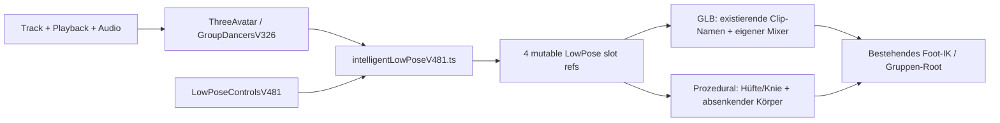

# Sonic Display V481 – Intelligent Stage Formation 2.0 + Low Pose Choreography

**Basis:** vollständiger Projektstand V480. **Ziel:** die automatische Bühne mit drei oder vier Avataren kann bei Rap-Versen, Hooks und starken Hardstyle-/Hardtekk-Momenten kontrollierte tiefe Posen einsetzen, ohne Singer-Credits als echte Vocal-Zeitstempel zu behandeln.

## Sichtbares Verhalten

- **Rap-Verse:** bis zu zwei Begleit-Avatare wechseln deterministisch zwischen `crouch`, `kneel` (wenn ein Clip existiert) und `rap-lean`. Der Bühnen-Lead bleibt aufrecht; die Rollenpositionen aus V326/V442 bleiben unverändert.
- **Hardstyle/Hardtekk:** bei hinreichend kräftiger Kick-Signalstärke kann `low-bounce` eingeplant werden. Ein Drop mit passendem Audioakzent und genügend Energie kann alle drei oder vier Tänzer gemeinsam absenken, sofern die Einstellung **Gemeinsame Hocke bei Drops** eingeschaltet ist.
- **Aufrichten:** der vorhandene Animation-Mixer blendet erkannte GLB-Clips zurück zur bisherigen Tanzanimation. Prozedurale Avatare bewegen Ober- und Unterschenkel über ein symmetrisches Zweiglied-System; das mathematische Kniewinkelziel kompensiert die Absenkung des Körperursprungs und behält die nominale Fußhöhe bei.
- **Ohne passenden GLB-Clip:** keine erfundenen Skelettrig-Kniebewegungen und kein Vertikalversatz des gesamten GLB-Skeletts. GLB-Hocken ist deshalb nur verfügbar, wenn das Modell bereits einen erkennbaren `squat`, `crouch` oder `kneel`-Clip enthält. Einige Charaktere zeigen ohne entsprechende Motion keinen Low-Pose-Effekt.

## Bedienung

Im vorhandenen **Advanced Multi-Avatar Stage Director (V326)** gibt es **V481 · Hocke & Low-Pose-Choreografie** mit:

1. Schalter für automatische Low Poses (Standard ein bei Auto-Multi-Artist-Show).
2. Intensität `subtle`, `medium`, `strong` (Standard `medium`).
3. Maximal gleichzeitig beteiligte Avatare, 1–4 (Standard 2). **Gemeinsame, ausdrücklich erlaubte Drops** überschreiben dieses normale Limit und verwenden die ganze Gruppe.
4. Aktivierung/Deaktivierung gemeinsamer Drop-Hocken.

Einstellungen werden lokal in `localStorage` unter `sonic-low-pose-v481` gespeichert. Es werden keine Song- oder Audioprofile hochgeladen. Der eigentliche Gruppenmodus muss durch V442 automatisch aktiv sein; **manuell geschriebene V326-/V325-Gruppen-Skripte werden nicht durch V481 verändert**. Der V326-Dialog dient auch zur Einstellung der automatischen Pose-Policy.

## Technischer Datenfluss



- `components/visualizer/intelligentLowPoseV481.ts`: reine, deterministische Planungsfunktion, Gating, Clip-Suche und normalisierte Einstellungen; niemals `Date.now`, `Math.random`, Timer oder Netzwerk.
- `components/visualizer/LowPoseControlsV481.tsx`: UI für Opt-in und Grenzwerte, unter dem bestehenden `components/visualizer/MultiAvatarStageStudioV326.tsx`.
- `components/visualizer/ThreeAvatar.tsx`: stellt **pro Tänzer** eine mutierbare Pose-Ref über einen React Context bereit, ohne jede Framezeit an React-State zu übertragen. Der GLB-Clipname wird nur bei Posewechsel als React-State gesetzt; die existierende Mixer-Überblendung und Foot-IK werden weiterverwendet. Prozedurale Avatare erhalten zwei kleine Bein-Ketten mit Kniegelenken.
- Kein neues Audio-, Motion-Download- oder Performance-Sampling. Die vorhandene Qualitätsstufe (`high/balanced/low`) begrenzt die Anzahl und Amplitude der automatisch angeregten Tiefposen.

## Schutzregeln und Grenzen

- Nur im **automatischen V442-Gruppenmodus** mit drei oder vier Avataren. Manuelle V326-Formationen, V325-Timelines, Sänger-/Duett-Zuordnungen, explizite Choreografie, Pause, `reducedMotion` und Lyrics-Vordergrund sperren V481.
- Kein Drop wird allein aus Spotify-Artist-Credits behauptet. Für einen synchronen Drop sind ein passender Songabschnitt und vorhandene Kick-/Beat-Energie nötig; diese Signale können mikrofonbasiert oder geschätzt sein.
- GLB-Clips enthalten ihre eigenen Keyframes. Ihre Fußkontakte und Model-Retargeting-Qualität hängen von den eingesetzten Dateien ab; die vorhandene Foot-IK kann sie unterstützen, garantiert aber ohne Echtgerätetest **keine perfekte Bodenfreiheit**.
- Prozedurale Hocke ist sichtbar und geometrisch abgestimmt, aber keine Kollisionssimulation. Für echte tiefe Kniefälle und Halbknien sind gute GLB-Motions notwendig. Maximale GLB-Clipqualität nicht durch die Software erzwingen.
- Der optische Status ist nicht als verifizierter Gesang oder echte Phonemerkennung zu interpretieren.

## Prüfung

```powershell
npm run test:v481
npm run test:v481:types
npm run check:architecture
npm run check:syntax
npm run build
```

`tests/v481-intelligent-low-pose-regression.cjs` testet 3/4-Avatar-Planung, manuelle/pausierte/sichere Modi, Gruppendrops, verschiedene Intensitäten, Clip-Erkennung, reproduzierbares Zurückspringen im Track, deterministischen simulierten 30-Minuten-Lauf und die Renderer-Verdrahtung. `tests/tsconfig.v481-core.json` prüft die reine Policy ohne Next.js. **Ein vollständiger Next.js-Build, visuelles GLB-Knieverhalten und die Fußkontakte auf echter Raspberry-Pi-Hardware benötigen installierte App-Abhängigkeiten und einen echten Funktionstest.**
